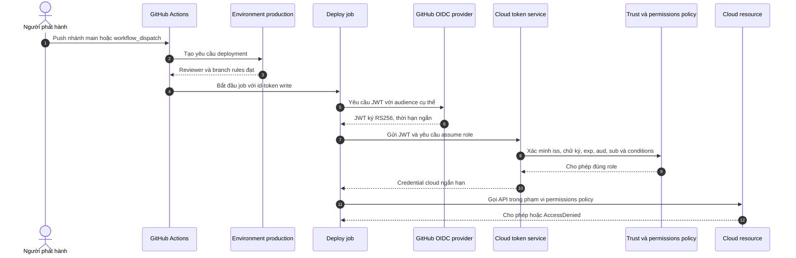
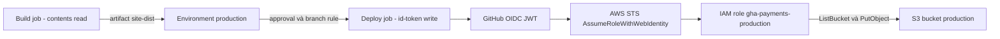

<Callout type="info" title="Kết quả sau bài học">
  Bạn sẽ hiểu GitHub ký danh tính của một job như thế nào, thiết kế `sub` và `aud` để cloud chỉ tin đúng workflow, triển khai AWS không cần access key dài hạn, rồi kiểm chứng và audit toàn bộ đường đi của credential.
</Callout>

## Mục lục

- [OIDC giải quyết bài toán gì](#oidc-giải-quyết-bài-toán-gì)
  - [Từ access key dài hạn đến credential ngắn hạn](#từ-access-key-dài-hạn-đến-credential-ngắn-hạn)
  - [OIDC không loại bỏ authorization](#oidc-không-loại-bỏ-authorization)
- [Actors và trust flow](#actors-và-trust-flow)
  - [Các actor](#các-actor)
  - [Luồng trao đổi token](#luồng-trao-đổi-token)
  - [Ranh giới tin cậy](#ranh-giới-tin-cậy)
- [Đọc JWT claims](#đọc-jwt-claims)
  - [Các claim quan trọng](#các-claim-quan-trọng)
  - [Subject mặc định và subject bất biến](#subject-mặc-định-và-subject-bất-biến)
  - [Reusable workflows](#reusable-workflows)
- [Thiết kế trust chặt](#thiết-kế-trust-chặt)
  - [Subject và audience](#subject-và-audience)
  - [Environment protection](#environment-protection)
  - [Quyền workflow tối thiểu](#quyền-workflow-tối-thiểu)
  - [Wildcard và các anti-pattern](#wildcard-và-các-anti-pattern)
- [Triển khai AWS hoàn chỉnh](#triển-khai-aws-hoàn-chỉnh)
  - [Kiến trúc ví dụ](#kiến-trúc-ví-dụ)
  - [Chuẩn bị environment và biến](#chuẩn-bị-environment-và-biến)
  - [Tạo OIDC provider](#tạo-oidc-provider)
  - [Trust policy an toàn](#trust-policy-an-toàn)
  - [Permissions policy cho role](#permissions-policy-cho-role)
  - [Workflow build và deploy](#workflow-build-và-deploy)
  - [Giải thích workflow](#giải-thích-workflow)
- [Pattern cho Azure và Google Cloud](#pattern-cho-azure-và-google-cloud)
  - [Azure](#azure)
  - [Google Cloud](#google-cloud)
- [Inspect claims an toàn](#inspect-claims-an-toàn)
  - [Workflow inspection không dùng third-party action](#workflow-inspection-không-dùng-third-party-action)
  - [Cách đọc kết quả](#cách-đọc-kết-quả)
- [Audit và ứng phó sự cố](#audit-và-ứng-phó-sự-cố)
  - [Audit liên kết GitHub với cloud](#audit-liên-kết-github-với-cloud)
  - [Rotation và bảo trì](#rotation-và-bảo-trì)
  - [Quy trình incident](#quy-trình-incident)
- [Threat model](#threat-model)
  - [Ma trận đe dọa](#ma-trận-đe-dọa)
  - [Rủi ro còn lại](#rủi-ro-còn-lại)
- [Bài thực hành](#bài-thực-hành)
  - [Chuẩn bị](#chuẩn-bị)
  - [Các bước](#các-bước)
  - [Kiểm thử negative path](#kiểm-thử-negative-path)
  - [Tiêu chí hoàn thành](#tiêu-chí-hoàn-thành)
- [Best practices](#best-practices)
- [Troubleshooting](#troubleshooting)
- [Tài liệu chính thức](#tài-liệu-chính-thức)
- [Các bài liên quan](#các-bài-liên-quan)

## OIDC giải quyết bài toán gì

**OpenID Connect**, viết tắt là **OIDC**, là lớp định danh xây trên OAuth 2.0. Trong GitHub Actions, OIDC cho phép một job chứng minh danh tính với cloud bằng **ID token** do GitHub ký. Cloud xác minh token rồi cấp credential tạm thời cho một role hoặc service principal đã định trước.

Trước OIDC, một workflow AWS thường giữ `AWS_ACCESS_KEY_ID` và `AWS_SECRET_ACCESS_KEY` trong GitHub Secrets. Access key vẫn hợp lệ ngoài workflow cho đến khi bị vô hiệu hóa. Nếu key bị lộ qua log, action độc hại, artifact hoặc runner bị chiếm quyền, kẻ tấn công có thể dùng lại key trong một khoảng thời gian dài.

### Từ access key dài hạn đến credential ngắn hạn

OIDC thay đổi vòng đời credential:

| Thuộc tính | Access key dài hạn | OIDC federation |
|---|---|---|
| Nơi tạo credential gốc | Cloud tạo key tĩnh | GitHub tạo JWT riêng cho job |
| Dữ liệu lưu trong GitHub | Secret có giá trị xác thực lâu dài | Không cần cloud access key |
| Cách cloud nhận diện caller | Ai có key đều là cùng một identity | Claim mô tả repository, ref, environment và workflow |
| Hết hạn | Phải xoay hoặc thu hồi thủ công | Credential cloud tự hết hạn sau phiên ngắn |
| Giới hạn nguồn gọi | Khó gắn key với một workflow cụ thể | Trust policy lọc `iss`, `aud`, `sub` và claim bổ sung |
| Blast radius khi lộ | Có thể kéo dài tới lúc phát hiện và rotate | Bị giới hạn bởi thời hạn phiên và quyền của role |

**Credential ngắn hạn** là credential tự hết hạn, thường gồm access token hoặc access key, secret key và session token. Với AWS STS, phiên `AssumeRoleWithWebIdentity` mặc định kéo dài một giờ; có thể yêu cầu từ 15 phút tới maximum session duration của role. Ví dụ trong bài đặt 15 phút vì thao tác upload ngắn.

OIDC giảm ba gánh nặng cùng lúc:

- không sao chép một cloud secret sang GitHub;
- không phải lên lịch rotate access key cho từng repository;
- có thể thu hẹp trust theo danh tính thực tế của job thay vì theo người đang giữ key.

<Callout type="warn" title="Ngắn hạn không có nghĩa là vô hại">
  Credential tạm thời vẫn là credential thật trong thời gian còn hiệu lực. Một action độc hại chạy trong job có `id-token: write` có thể tự yêu cầu JWT. Sau khi cloud cấp phiên, quyền của phiên do role cloud quyết định. Vì vậy phải đồng thời bảo vệ workflow, runner, trust policy và permissions policy.
</Callout>

### OIDC không loại bỏ authorization

**Authentication** trả lời “job này là ai?”. OIDC JWT cung cấp bằng chứng cho câu hỏi đó. **Authorization** trả lời “identity này được làm gì?”. IAM role, Azure RBAC hoặc Google Cloud IAM mới quyết định quyền trên tài nguyên.

Điểm thường bị hiểu sai là:

```yaml
permissions:
  id-token: write
```

`id-token: write` chỉ cho phép job yêu cầu OIDC JWT từ GitHub. Nó **không** cấp quyền ghi repository, không tự cho phép ghi S3, không trao quyền Azure Contributor và không cấp role Google Cloud. Job chỉ có quyền cloud sau khi:

1. cloud chấp nhận issuer, audience và các trust condition;
2. cloud phát credential tạm thời;
3. permissions policy của role cho phép đúng API và tài nguyên.

Ngược lại, một role quá mạnh vẫn nguy hiểm dù dùng OIDC. OIDC loại bỏ access key dài hạn; nó không sửa một policy có `Action: "*"` và `Resource: "*"`.

## Actors và trust flow

### Các actor

Một lần federation có sáu actor chính:

1. **Workflow job** chạy trên GitHub-hosted hoặc self-hosted runner. Đây là workload cần truy cập cloud.
2. **GitHub OIDC provider** tại `https://token.actions.githubusercontent.com`. Provider ký JWT bằng private key và công bố public key qua JWKS.
3. **GitHub environment** như `production`. Environment có thể chặn job bằng reviewer, branch policy, wait timer hoặc custom protection rule.
4. **Cloud identity provider configuration** lưu issuer và audience được phép. Trên AWS, đây là IAM OIDC identity provider.
5. **Token service** xác minh JWT rồi phát credential ngắn hạn. Trên AWS, đây là STS với `AssumeRoleWithWebIdentity`.
6. **Cloud role và tài nguyên** áp trust policy cùng permissions policy. Ví dụ role chỉ được `s3:PutObject` vào một bucket.

Reviewer environment không ký JWT và không cấp quyền cloud trực tiếp. Reviewer chỉ cho job qua cổng. Khi job bắt đầu, action đăng nhập mới yêu cầu JWT và đổi token với cloud.

### Luồng trao đổi token



JWT là **bearer token**: ai có token hợp lệ đều có thể trình token cho dịch vụ tin audience đó. Không ghi JWT vào log, artifact, output hoặc summary. Việc payload JWT có thể decode không làm token an toàn để công khai; chữ ký bảo vệ tính toàn vẹn chứ không mã hóa nội dung.

### Ranh giới tin cậy

Trust được thiết lập ở hai nơi độc lập:

- GitHub cho phép job yêu cầu token qua `permissions` và, nếu có, environment protection.
- Cloud chỉ nhận token khớp trust policy rồi giới hạn phiên bằng role policy.

Thiết kế an toàn phải **fail closed** ở cả hai phía. Nếu workflow quên `environment: production`, trust policy yêu cầu claim `environment=production` phải từ chối. Nếu trust policy vô tình rộng, branch protection và review workflow vẫn phải ngăn code không được duyệt đi vào deploy job.

## Đọc JWT claims

**JWT claim** là một trường mô tả identity hoặc ngữ cảnh của token. GitHub công bố danh sách claim được hỗ trợ tại discovery endpoint. Cloud phải luôn xác minh chữ ký, issuer, thời gian hiệu lực và audience trước khi dùng claim để authorize.

### Các claim quan trọng

| Claim | Ý nghĩa | Cách dùng trong trust |
|---|---|---|
| `iss` | Issuer phát token, luôn là `https://token.actions.githubusercontent.com` trên GitHub.com | Cloud đăng ký đúng OIDC provider và dùng JWKS của issuer |
| `sub` | Subject mô tả repository và context chính của job | Điều kiện bắt buộc, nên exact-match một repository cùng environment hoặc ref |
| `aud` | Audience mà token được phát cho | Khớp token exchange endpoint, ví dụ `sts.amazonaws.com` trên AWS |
| `repository` | Tên đầy đủ `OWNER/REPO` | Dễ đọc, nên kết hợp ID bất biến nếu cloud hỗ trợ |
| `repository_id` | ID số ổn định của repository | Chống rủi ro rename hoặc tái sử dụng tên |
| `repository_owner_id` | ID số ổn định của owner hoặc organization | Ràng buộc đúng chủ sở hữu dù tên đổi |
| `ref` | Git ref như `refs/heads/main` hoặc `refs/tags/v1.4.0` | Chỉ cho branch hoặc tag phát hành đã duyệt |
| `environment` | Tên environment mà job tham chiếu | Buộc job đi qua đúng cổng `production` |
| `actor` / `actor_id` | Tài khoản kích hoạt run và ID bất biến của tài khoản đó | Hữu ích cho audit; không nên là ranh giới chính vì actor hợp lệ vẫn có thể chạy code nguy hiểm |
| `workflow_ref` / `workflow_sha` | Workflow hiện tại cùng ref hoặc SHA | Phân biệt file workflow và phiên bản của caller |
| `job_workflow_ref` / `job_workflow_sha` | Reusable workflow được gọi cùng ref hoặc SHA | Buộc deployment đi qua workflow trung tâm đã duyệt |
| `run_id`, `run_attempt` | Workflow run và lần retry | Correlation cho audit, không phải định danh ổn định để viết trust lâu dài |
| `exp`, `iat`, `nbf`, `jti` | Thời điểm hết hạn, phát hành, bắt đầu hợp lệ và ID token | Token service tự kiểm tra replay window và thời gian hiệu lực |

Không phải cloud nào cũng cho viết condition trên mọi claim. Hãy đối chiếu danh sách claim mà token phát ra với danh sách condition key cloud thực sự hỗ trợ. Từ tháng 2 năm 2026, AWS STS hỗ trợ một tập claim GitHub bổ sung gồm `repository_id`, `repository_owner_id`, `repository`, `ref`, `environment` và `job_workflow_ref`; các claim này dùng được trong trust policy nhưng không được truyền tiếp vào role session.

### Subject mặc định và subject bất biến

`sub` mặc định thay đổi theo context của job:

| Context của job | `sub` dạng tên truyền thống |
|---|---|
| Có environment `production` | `repo:acme-example/payments-api:environment:production` |
| Pull request, không có environment | `repo:acme-example/payments-api:pull_request` |
| Push branch `main`, không có environment | `repo:acme-example/payments-api:ref:refs/heads/main` |
| Push tag `v1.4.0`, không có environment | `repo:acme-example/payments-api:ref:refs/tags/v1.4.0` |

Khi job khai báo environment, phần context trong `sub` là `environment:...`, không còn là `ref:...`. Claim `ref` riêng vẫn có mặt. Do đó trust production nên kiểm tra cả environment và branch khi cloud hỗ trợ claim bổ sung, đồng thời bật deployment branch policy ở GitHub.

GitHub.com đã đưa vào **immutable subject**, tức subject bất biến có owner ID và repository ID:

```text
repo:acme-example@12345678/payments-api@87654321:environment:production
```

Repository tạo từ ngày 15 tháng 7 năm 2026 dùng dạng này mặc định. Repository cũ giữ dạng tên nếu chưa opt in; rename hoặc transfer sau mốc đó cũng chuyển sang dạng bất biến theo tài liệu GitHub. GitHub Enterprise Server chưa hỗ trợ immutable subject này.

<Callout type="warn" title="Không đoán định dạng sub">
  Trust policy dùng subject tên cũ sẽ từ chối token dạng bất biến. Chiều ngược lại cũng vậy. Hãy inspect claim thực tế trong repository, kiểm tra OIDC customization qua REST API, rồi cập nhật cloud trust trước khi đổi template hoặc opt in immutable subject.
</Callout>

Organization có thể tùy biến toàn bộ `sub` bằng `include_claim_keys`, ví dụ gồm `repo`, `context` và `job_workflow_ref`. Tùy biến làm thay đổi chuỗi `sub`, vì vậy phải triển khai trust condition tương ứng ở cloud **trước** khi bật template mới ở GitHub.

### Reusable workflows

**Reusable workflow** là workflow có trigger `workflow_call` và được workflow khác gọi lại. Khi deploy nằm trong reusable workflow:

- `repository`, `ref`, `workflow_ref` và các claim caller vẫn mô tả repository gọi;
- `job_workflow_ref` mô tả file reusable workflow được chạy;
- `job_workflow_sha` cho biết commit cụ thể chứa reusable workflow đó.

Ví dụ:

```text
job_workflow_ref=acme-example/platform-automation/.github/workflows/deploy-aws.yml@refs/heads/main
```

Để dùng reusable workflow làm policy boundary:

- pin caller tới full commit SHA của reusable workflow;
- condition cloud phải exact-match `job_workflow_ref` hoặc đưa claim này vào custom `sub`;
- vẫn lọc repository caller, environment và ref;
- không dùng `@*` cho production nếu mục tiêu là buộc đúng một workflow bất biến.

Trong reusable workflow cùng owner hoặc organization, token được tạo trong context của caller. Với reusable workflow ngoài organization hoặc enterprise, caller phải cấp `id-token: write` rõ ràng. Quyền của called workflow không thể tự nâng cao vượt quá quyền caller đã cấp.

## Thiết kế trust chặt

### Subject và audience

Một trust tốt trả lời đồng thời bốn câu hỏi:

1. Token do **issuer nào** phát?
2. Token dành cho **token exchange service nào**?
3. Token đại diện cho **repository và context nào**?
4. Sau khi đổi token, role được làm gì trên **tài nguyên nào**?

Audience thường dùng theo provider:

| Provider | Audience phổ biến | Ghi chú |
|---|---|---|
| AWS commercial partition | `sts.amazonaws.com` | Mặc định của `aws-actions/configure-aws-credentials` |
| Microsoft Entra public cloud | `api://AzureADTokenExchange` | Mặc định của `azure/login` |
| Google Cloud Workload Identity Federation | Full provider resource name | `google-github-actions/auth` mặc định dùng provider làm audience |

Audience không thay thế subject. `sts.amazonaws.com` được nhiều repository trên toàn thế giới dùng. Trust chỉ kiểm tra audience mà không ràng buộc repository sẽ mở cửa quá rộng.

Nguyên tắc thiết kế:

- dùng `StringEquals` hoặc phép so sánh exact nếu biết đầy đủ giá trị;
- chọn một role riêng cho mỗi environment hoặc workload nhạy cảm;
- dùng ID bất biến bên cạnh tên dễ đọc;
- lọc `ref` chính xác, ví dụ `refs/heads/main`;
- nếu dùng tag, giới hạn pattern phát hành và bảo vệ quyền tạo tag;
- với reusable workflow, condition đúng file và ref hoặc SHA của workflow trung tâm;
- chỉ dùng custom audience khi cả action và cloud provider đều được cấu hình giống nhau.

### Environment protection

Environment là lớp bảo vệ rất phù hợp cho OIDC production vì nó vừa tạo claim `environment`, vừa chặn job trước khi job có thể yêu cầu JWT.

Cấu hình đề xuất cho `production`:

- required reviewers độc lập với người kích hoạt run;
- bật **Prevent self-review**;
- chỉ cho deployment từ branch `main` hoặc release tag đã bảo vệ;
- tắt admin bypass nếu quy trình không có break-glass được audit;
- thêm custom protection rule nếu phải kiểm tra change ticket hoặc health signal;
- bảo vệ tên environment và review mọi thay đổi trong `.github/workflows/**`.

<Callout type="error" title="Sai tên environment tạo ranh giới khác">
  `production` và `prodution` là hai environment khác nhau. Workflow tham chiếu một tên chưa tồn tại có thể làm GitHub tạo environment không có protection rule. Cloud trust phải exact-match `environment=production`, còn ruleset và CODEOWNERS phải bảo vệ thay đổi workflow.
</Callout>

Environment protection không thay trust condition. Nếu role chỉ lọc repository, bất kỳ workflow nào trong repository có `id-token: write` vẫn có thể thử assume role. Hãy yêu cầu `sub` production và claim `environment` ở cloud.

### Quyền workflow tối thiểu

Đặt mặc định workflow thành không có quyền rồi mở đúng job:

```yaml
permissions: {}

jobs:
  build:
    permissions:
      contents: read

  deploy:
    permissions:
      id-token: write
```

Job deploy trong ví dụ không checkout source và không cần `contents: read`. Nó chỉ tải artifact từ job trước rồi đổi OIDC token. Việc tách job tạo hai ranh giới:

- code build, package manager và build script không chạy trong job có quyền mint OIDC token;
- environment approval diễn ra trước khi deploy job bắt đầu.

Mọi step trong job có `id-token: write` đều có thể truy cập biến `ACTIONS_ID_TOKEN_REQUEST_URL` và `ACTIONS_ID_TOKEN_REQUEST_TOKEN`. Vì vậy job deploy chỉ nên chứa action đã review, pin full commit SHA và command tối thiểu. Không chạy test, `npm install`, script từ pull request hoặc action không tin cậy trong job này.

### Wildcard và các anti-pattern

<Callout type="error" title="Không dùng wildcard trust quá rộng">
  Không dùng `repo:*`, `repo:acme-example/*`, `repo:acme-example/payments-api:*` hoặc chỉ kiểm tra `aud=sts.amazonaws.com` cho role production. Một wildcard sau repository có thể chấp nhận branch, pull request và environment ngoài dự kiến.
</Callout>

Các anti-pattern khác:

- trust `sub` theo organization nhưng role có quyền production toàn account;
- dùng `StringLike` khi `StringEquals` đủ dùng;
- dùng tên actor làm điều kiện chính thay vì repository, ref và environment;
- cấp `id-token: write` ở workflow level dù chỉ một job deploy cần;
- build lại source hoặc chạy package lifecycle script trong deploy job;
- dùng `pull_request_target`, checkout code pull request không tin cậy rồi yêu cầu OIDC;
- cho public repository chạy deploy trên self-hosted runner có network tới production;
- pin reusable workflow hoặc action bằng mutable branch như `@main`;
- tin payload JWT tự decode mà không xác minh chữ ký, `iss`, `aud`, `exp` và `nbf`;
- lưu JWT hoặc credential STS vào artifact để job khác dùng lại.

## Triển khai AWS hoàn chỉnh

Ví dụ triển khai một static site từ repository `acme-example/payments-api` lên bucket `acme-example-production-site` trong AWS account minh họa `111122223333`. Các tên và ID trong policy là dữ liệu minh họa không trao quyền vào hệ thống thật. Workflow không hardcode chúng; nó đọc GitHub environment variables để có thể dùng sau khi cấu hình.

### Kiến trúc ví dụ



Role có hai policy độc lập:

- **trust policy** cho biết GitHub identity nào được assume role;
- **permissions policy** cho biết role được gọi API AWS nào.

Một trust policy chặt không bù cho permissions policy rộng. Một permissions policy hẹp cũng không nên được dùng để biện minh cho trust wildcard.

### Chuẩn bị environment và biến

Tạo environment `production` tại **Settings → Environments**. Bật reviewer, prevent self-review và chỉ cho branch `main` deploy. Thêm bốn environment variables, không phải secrets:

| Variable | Giá trị minh họa | Mục đích |
|---|---|---|
| `AWS_ROLE_ARN` | `arn:aws:iam::111122223333:role/gha-payments-production` | Role mà action sẽ assume |
| `AWS_ACCOUNT_ID` | `111122223333` | Fail nếu STS trả credential từ account khác |
| `AWS_REGION` | `ap-southeast-1` | Region cho AWS SDK và CLI |
| `AWS_DEPLOY_BUCKET` | `acme-example-production-site` | Bucket đích |

Account ID, role ARN, region và bucket name không phải credential bí mật. Dùng environment variables giúp review cấu hình theo môi trường và tránh lặp YAML. Nếu chính sách nội bộ coi account topology là nhạy cảm, có thể lưu metadata ở secret, nhưng điều đó không biến các giá trị này thành yếu tố xác thực.

### Tạo OIDC provider

Trong mỗi AWS account chứa role, tạo IAM OIDC provider một lần:

```bash
aws iam create-open-id-connect-provider \
  --url https://token.actions.githubusercontent.com \
  --client-id-list sts.amazonaws.com
```

Cấu hình tương đương trên IAM console:

- Provider URL: `https://token.actions.githubusercontent.com`
- Audience: `sts.amazonaws.com`

AWS hiện xác minh TLS của JWKS endpoint bằng kho CA tin cậy và chỉ dùng thumbprint trong trường hợp fallback. Không hardcode public key ký JWT của GitHub. AWS tự đọc discovery document và JWKS để theo kịp key rotation.

OIDC provider và role tin provider phải nằm trong cùng AWS account. Nếu provider đã tồn tại, không tạo bản thứ hai; kiểm tra audience hiện có trước.

### Trust policy an toàn

Policy dưới đây dùng subject bất biến và các condition key GitHub mà AWS STS hỗ trợ từ năm 2026:

```json
{
  "Version": "2012-10-17",
  "Statement": [
    {
      "Sid": "GitHubOIDCProductionOnly",
      "Effect": "Allow",
      "Principal": {
        "Federated": "arn:aws:iam::111122223333:oidc-provider/token.actions.githubusercontent.com"
      },
      "Action": "sts:AssumeRoleWithWebIdentity",
      "Condition": {
        "StringEquals": {
          "token.actions.githubusercontent.com:aud": "sts.amazonaws.com",
          "token.actions.githubusercontent.com:sub": "repo:acme-example@12345678/payments-api@87654321:environment:production",
          "token.actions.githubusercontent.com:repository": "acme-example/payments-api",
          "token.actions.githubusercontent.com:repository_id": "87654321",
          "token.actions.githubusercontent.com:repository_owner_id": "12345678",
          "token.actions.githubusercontent.com:ref": "refs/heads/main",
          "token.actions.githubusercontent.com:environment": "production"
        }
      }
    }
  ]
}
```

Trước khi áp dụng, lấy `sub`, `repository_id` và `repository_owner_id` thật bằng workflow inspection ở phần sau. Với repository cũ còn dùng subject theo tên, chỉ thay condition `sub` bằng dạng thực tế sau:

```text
repo:acme-example/payments-api:environment:production
```

Vẫn giữ các condition ID bất biến nếu AWS partition và region đang dùng hỗ trợ chúng. AWS Commercial Regions đã có tính năng này; với partition đặc biệt, đối chiếu tài liệu STS hiện hành và audience tương ứng.

Tại sao policy kiểm tra nhiều trường dù `sub` đã chứa repository và environment?

- `repository_id` và `repository_owner_id` chống rename, transfer và tái sử dụng tên;
- `repository` giúp audit policy dễ đọc;
- `ref` buộc đúng branch dù subject environment không chứa branch;
- `environment` làm ý định rõ ràng và fail nếu job bỏ khai báo environment;
- `aud` ngăn token dành cho dịch vụ khác được dùng với STS.

Nếu deploy qua reusable workflow, thêm exact condition sau và pin caller tới commit SHA của workflow trung tâm:

```json
{
  "Condition": {
    "StringEquals": {
      "token.actions.githubusercontent.com:job_workflow_ref": "acme-example/platform-automation/.github/workflows/deploy-aws.yml@refs/heads/main"
    }
  }
}
```

Tốt hơn nữa, khi quy trình cho phép, exact-match `job_workflow_ref` dùng full commit SHA thay cho `refs/heads/main`. Không thêm condition này vào workflow standalone vì claim không có giá trị reusable workflow phù hợp và request sẽ bị từ chối.

### Permissions policy cho role

Role ví dụ chỉ liệt kê bucket và upload object. Nó không được xóa object, đọc secret, quản trị IAM hoặc truy cập bucket khác:

```json
{
  "Version": "2012-10-17",
  "Statement": [
    {
      "Sid": "ListDeploymentBucket",
      "Effect": "Allow",
      "Action": "s3:ListBucket",
      "Resource": "arn:aws:s3:::acme-example-production-site"
    },
    {
      "Sid": "UploadStaticSite",
      "Effect": "Allow",
      "Action": "s3:PutObject",
      "Resource": "arn:aws:s3:::acme-example-production-site/*"
    }
  ]
}
```

Nếu bucket dùng customer-managed KMS key, thêm đúng quyền KMS trên đúng key và ràng buộc encryption context. Nếu deploy cần `--delete`, thêm `s3:DeleteObject` có chủ đích; không mở `s3:*`. Nếu ứng dụng triển khai ECS, Lambda hoặc Kubernetes, tạo role riêng với action và resource tương ứng thay vì tái sử dụng role admin.

Đặt maximum session duration của role theo nhu cầu thực tế. Workflow yêu cầu 900 giây. Session policy trong action có thể thu hẹp thêm quyền, nhưng không thể cấp quyền vượt quá role permissions policy.

### Workflow build và deploy

Lưu workflow sau tại `.github/workflows/deploy-aws.yml`. Các action được pin tới full commit SHA đã đối chiếu với release hiện hành năm 2026; comment giữ version dễ cập nhật bằng Dependabot.

```yaml
name: Deploy static site to AWS with OIDC

on:
  push:
    branches:
      - main
  workflow_dispatch:

permissions: {}

concurrency:
  group: deploy-aws-production
  cancel-in-progress: false

jobs:
  build:
    name: Build immutable artifact
    runs-on: ubuntu-latest
    permissions:
      contents: read
    steps:
      - name: Checkout source
        uses: actions/checkout@de0fac2e4500dabe0009e67214ff5f5447ce83dd # v6.0.2

      - name: Set up Node.js
        uses: actions/setup-node@820762786026740c76f36085b0efc47a31fe5020 # v7.0.0
        with:
          node-version: 24

      - name: Install and build
        run: |
          npm ci
          npm run build

      - name: Upload deployment artifact
        uses: actions/upload-artifact@043fb46d1a93c77aae656e7c1c64a875d1fc6a0a # v7.0.1
        with:
          name: site-dist-${{ github.sha }}
          path: dist/
          if-no-files-found: error
          retention-days: 1

  deploy:
    name: Deploy production
    needs: build
    if: github.ref == 'refs/heads/main'
    runs-on: ubuntu-latest
    environment: production
    permissions:
      id-token: write
    steps:
      - name: Validate non-secret configuration
        shell: bash
        env:
          AWS_ROLE_ARN: ${{ vars.AWS_ROLE_ARN }}
          AWS_ACCOUNT_ID: ${{ vars.AWS_ACCOUNT_ID }}
          AWS_REGION: ${{ vars.AWS_REGION }}
          AWS_DEPLOY_BUCKET: ${{ vars.AWS_DEPLOY_BUCKET }}
        run: |
          set -euo pipefail
          test -n "$AWS_ROLE_ARN"
          test -n "$AWS_ACCOUNT_ID"
          test -n "$AWS_REGION"
          test -n "$AWS_DEPLOY_BUCKET"

      - name: Download exact build artifact
        uses: actions/download-artifact@3e5f45b2cfb9172054b4087a40e8e0b5a5461e7c # v8.0.1
        with:
          name: site-dist-${{ github.sha }}
          path: dist/

      - name: Configure short-lived AWS credentials
        uses: aws-actions/configure-aws-credentials@e6de054238d6b7531b4efff3b6587d9aade6a06c # v6.2.3
        with:
          role-to-assume: ${{ vars.AWS_ROLE_ARN }}
          aws-region: ${{ vars.AWS_REGION }}
          allowed-account-ids: ${{ vars.AWS_ACCOUNT_ID }}
          role-duration-seconds: 900
          role-session-name: gha-${{ github.run_id }}-${{ github.run_attempt }}
          mask-aws-account-id: true

      - name: Verify assumed identity
        run: aws sts get-caller-identity

      - name: Upload static site
        env:
          AWS_DEPLOY_BUCKET: ${{ vars.AWS_DEPLOY_BUCKET }}
        run: |
          aws s3 sync ./dist "s3://${AWS_DEPLOY_BUCKET}/" --only-show-errors
```

`workflow_dispatch` vẫn chỉ deploy khi run dùng ref `main`, vì job có `if` và AWS trust cũng exact-match `refs/heads/main`. Environment branch rule tạo lớp kiểm tra thứ ba.

Nếu project không dùng Node.js hoặc output không phải `dist/`, thay riêng build job và artifact path. Không chuyển lệnh build sang deploy job.

### Giải thích workflow

Workflow áp defense in depth theo thứ tự:

1. `permissions: {}` đóng mọi scope mặc định.
2. Build job chỉ có `contents: read`; nó không thể yêu cầu OIDC token.
3. Artifact gắn với `${{ github.sha }}` nên deploy đúng output của commit đã build.
4. Deploy job chỉ chạy cho `refs/heads/main` và phải qua environment `production`.
5. Deploy job chỉ có `id-token: write`; nó không checkout hoặc chạy package script.
6. `allowed-account-ids` fail nếu action nhận credential từ nhầm AWS account.
7. Session chỉ 900 giây và session name chứa `run_id` cùng `run_attempt` để tra CloudTrail.
8. IAM trust lọc audience, subject, repository ID, owner ID, ref và environment.
9. IAM permissions chỉ cho list một bucket và put object vào bucket đó.

Action đăng nhập export `AWS_ACCESS_KEY_ID`, `AWS_SECRET_ACCESS_KEY` và `AWS_SESSION_TOKEN` tạm thời cho các step sau, rồi dọn biến ở post step. Không bật `output-credentials` và không truyền credential qua job output.

## Pattern cho Azure và Google Cloud

OIDC flow giống nhau giữa các cloud, nhưng tên identity, audience và ngôn ngữ trust condition khác nhau. Không sao chép nguyên trust policy AWS sang provider khác.

### Azure

Pattern Azure gồm:

1. tạo Microsoft Entra application hoặc user-assigned managed identity;
2. tạo **federated identity credential** với issuer GitHub;
3. đặt subject exact-match repository cùng environment hoặc ref;
4. đặt audience `api://AzureADTokenExchange` cho Azure public cloud;
5. gán Azure RBAC role tối thiểu ở scope resource group hoặc resource;
6. dùng `azure/login` trong job có `id-token: write`.

Federated credential production minh họa:

```text
issuer:   https://token.actions.githubusercontent.com
subject:  repo:acme-example@12345678/payments-api@87654321:environment:production
audience: api://AzureADTokenExchange
```

Login step:

```yaml
permissions:
  id-token: write

steps:
  - name: Login to Azure with OIDC
    uses: azure/login@532459ea530d8321f2fb9bb10d1e0bcf23869a43 # v3
    with:
      client-id: ${{ vars.AZURE_CLIENT_ID }}
      tenant-id: ${{ vars.AZURE_TENANT_ID }}
      subscription-id: ${{ vars.AZURE_SUBSCRIPTION_ID }}
```

Client ID, tenant ID và subscription ID là định danh, không phải client secret. Không tạo `AZURE_CREDENTIALS` chứa client secret khi OIDC đã hoạt động. Với sovereign cloud, audience và `environment` của action khác Azure public cloud; dùng đúng bảng giá trị trong tài liệu `azure/login`.

Xem [GitHub Docs: Configuring OpenID Connect in Azure](https://docs.github.com/en/actions/how-tos/security-for-github-actions/security-hardening-your-deployments/configuring-openid-connect-in-azure) và [Microsoft Learn: Use Azure Login with OIDC](https://learn.microsoft.com/en-us/azure/developer/github/connect-from-azure-openid-connect).

### Google Cloud

Pattern Google Cloud dùng **Workload Identity Pool** và **Workload Identity Provider**:

1. issuer là GitHub OIDC provider;
2. map `google.subject=assertion.sub`;
3. map mọi claim sẽ dùng, ví dụ `attribute.repository_id=assertion.repository_id` và `attribute.ref=assertion.ref`;
4. đặt attribute condition exact theo organization, repository ID, ref và environment;
5. cấp quyền trực tiếp cho federated principal khi dịch vụ hỗ trợ, hoặc cho phép impersonate một service account chuyên dụng;
6. dùng `google-github-actions/auth` trong job có `id-token: write`.

Condition minh họa:

```text
assertion.repository_owner_id == '12345678' &&
assertion.repository_id == '87654321' &&
assertion.ref == 'refs/heads/main' &&
assertion.environment == 'production'
```

Các claim phải được map trước khi tham chiếu bằng custom attribute hoặc IAM principal set. Không tạo provider chỉ có `google.subject=assertion.sub` rồi để mọi repository đi vào pool.

Auth step dùng service account impersonation. Nếu action tạo credentials file để các step sau sử dụng, đặt `actions/checkout` đã pin SHA trước step này theo hướng dẫn của action:

```yaml
permissions:
  contents: read
  id-token: write

steps:
  - name: Checkout source
    uses: actions/checkout@de0fac2e4500dabe0009e67214ff5f5447ce83dd # v6.0.2

  - name: Authenticate to Google Cloud
    uses: google-github-actions/auth@7c6bc770dae815cd3e89ee6cdf493a5fab2cc093 # v3
    with:
      workload_identity_provider: ${{ vars.GCP_WORKLOAD_IDENTITY_PROVIDER }}
      service_account: ${{ vars.GCP_SERVICE_ACCOUNT }}
```

Ưu tiên direct resource access nếu dịch vụ hỗ trợ federated principal. Nếu phải impersonate service account, dùng một service account cho mỗi workload và chỉ cấp `roles/iam.workloadIdentityUser` cho principal hoặc principal set chính xác.

Xem [Google Cloud: Workload Identity Federation với deployment pipelines](https://docs.cloud.google.com/iam/docs/workload-identity-federation-with-deployment-pipelines) và [GitHub Docs: Configuring OIDC in Google Cloud](https://docs.github.com/en/actions/how-tos/security-for-github-actions/security-hardening-your-deployments/configuring-openid-connect-in-google-cloud-platform).

## Inspect claims an toàn

Inspect claim trước khi viết trust policy giúp tránh đoán sai `sub`, immutable ID hoặc reusable workflow ref. Tuy nhiên không nên dùng decoder web công cộng, không copy JWT ra máy cá nhân và không in raw token vào log.

GitHub Docs có nhắc `github/actions-oidc-debugger`, nhưng repository action này đã archived. Workflow dưới đây không dùng third-party action. Nó yêu cầu token với audience `claim-inspection`, chỉ decode payload cục bộ và chỉ in allowlist claim.

### Workflow inspection không dùng third-party action

Tạo tạm `.github/workflows/inspect-oidc.yml` trên branch được kiểm soát:

```yaml
name: Inspect OIDC claims safely

on:
  workflow_dispatch:

permissions: {}

jobs:
  inspect:
    runs-on: ubuntu-latest
    environment: production
    permissions:
      id-token: write
    steps:
      - name: Request and print selected claims only
        shell: bash
        run: |
          set -euo pipefail

          response="$(curl --fail --silent --show-error \
            -H "Authorization: bearer ${ACTIONS_ID_TOKEN_REQUEST_TOKEN}" \
            "${ACTIONS_ID_TOKEN_REQUEST_URL}&audience=claim-inspection")"

          jwt="$(jq -er '.value' <<<"$response")"
          echo "::add-mask::$jwt"

          JWT="$jwt" python3 - <<'PY'
          import base64
          import json
          import os

          token = os.environ["JWT"]
          parts = token.split(".")
          if len(parts) != 3:
              raise SystemExit("JWT không có đúng ba phần")

          payload = parts[1]
          payload += "=" * (-len(payload) % 4)
          claims = json.loads(base64.urlsafe_b64decode(payload))

          allowed = [
              "iss", "sub", "aud", "repository", "repository_id",
              "repository_owner_id", "ref", "environment", "workflow_ref",
              "workflow_sha", "job_workflow_ref", "job_workflow_sha",
              "run_id", "run_attempt", "actor_id", "exp", "iat", "nbf"
          ]
          print(json.dumps(
              {key: claims[key] for key in allowed if key in claims},
              ensure_ascii=False,
              indent=2,
              sort_keys=True,
          ))
          PY
```

Audience `claim-inspection` không khớp trust AWS `sts.amazonaws.com`, Azure public default hay Google provider mặc định. Vì vậy token inspection không nên đổi được credential production. Đây là lớp giảm thiểu bổ sung; vẫn chỉ chạy workflow ở repository private hoặc repository có metadata được phép công khai.

Không bật shell tracing bằng `set -x`. Không upload output thành artifact. Sau khi chốt trust policy, xóa workflow inspection hoặc bỏ `id-token: write`; nếu metadata nhạy cảm, xóa workflow run log theo retention policy.

### Cách đọc kết quả

Kiểm tra tối thiểu:

- `iss` đúng tuyệt đối, không có slash cuối;
- `aud` là `claim-inspection` trong lần debug;
- `sub` là dạng tên hay dạng bất biến;
- `repository_id` và `repository_owner_id` khớp repository thật;
- `ref` đúng `refs/heads/main`;
- `environment` đúng chữ hoa, chữ thường và chính tả;
- `job_workflow_ref` chỉ xuất hiện phù hợp khi deploy qua reusable workflow;
- `exp`, `iat`, `nbf` tạo một cửa sổ hiệu lực ngắn.

Decoder trên chỉ đọc payload; nó **không xác minh chữ ký**. Việc này chấp nhận được để quan sát token vừa nhận trực tiếp từ GitHub trong job. Cloud token service vẫn phải tự xác minh JWT bằng discovery document và JWKS. Không dùng đoạn decoder này để xây authorization service.

Sau inspection, action cloud sẽ yêu cầu JWT mới với audience thật. Không lấy token audience debug rồi cố tái sử dụng cho AWS.

## Audit và ứng phó sự cố

### Audit liên kết GitHub với cloud

Một deployment phải truy vết được từ commit tới API cloud:

| Nguồn | Trường nên giữ | Câu hỏi trả lời |
|---|---|---|
| GitHub workflow run | `run_id`, `run_attempt`, actor, commit SHA, workflow ref | Run nào đã yêu cầu deployment? |
| GitHub deployment record | environment, approval, reviewer, trạng thái | Cổng production đã được ai thông qua? |
| AWS CloudTrail | `AssumeRoleWithWebIdentity`, subject, audience, role ARN, session name | Identity GitHub nào đã nhận phiên AWS? |
| API data event hoặc service log | assumed-role ARN, resource, action, timestamp | Phiên đó đã thay đổi tài nguyên nào? |
| IAM và GitHub audit log | thay đổi trust policy, role policy, environment, OIDC template | Ai đã thay đổi ranh giới tin cậy? |

Workflow đặt `role-session-name: gha-${{ github.run_id }}-${{ github.run_attempt }}`. Từ CloudTrail, tách run ID rồi mở:

```text
https://github.com/acme-example/payments-api/actions/runs/RUN_ID
```

`RUN_ID` ở đây là giá trị lấy từ log audit nội bộ, không phải secret. CloudTrail ghi subject của web identity token trong event `AssumeRoleWithWebIdentity`. GitHub subject không nên chứa PII tùy ý; dùng ID repository và workflow metadata do nền tảng cấp.

Bật trail hoặc CloudTrail Lake cho retention dài hơn Event history 90 ngày. Với S3, bật data events nếu cần biết từng object được ghi; management events một mình không ghi mọi data operation. Tạo alert cho:

- assume role ngoài branch, environment hoặc repository dự kiến;
- session duration bất thường;
- API nhạy cảm ngoài deployment window;
- sửa trust policy, permissions policy hoặc OIDC provider;
- deployment từ actor, runner group hoặc reusable workflow không dự kiến;
- nhiều lỗi `AssumeRoleWithWebIdentity` liên tiếp, có thể là dò trust condition.

### Rotation và bảo trì

OIDC bỏ công việc rotate access key, nhưng không bỏ bảo trì identity:

- GitHub xoay signing key và công bố qua JWKS; cloud provider phải tự lấy key mới;
- không pin `kid`, certificate thumbprint hoặc public key vào workflow;
- rà trust policy khi repository rename, transfer, opt in immutable subject hoặc đổi custom `sub` template;
- rà role permissions bằng access analyzer và CloudTrail usage;
- giảm maximum session duration nếu deployment thực tế ngắn hơn;
- cập nhật action pin qua pull request có review và release notes;
- xóa access key cũ sau khi OIDC đã qua negative test và có rollback plan;
- rotate mọi fallback hoặc break-glass credential còn tồn tại theo lịch riêng.

OIDC provider thường là tài nguyên dùng chung trong một AWS account. Không xóa provider để “rotate” định kỳ; thao tác đó làm hỏng mọi role đang tin provider. Rotation thực tế tập trung vào action pin, trust conditions, role permissions và credential fallback.

### Quy trình incident

Khi nghi workflow hoặc runner bị chiếm quyền:

1. **Contain:** disable workflow, chặn environment, bỏ `id-token: write` hoặc sửa trust policy để deny identity bị ảnh hưởng. Trên AWS, revoke active sessions của role theo cơ chế IAM và thêm deny khẩn cấp nếu cần chặn ngay API còn hiệu lực.
2. **Preserve evidence:** giữ workflow log, deployment approval, audit log và CloudTrail. Ghi `run_id`, commit SHA, action SHA, runner và thời gian.
3. **Scope:** tìm mọi lần `AssumeRoleWithWebIdentity` và API call từ assumed role trong cửa sổ sự cố. Kiểm tra role khác có cùng wildcard trust.
4. **Remove persistence:** sửa workflow, thay runner bị xâm nhập, xóa action hoặc reusable workflow độc hại, thu hẹp network và cloud policy.
5. **Rotate phần còn tĩnh:** thu hồi access key, client secret, deploy key hoặc break-glass secret có thể đã bị đọc. JWT cũ sẽ hết hạn nhưng secret dài hạn thì không.
6. **Recover:** khôi phục bằng action SHA đã review, trust exact-match và role mới hoặc policy mới nếu ranh giới cũ không còn đáng tin.
7. **Learn:** thêm negative test, detection và CODEOWNERS để cùng đường tấn công không tái diễn.

Nếu raw JWT bị in ra log, coi nó là bearer credential trong thời gian còn hiệu lực: hủy job, chặn role, xóa log khi phù hợp và kiểm tra token exchange log. Không chỉ dựa vào việc GitHub masking có thể che token sau đó.

## Threat model

### Ma trận đe dọa

| Đe dọa | Đường tấn công | Kiểm soát phòng ngừa | Tín hiệu phát hiện |
|---|---|---|---|
| Repository ngoài tổ chức assume role | Trust chỉ kiểm tra `aud` hoặc dùng `repo:*` | Exact `sub`, repository ID, owner ID và environment | CloudTrail có subject hoặc repository lạ |
| Feature branch lấy quyền production | Wildcard `repo:OWNER/REPO:*` chấp nhận mọi context | Exact `ref`, environment branch rule và protected branch | Assume role từ ref khác `main` |
| Pull request không tin cậy lấy token | Privileged job checkout PR head, nhất là `pull_request_target` | Không cấp OIDC cho PR; tách build/deploy; không checkout untrusted code trong deploy job | OIDC request hoặc deploy gắn event PR |
| Action bị chiếm supply chain | Mutable tag bị trỏ sang code độc hại rồi yêu cầu JWT | Pin full SHA, review source, allow-list Actions | Action SHA mới, egress hoặc token exchange bất thường |
| Workflow bị sửa để bypass gate | Maintainer đổi environment hoặc thêm job OIDC | CODEOWNERS, ruleset, required review, trust exact ở cloud | Diff `.github/workflows/**`, environment mới |
| Reusable workflow bị thay | Caller dùng `@main`, cloud chỉ tin repository caller | Pin full SHA và condition `job_workflow_ref` | Claim reusable workflow hoặc SHA thay đổi |
| Token bị log và replay | Script in JWT hoặc bật `set -x` | Không in raw token, audience cụ thể, lifetime ngắn | Secret scanning, log chứa chuỗi JWT, exchange lặp |
| Role có blast radius lớn | Role cho `*` trên nhiều account hoặc resource | Role riêng, least privilege, session 15 phút | CloudTrail ghi API ngoài allowlist deployment |
| Rename hoặc namespace recycle | Trust chỉ dựa tên owner/repository cũ | Immutable `sub`, repository ID và owner ID | Name khác nhưng ID không khớp |
| Self-hosted runner bị bám trụ | Job trước cài persistence hoặc đọc credential job sau | Ephemeral JIT runner, runner group riêng, không chạy code public không tin cậy | Process, network hoặc filesystem tồn tại giữa job |
| Audience confusion | Một token dành cho dịch vụ A được dịch vụ B chấp nhận | Exact audience và provider configuration riêng | `aud` khác expected trong failed exchange |
| Environment typo | Workflow tạo environment mới không có reviewer | Exact claim `production`, typed input, review workflow | Environment mới và claim không khớp |

### Rủi ro còn lại

Ngay cả cấu hình tốt vẫn còn rủi ro:

- code hợp lệ trên `main` có thể chứa logic triển khai phá hoại;
- reviewer có thể phê duyệt nhầm hoặc tài khoản reviewer bị chiếm;
- action đã pin vẫn có thể chứa lỗ hổng ở chính commit đó;
- cloud service có thể không hỗ trợ condition trên mọi claim;
- credential 15 phút đủ để gây thiệt hại nếu role quá mạnh;
- self-hosted runner có thể bị chiếm ngoài GitHub Actions;
- OIDC không đảm bảo artifact được build từ source đã review nếu pipeline artifact có lỗ hổng.

Vì vậy production quan trọng nên bổ sung artifact attestation, ký và verify artifact, deployment canary, resource policy, network controls và giám sát cloud. OIDC là một lớp identity mạnh, không phải toàn bộ supply-chain security.

## Bài thực hành

### Chuẩn bị

Dùng repository private thử nghiệm và AWS sandbox account, không dùng production lần đầu. Cần:

- quyền admin repository để tạo environment;
- quyền IAM để tạo OIDC provider, role và policy;
- một project có `npm run build` tạo thư mục `dist/`;
- một S3 bucket sandbox không chứa dữ liệu quan trọng;
- CloudTrail Event history hoặc trail để xem STS event.

Trước khi bắt đầu, xác nhận không còn workflow PR nào có thể gọi role sandbox. Bucket sandbox vẫn phải có tên duy nhất toàn cầu và chặn public access trừ khi bài lab chủ đích cấu hình static hosting theo cơ chế an toàn riêng.

### Các bước

1. Tạo environment `production`. Bật required reviewer, prevent self-review và chỉ cho `main` deploy.
2. Thêm workflow inspection. Chạy thủ công trên `main`, approve environment rồi ghi lại `sub`, `repository_id`, `repository_owner_id`, `ref` và `environment`.
3. Tạo AWS OIDC provider với issuer GitHub và audience `sts.amazonaws.com`.
4. Tạo role `gha-payments-production`. Dùng trust policy exact-match theo claim thật, không dùng wildcard.
5. Gắn permissions policy chỉ cho `s3:ListBucket` và `s3:PutObject` trên bucket sandbox.
6. Đặt maximum session duration phù hợp. Ví dụ workflow yêu cầu 900 giây.
7. Thêm `AWS_ROLE_ARN`, `AWS_ACCOUNT_ID`, `AWS_REGION`, `AWS_DEPLOY_BUCKET` vào environment variables.
8. Commit workflow build và deploy. Yêu cầu review thay đổi workflow trước khi merge.
9. Push `main`, kiểm tra build hoàn tất trước khi production chờ approval, rồi approve deployment.
10. Xác nhận `aws sts get-caller-identity` trả đúng assumed role và object xuất hiện trong bucket.
11. Mở CloudTrail, tìm `AssumeRoleWithWebIdentity`, đối chiếu subject và session name với GitHub run.
12. Xóa workflow inspection hoặc bỏ quyền OIDC của nó sau khi policy đã ổn định.

### Kiểm thử negative path

Một federation chưa hoàn thành nếu mới thử đường thành công. Thực hiện từng test trong sandbox và kỳ vọng fail:

- chạy workflow từ feature branch: deploy job bị `if`, environment hoặc AWS `ref` condition chặn;
- đổi job sang environment `staging`: AWS từ chối vì `sub` và `environment` không khớp;
- đổi audience action khỏi `sts.amazonaws.com`: STS từ chối;
- tạm thay `repository_id` trong trust bằng ID không tồn tại: assume role thất bại;
- bỏ `id-token: write`: action báo không lấy được OIDC token;
- bỏ `s3:PutObject` nhưng giữ trust: assume role thành công, upload nhận `AccessDenied`;
- dùng repository sandbox khác cùng organization: trust từ chối;
- nếu có reusable workflow, thay ref hoặc file reusable: condition `job_workflow_ref` từ chối;
- thử environment typo: GitHub có thể tạo environment mới nhưng AWS vẫn từ chối.

Negative test phân biệt lỗi **authentication/trust** với lỗi **authorization**. Nếu assume role fail, xem claim và trust. Nếu `get-caller-identity` thành công nhưng S3 fail, xem permissions policy hoặc bucket policy.

### Tiêu chí hoàn thành

- [ ] GitHub không còn lưu AWS access key cho đường deploy này.
- [ ] Chỉ deploy job có `id-token: write`.
- [ ] Deploy job không checkout source và không chạy package script.
- [ ] Environment `production` có reviewer và branch policy.
- [ ] AWS trust exact-match audience, subject, repository ID, owner ID, ref và environment.
- [ ] Không có wildcard trust theo organization, repository hoặc context production.
- [ ] Role chỉ có API và resource cần thiết.
- [ ] Session duration không dài hơn deployment cần.
- [ ] Action và reusable workflow được pin full commit SHA.
- [ ] Mọi negative test quan trọng đều fail đúng lớp.
- [ ] CloudTrail event liên kết được với GitHub `run_id`.
- [ ] Access key cũ đã bị vô hiệu hóa và xóa sau thời gian quan sát.

## Best practices

1. **Tách build và deploy.** Chỉ deploy job sau environment gate mới có `id-token: write`.
2. **Exact-match trước, wildcard sau cùng.** Với production, gần như luôn biết repository, ref và environment cụ thể.
3. **Dùng identity bất biến.** Ưu tiên immutable `sub`, `repository_id`, `repository_owner_id`, `actor_id` và full action SHA.
4. **Kiểm tra audience cùng subject.** Audience công cộng như `sts.amazonaws.com` không đủ để định danh repository.
5. **Bảo vệ environment.** Required reviewer, prevent self-review và deployment branch policy bổ sung trust cloud.
6. **Giữ role nhỏ.** Một role cho một workload hoặc environment; không dùng role admin chung cho mọi pipeline.
7. **Rút ngắn phiên.** Chọn 15–60 phút theo thời lượng thực tế, không mặc định 12 giờ.
8. **Pin action và reusable workflow.** Dùng full commit SHA, review release notes và cập nhật qua pull request.
9. **Không chạy code không tin cậy trong job OIDC.** Tránh package install, PR head, artifact không xác minh và action chưa review.
10. **Audit hai phía.** Correlate GitHub run, deployment approval, STS exchange và cloud API activity.
11. **Inspect bằng audience vô hại.** Chỉ in allowlist claim; không in raw token và không dùng decoder web.
12. **Di trú có rollback.** Tạo trust OIDC, chạy positive cùng negative tests, theo dõi audit rồi mới xóa access key cũ.
13. **Bảo vệ OIDC configuration.** Audit thay đổi custom `sub`, immutable subject, cloud provider, role trust và permissions policy.
14. **Thiết kế incident trước.** Biết cách disable workflow, chặn role, revoke session và tìm mọi API call liên quan.

## Troubleshooting

| Triệu chứng | Nguyên nhân cần kiểm tra | Hướng xử lý |
|---|---|---|
| `ACTIONS_ID_TOKEN_REQUEST_URL` không tồn tại | Job thiếu `id-token: write`, permission đặt sai cấp hoặc caller reusable workflow không cấp quyền | Đặt `permissions: id-token: write` chỉ ở job yêu cầu token; kiểm tra quyền caller |
| `Not authorized to perform sts:AssumeRoleWithWebIdentity` | `sub`, `aud`, ref, environment, repository ID hoặc reusable workflow ref không khớp | Inspect claim thật với audience debug; so sánh từng `StringEquals`, chú ý immutable subject |
| `No OpenIDConnect provider found` | AWS account của role chưa có provider hoặc provider ở account khác | Tạo provider trong cùng account với role, đúng hostname không có path thừa |
| `Incorrect token audience` hoặc audience mismatch | IAM provider, trust policy và action dùng audience khác nhau | Với AWS commercial, đồng bộ `sts.amazonaws.com`; kiểm tra partition đặc biệt |
| `InvalidIdentityToken` | Issuer, chữ ký, discovery, JWKS, clock hoặc token format không hợp lệ | Không tự sửa token; retry giới hạn, kiểm tra network tới GitHub OIDC và cấu hình provider |
| `ExpiredToken` | JWT hoặc credential tạm đã hết hạn, job quá dài hoặc tái sử dụng output cũ | Yêu cầu token/credential gần bước deploy; không truyền token qua artifact hay job output |
| Assume role fail sau khi thêm `environment` | `sub` đổi từ context ref sang context environment | Cập nhật exact `sub`; giữ kiểm tra `ref` bằng claim riêng nếu cloud hỗ trợ |
| Policy tên cũ bỗng fail | Repository dùng immutable subject sau opt in, tạo mới, rename hoặc transfer | Inspect `sub`, cập nhật trust sang dạng có owner ID và repository ID |
| AWS báo condition key thiếu | Trust yêu cầu claim không có, ví dụ `job_workflow_ref` cho standalone workflow hoặc `environment` khi job không khai báo | Chỉ yêu cầu claim phù hợp; thêm environment hoặc dùng reusable workflow đúng thiết kế |
| `get-caller-identity` thành công nhưng S3 `AccessDenied` | Trust đã đạt nhưng role policy, bucket policy, KMS key policy hoặc SCP chặn | Kiểm tra authorization path; không nới trust policy để sửa lỗi resource permission |
| Nhận credential từ nhầm account | Role ARN hoặc variable environment sai | Dùng `allowed-account-ids`; sửa environment variable và audit cấu hình |
| Job đứng ở `Waiting` | Chờ environment reviewer, wait timer, custom rule hoặc concurrency | Mở deployment review; kiểm tra đúng environment và reviewer hợp lệ |
| `workflow_dispatch` từ branch khác không deploy | `github.ref` không phải `refs/heads/main` | Đây là hành vi an toàn của ví dụ; chọn ref `main` thay vì bỏ condition |
| Azure báo không có federated identity record khớp | Issuer, subject hoặc audience khác cấu hình Entra | So sánh exact ba trường; chú ý immutable subject và environment context |
| `azure/login` yêu cầu secret dù đã chọn OIDC | Workflow đang truyền `creds` hoặc thiếu `id-token: write` | Dùng `client-id`, `tenant-id`, `subscription-id`; bỏ client secret và `creds` |
| Google Cloud từ chối attribute condition | Claim chưa được map, expression sai hoặc repository/ref không khớp | Map claim trước, kiểm tra CEL condition và chờ cấu hình WIF propagate |
| Google auth thành công nhưng API bị từ chối | Federated principal hoặc service account thiếu IAM role trên resource | Sửa resource IAM hoặc service account role theo least privilege |
| Reusable workflow không lấy được token | Caller ngoài organization chưa cấp quyền hoặc permission bị giảm khi truyền qua call chain | Cấp `id-token: write` rõ ở caller; kiểm tra mọi cấp workflow không nâng quyền |
| Claim inspection làm lộ JWT | Workflow in raw response, dùng `set -x` hoặc upload artifact | Hủy job, chặn exchange, xóa log khi phù hợp, audit cloud và thay workflow bằng allowlist decoder |
| Self-hosted runner vẫn có credential sau job | Runner hoặc tool ghi credential xuống disk, cleanup bị bỏ qua | Dùng ephemeral runner, không bỏ cleanup, xóa workspace và điều tra persistence |
| YAML thêm `permissions` làm checkout lỗi 403 | Khi khai báo một permission, các permission không khai báo thành `none` | Thêm `contents: read` riêng cho build/checkout job, không thêm vào deploy nếu không cần |

## Tài liệu chính thức

- [GitHub Docs: OpenID Connect](https://docs.github.com/en/actions/concepts/security/openid-connect) — khái niệm, lợi ích và luồng federation.
- [GitHub Docs: OpenID Connect reference](https://docs.github.com/en/actions/reference/security/oidc) — claims, subject formats, immutable subject, custom claims và quyền workflow.
- [GitHub OIDC discovery document](https://token.actions.githubusercontent.com/.well-known/openid-configuration) — issuer, JWKS URI và `claims_supported` hiện hành.
- [GitHub Docs: Configuring OIDC in AWS](https://docs.github.com/en/actions/how-tos/security-for-github-actions/security-hardening-your-deployments/configuring-openid-connect-in-amazon-web-services) — provider, audience, trust và workflow AWS.
- [GitHub Docs: OIDC với reusable workflows](https://docs.github.com/en/actions/how-tos/security-for-github-actions/security-hardening-your-deployments/using-openid-connect-with-reusable-workflows) — `job_workflow_ref` và trust workflow trung tâm.
- [GitHub Docs: Managing environments](https://docs.github.com/en/actions/how-tos/deploy/configure-and-manage-deployments/manage-environments) — reviewers, branch policy và protection rules.
- [GitHub Docs: Secure use reference](https://docs.github.com/en/actions/reference/security/secure-use) — pin action SHA, least privilege và rủi ro untrusted code.
- [GitHub REST API: Actions OIDC](https://docs.github.com/en/rest/actions/oidc) — đọc và thay OIDC subject customization, immutable subject và custom properties.
- [AWS IAM: Create an OIDC identity provider](https://docs.aws.amazon.com/IAM/latest/UserGuide/id_roles_providers_create_oidc.html) — cấu hình provider và JWKS validation.
- [AWS IAM: Configure a role for GitHub OIDC](https://docs.aws.amazon.com/IAM/latest/UserGuide/id_roles_create_for-idp_oidc.html#idp_oidc_Create_GitHub) — yêu cầu `sub` và cảnh báo trust rộng.
- [AWS IAM: Condition keys for OIDC federation](https://docs.aws.amazon.com/IAM/latest/UserGuide/reference_policies_iam-condition-keys.html#condition-keys-wif) — condition key GitHub được AWS STS hỗ trợ.
- [AWS STS: AssumeRoleWithWebIdentity](https://docs.aws.amazon.com/STS/latest/APIReference/API_AssumeRoleWithWebIdentity.html) — lifetime, session policy, response và lỗi.
- [AWS announcement: STS validates provider-specific claims](https://aws.amazon.com/about-aws/whats-new/2026/01/aws-sts-supports-validation-identity-provider-claims/) — hỗ trợ claim GitHub bổ sung trong năm 2026.
- [AWS action: configure-aws-credentials](https://github.com/aws-actions/configure-aws-credentials) — inputs OIDC, session duration, account allowlist và release hiện hành.
- [Microsoft Learn: Azure Login với OIDC](https://learn.microsoft.com/en-us/azure/developer/github/connect-from-azure-openid-connect) — federated credential và workflow Azure.
- [Azure Login action](https://github.com/Azure/login) — audience, sovereign cloud và input hiện hành.
- [Google Cloud: Workload Identity Federation cho deployment pipelines](https://docs.cloud.google.com/iam/docs/workload-identity-federation-with-deployment-pipelines) — mappings, conditions và service account impersonation.
- [Google auth action](https://github.com/google-github-actions/auth) — direct federation, service account impersonation và workflow inputs.
- [AWS CloudTrail User Guide](https://docs.aws.amazon.com/awscloudtrail/latest/userguide/cloudtrail-user-guide.html) — management events, data events, trails và CloudTrail Lake.

## Các bài liên quan

<Cards>
  <Card
    title="GITHUB_TOKEN và permissions"
    href="/docs/bao-mat/01-github-token-permissions/"
    description="Thu hẹp quyền GitHub của từng job trước khi mở quyền OIDC."
  />
  <Card
    title="Quản lý secrets"
    href="/docs/bao-mat/02-secrets-management/"
    description="Xử lý credential fallback và xóa access key dài hạn sau khi di trú."
  />
  <Card
    title="Bảo mật third-party actions"
    href="/docs/bao-mat/04-third-party-actions/"
    description="Review và pin action có thể tiếp cận OIDC token hoặc cloud credential."
  />
  <Card
    title="Artifact attestations"
    href="/docs/bao-mat/07-artifact-attestations/"
    description="Bổ sung provenance và xác minh artifact trước deployment."
  />
</Cards>
