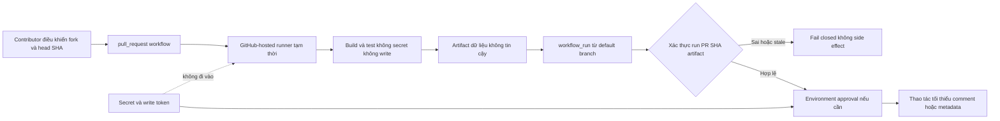

<Callout type="warn" title="Code từ fork là code không tin cậy">
  Một pull request có thể thay `Makefile`, script test, dependency, lifecycle hook và cả workflow. Nếu runner build hoặc test pull request, hãy giả định tác giả PR có khả năng thực thi lệnh tùy ý trong job đó. Mục tiêu không phải ngăn code chạy, mà là bảo đảm code ấy chạy **không có secret, không có quyền ghi và không chạm hạ tầng tin cậy**.
</Callout>

## Mục lục

- [Kết quả và phạm vi](#kết-quả-và-phạm-vi)
- [Ranh giới tin cậy của fork pull request](#ranh-giới-tin-cậy-của-fork-pull-request)
  - [Tài sản tác nhân và giả định](#tài-sản-tác-nhân-và-giả-định)
  - [Luồng dữ liệu qua ranh giới](#luồng-dữ-liệu-qua-ranh-giới)
  - [Các đường thực thi mã không tin cậy](#các-đường-thực-thi-mã-không-tin-cậy)
- [Chọn event và hiểu quyền hiệu lực](#chọn-event-và-hiểu-quyền-hiệu-lực)
  - [Hành vi của pull request](#hành-vi-của-pull-request)
  - [Approval cho contributor bên ngoài](#approval-cho-contributor-bên-ngoài)
  - [Rủi ro của pull request target](#rủi-ro-của-pull-request-target)
  - [Pull request do Dependabot tạo](#pull-request-do-dependabot-tạo)
  - [Ma trận quyết định](#ma-trận-quyết-định)
- [Pwn request và anti-pattern nguy hiểm](#pwn-request-và-anti-pattern-nguy-hiểm)
  - [Workflow không an toàn](#workflow-không-an-toàn)
  - [Vì sao các sửa chữa bề mặt không đủ](#vì-sao-các-sửa-chữa-bề-mặt-không-đủ)
- [Pattern một: CI không đặc quyền cho code từ fork](#pattern-một-ci-không-đặc-quyền-cho-code-từ-fork)
  - [Workflow kiểm thử an toàn](#workflow-kiểm-thử-an-toàn)
  - [Giới hạn blast radius của job test](#giới-hạn-blast-radius-của-job-test)
  - [Rủi ro trên self-hosted runner](#rủi-ro-trên-self-hosted-runner)
- [Pattern hai: pull request target chỉ xử lý metadata](#pattern-hai-pull-request-target-chỉ-xử-lý-metadata)
  - [Workflow metadata an toàn](#workflow-metadata-an-toàn)
  - [Khi nào vẫn không nên dùng](#khi-nào-vẫn-không-nên-dùng)
- [Pattern ba: tách build và follow-up bằng workflow run](#pattern-ba-tách-build-và-follow-up-bằng-workflow-run)
  - [Kiến trúc hai workflow](#kiến-trúc-hai-workflow)
  - [Hợp đồng artifact tối thiểu](#hợp-đồng-artifact-tối-thiểu)
  - [Workflow build không đặc quyền](#workflow-build-không-đặc-quyền)
  - [Workflow follow-up có validation](#workflow-follow-up-có-validation)
  - [Vì sao validation này cần thiết](#vì-sao-validation-này-cần-thiết)
  - [Điều không được chuyển qua artifact](#điều-không-được-chuyển-qua-artifact)
  - [Thêm environment approval](#thêm-environment-approval)
- [Audit và xác minh](#audit-và-xác-minh)
  - [Review tĩnh](#review-tĩnh)
  - [Kiểm tra settings](#kiểm-tra-settings)
  - [Bằng chứng runtime và ứng phó sự cố](#bằng-chứng-runtime-và-ứng-phó-sự-cố)
- [Bài thực hành](#bài-thực-hành)
  - [Chuẩn bị](#chuẩn-bị)
  - [Triển khai](#triển-khai)
  - [Kiểm thử đối kháng](#kiểm-thử-đối-kháng)
  - [Tiêu chí hoàn thành](#tiêu-chí-hoàn-thành)
- [Checklist production](#checklist-production)
- [Troubleshooting](#troubleshooting)
- [Tài liệu tham khảo chính thức](#tài-liệu-tham-khảo-chính-thức)
- [Các bài liên quan](#các-bài-liên-quan)

## Kết quả và phạm vi

Trang này tập trung vào pull request có **head repository** là một fork của repository đích. **Base repository** là repository nhận PR. **Head SHA** là commit cụ thể ở đầu nhánh của contributor. Head SHA bất biến, còn tên head branch là một ref có thể được contributor cập nhật.

Sau bài này, bạn có thể:

1. xác định nơi code từ fork đi qua trust boundary;
2. phân biệt chính xác `pull_request`, `pull_request_target` và `workflow_run`;
3. chạy build và test trong job không có đặc quyền;
4. dùng artifact như một giao thức dữ liệu không tin cậy giữa hai workflow;
5. xác thực run, PR, head SHA và artifact trước một thao tác có quyền ghi;
6. cấu hình approval cho contributor, environment và runner theo đúng mục đích;
7. audit repository để tìm mẫu **pwn request** — PR độc hại chiếm token, secret hoặc repository bằng cách khiến workflow đặc quyền chạy code của PR.

Các ví dụ dùng GitHub-hosted runner. Nếu tổ chức bắt buộc self-hosted runner, cần thêm một trust zone riêng, runner dùng một lần và network isolation; chỉ đổi `runs-on` là không đủ.

## Ranh giới tin cậy của fork pull request

### Tài sản tác nhân và giả định

Threat model bắt đầu bằng giả định mạnh nhưng thực tế: contributor điều khiển mọi byte trong commit của fork.

| Thành phần | Contributor có thể kiểm soát | Tài sản cần bảo vệ |
|---|---|---|
| Source và test | code ứng dụng, test mới, fixture, file cấu hình | source private, lịch sử Git, chất lượng required checks |
| Build system | `Makefile`, `package.json`, Gradle plugin, compiler flag | token, secret, artifact phát hành |
| Dependency | lockfile, package mới, install hook, container build context | credential registry, cache, mạng nội bộ |
| Workflow trong PR | file dưới `.github/workflows/**` ở merge commit của PR | quyền workflow follow-up và niềm tin của reviewer |
| Metadata | title, body, branch name, commit message | shell, template, API call của automation |
| Artifact và output | tên file, JSON, archive, coverage report | workspace của job đặc quyền, comment, deployment |
| Runner | process, filesystem, socket, endpoint mạng mà job nhìn thấy | runner của run sau, cloud metadata, dịch vụ nội bộ |

Tác nhân không chỉ là người gửi PR cố ý xấu. Một dependency bị compromise hoặc test vô tình in credential cũng tạo hậu quả tương tự. Thiết kế phải an toàn ngay cả khi code trong PR đạt arbitrary code execution trong job test.

### Luồng dữ liệu qua ranh giới



Ranh giới quan trọng nhất nằm giữa `D` và `F`. Workflow thứ hai có thể có write token hoặc secret dù workflow đầu không có. Vì vậy, artifact từ workflow đầu không trở thành tin cậy chỉ vì GitHub lưu nó. Nó vẫn là dữ liệu do code của contributor tạo ra.

### Các đường thực thi mã không tin cậy

Code độc hại không cần xuất hiện dưới dạng `curl evil.example`. Những lệnh bình thường sau đã có thể thực thi nội dung do PR kiểm soát:

- `npm ci`, vì package có `preinstall`, `install` hoặc `postinstall`;
- `npm test`, vì contributor sửa script trong `package.json` hoặc thêm test;
- `make test`, vì contributor sửa `Makefile`;
- `pip install .`, vì build backend và package metadata có thể chạy code;
- `gradle test`, Maven plugin, MSBuild target hoặc custom compiler plugin;
- `docker build .`, vì `Dockerfile`, build context và BuildKit feature đến từ PR;
- source generator, formatter, linter plugin hoặc test reporter từ repository;
- binary, script, symlink hoặc archive tải từ artifact của workflow không đặc quyền.

Nói ngắn gọn: **checkout không tự thực thi code, nhưng lệnh build tiếp theo thường có**. Hãy đặt cả checkout lẫn build vào vùng không đặc quyền.

## Chọn event và hiểu quyền hiệu lực

Tên event không phải nguồn duy nhất quyết định quyền. Quyền hiệu lực còn phụ thuộc repository visibility, PR có đến từ fork hay không, enterprise/organization/repository settings, `permissions` trong YAML, secret scope và environment protection rules.

### Hành vi của pull request

Với `pull_request`, workflow và checkout mặc định dùng merge commit của PR. `GITHUB_REF` thường là `refs/pull/<number>/merge`, còn `GITHUB_SHA` là merge commit thử nghiệm. Muốn định danh commit head cụ thể, dùng `github.event.pull_request.head.sha`.

Hành vi bảo mật cần phân biệt theo ngữ cảnh:

| Ngữ cảnh | `GITHUB_TOKEN` | Stored secrets | Kết luận hành động |
|---|---|---|---|
| PR từ fork vào public repository | GitHub hạ xuống read-only | Không truyền Actions secrets; `GITHUB_TOKEN` là ngoại lệ được tạo tự động | phù hợp cho CI không đặc quyền |
| PR từ fork của private repository | Baseline an toàn là read-only và không secrets nếu policy cho chạy fork workflow | Admin có thể bật **Send secrets to workflows from pull requests** | kiểm tra policy, không suy luận từ YAML |
| Private fork bật **Send write tokens** | Có thể nhận write token theo policy và `permissions` | phụ thuộc secret policy riêng | coi job là đặc quyền; không chạy code fork |
| PR từ branch trong cùng repository | Không chịu fork downgrade; quyền theo defaults và `permissions` | secrets thông thường có thể khả dụng theo scope; environment secrets vẫn chờ gate | không mặc định coi mọi `pull_request` là read-only |
| Job tham chiếu environment | quyền token vẫn theo `permissions` | environment secrets chỉ khả dụng sau protection rules | approval chỉ bảo vệ đúng environment scope |

<Callout type="warn" title="Không dùng câu tuyệt đối về secrets">
  “Pull request luôn không có secrets” là sai với PR cùng repository, private-fork policy được nới hoặc event đặc quyền. “pull_request_target luôn có mọi secret” cũng không chính xác: secret còn phụ thuộc access policy, có được workflow tham chiếu hay không và environment gate. Hãy kiểm event, fork status, settings và log **GITHUB_TOKEN Permissions** của run cụ thể.
</Callout>

Trong public fork PR thông thường, approval để chạy workflow không nâng token lên write và không cấp Actions secrets. Với private repository, admin có các công tắc riêng để gửi write token hoặc secrets; nên giữ chúng tắt cho workflow thực thi code contributor.

### Approval cho contributor bên ngoài

Tại **Settings → Actions → General → Approval for running fork pull request workflows from contributors**, public repository có thể yêu cầu approval cho:

- first-time contributor mới trên GitHub;
- mọi first-time contributor;
- mọi external contributor.

Mặc định hiện hành là first-time contributor cần approval. Người có write access phải đọc **Files changed**, đặc biệt `.github/workflows/**`, trước khi chọn **Approve workflows to run**. Run chờ quá 30 ngày bị xóa tự động.

Approval này chủ yếu hạn chế lạm dụng compute và quyết định liệu code có được chạy trên runner hay không. Nó không biến code thành tin cậy, không tự cấp secret và không chứng minh dependency an toàn.

<Callout type="warn" title="First-time không phải trust level bền vững">
  GitHub cảnh báo rằng một tài khoản có thể thoát nhóm first-time sau khi một commit hoặc PR vô hại được merge. Với public repository có threat model cao, **Require approval for all external contributors** mạnh hơn. Dù chọn policy nào, job sau approval vẫn phải không đặc quyền.
</Callout>

`pull_request_target` chạy từ base branch được coi là trusted context nên luôn chạy, không bị cổng approval fork nói trên chặn. Đừng chuyển sang event này chỉ để tránh trạng thái “Awaiting approval”.

### Rủi ro của pull request target

`pull_request_target` lấy workflow từ default branch của base repository. Checkout không truyền `ref` cũng lấy base repository, không lấy code PR. Đây là lý do event phù hợp cho triage, label hoặc comment bằng code tin cậy.

Tuy nhiên, event này không chịu fork downgrade như `pull_request`. Job có thể nhận base repository `GITHUB_TOKEN` với quyền ghi theo settings/YAML và có thể dùng repository hoặc organization secrets được tham chiếu. Nếu job checkout, tải hoặc fetch head code rồi thực thi, contributor có code execution trong vùng đặc quyền.

GitHub Docs hiện hành mô tả `actions/checkout` v7 trở lên có bảo vệ mặc định đối với unsafe fork PR checkout trong `pull_request_target`. Muốn bỏ bảo vệ phải đặt input có chủ đích `allow-unsafe-pr-checkout: true`. Đây là guardrail hữu ích, không phải sandbox:

- checkout v6 và cũ hơn không có lớp này;
- `git fetch`, `gh pr checkout`, download source/archive hoặc artifact có thể đi vòng;
- bảo vệ checkout không ngăn script injection từ title, body hoặc branch name;
- nếu opt out rồi chạy code, pwn request vẫn tồn tại.

Kết luận: nếu cần build hoặc test fork, dùng `pull_request`. Nếu chỉ cần metadata có quyền ghi, `pull_request_target` có thể dùng nhưng không được đưa nội dung PR vào đường thực thi.

### Pull request do Dependabot tạo

Workflow do Dependabot kích hoạt qua `push`, `pull_request`, `pull_request_review` hoặc `pull_request_review_comment` mặc định được xử lý như workflow từ fork:

- `GITHUB_TOKEN` read-only;
- GitHub Actions secrets không khả dụng;
- chỉ **Dependabot secrets** phù hợp mới xuất hiện trong `secrets` context;
- rerun thủ công giữ privilege của run ban đầu, không nhận privilege của người bấm rerun.

GitHub cho phép cấu hình `permissions` để tăng scope token và cấu hình Dependabot secrets. Khả năng cấu hình đó là ngoại lệ có chủ đích, không phải lý do để cho CI dependency update quyền ghi. Một PR Dependabot vẫn có thể thay lockfile, package hoặc script được thực thi.

Pattern an toàn là:

1. chạy lint, build và test Dependabot PR trong cùng vùng không đặc quyền như fork PR;
2. nếu cần private registry, dùng credential **read-only**, scope đúng package và lưu dưới Dependabot secrets;
3. không publish hoặc deploy từ PR;
4. sau merge, build lại trên `push` từ default branch tin cậy;
5. dùng `pull_request_target` cho Dependabot chỉ khi thao tác metadata và không thực thi diff dependency.

### Ma trận quyết định

| Nhu cầu | Event/pattern nên chọn | Có chạy head code không? | Quyền tối đa đề xuất |
|---|---|---:|---|
| Build, lint, unit test fork PR | `pull_request` | Có | `contents: read` hoặc `{}` nếu không cần checkout auth |
| Gắn label hoặc comment cố định | `pull_request_target` metadata-only | Không | đúng một scope ghi cần thiết |
| Comment kết quả sau test | `pull_request` → artifact → `workflow_run` | chỉ workflow đầu | đầu read-only; sau `actions: read` + `pull-requests: write` |
| Publish package hoặc deploy | workflow tin cậy sau merge, hoặc promotion riêng | không chạy code fork trong job có credential | environment + scope tối thiểu + OIDC nếu phù hợp |
| Test cần private dependency | ưu tiên mirror/read-only proxy không có quyền publish | Có, trong vùng cô lập | credential đọc scope hẹp; không production secret |
| Chạy test trên self-hosted runner nội bộ | tránh; dùng GitHub-hosted hoặc trust zone riêng | Có | runner một lần, không secret, không mạng nội bộ |

## Pwn request và anti-pattern nguy hiểm

### Workflow không an toàn

Ví dụ sau là anti-pattern để review, **không được triển khai**. Workflow đặc quyền checkout đúng head SHA của fork rồi chạy `npm ci` và `npm test`.

```yaml
# INSECURE — chỉ dùng để nhận diện lỗ hổng.
name: Insecure fork CI

on:
  pull_request_target:

permissions:
  contents: write
  id-token: write

jobs:
  test-and-publish:
    runs-on: ubuntu-latest
    steps:
      - name: Checkout untrusted PR head
        uses: actions/checkout@df4cb1c069e1874edd31b4311f1884172cec0e10 # v6.0.3
        with:
          ref: ${{ github.event.pull_request.head.sha }}

      - name: Execute code controlled by the PR
        run: |
          npm ci
          npm test

      - name: Publish
        env:
          PUBLISH_TOKEN: ${{ secrets.PUBLISH_TOKEN }}
        run: npm publish
```

Contributor chỉ cần sửa `preinstall`, `pretest`, test file hoặc dependency để đọc token, yêu cầu OIDC token, sửa release hoặc gửi secret ra mạng. Pin head SHA chỉ ngăn TOCTOU trên ref; nó không làm commit đã pin an toàn để chạy với privilege.

<Callout type="error" title="Đây là pwn request hoàn chỉnh">
  Ba yếu tố tạo lỗ hổng là: attacker kiểm soát code, workflow thực thi code đó, và cùng job có write token, OIDC hoặc secret. Chỉ cần một step có arbitrary code execution trước hoặc trong lúc credential còn khả dụng là đủ để compromise.
</Callout>

### Vì sao các sửa chữa bề mặt không đủ

| “Bản vá” bề mặt | Vì sao chưa đủ | Sửa đúng |
|---|---|---|
| Thêm maintainer approval hoặc label `safe-to-test` | contributor có thể push commit mới sau lúc review; branch ref gây TOCTOU | dùng job không đặc quyền; nếu review SHA, so khớp exact head SHA ngay trước side effect |
| Dùng `github.event.pull_request.head.sha` thay branch | SHA bất biến nhưng code tại SHA vẫn độc hại | chỉ chạy SHA đó trong trust zone không secret/write |
| Đặt `persist-credentials: false` | giảm token lưu trong Git config nhưng `github.token`, secret hoặc OIDC vẫn có thể khả dụng | hạ `permissions`, bỏ secrets và tách job/workflow |
| Không truyền `${{ secrets.GITHUB_TOKEN }}` | action có thể dùng `${{ github.token }}` | đặt `permissions: {}` rồi mở scope tối thiểu |
| Xóa repository secrets | write token, environment secret, organization secret, cloud metadata hoặc self-hosted credential vẫn có thể tồn tại | inventory mọi credential và network identity trong trust zone |
| Chuyển build sang `workflow_run` | `workflow_run` cũng là privileged trigger; tải rồi chạy artifact/head code vẫn là pwn request | build ở `pull_request`; follow-up chỉ parse dữ liệu đã validate |
| Dùng environment approval | reviewer có thể approve workflow vẫn chạy code độc hại sau gate | không chạy code fork trong job environment; gate chỉ bao quanh code tin cậy |
| Dùng self-hosted runner “rỗng” | code có thể persistence, dò mạng nội bộ hoặc chờ run sau | runner một lần, image sạch, network deny-by-default và group riêng |

## Pattern một: CI không đặc quyền cho code từ fork

### Workflow kiểm thử an toàn

Workflow sau chấp nhận rằng `npm ci` và `npm test` có thể chạy lệnh tùy ý. Vì vậy job chỉ có `contents: read`, không khai báo environment, không nhận secret và chạy trên GitHub-hosted runner tạm thời.

```yaml
name: Fork PR CI

on:
  pull_request:
    types: [opened, synchronize, reopened]

permissions: {}

jobs:
  test:
    name: Test untrusted pull request code
    runs-on: ubuntu-latest
    timeout-minutes: 20
    permissions:
      contents: read
    steps:
      - name: Checkout pull request merge commit
        uses: actions/checkout@df4cb1c069e1874edd31b4311f1884172cec0e10 # v6.0.3
        with:
          persist-credentials: false

      - name: Install dependencies
        shell: bash
        run: |
          set -euo pipefail
          npm ci

      - name: Run tests
        shell: bash
        run: |
          set -euo pipefail
          npm test
```

`actions/checkout` mặc định test merge commit của PR, giúp phát hiện xung đột logic với base branch. Nếu chính sách cần test exact head, có thể đặt `ref: ${{ github.event.pull_request.head.sha }}` trong **workflow `pull_request` không đặc quyền này**. Ghi rõ lựa chọn vì merge SHA và head SHA trả lời hai câu hỏi kiểm thử khác nhau.

Các SHA action trong trang được lấy từ ví dụ chính thức của GitHub Security Lab cập nhật năm 2026. Khi áp dụng, hãy xác minh SHA từ repository canonical và dùng Dependabot để đề xuất cập nhật.

### Giới hạn blast radius của job test

Giữ các thuộc tính sau trong vùng không tin cậy:

- `permissions: {}` ở workflow, chỉ mở `contents: read` cho job checkout;
- không `contents: write`, `packages: write`, `pull-requests: write`, `actions: write`;
- không `id-token: write`, vì OIDC có thể đổi thành cloud credential nếu trust policy rộng;
- không repository, organization hoặc environment secret;
- không PAT, GitHub App private key, deploy key hoặc package publish token;
- không Docker socket hay service account có quyền quản trị;
- không mount workspace dùng chung với job đặc quyền;
- timeout và concurrency để giảm lạm dụng compute;
- action bên thứ ba pin full SHA và đã review;
- tránh cache nếu không cần. Cache của PR có scope merge ref, nhưng nội dung cache vẫn không được coi là tin cậy;
- artifact do job tạo luôn mang nhãn **untrusted**, kể cả khi test xanh.

Public source có thể đã lộ trên GitHub, nhưng private-fork source là dữ liệu nhạy cảm. Job test có egress tự do có thể gửi source private ra ngoài. Với private repository, bổ sung network egress policy hoặc runner trust zone không có đường tới Internet tùy threat model.

### Rủi ro trên self-hosted runner

GitHub cảnh báo self-hosted runner không có bảo đảm VM sạch và tạm thời như GitHub-hosted runner. Một fork PR không cần secret trong YAML vẫn có thể:

- cài persistence để đọc run sau;
- đọc file, process hoặc credential còn sót từ run trước;
- truy cập cloud instance metadata, Vault, database hoặc mạng nội bộ;
- dùng Docker socket để chiếm host;
- tấn công repository khác nếu runner group dùng chung;
- quan sát command line của job đồng thời trên cùng host.

Với public repository, gần như không dùng self-hosted runner cho code PR. Nếu bắt buộc:

1. dùng JIT hoặc ephemeral runner nhận tối đa một job;
2. cấp VM/container sạch từ image bất biến, rồi hủy cả compute sau job;
3. dùng runner group chỉ cho đúng repository và đúng workflow;
4. tắt truy cập cloud metadata, internal control plane và production network;
5. không mount Docker socket, home directory hoặc cache dùng chung;
6. egress allowlist đến registry cần thiết; không xem DNS/HTTP tự do là vô hại;
7. lưu runner diagnostic log ra hệ thống ngoài trước khi hủy;
8. không dựa vào cleanup script do chính job không tin cậy chạy.

Ephemeral registration chỉ bảo đảm runner được deregister sau một job. Nó không tự xóa ổ đĩa hoặc làm sạch host vật lý. Automation của bạn phải tái tạo môi trường thật sự.

## Pattern hai: pull request target chỉ xử lý metadata

### Workflow metadata an toàn

Nếu cần gắn label ngay khi fork PR mở, `pull_request_target` hợp lý vì không cần checkout source. Ví dụ này chỉ dùng PR number dạng số và một label cố định.

```yaml
name: Triage fork pull request

on:
  pull_request_target:
    types: [opened, reopened]

permissions: {}

jobs:
  label:
    runs-on: ubuntu-latest
    permissions:
      issues: write
    steps:
      - name: Add a fixed review label
        uses: actions/github-script@3a2844b7e9c422d3c10d287c895573f7108da1b3 # v9.0.0
        with:
          github-token: ${{ secrets.GITHUB_TOKEN }}
          script: |
            await github.rest.issues.addLabels({
              owner: context.repo.owner,
              repo: context.repo.repo,
              issue_number: context.issue.number,
              labels: ['needs-security-review'],
            });
```

Workflow không có `actions/checkout`, `npm install`, `make`, local action từ PR hoặc artifact download. Script đến từ default branch; dữ liệu ảnh hưởng API được giới hạn ở repository hiện tại, PR number của event và label hằng.

Nếu cần đọc title/body, coi chúng là dữ liệu attacker-controlled. Không nội suy trực tiếp vào `run`, `eval`, template có code execution hoặc đường dẫn. Truyền qua input của action đã review, validate độ dài/format và dùng API parameterized.

### Khi nào vẫn không nên dùng

Không dùng `pull_request_target` nếu tác vụ có bất kỳ hành vi sau:

- checkout `head.sha`, merge ref hoặc repository của fork rồi build/test;
- `git fetch`, `gh pr checkout` hoặc tải source archive của fork rồi chạy command trong đó;
- gọi local action hoặc script lấy từ PR;
- cài dependency theo lockfile của PR;
- tải artifact PR rồi chạy binary, import module, source shell hoặc mở bằng tool có plugin/macro;
- dùng branch name mutable sau một approval hoặc label;
- cấp `write-all`, PAT rộng hoặc production environment chỉ để comment;
- ghép title, body, label, branch hoặc artifact text vào shell.

Nếu thao tác chỉ cần read-only metadata, `pull_request` hoặc GitHub App riêng có scope hẹp có thể đơn giản hơn. Đặc quyền không cần thiết là lý do đủ để tránh event này.

## Pattern ba: tách build và follow-up bằng workflow run

### Kiến trúc hai workflow

`workflow_run` cho phép workflow thứ hai chạy từ default branch sau khi workflow đầu hoàn tất. Workflow thứ hai có thể truy cập write token và secrets dù workflow đầu không có. Đây là privilege boundary, không chỉ là cách “chain jobs”.

Thiết kế an toàn có hai nguyên tắc:

1. workflow đầu chạy toàn bộ code fork trong vùng không đặc quyền;
2. workflow sau không checkout, import hoặc chạy code/artifact từ workflow đầu. Nó chỉ parse một giao thức dữ liệu nhỏ, validate bằng GitHub API rồi thực hiện side effect tối thiểu.

`workflow_run` chỉ kích hoạt nếu file workflow follow-up tồn tại trên default branch. Event `completed` chạy bất kể workflow trước thành công hay thất bại, nên job phải kiểm `conclusion`. GitHub cũng giới hạn chuỗi `workflow_run` tối đa ba cấp.

### Hợp đồng artifact tối thiểu

Ví dụ dùng artifact tên cố định `fork-ci-result`, chứa đúng một file `manifest.json`:

```json
{
  "pr_number": 123,
  "head_sha": "0123456789abcdef0123456789abcdef01234567",
  "result": "passed"
}
```

Dù schema nhỏ, cả ba giá trị vẫn không tin cậy. Workflow đặc quyền phải:

- chọn artifact từ **exact triggering run ID**, không lấy artifact mới nhất theo repository;
- yêu cầu đúng một artifact cùng tên, chưa hết hạn và dưới giới hạn kích thước;
- kiểm artifact metadata trỏ về cùng run ID và head SHA;
- giải nén vào `${{ runner.temp }}`, không vào workspace;
- yêu cầu đúng một regular file, không symlink và không file thừa;
- giới hạn file size trước khi parse;
- yêu cầu exact JSON keys và type;
- so `pr_number` và `head_sha` với event cùng REST API;
- kiểm PR vẫn mở, base repository đúng và current head SHA chưa đổi;
- fail closed nếu dữ liệu thiếu, stale, mơ hồ hoặc API lỗi;
- chỉ dùng dữ liệu đã allowlist trong API call; không chuyển thành shell/code.

Artifact digest do GitHub trả về giúp phát hiện bytes thay đổi sau upload, nhưng không chứng minh producer đáng tin. Attacker có thể tạo một artifact độc hại với digest hoàn toàn hợp lệ.

### Workflow build không đặc quyền

Tạo `.github/workflows/fork-ci.yml` trên default branch:

```yaml
name: Fork PR CI

on:
  pull_request:
    types: [opened, synchronize, reopened]

permissions: {}

jobs:
  test:
    runs-on: ubuntu-latest
    timeout-minutes: 20
    permissions:
      contents: read
    steps:
      - name: Checkout pull request merge commit
        uses: actions/checkout@df4cb1c069e1874edd31b4311f1884172cec0e10 # v6.0.3
        with:
          persist-credentials: false

      - name: Install and test untrusted code
        shell: bash
        run: |
          set -euo pipefail
          npm ci
          npm test

      - name: Create minimal handoff manifest
        shell: bash
        env:
          PR_NUMBER: ${{ github.event.pull_request.number }}
          HEAD_SHA: ${{ github.event.pull_request.head.sha }}
        run: |
          set -euo pipefail
          mkdir -p handoff
          python3 - <<'PY'
          import json
          import os
          from pathlib import Path

          manifest = {
              "pr_number": int(os.environ["PR_NUMBER"]),
              "head_sha": os.environ["HEAD_SHA"],
              "result": "passed",
          }
          Path("handoff/manifest.json").write_text(
              json.dumps(manifest, separators=(",", ":")) + "\n",
              encoding="utf-8",
          )
          PY

      - name: Upload untrusted result metadata
        uses: actions/upload-artifact@043fb46d1a93c77aae656e7c1c64a875d1fc6a0a # v7.0.1
        with:
          name: fork-ci-result
          path: handoff/
          if-no-files-found: error
          retention-days: 1
```

Manifest chỉ được tạo sau khi test thành công. Tuy nhiên, contributor có thể sửa workflow trong PR hoặc làm test báo xanh giả. Vì vậy follow-up chỉ dùng kết quả để đăng một thông báo có blast radius thấp. Không dùng `result: passed` như bằng chứng đủ để publish, ký hoặc deploy.

### Workflow follow-up có validation

Tạo `.github/workflows/fork-ci-report.yml` trên default branch. Workflow này không checkout code. Nó kiểm event/run, định vị artifact bằng exact run ID, parse JSON bằng JavaScript và gọi REST API để so current PR head.

```yaml
name: Report Fork PR CI

on:
  workflow_run:
    workflows: ["Fork PR CI"]
    types: [completed]

permissions: {}

jobs:
  report:
    if: >-
      github.event.workflow_run.event == 'pull_request' &&
      github.event.workflow_run.conclusion == 'success'
    runs-on: ubuntu-latest
    timeout-minutes: 10
    concurrency:
      group: fork-ci-report-${{ github.event.workflow_run.id }}
      cancel-in-progress: false
    environment: pr-automation
    permissions:
      actions: read
      pull-requests: write
    steps:
      - name: Validate triggering run and locate artifact
        id: artifact
        uses: actions/github-script@3a2844b7e9c422d3c10d287c895573f7108da1b3 # v9.0.0
        with:
          github-token: ${{ secrets.GITHUB_TOKEN }}
          script: |
            const run = context.payload.workflow_run;
            const expectedRepo = `${context.repo.owner}/${context.repo.repo}`;

            if (run.event !== 'pull_request' || run.conclusion !== 'success') {
              throw new Error('Unexpected triggering event or conclusion');
            }
            if (run.repository?.full_name !== expectedRepo) {
              throw new Error('Triggering run belongs to another repository');
            }
            if (!/^[0-9a-f]{40}$/.test(run.head_sha ?? '')) {
              throw new Error('Invalid workflow_run head SHA');
            }

            const artifacts = await github.paginate(
              github.rest.actions.listWorkflowRunArtifacts,
              {
                owner: context.repo.owner,
                repo: context.repo.repo,
                run_id: run.id,
                per_page: 100,
              },
            );
            const matches = artifacts.filter(
              (artifact) => artifact.name === 'fork-ci-result',
            );
            if (matches.length !== 1) {
              throw new Error(`Expected one fork-ci-result artifact, got ${matches.length}`);
            }

            const artifact = matches[0];
            if (artifact.expired || artifact.size_in_bytes > 8192) {
              throw new Error('Artifact is expired or too large');
            }
            if (artifact.workflow_run?.id !== run.id) {
              throw new Error('Artifact run ID mismatch');
            }
            if (artifact.workflow_run?.head_sha !== run.head_sha) {
              throw new Error('Artifact head SHA mismatch');
            }
            core.setOutput('artifact-id', String(artifact.id));
            core.info(`Validated artifact id ${artifact.id}`);

      - name: Download artifact from the exact triggering run
        uses: actions/download-artifact@3e5f45b2cfb9172054b4087a40e8e0b5a5461e7c # v8.0.1
        with:
          name: fork-ci-result
          path: ${{ runner.temp }}/fork-ci-result
          run-id: ${{ github.event.workflow_run.id }}
          github-token: ${{ secrets.GITHUB_TOKEN }}

      - name: Validate manifest against the current pull request
        uses: actions/github-script@3a2844b7e9c422d3c10d287c895573f7108da1b3 # v9.0.0
        env:
          RESULT_DIR: ${{ runner.temp }}/fork-ci-result
        with:
          github-token: ${{ secrets.GITHUB_TOKEN }}
          script: |
            const fs = require('fs');
            const path = require('path');

            const run = context.payload.workflow_run;
            const expectedRepo = `${context.repo.owner}/${context.repo.repo}`;
            const resultDir = process.env.RESULT_DIR;
            const entries = fs.readdirSync(resultDir).sort();
            if (entries.length !== 1 || entries[0] !== 'manifest.json') {
              throw new Error(`Unexpected artifact entries: ${entries.join(',')}`);
            }

            const manifestPath = path.join(resultDir, 'manifest.json');
            const stat = fs.lstatSync(manifestPath);
            if (!stat.isFile() || stat.isSymbolicLink() || stat.size > 4096) {
              throw new Error('Manifest must be a small regular file');
            }

            const manifest = JSON.parse(fs.readFileSync(manifestPath, 'utf8'));
            const keys = Object.keys(manifest).sort();
            const expectedKeys = ['head_sha', 'pr_number', 'result'];
            if (JSON.stringify(keys) !== JSON.stringify(expectedKeys)) {
              throw new Error('Manifest schema has unexpected keys');
            }
            if (!Number.isSafeInteger(manifest.pr_number) || manifest.pr_number < 1) {
              throw new Error('Invalid PR number');
            }
            if (!/^[0-9a-f]{40}$/.test(manifest.head_sha)) {
              throw new Error('Invalid manifest head SHA');
            }
            if (manifest.result !== 'passed') {
              throw new Error('Unexpected result value');
            }
            if (manifest.head_sha !== run.head_sha) {
              throw new Error('Manifest is not for the triggering head SHA');
            }

            const payloadPRs = Array.isArray(run.pull_requests)
              ? run.pull_requests
              : [];
            if (
              payloadPRs.length > 0 &&
              !payloadPRs.some((pr) => pr.number === manifest.pr_number)
            ) {
              throw new Error('PR number is not associated with the triggering run');
            }

            const { data: pr } = await github.rest.pulls.get({
              owner: context.repo.owner,
              repo: context.repo.repo,
              pull_number: manifest.pr_number,
            });
            if (pr.state !== 'open') {
              throw new Error('Pull request is no longer open');
            }
            if (pr.base.repo.full_name !== expectedRepo) {
              throw new Error('Pull request targets another base repository');
            }
            if (pr.head.sha !== run.head_sha) {
              throw new Error('Pull request head changed after the triggering run');
            }
            if (
              run.head_repository?.full_name &&
              pr.head.repo?.full_name !== run.head_repository.full_name
            ) {
              throw new Error('Pull request head repository mismatch');
            }

            const runUrl = `${process.env.GITHUB_SERVER_URL}/${expectedRepo}` +
              `/actions/runs/${run.id}`;
            await github.rest.issues.createComment({
              owner: context.repo.owner,
              repo: context.repo.repo,
              issue_number: manifest.pr_number,
              body: `Unprivileged fork CI completed for validated head ` +
                `\`${run.head_sha}\`. [Open run](${runUrl}).`,
            });
```

`artifact-id` được ghi log để audit; download vẫn dùng exact `run-id` và exact tên theo pattern chính thức. Nếu action version của tổ chức hỗ trợ download theo ID, có thể dùng output đã validate để thu hẹp hơn nữa. Dù dùng cách nào, không được bỏ kiểm tra run metadata và schema.

### Vì sao validation này cần thiết

Mỗi check chặn một lớp nhầm lẫn cụ thể:

| Validation | Rủi ro bị chặn |
|---|---|
| `workflow_run.event == pull_request` | workflow cùng tên bị kích hoạt bằng event khác do PR sửa trigger |
| `conclusion == success` | follow-up chạy sau failure/cancel vì `completed` luôn phát event |
| repository full name | confused deputy giữa repository hoặc payload không mong đợi |
| exact run ID khi list/download | lấy artifact “mới nhất” do run khác upload |
| đúng một tên artifact | ambiguity hoặc artifact thay thế ngoài dự kiến |
| size, expiry và artifact run metadata | zip bomb đơn giản, artifact stale hoặc sai producer run |
| giải nén vào `runner.temp` | file không tin cậy làm ô nhiễm workspace có code thực thi |
| exact entries, regular file, size | file thừa, symlink hoặc parser abuse cơ bản |
| exact JSON keys và type | type confusion, field lạ hoặc dữ liệu chưa được review |
| manifest SHA = event SHA | artifact tự nhận thuộc commit khác |
| REST PR base/head/state | comment nhầm PR, PR đã đóng hoặc TOCTOU sau khi contributor push commit mới |
| head repository nếu payload có | cùng SHA nhưng nguồn repository không đúng kỳ vọng |
| body comment cố định | artifact text không trở thành Markdown/script tùy ý |

`workflow_run` workflow luôn chạy từ default branch, nhưng attacker có thể sửa workflow đầu trong PR để đổi trigger, bỏ test hoặc upload artifact tùy ý. Chỉ kiểm `workflows: ["Fork PR CI"]` là chưa đủ. Follow-up phải tự xác minh event origin và không trao side effect mạnh dựa trên một chuỗi `passed` do artifact khai báo.

### Điều không được chuyển qua artifact

Không đưa các loại dữ liệu sau từ unprivileged build sang privileged follow-up rồi sử dụng trực tiếp:

- executable, shell script, JavaScript module, Python pickle hoặc binary;
- package tarball sẽ được publish bằng write token;
- container image sẽ được ký hoặc đẩy production chỉ vì test xanh;
- coverage HTML mở bằng browser/tool có script hoặc plugin;
- archive giải nén vào repository workspace hoặc `$HOME`;
- file path dùng để đọc/xóa file mà không canonicalize và allowlist;
- command, CLI arguments hoặc environment file sẽ được `source`/`eval`;
- cache được job đặc quyền restore rồi chạy;
- comment body tùy ý nếu không giới hạn độ dài và xử lý như dữ liệu.

Nếu cần publish bytes do fork build, threat model phải thừa nhận contributor kiểm soát bytes đó. Pattern an toàn phổ biến là merge sau review, sau đó **rebuild trên `push` từ commit ở base repository** trong workflow tin cậy. Không dùng privileged follow-up để “nâng cấp độ tin cậy” cho binary từ fork.

<Callout type="error" title="Không chạy artifact trong workflow_run">
  `workflow_run` có thể nhận write token và secrets dù producer workflow không có. Download một binary rồi chạy, `source` một script, import module hoặc chạy tool trong thư mục artifact sẽ nối lại đúng ba yếu tố của pwn request ở phía follow-up.
</Callout>

### Thêm environment approval

Ví dụ follow-up khai báo `environment: pr-automation`. Hãy tạo environment này **trước** khi chạy và cấu hình:

- required reviewer là team maintainer phù hợp;
- **Prevent self-review**;
- bỏ quyền bypass nếu policy yêu cầu bốn mắt;
- selected deployment branch là default branch nếu plan và quy trình phù hợp;
- không đặt production secret vào environment chỉ để comment PR.

First-time contributor approval và environment approval là hai cổng khác nhau:

| Cổng | Thời điểm | Bảo vệ gì | Không bảo vệ gì |
|---|---|---|---|
| Fork workflow approval | trước khi code PR chạy | compute và runner exposure | không cấp trust, không sanitize code |
| Environment approval | trước job privileged bắt đầu | write job và environment secrets sau gate | không làm artifact/code fork an toàn |
| PR review | trước merge | chất lượng và nội dung thay đổi | không thay thế runtime identity check |

Reviewer environment phải đối chiếu workflow run ID, PR number, head SHA hiện tại và side effect dự kiến. Workflow vẫn re-check API sau approval để chặn contributor push commit mới trong lúc job chờ.

Environment secrets chỉ được bảo vệ nếu credential thực sự nằm ở environment đó. Bản sao cùng credential ở repository hoặc organization scope không đi qua gate. Ngoài ra, tham chiếu sai tên environment có thể tạo một environment mới không có protection rules; hãy cố định tên và audit environment mới.

Với thao tác chỉ thêm comment có nội dung cố định, team có thể bỏ environment để giữ tự động hóa. Khi đó vẫn giữ validation và permission tối thiểu. Với publish, external API có secret hoặc thay đổi production, environment/reviewer chỉ là lớp bổ sung; tác vụ vẫn không được chạy code fork hay executable artifact.

## Audit và xác minh

### Review tĩnh

Bắt đầu bằng inventory heuristic. Các lệnh sau tìm điểm cần review; chúng không thay thế YAML parser hoặc CodeQL.

```bash
# Privileged/low-trust triggers.
git grep -nE 'pull_request_target|workflow_run|issue_comment' -- .github/workflows

# Checkout hoặc fetch ref do PR kiểm soát.
git grep -nE 'head\.sha|head\.ref|refs/pull|gh pr checkout|git fetch' -- .github/workflows

# Quyền và credential mạnh.
git grep -nE 'write-all|contents: write|packages: write|actions: write|id-token: write|secrets\.|environment:' -- .github/workflows

# Thực thi hoặc nạp dữ liệu tải về.
git grep -nE 'download-artifact|source |(^|[[:space:]])\. |eval|chmod \+x|npm (ci|install|test)|make|docker build' -- .github/workflows
```

Với từng match, trả lời theo thứ tự:

1. event này có thể do external actor kích hoạt không?
2. workflow file đến từ base branch hay PR merge commit?
3. job có checkout/fetch/download dữ liệu do actor kiểm soát không?
4. bước nào biến dữ liệu thành code execution?
5. job có write token, OIDC, secret, cache, artifact hoặc network nội bộ nào?
6. dữ liệu đi sang job/workflow đặc quyền bằng output, artifact hay cache ra sao?
7. có xác thực exact run ID, repository, PR, head SHA và schema không?
8. side effect có nhỏ nhất có thể không?

Bật CodeQL scanning cho GitHub Actions workflows để phát hiện các pattern như untrusted checkout và expression injection. Bảo vệ `.github/workflows/**`, local actions và script CI bằng `CODEOWNERS`, ruleset và required review.

### Kiểm tra settings

Đối chiếu UI và policy cấp enterprise → organization → repository:

- **Actions → General → Workflow permissions**: restricted mặc định; không bật write-all vì tiện;
- public fork approval: chọn nhóm contributor cần approval;
- private fork policy: kiểm bốn công tắc run, write token, secrets và required approval;
- allowed actions: allowlist và yêu cầu full commit SHA nếu gói hỗ trợ;
- environments: reviewer, prevent self-review, branch/tag restriction, bypass và secret scope;
- runner groups: repository nào được quyền dùng self-hosted runner;
- organization secrets: selected repositories thay vì `all` nếu có thể;
- OIDC trust policy: ràng buộc repository, ref, environment và audience;
- branch/ruleset: review thay đổi workflow và không cho bypass tùy tiện;
- Actions cache/artifact retention: ngắn đủ dùng và không chứa credential.

Không chỉ đọc YAML. Private-fork setting có thể biến cùng một `pull_request` job từ read-only/no-secrets thành write/secrets mà diff workflow không đổi.

### Bằng chứng runtime và ứng phó sự cố

Với run mẫu, lưu hoặc kiểm tra:

- event name, actor, triggering actor và fork status;
- `GITHUB_TOKEN Permissions` ở đầu log;
- workflow path/version và run attempt;
- run ID, PR number, head SHA, base SHA và artifact ID/digest;
- environment reviewer, thời điểm approve và deployment record;
- API side effect: comment, label, package, release hoặc deployment;
- runner labels/group và image version;
- cảnh báo cache save thất bại trên low-trust trigger;
- artifact name, size, expiry và retention.

Nếu phát hiện pwn request:

1. disable workflow hoặc Actions cho repository để chặn run mới;
2. cancel run đang queued/running và vô hiệu đường trigger đặc quyền;
3. kiểm mọi PR đang mở, kể cả PR tạo trước bản vá; đóng/rebase/reopen khi cần để không tiếp tục dùng trạng thái workflow dễ tổn thương;
4. rotate mọi repository, organization, environment và external secret có thể đã đi vào job;
5. thu hồi GitHub App/PAT, cloud session, deploy key và package token liên quan;
6. audit branch, tag, release, package, artifact, cache, environment và cloud log trong cửa sổ ảnh hưởng;
7. xóa/revoke artifact hoặc release bị tạo bởi run đáng ngờ;
8. rebuild sản phẩm từ commit tin cậy trên runner sạch;
9. lưu event payload, run log, SHA và timeline trước khi retention xóa bằng chứng;
10. thêm regression test/CodeQL/ruleset để pattern không quay lại.

Token ngắn hạn hết hạn không hoàn tác branch, release, package hoặc cloud credential đã tạo. Incident response phải kiểm hệ thống đích.

## Bài thực hành

### Chuẩn bị

Dùng một public repository phòng lab, không dùng repository production. Bạn cần:

- quyền admin để cấu hình Actions và environment;
- một tài khoản contributor hoặc fork riêng;
- GitHub-hosted runner;
- Node.js project tối thiểu với test vô hại;
- không có production secret, PAT, cloud role hoặc self-hosted runner;
- hai workflow `fork-ci.yml` và `fork-ci-report.yml` từ phần trên;
- environment `pr-automation` có required reviewer và prevent self-review.

Tạo project tối thiểu trên default branch:

```json
{
  "name": "fork-security-lab",
  "version": "1.0.0",
  "private": true,
  "scripts": {
    "test": "node -e \"console.log('tests passed')\""
  }
}
```

Tạo lockfile rồi commit:

```bash
npm install --package-lock-only
```

### Triển khai

1. Commit hai workflow an toàn lên default branch trước khi mở PR.
2. Tạo environment `pr-automation`; thêm reviewer nhưng không thêm secret.
3. Trong **Actions → General**, giữ default token restricted và bật approval phù hợp cho external contributor.
4. Fork repository, tạo branch và mở PR chỉ sửa tài liệu. Quan sát `Fork PR CI` chờ approval nếu actor thuộc policy.
5. Review diff rồi approve run. Xác nhận job đầu chạy với `contents: read`, không có write scope hoặc environment.
6. Sau khi test thành công, mở run `Report Fork PR CI`. Đối chiếu triggering run ID và head SHA trước khi approve environment.
7. Xác nhận follow-up comment đúng PR và chứa đúng SHA.

Để chứng minh code PR thật sự có arbitrary execution trong **vùng an toàn**, sửa script test trong fork thành payload vô hại:

```json
{
  "scripts": {
    "test": "node -e \"require('fs').writeFileSync('/tmp/fork-code-ran','yes')\" && test -f /tmp/fork-code-ran"
  }
}
```

Job vẫn xanh. Đây là kết quả mong đợi: contributor chạy được lệnh, nhưng lệnh chỉ ở runner tạm thời không có secret/write token.

### Kiểm thử đối kháng

Thực hiện từng ca trên commit/run riêng. Không thêm lệnh exfiltration hoặc credential thật.

| Ca kiểm thử | Cách tạo | Kết quả mong đợi |
|---|---|---|
| Contributor lần đầu | mở PR từ tài khoản thuộc policy approval | `pull_request` workflow chờ maintainer; `pull_request_target` metadata nếu có vẫn không chờ |
| Artifact sai SHA | trên branch lab, tạm đổi manifest thành 40 số `0` | follow-up fail ở so khớp event SHA, không comment |
| Artifact có file thừa | thêm `handoff/extra.txt` trước upload | follow-up fail vì entries không đúng schema |
| Artifact quá lớn | tạo file hoặc manifest vượt giới hạn | fail ở artifact/file size, không parse/execute |
| Head SHA stale | để follow-up chờ environment, sau đó push commit mới vào PR rồi mới approve | REST check thấy current `pr.head.sha` khác run SHA và fail closed |
| PR đã đóng | đóng PR trước khi approve follow-up | fail vì PR không còn `open` |
| Run thất bại | làm `npm test` trả exit code khác 0 | `workflow_run` được tạo nhưng job `report` bị skip bởi `conclusion` |
| Thiếu artifact | tạm bỏ upload trong branch lab | locate step yêu cầu đúng một artifact và fail |
| Metadata injection | đặt title PR chứa shell syntax | workflow an toàn không nội suy title vào shell; không có lệnh lạ |
| Permission âm | thử thêm một step gọi API ghi trong unprivileged workflow phòng lab | API trả 403; không tăng quyền để “sửa” test |

Ca SHA stale là kiểm thử TOCTOU quan trọng nhất. Approval của con người xảy ra ở một thời điểm; API validation ngay trước side effect phải ràng buộc đúng commit đã tạo run.

### Tiêu chí hoàn thành

- [ ] Code fork chỉ chạy trong workflow `pull_request` trên GitHub-hosted runner.
- [ ] Unprivileged job có `contents: read`, không write scope, OIDC, secret hoặc environment.
- [ ] `persist-credentials: false` được dùng như lớp bổ sung, không phải kiểm soát duy nhất.
- [ ] Follow-up workflow tồn tại trên default branch và không checkout source.
- [ ] Follow-up kiểm event, conclusion, repository, exact run ID và head SHA.
- [ ] Artifact có đúng một tên, kích thước giới hạn và được tải vào `runner.temp`.
- [ ] Manifest là regular file nhỏ, exact schema và không được thực thi.
- [ ] PR được xác minh lại bằng REST API sau environment approval.
- [ ] Push commit mới trong lúc chờ làm workflow fail closed.
- [ ] Side effect chỉ là comment cố định với `pull-requests: write`.
- [ ] First-time approval và environment approval được hiểu là hai cổng khác nhau.
- [ ] Không dùng self-hosted runner hoặc đã chứng minh runner thật sự một lần và network-isolated.
- [ ] Không có secret thật trong lab, log, artifact hoặc cache.

## Checklist production

**Event và trust boundary**

- [ ] Mọi workflow thực thi fork code dùng `pull_request`, không dùng privileged trigger.
- [ ] Team biết workflow/checkout mặc định của `pull_request` dùng merge commit và head SHA lấy từ event.
- [ ] `pull_request_target`, `workflow_run` và `issue_comment` có owner và threat model ghi thành văn bản.
- [ ] Không có checkout/fetch/download rồi execute untrusted code trong privileged trigger.
- [ ] PR title, body, branch, commit message và artifact luôn được coi là untrusted input.

**Token và secrets**

- [ ] `permissions: {}` ở workflow; mỗi job chỉ mở scope cần thiết.
- [ ] Untrusted job không có write token, `id-token: write`, PAT hoặc GitHub App token.
- [ ] Public/private fork settings đã được audit, không chỉ suy luận từ event.
- [ ] Private fork không bật send write tokens/secrets nếu job chạy contributor code.
- [ ] Dependabot chỉ nhận credential registry read-only, scope hẹp khi thật sự cần.
- [ ] Production credential chỉ nằm trong environment phù hợp, không có bản sao scope rộng.

**Artifact và follow-up**

- [ ] Download theo exact triggering run ID, không theo “latest”.
- [ ] Yêu cầu đúng một artifact tên cố định, giới hạn size/retention và kiểm metadata.
- [ ] Giải nén vào thư mục tạm, exact file allowlist, không symlink/file thừa.
- [ ] Schema, type, enum, length, PR number và SHA đều được validate.
- [ ] REST API xác nhận PR state, base repository và current head SHA ngay trước side effect.
- [ ] Không chạy, import, source, publish hoặc ký executable artifact từ fork.
- [ ] Privileged output/comment dùng template cố định, không eval hoặc shell interpolation.

**Approval và runner**

- [ ] Public fork approval policy phù hợp threat model; dự án rủi ro cao cân nhắc mọi external contributor.
- [ ] Reviewer đọc workflow, build script và dependency diff trước khi approve compute.
- [ ] Environment có required reviewer, prevent self-review và bypass policy phù hợp.
- [ ] Reviewer environment đối chiếu exact run/PR/SHA, không chỉ nhìn tên branch.
- [ ] Public fork code không chạy trên self-hosted runner dùng chung.
- [ ] Runner bắt buộc self-hosted là JIT/ephemeral, image sạch, group riêng và network deny-by-default.

**Governance**

- [ ] Actions pin full SHA từ repository canonical và có Dependabot update workflow.
- [ ] `.github/workflows/**`, local actions và CI scripts nằm trong CODEOWNERS/ruleset.
- [ ] CodeQL scanning cho Actions workflows đã bật.
- [ ] Audit log, run metadata, artifact digest và environment review đủ retention cho điều tra.
- [ ] Runbook pwn request gồm disable, rotate, revoke, audit side effects và rebuild sạch.

## Troubleshooting

| Triệu chứng | Nguyên nhân cần kiểm tra | Hướng xử lý an toàn |
|---|---|---|
| Fork PR workflow ở `Awaiting approval` | actor hoặc người kích hoạt thuộc public-fork approval policy | review toàn bộ diff rồi approve; không đổi sang `pull_request_target` để né gate |
| Workflow chờ hơn 30 ngày biến mất | GitHub tự xóa run fork chờ approval quá 30 ngày | cập nhật/reopen PR và tạo run mới sau review |
| `GITHUB_TOKEN` chỉ read dù YAML yêu cầu write | public fork downgrade, Dependabot hoặc private-fork policy | giữ CI read-only; tách side effect sang metadata-only/follow-up thay vì bật write cho code PR |
| Fork PR bất ngờ có write/secrets | private repository bật send write token/secrets hoặc PR thực ra đến từ branch cùng repo | dừng run, audit settings cấp org/repo, rotate credential nếu code đã chạy |
| Secret rỗng trong Dependabot PR | Actions secrets không cấp cho Dependabot event | dùng Dependabot secret read-only nếu bắt buộc; tốt hơn bỏ secret khỏi CI PR |
| `pull_request_target` không test thay đổi PR | checkout mặc định lấy default branch của base repository | đây là hành vi an toàn; chuyển test sang `pull_request`, không checkout head trong privileged job |
| Checkout v7 chặn fork PR ref trong `pull_request_target` | built-in unsafe PR checkout protection | không bật `allow-unsafe-pr-checkout` để chạy test; dùng `pull_request` hoặc chỉ inspect dữ liệu thụ động |
| Follow-up chạy dù CI thất bại | `workflow_run: completed` phát event cho mọi conclusion | đặt job `if` kiểm `workflow_run.conclusion == 'success'` |
| Follow-up không chạy | tên trong `workflows` không khớp `name`, file follow-up chưa ở default branch hoặc chuỗi quá ba cấp | sửa exact workflow name, merge file vào default branch, rút ngắn chain |
| Download báo không tìm thấy artifact | sai run ID/tên, producer không upload, artifact hết hạn hoặc thiếu `actions: read` | list artifact của exact triggering run; fail closed, không tìm artifact từ run khác |
| Có nhiều artifact cùng tên | producer bị sửa, retry/upload policy hoặc workflow không bảo đảm uniqueness | từ chối ambiguity; yêu cầu đúng một artifact và điều tra producer workflow |
| Validation báo head SHA changed | contributor push commit mới sau run/approval | không comment/deploy cho run cũ; để CI chạy lại trên head mới |
| Environment job chờ mãi | required reviewer, wait timer, branch restriction hoặc self-review | mở deployment gate, đối chiếu run/SHA; không bypass chỉ để pipeline xanh |
| Environment mới lạ xuất hiện | typo trong `environment:` tự tạo environment không protection | sửa tên, xóa environment nhầm sau audit, cố định tên trong workflow |
| Comment step trả 403 | thiếu `pull-requests: write`, org policy chặn hoặc token fork dùng sai workflow | chỉ cấp scope ở trusted follow-up; không tăng quyền unprivileged workflow |
| Cache save cảnh báo trên `workflow_run` hoặc `pull_request_target` | low-trust default-branch triggers có cache write read-only theo bảo vệ hiện hành | dùng restore-only hoặc populate cache từ trusted `push`; không tìm cách bypass |
| Self-hosted runner có file lạ sau PR | runner persistent đã chạy code không tin cậy | cô lập host, rotate credential, điều tra persistence; chuyển sang runner một lần từ image sạch |
| PR test xanh nhưng không nên publish | contributor có thể sửa test/workflow hoặc tạo artifact tùy ý | merge sau review rồi rebuild trên trusted `push`; không nâng trust cho artifact fork |

## Tài liệu tham khảo chính thức

Nguồn dưới đây được đối chiếu theo GitHub Docs và GitHub Security Lab hiện hành năm 2026:

- [GitHub Docs — Events that trigger workflows](https://docs.github.com/en/actions/reference/workflows-and-actions/events-that-trigger-workflows) — semantics của `pull_request`, `pull_request_target` và `workflow_run`.
- [GitHub Docs — Securely using pull_request_target](https://docs.github.com/en/actions/reference/security/securely-using-pull_request_target) — pwn request, checkout protection v7+, cache và quyết định event.
- [GitHub Docs — Secure use reference](https://docs.github.com/en/actions/reference/security/secure-use) — untrusted checkout, token, action pinning và self-hosted runner.
- [GitHub Docs — Approving workflow runs from forks](https://docs.github.com/en/actions/how-tos/manage-workflow-runs/approve-runs-from-forks) — quy trình maintainer approve fork workflow.
- [GitHub Docs — Managing Actions settings for a repository](https://docs.github.com/en/repositories/managing-your-repositorys-settings-and-features/enabling-features-for-your-repository/managing-github-actions-settings-for-a-repository) — public approval, private fork token/secrets và default permissions.
- [GitHub Docs — Disabling or limiting Actions for an organization](https://docs.github.com/en/organizations/managing-organization-settings/disabling-or-limiting-github-actions-for-your-organization) — policy fork, action allowlist và runner restrictions.
- [GitHub Docs — Using secrets in GitHub Actions](https://docs.github.com/en/actions/how-tos/write-workflows/choose-what-workflows-do/use-secrets) — fork, Dependabot và environment secret behavior.
- [GitHub Docs — Troubleshooting Dependabot on GitHub Actions](https://docs.github.com/en/code-security/dependabot/troubleshooting-dependabot/troubleshooting-dependabot-on-github-actions) — read-only token, Dependabot secrets và rerun semantics.
- [GitHub Docs — REST API endpoints for Actions artifacts](https://docs.github.com/en/rest/actions/artifacts) — list/download artifact theo run ID và metadata/digest.
- [GitHub Docs — REST API endpoints for pull requests](https://docs.github.com/en/rest/pulls/pulls#get-a-pull-request) — xác minh state, base/head repository và SHA.
- [GitHub Docs — Managing environments for deployment](https://docs.github.com/en/actions/how-tos/deploy/configure-and-manage-deployments/manage-environments) — required reviewers, secret gate và branch policy.
- [GitHub Docs — Dependency caching reference](https://docs.github.com/en/actions/reference/workflows-and-actions/dependency-caching) — cache scope và low-trust trigger protections.
- [GitHub Docs — Self-hosted runners reference](https://docs.github.com/en/actions/reference/runners/self-hosted-runners) — ephemeral/JIT runner và autoscaling guidance.
- [GitHub Security Lab — Preventing pwn requests](https://securitylab.github.com/resources/github-actions-preventing-pwn-requests/) — anti-pattern và mẫu tách `pull_request`/`workflow_run`.
- [GitHub Security Lab — New vulnerability patterns and mitigation strategies](https://securitylab.github.com/resources/github-actions-new-patterns-and-mitigations/) — workflow identity, artifact poisoning và TOCTOU.
- [GitHub Security Lab — Untrusted input](https://securitylab.github.com/resources/github-actions-untrusted-input/) — context attacker-controlled và script injection.

## Các bài liên quan

<Cards>
  <Card
    title="GITHUB_TOKEN và permissions"
    href="/docs/bao-mat/01-github-token-permissions/"
    description="Tính quyền hiệu lực và áp dụng least privilege theo từng job."
  />
  <Card
    title="Quản lý secrets"
    href="/docs/bao-mat/02-secrets-management/"
    description="Thiết kế secret scope, environment gate, rotation và incident response."
  />
  <Card
    title="Ngăn script injection"
    href="/docs/bao-mat/05-script-injection/"
    description="Xử lý title, body, branch và output không tin cậy mà không biến chúng thành lệnh."
  />
</Cards>
