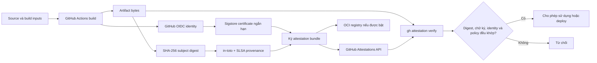

<Callout type="error" title="Attestation hợp lệ không có nghĩa artifact an toàn">
  Một artifact độc hại vẫn có thể có attestation hợp lệ nếu workflow, dependency, runner hoặc tài khoản có quyền sửa pipeline đã bị chiếm. Attestation chứng minh quan hệ giữa **đúng bytes** và danh tính build; nó không quét malware và không phán quyết code là lành tính.
</Callout>

## Mục lục

- [Mô hình tinh thần](#mô-hình-tinh-thần)
  - [Provenance và attestation](#provenance-và-attestation)
  - [Attestation chứng minh gì](#attestation-chứng-minh-gì)
  - [Attestation không chứng minh gì](#attestation-không-chứng-minh-gì)
- [Chuỗi tin cậy](#chuỗi-tin-cậy)
  - [Subject digest gắn tuyên bố với bytes](#subject-digest-gắn-tuyên-bố-với-bytes)
  - [Sigstore cung cấp chữ ký ngắn hạn](#sigstore-cung-cấp-chữ-ký-ngắn-hạn)
  - [SLSA mô tả mức bảo đảm của build](#slsa-mô-tả-mức-bảo-đảm-của-build)
- [Phạm vi hỗ trợ và yêu cầu gói](#phạm-vi-hỗ-trợ-và-yêu-cầu-gói)
- [Mô hình đe dọa](#mô-hình-đe-dọa)
- [Thiết kế permissions tối thiểu](#thiết-kế-permissions-tối-thiểu)
  - [Quyền theo loại artifact](#quyền-theo-loại-artifact)
  - [Ý nghĩa của từng permission](#ý-nghĩa-của-từng-permission)
- [Tạo provenance cho file build](#tạo-provenance-cho-file-build)
  - [Workflow hoàn chỉnh](#workflow-hoàn-chỉnh)
  - [Chọn action và pin phiên bản](#chọn-action-và-pin-phiên-bản)
- [Tạo provenance cho container image](#tạo-provenance-cho-container-image)
- [Xác minh bằng GitHub CLI](#xác-minh-bằng-github-cli)
  - [Xác minh file với repo hoặc owner](#xác-minh-file-với-repo-hoặc-owner)
  - [Ràng buộc danh tính builder chặt hơn](#ràng-buộc-danh-tính-builder-chặt-hơn)
  - [Xác minh container image](#xác-minh-container-image)
  - [Đọc JSON mà không tin nhầm metadata](#đọc-json-mà-không-tin-nhầm-metadata)
  - [Xác minh offline](#xác-minh-offline)
- [Policy và enforcement](#policy-và-enforcement)
  - [Chặn phát hành hoặc triển khai bằng exit code](#chặn-phát-hành-hoặc-triển-khai-bằng-exit-code)
  - [Enforcement trên Kubernetes](#enforcement-trên-kubernetes)
- [Lưu trữ, retention và vòng đời](#lưu-trữ-retention-và-vòng-đời)
  - [Dữ liệu được lưu ở đâu](#dữ-liệu-được-lưu-ở-đâu)
  - [Retention và xóa attestation](#retention-và-xóa-attestation)
- [Audit](#audit)
- [Bài thực hành](#bài-thực-hành)
  - [Chuẩn bị](#chuẩn-bị)
  - [Workflow phòng lab](#workflow-phòng-lab)
  - [Chạy và xác minh](#chạy-và-xác-minh)
  - [Thử nghiệm âm và tiêu chí hoàn thành](#thử-nghiệm-âm-và-tiêu-chí-hoàn-thành)
- [Best practices cho production](#best-practices-cho-production)
- [Troubleshooting](#troubleshooting)
- [Bài bảo mật liên quan](#bài-bảo-mật-liên-quan)
- [Tài liệu tham khảo](#tài-liệu-tham-khảo)

## Mô hình tinh thần

### Provenance và attestation

**Artifact** là đầu ra được phân phối của một build, chẳng hạn `my-app.tar.gz`, package hoặc container image.

**Provenance** là thông tin nguồn gốc của artifact: repository nào, commit nào, workflow nào và builder nào đã tạo ra nó. Có thể hình dung provenance như “phiếu xuất xưởng” của một tập bytes cụ thể.

**Attestation** là một tuyên bố được ký bằng mật mã về một subject. Trong trang này, subject chính là artifact. GitHub biểu diễn tuyên bố theo định dạng [in-toto Statement](https://github.com/in-toto/attestation/tree/main/spec/v1):

```json
{
  "_type": "https://in-toto.io/Statement/v1",
  "subject": [
    {
      "name": "my-app.tar.gz",
      "digest": {
        "sha256": "0123456789abcdef..."
      }
    }
  ],
  "predicateType": "https://slsa.dev/provenance/v1",
  "predicate": {
    "buildDefinition": "...",
    "runDetails": "..."
  }
}
```

`subject` trả lời “tuyên bố này nói về bytes nào”. `predicateType` trả lời “đây là loại tuyên bố gì”. `predicate` chứa chi tiết của tuyên bố, ở đây là SLSA build provenance.

### Attestation chứng minh gì

Khi `gh attestation verify` thành công với policy đủ chặt, người dùng có bằng chứng rằng:

- file hoặc image đang kiểm tra có digest trùng với subject đã ký;
- chữ ký và timestamp hợp lệ theo trust root của Sigstore;
- certificate gắn signer với một GitHub Actions workflow qua GitHub OIDC;
- attestation thuộc repository hoặc owner được người xác minh cho phép;
- predicate có đúng loại được yêu cầu, mặc định là `https://slsa.dev/provenance/v1`;
- các ràng buộc bổ sung như signer workflow, source ref hoặc loại runner khớp policy nếu đã truyền cờ tương ứng.

Đây là bằng chứng về **integrity** và **origin**. Integrity nghĩa là bytes không bị đổi so với digest đã chứng thực. Origin nghĩa là danh tính build khớp policy đã chọn.

### Attestation không chứng minh gì

Attestation không tự chứng minh rằng:

- source code không có backdoor hoặc lỗ hổng;
- dependency, action và compiler là đáng tin cậy;
- runner không bị chiếm trước hoặc trong lúc build;
- test đã đủ hoặc đã thật sự phát hiện hành vi độc hại;
- build có thể tái lập bit-for-bit;
- SBOM đầy đủ, trừ khi có một SBOM attestation riêng và policy kiểm tra nó;
- artifact hiện tại là phiên bản mới nhất hoặc chưa bị thu hồi;
- người gọi workflow có thẩm quyền phát hành theo quy trình của tổ chức.

<Callout type="warn" title="Tình huống dễ hiểu sai">
  Nếu attacker sửa workflow để build malware rồi dùng chính job đó tạo attestation, chữ ký vẫn có thể hợp lệ. Kết quả xác minh đúng chỉ nói: “bytes malware này được workflow mang danh tính đã cho tạo và ký”. Vì vậy phải bảo vệ builder, workflow và policy xác minh cùng lúc.
</Callout>

## Chuỗi tin cậy

Luồng tạo và xác minh có các mắt xích sau:



### Subject digest gắn tuyên bố với bytes

**Subject digest** là hàm băm mật mã của artifact. Với file, action tính digest từ đường dẫn trong `subject-path`. Với image, workflow chuyển digest do registry/build action trả về qua `subject-digest`.

Tên file hoặc image tag không đủ để định danh nội dung. Cả hai đều có thể được thay thế. Digest `sha256:...` mới gắn attestation với nội dung cụ thể.

Ví dụ, cùng một source archive nhưng nén lại với timestamp khác sẽ tạo bytes khác và digest khác. Attestation của archive cũ không xác minh được archive mới. Hãy attest **đúng file cuối cùng được phát hành**, sau mọi bước đóng gói và ký bổ sung làm thay đổi bytes.

<Callout type="info" title="Tên subject không phải bằng chứng integrity">
  `subject.name` giúp con người nhận diện artifact. Kiểm tra bảo mật dựa vào digest. Với OCI image, dùng tên fully qualified không kèm tag trong `subject-name`, rồi truyền digest riêng.
</Callout>

### Sigstore cung cấp chữ ký ngắn hạn

GitHub dùng Sigstore để ký theo mô hình keyless, tức workflow không phải giữ một private signing key dài hạn:

1. job có `id-token: write` yêu cầu GitHub cấp OIDC token ngắn hạn;
2. Sigstore dùng identity trong token để cấp signing certificate ngắn hạn;
3. action ký in-toto statement và đóng gói chữ ký, certificate cùng dữ liệu xác minh thành Sigstore bundle;
4. verifier kiểm tra bundle bằng trust root và kiểm tra identity trong certificate.

Với repository public, GitHub dùng Sigstore Public Good Instance. Bản ghi được đưa vào transparency log bất biến và công khai đọc được. Transparency log giúp phát hiện, định thời và audit việc ký.

Với repository private hoặc internal, GitHub dùng Sigstore instance riêng. Instance này chỉ liên kết với GitHub Actions và **không có transparency log công khai**. Attestation vẫn được ký và xác minh bằng trust root tương ứng.

Sigstore bảo vệ mắt xích chữ ký và identity. Nó không bảo đảm rằng code chạy bên trong identity đó là tốt.

### SLSA mô tả mức bảo đảm của build

[SLSA](https://slsa.dev/) là framework đánh giá bảo mật chuỗi cung ứng phần mềm theo các mức tăng dần. SLSA provenance mô tả cách build được gọi, builder và các dependency đầu vào đã biết.

Theo GitHub Docs hiện hành, artifact attestations tự nó cung cấp **SLSA v1.0 Build Level 2**. Mức này tạo provenance đã ký và liên kết artifact với build instructions.

Có thể hướng tới **SLSA v1.0 Build Level 3** bằng một trusted reusable workflow. Workflow tái sử dụng phải cô lập build và ký khỏi phần caller có thể tùy ý sửa. Cả caller và reusable workflow cần contract permission phù hợp. Chỉ “chuyển YAML sang `workflow_call`” không tự động đạt Level 3.

Khi xác minh artifact do reusable workflow ký, policy cần kiểm tra reusable workflow bằng `--signer-workflow` hoặc ít nhất `--signer-repo`. Repository dùng để tra attestation vẫn là repository của caller.

## Phạm vi hỗ trợ và yêu cầu gói

Theo tài liệu GitHub hiện hành năm 2026:

| Repository | Khả dụng |
|---|---|
| Public trên các gói GitHub hiện hành | Có |
| Public trên GitHub Free, Pro hoặc Team | Có |
| Private hoặc internal trên GitHub Free, Pro hoặc Team | Không |
| Private hoặc internal trên GitHub Enterprise Cloud | Có |
| GitHub Enterprise Server | Không được action chính thức hỗ trợ |
| Gói legacy Bronze, Silver hoặc Gold | Không |

Repository private/internal cần GitHub Enterprise Cloud. Không nên thiết kế fallback bằng private key tự quản rồi gọi đó là “GitHub artifact attestation”; đó là một hệ thống ký khác với trust root và policy khác.

## Mô hình đe dọa

| Mối đe dọa | Attestation giúp gì | Khoảng trống còn lại và kiểm soát cần thêm |
|---|---|---|
| Artifact bị sửa sau build | Digest không khớp nên verification thất bại | Người dùng phải thật sự chạy verification trên bytes tải về |
| Kẻ giả mạo publish file cùng tên | Chữ ký hoặc repository identity không khớp | Policy phải dùng `--repo`, tốt hơn nữa là `--signer-workflow` |
| Image tag bị trỏ sang manifest khác | Verification theo digest phát hiện khác biệt | Deploy bằng `image@sha256:...`, không chỉ bằng tag mutable |
| Workflow hoặc dependency build bị compromise | Có thể truy ngược run, commit và workflow | Attestation độc hại vẫn hợp lệ; pin action, review dependency và bảo vệ workflow |
| Self-hosted runner bị compromise | Identity cho biết loại builder trong certificate | Dùng runner tạm thời, cô lập; cân nhắc `--deny-self-hosted-runners` |
| Attacker có quyền trong job ký | Attestation ghi lại identity của job | Mọi step trong job có thể lạm dụng OIDC/token; tách job và không chạy code không tin cậy |
| Replay một artifact cũ nhưng từng hợp lệ | Chữ ký cũ vẫn xác minh đúng | Policy phải kiểm tra source ref/digest/version và quy trình thu hồi |
| Predicate bị làm giả bởi workflow bị chiếm | Signature bảo vệ predicate khỏi sửa sau khi ký | Workflow gốc có thể ký predicate sai; ưu tiên trusted reusable builder |
| Repository hoặc organization account bị chiếm | Verification vẫn nhận đúng identity đã cho phép | Cần MFA, least privilege, ruleset, CODEOWNERS và incident response |
| Metadata nhạy cảm bị đưa vào attestation public | Không giúp bảo mật bí mật | Không đưa secret, đường dẫn nội bộ hoặc dữ liệu nhạy cảm vào subject/predicate |

Ranh giới tin cậy quan trọng là **builder identity**, không phải chỉ chữ ký. Nếu policy tin mọi workflow trong cả organization qua `--owner`, blast radius lớn hơn khi policy chỉ tin một repository và một signer workflow.

## Thiết kế permissions tối thiểu

Đặt `permissions: {}` ở cấp workflow, rồi mở quyền tại đúng job build-and-attest. Permission của `GITHUB_TOKEN` áp dụng cho toàn bộ step trong job, không chỉ step attestation.

### Quyền theo loại artifact

| Trường hợp | Permission tối thiểu thực tế |
|---|---|
| File đã có sẵn trong job, không checkout repository | `id-token: write`, `attestations: write` |
| Build binary/archive từ source trong repository hiện tại | Hai quyền trên cộng `contents: read` để checkout |
| Build và push image lên GHCR | Ba quyền trên cộng `packages: write` |
| Push image lên registry ngoài GitHub | Ba quyền build/attest; quyền registry đến từ OIDC hoặc secret riêng, không phải `packages` |
| Ghi storage record lên organization Linked artifacts | Thêm `artifact-metadata: write`; chỉ cần khi dùng tính năng này |

`packages: write` phục vụ publish lên GitHub Packages/GHCR. Nó không phải yêu cầu mật mã chung của attestation cho file. Tương tự, `contents: read` phục vụ đọc source; nếu job không checkout thì có thể bỏ.

### Ý nghĩa của từng permission

- `id-token: write`: cho phép job yêu cầu GitHub OIDC token để lấy Sigstore signing certificate ngắn hạn. Đây không phải quyền sửa repository.
- `attestations: write`: cho phép tạo và lưu attestation qua GitHub Attestations API.
- `contents: read`: cho phép `actions/checkout` đọc source của repository hiện tại.
- `packages: write`: cho phép đăng nhập và push package/image lên GitHub Packages theo phạm vi token.
- `artifact-metadata: write`: cho phép tạo storage record cho Linked artifacts. Đây là metadata, không phải file artifact.

<Callout type="warn" title="Không cấp quyền ký cho job chạy code không tin cậy">
  Một step độc hại trong job có cả `id-token: write` và `attestations: write` có thể tạo attestation cho digest do attacker chọn. Không tạo provenance trong workflow `pull_request` chạy code từ fork. Chỉ attest bản build phát hành sau merge, trên ref được bảo vệ.
</Callout>

## Tạo provenance cho file build

### Workflow hoàn chỉnh

Workflow sau giả định `make release` tạo đúng file `dist/my-app.tar.gz`. Hãy thay lệnh build và đường dẫn bằng đầu ra thật của dự án.

```yaml
name: Build and attest release asset

on:
  push:
    tags:
      - 'v*'
  workflow_dispatch:

permissions: {}

jobs:
  build-and-attest:
    runs-on: ubuntu-latest
    timeout-minutes: 20
    permissions:
      contents: read
      id-token: write
      attestations: write

    steps:
      - name: Checkout source
        uses: actions/checkout@3d3c42e5aac5ba805825da76410c181273ba90b1 # v7.0.1
        with:
          persist-credentials: false

      - name: Build final release asset
        shell: bash
        run: |
          set -euo pipefail
          make release
          test -f dist/my-app.tar.gz
          sha256sum dist/my-app.tar.gz

      - name: Generate build provenance attestation
        id: attest
        uses: actions/attest-build-provenance@0f67c3f4856b2e3261c31976d6725780e5e4c373 # v4.1.1
        with:
          subject-path: dist/my-app.tar.gz

      - name: Record attestation URL
        shell: bash
        env:
          ATTESTATION_URL: ${{ steps.attest.outputs.attestation-url }}
        run: printf 'Attestation: %s\n' "$ATTESTATION_URL"
```

Action tính digest từ `subject-path`, tạo SLSA provenance, ký bundle và upload attestation lên GitHub. Nó **không tự publish file** `dist/my-app.tar.gz`. Pipeline vẫn phải upload đúng file đó lên release hoặc artifact registry.

Không build lại artifact ở job publish. Cách an toàn là chuyển đúng bytes đã attest sang job publish, kiểm tra digest ở ranh giới job, rồi phát hành. Nếu bước ký platform-specific làm thay đổi file, thực hiện bước đó trước attestation.

### Chọn action và pin phiên bản

Từ major version 4, `actions/attest-build-provenance` là wrapper của `actions/attest`. GitHub khuyến nghị implementation mới dùng `actions/attest@v4`; ví dụ trên giữ `actions/attest-build-provenance` để minh họa action chuyên provenance và đáp ứng workflow đang dùng action này.

Các ví dụ production trong trang pin action bằng full commit SHA và ghi version ở comment. Tag `@v4` dễ cập nhật nhưng là ref có thể di chuyển. Khi nâng version:

1. đọc release notes và `action.yml` chính thức;
2. xác minh commit tương ứng với release;
3. cập nhật SHA qua pull request;
4. chạy lại positive test và negative test;
5. để Dependabot hoặc Renovate đề xuất bản nâng cấp thay vì tự động merge.

Không dùng tên gần giống từ publisher khác. Repository action chính thức là `actions/attest-build-provenance` hoặc `actions/attest`.

## Tạo provenance cho container image

Với OCI image, subject phải là **fully qualified image name không kèm tag** cộng với digest `sha256:...`. Digest output của `docker/build-push-action` là lựa chọn phù hợp vì nó nhận diện manifest vừa push.

Ví dụ sau build và push lên GHCR. Repository cần có `Dockerfile`.

```yaml
name: Build and attest container image

on:
  push:
    branches: [main]

permissions: {}

env:
  REGISTRY: ghcr.io
  IMAGE_NAME: ${{ github.repository }}

jobs:
  image:
    runs-on: ubuntu-latest
    permissions:
      contents: read
      packages: write
      id-token: write
      attestations: write

    steps:
      - name: Checkout source
        uses: actions/checkout@3d3c42e5aac5ba805825da76410c181273ba90b1 # v7.0.1
        with:
          persist-credentials: false

      - name: Login to GHCR
        uses: docker/login-action@dbcb813823bdd20940b903addbd779551569679f # v4.6.0
        with:
          registry: ${{ env.REGISTRY }}
          username: ${{ github.actor }}
          password: ${{ github.token }}

      - name: Build and push image
        id: push
        uses: docker/build-push-action@53b7df96c91f9c12dcc8a07bcb9ccacbed38856a # v7.3.0
        with:
          context: .
          push: true
          tags: ${{ env.REGISTRY }}/${{ env.IMAGE_NAME }}:${{ github.sha }}

      - name: Generate and publish provenance
        uses: actions/attest-build-provenance@0f67c3f4856b2e3261c31976d6725780e5e4c373 # v4.1.1
        with:
          subject-name: ${{ env.REGISTRY }}/${{ env.IMAGE_NAME }}
          subject-digest: ${{ steps.push.outputs.digest }}
          push-to-registry: true
          create-storage-record: false
```

`push-to-registry: true` đưa attestation tới OCI registry bên cạnh việc lưu qua GitHub. Registry phải hỗ trợ artifact liên quan và job phải đăng nhập trước.

Ví dụ đặt `create-storage-record: false` để tập permission trên mức tối thiểu. Nếu repository thuộc organization và muốn image xuất hiện trong **Linked artifacts**, thêm `artifact-metadata: write` rồi đặt `create-storage-record: true`. Storage record chỉ được tạo khi `push-to-registry: true`.

Không đưa `:latest` hoặc `:${{ github.sha }}` vào `subject-name`. Tag vẫn được dùng để publish, nhưng subject cụ thể được xác định bằng `${{ steps.push.outputs.digest }}`.

## Xác minh bằng GitHub CLI

Cài hoặc cập nhật GitHub CLI tới bản có nhóm lệnh `gh attestation`, rồi kiểm tra:

```bash
gh --version
gh attestation --help
gh auth status
```

Repository public có thể tra cứu attestation public mà không cần quyền private. Repository private cần tài khoản/token có quyền đọc phù hợp. Verification online tải attestation từ GitHub theo owner/repo được chỉ định.

### Xác minh file với repo hoặc owner

Mẫu nên dùng cho production là `--repo` hoặc dạng ngắn `-R`:

```bash
gh attestation verify ./my-app.tar.gz \
  --repo acme/my-app
```

Lệnh sẽ:

1. tính digest của file cục bộ;
2. tìm attestation liên quan trong repository `acme/my-app`;
3. kiểm tra Sigstore bundle, signature, timestamp và OIDC issuer;
4. kiểm tra signer identity thuộc phạm vi repository;
5. yêu cầu SLSA provenance predicate mặc định;
6. trả exit code khác `0` nếu không có attestation hợp lệ.

Có thể mở rộng trust tới mọi repository của một owner:

```bash
gh attestation verify ./my-app.tar.gz \
  --owner acme
```

`--owner acme` phù hợp khi policy thật sự tin mọi repository đủ điều kiện trong owner đó. `--repo acme/my-app` hẹp hơn và nên là mặc định.

<Callout type="warn" title="Owner và repo vừa là nơi tra cứu vừa là trust policy">
  Đừng lấy `--owner` hoặc `--repo` từ metadata nằm trong chính artifact. Consumer phải cấu hình giá trị kỳ vọng từ một nguồn tin cậy. Nếu attacker được tự chọn owner, kiểm tra identity mất ý nghĩa.
</Callout>

### Ràng buộc danh tính builder chặt hơn

Chỉ tin đúng release workflow trên nhánh chính:

```bash
gh attestation verify ./my-app.tar.gz \
  --repo acme/my-app \
  --signer-workflow acme/my-app/.github/workflows/release.yml \
  --source-ref refs/heads/main \
  --deny-self-hosted-runners
```

Các cờ policy hữu ích:

| Cờ | Điều được ràng buộc |
|---|---|
| `--signer-workflow OWNER/REPO/PATH` | Đường dẫn workflow đã ký |
| `--signer-repo OWNER/REPO` | Repository chứa signer, đặc biệt cho reusable workflow |
| `--source-ref refs/heads/main` | Git ref nguồn |
| `--source-digest COMMIT_SHA` | Commit nguồn |
| `--signer-digest COMMIT_SHA` | Commit chứa signer workflow |
| `--deny-self-hosted-runners` | Từ chối attestation sinh trên self-hosted runner |
| `--predicate-type URI` | Loại tuyên bố phải khớp |

Nếu reusable workflow nằm ở `acme/builders`, vẫn tra attestation theo caller repo nhưng ràng buộc signer riêng:

```bash
gh attestation verify ./my-app.tar.gz \
  --repo acme/my-app \
  --signer-workflow acme/builders/.github/workflows/release.yml
```

Nói ngắn gọn: càng ràng buộc chính xác identity, policy càng ít phải tin.

### Xác minh container image

Đăng nhập registry trước. Dùng URI có tiền tố `oci://`:

```bash
docker login ghcr.io

gh attestation verify \
  oci://ghcr.io/acme/my-app@sha256:0123456789abcdef... \
  --repo acme/my-app
```

Nếu attestation được lưu trong OCI registry, có thể yêu cầu CLI lấy bundle từ đó:

```bash
gh attestation verify \
  oci://ghcr.io/acme/my-app@sha256:0123456789abcdef... \
  --repo acme/my-app \
  --bundle-from-oci
```

Ưu tiên digest reference trong deployment manifest. Nếu xác minh một tag, tag có thể trỏ tới image khác giữa thời điểm kiểm tra và thời điểm deploy.

### Đọc JSON mà không tin nhầm metadata

Xuất kết quả đã xác minh để audit hoặc đưa vào policy engine:

```bash
gh attestation verify ./my-app.tar.gz \
  --repo acme/my-app \
  --format json > verification.json

jq '.[].verificationResult | {
  certificate: .signature.certificate,
  timestamps: .verifiedTimestamps,
  subject: .statement.subject,
  predicateType: .statement.predicateType
}' verification.json
```

Theo GitHub CLI manual, trong kết quả verification, `signature.certificate` và `verifiedTimestamps` là các phần không thể do workflow nguồn tùy ý giả mạo. Ngược lại, workflow tạo attestation có thể kiểm soát nhiều nội dung trong `statement.predicate`.

Vì vậy, đừng viết policy kiểu “predicate nói testsPassed=true nên cho deploy” nếu chính workflow không được cô lập và tin cậy. Hãy kiểm tra certificate identity trước, rồi mới dùng predicate từ một trusted builder.

### Xác minh offline

Trên máy có mạng, tải bundle và trust roots:

```bash
gh attestation download ./my-app.tar.gz \
  --repo acme/my-app

gh attestation trusted-root > trusted_root.jsonl
```

`gh attestation download` ghi bundle theo digest, ví dụ `sha256:abc....jsonl`. Chuyển artifact, bundle, GitHub CLI và `trusted_root.jsonl` vào môi trường offline, rồi chạy:

```bash
gh attestation verify ./my-app.tar.gz \
  --repo acme/my-app \
  --bundle sha256:abc....jsonl \
  --custom-trusted-root trusted_root.jsonl
```

Tạo lại trusted roots mỗi lần nhập signed material mới. Trust root cũ không thông báo cho môi trường air-gapped về key đã bị thu hồi sau lần đồng bộ cuối.

## Policy và enforcement

Attestation chỉ tạo giá trị khi consumer xác minh và **từ chối** artifact không đạt policy. Verification thủ công là bước học tập tốt, nhưng production cần một gate tự động.

### Chặn phát hành hoặc triển khai bằng exit code

Một deploy job có thể fail closed như sau:

```bash
set -euo pipefail

gh attestation verify "$ARTIFACT_PATH" \
  --repo acme/my-app \
  --signer-workflow acme/builders/.github/workflows/release.yml \
  --source-ref refs/heads/main \
  --deny-self-hosted-runners

./deploy.sh "$ARTIFACT_PATH"
```

`deploy.sh` chỉ chạy khi verification trả exit code `0`. Không dùng `|| true`, không fallback sang artifact không có attestation và không chỉ ghi warning.

Một policy production nên quyết định rõ:

- repository hoặc organization nào được tin;
- signer workflow nào được tin;
- Git ref hoặc commit nào được phát hành;
- GitHub-hosted hay self-hosted runner được phép;
- predicate type nào bắt buộc, ví dụ provenance và SBOM;
- cơ chế thu hồi, exception có thời hạn và người phê duyệt;
- artifact phải được tham chiếu bằng digest tại điểm deploy.

Branch ruleset, protected environment và CODEOWNERS bảo vệ quá trình tạo artifact. Chúng không thay thế verification ở phía consumer.

### Enforcement trên Kubernetes

GitHub có hướng dẫn chính thức dùng **Sigstore Policy Controller** làm Kubernetes admission controller. Controller kiểm tra image trước khi API server cho workload vào namespace.

Luồng triển khai ở mức cao:

1. build image và tạo attestation với `push-to-registry: true`;
2. cài Sigstore Policy Controller bằng Helm;
3. cài GitHub trust root và `ClusterImagePolicy` giới hạn organization/image;
4. bật policy cho namespace bằng label `policy.sigstore.dev/include: "true"`;
5. thử cả image hợp lệ và image không có attestation trước production.

<Callout type="warn" title="Policy không tự bật cho mọi namespace">
  Theo hướng dẫn GitHub, admission policy chỉ enforce sau khi namespace được opt in bằng label. Hãy audit namespace mới và dùng policy-as-code để tránh vùng không được bảo vệ.
</Callout>

Các version Helm thay đổi độc lập với trang này. Lấy command và version chart trực tiếp từ hướng dẫn GitHub/Sigstore tại thời điểm cài, thay vì sao chép version cũ vào production.

## Lưu trữ, retention và vòng đời

### Dữ liệu được lưu ở đâu

Khi action chạy thành công:

- GitHub lưu attestation bundle qua Attestations API và liên kết nó với repository tạo workflow;
- runner có một bundle cục bộ tại đường dẫn output `bundle-path`, nhưng filesystem runner là tạm thời;
- với public repository, Sigstore Public Good còn ghi dữ liệu ký vào transparency log công khai, bất biến;
- với private/internal repository, GitHub Sigstore không dùng transparency log công khai;
- với `push-to-registry: true`, bundle còn được publish tới OCI registry;
- với `artifact-metadata: write` và storage record được bật, metadata có thể xuất hiện trên trang Linked artifacts của organization.

Attestation không chứa file artifact. Artifact vẫn nằm ở GitHub Release, Actions artifact, package registry hoặc registry bên ngoài. Xóa một Actions artifact không tự động xóa attestation tương ứng.

### Retention và xóa attestation

Không áp dụng `retention-days` của `actions/upload-artifact` cho artifact attestation. Đây là hai loại record khác nhau. GitHub hướng dẫn quản lý vòng đời attestation bằng giao diện **Actions → Attestations** hoặc REST API, thay vì coi nó có cùng retention với Actions artifact.

Nên xóa attestation khi:

- tạo nhầm;
- artifact tương ứng đã bị xóa;
- artifact không còn được phép sử dụng;
- incident response quyết định thu hồi trust.

Tải bundle trước khi xóa nếu chính sách lưu hồ sơ yêu cầu. Sau khi xóa khỏi GitHub, consumer dùng tra cứu online sẽ không còn xác minh được artifact qua record đó. Với public repository, không giả định việc xóa GitHub record có thể xóa lịch sử đã ghi trong transparency log bất biến.

Đồng bộ lifecycle theo digest: khi xóa image/package khỏi registry, automation nên xóa hoặc đánh dấu không còn active các record liên quan. Đừng để attestation “mồ côi” làm auditor hiểu nhầm artifact vẫn được phân phối.

## Audit

Audit theo cả producer và consumer:

1. **Producer workflow:** review trigger, permissions, runner, build inputs, action SHA và bước nào có thể thay đổi artifact sau attestation.
2. **GitHub UI:** vào repository → **Actions → Attestations**; lọc theo subject name, ngày tạo và predicate.
3. **Workflow run:** giữ run ID, source SHA, signer workflow và `attestation-url`; xem **Set up job → GITHUB_TOKEN Permissions**.
4. **Artifact registry:** đối chiếu digest đang phát hành với `subject.digest`, không đối chiếu chỉ bằng tag/version.
5. **Consumer gate:** lưu command policy, exit status và JSON verification làm bằng chứng triển khai.
6. **Organization:** nếu dùng Linked artifacts, đối chiếu source repository, storage record và deployment record.
7. **Lifecycle:** định kỳ tìm attestation không còn artifact, artifact production không có attestation và exception đã hết hạn.

Có thể tải bundle phục vụ audit:

```bash
gh attestation download ./my-app.tar.gz \
  --repo acme/my-app
```

Tải bundle chưa phải là xác minh. REST API cũng chỉ trả dữ liệu. Auditor vẫn phải kiểm tra signature, timestamp và signer identity bằng `gh attestation verify` hoặc verifier tương đương.

## Bài thực hành

Bài lab tạo một executable nhỏ, upload nó như Actions artifact, tạo provenance rồi xác minh trên máy cục bộ. Không cần secret hay PAT trong YAML.

### Chuẩn bị

- Dùng repository public thử nghiệm, hoặc private/internal repository trên GitHub Enterprise Cloud.
- Bật GitHub Actions.
- Cài GitHub CLI có lệnh `gh attestation` và đăng nhập bằng `gh auth login` nếu repository private.
- Không dùng repository production cho negative test.

Kiểm tra môi trường:

```bash
gh auth status
gh repo view --json nameWithOwner
gh attestation --help
```

### Workflow phòng lab

Tạo `.github/workflows/artifact-attestation-lab.yml` trong repository lab:

```yaml
name: Artifact attestation lab

on:
  workflow_dispatch:

permissions: {}

jobs:
  build-attest-upload:
    runs-on: ubuntu-latest
    timeout-minutes: 10
    permissions:
      id-token: write
      attestations: write

    steps:
      - name: Build a small executable artifact
        shell: bash
        run: |
          set -euo pipefail
          mkdir -p dist
          printf '%s\n' '#!/usr/bin/env bash' 'printf "hello from attested artifact\\n"' > dist/hello.sh
          chmod +x dist/hello.sh
          sha256sum dist/hello.sh

      - name: Generate provenance
        id: attest
        uses: actions/attest-build-provenance@0f67c3f4856b2e3261c31976d6725780e5e4c373 # v4.1.1
        with:
          subject-path: dist/hello.sh

      - name: Upload the exact attested bytes
        uses: actions/upload-artifact@b7c566a772e6b6bfb58ed0dc250532a479d7789f # v6
        with:
          name: attested-hello
          path: dist/hello.sh
          if-no-files-found: error
          retention-days: 7
```

Job không checkout source nên không cần `contents: read`. `retention-days: 7` chỉ áp dụng cho Actions artifact `attested-hello`; nó không đặt retention của attestation.

### Chạy và xác minh

Từ máy cục bộ:

```bash
REPO="$(gh repo view --json nameWithOwner --jq .nameWithOwner)"

gh workflow run artifact-attestation-lab.yml --repo "$REPO"
gh run watch --repo "$REPO"

RUN_ID="$(
  gh run list \
    --repo "$REPO" \
    --workflow artifact-attestation-lab.yml \
    --limit 1 \
    --json databaseId \
    --jq '.[0].databaseId'
)"

rm -rf ./lab-download
gh run download "$RUN_ID" \
  --repo "$REPO" \
  --name attested-hello \
  --dir ./lab-download

gh attestation verify ./lab-download/hello.sh \
  --repo "$REPO" \
  --signer-workflow "$REPO/.github/workflows/artifact-attestation-lab.yml"
```

Nếu thành công, chạy artifact:

```bash
bash ./lab-download/hello.sh
```

### Thử nghiệm âm và tiêu chí hoàn thành

Sửa một byte rồi xác minh lại:

```bash
printf '\n# tampered\n' >> ./lab-download/hello.sh

if gh attestation verify ./lab-download/hello.sh --repo "$REPO"; then
  echo "ERROR: artifact đã sửa nhưng vẫn verify thành công" >&2
  exit 1
else
  echo "PASS: digest mismatch bị từ chối"
fi
```

Bài lab hoàn thành khi:

- run tạo được attestation và Actions artifact;
- verification với đúng repo và signer workflow thành công trước khi sửa file;
- verification thất bại sau khi sửa file;
- phần **GITHUB_TOKEN Permissions** chỉ có quyền cần thiết;
- không có token hoặc secret bị ghi vào log;
- người học giải thích được vì sao file chưa sửa “hợp lệ” vẫn chưa được chứng minh là không độc hại.

Thử thêm một negative test an toàn: dùng `--repo` của repository khác. Verification phải thất bại vì signer identity không thuộc trust policy đó.

## Best practices cho production

- Chỉ attest artifact phát hành mà consumer thật sự tải hoặc deploy. Không ký mọi build test ngắn hạn.
- Attest file cuối cùng sau đóng gói. Với image, dùng digest output của lần push vừa hoàn tất.
- Đặt `permissions: {}` ở workflow và cấp `id-token`, `attestations`, `contents`, `packages` tại đúng job.
- Không chạy source từ fork, script không tin cậy hoặc dependency install chưa kiểm soát trong job có quyền tạo attestation.
- Bảo vệ `.github/workflows/`, build scripts và reusable workflows bằng ruleset, branch protection và `CODEOWNERS`.
- Pin action ngoài repository bằng full commit SHA. Review release notes trước khi cập nhật.
- Tách build/release khỏi CI của pull request. Chỉ ký build từ tag, branch hoặc environment đã bảo vệ.
- Xác minh bằng `--repo`; thêm `--signer-workflow`, source ref/digest và runner policy khi rủi ro cao.
- Dùng trusted reusable workflow để giảm khả năng caller thao túng builder và để hướng tới SLSA Build Level 3.
- Deploy container bằng digest, không chỉ tag. Xác minh ngay tại admission/deployment boundary.
- Fail closed khi verification lỗi. Exception phải có owner, lý do và ngày hết hạn.
- Kết hợp provenance với SBOM, vulnerability scanning, dependency review và malware controls. Các lớp này trả lời câu hỏi khác nhau.
- Lưu bằng chứng verification và mapping run → commit → digest → deployment để audit.
- Đồng bộ xóa/thu hồi giữa registry, GitHub attestations và inventory. Không coi attestation cũ là bằng chứng freshness.
- Với public repository, xem subject name và provenance là dữ liệu công khai vì Sigstore transparency log có thể đọc được.

## Troubleshooting

| Triệu chứng | Nguyên nhân thường gặp | Cách xử lý an toàn |
|---|---|---|
| `Resource not accessible by integration` khi tạo attestation | Thiếu `attestations: write`, fork PR bị hạ quyền hoặc plan không hỗ trợ private repo | Xem **Set up job → GITHUB_TOKEN Permissions** và bảng plan; không thay bằng PAT rộng |
| Lỗi lấy OIDC token | Thiếu `id-token: write` hoặc job/event bị policy chặn | Cấp đúng quyền ở job attest; không đặt vào mọi job |
| `subject-path` không tìm thấy file | Build output sai đường dẫn hoặc file được tạo ở job khác | `test -f` ngay trước action; chuyển đúng artifact/digest qua ranh giới job |
| Digest không khớp khi verify | File bị sửa, nén lại, line ending đổi hoặc consumer verify nhầm file | So SHA-256 giữa publish và download; attest đúng bytes cuối cùng |
| Không tìm thấy attestation | Sai owner/repo, attestation đã xóa, digest mới hoặc private repo chưa auth | Kiểm tra `sha256sum`, `gh auth status`, **Actions → Attestations** và repository caller |
| Verify thành công với `--owner` nhưng policy vẫn quá rộng | Owner chứa nhiều repository có quyền ký | Chuyển sang `--repo` và `--signer-workflow` |
| Reusable workflow verify thất bại | Chỉ định caller làm signer hoặc thiếu signer repo/workflow | Dùng caller ở `--repo`; dùng reusable workflow ở `--signer-repo`/`--signer-workflow` |
| Container attestation không có trong registry | Thiếu `push-to-registry: true`, chưa login hoặc registry không hỗ trợ | Login trước, dùng fully qualified subject name không tag và thử `--bundle-from-oci` |
| GHCR push bị từ chối | Thiếu `packages: write` hoặc package policy không cấp quyền | Kiểm tra package access; không tăng thành `write-all` |
| Linked artifacts không có storage record | Thiếu `artifact-metadata: write`, `create-storage-record: false`, không push registry hoặc repo không thuộc organization | Chỉ bật permission và storage record nếu thật sự dùng inventory này |
| File bundle offline không verify | Bundle không thuộc digest, trust root cũ hoặc sai issuer/root | Tải lại bundle và `gh attestation trusted-root` trên máy online đáng tin cậy |
| JSON predicate trông đúng nhưng nguồn không tin cậy | Workflow nguồn có thể tự chọn metadata predicate | Ràng buộc certificate signer; chuyển build/sign sang trusted reusable workflow |
| Artifact độc hại vẫn verify thành công | Builder/workflow/dependency/runner đã bị compromise | Dừng deploy; điều tra run và source; xóa/thu hồi attestation cùng artifact; vá trust chain |
| Attestation tồn tại sau khi Actions artifact hết hạn | Hai record có lifecycle độc lập | Xóa attestation mồ côi theo policy; không kỳ vọng `retention-days` áp dụng cho attestation |

## Bài bảo mật liên quan

<Cards>
  <Card title="GITHUB_TOKEN permissions" href="/docs/bao-mat/01-github-token-permissions/" description="Thiết kế quyền tối thiểu cho job tạo attestation." />
  <Card title="OIDC federation" href="/docs/bao-mat/03-oidc-federation/" description="Hiểu identity token ngắn hạn dùng trong trust chain." />
  <Card title="Third-party actions" href="/docs/bao-mat/04-third-party-actions/" description="Review và pin action chạy bên trong builder." />
  <Card title="Supply chain security" href="/docs/bao-mat/08-supply-chain-security/" description="Đặt provenance trong chiến lược chuỗi cung ứng tổng thể." />
</Cards>

## Tài liệu tham khảo

Các nguồn dưới đây là tài liệu chính thức được đối chiếu theo nội dung hiện hành năm 2026:

- [GitHub Docs — Artifact attestations concepts](https://docs.github.com/en/actions/concepts/security/artifact-attestations)
- [GitHub Docs — Using artifact attestations to establish provenance for builds](https://docs.github.com/en/actions/how-tos/secure-your-work/use-artifact-attestations/use-artifact-attestations)
- [GitHub Docs — SLSA Build Level 3 with reusable workflows](https://docs.github.com/en/actions/how-tos/secure-your-work/use-artifact-attestations/increase-security-rating)
- [GitHub Docs — Managing the lifecycle of artifact attestations](https://docs.github.com/en/actions/how-tos/secure-your-work/use-artifact-attestations/manage-attestations)
- [GitHub Docs — Verifying attestations offline](https://docs.github.com/en/actions/how-tos/secure-your-work/use-artifact-attestations/verify-attestations-offline)
- [GitHub Docs — Enforcing artifact attestations with a Kubernetes admission controller](https://docs.github.com/en/actions/security-for-github-actions/using-artifact-attestations/enforcing-artifact-attestations-with-a-kubernetes-admission-controller)
- [GitHub Docs — About linked artifacts](https://docs.github.com/en/code-security/concepts/supply-chain-security/linked-artifacts)
- [GitHub CLI manual — gh attestation verify](https://cli.github.com/manual/gh_attestation_verify)
- [GitHub CLI manual — gh attestation download](https://cli.github.com/manual/gh_attestation_download)
- [GitHub CLI manual — gh attestation trusted-root](https://cli.github.com/manual/gh_attestation_trusted-root)
- [actions/attest-build-provenance](https://github.com/actions/attest-build-provenance)
- [actions/attest](https://github.com/actions/attest)
- [GitHub REST API — Artifact attestations](https://docs.github.com/en/rest/users/attestations)
- [SLSA v1.0 provenance](https://slsa.dev/spec/v1.0/provenance)
- [SLSA v1.0 security levels](https://slsa.dev/spec/v1.0/levels)
- [in-toto Attestation Framework](https://github.com/in-toto/attestation/tree/main/spec/v1)
- [Sigstore documentation](https://docs.sigstore.dev/)
