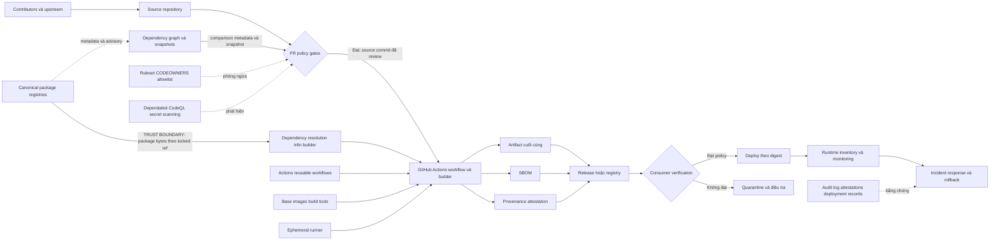

<Callout type="warn" title="Một pipeline xanh chưa chứng minh sản phẩm đáng tin">
  Test xanh chỉ cho biết các kiểm tra đã cấu hình không phát hiện lỗi. Một dependency độc hại, action bị chiếm, base image bị thay thế hoặc runner đã bị xâm nhập vẫn có thể tạo ra release “thành công”. Bảo mật chuỗi cung ứng phải bảo vệ cả đầu vào, quá trình build, đầu ra và điểm tiêu thụ.
</Callout>

## Mục lục

- [Kết quả và phạm vi](#kết-quả-và-phạm-vi)
- [Threat model end-to-end](#threat-model-end-to-end)
  - [Tài sản tác nhân và giả định](#tài-sản-tác-nhân-và-giả-định)
  - [Luồng chuỗi cung ứng](#luồng-chuỗi-cung-ứng)
  - [Ma trận đe dọa và kiểm soát](#ma-trận-đe-dọa-và-kiểm-soát)
  - [Phòng ngừa phát hiện và phục hồi](#phòng-ngừa-phát-hiện-và-phục-hồi)
- [Quản trị source và đầu vào build](#quản-trị-source-và-đầu-vào-build)
  - [Source governance](#source-governance)
  - [Dependency và lockfile](#dependency-và-lockfile)
  - [Actions và reusable workflows](#actions-và-reusable-workflows)
  - [Container và base image](#container-và-base-image)
  - [Build tool compiler và plugin](#build-tool-compiler-và-plugin)
  - [Runner và hạ tầng build](#runner-và-hạ-tầng-build)
- [Lớp phát hiện trên GitHub](#lớp-phát-hiện-trên-github)
  - [Dependency graph](#dependency-graph)
  - [Dependabot alerts và updates](#dependabot-alerts-và-updates)
  - [Dependency review trước khi merge](#dependency-review-trước-khi-merge)
  - [Code scanning và CodeQL](#code-scanning-và-codeql)
  - [Secret scanning và push protection](#secret-scanning-và-push-protection)
- [Làm cho đầu vào bất biến](#làm-cho-đầu-vào-bất-biến)
  - [Pinning không chỉ dành cho action](#pinning-không-chỉ-dành-cho-action)
  - [Quy trình cập nhật có kiểm chứng](#quy-trình-cập-nhật-có-kiểm-chứng)
  - [Build có tính xác định và tái lập](#build-có-tính-xác-định-và-tái-lập)
- [SBOM và inventory có thể truy vấn](#sbom-và-inventory-có-thể-truy-vấn)
  - [SBOM trả lời câu hỏi nào](#sbom-trả-lời-câu-hỏi-nào)
  - [SPDX và CycloneDX](#spdx-và-cyclonedx)
  - [Tạo xác minh và lưu SBOM](#tạo-xác-minh-và-lưu-sbom)
- [Provenance attestation và SLSA](#provenance-attestation-và-slsa)
  - [Phân biệt SBOM provenance chữ ký và checksum](#phân-biệt-sbom-provenance-chữ-ký-và-checksum)
  - [Dùng SLSA như thước đo bảo đảm](#dùng-slsa-như-thước-đo-bảo-đảm)
  - [Ràng buộc policy với builder identity](#ràng-buộc-policy-với-builder-identity)
- [Bảo toàn release từ build đến deploy](#bảo-toàn-release-từ-build-đến-deploy)
  - [Build once promote by digest](#build-once-promote-by-digest)
  - [Thiết kế release integrity](#thiết-kế-release-integrity)
  - [Thu hồi và rollback](#thu-hồi-và-rollback)
- [Policy và enforcement](#policy-và-enforcement)
  - [Các gate theo vòng đời](#các-gate-theo-vòng-đời)
  - [Exception có thời hạn](#exception-có-thời-hạn)
  - [Ownership và phân tách nhiệm vụ](#ownership-và-phân-tách-nhiệm-vụ)
- [Ứng phó sự cố chuỗi cung ứng](#ứng-phó-sự-cố-chuỗi-cung-ứng)
  - [Nhận diện và khoanh vùng](#nhận-diện-và-khoanh-vùng)
  - [Containment eradication và recovery](#containment-eradication-và-recovery)
  - [Câu hỏi điều tra theo từng mắt xích](#câu-hỏi-điều-tra-theo-từng-mắt-xích)
- [Bằng chứng audit](#bằng-chứng-audit)
  - [Bộ bằng chứng tối thiểu](#bộ-bằng-chứng-tối-thiểu)
  - [Truy vấn ngược từ deployment](#truy-vấn-ngược-từ-deployment)
- [Bài thực hành](#bài-thực-hành)
  - [Chuẩn bị](#chuẩn-bị)
  - [Workflow policy và dependency review](#workflow-policy-và-dependency-review)
  - [Cấu hình Dependabot](#cấu-hình-dependabot)
  - [Kiểm thử dương](#kiểm-thử-dương)
  - [Kiểm thử âm](#kiểm-thử-âm)
  - [Tiêu chí hoàn thành](#tiêu-chí-hoàn-thành)
- [Lộ trình trưởng thành](#lộ-trình-trưởng-thành)
- [Best practices cho production](#best-practices-cho-production)
- [Anti-patterns cần tránh](#anti-patterns-cần-tránh)
- [Troubleshooting](#troubleshooting)
- [Tài liệu tham khảo chính thức](#tài-liệu-tham-khảo-chính-thức)
- [Các bài liên quan](#các-bài-liên-quan)

## Kết quả và phạm vi

**Chuỗi cung ứng phần mềm** là toàn bộ hệ thống biến source và dependency thành sản phẩm được phát hành. Nó bao gồm con người, repository, package registry, action, compiler, container image, runner, artifact store và môi trường deploy.

Trang này dùng GitHub Actions làm nền tảng minh họa, nhưng threat model không dừng ở file workflow. Sau bài này, bạn có thể:

1. lập inventory cho mọi đầu vào trực tiếp và bắc cầu;
2. phân loại kiểm soát thành phòng ngừa, phát hiện và phục hồi;
3. chặn dependency hoặc license không đạt policy trước khi merge;
4. dùng lockfile, full commit SHA và image digest đúng vai trò;
5. tạo SBOM phù hợp với consumer thay vì chỉ để hoàn thành checklist;
6. liên kết artifact với source và builder bằng provenance;
7. xác minh release tại điểm publish và deploy;
8. thu thập bằng chứng đủ để truy ngược một deployment;
9. ứng phó khi package, action, image hoặc builder bị compromise;
10. xây lộ trình trưởng thành có tiêu chí đo được.

Trang này không lặp lại toàn bộ cách harden một action hoặc tạo artifact attestation. Hãy xem [Bảo mật third-party actions](/docs/bao-mat/04-third-party-actions/) để review action ở mức source và xem [Artifact attestations và provenance](/docs/bao-mat/07-artifact-attestations/) để triển khai, xác minh attestation ở mức câu lệnh.

## Threat model end-to-end

### Tài sản tác nhân và giả định

Bắt đầu bằng tài sản cần bảo vệ. Nếu chỉ ghi “pipeline”, team sẽ bỏ sót package registry, signing identity hoặc artifact đã được deploy.

| Nhóm tài sản | Ví dụ | Thuộc tính phải bảo vệ |
|---|---|---|
| Source | commit, tag, branch, pull request, build script | tính toàn vẹn, tác giả, lịch sử review |
| Dependency | package trực tiếp, package bắc cầu, action, reusable workflow | danh tính, version, license, vulnerability status |
| Build input | lockfile, base image, compiler, plugin, system package | tính bất biến, khả năng truy vết |
| Credential | `GITHUB_TOKEN`, registry token, danh tính [OpenID Connect (OIDC)](/docs/bao-mat/03-oidc-federation/), signing key | quyền tối thiểu, vòng đời ngắn, không rò rỉ |
| Builder | workflow, runner image, self-hosted host, tool cache | cô lập, nguồn gốc, trạng thái sạch |
| Output | binary, package, image, SBOM, provenance, checksum | digest, nguồn gốc, chống thay thế |
| Kênh phân phối | GitHub Release, package registry, Open Container Initiative (OCI) registry | authorization, retention, chống overwrite |
| Deployment | digest đang chạy, environment approval, admission decision | đúng artifact, đúng policy, rollback được |
| Bằng chứng | run log, review, attestation, audit log, SBOM | đầy đủ, chống sửa, giữ đủ lâu |

Tác nhân đe dọa có thể là:

- maintainer bị chiếm tài khoản;
- contributor cố ý đưa dependency độc hại;
- package maintainer hoặc registry bị compromise;
- người nội bộ cấp quyền quá rộng hoặc bypass policy;
- attacker chiếm runner hay cache;
- dependency bắc cầu có install hook độc hại;
- build tool tải mã mới trong lúc chạy;
- attacker thay artifact sau build;
- consumer deploy theo tag đã bị di chuyển;
- lỗi vận hành làm phát hành nhầm bytes.

Threat model nên giả định một mắt xích có thể thất bại. Kiến trúc tốt không để một compromise đơn lẻ tự động trở thành production compromise.

**Trusted Computing Base (TCB)** — tập thành phần bắt buộc phải đáng tin để policy có ý nghĩa — cần được ghi rõ thay vì ngầm hiểu:

| Trust assumption / thành phần TCB | Điều hệ thống đang tin | Kiểm soát và bằng chứng cần có |
|---|---|---|
| GitHub control plane, OIDC issuer và trust root | event/ref, token claim, API response, ruleset và audit log do GitHub phát hành là xác thực | giới hạn `sub`/`aud`, quyền tối thiểu, environment protection, audit cấu hình trust và đối chiếu bằng chứng ngoài pipeline khi rủi ro cao |
| Registry canonical và semantics của digest | tên registry/namespace trỏ đúng publisher; digest được tính trên đúng object và bytes tải về khớp digest | allowlist endpoint/namespace, TLS, immutable policy, xác minh digest sau tải và hiểu khác biệt manifest-list/platform digest |
| Policy, config và đường admin bypass | ruleset, CODEOWNERS, required check, allowlist và exception không bị actor trái phép sửa hoặc bỏ qua | bảo vệ config, phân tách nhiệm vụ, giới hạn bypass, cảnh báo và định kỳ review audit log |
| Builder và signing identity | workflow, runner, toolchain và danh tính ký đúng là builder được consumer cho phép | runner sạch, workflow pin/bảo vệ, signing identity ngắn hạn, provenance ràng buộc exact repository/workflow/ref và consumer verification |

Nếu một trust root bị compromise, hãy dừng merge/build/publish/deploy dựa trên root đó. Thu hồi OIDC trust hoặc signing credential liên quan, vô hiệu đường bypass, quarantine và denylist artifact kể từ mốc sạch cuối cùng, rồi bảo toàn bằng chứng. Chỉ khôi phục sau khi đã thiết lập lại trust/config, build lại trên builder sạch độc lập, phát hành provenance mới và thông báo consumer về digest bị thu hồi. Với nghi vấn GitHub control plane, không dùng chính control plane đó làm nguồn bằng chứng duy nhất; chuyển sang kênh xác minh và phê duyệt độc lập cho đến khi trust được tái lập.

### Luồng chuỗi cung ứng



Dependency review tại PR gate so sánh metadata và snapshot mà GitHub biết. Nó không xác minh toàn bộ package bytes registry sẽ phục vụ tại thời điểm build. Package bytes đi qua trust boundary từ registry vào resolver/builder, nên build vẫn phải dùng registry canonical, locked reference/integrity metadata, kiểm digest khi ecosystem hỗ trợ và kiểm soát network.

Sơ đồ có ba ranh giới quan trọng:

1. **Trước merge:** dữ liệu do contributor và upstream kiểm soát đi vào repository.
2. **Trong build:** source đã merge gặp toolchain, runner và credential.
3. **Trước deploy:** consumer quyết định có tin đúng bytes đã phát hành hay không.

Nếu chỉ bảo vệ ranh giới đầu tiên, attacker có thể chiếm builder. Nếu chỉ ký đầu ra, workflow bị chiếm vẫn ký được malware. Vì vậy kiểm soát phải trải dài qua cả ba ranh giới.

### Ma trận đe dọa và kiểm soát

| Mối đe dọa | Dấu hiệu hoặc hậu quả | Phòng ngừa | Phát hiện | Phục hồi |
|---|---|---|---|---|
| Dependency confusion hoặc typosquatting | package cùng tên từ registry ngoài ý muốn | scope registry, mirror nội bộ, allowlist namespace, lockfile | dependency review, registry log, SBOM diff | block package, rotate token, rebuild |
| Package bắc cầu có CVE | không có diff source trực tiếp nhưng lockfile đổi lớn | lockfile, update PR, policy severity | dependency graph, Dependabot alert | nâng/hạ version, mitigation, rebuild |
| Maintainer upstream bị compromise | release mới có install hook hoặc network call lạ | phê duyệt publisher, pin version/digest | review diff, advisory, egress anomaly | pin bản sạch, quarantine release |
| Action tag bị retarget | workflow không đổi nhưng code thực thi đổi | full 40-char SHA, allowlist | policy scan, dependency inventory | block action, rotate credential, rerun sạch |
| Base image tag bị thay | image build nhận filesystem khác | pin OCI digest | registry event, image/SBOM diff | pin digest sạch, rebuild mọi derivative image |
| Compiler hoặc plugin độc hại | binary chứa hành vi không có trong source | pin toolchain, trusted builder, egress control | reproducible-build comparison, provenance review | thay toolchain, rebuild trên builder sạch |
| Runner persistent bị chiếm | secret/run sau bị đọc, output bị sửa | ephemeral runner, isolation, no shared socket | log runner/Endpoint Detection and Response (EDR), process/network bất thường | cô lập host, rotate credentials, reprovision |
| Source governance bị bypass | workflow hoặc release script đổi không đủ review | ruleset, CODEOWNERS, signed/verified identity policy | audit log, required check history | revert, revoke release, điều tra bypass |
| Secret được commit | credential bị dùng ngoài pipeline | push protection, OIDC, secret scope hẹp | secret scanning, provider alert | revoke trước, rồi xóa lịch sử nếu cần |
| Artifact bị thay sau build | checksum consumer khác producer | immutable registry, digest, attestation | verification failure | quarantine, republish bytes sạch |
| Replay release cũ | artifact hợp lệ nhưng không còn được phép | version policy, denylist/allowlist digest | deployment inventory, freshness check | rollback hoặc forward-fix theo incident |
| SBOM thiếu thành phần | CVE impact analysis bỏ sót package | generator phù hợp, dependency submission | compare SBOM với build/image scan | tạo lại SBOM và đánh giá phạm vi |
| Provenance từ builder quá rộng | artifact được ký đúng nhưng bởi workflow không mong đợi | trusted reusable workflow, identity constraint | verify signer workflow/source ref | revoke trust, xóa artifact/attestation |

Ma trận phải có owner và bằng chứng cho từng kiểm soát trong hệ thống thực. Một dòng “đã bật scanning” không đủ nếu không ai chịu trách nhiệm xử lý alert.

### Phòng ngừa phát hiện và phục hồi

Ba nhóm kiểm soát trả lời ba câu hỏi khác nhau:

- **Phòng ngừa:** làm sao để thay đổi nguy hiểm không đi vào hoặc không có đủ quyền gây hậu quả?
- **Phát hiện:** nếu phòng ngừa thất bại, làm sao biết dependency, secret, source hoặc artifact có vấn đề?
- **Phục hồi:** làm sao dừng phát tán, thu hồi trust và xây lại từ điểm sạch?

Ví dụ pin image bằng digest là phòng ngừa thay đổi ngoài ý muốn. Quét image là phát hiện lỗ hổng trong bytes đã pin. Giữ digest sạch trước đó và runbook rollback là phục hồi.

<Callout type="info" title="Không dùng scanner thay cho policy">
  Scanner có thể không biết lỗ hổng zero-day tại thời điểm build. Pinning và least privilege vẫn giảm thay đổi ngoài ý muốn. Khi advisory xuất hiện sau đó, SBOM và inventory giúp tìm nhanh mọi artifact bị ảnh hưởng.
</Callout>

## Quản trị source và đầu vào build

### Source governance

Source governance là tập quy tắc xác định ai được thay đổi code, thay đổi nào cần review và bằng chứng nào phải tồn tại trước merge.

Baseline cho default branch và release branch:

- dùng repository ruleset hoặc branch protection;
- yêu cầu pull request, required reviews và required status checks;
- yêu cầu CODEOWNER review cho `.github/workflows/**`, build script, lockfile và release config;
- hạn chế bypass, đặc biệt với admin và automation account;
- bật stale review dismissal khi commit mới thay đổi nội dung đã review;
- tách quyền merge source khỏi quyền approve production environment khi rủi ro cao;
- bảo vệ tag/release namespace khỏi tạo hoặc cập nhật tùy ý;
- audit deploy key, GitHub App và bot có quyền ghi;
- yêu cầu danh tính commit/tag được xác minh nếu chính sách tổ chức cần non-repudiation;
- giữ lịch sử thay đổi policy và quyền truy cập.

Ví dụ CODEOWNERS ở mức ý tưởng:

```text
# Các đường dẫn làm thay đổi trust chain
/.github/workflows/  @ORG/platform-security
/.github/actions/    @ORG/platform-security
/package-lock.json   @ORG/appsec @ORG/runtime-owners
/Dockerfile          @ORG/platform-security
/scripts/release/    @ORG/release-engineering
```

CODEOWNERS chỉ có hiệu lực cưỡng chế khi ruleset yêu cầu Code Owner review. File có owner nhưng branch cho phép push trực tiếp vẫn là kiểm soát trên giấy.

### Dependency và lockfile

**Manifest** mô tả dependency mong muốn, chẳng hạn `package.json`, `pyproject.toml` hoặc `pom.xml`. **Lockfile** ghi dependency đã được resolver chọn, thường gồm cả phiên bản bắc cầu và dữ liệu integrity tùy ecosystem.

Production nên:

1. commit lockfile nếu ecosystem hỗ trợ;
2. dùng lệnh cài đặt “frozen” hoặc “clean” làm thất bại khi manifest lệch lockfile;
3. review cả manifest lẫn lockfile trong cùng PR;
4. không chạy lifecycle script trong bước kiểm tra inventory nếu chưa cần;
5. giới hạn registry và namespace được phép;
6. dùng proxy/mirror có retention và malware policy khi threat model yêu cầu;
7. ghi rõ dependency dùng cho runtime, development hay build;
8. loại dependency không còn dùng để giảm attack surface;
9. quản lý exception license và vulnerability có ngày hết hạn;
10. build lại sau khi dependency được cập nhật, không chỉ sửa metadata.

Lockfile không tự chứng minh package an toàn. Nó chỉ làm dependency resolution có thể lặp lại tốt hơn và tạo diff cụ thể để review.

Một lockfile cũng có thể bị đầu độc. Ví dụ attacker thay URL tarball hoặc integrity field cùng lúc. Reviewer phải kiểm package name, source registry, version, integrity metadata và thay đổi bắc cầu bất thường.

### Actions và reusable workflows

Action và reusable workflow là build dependency có khả năng thực thi mã. Chúng cần inventory, owner, version và quy trình cập nhật như package ứng dụng.

Baseline:

- chỉ allow action/reusable workflow đã phê duyệt;
- pin remote action bằng full commit SHA 40 ký tự;
- pin external reusable workflow bằng full SHA;
- review source, `dist`, pre/post step và download runtime;
- đặt [`permissions: {}`](/docs/bao-mat/01-github-token-permissions/) rồi mở scope tại job;
- không truyền `secrets: inherit` theo thói quen;
- dùng Dependabot ecosystem `github-actions` để đề xuất cập nhật;
- bảo vệ local action bằng CODEOWNERS;
- lưu SHA cũ và diff review để rollback.

Chi tiết về publisher, nested action, tag retarget và post step nằm trong [Bảo mật third-party actions](/docs/bao-mat/04-third-party-actions/).

### Container và base image

Container image gồm nhiều lớp dependency: base image, package hệ điều hành, runtime, package ứng dụng và file được copy từ build context.

Dùng digest reference cho build production:

```dockerfile
# Mẫu cú pháp. Thay <64-hex-digest> bằng digest đã lấy và xác minh từ registry canonical.
FROM registry.example.com/runtime@sha256:<64-hex-digest>
```

Chuỗi `<64-hex-digest>` chỉ là ký hiệu minh họa và không phải digest hợp lệ. Không sao chép nguyên vào Dockerfile.

Digest làm image bất biến theo nội dung, nhưng tạo trách nhiệm cập nhật. Pipeline cần bot hoặc quy trình định kỳ để đề xuất digest mới kèm mapping đến version dễ đọc.

Kiểm soát image nên bao gồm:

- registry canonical và namespace allowlist;
- digest thay vì tag tại build và deploy;
- multi-stage build để giảm tool không cần ở runtime;
- user không phải root nếu workload cho phép;
- không đưa secret vào layer hoặc build argument;
- tạo SBOM từ image cuối cùng, không chỉ từ source manifest;
- quét cả OS package và language package;
- xác minh provenance/chữ ký trước deploy;
- re-scan digest đang chạy khi advisory database cập nhật;
- retention đủ để rollback nhưng có denylist digest đã thu hồi.

Tag như `latest`, `stable` hoặc `node:current` thuận tiện cho thử nghiệm. Chúng không phù hợp làm định danh security ở production vì có thể trỏ tới bytes khác mà Git diff không đổi.

### Build tool compiler và plugin

Compiler, linker, package-manager plugin, code generator và test reporter đều có thể thực thi code. Chúng thường bị bỏ ngoài inventory vì không nằm trong dependency runtime.

Hãy ghi lại:

- tên và version toolchain;
- nguồn tải canonical;
- checksum hoặc digest;
- installer và bootstrap script;
- plugin được load tự động;
- biến môi trường ảnh hưởng output;
- network endpoint được gọi trong build;
- runner image hoặc container chứa tool;
- license và lịch cập nhật;
- owner nội bộ chịu trách nhiệm.

Không dùng `curl URL | sh` trong release build. Nếu buộc tải binary, pin version, tải checksum/chữ ký từ kênh tin cậy, kiểm tra trước khi thực thi và lưu metadata vào provenance.

Tool cache tăng tốc nhưng mở thêm đường poisoning. Cache key phải gắn với lockfile/toolchain, cache từ low-trust PR không được nâng trust thành executable cho release job, và release có rủi ro cao nên ưu tiên builder sạch.

### Runner và hạ tầng build

GitHub-hosted runner được tạo mới cho từng job, nhưng workflow vẫn phải coi runner image và preinstalled tool là input. Ghi image metadata từ log và pin tool version thay vì dựa vào “bản có sẵn mới nhất”.

Self-hosted runner cần kiểm soát mạnh hơn:

- runner một lần hoặc just-in-time (JIT) nhận tối đa một job;
- hủy compute và ổ đĩa sau job;
- image bất biến, vá định kỳ và có provenance riêng;
- runner group giới hạn repository/workflow;
- network egress deny-by-default hoặc allowlist;
- chặn cloud metadata và mạng production nếu job không cần;
- không mount Docker socket dùng chung;
- không dùng home directory, workspace hay cache persistent giữa trust zones;
- chuyển log ra hệ thống ngoài runner trước khi hủy;
- EDR hoặc runtime telemetry phù hợp với dữ liệu nhạy cảm;
- credential ngắn hạn, scope hẹp và chỉ cấp sau approval.

Ephemeral registration không đồng nghĩa máy đã sạch. Nếu VM vẫn được tái sử dụng, persistence vẫn sống sau khi runner deregister.

## Lớp phát hiện trên GitHub

### Dependency graph

Dependency graph là inventory GitHub tổng hợp từ manifest, lockfile và snapshot được gửi qua dependency submission API. Nó hiển thị dependency trực tiếp, dependency bắc cầu nếu ecosystem hỗ trợ, version, license, manifest và vulnerability đã biết.

Dùng dependency graph để:

- tìm package bị ảnh hưởng trên một repository;
- xem đường bắc cầu đưa package vào build;
- cung cấp dữ liệu cho Dependabot alerts và dependency review;
- xem dependency thay đổi trong pull request;
- xuất SBOM SPDX;
- tổng hợp dependency insights ở organization;
- bổ sung ecosystem GitHub chưa tự parse qua dependency submission API.

Dependency graph phản ánh dữ liệu GitHub nhận biết. Nó có thể thiếu package được tải động, binary vendored, system package hoặc dependency chỉ xuất hiện trong image. Vì vậy cần so sánh graph với SBOM tạo từ artifact cuối cùng.

Nếu build tự submit dependency snapshot, cần tránh race condition với dependency review. Cách ưu tiên là hoàn tất dependency submission trước dependency review trong cùng workflow. Tùy chọn `retry-on-snapshot-warnings` của dependency-review-action chỉ giảm xác suất race: action retry đến timeout rồi vẫn có thể tiếp tục sau snapshot warning. Vì vậy không được coi retry là fail-closed.

Nếu policy bắt buộc fail-closed, thêm một gate riêng kiểm kết quả dependency comparison API hoặc trạng thái snapshot warning và `exit` khác 0 khi dữ liệu so sánh không đầy đủ. Một lựa chọn khác là buộc submission hoàn tất trước review trong cùng workflow. Gate phải được kiểm thử trên repository lab và làm required check; không suy diễn trạng thái an toàn chỉ từ việc dependency-review-action đã kết thúc.

### Dependabot alerts và updates

Ba khả năng thường bị nhầm:

| Khả năng | Nó làm gì | Không làm gì |
|---|---|---|
| Dependabot alerts | báo dependency hiện có khớp advisory đã biết | không tự bảo đảm bản vá tương thích |
| Dependabot security updates | mở PR nâng dependency dễ tổn thương khi có thể | không thay security review và test |
| Dependabot version updates | mở PR cập nhật theo lịch dù chưa có CVE | không biết mọi breaking change hoặc malicious release |

Bật alert mà không có service-level agreement (SLA) tạo backlog rủi ro. Policy nên quy định thời gian triage theo severity, exploitability, exposure và môi trường đang chạy.

PR của bot vẫn thay bytes được cài vào build. Hãy chạy dependency review, test, source diff và release note review như PR của con người. Không auto-merge dependency có install hook, build plugin, action hoặc toolchain đặc quyền chỉ vì CI xanh.

Dependabot có thể cập nhật GitHub Actions pin SHA khi cấu hình ecosystem `github-actions`. Giữ exact version ở comment cùng dòng giúp reviewer hiểu SHA đang đại diện release nào.

### Dependency review trước khi merge

Dependency review so sánh dependency giữa base và head của pull request. Nó cho biết package được thêm, xóa, nâng/hạ version, dependency bắc cầu, vulnerability và license.

Dependency review action biến thông tin đó thành required check. Với dependency-review-action v5, policy vulnerability mặc định bắt đầu từ severity `low` và chỉ áp dụng cho scope `runtime`. Dependency thuộc scope `development` hoặc `unknown` không mặc định bị chặn. Production vẫn nên cấu hình `fail-on-severity`, `fail-on-scopes` và license policy tường minh để hành vi không phụ thuộc default hoặc cách hiểu khác nhau giữa các team.

Workflow đầy đủ nằm trong bài lab. Các nguyên tắc chính là:

- chạy trên `pull_request`, và trên `merge_group` khi repository dùng merge queue;
- chỉ cấp `contents: read`;
- pin action bằng full SHA;
- đặt check làm required trong ruleset;
- không coi snapshot warning hoặc `retry-on-snapshot-warnings` là fail-closed; nếu dữ liệu so sánh là bắt buộc, dùng gate riêng trả exit code khác 0 hoặc hoàn tất dependency submission trước review trong cùng workflow;
- exception theo GitHub Security Advisory (GHSA)/license phải có owner và ngày hết hạn;
- không dùng dependency review thay cho build/test hay xác minh package bytes được phục vụ lúc build.

License check là kiểm soát pháp lý và vận hành, không phải malware scanner. Một package MIT vẫn có thể độc hại; một license bị deny không đồng nghĩa package có lỗ hổng.

### Code scanning và CodeQL

Code scanning tìm vulnerability trong source và workflow. CodeQL biến code thành database rồi chạy query để tìm data flow hoặc pattern nguy hiểm.

CodeQL hiện hỗ trợ nhiều ngôn ngữ ứng dụng và GitHub Actions workflows. Với supply chain, nó hữu ích để phát hiện:

- untrusted input đi vào shell;
- checkout code không tin cậy trong trigger đặc quyền;
- [script injection qua expression](/docs/bao-mat/05-script-injection/);
- lỗ hổng trong build/release script;
- source vulnerability có thể bị khai thác qua dependency boundary.

Chọn **default setup** nếu repository phù hợp cấu hình tự động. Chọn **advanced setup** khi cần custom build, query suite, matrix hoặc runner riêng.

Sau khi bật, mở **Security → Code scanning → Tool status** và xác nhận GitHub Actions workflow scanning thực sự được bật. Kiểm coverage để chắc các file `.github/workflows/*.yml` và `.yaml` mong đợi được phân tích, không chỉ các ngôn ngữ ứng dụng. Một CodeQL check xanh cho JavaScript, Java hoặc ngôn ngữ app khác không chứng minh workflow YAML đã được scan.

Với repository cần enforcement, cân nhắc ruleset **Require code scanning results** cho tool và mức alert phù hợp. Negative test nên đưa một mẫu workflow injection an toàn vào branch lab, xác nhận alert/check xuất hiện, rồi revert mẫu đó trước merge.

CodeQL không phân tích mọi ngôn ngữ và không chứng minh dependency binary an toàn. Nếu ngôn ngữ không được hỗ trợ, dùng scanner phù hợp và upload kết quả theo Static Analysis Results Interchange Format (SARIF) khi tích hợp cho phép. Takeaway: xác nhận Tool status và coverage thực tế, không chỉ xác nhận một job CodeQL đã chạy.

Alert phải có quy trình:

1. xác nhận source/ref và query version;
2. triage reachability và exposure;
3. gán owner cùng SLA;
4. sửa hoặc tạo exception có thời hạn;
5. chạy regression test;
6. đóng alert với lý do có thể audit.

### Secret scanning và push protection

Secret scanning phát hiện credential trong toàn bộ Git history và nhiều bề mặt cộng tác như issue, pull request, discussion hoặc wiki tùy loại nội dung được hỗ trợ. GitHub định kỳ quét lại khi thêm pattern mới.

Push protection chặn secret được hỗ trợ trước khi nó đi vào repository. Nếu cho phép bypass, yêu cầu lý do, audit người bypass và theo dõi alert phát sinh.

Khi có alert:

1. **revoke hoặc rotate credential trước**;
2. xác định nơi credential có thể đã được dùng;
3. audit provider log và GitHub run trong cửa sổ ảnh hưởng;
4. xóa khỏi source/history nếu policy yêu cầu;
5. thay credential dài hạn bằng OIDC hoặc token ngắn hạn khi có thể;
6. thêm custom pattern nếu secret nội bộ chưa được nhận diện.

Xóa commit không vô hiệu credential đã bị sao chép. Rotation là hành động containment; rewrite history chỉ xử lý dữ liệu còn lưu.

Chi tiết về masking, secret scope và rotation nằm trong [Quản lý secrets trong production](/docs/bao-mat/02-secrets-management/).

## Làm cho đầu vào bất biến

### Pinning không chỉ dành cho action

Một build có thể pin action nhưng vẫn không tái tạo được vì các input khác mutable.

| Đầu vào | Ref mutable | Ref nên dùng ở production | Cơ chế cập nhật |
|---|---|---|---|
| GitHub Action | `@main`, `@v4` | full commit SHA 40 ký tự | Dependabot PR + source diff |
| Reusable workflow ngoài repo | branch hoặc tag | full commit SHA | platform PR + contract test |
| Package | range rộng không lock | exact resolution trong lockfile | package-manager bot + dependency review |
| OCI image | `:latest`, `:stable`, `:1` | `@sha256:<digest>` | image update bot + scan |
| Binary tải về | URL `latest` | versioned URL + verified checksum/signature | PR cập nhật checksum |
| Compiler/plugin | runner default hoặc channel rolling | version/digest cụ thể | toolchain update PR |
| Source checkout | branch mutable | event commit SHA | workflow event + API validation |
| Release artifact | filename hoặc tag | digest + trusted origin | promotion record |

Pinning giữ identity ổn định, nhưng không bảo đảm chất lượng. Một package độc hại được pin chính xác vẫn là package độc hại.

Ngược lại, không cập nhật cũng nguy hiểm. Pinning phải đi cùng automation tạo PR, SLA review và inventory biết version nào đang chạy.

### Quy trình cập nhật có kiểm chứng

Mọi cập nhật dependency đặc quyền nên theo quy trình:

1. Xác định repository/registry canonical.
2. Xác định release hoặc digest mục tiêu.
3. Xác minh ref thuộc đúng publisher.
4. Đọc advisory, release notes và thay đổi quyền.
5. Review diff manifest, lockfile, build script, generated bundle và base image.
6. Kiểm tra dependency bắc cầu mới hoặc bị downgrade.
7. Chạy build/test trong vùng không có production credential.
8. Tạo SBOM diff giữa artifact cũ và mới.
9. Quét artifact mới và xác minh provenance.
10. Merge qua CODEOWNER/required checks.
11. Canary hoặc progressive rollout nếu sản phẩm cho phép.
12. Giữ digest cũ và kế hoạch rollback.

Với security update khẩn cấp, có thể rút ngắn thời gian chờ nhưng không bỏ xác minh publisher, build sạch và digest. “Emergency” không nên trở thành quyền bypass vĩnh viễn.

### Build có tính xác định và tái lập

**Deterministic build** tạo cùng output khi cùng input và môi trường được kiểm soát. **Reproducible build** cho phép bên độc lập tạo lại output tương đương, thường là bit-for-bit, từ source và instructions công bố.

Các nguồn gây sai khác phổ biến:

- timestamp hiện tại;
- thứ tự file không ổn định;
- absolute path của workspace;
- locale hoặc timezone;
- random seed;
- network response;
- unpinned package/base image;
- compiler hoặc linker khác version;
- metadata user/host;
- archive compression không cố định.

Tái lập build giúp phát hiện toolchain hoặc builder chèn bytes ngoài dự kiến. Nó không tự chứng minh source là an toàn. Nói ngắn gọn: reproducibility kiểm tra quan hệ source-to-binary, còn review và scanning kiểm tra chất lượng source.

Không mọi dự án đạt bit-for-bit ngay. Hãy bắt đầu bằng ghi đủ input trong provenance, loại network download mutable, rồi đo phần output còn sai khác.

## SBOM và inventory có thể truy vấn

### SBOM trả lời câu hỏi nào

**SBOM** là danh mục máy đọc được về thành phần phần mềm. Nó giúp trả lời:

- artifact chứa package nào và version nào;
- package là trực tiếp hay bắc cầu;
- package đến từ ecosystem nào;
- license hoặc package URL là gì;
- thành phần nào bị ảnh hưởng khi advisory mới xuất hiện;
- hai release khác nhau ở dependency nào.

SBOM không tự trả lời:

- package có được build bởi workflow tin cậy không;
- SBOM có đầy đủ và đúng với artifact không;
- package có malware chưa được biết không;
- dependency có được phép theo policy hiện tại không;
- artifact có bị sửa sau lúc SBOM được tạo không.

Do đó, SBOM phải gắn với digest artifact và được xác minh hoặc attest khi threat model yêu cầu.

### SPDX và CycloneDX

SPDX và CycloneDX đều là chuẩn SBOM phổ biến, nhưng có trọng tâm khác nhau.

| Tiêu chí | SPDX | CycloneDX |
|---|---|---|
| Nguồn gốc | Linux Foundation / ISO standard | OWASP |
| Trọng tâm mạnh | license, provenance thành phần, trao đổi inventory | security use cases, component/service/dependency graph |
| Định dạng thường gặp | JSON, tag-value, RDF, YAML, spreadsheet tùy version/tool | JSON, XML, Protocol Buffers tùy version/tool |
| Dùng với GitHub dependency graph | GitHub export SBOM theo SPDX | có tool submit CycloneDX qua dependency submission API |
| Consumer phù hợp | legal/compliance, inventory trao đổi rộng | vulnerability management, application security platform |

Không chọn format chỉ vì tool tạo được. Hãy hỏi consumer cần schema/version nào, field nào bắt buộc và có validate được không.

GitHub hiện xuất trạng thái dependency graph dưới dạng SPDX. Điều đó phản ánh những dependency GitHub biết từ manifest, lockfile và submission. Image scanner có thể tạo SBOM khác vì nó nhìn filesystem của artifact cuối cùng.

### Tạo xác minh và lưu SBOM

Một quy trình production nên tạo ít nhất hai góc nhìn khi phù hợp:

1. **Source/dependency SBOM:** từ manifest, lockfile hoặc dependency graph.
2. **Artifact SBOM:** từ package/image/filesystem cuối cùng được phát hành.

Sau đó:

- validate SBOM theo schema/version đã chọn;
- kiểm component có package URL hoặc định danh ổn định khi ecosystem hỗ trợ;
- ghi tool và version generator;
- gắn SBOM với artifact digest;
- so sánh source SBOM và artifact SBOM;
- giải thích component chỉ xuất hiện ở một phía;
- quét vulnerability trên SBOM nhưng vẫn quét artifact khi có thể;
- lưu SBOM cạnh release hoặc trong registry hỗ trợ related artifact;
- attest SBOM nếu consumer cần kiểm origin/integrity;
- đặt retention theo vòng đời artifact và nghĩa vụ audit;
- không đưa secret hoặc path nội bộ nhạy cảm vào metadata công khai.

Ví dụ mapping inventory:

```json
{
  "artifact": "registry.example.com/acme/service@sha256:<verified-digest>",
  "source_commit": "<verified-40-character-commit-sha>",
  "sbom_format": "SPDX-or-CycloneDX",
  "sbom_digest": "sha256:<verified-sbom-digest>",
  "provenance_record": "<trusted-attestation-reference>"
}
```

Đây là schema minh họa nội bộ, không phải SPDX, CycloneDX hay API GitHub. Mọi giá trị nằm trong dấu `<...>` bắt buộc được thay bằng dữ liệu đã xác minh.

## Provenance attestation và SLSA

### Phân biệt SBOM provenance chữ ký và checksum

| Cơ chế | Câu hỏi nó trả lời | Điều còn thiếu |
|---|---|---|
| Checksum/digest | bytes có đúng với giá trị đã công bố không? | ai công bố và build bằng gì? |
| Chữ ký | signer có ký đúng bytes/tuyên bố không? | signer có phải builder được phép không? |
| SBOM | artifact được khai báo chứa thành phần nào? | inventory có đúng/đủ và ai tạo? |
| Provenance | source, workflow và builder nào tạo artifact? | source/dependency có an toàn không? |
| Attestation | tuyên bố có chữ ký gắn với subject digest nào? | nội dung tuyên bố có đáng tin theo policy không? |
| Vulnerability scan | vulnerability đã biết nào khớp inventory/bytes? | zero-day, business logic và origin |

Không cơ chế nào thay thế cơ chế còn lại. Một release mạnh thường có digest, SBOM, provenance, scan result và policy verification.

### Dùng SLSA như thước đo bảo đảm

SLSA là framework mô tả mức bảo đảm chuỗi cung ứng, đặc biệt quanh build và provenance. Dùng SLSA để đặt mục tiêu kiến trúc, không dùng như badge marketing.

Cách áp dụng thực tế:

1. inventory mọi build path, kể cả hotfix và manual release;
2. xác định build nào tạo provenance;
3. xác định provenance do build platform hay script cùng repository tự khai báo;
4. bảo vệ builder instructions khỏi caller tùy ý sửa;
5. cô lập secret và signing identity;
6. xác minh provenance ở consumer;
7. ghi exception cho artifact chưa đạt mục tiêu;
8. đánh giá lại khi spec hoặc nền tảng thay đổi.

GitHub artifact attestations có thể tạo SLSA build provenance. Trusted reusable workflow giúp tăng bảo đảm bằng cách tách logic builder khỏi caller. Chỉ đổi sang `workflow_call` không đủ nếu caller vẫn có thể chèn step tùy ý vào vùng ký.

Để triển khai chính xác permission, subject digest và `gh attestation verify`, xem [Artifact attestations và provenance](/docs/bao-mat/07-artifact-attestations/).

### Ràng buộc policy với builder identity

Verification quá rộng tạo “confused deputy”: artifact được ký hợp lệ bởi một workflow khác nhưng consumer vẫn chấp nhận.

Policy nên ràng buộc dần từ rộng đến hẹp:

- owner hoặc organization mong đợi;
- exact source repository;
- exact signer repository;
- exact signer workflow path;
- source ref hoặc source commit;
- runner class được phép;
- predicate type;
- subject digest;
- trạng thái thu hồi hoặc denylist nội bộ.

Repository, workflow và ref kỳ vọng phải đến từ cấu hình tin cậy của consumer. Không đọc các giá trị đó từ chính artifact rồi dùng để quyết định trust.

<Callout type="error" title="Ký trong cùng job không xóa rủi ro của job">
  Nếu job chạy dependency độc hại rồi có quyền tạo attestation, dependency đó có thể làm sai artifact trước khi ký. Tách builder, giảm network, pin input và bảo vệ workflow vẫn là bắt buộc.
</Callout>

## Bảo toàn release từ build đến deploy

### Build once promote by digest

**Build once, promote by digest** nghĩa là một tập bytes được build một lần, rồi chính bytes đó đi qua staging đến production. Không rebuild theo từng môi trường.

Luồng an toàn:

```text
Source commit đã review
        ↓
Build trên builder tin cậy
        ↓
Artifact digest + SBOM + provenance
        ↓
Publish vào registry bất biến
        ↓
Verify policy tại staging
        ↓
Promote cùng digest
        ↓
Verify lại tại production
```

Rebuild cho production có thể lấy dependency, timestamp hoặc toolchain khác. Khi đó kết quả staging test không còn áp dụng cho production bytes.

Cấu hình theo môi trường nên được nạp lúc deploy hoặc runtime. Không đóng secret production vào artifact.

### Thiết kế release integrity

Một release production nên đáp ứng:

- trigger chỉ từ tag/branch/environment được bảo vệ;
- source commit đã đi qua required review/checks;
- workflow và action pin bất biến;
- builder sạch, identity rõ và permission tối thiểu;
- artifact được hash sau bước cuối cùng làm thay đổi bytes;
- SBOM được tạo cho artifact cuối;
- provenance subject trùng digest được publish;
- registry không cho overwrite cùng version hoặc có immutable policy;
- release notes map version đến source commit và digest;
- consumer verify origin, signer workflow và digest;
- deployment manifest dùng digest;
- deployment record lưu environment, actor, time và digest;
- có canary/health signal cùng rollback plan.

Nếu ký native binary làm thay đổi bytes, ký trước khi tính digest và tạo provenance cho file cuối. Nếu đóng gói lại sau attestation, attestation cũ không còn gắn với package mới.

### Thu hồi và rollback

Rollback không chỉ là deploy tag cũ. Tag cũ có thể đã bị di chuyển hoặc artifact cũ có vulnerability nghiêm trọng.

Runbook cần:

- danh sách digest được phép và bị thu hồi;
- mapping release → source SHA → artifact digest;
- digest gần nhất đã xác minh và còn an toàn;
- khả năng dừng promotion;
- cách revoke package/image hoặc chuyển về quarantine;
- cách xóa/thu hồi attestation theo nền tảng;
- cách invalidate cache/CDN;
- cách rotate credential đã tiếp xúc;
- tiêu chí rebuild từ source sạch;
- kênh thông báo consumer.

Rollback là phục hồi availability. Nếu digest cũ cũng bị ảnh hưởng, phải forward-fix hoặc rebuild sạch thay vì quay lại mù quáng.

## Policy và enforcement

### Các gate theo vòng đời

| Giai đoạn | Gate bắt buộc | Bằng chứng | Hành vi khi lỗi |
|---|---|---|---|
| Commit/push | push protection, branch/ruleset | push audit, bypass reason | chặn hoặc alert có owner |
| Pull request | CODEOWNERS, dependency review, CodeQL, tests | review, check run, SARIF alert | không merge |
| Dependency update | canonical source, lockfile, license/severity policy | diff, advisory, test | từ chối hoặc exception có hạn |
| Build | immutable inputs, least privilege, clean runner | workflow SHA, runner log, input digest | hủy build |
| Package/image | SBOM, vulnerability policy, provenance | SBOM digest, scan result, attestation | quarantine, không publish/promote |
| Release | protected environment, separation of duties | approval, release record | chờ hoặc từ chối |
| Deploy | verify digest và builder identity | verification output, deployment record | fail closed |
| Runtime | inventory và advisory re-scan | deployed digest, alert | contain, rollback/forward-fix |

Required check chỉ có giá trị nếu ruleset không cho actor thường xuyên bypass. Audit tỷ lệ bypass là một metric quan trọng.

Ở quy mô organization, dùng:

- repository rulesets và required workflows;
- Actions allowlist và yêu cầu full SHA;
- security configuration để bật feature nhất quán;
- runner groups;
- environment protection;
- organization secret scope;
- policy-as-code trong reusable workflow hoặc admission controller;
- dashboard coverage và exception inventory.

### Exception có thời hạn

Không phải CVE nào cũng có bản vá ngay. Exception hợp lệ cần có:

- định danh package/digest/advisory;
- repository và môi trường bị ảnh hưởng;
- lý do business;
- đánh giá exploitability và compensating controls;
- approver không phải người tự yêu cầu khi rủi ro cao;
- owner thực hiện remediation;
- ngày hết hạn;
- trigger xem lại nếu severity hoặc exploit status đổi;
- bằng chứng đóng exception.

Không thêm GHSA vào allowlist vô thời hạn ngay trong workflow. Dùng file policy được CODEOWNERS bảo vệ hoặc hệ thống exception tập trung.

### Ownership và phân tách nhiệm vụ

Phân tách nhiệm vụ giảm khả năng một tài khoản vừa sửa builder vừa tự phê duyệt release.

Một mô hình thực tế:

- development owner source và test;
- platform owner reusable builder, runner và registry;
- security owner policy, exception và alert triage;
- release manager approve production promotion;
- service owner chịu trách nhiệm runtime và rollback;
- auditor có quyền đọc bằng chứng nhưng không sửa pipeline.

Tổ chức nhỏ có thể một người giữ nhiều vai trò. Khi đó cần required review, audit log và break-glass có cảnh báo để bù lại.

## Ứng phó sự cố chuỗi cung ứng

### Nhận diện và khoanh vùng

Tín hiệu có thể đến từ advisory, secret alert, registry event, provenance mismatch, EDR, user report hoặc upstream maintainer.

Khi nhận tín hiệu:

1. Mở incident và ghi thời điểm đầu tiên.
2. Xác định indicator of compromise (IOC): package/version, action SHA, image digest, runner, credential hoặc workflow SHA.
3. Dùng dependency graph, SBOM và deployment inventory để tìm phạm vi.
4. Phân biệt “có trong inventory” với “đã chạy hoặc có thể khai thác”.
5. Dừng merge, build, publish và deploy liên quan.
6. Bảo toàn log, event payload, artifact, SBOM và attestation trước khi retention xóa.
7. Không chạy artifact nghi vấn để “kiểm tra nhanh” trên máy có credential.

### Containment eradication và recovery

**Containment** giới hạn hậu quả đang xảy ra:

- block package/action/image bằng policy;
- disable workflow hoặc revoke environment access;
- quarantine artifact và digest;
- revoke token, signing credential và cloud session;
- cô lập self-hosted runner;
- dừng deployment hoặc scale workload bị ảnh hưởng xuống nếu cần.

**Eradication** loại bỏ nguyên nhân:

- thay dependency/action/toolchain;
- vá source và workflow;
- reprovision runner từ image sạch;
- xóa persistence, cache và artifact bị đầu độc;
- sửa trust policy, CODEOWNERS hoặc bypass path;
- thu hồi release/attestation không còn được tin.

**Recovery** khôi phục dịch vụ có kiểm chứng:

1. chọn source commit sạch;
2. dùng dependency và builder đã xác minh;
3. build lại trên runner sạch;
4. tạo SBOM và provenance mới;
5. quét và xác minh ở consumer;
6. deploy canary bằng digest;
7. theo dõi IOC và business metrics;
8. mở dần traffic;
9. thông báo consumer và regulator nếu áp dụng;
10. thêm regression control.

Không tái sử dụng artifact chỉ vì checksum vẫn khớp. Nếu builder bị chiếm, checksum chỉ xác nhận đúng bytes có khả năng đã bị đầu độc.

### Câu hỏi điều tra theo từng mắt xích

| Mắt xích | Câu hỏi điều tra |
|---|---|
| Source | commit nào đưa thay đổi vào, ai review, ruleset có bị bypass không? |
| Dependency | version nào, direct hay transitive, registry nào, lockfile đổi khi nào? |
| Action/workflow | SHA nào chạy, source canonical không, có pre/post/download runtime không? |
| Runner | job nào chạy trước/sau, host có persistent không, network/process nào bất thường? |
| Credential | job thấy token/secret/OIDC nào, quyền và thời hạn ra sao, đã dùng ở đâu? |
| Artifact | digest nào, được build/publish lúc nào, có bị overwrite không? |
| SBOM | generator nào, có package bị thiếu không, artifact digest có được gắn không? |
| Provenance | signer workflow/source ref/runner nào, consumer đã verify policy gì? |
| Distribution | registry/release/CDN nào có bytes, consumer nào đã tải? |
| Deployment | environment nào đang chạy digest, ai approve, rollback target có sạch không? |

## Bằng chứng audit

### Bộ bằng chứng tối thiểu

| Bằng chứng | Trường tối thiểu | Nguồn | Retention gợi ý |
|---|---|---|---|
| Source change | PR, commit SHA, reviewers, required checks | GitHub repository | theo lifecycle sản phẩm |
| Dependency decision | manifest/lock diff, advisory, license, exception | PR + security tools | ít nhất đến hết hỗ trợ release |
| Workflow identity | workflow path, workflow commit, run ID/attempt, event | Actions run | đủ cho incident window |
| Permissions | effective `GITHUB_TOKEN` scopes, environment, OIDC use | job log + config | cùng run evidence |
| Runner | labels, image version, group, ephemeral instance ID | Actions + runner platform | theo threat model |
| Artifact | canonical name, SHA-256 digest, size | registry/release | suốt lifecycle artifact |
| SBOM | format/version, generator, SBOM digest, artifact digest | artifact store | suốt lifecycle + audit period |
| Provenance | subject digest, signer identity, source, predicate | attestations/OCI | suốt lifecycle + audit period |
| Verification | policy, command/engine version, result, timestamp | deploy gate | gắn deployment record |
| Deployment | environment, actor/approver, digest, time | deployment platform | theo compliance |
| Exception | scope, owner, reason, approval, expiry | policy system | kể cả sau khi đóng |
| Incident | timeline, IOC, containment, rebuild digest | incident system | theo legal/compliance |

Retention phải khớp thời gian sản phẩm còn được dùng. Giữ provenance 90 ngày cho binary được hỗ trợ ba năm sẽ làm điều tra thất bại.

Không ghi secret vào bằng chứng. Log có giá trị audit vẫn phải qua redaction, access control và retention policy.

### Truy vấn ngược từ deployment

Một hệ thống trưởng thành phải trả lời từ digest đang chạy:

1. Deployment nào đang dùng digest này?
2. Release/package nào chứa digest?
3. Attestation nào gắn với digest?
4. Signer workflow, run ID và source commit nào tạo nó?
5. SBOM nào gắn với cùng digest?
6. Dependency/advisory nào ảnh hưởng SBOM đó?
7. Ai review source và approve production?
8. Policy verification nào đã pass?
9. Exception nào còn hiệu lực lúc deploy?
10. Digest sạch nào có thể rollback?

Nếu truy vấn cần ghép tay từ nhiều spreadsheet, thời gian containment sẽ dài. Hãy chuẩn hóa `source SHA → run ID → artifact digest → deployment` như khóa liên kết.

## Bài thực hành

Bài lab xây một required workflow cho repository Node.js. Nó chặn action ref mutable, kiểm tính nhất quán giữa manifest và lockfile bằng `npm ci --ignore-scripts`, ghi lại version Node.js/npm thực tế và dùng dependency review để chặn vulnerability mới theo policy tường minh.

### Chuẩn bị

Bạn cần:

- repository lab có `package.json` và `package-lock.json`;
- quyền tạo workflow, ruleset và Dependabot config;
- GitHub-hosted runner;
- dependency graph đã bật;
- dependency review khả dụng cho loại repository/gói GitHub của bạn;
- không có production secret;
- một branch mới, không làm lab trực tiếp trên default branch.

Tạo branch:

```bash
git switch -c security/supply-chain-lab
npm install --package-lock-only
git add package.json package-lock.json
git commit -m "chore: establish locked dependency baseline"
```

Nếu project chưa có package nào, `package.json` tối thiểu có thể là:

```json
{
  "name": "supply-chain-lab",
  "version": "1.0.0",
  "private": true
}
```

### Workflow policy và dependency review

Tạo `.github/workflows/supply-chain-policy.yml`:

```yaml
name: Supply Chain Policy

on:
  pull_request:
  merge_group:
    types: [checks_requested]
  workflow_dispatch:

permissions: {}

jobs:
  immutable-inputs:
    name: Immutable refs and lockfile
    runs-on: ubuntu-latest
    timeout-minutes: 15
    permissions:
      contents: read
    steps:
      - name: Checkout repository
        uses: actions/checkout@3d3c42e5aac5ba805825da76410c181273ba90b1 # v7.0.1
        with:
          persist-credentials: false

      - name: Reject mutable remote action references
        shell: bash
        run: |
          set -euo pipefail
          python3 - <<'PY'
          from pathlib import Path
          import re
          import sys

          uses_pattern = re.compile(
              r"^\s*(?:-\s*)?uses:\s*['\"]?([^\s#'\"]+)",
              re.MULTILINE,
          )
          full_sha = re.compile(r"^[0-9a-fA-F]{40}$")
          docker_digest = re.compile(r"^docker://.+@sha256:[0-9a-fA-F]{64}$")
          failures = []

          root = Path(".github/workflows")
          paths = sorted([*root.rglob("*.yml"), *root.rglob("*.yaml")])
          for path in paths:
              text = path.read_text(encoding="utf-8")
              for match in uses_pattern.finditer(text):
                  value = match.group(1)
                  line = text.count("\n", 0, match.start()) + 1
                  if value.startswith(("./", "$/")):
                      continue
                  if value.startswith("docker://"):
                      if not docker_digest.fullmatch(value):
                          failures.append((path, line, value, "Docker ref must use sha256 digest"))
                      continue
                  if "@" not in value or not full_sha.fullmatch(value.rsplit("@", 1)[1]):
                      failures.append((path, line, value, "Remote ref must use a full commit SHA"))

          for path, line, value, reason in failures:
              print(f"::error file={path},line={line}::{reason}: {value}")
          if failures:
              sys.exit(1)
          print("All remote uses references are immutable")
          PY

      - name: Record preinstalled tool versions
        shell: bash
        run: |
          set -euo pipefail
          node --version
          npm --version

      - name: Verify npm lockfile without lifecycle scripts
        shell: bash
        run: |
          set -euo pipefail
          test -f package.json
          test -f package-lock.json
          npm ci --ignore-scripts

  dependency-review:
    name: Dependency review
    if: github.event_name == 'pull_request' || github.event_name == 'merge_group'
    runs-on: ubuntu-latest
    timeout-minutes: 10
    permissions:
      contents: read
    steps:
      - name: Checkout repository
        uses: actions/checkout@3d3c42e5aac5ba805825da76410c181273ba90b1 # v7.0.1
        with:
          persist-credentials: false

      - name: Reject vulnerable runtime dependencies
        uses: actions/dependency-review-action@a1d282b36b6f3519aa1f3fc636f609c47dddb294 # v5.0.0
        with:
          fail-on-severity: moderate
          fail-on-scopes: runtime
```

Hai SHA trên là full 40-character SHA từ repository canonical, được đối chiếu với exact release khi biên soạn tài liệu. `actions/dependency-review-action@v5.0.0` dùng Node.js 24 và yêu cầu self-hosted Actions Runner tối thiểu `v2.327.1`; GitHub-hosted runner được nền tảng cập nhật. Khi áp dụng, vẫn xác minh lại release/SHA và dùng Dependabot để đề xuất bản mới.

Nếu repository dùng merge queue, mọi workflow cung cấp required check phải lắng nghe `merge_group` với activity `checks_requested`; nếu không, merge group có thể chờ check không bao giờ được tạo. Condition của job `dependency-review` vì thế chấp nhận cả `pull_request` và `merge_group`. `workflow_dispatch` vẫn phục vụ chạy policy thủ công, còn `immutable-inputs` không bị giới hạn bởi condition này.

Script ref là guardrail tối thiểu. Nó không parse toàn bộ YAML, không kiểm `container.image`, `services`, `FROM`, download trong shell hoặc nested dependency bên trong action ngoài. Production vẫn cần Actions policy phía GitHub và scanner/policy engine phù hợp.

`ubuntu-latest` cùng Node.js/npm cài sẵn là input mutable: image và tool version có thể đổi mà workflow không có Git diff. Lab chỉ ghi version vào log và dùng `npm ci --ignore-scripts` để kiểm manifest khớp lockfile mà không chạy lifecycle script của package. Với production, dùng action setup tool đã xác minh và pin bằng full SHA, đồng thời yêu cầu exact Node.js/npm version; không thêm action setup chỉ với tag hoặc SHA chưa được xác minh. Build/test thật vẫn có thể cần lifecycle script; hãy chạy chúng ở job không có production credential.

### Cấu hình Dependabot

Tạo `.github/dependabot.yml`:

```yaml
version: 2
updates:
  - package-ecosystem: npm
    directory: "/"
    schedule:
      interval: weekly
    labels:
      - dependencies
    open-pull-requests-limit: 10

  - package-ecosystem: github-actions
    directory: "/"
    schedule:
      interval: weekly
    labels:
      - dependencies
      - github-actions
    open-pull-requests-limit: 10
```

Với monorepo, thêm từng directory hoặc dùng cấu hình hỗ trợ theo tài liệu Dependabot hiện hành. Không giả định một entry `/` sẽ quét mọi project nằm sâu trong cây thư mục.

Bảo vệ hai file mới:

```text
# .github/CODEOWNERS
/.github/workflows/supply-chain-policy.yml @ORG/platform-security
/.github/dependabot.yml                   @ORG/platform-security
/package.json                            @ORG/appsec
/package-lock.json                       @ORG/appsec
```

Thay `@ORG/...` bằng team thật. Sau khi positive test chạy đúng, đặt hai job làm required checks trong ruleset.

### Kiểm thử dương

1. Push branch và mở pull request.
2. Không thay dependency ở lần chạy đầu.
3. Xác nhận `Immutable refs and lockfile` thành công.
4. Xác nhận `Dependency review` thành công.
5. Mở log **Set up job** và kiểm token chỉ có `contents: read`.
6. Kiểm hai action ref đều là SHA 40 ký tự.
7. Mở **Insights → Dependency graph** và xác nhận package inventory xuất hiện sau khi merge baseline phù hợp.
8. Nếu repository dùng merge queue, đưa PR vào queue và xác nhận cả hai required jobs được tạo cho event `merge_group`.

### Kiểm thử âm

Thực hiện từng ca trên commit riêng. Revert ca trước khi sang ca tiếp theo.

**Ca 1 — action ref mutable phải thất bại**

Tạm thêm một workflow lab có dòng:

```yaml
- uses: actions/checkout@v7
```

Job `Immutable refs and lockfile` phải tạo annotation `Remote ref must use a full commit SHA`. Không “sửa” test bằng cách allow tag.

**Ca 2 — manifest lệch lockfile phải thất bại**

Thêm một dependency giả vào `package.json` bằng cách sửa file thủ công nhưng không cập nhật `package-lock.json`. Dùng tên package nội bộ hoặc tên không được publish để tránh tải mã ngoài ý muốn.

`npm ci --ignore-scripts` phải thất bại vì manifest và lockfile không đồng bộ. Revert thay đổi sau khi quan sát failure.

**Ca 3 — vulnerability mới phải thất bại**

Trong repository lab, chọn một advisory đang active từ [GitHub Advisory Database](https://github.com/advisories) cho ecosystem npm. Chọn package/version chỉ dành cho phòng lab và không chạy mã của package.

Cập nhật manifest cùng lockfile trong container hoặc máy lab cô lập. Mở PR. Dependency review phải thất bại nếu advisory có severity từ `moderate` trở lên và dependency thuộc runtime scope.

Không hard-code một package/version “dễ tổn thương” từ tài liệu này. Advisory có thể được rút lại, severity có thể đổi và package cũ có thể không còn tải được. Tiêu chí của negative test là GHSA còn active tại thời điểm chạy và log ghi đúng advisory.

**Ca 4 — development scope minh họa policy**

Thêm package có advisory active vào `devDependencies` trong môi trường lab. Với `fail-on-scopes: runtime`, check có thể không chặn vì policy hiện chỉ fail runtime dependency.

Đây là cơ hội review policy, không phải lỗi action. Nếu development dependency chạy trong build, test hoặc release, nó vẫn có khả năng thực thi mã. Khi threat model yêu cầu, đổi `fail-on-scopes` để bao gồm `development` theo option chính thức và chạy lại negative test.

**Ca 5 — snapshot warning không được coi là fail-closed**

Chỉ thực hiện ca này trên repository lab có dependency submission. Tạo có kiểm soát tình huống submission chưa hoàn tất trước dependency review, chẳng hạn tạm dừng submission job của chính lab, rồi quan sát log theo hành vi thực tế của action/version đang dùng.

Nếu log có snapshot warning, xác nhận `retry-on-snapshot-warnings` chỉ retry đến timeout và dependency-review-action có thể tiếp tục. Đây **không** phải kết quả fail-closed đạt yêu cầu. Sau đó bật gate riêng đã được team triển khai để kiểm dữ liệu comparison/snapshot, hoặc sắp dependency submission hoàn tất trước review trong cùng workflow. Chạy lại và xác nhận khi dữ liệu bắt buộc vẫn thiếu, required gate kết thúc khác 0 và ruleset chặn merge. Không mô phỏng thành công bằng API response tự bịa hoặc chỉ grep một chuỗi log.

**Ca 6 — permission âm**

Thêm tạm một step dùng `gh api` để sửa issue hoặc tạo ref bằng `${{ github.token }}`. Job chỉ có `contents: read`, nên thao tác ghi phải trả lỗi authorization.

Không tăng `contents: write` để làm test xanh. Xóa step sau khi xác nhận least privilege hoạt động.

**Ca 7 — secret giả**

Dùng một chuỗi test do secret scanning documentation cho phép hoặc custom pattern riêng của organization. Không dùng credential thật. Xác nhận push protection chặn push hoặc secret scanning tạo alert theo cấu hình repository.

Nếu cần bypass để kiểm quy trình, dùng repository lab, ghi lý do và xác nhận bypass xuất hiện trong audit/alert. Xóa test string sau bài lab.

### Tiêu chí hoàn thành

- [ ] Dependency graph đã bật và hiển thị manifest/lockfile mong đợi.
- [ ] Workflow dùng `permissions: {}` ở cấp workflow và chỉ `contents: read` ở từng job.
- [ ] Hai action dùng full SHA 40 ký tự từ repository canonical.
- [ ] Ref `@v7` làm policy job thất bại.
- [ ] Manifest lệch lockfile làm `npm ci --ignore-scripts` thất bại.
- [ ] Dependency runtime có GHSA active từ mức `moderate` làm dependency review thất bại.
- [ ] Team giải thích được quyết định có chặn development dependency hay không.
- [ ] Snapshot warning không được ghi nhận là fail-closed; nếu dữ liệu comparison là bắt buộc, gate riêng trả exit code khác 0 hoặc submission hoàn tất trước review trong cùng workflow.
- [ ] API write thử nghiệm thất bại mà không tăng quyền.
- [ ] Secret test không phải credential thật và được push protection/scanning xử lý.
- [ ] Hai job được đặt làm required checks sau khi baseline xanh; nếu dùng merge queue, cả hai được tạo và chạy trên `merge_group`.
- [ ] Dependabot tạo PR riêng cho npm và GitHub Actions.
- [ ] CODEOWNERS bảo vệ workflow, Dependabot config, manifest và lockfile.
- [ ] Mọi thay đổi cố ý vi phạm đã được revert trước merge.
- [ ] Team ghi owner, SLA và nơi lưu exception.

## Lộ trình trưởng thành

| Mức | Trạng thái | Kiểm soát bắt buộc | Exit criteria đo được |
|---|---|---|---|
| 0 — Phản ứng | dependency và release không có inventory thống nhất | lập owner, incident contact, backup/rollback | biết mọi production repo và registry |
| 1 — Inventory | có manifest/lockfile nhưng coverage chưa đủ | dependency graph, SBOM thử nghiệm, action/image inventory | ≥ 90% repository có owner và graph |
| 2 — Prevent | PR có gate và input chính được pin | ruleset, CODEOWNERS, lockfile, full SHA, digest, least privilege | không còn mutable action ref ở production |
| 3 — Detect | alert và scan có SLA | Dependabot, dependency review, CodeQL, secret scanning, artifact scan | coverage dashboard và alert SLA đạt mục tiêu |
| 4 — Prove | artifact gắn source và builder | SBOM artifact, provenance, protected release, consumer verification | mọi production digest verify được |
| 5 — Enforce và recover | policy áp dụng toàn org, IR đã diễn tập | required workflow, admission policy, exception expiry, drill | negative test fail closed và recovery drill đạt recovery time objective (RTO) |

Không nhảy thẳng đến ký artifact nếu organization chưa biết workflow nào đang phát hành production. Inventory và ownership là nền móng.

Các metric hữu ích:

- phần trăm repository bật dependency graph;
- phần trăm workflow remote `uses` pin full SHA;
- phần trăm base image/deployment dùng digest;
- phần trăm production artifact có SBOM và provenance;
- thời gian trung vị triage Dependabot/secret/code scanning alert;
- số exception quá hạn;
- tỷ lệ policy bypass;
- phần trăm deployment có verification record;
- thời gian truy vấn từ advisory đến danh sách digest đang chạy;
- thời gian rebuild và rollback trong diễn tập.

Tránh metric dễ làm đẹp như “số alert đã đóng” mà không xét lý do đóng hoặc exposure thực tế.

## Best practices cho production

- Xây threat model theo đường đi của bytes, không theo sơ đồ tổ chức.
- Dùng deny-by-default cho action, permission, registry và production environment.
- Bảo vệ source, workflow, build script và policy bằng ruleset cùng CODEOWNERS.
- Commit lockfile và cài bằng chế độ frozen/clean trong CI.
- Pin action/reusable workflow bằng full SHA; pin image bằng digest.
- Tự động mở PR cập nhật để pinning không trở thành đóng băng dependency.
- Review dependency bắc cầu, install hook và toolchain như code có đặc quyền.
- Tách CI của PR khỏi release/deploy có credential.
- Dùng runner tạm thời, image sạch và trust zone riêng cho build nhạy cảm.
- Bật dependency graph, Dependabot, dependency review, CodeQL và secret scanning theo eligibility của repository.
- Đặt alert owner, severity policy và SLA trước khi bật hàng loạt.
- Tạo SBOM cho artifact cuối cùng và gắn nó với artifact digest.
- Tạo provenance từ builder được bảo vệ; xác minh ở phía consumer.
- Build một lần rồi promote cùng digest qua các môi trường.
- Quét lại digest đang chạy khi advisory database cập nhật.
- Fail closed nếu verification lỗi; không fallback sang tag hoặc unsigned artifact.
- Quản lý exception bằng owner, compensating control và expiry.
- Lưu mapping source SHA → run ID → artifact digest → deployment.
- Diễn tập package/action/runner compromise, không chỉ secret leak.
- Đồng bộ lifecycle của release, SBOM, attestation và registry artifact.

## Anti-patterns cần tránh

| Anti-pattern | Vì sao nguy hiểm | Thay thế |
|---|---|---|
| “CI xanh nên release an toàn” | test chỉ bao phủ kiểm tra đã viết | provenance, scan, policy và consumer verification |
| Chỉ quét manifest | bỏ sót OS package, vendored binary và artifact drift | quét graph lẫn artifact/image cuối |
| Không commit lockfile | resolution thay đổi ngoài Git diff | commit lockfile và frozen install |
| Tin tuyệt đối vào lockfile | lockfile có thể pin package độc hại | dependency review, registry policy, scanning |
| `uses: owner/action@v4` | tag có thể di chuyển | full SHA + Dependabot |
| `FROM image:latest` | base image đổi mà source không đổi | digest + update PR |
| Pin mãi không cập nhật | giữ CVE và toolchain cũ | update automation + SLA review |
| Auto-merge mọi bot PR | bot PR thay code được build/chạy | required review cho dependency đặc quyền |
| `curl ... | sh` trong release | tải và thực thi nội dung mutable | version + checksum/signature + isolated install |
| Rebuild riêng cho production | bytes khác staging đã test | build once, promote by digest |
| Tạo SBOM chỉ từ source | bỏ sót thành phần trong image cuối | thêm artifact/image SBOM |
| SBOM không gắn digest | không biết inventory thuộc bytes nào | lưu/attest mapping digest |
| Attestation được coi là malware scan | artifact độc hại vẫn có thể được ký hợp lệ | bảo vệ builder + scan + verify identity |
| Verify chỉ theo owner rộng | workflow không mong đợi có thể ký artifact | exact repo/signer workflow/ref |
| Dùng persistent runner cho mọi trust zone | persistence và credential bleed | ephemeral runner/group/network isolation |
| Alert không có owner | phát hiện nhưng không giảm rủi ro | SLA, escalation và exception workflow |
| Exception không hết hạn | bypass tạm thời trở thành policy thật | expiry + revalidation |
| Rollback theo tag | tag có thể mutable hoặc digest cũ bị thu hồi | rollback theo digest đã xác minh |
| Xóa secret khỏi Git rồi kết thúc | credential vẫn có thể đang active | revoke/rotate trước, audit provider |
| Giữ log ngắn hơn lifecycle release | không điều tra được artifact cũ | retention theo support/compliance period |

## Troubleshooting

| Triệu chứng | Nguyên nhân cần kiểm tra | Hướng xử lý an toàn |
|---|---|---|
| Dependency graph thiếu package | ecosystem/manifest chưa được hỗ trợ, lockfile chưa commit hoặc dependency sinh lúc build | kiểm danh sách ecosystem; dùng dependency submission; so với artifact SBOM |
| Dependency review không thấy thay đổi | graph chưa có snapshot, PR không đổi manifest/lockfile hoặc submission chạy race | chạy submission trước review trong cùng workflow; dùng retry chỉ để giảm race; nếu cần fail-closed, thêm required gate kiểm comparison/snapshot và trả exit code khác 0 khi dữ liệu thiếu |
| Dependency review trả 403 | feature/plan không đủ hoặc `contents: read`/policy repository thiếu | kiểm eligibility và effective token; không thay bằng PAT rộng |
| Dependency review v5 lỗi runtime trên self-hosted runner | runner cũ hơn yêu cầu Node.js 24 action | nâng runner theo release note hoặc dùng release action tương thích đã review |
| Dependabot không mở PR npm | sai directory, manifest không ở path, open PR limit hoặc update bị ignore | xem Dependabot log; khai báo đúng từng directory |
| Dependabot không cập nhật action SHA | thiếu ecosystem `github-actions`, ref không gắn release hoặc syntax không được nhận diện | cấu hình directory `/`; giữ comment version; kiểm repository syntax |
| `npm ci` thất bại sau PR hợp lệ | lockfile được tạo bằng tool/version khác hoặc manifest lệch | chuẩn hóa package manager/version; tạo lại lockfile trong môi trường sạch và review diff |
| Policy ref báo false positive | YAML phức tạp hoặc regex heuristic | dùng parser/policy engine; exception có review; không tắt toàn check |
| Action đã pin vẫn tải code mới | action download package/script/image mutable ở runtime | review action sâu, pin checksum/digest hoặc thay action |
| Image digest đổi dù tag giống | publisher phát hành lại tag hoặc multi-arch manifest đổi | review digest mới như update; không tự động chấp nhận |
| SBOM source và image khác nhau | OS package, multi-stage copy, vendored file hoặc generator coverage khác | phân loại sai khác; dùng cả hai inventory; không ép chúng giống giả tạo |
| SBOM không validate schema | generator/consumer dùng version khác hoặc output bị cắt | pin tool/schema; validate ngay sau tạo; fail build nếu file lỗi |
| Scan không có alert nhưng advisory biết là tồn tại | inventory thiếu, alias/version mapping sai hoặc database chưa cập nhật | xác minh package URL/version; dùng scanner thứ hai; tạo incident thủ công |
| Provenance verify đúng nhưng artifact vẫn độc hại | source, dependency, workflow hoặc runner bị compromise trước ký | dừng deploy; điều tra builder; rebuild sạch; thu hồi artifact |
| Verify provenance không tìm thấy record | sai repo/owner, digest khác, attestation đã xóa hoặc registry chưa publish bundle | đối chiếu digest và caller repo; kiểm lifecycle/OCI settings |
| Deploy theo tag khác digest đã verify | tag bị cập nhật giữa verify và deploy | resolve một lần rồi deploy exact digest; verify tại admission boundary |
| Release artifact và SBOM không cùng version | hai job build lại hoặc publish lấy “latest” | chuyển exact artifact/digest theo run ID; build once |
| Secret scanning báo credential đã xóa | alert dựa trên history hoặc metadata khác | revoke trước; tìm location; chỉ đóng alert với lý do audit được |
| Push protection bị bypass thường xuyên | test fixture, custom pattern nhiễu hoặc văn hóa bypass | dùng documented dummy token, tune pattern và audit bypass rate |
| Required check có thể bị bỏ qua | ruleset bypass actor, check name thay đổi hoặc workflow không chạy trên path | audit ruleset/event; dùng required workflow; kiểm merge queue |
| Rollback artifact không còn trong registry | retention ngắn hoặc cleanup không giữ approved digest | thiết kế retention theo RTO; mirror/backup artifact đã xác minh |
| Không xác định được deployment bị ảnh hưởng | thiếu mapping digest hoặc deploy theo tag | inventory runtime theo digest; lưu deployment record và SBOM mapping |

## Tài liệu tham khảo chính thức

Các nguồn dưới đây ưu tiên tài liệu chính thức, được đối chiếu theo nội dung hiện hành năm 2026:

- [GitHub Docs — Supply chain security](https://docs.github.com/en/code-security/supply-chain-security)
- [GitHub Docs — Dependency graph](https://docs.github.com/en/code-security/concepts/supply-chain-security/dependency-graph)
- [GitHub Docs — Dependency graph supported package ecosystems](https://docs.github.com/en/code-security/reference/supply-chain-security/dependency-graph-supported-package-ecosystems)
- [GitHub Docs — Dependency submission API](https://docs.github.com/en/code-security/how-tos/secure-your-supply-chain/secure-your-dependencies/use-dependency-submission-api)
- [GitHub Docs — Exporting dependencies as an SBOM](https://docs.github.com/en/code-security/how-tos/secure-your-supply-chain/establish-provenance-and-integrity/export-dependencies-as-sbom)
- [GitHub REST API — SBOM](https://docs.github.com/en/rest/dependency-graph/sboms)
- [GitHub Docs — Dependency review](https://docs.github.com/en/code-security/concepts/supply-chain-security/dependency-review)
- [GitHub Docs — Configuring dependency review action](https://docs.github.com/en/code-security/how-tos/secure-your-supply-chain/manage-your-dependency-security/configure-dependency-review-action)
- [actions/dependency-review-action](https://github.com/actions/dependency-review-action)
- [GitHub Docs — Dependabot alerts](https://docs.github.com/en/code-security/concepts/supply-chain-security/dependabot-alerts)
- [GitHub Docs — Dependabot security updates](https://docs.github.com/en/code-security/dependabot/dependabot-security-updates/about-dependabot-security-updates)
- [GitHub Docs — Dependabot version updates](https://docs.github.com/en/code-security/dependabot/dependabot-version-updates/about-dependabot-version-updates)
- [GitHub Docs — Keeping Actions up to date with Dependabot](https://docs.github.com/en/code-security/how-tos/secure-your-supply-chain/secure-your-dependencies/auto-update-actions)
- [GitHub Advisory Database](https://github.com/advisories)
- [GitHub Docs — Code scanning with CodeQL](https://docs.github.com/en/code-security/code-scanning/introduction-to-code-scanning/about-code-scanning-with-codeql)
- [GitHub Docs — Configuring CodeQL default setup](https://docs.github.com/en/code-security/code-scanning/enabling-code-scanning/configuring-default-setup-for-code-scanning)
- [GitHub Docs — Secret scanning](https://docs.github.com/en/code-security/secret-scanning/introduction/about-secret-scanning)
- [GitHub Docs — Push protection](https://docs.github.com/en/code-security/secret-scanning/protecting-pushes-with-secret-scanning)
- [GitHub Docs — Secure use reference for GitHub Actions](https://docs.github.com/en/actions/reference/security/secure-use)
- [GitHub Docs — Artifact attestations](https://docs.github.com/en/actions/concepts/security/artifact-attestations)
- [GitHub Docs — Using artifact attestations](https://docs.github.com/en/actions/how-tos/secure-your-work/use-artifact-attestations/use-artifact-attestations)
- [GitHub Docs — Enforcing artifact attestations with Kubernetes](https://docs.github.com/en/actions/security-for-github-actions/using-artifact-attestations/enforcing-artifact-attestations-with-a-kubernetes-admission-controller)
- [SLSA specification](https://slsa.dev/spec/)
- [in-toto Attestation Framework](https://github.com/in-toto/attestation/tree/main/spec)
- [SPDX specification](https://spdx.dev/specifications/)
- [CycloneDX specification](https://cyclonedx.org/specification/overview/)
- [OpenSSF Scorecard](https://scorecard.dev/)
- [Sigstore documentation](https://docs.sigstore.dev/)

## Các bài liên quan

<Cards>
  <Card
    title="Bảo mật third-party actions"
    href="/docs/bao-mat/04-third-party-actions/"
    description="Đánh giá publisher, source, bundle, permission và pin full SHA."
  />
  <Card
    title="Bảo mật fork pull requests"
    href="/docs/bao-mat/06-fork-pull-requests/"
    description="Cô lập code không tin cậy khỏi secret, write token và runner tin cậy."
  />
  <Card
    title="Artifact attestations và provenance"
    href="/docs/bao-mat/07-artifact-attestations/"
    description="Tạo và xác minh provenance cho file cùng container image."
  />
  <Card
    title="Quản lý secrets"
    href="/docs/bao-mat/02-secrets-management/"
    description="Thiết kế secret scope, rotation, scanning và incident response."
  />
  <Card
    title="Checklist bảo mật GitHub Actions"
    href="/docs/bao-mat/09-security-checklist/"
    description="Đối chiếu các kiểm soát bắt buộc trước khi đưa workflow vào production."
  />
</Cards>
