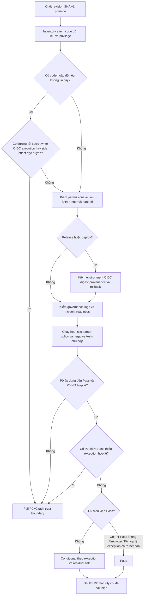

<Callout type="error" title="Một lỗi P0 đủ để dừng phát hành">
  Điểm tổng cao không bù được một lỗi blocking. Nếu code không tin cậy chạy cùng secret, token ghi, OIDC hoặc runner có đường tới production, kết luận phải là **Fail** cho đến khi ranh giới đó được sửa hoặc loại bỏ.
</Callout>

## Mục lục

- [Cách dùng checklist](#cách-dùng-checklist)
  - [Phạm vi áp dụng](#phạm-vi-áp-dụng)
  - [Mức ưu tiên và bằng chứng](#mức-ưu-tiên-và-bằng-chứng)
- [Quick gate trước khi merge hoặc go-live](#quick-gate-trước-khi-merge-hoặc-go-live)
- [Ma trận event và rủi ro](#ma-trận-event-và-rủi-ro)
- [Checklist chi tiết](#checklist-chi-tiết)
  - [Governance và bảo vệ thay đổi](#governance-và-bảo-vệ-thay-đổi)
  - [Trigger và dữ liệu không tin cậy](#trigger-và-dữ-liệu-không-tin-cậy)
  - [Quyền của token tự động](#quyền-của-token-tự-động)
  - [Secrets và environment approval](#secrets-và-environment-approval)
  - [OIDC và quyền trên hệ thống đích](#oidc-và-quyền-trên-hệ-thống-đích)
  - [Third-party actions và reusable workflows](#third-party-actions-và-reusable-workflows)
  - [Pull request từ fork](#pull-request-từ-fork)
  - [Runner và cô lập mạng](#runner-và-cô-lập-mạng)
  - [Dependency và chuỗi cung ứng](#dependency-và-chuỗi-cung-ứng)
  - [Artifact cache và attestation](#artifact-cache-và-attestation)
  - [Release và deployment](#release-và-deployment)
  - [Log retention và audit](#log-retention-và-audit)
  - [Sẵn sàng ứng phó sự cố](#sẵn-sàng-ứng-phó-sự-cố)
- [Audit tự động và thu thập bằng chứng](#audit-tự-động-và-thu-thập-bằng-chứng)
  - [Chụp nhanh cấu hình bằng GitHub CLI](#chụp-nhanh-cấu-hình-bằng-github-cli)
  - [Chạy policy check trong repository](#chạy-policy-check-trong-repository)
  - [Giới hạn của kiểm tra tự động](#giới-hạn-của-kiểm-tra-tự-động)
- [Cách chấm điểm và kết luận](#cách-chấm-điểm-và-kết-luận)
- [Quy trình review từng bước](#quy-trình-review-từng-bước)
- [Bài thực hành và negative tests](#bài-thực-hành-và-negative-tests)
  - [Chuẩn bị](#chuẩn-bị)
  - [Thực hiện](#thực-hiện)
  - [Tiêu chí hoàn thành](#tiêu-chí-hoàn-thành)
- [Troubleshooting](#troubleshooting)
- [Tài liệu liên quan trong series](#tài-liệu-liên-quan-trong-series)
- [Tài liệu tham khảo chính thức](#tài-liệu-tham-khảo-chính-thức)

## Cách dùng checklist

Checklist này là một **control baseline**, tức tập kiểm soát tối thiểu mà nhóm dùng làm chuẩn. Nó không thay threat model riêng của hệ thống. Một pipeline ký firmware, phát hành package công khai hoặc deploy vào tài khoản cloud production có thể cần kiểm soát chặt hơn.

Dùng trang này theo ba chế độ:

| Chế độ | Khi dùng | Phạm vi tối thiểu | Kết quả cần lưu |
|---|---|---|---|
| PR review | Workflow, action, script CI, dependency hoặc cấu hình runner thay đổi | Quick gate, các mục bị diff tác động và luồng privilege liên quan | Comment review, kết quả policy check, SHA của revision |
| Go-live review | Workflow mới hoặc lần đầu cấp quyền production | Toàn bộ P0, toàn bộ P1 và negative tests liên quan | Biên bản Pass/Conditional/Fail, owner, bằng chứng, rollback |
| Audit định kỳ | Theo quý; theo tháng với pipeline phát hành quan trọng | Toàn bộ checklist và cấu hình ngoài repository | Snapshot API/UI, mẫu run, audit log, exception còn hiệu lực |

### Phạm vi áp dụng

Inventory phải bao phủ nhiều hơn `.github/workflows/**`. Một thay đổi ở local action, script deploy hoặc lockfile có thể thực thi trong cùng trust boundary với workflow.

- `.github/workflows/**` và reusable workflows được gọi;
- `.github/actions/**`, script build, test, release và deploy;
- `CODEOWNERS`, ruleset, branch protection và tag protection;
- Actions policy ở enterprise, organization và repository;
- secrets, variables, environments và deployment protection rules;
- GitHub App, personal access token, deploy key và OIDC trust policy;
- GitHub-hosted runner, self-hosted runner group, image và network policy;
- dependency manifest, lockfile, package registry và update automation;
- artifact, cache, package, container image, attestation và release asset;
- GitHub audit log, provider audit log, runner telemetry và runbook incident.

**Trust boundary** là ranh giới nơi dữ liệu hoặc code đi từ vùng ít tin cậy sang vùng có quyền cao hơn. Ví dụ điển hình là artifact do fork PR tạo được workflow có `contents: write` tải về. Việc GitHub lưu artifact không làm bytes đó trở thành đáng tin cậy.

### Mức ưu tiên và bằng chứng

| Mức | Ý nghĩa | Cách xử lý |
|---|---|---|
| **P0 — Blocking** | Có đường thực tế tới chiếm credential, repository, artifact phát hành, runner hoặc production | Dừng merge/go-live. Không chấp nhận bằng điểm bù. Exception chỉ dùng cho tình huống khẩn cấp đã được security owner phê duyệt và có thời hạn rất ngắn |
| **P1 — High** | Giảm đáng kể xác suất hoặc blast radius, tức phạm vi thiệt hại khi compromise | Phải Pass để có kết luận Pass. Conditional chỉ hợp lệ khi từng mục chưa Pass có compensating control, owner, expiry và residual-risk approval |
| **P2 — Defense in depth** | Tăng khả năng phòng thủ, phát hiện, truy vết hoặc phục hồi | Lập kế hoạch cải thiện. Không bỏ qua nếu hệ thống có rủi ro cao |

Một checkbox chỉ được đánh dấu đạt khi có **bằng chứng**. Mọi predicate được nối bằng dấu chấm phẩy hoặc từ “và” trong cột **Đạt khi** đều phải được thỏa mãn. Thiếu một predicate hoặc thiếu bằng chứng cho predicate đó thì trạng thái là `Unknown`; nếu bằng chứng cho thấy predicate không đạt thì là `Fail`. Bằng chứng tốt là dữ liệu có thể tái kiểm tra: URL ruleset, output API đã loại dữ liệu nhạy cảm, file policy, run ID, exact commit SHA, artifact digest, log approval hoặc ticket diễn tập.

Không dùng các câu như “team đã biết”, “action phổ biến” hoặc “token được GitHub mask” làm bằng chứng. Chúng không chứng minh kiểm soát đang được enforce.

## Quick gate trước khi merge hoặc go-live

Quick gate là kiểm tra ngắn cho reviewer. Nếu bất kỳ dòng P0 nào không đạt hoặc chưa xác định, dừng và chuyển sang checklist chi tiết.

- [ ] **P0 — Code không tin cậy được cô lập.** Fork PR, metadata bên ngoài, dependency install và artifact không tin cậy không chạy cùng write token, stored secret, `id-token: write` hoặc network production.
- [ ] **P0 — Trigger đặc quyền an toàn.** `pull_request_target`, `workflow_run`, `issue_comment` và `repository_dispatch` không đưa bytes do actor bên ngoài kiểm soát vào execution hoặc privileged side effect: build/test, import, local action, plugin, parser nguy hiểm, đường dẫn có path traversal/symlink, ký, publish hay deploy. Checkout/fetch đơn thuần không tự thực thi; nó thành P0 khi có đường tới sink như trên. Nếu organization chọn policy metadata-only tuyệt đối, checkout/fetch là vi phạm baseline P1 ngay cả khi chưa có sink.
- [ ] **P0 — Quyền token fail closed.** Workflow có `permissions: {}` hoặc map quyền tối thiểu rõ ràng. Không có `write-all`. Quyền ghi chỉ nằm trong job ngắn, tin cậy.
- [ ] **P0 — Production có cổng độc lập.** Job deploy dùng environment đã tồn tại, required reviewer phù hợp, prevent self-review và ref policy. Credential production không có bản sao ở scope rộng hơn.
- [ ] **P0 — OIDC trust chặt.** Provider kiểm tra đúng issuer, audience, repository, ref hoặc environment. Role đích không dùng wildcard rộng và không có quyền quản trị ngoài nhu cầu deploy.
- [ ] **P0 — Dependency thực thi bất biến.** Remote action và reusable workflow được pin bằng full commit SHA 40 ký tự đã xác minh từ repository canonical. Runtime download và container image được pin bằng digest hoặc checksum đáng tin cậy.
- [ ] **P0 — Fork PR không nhận privilege.** Private-fork settings không gửi write token hoặc secrets cho workflow chạy code contributor. Public fork CI dùng runner không có đường tới tài sản nội bộ.
- [ ] **P0 — Self-hosted runner không trở thành cầu nối.** Code không tin cậy không chạy trên runner bền vững hoặc runner nhìn thấy production. Runner đặc quyền là một lần dùng, thuộc group riêng và có egress tối thiểu.
- [ ] **P0 — Bytes phát hành có danh tính rõ.** Exact release bytes được ràng buộc bằng digest với trusted producer. Pipeline không build lại sau approval và fail closed khi provenance hoặc attestation là policy bắt buộc.
- [ ] **P0 — Đường thay đổi được bảo vệ.** Ruleset/branch protection, required checks và CODEOWNERS thực sự enforce review cho workflow, local action, script phát hành và policy files. Bypass bị hạn chế và audit.
- [ ] **P0 — Có khả năng thu hồi.** Owner biết cách disable workflow, revoke credential tại provider, cô lập runner, chặn release/deploy và xác định run/artifact bị ảnh hưởng.
- [ ] **P1 — Có bằng chứng runtime.** Một run gần nhất cho thấy quyền hiệu lực, environment approval, action SHA, artifact digest và identity hệ thống đích khớp thiết kế.

<Callout type="warn" title="Unknown không phải Pass">
  Nếu reviewer không có quyền xem private-fork settings, environment rules hoặc cloud trust policy, trạng thái là **chưa xác minh**. Với mục P0, chưa xác minh phải được xử lý như Fail cho tới khi owner cung cấp bằng chứng.
</Callout>

## Ma trận event và rủi ro

**Event** là tín hiệu khởi động workflow. Rủi ro không chỉ đến từ tên event. Nó còn phụ thuộc workflow revision nào được dùng, ai kiểm soát payload, quyền hiệu lực, secrets, runner và code được thực thi. Ma trận dưới đây **không exhaustive**; mọi event thực tế vẫn phải được inventory theo TRG-01.

| Event hoặc pattern | Nguồn có thể không tin cậy | Rủi ro chính | Baseline an toàn | Mức review |
|---|---|---|---|---|
| `pull_request` từ fork | source, test, lockfile, title, body, branch, outputs | arbitrary code execution trong CI | GitHub-hosted runner; `contents: read` tối đa; không secrets/OIDC; không publish | P0 nếu có privilege |
| `pull_request` cùng repository | contributor nội bộ và metadata PR | không có fork downgrade; stored secrets có thể khả dụng | vẫn cấp quyền tối thiểu; tách build khỏi deploy; review actor và branch policy | P1, thành P0 nếu deploy |
| `pull_request_target` | metadata và bytes từ head repository của PR | pwn request khi untrusted bytes đi tới execution hoặc privileged side effect | ưu tiên metadata-only và không checkout; nếu có fetch thụ động thì không build/test/import/local action/plugin, không đưa vào parser/path nguy hiểm và không dùng cho side effect đặc quyền | P0 khi có đường source → sink; checkout-only là P1 nếu organization chọn metadata-only tuyệt đối |
| Dependabot tạo `push`/PR/review event | dependency diff, manifest và lockfile do bot tạo | workflow có semantics như fork: `GITHUB_TOKEN` read-only, Actions secrets không khả dụng; chỉ Dependabot secrets phù hợp mới được cấp | build/test trong vùng không đặc quyền; secret registry nếu bắt buộc phải read-only và lưu dưới Dependabot secrets; publish sau merge từ trusted ref | P0 nếu nâng privilege hoặc publish từ PR |
| `merge_group` | merge commit tạm và thay đổi base/queue | required check không báo cáo cho merge queue hoặc kiểm sai SHA | required workflow nghe `merge_group` với `types: [checks_requested]`; kiểm `github.sha` của merge group; giữ cả trigger PR khi cần | P1, thành P0 cho release gate |
| `workflow_run` | event và artifact/output từ workflow trước | workflow sau có thể có write token hoặc secrets | kiểm repository, event, conclusion, exact run ID, PR/head SHA, schema và size; không chạy artifact | P0 |
| `issue_comment` hoặc `issues` | body, actor và command text | command injection hoặc bot đặc quyền bị lạm dụng | kiểm authorization bằng API; parser allowlist; không nội suy vào shell | P0 nếu side effect ghi/deploy |
| `pull_request_review` hoặc `pull_request_review_comment` | review body, diff comment, actor, PR head và association | review/comment giả làm approval hoặc command đặc quyền | kiểm review state và authorization bằng API tại thời điểm chạy; coi body/path là dữ liệu; không checkout rồi execute PR head | P0 nếu cấp privilege/side effect |
| `repository_dispatch` | caller và `client_payload` | endpoint automation trở thành remote execution | xác thực caller ngoài GitHub; validate schema; map command tĩnh; environment gate | P0 |
| `workflow_dispatch` | người có quyền chạy và inputs | deploy nhầm ref/environment; input thành lệnh | input typed; allowlist environment; kiểm ref; approval; không dùng input làm command | P1/P0 cho production |
| `schedule` | code trên default branch tại thời điểm chạy | dependency drift, credential tồn tại lâu, ít người quan sát | pin dependency; timeout; owner; alert failure; quyền tối thiểu | P1 |
| `push` vào default branch | người hoặc automation có thể merge/push | release từ commit chưa đạt gate hoặc bot push | ruleset, required checks, không direct push, build từ exact SHA | P1/P0 cho release |
| `push` tag | người hoặc token có thể tạo/move tag | phát hành version giả hoặc tag trỏ sai commit | protected tag/ruleset; verify tag và commit; environment approval | P0 |
| `release` | người hoặc automation quản lý release | upload asset không khớp source/tag | kiểm action type, tag, digest, provenance; permission scope nhỏ | P0 |
| `deployment` hoặc `deployment_status` | ref, environment, payload, creator/App và status từ hệ thống ngoài | deploy nhầm ref/target, vòng lặp automation hoặc status giả mở gate | allowlist creator/App, exact SHA và environment; idempotency; không coi status đơn lẻ là approval hoặc provenance | P0 nếu thay đổi production |
| `workflow_call` | caller inputs, secrets và permission contract | reusable workflow trở thành confused deputy | typed inputs; secrets tường minh; caller allowlist; quyền chỉ giảm; pin cross-repo SHA | P0 nếu reusable deploy |

**Confused deputy** là thành phần có quyền cao bị caller ít quyền hơn lợi dụng để thực hiện hành động ngoài ý định. Một reusable deploy workflow nhận tùy ý account ID và secret kế thừa là ví dụ điển hình. Cách xử lý là cố định hoặc allowlist đích, xác thực caller và giới hạn contract.

## Checklist chi tiết

Mỗi mục có một ID để ghi vào review record. Cột **Đạt khi** mô tả các predicate và bằng chứng tối thiểu. Một control chỉ là `Pass` khi **mọi predicate** trong ô này đều đủ bằng chứng; thiếu predicate hoặc bằng chứng là `Unknown`, còn quan sát trái predicate là `Fail`. Cột **Fail khi** nêu dấu hiệu điển hình phải dừng hoặc mở finding, nhưng không phải danh sách đầy đủ.

### Governance và bảo vệ thay đổi

| ID | Mức | Kiểm soát | Đạt khi | Fail khi |
|---|---|---|---|---|
| GOV-01 | P0 | Bảo vệ default branch và release ref | Ruleset yêu cầu pull request, review không phải tác giả, required checks và xử lý stale approval; tag phát hành có rule riêng | Có thể push trực tiếp, force-push, xóa ref hoặc tạo release tag ngoài quy trình |
| GOV-02 | P0 | CODEOWNERS bao phủ code đặc quyền | `.github/workflows/`, `.github/actions/`, script build/release/deploy, lockfile và policy files có owner; ruleset bật review từ Code Owners | Có file thực thi trong pipeline không có owner, hoặc CODEOWNERS tồn tại nhưng review không được enforce |
| GOV-03 | P0 | Bypass được giới hạn | Chỉ break-glass identity được bypass; mọi lần dùng có lý do, ticket và audit event; admin không mặc định bypass | Maintainer thông thường hoặc automation token có thể bỏ qua review/check |
| GOV-04 | P1 | Tách quyền quản trị | Nhóm quản lý Actions policy, secrets, runners và environments nhỏ, có MFA và access review định kỳ | Một account cá nhân vừa sửa workflow, vừa approve environment, vừa quản lý cloud role |
| GOV-05 | P1 | Policy action deny by default | Enterprise/organization chỉ cho action/reusable workflow đã duyệt và yêu cầu pin full SHA nếu tính năng hỗ trợ | Mọi Marketplace action mặc định được phép hoặc exception không có owner/ngày hết hạn |
| GOV-06 | P1 | Required check độc lập | Policy check chạy từ revision tin cậy và là required check cho thay đổi workflow | PR có thể sửa hoặc bỏ chính check rồi merge trong cùng thay đổi mà không có guardrail khác |
| GOV-07 | P2 | Inventory và ownership | Mỗi workflow có owner, mục đích, trigger, privilege, hệ thống đích, SLA và ngày review gần nhất | Workflow không ai sở hữu, thất bại nhiều tuần hoặc không biết còn được dùng không |

<Callout type="warn" title="Full-SHA policy không bao phủ mọi reusable workflow">
  Built-in policy yêu cầu full SHA không enforce ref của cross-repository reusable workflow trong `jobs.<job_id>.uses`. GOV-05 cần YAML parser hoặc custom policy duyệt riêng trường này; không chỉ quét `steps[*].uses`.
</Callout>

Nếu repository dùng ruleset và branch protection đồng thời, xác định rule hiệu lực thay vì giả định chúng cộng dồn như mong muốn. Kiểm bằng UI/API và một PR thử nghiệm không đủ review. Hành động cuối cùng là chứng minh merge bị chặn, không chỉ chụp trang cấu hình.

### Trigger và dữ liệu không tin cậy

| ID | Mức | Kiểm soát | Đạt khi | Fail khi |
|---|---|---|---|---|
| TRG-01 | P0 | Inventory mọi trigger | Mỗi `on` có actor, dữ liệu attacker kiểm soát, workflow revision và privilege được ghi trong review | Reviewer chỉ đọc `run` mà không xác định ai có thể kích hoạt |
| TRG-02 | P0 | Trigger đặc quyền không đưa input vào sink nguy hiểm | Với `pull_request_target`, `workflow_run`, comment/dispatch, untrusted bytes không đi tới build/test, shell, import, local action, plugin, parser nguy hiểm, path traversal/symlink hoặc privileged side effect | `head.sha`, artifact, branch, body hoặc output đi vào execution hay side effect đặc quyền; checkout/fetch đơn thuần chỉ thành P0 khi tồn tại đường này |
| TRG-03 | P0 | Không nội suy dữ liệu vào source script | Context không tin cậy được truyền qua step-level `env`/input, đọc bằng biến runtime, quote và validate | `${{ github.event.* }}`, `inputs.*`, `steps.*.outputs` hoặc `needs.*.outputs` nằm trực tiếp trong `run`/`script` có khả năng thực thi |
| TRG-04 | P1 | Dispatch input là dữ liệu typed và allowlist | Environment, mode, ref và target được map vào tập giá trị cố định; actor có quyền phù hợp | Input được dùng làm command, option, URL, path, account hoặc environment tùy ý |
| TRG-05 | P1 | Reusable workflow có contract | Inputs có type/default hợp lý; secrets truyền từng tên; caller và permission contract được tài liệu hóa | Dùng `secrets: inherit` theo thói quen hoặc caller có thể chọn tài nguyên production ngoài allowlist |
| TRG-06 | P1 | Chống replay và race | Side effect kiểm exact SHA/run attempt; concurrency hoặc idempotency key ngăn hai deploy/release cạnh tranh | Rerun cũ có thể ghi đè release mới hoặc deploy artifact stale |
| TRG-07 | P2 | Timeout và giới hạn compute | Mọi job có timeout phù hợp; event công khai có concurrency/rate guard | Fork/comment có thể tạo job vô hạn hoặc giữ runner quá lâu |

Xem cách xử lý expression và shell trong [Phòng chống script injection](/docs/bao-mat/05-script-injection). Với event fork và handoff bằng artifact, dùng pattern trong [Bảo mật workflow cho fork pull requests](/docs/bao-mat/06-fork-pull-requests).

### Quyền của token tự động

| ID | Mức | Kiểm soát | Đạt khi | Fail khi |
|---|---|---|---|---|
| TOK-01 | P0 | Deny by default | Workflow đặt `permissions: {}` hoặc map tối thiểu; job mở đúng scope cần dùng | Dựa vào default của repository/organization hoặc dùng `write-all` |
| TOK-02 | P0 | Tách job đặc quyền | Build/test không có scope ghi; publish/deploy là job ngắn, không chạy code không tin cậy | Một job vừa cài dependency/chạy test vừa có `contents`, `packages`, `actions` hoặc `id-token` ở mức write |
| TOK-03 | P1 | Xác minh quyền hiệu lực | Run mẫu tại đúng event có phần **GITHUB_TOKEN Permissions** khớp thiết kế | Chỉ review YAML; không kiểm fork downgrade, job override hoặc setting cấp trên |
| TOK-04 | P1 | Không lưu Git credential không cần thiết | Checkout không persist credential khi step sau không push; token không đi vào output/artifact/cache | Token nằm trong Git config, URL remote, command argument hoặc file workspace lâu hơn nhu cầu |
| TOK-05 | P1 | Chọn đúng identity | API trong repo dùng `GITHUB_TOKEN`; cross-repo dùng GitHub App hẹp; PAT chỉ là phương án cuối có hạn dùng | PAT classic của nhân viên được dùng để né thiết kế permission hoặc sống vô hạn |
| TOK-06 | P2 | Negative permission test | Một thao tác ngoài scope thất bại, còn thao tác đúng scope thành công trong repository lab | Không biết job có thể làm gì ngoài đường happy path |

Chi tiết permission scope và cách kiểm chứng nằm tại [GITHUB_TOKEN và mô hình permissions](/docs/bao-mat/01-github-token-permissions).

### Secrets và environment approval

| ID | Mức | Kiểm soát | Đạt khi | Fail khi |
|---|---|---|---|---|
| SEC-01 | P0 | Scope credential nhỏ nhất | Production credential chỉ ở environment tương ứng hoặc được cấp động; organization secret dùng selected repositories | Cùng credential production tồn tại ở repository/organization scope và bỏ qua environment gate |
| SEC-02 | P0 | Approval độc lập | Environment đã tạo trước, có required reviewer, prevent self-review, ref policy và quy trình break-glass | Workflow có thể tạo/đánh vần sai environment mới không rule, hoặc actor tự approve |
| SEC-03 | P0 | Không cấp secret cho code không tin cậy | Fork PR, dependency install, test, scanner ít tin cậy và artifact parser không nhận secret | Approval được dùng làm lý do để chạy PR head với secret |
| SEC-04 | P1 | Secret chỉ vào step cần dùng | Credential truyền theo từng tên ở `env`/`with`, không nằm ở workflow-level env; step không bật trace | Toàn job nhận một bundle credential hoặc dùng `secrets: inherit` không có contract |
| SEC-05 | P1 | Inventory và rotation | Mỗi secret có owner, provider credential ID, scope, quyền, consumer, TTL, ngày rotate và cách revoke | Secret không owner, không expiration hoặc không biết revoke ở hệ thống nguồn |
| SEC-06 | P1 | Không rò qua kênh bền vững | Log, output, summary, artifact, cache, image layer và debug bundle được kiểm; token runtime được mask ngay | Dựa vào masking để cho phép in secret hoặc chuyển secret giữa jobs |
| SEC-07 | P1 | Fail closed khi thiếu credential | Job dừng rõ ràng; không fallback sang anonymous, credential máy runner hoặc account khác | Secret rỗng làm deploy sang target mặc định hay dùng ambient credential |
| SEC-08 | P2 | Secret scanning và push protection | Tính năng phù hợp plan được bật; bypass có reviewer; alert có SLA revoke | Alert chỉ được xóa khỏi code mà credential vẫn còn hiệu lực |

Masking là cơ chế giảm lộ trên log, không phải access control. Nếu secret bị ghi ra ngoài, revoke ở provider trước rồi mới xóa log. Xem quy trình đầy đủ trong [Quản lý secrets trong production](/docs/bao-mat/02-secrets-management).

### OIDC và quyền trên hệ thống đích

| ID | Mức | Kiểm soát | Đạt khi | Fail khi |
|---|---|---|---|---|
| OIDC-01 | P0 | `id-token: write` chỉ ở job cần federation | Job OIDC ngắn, không build/test code không tin cậy và chỉ có action/script đã review | Quyền OIDC đặt ở workflow level hoặc có trong fork/PR job |
| OIDC-02 | P0 | Trust policy exact | Provider kiểm issuer, audience, repository/owner ID nếu hỗ trợ, ref hoặc environment và reusable workflow identity khi cần | Trust chỉ kiểm audience, dùng wildcard toàn organization hoặc chấp nhận mọi ref/context |
| OIDC-03 | P0 | Role permission tối thiểu | Role riêng theo workload/environment; resource và API cụ thể; session ngắn | Role admin, wildcard tài nguyên rộng hoặc cùng role dùng cho staging và production |
| OIDC-04 | P1 | Environment và cloud cùng enforce | GitHub environment, cloud trust và branch/tag rules đều yêu cầu cùng context production | Chỉ một phía kiểm ref/environment; typo environment vẫn lấy được role |
| OIDC-05 | P1 | Identity được truy vết | Session name hoặc provider log liên kết được run ID, commit SHA, role và API đã gọi | Chỉ biết “GitHub Actions” đã đăng nhập mà không nối được tới run |
| OIDC-06 | P1 | Negative trust tests | Sai branch, sai environment, sai repository và sai audience đều bị từ chối trong sandbox | Chỉ thử assume-role thành công từ đường production |
| OIDC-07 | P2 | Không lưu JWT/credential tạm | Raw JWT và cloud credential không vào log/output/artifact; lifetime khớp thời gian deploy | Token được decode bằng dịch vụ web, truyền sang job khác hoặc lưu để dùng lại |

OIDC giải quyết authentication, tức chứng minh job là ai. Authorization vẫn do role phía provider quyết định. Xem claim, trust policy và negative test tại [OIDC federation trong GitHub Actions](/docs/bao-mat/03-oidc-federation).

### Third-party actions và reusable workflows

| ID | Mức | Kiểm soát | Đạt khi | Fail khi |
|---|---|---|---|---|
| ACT-01 | P0 | Pin ref bất biến | Mọi remote `uses` dùng full commit SHA 40 ký tự; SHA được phân giải từ exact release trong repository canonical | Dùng branch, tag, SHA rút gọn hoặc SHA lấy từ fork không được xác minh |
| ACT-02 | P0 | Review code thật sự chạy | Đã đọc metadata, pre/main/post, composite steps, bundle `dist`, Docker entrypoint, network và runtime download | Chỉ xem Marketplace badge, README, số sao hoặc source dễ đọc nhưng bỏ qua bundle |
| ACT-03 | P0 | Dependency runtime bất biến | Binary, script, base image và container được khóa bằng digest/checksum lấy từ kênh đáng tin cậy | Action pin SHA nhưng tải `latest`, chạy remote script hoặc dùng image tag mutable |
| ACT-04 | P1 | Giảm blast radius của action | Job có permission, secret, network và runner tối thiểu; action scanner không nằm cùng deploy credential | Action được tin chỉ vì do vendor lớn phát hành |
| ACT-05 | P1 | Allowlist và owner nội bộ | Policy chỉ cho dependency đã duyệt; mỗi action có owner, ngày review, version và rollback SHA | Team có thể thêm action mới mà không qua security review |
| ACT-06 | P1 | Quy trình update có kiểm chứng | Bot mở PR; reviewer kiểm release notes, diff source/bundle, quyền mới và test cô lập | Auto-merge mọi update action hoặc giữ pin cũ vô thời hạn không theo dõi advisory |
| ACT-07 | P2 | Reusable workflow làm guardrail | Workflow trung tâm được pin cross-repo, contract rõ và cloud có thể ràng buộc signer/workflow identity | Workflow trung tâm che giấu dependency và nhận toàn bộ secrets của caller |

Không có ví dụ `uses` có thể sao chép trên trang tổng hợp này. Khi thêm action vào workflow thật, lấy full SHA từ repository canonical, xác minh release và ghi exact version trong comment cùng dòng. Quy trình từng bước nằm tại [Bảo mật third-party actions](/docs/bao-mat/04-third-party-actions).

### Pull request từ fork

| ID | Mức | Kiểm soát | Đạt khi | Fail khi |
|---|---|---|---|---|
| FORK-01 | P0 | CI dùng `pull_request` không đặc quyền | Job test có `contents: read` tối đa, không secrets/OIDC/write và chạy trên GitHub-hosted runner | Dùng event đặc quyền chỉ để tránh approval hoặc để lấy secret |
| FORK-02 | P0 | `pull_request_target` không nối untrusted bytes với privilege | API side effect nhỏ dùng tham số đã validate; mọi bytes từ PR head, archive hoặc artifact không đi tới build/test/import/local action/plugin, parser nguy hiểm, path traversal/symlink hay side effect đặc quyền | Bytes PR đi vào execution hoặc ảnh hưởng hành động ghi, ký, publish, deploy; checkout/fetch đơn thuần chưa đủ tạo P0 |
| FORK-02M | P1 | Baseline metadata-only của organization | Khi organization chọn policy metadata-only tuyệt đối, workflow không checkout/fetch/archive/download PR head dù chưa có sink | Policy metadata-only đã áp dụng nhưng workflow vẫn đưa PR bytes vào workspace đặc quyền |
| FORK-03 | P0 | Private-fork policy an toàn | Không gửi write token hoặc Actions secrets cho workflow chạy fork; setting được snapshot | Admin đã nới setting nhưng reviewer chỉ nhìn YAML |
| FORK-04 | P0 | Handoff đặc quyền được xác thực | `workflow_run` kiểm exact producer run, event, repository, conclusion, PR, current head SHA, artifact schema/size | Workflow sau tải artifact “mới nhất”, chạy executable hoặc tin trường `passed` do producer tự khai |
| FORK-05 | P1 | Approval đúng mục đích | External contributor approval chỉ cấp compute; reviewer đọc diff và job vẫn không đặc quyền | Approval được coi là chuyển code thành trusted |
| FORK-06 | P1 | Cache/artifact được gắn nhãn untrusted | Consumer parse dữ liệu nhỏ, chống path traversal/symlink và không dùng bytes PR để ký/publish | Binary từ fork được promote thẳng sang release vì CI xanh |
| FORK-07 | P2 | Chống abuse | Timeout, concurrency, quota và alert bất thường được cấu hình | Actor ngoài có thể chiếm compute hoặc tạo artifact không giới hạn |

Metadata-only tuyệt đối là baseline đơn giản và an toàn nhất cho `pull_request_target`; trang này không khuyến khích checkout head trong event đặc quyền. Nếu organization chọn baseline đó, checkout/fetch head dù chưa execute là finding P1 theo FORK-02M. Finding thuộc FORK-02 và là P0 khi reviewer chứng minh được đường từ untrusted bytes tới execution hoặc privileged side effect. Cách phân loại này nhất quán với [Bảo mật workflow cho fork pull requests](/docs/bao-mat/06-fork-pull-requests#rủi-ro-của-pull-request-target).

### Runner và cô lập mạng

| ID | Mức | Kiểm soát | Đạt khi | Fail khi |
|---|---|---|---|---|
| RUN-01 | P0 | Code công khai không tin cậy dùng runner phù hợp | Fork PR dùng GitHub-hosted runner hoặc trust zone dùng một lần không thấy tài sản nội bộ | Public fork chạy trên máy bền vững, có Docker socket, metadata service hoặc mạng production |
| RUN-02 | P0 | Runner đặc quyền là ephemeral thật sự | Runner nhận một job, compute bị hủy sau job, disk/home/workspace không tái sử dụng | Chỉ deregister runner nhưng giữ VM, volume hoặc host bị job trước sửa |
| RUN-03 | P0 | Runner group giới hạn | Group chỉ cho repository/workflow cần thiết; labels không phải cơ chế authorization duy nhất | Repository ít tin cậy có thể chọn label của runner production |
| RUN-04 | P1 | Network deny by default | Egress chỉ tới GitHub, registry và API đích cần thiết; cloud metadata và internal control plane bị chặn | Job có secret được truy cập Internet tùy ý hoặc toàn mạng nội bộ |
| RUN-05 | P1 | Không có ambient credential | Không long-lived key trong image, home, credential helper, Docker daemon hoặc service account host | Workflow không tham chiếu secret nhưng vẫn lấy được credential từ máy |
| RUN-06 | P1 | Image và autoscaler được bảo vệ | Image bất biến, patch SLA, checksum/digest, bootstrap tối thiểu; controller/ARC và registration token có quyền hẹp | Runner image cài tool từ nguồn mutable mỗi lần hoặc autoscaler có cluster-admin không cần thiết |
| RUN-07 | P1 | Telemetry sống ngoài runner | Diagnostic, process/network và lifecycle event được gửi ra hệ thống chỉ đọc trước khi hủy máy | Attacker có thể xóa toàn bộ bằng chứng trên runner rồi job kết thúc |
| RUN-08 | P2 | Kiểm thử isolation | Bài test xác nhận không đọc được metadata, secret cũ, workspace cũ và domain ngoài allowlist | Isolation chỉ tồn tại trên sơ đồ, chưa từng được kiểm tra |

Ephemeral nghĩa là ngắn hạn, nhưng không tự đồng nghĩa sạch. Cần hủy compute hoặc reset bằng cơ chế nằm ngoài quyền của job. Cleanup script chạy trong chính job không phải ranh giới bảo mật.

### Dependency và chuỗi cung ứng

| ID | Mức | Kiểm soát | Đạt khi | Fail khi |
|---|---|---|---|---|
| DEP-01 | P0 | Build tái tạo từ dependency đã khóa | Manifest và lockfile được commit; CI dùng chế độ frozen/clean install; registry nguồn được cố định | CI tự cập nhật lockfile, lấy version nổi hoặc dùng registry mirror không rõ nguồn |
| DEP-02 | P0 | Publish không chạy dependency chưa review trong vùng đặc quyền | Build/test dependency chạy trước; job ký/publish chỉ xử lý exact artifact đã kiểm chứng | `npm install`, plugin build hoặc generator chạy sau khi production credential được cấp |
| DEP-03 | P1 | Dependency review trên PR | Thay đổi manifest/lockfile hiển thị package mới, license, vulnerability và transitive impact; finding nghiêm trọng chặn merge | Reviewer chỉ đọc manifest và bỏ qua lockfile/transitive dependency |
| DEP-04 | P1 | Update và advisory có SLA | Dependency graph/alerts/update bot hoạt động; critical finding có owner và thời hạn; bot PR không auto-merge mù quáng | Alert tồn tại lâu không triage hoặc pin SHA làm team ngừng theo dõi upstream |
| DEP-05 | P1 | Registry và namespace được kiểm soát | Internal package dùng namespace/scoped registry; publish và install token tách biệt; chống dependency confusion | Package nội bộ có thể bị public package cùng tên thay thế |
| DEP-06 | P1 | SBOM và provenance được tạo cho release quan trọng | Software Bill of Materials (SBOM) mô tả component/version; provenance gắn exact digest với builder | Chỉ có danh sách dependency từ source nhưng không biết artifact phát hành chứa gì |
| DEP-07 | P2 | Build hermetic hoặc egress giới hạn | Build quan trọng không tải tùy ý ngoài lock/mirror; download có checksum và log | Cùng commit tạo output khác nhau do tải dependency mới nhất lúc build |
| DEP-08 | P2 | Có chiến lược thay thế dependency | Action/package trọng yếu có owner, health review và kế hoạch fork/thay thế | Một dependency không duy trì là điểm lỗi đơn không ai chịu trách nhiệm |

**Dependency confusion** xảy ra khi package manager lấy package public do attacker tạo thay cho package nội bộ cùng tên. Cách xử lý là khóa namespace, registry và xác thực nguồn. Chiến lược tổng thể nằm tại [Supply chain security](/docs/bao-mat/08-supply-chain-security).

### Artifact cache và attestation

| ID | Mức | Kiểm soát | Đạt khi | Fail khi |
|---|---|---|---|---|
| ART-01 | P0 | Exact release bytes gắn với trusted producer | Build ghi SHA-256/digest; handoff chọn exact run/artifact từ trusted producer; release/deploy đối chiếu cùng digest và fail closed nếu provenance policy bắt buộc không đạt | Chọn bằng tên, tag, “latest”, artifact mới nhất hoặc digest không ràng buộc producer; provenance bắt buộc lỗi nhưng pipeline vẫn tiếp tục |
| ART-02 | P0 | Dữ liệu từ vùng ít tin cậy không được thực thi | Consumer kiểm size, file count, schema, regular file, symlink/path traversal và chỉ parse data | Download rồi `source`, import, `chmod +x`, cài package, ký hoặc chạy binary |
| ART-03 | P1 | Provenance được verify tại consumer gate | Khi áp dụng và plan hỗ trợ, verify exact bytes, expected repo/signer workflow/source ref rồi fail closed; signed provenance có trust policy tương đương được chấp nhận | Control được khai là áp dụng nhưng chỉ tạo provenance không verify, trust signer quá rộng hoặc dùng `|| true` khi verify lỗi |
| ART-04 | P1 | Attest đúng bytes cuối cùng | Đóng gói/ký biến đổi hoàn tất trước attestation; publish không build hoặc nén lại | Attest file trung gian rồi phát hành file có digest khác |
| ART-05 | P1 | Permission attestation tách biệt | Chỉ trusted release job có `id-token: write` và `attestations: write` | Fork/test job có khả năng tạo provenance mang identity production |
| ART-06 | P1 | Cache chỉ là tối ưu hiệu năng | Cache miss không đổi tính đúng; output được validate/rebuild; key phân tách trust zone và ref | Cache được coi như artifact đã ký hoặc executable cache từ PR đi vào deploy |
| ART-07 | P1 | Artifact không chứa credential | Upload path allowlist, hidden file được review, retention tối thiểu và download access phù hợp | Upload toàn workspace/home, debug bundle, `.env`, Git credential hoặc key |
| ART-08 | P1 | Container deploy bằng digest | Registry record, attestation và manifest deploy cùng một image digest | Verify tag rồi deploy tag mutable ở thời điểm khác |
| ART-09 | P2 | Lifecycle đồng bộ | Artifact/package, attestation và release record có retention/thu hồi theo digest; record mồ côi được dọn | Xóa binary nhưng để attestation gây hiểu nhầm, hoặc hết log trước kỳ audit |

ART-03 mặc định là P1. Nâng verification thành P0 khi artifact vượt qua trust boundary độc lập, phục vụ compliance/admission hoặc public consumer, hay khi attestation/provenance là control chính để nhận diện trusted producer. Nếu GitHub Artifact Attestations không phù hợp plan hoặc hệ phân phối, security owner phải ghi applicability; signed provenance với định danh signer, subject digest và policy fail-closed tương đương là phương án hợp lệ.

Attestation chứng minh nguồn gốc và integrity của bytes. Nó không chứng minh bytes không độc hại. Đọc mô hình trust và lệnh verify tại [Artifact attestations và provenance](/docs/bao-mat/07-artifact-attestations).

### Release và deployment

| ID | Mức | Kiểm soát | Đạt khi | Fail khi |
|---|---|---|---|---|
| REL-01 | P0 | Release chỉ từ ref tin cậy | Source SHA đã qua required checks; branch/tag được bảo vệ; actor và trigger được xác định | Release từ PR head, branch tùy ý hoặc tag do token rộng tạo |
| REL-02 | P0 | Build once promote many | Cùng digest được promote qua staging/production; approval nhìn thấy SHA, digest, test và target | Production job checkout lại, build lại hoặc lấy dependency mới sau approval |
| REL-03 | P0 | Environment gate trước privilege | Job chưa nhận secret/OIDC trước khi rules đạt; reviewer độc lập; target cố định/allowlist | Approval xảy ra sau khi code đặc quyền đã chạy hoặc input chọn account tùy ý |
| REL-04 | P0 | Quyền phát hành nhỏ nhất | Job release chỉ có scope tạo release/package/deployment cần thiết; cloud role đúng resource | Một token có thể sửa source, branch, package, release và production cùng lúc |
| REL-05 | P1 | Chống deploy đồng thời và replay | Concurrency không hủy nhầm deploy production; API idempotent; rerun cũ không ghi đè phiên bản mới | Hai run cùng thay đổi production hoặc rollback ngoài ý muốn |
| REL-06 | P1 | Kiểm chứng trước và sau deploy | Trước deploy verify digest/provenance; sau deploy đọc identity/version thực tế và ghi deployment status | Job xanh chỉ vì CLI trả `0`, không biết production đang chạy bytes nào |
| REL-07 | P1 | Rollback đã thử | Rollback dùng artifact/digest đã verify, quyền và approval rõ; không rebuild version cũ | Runbook yêu cầu sửa tay production hoặc build lại source cũ không khóa dependency |
| REL-08 | P2 | Separation of duties | Người viết thay đổi không phải người duy nhất approve và phát hành; break-glass được giám sát | Một actor có thể đưa code tới production không có checkpoint độc lập |

### Log retention và audit

| ID | Mức | Kiểm soát | Đạt khi | Fail khi |
|---|---|---|---|---|
| LOG-01 | P0 | Không ghi credential | Debug tracing tắt; không dump context/env/header; generated token được mask trước output | Raw token, secret, cookie, signing material hoặc cloud credential xuất hiện trong log/summary |
| LOG-02 | P1 | Retention khớp yêu cầu điều tra | Run log, artifact bằng chứng, audit log và provider log sống đủ lâu cho detection/audit; policy được ghi rõ | Sự cố thường được phát hiện sau khi log đã tự xóa |
| LOG-03 | P1 | Correlation end to end | Có mapping commit SHA → workflow/run attempt → action SHA → artifact digest → deployment/provider event | Mỗi hệ thống có log nhưng không thể nối một deploy về đúng build |
| LOG-04 | P1 | Audit cấu hình ngoài Git | Thay đổi Actions policy, secret scope, environment, runner group, ruleset và cloud trust được ghi/alert | Chỉ audit Git history trong khi admin đổi setting qua UI/API không để diff |
| LOG-05 | P1 | Log được xuất ra vùng chống sửa | Sự kiện quan trọng đi tới SIEM hoặc storage hạn chế xóa; quyền đọc/xóa tách khỏi pipeline | Workflow hoặc runner bị compromise có thể xóa cả log và bằng chứng |
| LOG-06 | P2 | Alert có tín hiệu cụ thể | Cảnh báo bypass, action mới, mutable ref, secret scope rộng, environment rule bị bỏ, assume-role lạ và release ngoài giờ | Thu thập log nhưng không ai được báo khi boundary thay đổi |
| LOG-07 | P2 | Dữ liệu audit tối thiểu và riêng tư | Lưu ID/metadata cần điều tra; không đưa secret hoặc dữ liệu cá nhân không cần thiết vào provenance/log | Bằng chứng audit tự trở thành kho dữ liệu nhạy cảm không quản lý |

Retention là thời gian hệ thống giữ record. Chọn thời gian dựa trên detection latency, yêu cầu pháp lý và chi phí. Hành động cần làm là ghi một con số cụ thể cho từng nguồn, không dùng “mặc định GitHub” như policy.

### Sẵn sàng ứng phó sự cố

| ID | Mức | Kiểm soát | Đạt khi | Fail khi |
|---|---|---|---|---|
| IR-01 | P0 | Có owner và kênh khẩn cấp | On-call biết ai được disable workflow/Actions, khóa environment, block action và cô lập runner | Chỉ một người nghỉ phép có quyền containment |
| IR-02 | P0 | Revoke tại nguồn | Runbook liệt kê provider credential/role/App/PAT/package/release cần thu hồi; lệnh và quyền được thử | Chỉ xóa GitHub secret hoặc cancel run, trong khi token đã lấy còn dùng được |
| IR-03 | P1 | Bảo toàn bằng chứng | Thu run/event payload, attempt, commit, action SHA, artifact digest, runner, approval, network và provider log trước cleanup | Xóa log/runner ngay mà chưa ghi timeline và phạm vi |
| IR-04 | P1 | Scope downstream | Quy trình kiểm branch, tag, release, package, cache, artifact, deployment và cloud API side effect | Chỉ rotate secret nhưng không tìm persistence hoặc output bị đầu độc |
| IR-05 | P1 | Khôi phục từ nguồn tin cậy | Rebuild trên runner sạch, dependency khóa, action SHA đã review; verify artifact trước republish | Khôi phục bằng rerun cùng workflow/runner có khả năng đã compromise |
| IR-06 | P1 | Diễn tập định kỳ | Tabletop hoặc sandbox drill trong 6–12 tháng; thời gian disable/revoke/correlation được đo | Runbook chưa từng chạy, permission khẩn cấp hết hạn hoặc lệnh không còn đúng |
| IR-07 | P2 | Bài học trở thành guardrail | Sau incident thêm test, detection, ruleset hoặc policy check với owner | Chỉ viết postmortem nhưng cùng pattern có thể merge lại |

## Audit tự động và thu thập bằng chứng

### Chụp nhanh cấu hình bằng GitHub CLI

Có thể gọi các lệnh từ repository cần audit, nhưng output phải nằm ngoài checkout. Các endpoint quản trị cần quyền phù hợp. Không tăng scope token chỉ để làm cho lệnh thành công; nếu không đọc được endpoint, ghi record `*-unverified.txt` và yêu cầu owner cung cấp bằng chứng.

```bash
set -euo pipefail
umask 077

REPO="$(gh repo view --json nameWithOwner --jq .nameWithOwner)"
STAMP="$(date -u +%Y%m%dT%H%M%SZ)"
BASE_DIR="${XDG_RUNTIME_DIR:-${TMPDIR:-/tmp}}"
OUT="$(mktemp -d "${BASE_DIR%/}/gha-security-review.${STAMP}.XXXXXX")"
TMP="$OUT/.tmp"
mkdir -p "$TMP"

mark_unverified() {
  local stem="$1" subject="$2"
  rm -f "$OUT/${stem}.json"
  printf 'Không thể xác minh %s bằng credential hiện tại; cần owner export và ký nhận.\n' \
    "$subject" > "$OUT/${stem}-unverified.txt"
}

fetch_json() {
  local stem="$1" endpoint="$2"
  if gh api "$endpoint" > "$TMP/${stem}.raw" 2> "$TMP/${stem}.err" \
    && jq -e . "$TMP/${stem}.raw" > "$OUT/${stem}.json"; then
    :
  else
    mark_unverified "$stem" "$endpoint"
  fi
  rm -f "$TMP/${stem}.raw" "$TMP/${stem}.err"
}

fetch_array_pages() {
  local stem="$1" endpoint="$2"
  if gh api --paginate --slurp "$endpoint" \
      > "$TMP/${stem}.raw" 2> "$TMP/${stem}.err" \
    && jq -e '
      if type == "array" and all(.[]; type == "array")
      then add // []
      else error("expected pages containing arrays")
      end
    ' "$TMP/${stem}.raw" > "$OUT/${stem}.json"; then
    :
  else
    mark_unverified "$stem" "$endpoint"
  fi
  rm -f "$TMP/${stem}.raw" "$TMP/${stem}.err"
}

fetch_collection_pages() {
  local stem="$1" endpoint="$2" field="$3"
  if gh api --paginate --slurp "$endpoint" \
      > "$TMP/${stem}.raw" 2> "$TMP/${stem}.err" \
    && jq -e --arg field "$field" '
      if type == "array"
         and all(.[]; type == "object"
             and has($field)
             and ((.[$field] | type) == "array"))
      then {
        total_count: ([.[] | .[$field][]] | length),
        ($field): [.[] | .[$field][]]
      }
      else error("expected object pages with collection field")
      end
    ' "$TMP/${stem}.raw" > "$OUT/${stem}.json"; then
    :
  else
    mark_unverified "$stem" "$endpoint"
  fi
  rm -f "$TMP/${stem}.raw" "$TMP/${stem}.err"
}

# Metadata repository; output JSON luôn được parse lại.
if gh repo view "$REPO" \
    --json nameWithOwner,visibility,defaultBranchRef \
    > "$TMP/repository.raw" 2> "$TMP/repository.err" \
  && jq -e . "$TMP/repository.raw" > "$OUT/repository.json"; then
  :
else
  mark_unverified repository "repository metadata"
fi
rm -f "$TMP/repository.raw" "$TMP/repository.err"

# Object đơn.
fetch_json workflow-permissions \
  "repos/${REPO}/actions/permissions/workflow"
fetch_json actions-policy \
  "repos/${REPO}/actions/permissions"
fetch_json retention \
  "repos/${REPO}/actions/permissions/artifact-and-log-retention"

# Array pages phải --slurp rồi dùng add; không redirect nhiều JSON documents thô.
fetch_array_pages rulesets "repos/${REPO}/rulesets?per_page=100"

# Object collection pages phải --slurp rồi merge đúng field.
fetch_collection_pages environments \
  "repos/${REPO}/environments?per_page=100" environments
fetch_collection_pages artifacts \
  "repos/${REPO}/actions/artifacts?per_page=100" artifacts
fetch_collection_pages runners \
  "repos/${REPO}/actions/runners?per_page=100" runners

# Inventory tên/metadata; các lệnh này không trả plaintext secret.
if ! gh secret list --repo "$REPO" > "$OUT/repository-secrets.txt"; then
  rm -f "$OUT/repository-secrets.txt"
  printf 'Không thể xác minh repository secrets; cần owner export và ký nhận.\n' \
    > "$OUT/repository-secrets-unverified.txt"
fi
if ! gh variable list --repo "$REPO" > "$OUT/repository-variables.txt"; then
  rm -f "$OUT/repository-variables.txt"
  printf 'Không thể xác minh repository variables; cần owner export và ký nhận.\n' \
    > "$OUT/repository-variables-unverified.txt"
fi

# Run gần đây để chọn mẫu kiểm tra runtime.
if gh run list --repo "$REPO" --limit 30 \
    --json databaseId,name,event,status,conclusion,headSha,createdAt \
    > "$TMP/recent-runs.raw" 2> "$TMP/recent-runs.err" \
  && jq -e . "$TMP/recent-runs.raw" > "$OUT/recent-runs.json"; then
  :
else
  mark_unverified recent-runs "recent workflow runs"
fi
rm -f "$TMP/recent-runs.raw" "$TMP/recent-runs.err"

# Validation cuối: mọi file JSON export phải parse được.
shopt -s nullglob
for json in "$OUT"/*.json; do
  jq -e . "$json" > /dev/null
done
rm -rf "$TMP"

printf 'Đã ghi inventory vào %s cho %s\n' "$OUT" "$REPO"
```

Đây chỉ là **inventory**, không đủ chứng minh control đang enforce. Review đầy đủ còn phải fetch detail từng ruleset; xác định exact active branch rules hoặc classic branch protection cho từng ref; kiểm bypass actors; Actions policy; private-fork settings; environment deployment branch policy; và retention hiệu lực. Sau đó đối chiếu bằng PR/run thử, provider log và các evidence khác trong từng control.

Snapshot có thể chứa tên secret, repository private, actor, runner label và topology nội bộ. Lưu nó trong vùng audit có access control và retention rõ. Không commit output vào repository.

Đối với organization, không redirect output từ `--paginate` thẳng vào một file. Dùng `--slurp`, normalize đúng shape và `jq -e` như các lệnh an toàn sau:

```bash
ORGANIZATION="example"

gh api "orgs/${ORGANIZATION}/actions/permissions/workflow" | jq -e .

gh api --paginate --slurp \
  "orgs/${ORGANIZATION}/actions/permissions/repositories?per_page=100" \
  | jq -e '{
      total_count: ([.[] | .repositories[]] | length),
      repositories: [.[] | .repositories[]]
    }'

gh api --paginate --slurp \
  "orgs/${ORGANIZATION}/actions/runner-groups?per_page=100" \
  | jq -e '{
      total_count: ([.[] | .runner_groups[]] | length),
      runner_groups: [.[] | .runner_groups[]]
    }'

# Luôn giới hạn time window/phrase; audit-log pages là arrays nên dùng add.
gh api --method GET --paginate --slurp \
  -f phrase='created:>=2026-01-01' \
  "orgs/${ORGANIZATION}/audit-log?per_page=100" \
  | jq -e 'add // []'
```

Audit log organization có thể lớn và nhạy cảm. Trong production, dùng time window, phrase filter theo tài liệu REST hiện hành và đẩy kết quả đã normalize vào hệ thống audit thay vì tải thủ công toàn bộ mỗi lần.

### Chạy policy check trong repository

Script Python dưới đây chỉ là **advisory heuristic**, tức bộ dò candidate cơ học bằng regex để tạo hàng đợi review. Nó tìm một số pattern được hỗ trợ: `permissions` có vẻ bị thiếu/rộng, remote `uses` có vẻ mutable, và tổ hợp `pull_request_target` có cả dấu hiệu lấy PR bytes lẫn execution/privileged side effect. Pattern bị bắt có thể làm script exit `1`, nhưng kết quả có cả false positive lẫn false negative.

Đây không phải YAML parser, security proof, bằng chứng `Pass` hay blocking required policy duy nhất. Checkout/fetch PR head đơn thuần chỉ tạo warning; candidate P0 chỉ xuất hiện khi regex đồng thời thấy một sink nguy hiểm trong cùng file. Vì regex không hiểu job boundary hay data flow, reviewer vẫn phải xác minh đường source → sink thực tế.

```bash
python3 - <<'PY'
from pathlib import Path
import re
import sys

root = Path('.github/workflows')
paths = sorted([*root.rglob('*.yml'), *root.rglob('*.yaml')]) if root.exists() else []
full_sha = re.compile(r'^[0-9a-fA-F]{40}$')
uses_line = re.compile(r'^\s*(?:-\s*)?uses:\s*["\']?([^\s#"\']+)', re.MULTILINE)
untrusted_expr = re.compile(
    r'\$\{\{[^}]+(?:github\.event|github\.head_ref|inputs\.|'
    r'steps\.[^.]+\.outputs|needs\.[^.]+\.outputs)'
)
pr_target = re.compile(r'\bpull_request_target\b')
pr_bytes = re.compile(
    r'(github\.event\.pull_request\.head\.(?:sha|ref)|refs/pull/|'
    r'gh\s+pr\s+checkout|git\s+fetch[^\n]*(?:head|pull)|'
    r'download-artifact|source[_ -]?archive)',
    re.IGNORECASE,
)
dangerous_sink = re.compile(
    r'(^\s*(?:-\s*)?uses:\s*["\']?\./|npm\s+(?:ci|install|test)|'
    r'pip\s+install|pytest(?:\s|$)|make(?:\s|$)|docker\s+build|'
    r'(^|[;&|]\s*)(?:source|eval)\s+|\b(?:tar|unzip)\b|'
    r'\b(?:publish|deploy|sign)\b|gh\s+api[^\n]*(?:--method|-X)\s*'
    r'(?:POST|PUT|PATCH|DELETE))',
    re.IGNORECASE | re.MULTILINE,
)

candidates = []
warnings = []
remote_refs = 0

for path in paths:
    text = path.read_text(encoding='utf-8')

    if not re.search(r'^\s*permissions\s*:', text, re.MULTILINE):
        candidates.append((path, 1, 'candidate: workflow có vẻ thiếu permissions'))

    for match in re.finditer(r'permissions\s*:\s*(write-all|read-all)', text):
        line = text.count('\n', 0, match.start()) + 1
        if match.group(1) == 'write-all':
            candidates.append((path, line, 'candidate: permissions: write-all'))
        else:
            warnings.append((path, line, 'candidate: read-all rộng; review scope'))

    # Regex quét cả jobs.<job>.uses và steps[*].uses theo dòng, nhưng không hiểu YAML.
    for match in uses_line.finditer(text):
        value = match.group(1)
        line = text.count('\n', 0, match.start()) + 1
        if value.startswith(('./', '../')):
            continue
        if value.startswith('docker://'):
            if not re.fullmatch(r'docker://.+@sha256:[0-9a-fA-F]{64}', value):
                candidates.append((path, line, 'candidate: Docker uses chưa pin digest'))
            continue
        remote_refs += 1
        if '@' not in value or not full_sha.fullmatch(value.rsplit('@', 1)[1]):
            candidates.append((path, line, 'candidate: remote uses chưa pin full SHA'))

    if pr_target.search(text):
        source = pr_bytes.search(text)
        sink = dangerous_sink.search(text)
        if source and sink:
            line = text.count('\n', 0, min(source.start(), sink.start())) + 1
            candidates.append((
                path,
                line,
                'candidate: pull_request_target có cả PR bytes và execution/side effect',
            ))
        elif source:
            line = text.count('\n', 0, source.start()) + 1
            warnings.append((
                path,
                line,
                'checkout/fetch candidate; tự nó chưa chứng minh execution P0',
            ))

    for match in untrusted_expr.finditer(text):
        line = text.count('\n', 0, match.start()) + 1
        warnings.append((path, line, 'review untrusted expression tới sink theo từng job'))

print(f'Đã quét heuristic {len(paths)} workflow và {remote_refs} remote uses')
for path, line, message in warnings:
    print(f'WARNING {path}:{line}: {message}')
for path, line, message in candidates:
    print(f'CANDIDATE {path}:{line}: {message}', file=sys.stderr)

if candidates:
    raise SystemExit(1)
PY
```

Chạy script trên checkout sạch của pull request hoặc trên bộ fixture cô lập. Exit `0` chỉ có nghĩa regex không bắt candidate được hỗ trợ; nó không kết luận repository sạch. Có thể dùng output làm tín hiệu advisory trong workflow được CODEOWNERS bảo vệ, nhưng không biến script này thành policy blocking duy nhất.

### Giới hạn của kiểm tra tự động

Script trên cố ý không giả vờ là YAML parser hay security proof. Nó không thể:

- hiểu YAML 1.2, alias/anchor, multiline scalar hoặc mọi dạng `on`;
- tính effective permissions sau workflow default, job override và policy cấp trên;
- xác minh SHA thuộc repository canonical;
- đọc source, pre/post step hoặc dependency lồng bên trong action ngoài;
- phân biệt mọi expression an toàn trong `env` với expression nguy hiểm trong multiline `run`;
- nối chính xác trigger → source → sink theo từng job;
- xem settings fork, environment, runner group hoặc cloud trust policy;
- chứng minh artifact/cache không bị dùng như executable;
- phát hiện đầy đủ runtime download, plugin, package lifecycle script hoặc ambient credential;
- xác định ruleset nào áp dụng cho một ref cụ thể chỉ từ source workflow.

Policy production cần YAML 1.2 parser hoặc policy engine. Implementation phải normalize `on` ở cả dạng scalar, list và map; tính effective permissions cho từng job; duyệt riêng `jobs.<job_id>.uses` và `steps[*].uses`; rồi phân tích trigger → sink theo job thay vì theo cả file. Mỗi rule phải có fixture positive, negative và edge case để regression test false positive/negative khi parser, GitHub syntax hoặc policy thay đổi.

Kết luận hành động: dùng heuristic để tìm candidate, parser/policy engine để enforce rule cơ học, CodeQL hoặc mô hình data flow phù hợp để theo luồng, và review thủ công để xác minh trust boundary. Không dùng “policy check xanh” làm bằng chứng `Pass`.

## Cách chấm điểm và kết luận

Chấm trạng thái sau khi thu bằng chứng, không chấm theo cảm giác.

1. Đánh dấu mỗi control là `Pass`, `Fail`, `N/A` hoặc `Unknown`.
2. Chỉ dùng `Pass` khi mọi predicate trong **Đạt khi** có bằng chứng. Thiếu bất kỳ predicate nào là `Unknown`; quan sát trái predicate là `Fail`.
3. `N/A` phải có scope/applicability rationale và security owner phê duyệt. Ví dụ repository không deploy thì một số control OIDC có thể không áp dụng.
4. `Unknown` của P0 được xử lý như `Fail`. P0 `N/A` không có phê duyệt hợp lệ cũng là `Fail`.
5. Exception hợp lệ phải gắn đúng control, có compensating control, owner, expiry còn hiệu lực và residual-risk approval của security owner.
6. Loại `N/A` hợp lệ khỏi mẫu số. Tính riêng:
   - `P1 maturity = số P1 Pass / số P1 áp dụng × 100`;
   - `P2 maturity = số P2 Pass / số P2 áp dụng × 100`.
7. Tỷ lệ P1/P2 chỉ là **maturity metric** để ưu tiên cải thiện. Chúng không phải merge/go-live gate và không bù được control chưa Pass.

| Kết luận | Điều kiện bắt buộc | Hành động |
|---|---|---|
| **Pass** | Mọi P0 và P1 áp dụng đều `Pass`; không có `Unknown`; mọi `N/A` được security owner phê duyệt; không exception nào hết hạn | Cho merge/go-live; lưu record từng control và ngày review tiếp theo |
| **Conditional** | Mọi P0 áp dụng đều `Pass`; P0 `N/A` hợp lệ; mỗi P1 chưa `Pass` có compensating control, owner, expiry còn hiệu lực và residual-risk approval | Chỉ go-live trong phạm vi exception; theo dõi từng finding tới expiry hoặc khi đóng |
| **Fail** | Có P0 `Fail`/`Unknown`; P0 `N/A` không hợp lệ; hoặc bất kỳ P1 chưa `Pass` nào không có exception hợp lệ | Dừng merge/go-live; sửa boundary hoặc hoàn thiện exception rồi review lại |

**Compensating control** là kiểm soát thay thế làm giảm cùng rủi ro. Ví dụ chưa có egress allowlist nhưng deploy job không chạy third-party code, dùng credential 5 phút và provider resource policy exact có thể giảm rủi ro tạm thời. “Sẽ cẩn thận hơn” không phải compensating control. Exception hết hạn không còn hợp lệ.

Dùng một record cho **mỗi control**, không gom các finding thành một dòng chung. Trường **Expected** phải liệt kê toàn bộ predicate từ ô **Đạt khi**; trường **Observed** và **Evidence URL/hash** phải đối chiếu từng predicate.

```text
Control ID:
Scope:
Status: Pass | Fail | N/A | Unknown
Expected:
Observed:
Evidence URL/hash:
Reviewer:
Owner:
Exception: none | compensating control + residual-risk approver/date
Expiry: none | YYYY-MM-DDThh:mm:ssZ
```

Ở cấp review, lưu thêm repository/workflow, revision SHA, review mode, decision, ngày review tiếp theo và P1/P2 maturity. Với `N/A`, ghi security owner approval trong **Reviewer** hoặc evidence URL. Với exception, **Owner**, **Exception** và **Expiry** không được để trống.

## Quy trình review từng bước



<Steps>
<Step>

**Chốt revision và phạm vi.** Ghi exact commit SHA. Liệt kê workflow, local action, script, settings và cloud policy bị thay đổi trực tiếp hoặc gián tiếp.

</Step>
<Step>

**Vẽ luồng privilege.** Với từng job, ghi `event → code/data → runner → permissions → secrets/OIDC → artifact/cache → side effect`. Đánh dấu nơi trust tăng lên.

</Step>
<Step>

**Chạy quick gate.** Dừng ngay khi thấy code không tin cậy cùng privilege. Đừng dành thời gian chấm điểm một thiết kế đã có lỗi P0.

</Step>
<Step>

**Review source và cấu hình ngoài Git.** Đọc workflow, action, script và lockfile. Sau đó đối chiếu ruleset, fork settings, environment, runner group, Actions policy và provider trust.

</Step>
<Step>

**Xác minh dependency thực thi.** Với mỗi remote `uses`, xác minh canonical repository, release, full SHA, source/bundle và permission. Với runtime download, xác minh digest/checksum và nguồn.

</Step>
<Step>

**Kiểm đường phát hành.** Bắt đầu từ bytes production rồi truy ngược về digest, attestation, build run, commit và review. Nếu không truy ngược được, finding thuộc ART-01 hoặc REL-02.

</Step>
<Step>

**Chạy positive và negative tests.** Happy path phải thành công. Sai ref, thiếu permission, sai artifact digest, sai OIDC claim và payload injection phải fail closed.

</Step>
<Step>

**Kiểm runtime evidence.** Mở một run của đúng event. Đối chiếu effective permissions, action SHA, runner, approval, artifact digest và provider identity.

</Step>
<Step>

**Kết luận và theo dõi.** Ghi Pass/Conditional/Fail. Mỗi finding có control ID, owner, due date, evidence cần bổ sung và điều kiện đóng.

</Step>
</Steps>

## Bài thực hành và negative tests

Mục tiêu bài lab là xác minh advisory heuristic bắt đúng các fixture được hỗ trợ và các trust boundary được chọn fail closed. Lab không chứng minh toàn bộ repository sạch. Không dùng secret, cloud role, package hoặc runner production.

### Chuẩn bị

- [ ] Repository sandbox riêng, không chứa source hay credential nhạy cảm.
- [ ] GitHub-hosted runner; không dùng self-hosted runner.
- [ ] Quyền admin sandbox để xem workflow permissions và tạo environment `security-review-lab`.
- [ ] Environment có reviewer độc lập và prevent self-review nếu plan hỗ trợ.
- [ ] GitHub CLI đã đăng nhập đúng sandbox.
- [ ] Một branch dành riêng cho bài lab; mọi fixture cố ý sai được xóa trước merge.

### Thực hiện

**Negative test 1 — fixture remote ref mutable tạo candidate**

1. Sao chép heuristic script ở phần trước vào terminal.
2. Trong branch lab, tạo một workflow fixture có một remote `uses` dùng branch hoặc tag mutable. Không chạy workflow fixture đó.
3. Chạy script và kỳ vọng exit code `1` với candidate remote ref chưa pin full SHA.
4. Xóa remote step. Có thể thay bằng một full SHA 40 ký tự đã tự xác minh từ repository canonical theo quy trình của bài 04, nhưng exit `0` vẫn không phải bằng chứng `Pass`.

**Negative test 2 — fixture permission rộng tạo candidate**

1. Thêm tạm `permissions: write-all` vào fixture không được kích hoạt.
2. Heuristic phải trả exit code `1` cho pattern được hỗ trợ.
3. Thay bằng `permissions: {}`. Script không còn candidate permission cơ học; vẫn phải mở run thật của workflow read-only và kiểm **Set up job → GITHUB_TOKEN Permissions**.

**Regression fixture — phân biệt checkout/fetch với source → sink**

1. Tạo fixture tĩnh, không có trigger chạy được, chứa `pull_request_target`, `permissions: {}` và dấu hiệu fetch `github.event.pull_request.head.sha`, nhưng không build/test/import/local action/plugin hay side effect.
2. Kỳ vọng heuristic chỉ cảnh báo checkout/fetch; riêng pattern này không tạo candidate P0.
3. Trong bản sao fixture vẫn không chạy được, thêm `npm test`. Kỳ vọng tổ hợp PR bytes + sink tạo candidate và exit `1`.
4. Giữ cả hai ca trong fixture regression của policy production. Reviewer vẫn phải xác minh job boundary vì regex có thể ghép source và sink không liên quan.

**Negative test 3 — injection chỉ tạo dữ liệu**

Dùng workflow lab an toàn trong [Phòng chống script injection](/docs/bao-mat/05-script-injection#bài-thực-hành-an-toàn). Truyền payload marker có command substitution và chuỗi giống workflow command. Kỳ vọng marker không được thực thi và không tạo annotation.

**Negative test 4 — fork code không có privilege**

Dùng pattern lab trong [Bảo mật workflow cho fork pull requests](/docs/bao-mat/06-fork-pull-requests#bài-thực-hành). Cho test tạo một file marker vô hại để chứng minh contributor có arbitrary code execution. Sau đó xác nhận job không có secret, write token, OIDC hoặc self-hosted runner.

**Negative test 5 — environment gate**

1. Tạo workflow thủ công với `permissions: {}` và một job chỉ in commit SHA sau environment `security-review-lab`.
2. Run phải chờ reviewer.
3. Actor khởi tạo không tự approve được khi prevent self-review bật.
4. Tạo một run từ ref không được environment cho phép. Job phải bị chặn.
5. Không thêm secret thật; bài này chỉ kiểm control plane.

**Negative test 6 — provenance bị sửa phải fail khi control áp dụng**

Nếu plan và applicability dùng GitHub Artifact Attestations, chạy lab trong [Artifact attestations và provenance](/docs/bao-mat/07-artifact-attestations#bài-thực-hành). Nếu dùng signed provenance tương đương, chạy verifier và trust policy tương ứng trong sandbox. File gốc phải thành công; thay đổi một byte phải trả exit code khác `0`.

**Negative test 7 — OIDC trust từ chối context sai**

Chỉ dùng cloud sandbox. Lần lượt thử sai branch, sai environment, sai audience và repository không được phép theo [OIDC federation](/docs/bao-mat/03-oidc-federation#kiểm-thử-negative-path). Mỗi ca phải thất bại ở trust policy mà không tạo tài nguyên.

**Negative test 8 — diễn tập containment**

1. Chọn một run ID sandbox.
2. Đo thời gian tìm workflow owner, disable workflow, cancel run và khóa environment.
3. Mô phỏng credential bị lộ bằng một chuỗi không có quyền. Owner phải chỉ đúng nơi revoke tại provider, không chỉ nơi xóa GitHub secret.
4. Thu commit SHA, action SHA, runner label, artifact ID/digest và approval record vào một incident note.
5. Bật lại sandbox theo runbook và ghi điểm thiếu.

<Callout type="error" title="Không triển khai workflow cố ý dễ bị khai thác">
  Fixture sai chỉ dùng để heuristic hoặc policy regression đọc và phải không có trigger có thể chạy. Không tạo job thật nội suy payload vào shell, checkout fork head trong `pull_request_target`, in token hoặc tải executable không tin cậy để “chứng minh” lỗ hổng.
</Callout>

### Tiêu chí hoàn thành

- [ ] Advisory heuristic trả candidate/exit `1` cho fixture mutable remote ref và `write-all` được hỗ trợ; team không diễn giải exit `0` là repository sạch.
- [ ] Fixture `pull_request_target` checkout/fetch-only chỉ tạo warning; fixture có cả PR bytes và sink được hỗ trợ tạo candidate. Cả hai không chạy được.
- [ ] Workflow mẫu khai báo permission tường minh và remote dependency dùng SHA đã xác minh bằng quy trình độc lập, không chỉ bằng regex.
- [ ] Payload injection không tạo marker, command hoặc workflow annotation.
- [ ] Fork code chạy được trong vùng không đặc quyền nhưng không thấy secret/OIDC/write/network nội bộ.
- [ ] Environment chặn job trước approval và từ chối ref không hợp lệ.
- [ ] Khi provenance control áp dụng, bytes nguyên bản verify thành công và bytes bị sửa fail closed bằng attestation hoặc signed provenance tương đương.
- [ ] OIDC từ chối mọi context sai đã chọn.
- [ ] Team hoàn thành containment sandbox và nối được run → commit → artifact → provider log.
- [ ] Mọi fixture cố ý sai đã bị xóa khỏi branch merge; branch cuối cùng qua quick gate và review thủ công.

## Troubleshooting

| Triệu chứng | Nguyên nhân cần kiểm tra | Hướng xử lý an toàn |
|---|---|---|
| Heuristic báo workflow thiếu `permissions` dù setting repository là read-only | Regex không hiểu YAML/effective default, nhưng default vẫn có thể drift | Review candidate; khai báo `permissions: {}` hoặc map tối thiểu nếu đúng thiết kế; xác minh effective permissions runtime |
| Heuristic báo remote action dù dùng exact version tag | Tag vẫn mutable; regex cũng không xác minh repository canonical | Phân giải release từ repository canonical, review commit và pin full SHA 40 ký tự; dùng parser/policy production để enforce |
| `pull_request_target` có `npm test` nhưng heuristic không biết test dùng bytes nào | Regex chỉ ghép source và sink trong cùng file, không hiểu job/data flow | Review source → sink theo từng job. Nếu test PR head, chuyển sang `pull_request`; nếu không có đường đó, ghi false positive và thêm regression fixture |
| Checkout/fetch trong `pull_request_target` chỉ tạo warning | Checkout/fetch đơn thuần không tự execute; organization có thể vẫn cấm theo metadata-only baseline | Không dùng warning để hợp thức hóa unsafe checkout. Xóa checkout nếu không cần; ghi P1 nếu vi phạm baseline metadata-only, nâng P0 khi có execution/privileged side effect |
| Fork CI không có secret hoặc write token | Đây là hành vi bảo vệ mong đợi | Thiết kế test không đặc quyền; publish/deploy sau merge hoặc qua handoff đã xác thực |
| Job chờ environment không thấy reviewer | Sai tên environment, rule/plan không phù hợp hoặc reviewer không có quyền | Mở đúng environment, kiểm chính tả, protection rules và plan; không tạo bản sao credential ở scope rộng hơn |
| Job OIDC có token nhưng cloud từ chối | `aud`, `sub`, repository ID, ref, environment hoặc signer workflow không khớp | Inspect claim trong sandbox, sửa exact trust condition; không nới wildcard để làm job xanh |
| Cloud login thành công từ branch ngoài dự kiến | Trust policy quá rộng hoặc chỉ kiểm audience | Thu hẹp ngay repository/ref/environment, thu hồi session nếu cần và thêm negative test |
| Self-hosted runner ghi `ephemeral` nhưng còn file run trước | Deregistration không hủy compute/disk | Hủy VM/Pod/volume bằng controller ngoài job; kiểm image và persistence |
| Artifact có digest nhưng consumer vẫn không an toàn | Digest chỉ định danh bytes, không chứng minh producer đáng tin | Ràng buộc producer run, commit, signer workflow và attestation; không chạy artifact từ fork |
| Attestation verify thành công nhưng malware scan thất bại | Provenance không phải malware/vulnerability verdict | Dừng deploy; điều tra builder/dependency; giữ cả verification và security scan làm gate riêng |
| Cache miss làm build khác kết quả | Pipeline phụ thuộc cache cho tính đúng hoặc dependency chưa khóa | Làm build đúng khi cache rỗng; khóa dependency và xem cache chỉ là tối ưu |
| Required CODEOWNER review không xuất hiện | Pattern không match, file CODEOWNERS sai vị trí/syntax hoặc ruleset chưa require | Dùng PR thử đổi workflow, kiểm owner resolution và bật required Code Owner review |
| Ruleset API trống nhưng UI có branch protection | Repository dùng cơ chế protection khác hoặc caller thiếu quyền | Kiểm cả ruleset và branch protection UI/API; ghi trạng thái chưa xác minh nếu không đủ quyền |
| Snapshot CLI trả `403` cho runner/environment | Token auditor thiếu quyền quản trị | Giữ file `*-unverified.txt`; không xin token rộng dùng lâu; nhờ owner chạy export có kiểm soát và ký nhận bằng chứng |
| Log đã bị xóa trước khi incident được phát hiện | Retention ngắn hơn detection latency | Tăng retention trong giới hạn plan và xuất security event sang storage/SIEM phù hợp |
| Secret đã xóa khỏi GitHub nhưng vẫn gọi API được | Xóa bản lưu không revoke credential nguồn | Revoke tại provider, rotate consumer, audit usage rồi mới dọn log/bản sao |
| P1/P2 maturity cao nhưng còn một P0 `Unknown` hoặc P1 chưa Pass thiếu exception | Metric không phải go-live gate và không bù được control | Kết luận Fail; lấy bằng chứng, sửa thiết kế hoặc hoàn thiện exception P1 hợp lệ |
| P1 maturity thấp nhưng mọi P0 Pass và từng P1 chưa Pass có exception hợp lệ | Tỷ lệ chỉ đo maturity | Có thể kết luận Conditional theo đúng scope/expiry/residual-risk approval; không đặt ngưỡng phần trăm giả làm gate |

## Tài liệu liên quan trong series

<Cards>
  <Card title="GITHUB_TOKEN permissions" href="/docs/bao-mat/01-github-token-permissions" description="Thiết kế quyền tối thiểu và kiểm thử permission failure." />
  <Card title="Quản lý secrets" href="/docs/bao-mat/02-secrets-management" description="Scope, environment approval, rotation và incident response." />
  <Card title="OIDC federation" href="/docs/bao-mat/03-oidc-federation" description="Trust claims và credential cloud ngắn hạn." />
  <Card title="Third-party actions" href="/docs/bao-mat/04-third-party-actions" description="Review source, pin SHA, allowlist và update dependency." />
  <Card title="Script injection" href="/docs/bao-mat/05-script-injection" description="Xử lý context và input như dữ liệu thay vì source code." />
  <Card title="Fork pull requests" href="/docs/bao-mat/06-fork-pull-requests" description="Cô lập code contributor và xác thực handoff đặc quyền." />
  <Card title="Artifact attestations" href="/docs/bao-mat/07-artifact-attestations" description="Gắn provenance với exact bytes và verify fail closed." />
  <Card title="Supply chain security" href="/docs/bao-mat/08-supply-chain-security" description="Kiểm soát dependency, build, SBOM và provenance end to end." />
</Cards>

## Tài liệu tham khảo chính thức

Các nguồn dưới đây là tài liệu chính thức nên được đối chiếu lại khi GitHub plan, GitHub Enterprise Server hoặc cloud provider thay đổi:

- [GitHub Actions — Secure use reference](https://docs.github.com/en/actions/reference/security/secure-use)
- [Workflow syntax — permissions](https://docs.github.com/en/actions/reference/workflows-and-actions/workflow-syntax#permissions)
- [Events that trigger workflows](https://docs.github.com/en/actions/reference/workflows-and-actions/events-that-trigger-workflows)
- [Securely using pull_request_target](https://docs.github.com/en/actions/reference/security/securely-using-pull_request_target)
- [Managing GitHub Actions settings for a repository](https://docs.github.com/en/repositories/managing-your-repositorys-settings-and-features/enabling-features-for-your-repository/managing-github-actions-settings-for-a-repository)
- [Managing GitHub Actions settings for an organization](https://docs.github.com/en/organizations/managing-organization-settings/disabling-or-limiting-github-actions-for-your-organization)
- [About protected branches](https://docs.github.com/en/repositories/configuring-branches-and-merges-in-your-repository/managing-protected-branches/about-protected-branches)
- [About rulesets](https://docs.github.com/en/repositories/configuring-branches-and-merges-in-your-repository/managing-rulesets/about-rulesets)
- [About code owners](https://docs.github.com/en/repositories/managing-your-repositorys-settings-and-features/customizing-your-repository/about-code-owners)
- [Managing environments for deployment](https://docs.github.com/en/actions/how-tos/deploy/configure-and-manage-deployments/manage-environments)
- [OpenID Connect concepts](https://docs.github.com/en/actions/concepts/security/openid-connect)
- [Using secrets in GitHub Actions](https://docs.github.com/en/actions/how-tos/write-workflows/choose-what-workflows-do/use-secrets)
- [Managing self-hosted runners](https://docs.github.com/en/actions/how-tos/manage-runners/self-hosted-runners)
- [Using self-hosted runners in a workflow](https://docs.github.com/en/actions/how-tos/manage-runners/self-hosted-runners/use-in-a-workflow)
- [Managing access to self-hosted runners using groups](https://docs.github.com/en/actions/how-tos/manage-runners/self-hosted-runners/manage-access)
- [Dependency review](https://docs.github.com/en/code-security/supply-chain-security/understanding-your-software-supply-chain/about-dependency-review)
- [About the dependency graph](https://docs.github.com/en/code-security/supply-chain-security/understanding-your-software-supply-chain/about-the-dependency-graph)
- [Artifact attestations concepts](https://docs.github.com/en/actions/concepts/security/artifact-attestations)
- [GitHub CLI manual — gh api](https://cli.github.com/manual/gh_api)
- [GitHub CLI manual — gh attestation verify](https://cli.github.com/manual/gh_attestation_verify)
- [REST API — GitHub Actions permissions](https://docs.github.com/en/rest/actions/permissions)
- [REST API — Rules](https://docs.github.com/en/rest/repos/rules)
- [REST API — Environments](https://docs.github.com/en/rest/deployments/environments)
- [REST API — Self-hosted runners](https://docs.github.com/en/rest/actions/self-hosted-runners)
- [REST API — Audit log](https://docs.github.com/en/rest/orgs/orgs#get-the-audit-log-for-an-organization)
- [Audit log events for an organization](https://docs.github.com/en/organizations/keeping-your-organization-secure/managing-security-settings-for-your-organization/audit-log-events-for-your-organization)
- [SLSA supply-chain levels](https://slsa.dev/spec/v1.0/levels)
- [OpenSSF Scorecard checks](https://github.com/ossf/scorecard/blob/main/docs/checks.md)
