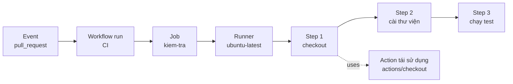

GitHub Actions là nền tảng tự động hóa được tích hợp vào GitHub. Thay vì chờ một người nhớ chạy kiểm thử, đóng gói hoặc triển khai sau mỗi thay đổi, bạn mô tả quy trình bằng YAML và để GitHub thực hiện đúng quy trình đó khi một sự kiện phù hợp xảy ra.

<Callout type="info" title="Sau trang này">
  Bạn sẽ phân biệt được event, workflow, job, step, runner và action; nhận ra những bài toán phù hợp với GitHub Actions; đồng thời đọc được cấu trúc của một workflow CI cơ bản. Bạn chưa cần có kinh nghiệm vận hành CI/CD.
</Callout>

## Mục lục

- [Vì sao cần tự động hóa](#vì-sao-cần-tự-động-hóa)
  - [Khi mọi việc còn làm thủ công](#khi-mọi-việc-còn-làm-thủ-công)
  - [GitHub Actions thay đổi quy trình ra sao](#github-actions-thay-đổi-quy-trình-ra-sao)
- [GitHub Actions là gì](#github-actions-là-gì)
  - [CI và CD](#ci-và-cd)
  - [Tự động hóa ngoài CI và CD](#tự-động-hóa-ngoài-ci-và-cd)
- [Mô hình hoạt động](#mô-hình-hoạt-động)
  - [Event là sự kiện khởi chạy](#event-là-sự-kiện-khởi-chạy)
  - [Workflow là quy trình tự động](#workflow-là-quy-trình-tự-động)
  - [Job và runner](#job-và-runner)
  - [Step và action](#step-và-action)
- [Đọc một workflow tối giản](#đọc-một-workflow-tối-giản)
  - [Workflow mẫu](#workflow-mẫu)
  - [Điều xảy ra khi workflow chạy](#điều-xảy-ra-khi-workflow-chạy)
- [Use case phổ biến](#use-case-phổ-biến)
  - [Kiểm thử tích hợp liên tục](#kiểm-thử-tích-hợp-liên-tục)
  - [Phát hành và triển khai liên tục](#phát-hành-và-triển-khai-liên-tục)
  - [Tự động hóa công việc repository](#tự-động-hóa-công-việc-repository)
- [Điểm mạnh và giới hạn](#điểm-mạnh-và-giới-hạn)
  - [Điểm mạnh](#điểm-mạnh)
  - [Giới hạn và đánh đổi](#giới-hạn-và-đánh-đổi)
- [Khi nào nên dùng GitHub Actions](#khi-nào-nên-dùng-github-actions)
- [Những nguyên tắc nên có từ đầu](#những-nguyên-tắc-nên-có-từ-đầu)
- [Chuẩn bị học tiếp](#chuẩn-bị-học-tiếp)
- [Tài liệu tham khảo](#tài-liệu-tham-khảo)
- [Học tiếp](#học-tiếp)

## Vì sao cần tự động hóa

### Khi mọi việc còn làm thủ công

Hãy hình dung một nhóm phát triển ứng dụng web. Mỗi khi có pull request — đề nghị hợp nhất một thay đổi mã nguồn — người tạo phải tự nhớ thực hiện các việc sau:

1. Cài đúng phiên bản công cụ và thư viện.
2. Chạy kiểm tra định dạng, kiểm thử và lệnh build.
3. Gửi kết quả cho người review.
4. Sau khi merge, đóng gói bản phát hành và triển khai.

Quy trình này có ba vấn đề dễ thấy:

- **Kết quả không nhất quán:** máy của mỗi người có thể dùng hệ điều hành, phiên bản công cụ hoặc biến môi trường khác nhau.
- **Phản hồi chậm:** lỗi chỉ được phát hiện khi ai đó nhớ chạy lệnh, đôi khi sau khi thay đổi đã được merge.
- **Khó truy vết:** một checklist trong trí nhớ hoặc tin nhắn không cho biết chính xác lệnh nào đã chạy cho commit nào.

Ví dụ, câu “trên máy tôi kiểm thử vẫn qua” không chứng minh rằng mã nguồn cũng chạy được trong một môi trường sạch. Nhóm cần một nơi trung lập chạy lại cùng một quy trình cho mọi thay đổi.

### GitHub Actions thay đổi quy trình ra sao

Với GitHub Actions, nhóm đưa các lệnh kiểm tra vào một tệp được lưu cùng mã nguồn. Khi pull request được mở hoặc cập nhật, GitHub tự tạo môi trường chạy, thực hiện các lệnh và hiển thị kết quả ngay trên pull request.

Cách làm này biến quy trình từ **hướng dẫn dành cho con người** thành **cấu hình có thể thực thi**:

```text
Thủ công:  Có thay đổi → nhắc nhau chạy lệnh → gửi kết quả → quyết định merge
Tự động:  Có thay đổi → workflow tự chạy    → GitHub ghi kết quả → quyết định merge
```

Tự động hóa không loại bỏ việc review hay chịu trách nhiệm của con người. Nó loại bỏ phần lặp lại, tạo phản hồi sớm và cung cấp bằng chứng nhất quán cho quyết định của nhóm.

## GitHub Actions là gì

GitHub Actions là nền tảng **CI/CD** và tự động hóa quy trình của GitHub. Bạn định nghĩa một hoặc nhiều **workflow** trong repository; GitHub chạy workflow khi có sự kiện từ GitHub, theo lịch, theo yêu cầu thủ công hoặc qua API.

Workflow không chỉ chứa lệnh. Nó còn mô tả điều kiện khởi chạy, môi trường thực thi, quyền truy cập và thứ tự phụ thuộc giữa các phần việc. Vì tệp workflow được lưu trong Git, thay đổi đối với quy trình cũng có lịch sử, pull request và review giống như mã nguồn.

### CI và CD

**Continuous Integration (CI), hay tích hợp liên tục**, là thực hành hợp nhất thay đổi thường xuyên và tự động kiểm tra từng thay đổi. Một workflow CI thường chạy lint, test và build trên mỗi pull request. Mục tiêu là phát hiện lỗi gần thời điểm chúng được tạo ra.

**Continuous Delivery, hay chuyển giao liên tục**, giữ cho phần mềm luôn ở trạng thái có thể phát hành. Pipeline có thể tạo artifact — gói đầu ra như tệp ZIP, binary hoặc container image — nhưng vẫn chờ người có thẩm quyền phê duyệt trước khi đưa lên production.

**Continuous Deployment, hay triển khai liên tục**, đi thêm một bước: thay đổi vượt qua mọi kiểm tra sẽ tự động được triển khai. Hai khái niệm này đều thường được viết tắt là CD, vì vậy hãy xác nhận nhóm đang nói về “delivery” hay “deployment”.

Một luồng điển hình là:

```text
Pull request → lint + test + build → merge → tạo artifact → phê duyệt → production
               └────── CI ──────┘   └──── continuous delivery ──────────┘
```

Nếu bỏ bước phê duyệt và tự động đưa bản đạt chuẩn lên production, phần cuối trở thành continuous deployment.

### Tự động hóa ngoài CI và CD

GitHub Actions cũng phản ứng được với các sự kiện không liên quan trực tiếp đến build hoặc deploy. Ví dụ:

- gắn nhãn cho issue mới dựa trên nội dung;
- tạo release notes khi phát hành phiên bản;
- chạy quét bảo mật theo lịch;
- đồng bộ tài liệu khi nhánh chính thay đổi;
- gửi thông báo khi một deployment hoàn tất.

Điểm chung không phải là “DevOps”, mà là một quy tắc có dạng: **khi X xảy ra, hãy thực hiện Y theo cách có thể lặp lại**.

## Mô hình hoạt động

Mô hình cốt lõi có thể đọc từ trái sang phải: **event → workflow run → job → runner → step**. Một step có thể chạy trực tiếp một script hoặc gọi một action tái sử dụng.



Sơ đồ là một luồng đơn giản. Trong thực tế, một workflow có thể có nhiều job chạy song song hoặc chờ nhau.

### Event là sự kiện khởi chạy

**Event** là hoạt động có thể khởi chạy workflow. `push` xuất hiện khi có commit được đẩy lên repository; `pull_request` xuất hiện khi có hoạt động phù hợp trên pull request. Ngoài ra còn có sự kiện chạy theo lịch, chạy thủ công và sự kiện từ hệ thống bên ngoài.

Bạn có thể lọc sự kiện. Ví dụ, chỉ chạy deployment khi có `push` vào nhánh `main`, thay vì chạy với mọi nhánh. Mỗi lần điều kiện khớp, GitHub tạo một **workflow run**, tức một lần thực thi cụ thể của workflow.

### Workflow là quy trình tự động

**Workflow** là quy trình tự động được mô tả bằng YAML. Tệp phải có đuôi `.yml` hoặc `.yaml` và nằm trong thư mục `.github/workflows/` của repository.

Một repository có thể có nhiều workflow độc lập. Ví dụ, `ci.yml` kiểm tra pull request, `release.yml` tạo bản phát hành, còn `docs.yml` triển khai tài liệu.

### Job và runner

**Job** là một nhóm step thực hiện trên cùng một runner. Các step trong một job chạy theo thứ tự và có thể dùng chung các tệp trong workspace. Ví dụ, step đầu tải mã nguồn; step sau có thể build chính mã nguồn vừa tải.

**Runner** là máy chủ thực thi job. GitHub cung cấp runner do GitHub quản lý cho Linux, Windows và macOS. Với runner loại này, mỗi job nhận một máy ảo mới. Bạn cũng có thể dùng **self-hosted runner**, tức máy do chính tổ chức cài đặt và vận hành, khi cần phần cứng, mạng nội bộ hoặc phần mềm đặc thù.

Nếu workflow có nhiều job và không khai báo phụ thuộc, các job có thể chạy song song. Khi job `deploy` chỉ được chạy sau job `test`, bạn khai báo quan hệ phụ thuộc để `deploy` chờ `test` thành công.

### Step và action

**Step** là đơn vị công việc nhỏ nhất được khai báo trong job. Một step thường dùng một trong hai cách:

- `run`: chạy lệnh shell do bạn viết, chẳng hạn `npm test`;
- `uses`: gọi một **action**, tức thành phần tự động hóa có thể tái sử dụng, chẳng hạn action tải mã nguồn về runner.

Action giúp tránh viết lại những việc phổ biến như checkout repository hoặc thiết lập Node.js. Bạn có thể dùng action do GitHub cung cấp, action từ Marketplace hoặc action do nhóm tự xây dựng.

<Callout type="warn" title="Action cũng là mã được thực thi">
  Action có thể đọc dữ liệu và sử dụng các quyền mà job cấp cho nó. Hãy kiểm tra nguồn, giới hạn quyền của `GITHUB_TOKEN` và thận trọng với action bên thứ ba. Với yêu cầu bảo mật cao, tài liệu GitHub khuyến nghị ghim action bên thứ ba vào full commit SHA thay vì một tag có thể bị di chuyển.
</Callout>

## Đọc một workflow tối giản

### Workflow mẫu

Ví dụ sau giả định repository là dự án Node.js có `package.json`, tệp lock `package-lock.json` và script `test`. Lưu nội dung này tại `.github/workflows/ci.yml` thì nó có thể chạy trên pull request và khi có `push` vào `main`:

```yaml
name: CI cơ bản

on:
  pull_request:
  push:
    branches: [main]

permissions:
  contents: read

jobs:
  kiem-tra:
    runs-on: ubuntu-latest
    steps:
      - name: Lấy mã nguồn
        uses: actions/checkout@v7

      - name: Thiết lập Node.js
        uses: actions/setup-node@v7
        with:
          node-version: 22
          cache: npm

      - name: Cài thư viện
        run: npm ci

      - name: Chạy kiểm thử
        run: npm test
```

Đây là một workflow hoàn chỉnh, không phải toàn bộ chiến lược CI cho mọi dự án. Dự án dùng Python, Java hoặc công cụ khác sẽ thay các step thiết lập và kiểm thử tương ứng.

### Điều xảy ra khi workflow chạy

Đối chiếu YAML với mô hình vừa học:

1. `on` chọn **event**. Pull request hoặc push vào `main` tạo một workflow run.
2. `jobs` khai báo một **job** có mã định danh `kiem-tra`.
3. `runs-on: ubuntu-latest` yêu cầu một **runner** Ubuntu do GitHub quản lý.
4. `steps` chạy tuần tự trên runner đó.
5. Hai step dùng `uses` để gọi **action**. Hai step còn lại dùng `run` để chạy lệnh shell.
6. `permissions: contents: read` chỉ cấp quyền đọc nội dung repository cho `GITHUB_TOKEN`, token tạm thời GitHub tạo cho run.

Nếu `npm ci` trả về mã lỗi khác `0`, job thất bại và step `npm test` bị bỏ qua theo hành vi mặc định. Kết quả thành công hay thất bại được ghi lại trong tab **Actions** và có thể xuất hiện như một check trên pull request.

<Callout type="idea" title="Cách đọc YAML khi mới học">
  Đừng cố nhớ mọi từ khóa. Trước tiên, hãy trả lời năm câu hỏi: workflow chạy khi nào, có những job nào, mỗi job dùng runner nào, các step chạy gì và workflow được cấp quyền gì.
</Callout>

## Use case phổ biến

### Kiểm thử tích hợp liên tục

CI là điểm bắt đầu phù hợp nhất vì đầu vào và kết quả đều rõ ràng:

| Khi nào chạy | Công việc | Kết quả mong đợi |
|---|---|---|
| Mở hoặc cập nhật pull request | lint, unit test, build | Phản hồi trước khi merge |
| Push lên nhánh chính | test tích hợp, tạo artifact | Xác nhận trạng thái nhánh chính |
| Chạy ma trận nhiều phiên bản | test trên nhiều hệ điều hành hoặc runtime | Phát hiện lỗi tương thích |

Ví dụ, một thư viện Node.js có thể chạy cùng bộ test trên Node.js 20 và 22. GitHub Actions tạo các job riêng, nhờ đó nhóm thấy phiên bản nào thất bại thay vì thử thủ công trên nhiều máy.

### Phát hành và triển khai liên tục

Sau khi CI thành công, workflow có thể:

1. đóng gói ứng dụng;
2. tạo và lưu artifact;
3. xuất bản package hoặc container image;
4. triển khai lên môi trường staging;
5. chờ phê duyệt trước khi triển khai production.

Ví dụ, việc đẩy tag `v1.4.0` có thể khởi chạy workflow tạo release và image tương ứng. Với production, hãy kết hợp environment, cơ chế phê duyệt, giới hạn quyền và phương án rollback thay vì coi một lệnh deploy là toàn bộ quy trình CD.

### Tự động hóa công việc repository

Không phải workflow nào cũng cần biên dịch mã nguồn. Một workflow có thể gắn nhãn issue khi issue được mở, kiểm tra liên kết hỏng trong tài liệu mỗi đêm hoặc cập nhật changelog khi tạo release.

Những việc phù hợp thường có ba đặc điểm: có sự kiện đầu vào rõ ràng, có quy tắc lặp lại được và có kết quả quan sát được. Nếu quy trình vẫn cần phán đoán khó mô tả, hãy tự động hóa phần máy móc và giữ điểm phê duyệt cho con người.

## Điểm mạnh và giới hạn

### Điểm mạnh

- **Tích hợp sát với GitHub:** workflow có thể phản ứng trực tiếp với push, pull request, issue, release và nhiều sự kiện khác.
- **Quy trình được quản lý bằng Git:** YAML nằm cạnh mã nguồn nên có lịch sử thay đổi, review và khả năng quay lại phiên bản cũ.
- **Phản hồi tập trung:** log, trạng thái job và check của pull request nằm trong cùng giao diện cộng tác.
- **Linh hoạt về môi trường:** có runner do GitHub quản lý cho nhiều hệ điều hành và self-hosted runner cho nhu cầu riêng.
- **Tái sử dụng được:** action và reusable workflow giúp chuẩn hóa công việc giữa nhiều job hoặc repository.
- **Phạm vi rộng:** cùng nền tảng có thể phục vụ CI, release, deployment và tự động hóa quản trị repository.

### Giới hạn và đánh đổi

- **YAML không làm mất độ phức tạp:** pipeline nhiều điều kiện, ma trận và phụ thuộc vẫn cần được thiết kế, kiểm thử và bảo trì như mã nguồn.
- **Môi trường GitHub-hosted là tạm thời:** không nên dựa vào dữ liệu còn lại sau khi job kết thúc. Dữ liệu cần dùng về sau phải được lưu bằng artifact, cache hoặc hệ thống bên ngoài phù hợp.
- **Có chi phí và giới hạn sử dụng:** phút chạy, lưu trữ, số job đồng thời và các giới hạn khác phụ thuộc loại runner, loại repository và gói GitHub. Hãy kiểm tra tài liệu billing hiện hành trước khi dự toán.
- **Rủi ro chuỗi cung ứng:** action bên thứ ba là dependency có thể tiếp cận mã nguồn, token hoặc secret trong phạm vi job được cấp.
- **Self-hosted runner cần vận hành:** đổi lại quyền kiểm soát phần cứng và mạng là trách nhiệm cập nhật, cô lập, mở rộng và giám sát máy chạy.
- **Debug khác chạy cục bộ:** lỗi có thể đến từ event payload, quyền, secret, mạng hoặc khác biệt runner, không chỉ từ lệnh build.

<Callout type="info" title="GitHub Actions không thay thế mọi công cụ">
  Nền tảng này thực thi quy trình; nó không tự tạo ra chiến lược kiểm thử, quy tắc review, quan sát production hay kế hoạch rollback. Chất lượng của automation vẫn phụ thuộc vào cách nhóm thiết kế các lớp bảo vệ đó.
</Callout>

## Khi nào nên dùng GitHub Actions

| Tình huống | Khuyến nghị | Lý do |
|---|---|---|
| Mã nguồn và pull request nằm trên GitHub | Nên dùng | Event, quyền và trạng thái kiểm tra được tích hợp sẵn |
| Cần chạy test hoặc build khi mã thay đổi | Nên dùng | Đây là luồng CI tự nhiên và dễ kiểm chứng |
| Cần release hoặc deploy gắn với tag, nhánh hay approval | Nên dùng | Workflow có thể nối sự kiện Git với môi trường triển khai |
| Cần phần cứng hoặc mạng nội bộ đặc thù | Dùng kèm self-hosted runner | Vẫn giữ mô hình workflow nhưng tự quản lý môi trường chạy |
| Cần tiến trình chạy thường trực như web server hoặc consumer | Không dùng workflow làm runtime | Actions phù hợp với job có điểm bắt đầu và kết thúc |
| Quy trình rất dài, có trạng thái nghiệp vụ phức tạp qua nhiều ngày | Cân nhắc công cụ orchestration chuyên dụng | Workflow CI/CD không phải lúc nào cũng là workflow engine nghiệp vụ |
| Hệ thống chính không đặt trên GitHub | Đánh giá chi phí tích hợp | Có thể gọi qua API, nhưng lợi thế tích hợp gốc giảm đi |

Nói ngắn gọn: chọn GitHub Actions khi automation bắt đầu từ hoạt động phát triển trên GitHub và có thể biểu diễn thành các job hữu hạn, quan sát được.

## Những nguyên tắc nên có từ đầu

Ngay cả workflow đầu tiên cũng nên hình thành các thói quen đúng:

1. **Bắt đầu nhỏ:** tự động hóa một lệnh test ổn định trước khi xây cả pipeline release.
2. **Đặt tên theo mục đích:** `Kiểm thử`, `Build tài liệu` dễ đọc log hơn `Job 1` hoặc `Run script`.
3. **Giới hạn trigger:** dùng bộ lọc nhánh hoặc đường dẫn khi phù hợp để tránh run không cần thiết.
4. **Cấp quyền tối thiểu:** khai báo `permissions` theo công việc thực tế; không cấp quyền ghi chỉ vì tiện.
5. **Không ghi secret vào YAML hoặc log:** lưu thông tin nhạy cảm bằng secrets và kiểm soát nơi chúng được sử dụng.
6. **Xem action như dependency:** đánh giá nguồn, phiên bản và cách cập nhật action.
7. **Giữ lệnh chính chạy được ở local:** chẳng hạn workflow gọi `npm test` thay vì nhúng toàn bộ logic kiểm thử vào YAML. Cách này giúp tái hiện lỗi dễ hơn.
8. **Theo dõi thời gian và dung lượng:** cache, artifact và ma trận lớn đều có lợi ích nhưng cũng làm tăng tài nguyên sử dụng.

## Chuẩn bị học tiếp

Đến đây, bạn chỉ cần giữ một câu trong đầu:

> Một event tạo workflow run; workflow gồm các job; mỗi job chạy trên một runner và thực hiện các step; mỗi step chạy script hoặc dùng action.

Trang tiếp theo sẽ đi sâu vào kiến trúc và vòng đời thực thi. Sau đó, bạn sẽ tạo workflow đầu tiên và dùng lộ trình học tập để chọn chủ đề phù hợp.

Để thực hành thuận lợi, hãy chuẩn bị:

- một tài khoản GitHub;
- một repository mà bạn có quyền ghi và đã bật GitHub Actions;
- hiểu cơ bản về commit, branch và pull request;
- sẵn sàng đọc YAML theo thụt lề, chưa cần thuộc cú pháp.

## Tài liệu tham khảo

- [Understanding GitHub Actions — GitHub Docs](https://docs.github.com/en/actions/get-started/understand-github-actions)
- [Continuous integration — GitHub Docs](https://docs.github.com/en/actions/get-started/continuous-integration)
- [Workflow syntax for GitHub Actions — GitHub Docs](https://docs.github.com/en/actions/reference/workflows-and-actions/workflow-syntax)
- [Events that trigger workflows — GitHub Docs](https://docs.github.com/en/actions/reference/workflows-and-actions/events-that-trigger-workflows)
- [Secure use reference — GitHub Docs](https://docs.github.com/en/actions/reference/security/secure-use)
- [GitHub Actions billing — GitHub Docs](https://docs.github.com/en/billing/managing-billing-for-your-products/managing-billing-for-github-actions/about-billing-for-github-actions)

## Học tiếp

<Cards>
  <Card
    title="Kiến trúc và luồng thực thi"
    href="/docs/bat-dau/02-kien-truc-va-luong-thuc-thi"
    description="Đi sâu vào cách GitHub xếp lịch, cấp runner và thực thi workflow."
  />
  <Card
    title="Workflow đầu tiên"
    href="/docs/bat-dau/03-workflow-dau-tien"
    description="Tạo, chạy và quan sát một workflow trong repository của bạn."
  />
  <Card
    title="Lộ trình học tập"
    href="/docs/bat-dau/04-lo-trinh-hoc-tap"
    description="Chọn thứ tự học từ nền tảng đến CI/CD production."
  />
</Cards>
