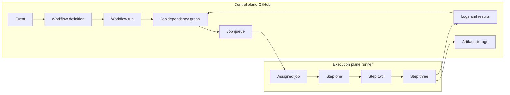
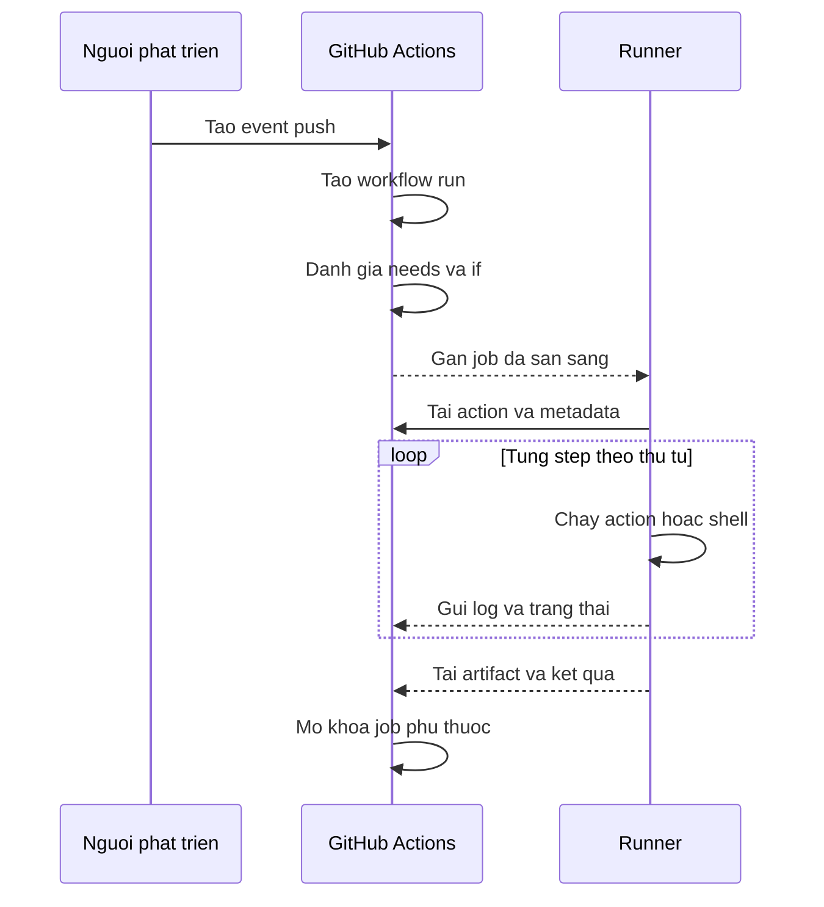
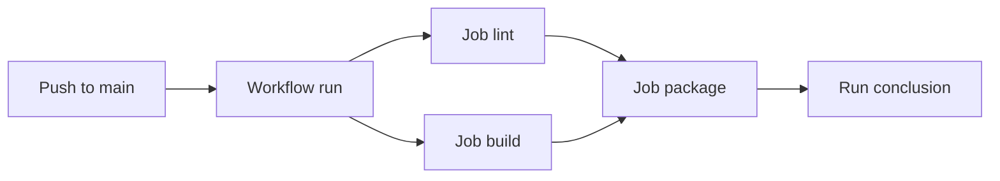

<Callout type="info" title="Mục tiêu của trang">
  Sau trang này, bạn có thể nhìn một workflow YAML và trả lời được ba câu hỏi: GitHub điều phối phần nào, runner thực thi phần nào, và vì sao một job đang `queued`, `skipped`, `cancelled` hoặc `failure`.
</Callout>

## Mục lục

- [Mô hình hai mặt phẳng](#mô-hình-hai-mặt-phẳng)
  - [Control plane trên GitHub](#control-plane-trên-github)
  - [Execution plane trên runner](#execution-plane-trên-runner)
- [Vòng đời từ event đến kết quả](#vòng-đời-từ-event-đến-kết-quả)
  - [Event tạo workflow run](#event-tạo-workflow-run)
  - [GitHub lập lịch các job](#github-lập-lịch-các-job)
  - [Runner nhận một job](#runner-nhận-một-job)
  - [Steps chạy theo thứ tự](#steps-chạy-theo-thứ-tự)
  - [GitHub tổng hợp kết quả](#github-tổng-hợp-kết-quả)
- [Ví dụ workflow với đồ thị job](#ví-dụ-workflow-với-đồ-thị-job)
  - [Workflow YAML](#workflow-yaml)
  - [Đồ thị và luồng thực thi](#đồ-thị-và-luồng-thực-thi)
- [Dữ liệu đi qua luồng thực thi](#dữ-liệu-đi-qua-luồng-thực-thi)
  - [Contexts và expressions](#contexts-và-expressions)
  - [Artifacts và cache](#artifacts-và-cache)
- [Trạng thái và thao tác vòng đời](#trạng-thái-và-thao-tác-vòng-đời)
  - [Phân biệt status và conclusion](#phân-biệt-status-và-conclusion)
  - [Re-run một workflow run](#re-run-một-workflow-run)
  - [Cancel một workflow run](#cancel-một-workflow-run)
- [Ba cơ chế điều khiển cần biết](#ba-cơ-chế-điều-khiển-cần-biết)
  - [Concurrency](#concurrency)
  - [Permissions](#permissions)
  - [Secrets](#secrets)
- [Troubleshooting](#troubleshooting)
- [Nguyên tắc thiết kế ban đầu](#nguyên-tắc-thiết-kế-ban-đầu)
- [Đi tiếp](#đi-tiếp)
- [Tài liệu tham khảo](#tài-liệu-tham-khảo)

---

## Mô hình hai mặt phẳng

Một cách dễ hiểu GitHub Actions là tách hệ thống thành hai **mặt phẳng**:

- **Control plane** là phần điều phối do GitHub quản lý.
- **Execution plane** là môi trường runner thực sự chạy lệnh và action.

Đây là mô hình tư duy dùng trong trang này, không phải tên của hai sản phẩm GitHub riêng biệt. Điểm phân chia quan trọng là: GitHub quyết định *job nào được chạy và khi nào*; runner chịu trách nhiệm *chạy nội dung của job đó*.



### Control plane trên GitHub

Control plane nhận sự kiện, đọc workflow phù hợp trong `.github/workflows`, tạo **workflow run** và theo dõi toàn bộ vòng đời. Một workflow run là một lần thực thi cụ thể của workflow, gắn với event, Git ref và commit SHA tương ứng.

Phần GitHub quản lý thường bao gồm:

- so khớp event với cấu hình `on` và các bộ lọc branch hoặc path;
- tạo workflow run và đồ thị phụ thuộc giữa các job;
- đánh giá các điều kiện có thể xử lý trước khi cấp runner, chẳng hạn `jobs.<job_id>.if`;
- đưa job đã sẵn sàng vào hàng đợi rồi định tuyến theo `runs-on`;
- cấp `GITHUB_TOKEN` riêng cho từng job với quyền đã cấu hình;
- nhận log, trạng thái, conclusion và dữ liệu do runner tải lên;
- mở khóa các job phụ thuộc khi điều kiện `needs` đã được thỏa mãn;
- xử lý yêu cầu re-run, cancel và quy tắc `concurrency`.

Ví dụ, điều kiện `if: github.ref == 'refs/heads/main'` ở cấp job có thể được GitHub đánh giá trước khi gửi job tới runner. Nếu điều kiện là `false`, job được đánh dấu `skipped` và không cần chiếm runner.

### Execution plane trên runner

**Runner** là máy chủ chạy một job. Runner có thể do GitHub cung cấp hoặc do bạn tự vận hành. Mỗi runner chỉ thực thi một job tại một thời điểm.

`runs-on: ubuntu-latest` yêu cầu một GitHub-hosted runner phù hợp. Với GitHub-hosted runner, mỗi job chạy trên một runner instance mới. Hai job trong cùng workflow vì thế không mặc nhiên dùng chung ổ đĩa, process hay biến môi trường.

Ngược lại, mọi step trong **cùng một job** dùng chung runner, workspace và filesystem của job đó. Tuy nhiên, mỗi `run` step mở một process và shell mới. Một file được tạo ở step trước vẫn còn ở step sau, nhưng lệnh `export MY_VAR=value` không tự duy trì qua step kế tiếp. Muốn lưu biến cho step sau, workflow phải ghi vào `GITHUB_ENV` hoặc dùng output.

<Callout type="warn" title="Runner tự quản cần kết nối ra ngoài">
  Self-hosted runner chủ động kết nối tới GitHub qua HTTPS để nhận job. Nếu runner không online, không nhàn rỗi hoặc không khớp đầy đủ label trong `runs-on`, job tiếp tục nằm trong hàng đợi. Đừng mở cổng vào runner chỉ để GitHub gửi job.
</Callout>

## Vòng đời từ event đến kết quả

### Event tạo workflow run

**Event** là hoạt động kích hoạt workflow, ví dụ `push`, `pull_request`, lịch `schedule` hoặc thao tác thủ công qua `workflow_dispatch`.

Khi event xảy ra, GitHub tìm các workflow có `on` phù hợp. Mỗi event phù hợp tạo một workflow run riêng. Nếu hai event phù hợp xảy ra gần như đồng thời, chúng có thể tạo hai run độc lập.



Các bộ lọc event quyết định có tạo run hay không. Điều kiện `if` ở job hoặc step lại quyết định một phần của run có được thực thi hay không. Phân biệt hai tầng này giúp tránh nhầm giữa “workflow không hề được kích hoạt” và “workflow đã chạy nhưng một job bị skip”.

### GitHub lập lịch các job

Một workflow chứa một hoặc nhiều **job**. Theo mặc định, các job không phụ thuộc nhau đủ điều kiện chạy song song, tùy vào runner sẵn có và giới hạn concurrency.

`needs` biến danh sách job thành một **đồ thị có hướng không chu trình**, thường gọi tắt là DAG. Ví dụ, `package` khai báo `needs: [lint, build]` thì chỉ được chạy sau khi cả `lint` và `build` hoàn tất thành công.

Nếu job mà nó cần bị `failure` hoặc `skipped`, job phụ thuộc cũng bị skip theo mặc định. Chỉ dùng điều kiện trạng thái như `always()` khi thật sự cần một job dọn dẹp hoặc tổng hợp vẫn chạy sau lỗi. Nội dung chuyên sâu hơn nằm ở [Job dependencies](/docs/dieu-khien-workflow/02-job-dependencies/).

### Runner nhận một job

Khi các dependency và điều kiện đã thỏa mãn, job chuyển vào hàng đợi. GitHub định tuyến job tới runner khớp `runs-on`.

Ở đầu mỗi job, GitHub tạo `GITHUB_TOKEN` cho job đó. Runner sau đó chuẩn bị workspace, tải action cần dùng và thực thi các step. Với self-hosted runner, GitHub tìm runner online, nhàn rỗi và khớp label hoặc runner group; nếu chưa có, job vẫn `queued`.

<Callout type="info" title="Đơn vị cấp runner là job">
  `runs-on` nằm ở cấp job, không phải cấp workflow hay step. Một workflow có ba job có thể dùng ba runner khác nhau. Muốn chuyển file giữa các job, hãy dùng artifact hoặc một kho dữ liệu bên ngoài thay vì dựa vào filesystem cục bộ.
</Callout>

### Steps chạy theo thứ tự

**Step** là đơn vị công việc bên trong job. Theo mặc định, steps chạy tuần tự theo thứ tự khai báo:

1. Step có `uses` chạy một **action**, tức đơn vị mã có thể tái sử dụng.
2. Step có `run` gửi script tới shell của hệ điều hành, chẳng hạn Bash trên Ubuntu hoặc PowerShell trên Windows.
3. Exit code khác `0` thường làm step thất bại. Các step sau chỉ chạy nếu điều kiện trạng thái của chúng cho phép.

Mỗi step là một process riêng nhưng cùng truy cập workspace của job. Vì vậy, mô hình phổ biến là checkout mã nguồn, cài dependency, build rồi test trong cùng job. GitHub Actions không có cơ chế khai báo nhiều step chạy song song trong một job. Khi cần song song hóa rõ ràng, hãy tách công việc thành nhiều job độc lập.

### GitHub tổng hợp kết quả

Trong lúc chạy, runner gửi log và cập nhật trạng thái về GitHub. Cuối job, runner chạy các bước hậu xử lý của action nếu có, tải artifact hoặc cache được yêu cầu, rồi báo kết quả cuối.

Control plane dùng kết quả đó để:

- mở khóa job downstream nếu `needs` đã thành công;
- skip job downstream nếu dependency thất bại và không có điều kiện thay thế;
- tổng hợp trạng thái và conclusion của workflow run;
- hiển thị checks trên commit hoặc pull request;
- giữ log và artifact theo chính sách retention.

## Ví dụ workflow với đồ thị job

### Workflow YAML

Workflow nhỏ sau đây có thể chạy trong bất kỳ repository nào. `lint` và `build` độc lập nên có thể chạy song song. `package` chờ cả hai job, sau đó tải artifact do `build` tạo ra.

```yaml
name: Job graph demo
run-name: Demo ${{ github.ref_name }} by @${{ github.actor }}

on:
  push:
    branches: [main]
  workflow_dispatch:

permissions:
  contents: read

concurrency:
  group: demo-${{ github.workflow }}-${{ github.ref }}
  cancel-in-progress: true

jobs:
  lint:
    runs-on: ubuntu-latest
    steps:
      - name: Run lint demo
        run: echo "Lint passed"

  build:
    runs-on: ubuntu-latest
    steps:
      - name: Create build output
        run: |
          mkdir -p dist
          printf 'demo build\n' > dist/app.txt

      - name: Upload build artifact
        uses: actions/upload-artifact@v7
        with:
          name: demo-dist
          path: dist/

  package:
    needs: [lint, build]
    runs-on: ubuntu-latest
    steps:
      - name: Download build artifact
        uses: actions/download-artifact@v8
        with:
          name: demo-dist
          path: dist/

      - name: Verify package input
        run: test -f dist/app.txt
```

YAML trên minh họa đồng thời bốn tầng:

- `on` định nghĩa event.
- Mỗi key dưới `jobs` tạo một job.
- `needs` tạo cạnh trong đồ thị job.
- Mỗi phần tử dưới `steps` là một action hoặc shell command chạy trên runner của job.

### Đồ thị và luồng thực thi



| Thời điểm | Control plane | Execution plane |
|---|---|---|
| Run vừa được tạo | Xác định `lint` và `build` chưa có dependency | Chưa có lệnh nào chạy |
| Hai job đầu sẵn sàng | Xếp hàng và định tuyến hai job | Runner A chạy `lint`; runner B chạy các step của `build` |
| `build` hoàn tất | Ghi nhận artifact `demo-dist`; vẫn chờ `lint` nếu cần | Runner B kết thúc và filesystem của nó không được chuyển sang runner khác |
| Cả hai job thành công | Mở khóa và định tuyến `package` | Runner C tải `demo-dist`, rồi kiểm tra file |
| `package` hoàn tất | Tổng hợp conclusion của run | Runner C kết thúc |

Nếu `lint` thất bại, `package` bị skip theo mặc định dù `build` đã upload artifact thành công. Đây là hệ quả trực tiếp của `needs: [lint, build]`.

## Dữ liệu đi qua luồng thực thi

### Contexts và expressions

**Context** là object chứa thông tin về run, event, job, step hoặc runner. Ví dụ:

- `github.ref_name` là tên branch hoặc tag;
- `github.actor` là tài khoản kích hoạt run;
- `runner.os` là hệ điều hành của runner đang chạy job;
- `needs.build.result` là kết quả của job `build` mà job hiện tại phụ thuộc;
- `steps.<id>.outputs.<name>` là output của một step có `id`.

**Expression** là biểu thức trong cú pháp `${{ ... }}` để đọc context, so sánh giá trị hoặc gọi hàm. Trong ví dụ, `${{ github.ref_name }}` làm tên run phản ánh branch hiện tại, còn expression trong `concurrency.group` tạo một khóa theo workflow và ref.

Không phải context nào cũng có ở mọi vị trí. `github` có thể dùng sớm để GitHub quyết định có cấp runner hay không, trong khi `runner.os` chỉ có ý nghĩa khi job đang chạy trên runner. Hãy tra bảng context availability thay vì đoán. Xem tiếp [Contexts](/docs/nen-tang/07-contexts/) và [Expressions](/docs/nen-tang/08-expressions/).

<Callout type="warn" title="Context có thể chứa dữ liệu không tin cậy">
  Giá trị từ event như tiêu đề pull request hoặc nội dung issue có thể do người khác kiểm soát. Không nối trực tiếp dữ liệu đó vào shell script. Hãy truyền qua biến môi trường, trích dẫn đúng cách và đọc hướng dẫn chống script injection trước khi dùng dữ liệu event trong lệnh.
</Callout>

### Artifacts và cache

Cả artifact và cache đều lưu file bên ngoài runner, nhưng chúng giải quyết hai bài toán khác nhau.

| Cơ chế | Dùng khi | Ví dụ | Kỳ vọng khi không có dữ liệu |
|---|---|---|---|
| **Artifact** | Giữ output của job sau khi job kết thúc hoặc chuyển file giữa các job | Binary, test report, ảnh chụp khi test thất bại | Job tải artifact có thể thất bại nếu artifact bắt buộc không tồn tại |
| **Cache** | Tái sử dụng dữ liệu ít thay đổi giữa các run để tăng tốc | npm cache, Maven repository, intermediate build output | Workflow vẫn phải có khả năng tải hoặc tạo lại dữ liệu |

Trong workflow mẫu, `build` và `package` chạy trên runner khác nhau. Cặp `upload-artifact` và `download-artifact` là cây cầu rõ ràng giữa hai filesystem bị cô lập.

Cache chỉ là tối ưu hiệu năng, không phải nguồn dữ liệu duy nhất. Cache miss là tình huống bình thường. Không lưu secret hoặc credential trong cache; nội dung cache khôi phục cần được xem như input không tin cậy. Xem chuyên đề [Artifacts](/docs/dieu-khien-workflow/08-artifacts/) và [Dependency caching](/docs/dieu-khien-workflow/09-dependency-caching/).

## Trạng thái và thao tác vòng đời

### Phân biệt status và conclusion

**Status** cho biết một run hoặc job đang ở giai đoạn nào. **Conclusion** cho biết kết quả cuối sau khi nó hoàn tất.

| Loại | Giá trị thường gặp | Ý nghĩa |
|---|---|---|
| Status | `queued` | Đang chờ dependency, quy tắc điều khiển hoặc runner phù hợp |
| Status | `in_progress` | Runner đang thực thi hoặc run còn job đang thực thi |
| Status | `completed` | Đối tượng đã kết thúc và có conclusion |
| Conclusion | `success` | Các phần bắt buộc hoàn tất thành công |
| Conclusion | `failure` | Có lỗi không được bỏ qua |
| Conclusion | `cancelled` | Run hoặc job bị hủy trước khi hoàn tất bình thường |
| Conclusion | `skipped` | Điều kiện hoặc dependency khiến phần đó không chạy |
| Conclusion | `timed_out` | Vượt giới hạn thời gian |

GitHub còn có các conclusion ít gặp như `neutral`, `stale` hoặc `action_required`. Ở mức nhập môn, hãy đọc theo hai câu hỏi: “Nó còn chạy không?” từ status, rồi “Nó kết thúc ra sao?” từ conclusion.

### Re-run một workflow run

Người có quyền write có thể re-run toàn bộ workflow, chỉ các job thất bại hoặc một job cụ thể. GitHub cho phép thao tác này trong vòng 30 ngày kể từ run ban đầu và giới hạn tổng số lần re-run của một run.

Re-run vẫn dùng `GITHUB_SHA`, `GITHUB_REF` và quyền của actor đã kích hoạt run ban đầu. Nó không tự chuyển sang commit mới nhất và cũng không mượn quyền của người bấm nút re-run. Vì vậy, re-run phù hợp khi lỗi có tính tạm thời, chẳng hạn registry chập chờn. Nếu YAML hoặc mã nguồn sai, hãy sửa bằng commit mới rồi tạo run mới.

Có thể thao tác trên giao diện Actions hoặc dùng GitHub CLI:

```bash
gh run rerun RUN_ID
gh run rerun RUN_ID --failed
```

### Cancel một workflow run

Run đang `queued` hoặc `in_progress` có thể được cancel từ giao diện, CLI hoặc API. GitHub gửi yêu cầu hủy tới runner; runner sau đó ngắt process của step. Kết quả thường là `cancelled` thay vì `failure`.

Điều kiện trạng thái ảnh hưởng đến hủy. Job hoặc step dùng `if: always()` có thể tiếp tục trong quá trình cancellation, khiến run chưa dừng ngay. Với công việc hậu xử lý không nên chạy sau khi hủy, ưu tiên điều kiện có `!cancelled()`.

```bash
gh run cancel RUN_ID
```

<Callout type="idea" title="Cancel khác failure">
  `failure` nói rằng công việc đã chạy và báo lỗi. `cancelled` nói rằng hệ thống hoặc người dùng chủ động dừng công việc. Khi điều tra incident, hai kết luận này dẫn tới hai hướng kiểm tra khác nhau.
</Callout>

## Ba cơ chế điều khiển cần biết

Ba cấu hình sau tác động trực tiếp đến vòng đời nhưng có trang chuyên đề riêng. Ở đây chỉ cần nắm vị trí của chúng trong kiến trúc.

### Concurrency

`concurrency` nhóm workflow run hoặc job theo một khóa để tránh nhiều bản cùng chạy vào tài nguyên dùng chung. Trong ví dụ, push mới trên cùng workflow và cùng ref sẽ hủy run cũ vì `cancel-in-progress: true`.

Cơ chế này nằm ở control plane: GitHub quyết định run nào chờ, run nào bị thay thế và run nào được tiếp tục. Dùng nó cho CI trên branch nhiều commit hoặc deploy vào cùng environment. Xem [Concurrency](/docs/dieu-khien-workflow/05-concurrency/).

### Permissions

`permissions` giới hạn quyền của `GITHUB_TOKEN` ở cấp workflow hoặc job. Token được tạo riêng trước mỗi job và hết hiệu lực khi job kết thúc hoặc đạt giới hạn thời gian của token.

Workflow mẫu chỉ cần đọc repository metadata nên khai báo:

```yaml
permissions:
  contents: read
```

Hãy bắt đầu với quyền tối thiểu rồi chỉ thêm `write` cho job thật sự cần. Đừng cấp quyền ghi toàn workflow chỉ vì một job deploy cần nó. Xem [GITHUB_TOKEN permissions](/docs/bao-mat/01-github-token-permissions/).

### Secrets

Secret là dữ liệu nhạy cảm được lưu ở cấp repository, organization hoặc environment. GitHub Actions chỉ đưa secret vào runtime khi workflow tham chiếu rõ ràng, ví dụ `${{ secrets.DEPLOY_TOKEN }}`.

Secret thường đi qua ranh giới control plane và execution plane: GitHub quản lý giá trị đã mã hóa, còn runner nhận giá trị cần thiết để action hoặc command sử dụng. Việc che secret trong log là lớp bảo vệ hữu ích nhưng không tuyệt đối. Không in secret, không ghi nó vào artifact hoặc cache, và giới hạn secret ở job cần dùng. Xem [Secrets management](/docs/bao-mat/02-secrets-management/).

## Troubleshooting

| Triệu chứng | Kiểm tra trước | Hướng xử lý ngắn |
|---|---|---|
| Job ở `queued` quá lâu | `runs-on`, runner online và idle, label hoặc runner group, concurrency, environment approval | Mở job summary để xem lý do chờ; với self-hosted runner, kiểm tra service và kết nối outbound HTTPS |
| Job hoặc step là `skipped` | `if`, kết quả các job trong `needs`, branch hoặc path filter | Xem graph và log của dependency đầu tiên không thành công; phân biệt run không được trigger với job bị skip trong run |
| Run là `cancelled` | Người dùng, API, `concurrency.cancel-in-progress`, timeout hoặc run mới cùng group | Xem audit và run timeline; không re-run mù nếu một run mới đã thay thế run cũ có chủ đích |
| Run là `failure` | Step đầu tiên có dấu lỗi và exit code khác `0` | Đọc log từ lỗi đầu tiên, sửa nguyên nhân gốc rồi re-run nếu lỗi tạm thời hoặc push commit mới nếu mã hay YAML sai |
| Job downstream không chạy | Một dependency trong `needs` bị failure hoặc skipped | Sửa dependency; chỉ thêm `always()` cho job tổng hợp hoặc cleanup có chủ đích |
| File có ở job trước nhưng mất ở job sau | Mỗi job dùng runner và filesystem riêng | Upload artifact ở job tạo file, rồi download ở job tiêu thụ |

Có thể xem nhanh run và log bằng GitHub CLI:

```bash
gh run list --limit 5
gh run view RUN_ID --verbose
gh run view RUN_ID --log-failed
```

## Nguyên tắc thiết kế ban đầu

- Thiết kế job theo ranh giới trách nhiệm và nhu cầu chạy song song, không gom cả pipeline vào một job dài.
- Dùng `needs` để đồ thị phụ thuộc hiện rõ trong YAML và giao diện Actions.
- Giữ steps tuần tự khi chúng chia sẻ workspace; dùng artifact khi dữ liệu phải đi qua ranh giới job.
- Xem cache là tối ưu có thể mất, không phải nơi lưu output bắt buộc.
- Đặt `permissions` tối thiểu và chỉ đưa secret vào job cần nó.
- Dùng tên workflow, job và step mô tả kết quả mong đợi để log dễ đọc.
- Khi debug, tìm job hoặc step đầu tiên đổi từ luồng thành công sang lỗi. Các job skipped phía sau thường chỉ là hậu quả.

## Đi tiếp

<Cards>
  <Card title="Tổng quan GitHub Actions" href="/docs/bat-dau/01-tong-quan-github-actions/" description="Ôn lại các khái niệm và phạm vi tự động hóa." />
  <Card title="Workflow đầu tiên" href="/docs/bat-dau/03-workflow-dau-tien/" description="Áp dụng mô hình event, job, runner và step vào workflow thực tế." />
  <Card title="Jobs và steps" href="/docs/nen-tang/04-jobs-va-steps/" description="Đi sâu vào cấu trúc, điều kiện và cách tổ chức công việc." />
  <Card title="Runners" href="/docs/nen-tang/06-runners/" description="Hiểu cách chọn và vận hành môi trường thực thi." />
</Cards>

## Tài liệu tham khảo

- [Understanding GitHub Actions](https://docs.github.com/en/actions/about-github-actions/understanding-github-actions)
- [Workflow syntax for GitHub Actions](https://docs.github.com/en/actions/reference/workflows-and-actions/workflow-syntax)
- [Contexts](https://docs.github.com/en/actions/concepts/workflows-and-actions/contexts)
- [Evaluate expressions in workflows and actions](https://docs.github.com/en/actions/reference/workflows-and-actions/expressions)
- [Self-hosted runners reference](https://docs.github.com/en/actions/reference/runners/self-hosted-runners)
- [Workflow artifacts](https://docs.github.com/en/actions/concepts/workflows-and-actions/workflow-artifacts)
- [Dependency caching](https://docs.github.com/en/actions/concepts/workflows-and-actions/dependency-caching)
- [Re-running workflows and jobs](https://docs.github.com/en/actions/how-tos/manage-workflow-runs/re-run-workflows-and-jobs)
- [Canceling a workflow run](https://docs.github.com/en/actions/how-tos/manage-workflow-runs/cancel-a-workflow-run)
- [Workflow cancellation reference](https://docs.github.com/en/actions/reference/workflows-and-actions/workflow-cancellation)
- [REST API endpoints for workflow runs](https://docs.github.com/en/rest/actions/workflow-runs)
- [GITHUB_TOKEN](https://docs.github.com/en/actions/concepts/security/github_token)
- [Secrets](https://docs.github.com/en/actions/concepts/security/secrets)
