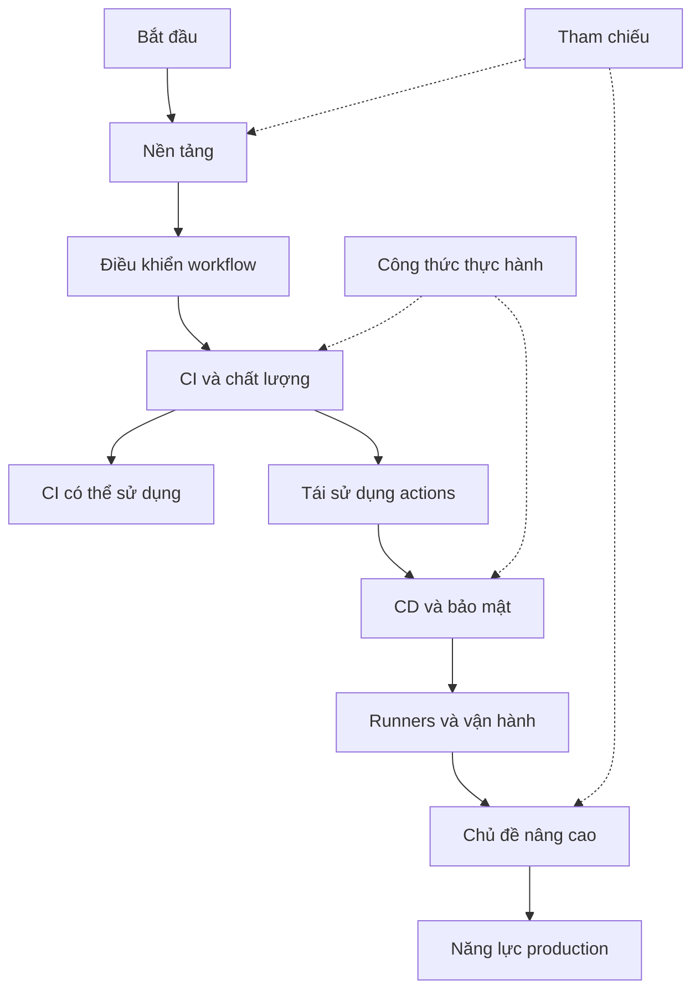

<Callout type="info" title="Cách dùng trang này">
  Đây là bản đồ học tập, không phải một danh sách phải đọc thuộc lòng. Hãy chọn nhánh phù hợp, làm đầu ra của từng giai đoạn và chỉ chuyển tiếp khi đáp ứng điều kiện kiểm chứng.
</Callout>

## Mục lục

- [Cách sử dụng lộ trình](#cách-sử-dụng-lộ-trình)
  - [Bản đồ tổng thể](#bản-đồ-tổng-thể)
  - [Nguyên tắc học](#nguyên-tắc-học)
- [Chọn nhánh học](#chọn-nhánh-học)
  - [Nhánh học nhanh để có CI](#nhánh-học-nhanh-để-có-ci)
  - [Nhánh học đầy đủ cho production](#nhánh-học-đầy-đủ-cho-production)
- [Lộ trình theo giai đoạn](#lộ-trình-theo-giai-đoạn)
  - [Giai đoạn 1 Khởi động](#giai-đoạn-1-khởi-động)
  - [Giai đoạn 2 Xây nền tảng](#giai-đoạn-2-xây-nền-tảng)
  - [Giai đoạn 3 Điều khiển workflow](#giai-đoạn-3-điều-khiển-workflow)
  - [Giai đoạn 4 Xây CI và cổng chất lượng](#giai-đoạn-4-xây-ci-và-cổng-chất-lượng)
  - [Giai đoạn 5 Tái sử dụng và đóng gói automation](#giai-đoạn-5-tái-sử-dụng-và-đóng-gói-automation)
  - [Giai đoạn 6 Thiết kế CD an toàn](#giai-đoạn-6-thiết-kế-cd-an-toàn)
  - [Giai đoạn 7 Chọn runner và vận hành](#giai-đoạn-7-chọn-runner-và-vận-hành)
  - [Giai đoạn 8 Mở rộng kiến trúc workflow](#giai-đoạn-8-mở-rộng-kiến-trúc-workflow)
  - [Giai đoạn 9 Củng cố bằng công thức và tham chiếu](#giai-đoạn-9-củng-cố-bằng-công-thức-và-tham-chiếu)
- [Capstone project](#capstone-project)
  - [Phạm vi đề xuất](#phạm-vi-đề-xuất)
  - [Tiêu chí hoàn thành](#tiêu-chí-hoàn-thành)
- [Checklist tự đánh giá](#checklist-tự-đánh-giá)
  - [Nền tảng và CI](#nền-tảng-và-ci)
  - [Phân phối và bảo mật](#phân-phối-và-bảo-mật)
  - [Vận hành và mở rộng](#vận-hành-và-mở-rộng)
- [Điều chỉnh lộ trình theo bối cảnh](#điều-chỉnh-lộ-trình-theo-bối-cảnh)
- [Tài liệu chính thức](#tài-liệu-chính-thức)

## Cách sử dụng lộ trình

Lộ trình đi từ một workflow nhỏ đến một hệ thống automation có thể kiểm thử, phát hành, bảo mật và vận hành. Thứ tự này có chủ đích: trước khi tối ưu hoặc tái sử dụng workflow, bạn cần hiểu luồng thực thi; trước khi triển khai production, bạn cần có cổng chất lượng và mô hình quyền rõ ràng.

### Bản đồ tổng thể

Mốc **CI có thể sử dụng** là điểm dừng hợp lý cho nhánh học nhanh. Mốc **năng lực production** đòi hỏi thêm khả năng kiểm soát deployment, quyền truy cập, runner, sự cố và thay đổi ở quy mô lớn.

### Nguyên tắc học

1. **Học trên một repository thật.** Dùng cùng một ứng dụng mẫu xuyên suốt để thấy workflow tiến hóa thay vì tạo các ví dụ rời rạc.
2. **Đọc rồi thay đổi.** Sau mỗi trang, sửa ít nhất một trigger, job, permission hoặc điều kiện và quan sát run mới.
3. **Lưu bằng chứng.** Giữ lại run URL, test report, artifact, deployment log và quyết định thiết kế. Đây là dữ liệu để bạn chứng minh đầu ra của giai đoạn.
4. **Tra cứu thay vì học thuộc.** Phần Tham chiếu được dùng khi viết hoặc debug. Không cần đọc tuyến tính ngay từ đầu.
5. **Không vượt qua một gate đang đỏ.** Nếu chưa giải thích được vì sao workflow chạy, thất bại hoặc bị hủy, hãy sửa ở giai đoạn hiện tại trước khi thêm độ phức tạp.

## Chọn nhánh học

<Cards>
  <Card
    title="Học nhanh để có CI"
    href="#nhánh-học-nhanh-để-có-ci"
    description="Tập trung vào workflow cho pull request, kiểm thử và phản hồi chất lượng sớm."
  />
  <Card
    title="Học đầy đủ cho production"
    href="#nhánh-học-đầy-đủ-cho-production"
    description="Đi hết các giai đoạn, gồm CD, bảo mật, runners, vận hành và governance."
  />
</Cards>

### Nhánh học nhanh để có CI

Nhánh này phù hợp khi mục tiêu trước mắt là chặn code lỗi trước khi merge. Bạn vẫn học quyền tối thiểu và cách dùng action bên thứ ba, vì một CI chạy được nhưng cấp quyền quá rộng chưa phải là một CI an toàn.

<Steps>
<Step>

Đọc ba trang đầu của phần Bắt đầu, sau đó hoàn thành các chủ đề cốt lõi về cấu trúc workflow, event, job, action, context và expression ở Giai đoạn 2.

</Step>
<Step>

Học branch/path filter, job dependency, condition, concurrency, cache và artifact ở Giai đoạn 3. Đây là nhóm kỹ năng giúp CI chạy đúng lúc, đúng thứ tự và không lãng phí run.

</Step>
<Step>

Chọn đúng trang CI cho ngôn ngữ của dự án. Thêm lint, unit test, báo cáo và một cổng chất lượng có thể tái hiện ở Giai đoạn 4.

</Step>
<Step>

Đọc [GITHUB_TOKEN và permissions](/docs/bao-mat/01-github-token-permissions/) cùng [Bảo mật third-party actions](/docs/bao-mat/04-third-party-actions/). Kết thúc bằng cách tự dựng lại [Công thức CI cơ bản](/docs/cong-thuc/01-basic-ci/) cho repository của bạn.

</Step>
</Steps>

**Đầu ra của nhánh:** một workflow pull request chạy đúng kiểm tra bắt buộc, dùng cache có kiểm chứng, tải lên kết quả cần thiết và khai báo quyền tối thiểu. Khi đạt mốc này, bạn có thể dừng để áp dụng CI hoặc tiếp tục từ Giai đoạn 5.

### Nhánh học đầy đủ cho production

Nhánh này dành cho người chịu trách nhiệm cả vòng đời thay đổi: từ pull request đến deployment, rollback và xử lý sự cố. Đi tuần tự qua Giai đoạn 1 đến Giai đoạn 8. Dùng Giai đoạn 9 để luyện lại bằng tình huống hoàn chỉnh và tra cứu cú pháp khi cần.

<Callout type="warn" title="Production không chỉ là deploy thành công">
  Một workflow production còn phải giới hạn quyền, bảo vệ môi trường, có đường rollback, để lại dấu vết audit và có người biết xử lý khi automation thất bại.
</Callout>

## Lộ trình theo giai đoạn

Mỗi giai đoạn dưới đây có cùng bốn phần: mục tiêu, thứ tự học, đầu ra thực hành và điều kiện chuyển tiếp. Các trang được sắp theo quan hệ phụ thuộc kiến thức, không chỉ theo độ khó của cú pháp.

<Steps>
<Step>

### Giai đoạn 1 Khởi động

**Mục tiêu:** hiểu GitHub Actions giải quyết bài toán gì, một event được biến thành job trên runner ra sao và cách quan sát workflow đầu tiên.

**Học theo thứ tự:**

1. [Tổng quan GitHub Actions](/docs/bat-dau/01-tong-quan-github-actions/) để xác định phạm vi của nền tảng.
2. [Kiến trúc và luồng thực thi](/docs/bat-dau/02-kien-truc-va-luong-thuc-thi/) để nối các khái niệm workflow, event, job, step, action và runner.
3. [Workflow đầu tiên](/docs/bat-dau/03-workflow-dau-tien/) để chuyển mô hình đó thành một run có thể quan sát.

Thứ tự này giúp bạn thấy bức tranh trước khi chạm vào YAML. Nhờ đó, khi workflow không chạy, bạn biết cần kiểm tra trigger, cấu trúc job hay runner thay vì sửa ngẫu nhiên.

**Bài thực hành và đầu ra:** tạo một workflow chạy thủ công và khi push. Workflow phải checkout repository, in thông tin run không nhạy cảm và có ít nhất hai step với tên dễ hiểu. Lưu run URL thành công và một run thất bại do bạn chủ động tạo ra rồi sửa lại.

**Điều kiện chuyển giai đoạn:** bạn giải thích được quan hệ giữa event, workflow run, job, step, action và runner; đồng thời biết mở log của một step cụ thể.

</Step>
<Step>

### Giai đoạn 2 Xây nền tảng

**Mục tiêu:** tự viết được workflow nhỏ mà không phụ thuộc vào việc sao chép một file YAML không hiểu rõ.

**Học theo thứ tự:**

1. [Cấu trúc workflow](/docs/nen-tang/01-cau-truc-workflow/) rồi [YAML cho GitHub Actions](/docs/nen-tang/02-yaml-cho-github-actions/) để nắm khung file và lỗi cú pháp thường gặp.
2. [Events và triggers](/docs/nen-tang/03-events-va-triggers/) trước [Jobs và steps](/docs/nen-tang/04-jobs-va-steps/), vì bạn cần biết khi nào workflow được tạo rồi mới thiết kế việc nó làm.
3. [Actions](/docs/nen-tang/05-actions/) và [Runners](/docs/nen-tang/06-runners/) để phân biệt logic tái sử dụng với môi trường thực thi.
4. [Contexts](/docs/nen-tang/07-contexts/) rồi [Expressions](/docs/nen-tang/08-expressions/) để đọc dữ liệu runtime và đưa ra quyết định.
5. [Variables và environment variables](/docs/nen-tang/09-variables-va-environment-variables/) trước [Secrets](/docs/nen-tang/10-secrets/) để không nhầm dữ liệu cấu hình thông thường với dữ liệu nhạy cảm.

**Bài thực hành và đầu ra:** mở rộng workflow ở Giai đoạn 1 thành hai job. Một job kiểm tra code, job còn lại chỉ chạy sau khi job đầu thành công. Dùng variable cho cấu hình không nhạy cảm, secret thử nghiệm cho giá trị nhạy cảm và expression để đặt tên run hoặc điều kiện chạy.

**Điều kiện chuyển giai đoạn:** bạn đọc được một workflow và chỉ ra trigger, quyền, runner, phạm vi biến, dữ liệu context và thứ tự thực thi. Bạn cũng biết giá trị nào không được ghi trực tiếp vào repository.

</Step>
<Step>

### Giai đoạn 3 Điều khiển workflow

**Mục tiêu:** làm cho workflow chạy đúng phạm vi, đúng thứ tự, có giới hạn tài nguyên và truyền được dữ liệu giữa các phần.

**Học theo thứ tự:**

1. [Branch và path filters](/docs/dieu-khien-workflow/01-branch-path-filters/), [Job dependencies](/docs/dieu-khien-workflow/02-job-dependencies/) và [Conditionals](/docs/dieu-khien-workflow/03-conditionals/) tạo nên luồng điều khiển cơ bản.
2. [Matrix strategy](/docs/dieu-khien-workflow/04-matrix-strategy/) mở rộng cùng một kiểm tra trên nhiều cấu hình; [Concurrency](/docs/dieu-khien-workflow/05-concurrency/) ngăn các run cũ tranh chấp với run mới.
3. [Defaults và timeouts](/docs/dieu-khien-workflow/06-defaults-timeouts/) đặt ranh giới thực thi trước khi workflow phức tạp hơn.
4. [Outputs](/docs/dieu-khien-workflow/07-outputs/) truyền dữ liệu nhỏ; [Artifacts](/docs/dieu-khien-workflow/08-artifacts/) lưu hoặc chuyển file. Hai cơ chế này giải quyết hai loại dữ liệu khác nhau.
5. [Dependency caching](/docs/dieu-khien-workflow/09-dependency-caching/) tối ưu tải dependency sau khi luồng đã đúng.
6. [Containers và service containers](/docs/dieu-khien-workflow/10-containers-service-containers/) bổ sung môi trường cô lập và dịch vụ phụ trợ khi bài kiểm thử cần chúng.

**Bài thực hành và đầu ra:** cấu hình CI chỉ chạy khi file liên quan thay đổi, hủy run cũ trên cùng pull request, đặt timeout, chạy matrix phù hợp, cache dependency và tải lên test artifact kể cả khi test thất bại. Nếu dự án có database, thêm service container và health check.

**Điều kiện chuyển giai đoạn:** bạn phân biệt được output, artifact và cache; giải thích được vì sao một job bị skip hoặc cancel; đồng thời chứng minh cache hit không làm thay đổi kết quả kiểm thử.

</Step>
<Step>

### Giai đoạn 4 Xây CI và cổng chất lượng

**Mục tiêu:** biến các kỹ thuật điều khiển thành pipeline phản hồi đáng tin cậy cho pull request.

**Học theo thứ tự:**

1. Chọn đúng stack chính: [CI cho Node.js](/docs/ci/01-ci-nodejs/), [CI cho Python](/docs/ci/02-ci-python/), [CI cho Java](/docs/ci/03-ci-java/), [CI cho .NET](/docs/ci/04-ci-dotnet/), [CI cho Go](/docs/ci/05-ci-go/) hoặc [CI cho Rust](/docs/ci/06-ci-rust/). Không cần học mọi ngôn ngữ nếu dự án không sử dụng chúng.
2. Nếu sản phẩm đóng gói bằng container, học [CI cho Docker image](/docs/ci/07-ci-docker/). Nếu test cần dữ liệu thật, học [CI với database services](/docs/ci/08-ci-database-services/).
3. Xây tháp kiểm thử từ [Unit testing](/docs/kiem-thu-chat-luong/01-unit-testing/) và [Lint, format và type check](/docs/kiem-thu-chat-luong/04-lint-format-typecheck/), rồi mới thêm [Integration testing](/docs/kiem-thu-chat-luong/02-integration-testing/) và [End-to-end testing](/docs/kiem-thu-chat-luong/03-end-to-end-testing/).
4. Dùng [Code coverage](/docs/kiem-thu-chat-luong/05-code-coverage/) như tín hiệu, không thay cho chất lượng assertion. Sau đó thêm [CodeQL và dependency review](/docs/kiem-thu-chat-luong/06-codeql-dependency-review/) cùng [Test reports và annotations](/docs/kiem-thu-chat-luong/07-test-reports-annotations/) để lỗi xuất hiện ngay trong trải nghiệm review.

Kiểm tra rẻ và nhanh được đặt trước kiểm tra tích hợp hoặc end-to-end. Cách xếp này tạo phản hồi sớm mà vẫn giữ các lớp xác nhận sâu hơn cho thay đổi đã qua vòng đầu.

**Bài thực hành và đầu ra:** tạo pull request cố ý vi phạm lint, làm hỏng unit test và tạo một dependency có thay đổi đáng chú ý. CI phải chỉ rõ lỗi ở check phù hợp, xuất báo cáo có thể đọc và trở lại xanh sau khi sửa.

**Điều kiện chuyển giai đoạn:** một contributor mới có thể mở pull request và hiểu cần sửa gì chỉ từ check, annotation và artifact. Kết quả CI lặp lại được trên cùng commit và không phụ thuộc vào secret production.

</Step>
<Step>

### Giai đoạn 5 Tái sử dụng và đóng gói automation

**Mục tiêu:** giảm trùng lặp mà không che giấu hành vi quan trọng hoặc tạo một abstraction khó bảo trì.

**Học theo thứ tự:**

1. [Reusable workflows](/docs/tai-su-dung-actions/01-reusable-workflows/) để tái sử dụng cả quy trình nhiều job.
2. [Workflow templates](/docs/tai-su-dung-actions/02-workflow-templates/) để tạo điểm khởi đầu nhất quán cho nhiều repository.
3. [Composite actions](/docs/tai-su-dung-actions/03-composite-actions/) để gom các step thường lặp lại.
4. Chỉ khi composite action không đủ, chọn [JavaScript actions](/docs/tai-su-dung-actions/04-javascript-actions/) hoặc [Docker container actions](/docs/tai-su-dung-actions/05-docker-container-actions/) theo môi trường và nhu cầu phân phối.
5. Hoàn thiện contract qua [Action metadata](/docs/tai-su-dung-actions/06-action-metadata/), rồi học [Phát hành và version actions](/docs/tai-su-dung-actions/07-publish-version-actions/) để consumer có thể pin phiên bản.

**Bài thực hành và đầu ra:** tìm một cụm step lặp trong CI và trích xuất đúng cấp độ. Ghi rõ input, output, secret cần thiết, quyền cần thiết và chiến lược version. Tạo một consumer workflow chứng minh thành phần dùng lại hoạt động mà không dựa vào biến ngầm.

**Điều kiện chuyển giai đoạn:** bạn giải thích được khi nào dùng reusable workflow, template, composite action hoặc custom action. Một thay đổi breaking có đường phát hành và migration rõ ràng.

</Step>
<Step>

### Giai đoạn 6 Thiết kế CD an toàn

**Mục tiêu:** đưa artifact đã kiểm chứng qua các môi trường bằng danh tính ngắn hạn, cổng phê duyệt và chiến lược rollback rõ ràng.

**Học theo thứ tự:** học hai luồng CD và bảo mật song song. Hoàn tất các chủ đề bảo mật liên quan trước khi cấp quyền deploy thật.

- **Luồng phân phối:** [Nền tảng deployment](/docs/cd/01-deployment-fundamentals/) → [Environments và approvals](/docs/cd/02-environments-approvals/) → [Release management](/docs/cd/03-release-management/). Sau đó chọn đích triển khai: [GitHub Pages](/docs/cd/04-deploy-github-pages/), [container registry](/docs/cd/05-publish-container-registry/), [Kubernetes](/docs/cd/06-deploy-kubernetes/), [AWS bằng OIDC](/docs/cd/07-deploy-aws-oidc/) hoặc [Azure và GCP bằng OIDC](/docs/cd/08-deploy-azure-gcp-oidc/). Kết thúc bằng [Rollback strategies](/docs/cd/09-rollback-strategies/).
- **Luồng bảo mật:** [GITHUB_TOKEN và permissions](/docs/bao-mat/01-github-token-permissions/) → [Quản lý secrets](/docs/bao-mat/02-secrets-management/) → [OIDC federation](/docs/bao-mat/03-oidc-federation/) → [Bảo mật third-party actions](/docs/bao-mat/04-third-party-actions/) → [Ngăn chặn script injection](/docs/bao-mat/05-script-injection/) → [Bảo mật workflow cho fork pull requests](/docs/bao-mat/06-fork-pull-requests/). Cuối cùng, bảo vệ đầu ra qua [Artifact attestations](/docs/bao-mat/07-artifact-attestations/) và [Supply chain security](/docs/bao-mat/08-supply-chain-security/), rồi rà [Security checklist](/docs/bao-mat/09-security-checklist/).

**Bài thực hành và đầu ra:** triển khai cùng một artifact bất biến qua môi trường thử nghiệm rồi production. Dùng environment protection, permission tối thiểu và OIDC nếu nền tảng đích hỗ trợ. Mô phỏng deployment lỗi, thực hiện rollback và lưu lại bằng chứng approval, deployment và khôi phục.

**Điều kiện chuyển giai đoạn:** không có credential cloud dài hạn trong repository; action bên thứ ba được pin theo chính sách của nhóm; pull request từ fork không nhận secret đặc quyền; quy trình rollback đã được chạy thử thay vì chỉ được mô tả.

</Step>
<Step>

### Giai đoạn 7 Chọn runner và vận hành

**Mục tiêu:** chọn hạ tầng thực thi theo rủi ro và tải công việc, sau đó vận hành workflow bằng log, cảnh báo, kiểm soát chi phí và runbook.

**Học theo thứ tự:**

1. Bắt đầu với [GitHub-hosted runners](/docs/runners/01-github-hosted-runners/) để có baseline ít vận hành nhất.
2. Chỉ chọn [Self-hosted runners](/docs/runners/02-self-hosted-runners/) khi có yêu cầu mạng, phần cứng, hiệu năng hoặc kiểm soát cụ thể. Khi đó, học [Labels và runner groups](/docs/runners/03-labels-va-runner-groups/), so sánh với [Larger runners](/docs/runners/04-larger-runners/) và cân nhắc [Autoscaling với Actions Runner Controller](/docs/runners/05-autoscaling-arc/) nếu chạy trên Kubernetes.
3. Với self-hosted runner, [Bảo mật runner](/docs/runners/06-runner-hardening/) phải đi trước [Giám sát và bảo trì runner](/docs/runners/07-runner-monitoring-maintenance/).
4. Xây năng lực vận hành từ [Debugging và logs](/docs/van-hanh/01-debugging-logs/), [Xử lý lỗi](/docs/van-hanh/02-failure-handling/) và [Notifications](/docs/van-hanh/03-notifications/).
5. Tiếp tục với [Usage, limits và costs](/docs/van-hanh/04-usage-limits-costs/), [Tối ưu hiệu năng workflow](/docs/van-hanh/05-performance-optimization/) và [Retention và cleanup](/docs/van-hanh/06-retention-cleanup/). Kết thúc bằng [Governance và audit](/docs/van-hanh/07-governance-audit/) cùng [Incident runbook](/docs/van-hanh/08-incident-runbook/).

**Bài thực hành và đầu ra:** lập decision record cho lựa chọn runner. Thiết lập timeout, retry có giới hạn, cảnh báo có owner, chính sách retention và dashboard hoặc báo cáo sử dụng phù hợp. Chạy một game day: làm hỏng dependency, runner hoặc deployment rồi xử lý theo runbook.

**Điều kiện chuyển giai đoạn:** nhóm xác định được ai nhận cảnh báo, cách phân loại lỗi code và lỗi hạ tầng, cách cô lập runner có vấn đề, nơi xem chi phí và cách khôi phục dịch vụ automation.

</Step>
<Step>

### Giai đoạn 8 Mở rộng kiến trúc workflow

**Mục tiêu:** xử lý repository và organization phức tạp mà vẫn giữ luồng phụ thuộc, quyền và ownership có thể kiểm soát.

**Học theo thứ tự:**

1. [Dynamic matrix](/docs/nang-cao/01-dynamic-matrix/) rồi [Fan-out và fan-in](/docs/nang-cao/02-fan-out-fan-in/) để tạo và tổng hợp công việc động.
2. [Workflow cho monorepo](/docs/nang-cao/03-monorepo-workflows/) và [Merge queue](/docs/nang-cao/04-merge-queue/) để bảo vệ throughput khi nhiều thay đổi cùng đi qua CI.
3. [Workflow chaining](/docs/nang-cao/05-workflow-chaining/) trước [repository_dispatch và workflow_dispatch](/docs/nang-cao/06-repository-dispatch/) để hiểu ranh giới giữa nối workflow nội bộ và kích hoạt theo API.
4. [Tự động hóa cross-repository](/docs/nang-cao/07-cross-repository-automation/) rồi [GitHub API và gh CLI](/docs/nang-cao/08-github-api-cli/) để điều phối ngoài một repository.
5. [GitHub Actions ở quy mô organization](/docs/nang-cao/09-policy-at-scale/) đặt các kỹ thuật trên vào mô hình policy, ownership và rollout rộng hơn.

**Bài thực hành và đầu ra:** chọn một nhu cầu thực, chẳng hạn selective CI cho monorepo hoặc release nhiều repository. Vẽ dependency graph, chỉ rõ trust boundary, permission, cơ chế idempotency và failure recovery trước khi triển khai workflow.

**Điều kiện chuyển giai đoạn:** workflow nâng cao không tạo vòng lặp trigger, không dùng token rộng hơn nhu cầu và có thể chạy lại an toàn. Nhóm biết nơi thay đổi policy dùng chung và cách rollout mà không phá consumer.

</Step>
<Step>

### Giai đoạn 9 Củng cố bằng công thức và tham chiếu

**Mục tiêu:** chuyển kiến thức rời rạc thành khả năng giải quyết tình huống, đồng thời hình thành thói quen kiểm tra tài liệu thay vì đoán cú pháp.

**Học theo thứ tự:**

- Bắt đầu từ [Công thức CI cơ bản](/docs/cong-thuc/01-basic-ci/), rồi áp dụng [Deploy nhiều môi trường](/docs/cong-thuc/02-multi-environment-deployment/) và [Build và publish Docker image](/docs/cong-thuc/03-docker-publish/).
- Chọn công thức theo bối cảnh: [Selective CI cho monorepo](/docs/cong-thuc/04-monorepo-selective-ci/), [Scheduled maintenance](/docs/cong-thuc/05-scheduled-maintenance/), [Manual operations workflow](/docs/cong-thuc/06-manual-operations/), [Release automation](/docs/cong-thuc/07-release-automation/) hoặc [Cloud deployment với OIDC](/docs/cong-thuc/08-cloud-deployment-oidc/).
- Khi triển khai, tra [Workflow syntax reference](/docs/tham-chieu/01-workflow-syntax/), [Contexts reference](/docs/tham-chieu/02-contexts-reference/), [Expressions reference](/docs/tham-chieu/03-expressions-reference/), [Variables reference](/docs/tham-chieu/04-variables-reference/) và [Events reference](/docs/tham-chieu/05-events-reference/).
- Khi viết tooling hoặc xử lý lỗi, dùng [Workflow commands reference](/docs/tham-chieu/06-workflow-commands/), [Permissions reference](/docs/tham-chieu/07-permissions-reference/) và [Troubleshooting reference](/docs/tham-chieu/08-troubleshooting/). Tra [Thuật ngữ GitHub Actions](/docs/tham-chieu/09-glossary/) khi một khái niệm chưa rõ.

**Bài thực hành và đầu ra:** chọn một công thức gần với nhu cầu của bạn nhưng không sao chép nguyên trạng. Ghi lại những thay đổi về trigger, permission, cache key, environment và rollback; sau đó liên kết mỗi quyết định với trang nền tảng hoặc tham chiếu liên quan.

**Điều kiện hoàn thành lộ trình:** bạn có thể bắt đầu từ yêu cầu, thiết kế workflow, giải thích trade-off, kiểm chứng bằng run và viết hướng dẫn vận hành. Khi gặp cú pháp chưa nhớ, bạn biết chính xác nên tra ở đâu.

</Step>
</Steps>

## Capstone project

Capstone nên dùng một ứng dụng đủ nhỏ để bạn tập trung vào automation nhưng đủ thật để có build, test, artifact và deployment. Có thể dùng chính stack bạn đang làm việc; không cần đổi ngôn ngữ chỉ để khớp ví dụ.

### Phạm vi đề xuất

Xây pipeline cho một dịch vụ web có container và ít nhất hai môi trường:

1. **Pull request:** dùng path filter và concurrency; chạy lint, unit test, integration test; xuất test report; thực hiện dependency review hoặc CodeQL phù hợp.
2. **Build:** tạo một artifact hoặc container image duy nhất, gắn định danh theo commit và lưu provenance hoặc attestation nếu luồng phát hành cần xác minh nguồn gốc.
3. **Deploy:** đưa đúng artifact đó lên môi trường thử nghiệm, chạy smoke test, yêu cầu approval trước production và dùng OIDC cho cloud provider khi khả dụng.
4. **Khôi phục:** mô phỏng một bản phát hành lỗi và rollback về artifact đã biết là tốt.
5. **Tái sử dụng:** tách phần lặp lại thành reusable workflow hoặc action ở đúng cấp độ, với input và permission được mô tả.
6. **Vận hành:** thêm notification có owner, retention policy, dashboard hoặc báo cáo sử dụng, và incident runbook.
7. **Hạ tầng thực thi:** ghi decision record giải thích vì sao dùng GitHub-hosted, larger hay self-hosted runner; nếu dùng self-hosted, bổ sung hardening và kế hoạch bảo trì.

### Tiêu chí hoàn thành

Capstone được xem là hoàn chỉnh khi reviewer có thể kiểm tra các bằng chứng sau mà không cần hỏi lại người viết:

- Sơ đồ luồng từ event đến CI, artifact, approval, deployment và rollback.
- Workflow code có permission tối thiểu, action version rõ ràng, timeout và concurrency phù hợp.
- Pull request mẫu có check thất bại dễ hiểu, annotation hoặc report và lần chạy lại thành công sau khi sửa.
- Deployment log chứng minh cùng một artifact đi qua các môi trường.
- Một lần rollback hoặc game day đã được ghi nhận.
- Runbook nêu owner, kênh cảnh báo, bước chẩn đoán, cách giảm tác động và điều kiện đóng sự cố.
- Tài liệu về trade-off còn tồn tại, chẳng hạn chi phí runner, độ dài retention hoặc giới hạn của test hiện tại.

## Checklist tự đánh giá

Đánh dấu theo năng lực bạn đã chứng minh bằng workflow và run thực tế, không chỉ theo trang đã đọc.

### Nền tảng và CI

- [ ] Tôi giải thích được event, workflow run, job, step, action và runner.
- [ ] Tôi chọn đúng context, expression, variable hoặc secret cho từng loại dữ liệu.
- [ ] Tôi kiểm soát được filter, dependency, condition, matrix, concurrency và timeout.
- [ ] Tôi phân biệt output, artifact và cache; cache miss không làm pipeline sai.
- [ ] CI cho pull request cung cấp lỗi dễ hành động và kết quả có thể tái hiện.
- [ ] Tôi chọn lớp kiểm thử theo rủi ro thay vì thêm mọi test vào một job duy nhất.

### Phân phối và bảo mật

- [ ] Tôi dùng permission tối thiểu cho `GITHUB_TOKEN` và từng job đặc quyền.
- [ ] Tôi đánh giá, pin và cập nhật third-party action theo chính sách rõ ràng.
- [ ] Workflow cho fork không làm lộ secret hoặc chạy input không tin cậy trong ngữ cảnh đặc quyền.
- [ ] Deployment dùng environment, approval và concurrency phù hợp.
- [ ] Tôi ưu tiên OIDC thay cho cloud credential dài hạn khi nền tảng hỗ trợ.
- [ ] Artifact được định danh, truy vết và đi qua các môi trường mà không build lại tùy tiện.
- [ ] Rollback đã được thử và có tiêu chí kích hoạt cụ thể.

### Vận hành và mở rộng

- [ ] Tôi có lý do đo được khi chọn GitHub-hosted, larger hoặc self-hosted runner.
- [ ] Self-hosted runner, nếu có, được cô lập, harden, giám sát và vá định kỳ.
- [ ] Alert có owner; log, retention và chi phí có chính sách theo dõi.
- [ ] Failure handling phân biệt lỗi tạm thời với lỗi logic và không retry vô hạn.
- [ ] Reusable workflow hoặc custom action có contract và version strategy.
- [ ] Automation liên repository có trust boundary, quyền và cơ chế chạy lại an toàn.
- [ ] Incident runbook đã được kiểm tra qua game day hoặc sự cố thực tế.

## Điều chỉnh lộ trình theo bối cảnh

<Accordions type="single">
  <Accordion title="Tôi chỉ cần CI, chưa cần deploy">
    Hoàn thành Giai đoạn 1 đến Giai đoạn 4, cộng hai chủ đề bảo mật bắt buộc của nhánh học nhanh. Sau khi CI ổn định, học Giai đoạn 5 nếu nhiều repository bắt đầu lặp workflow. Chưa cần học cloud deployment, nhưng vẫn nên biết nơi tra permission và troubleshooting.
  </Accordion>
  <Accordion title="Nhóm không vận hành self-hosted runner">
    Học kỹ GitHub-hosted runners và đọc phần self-hosted để hiểu trust boundary. Bạn có thể bỏ qua triển khai ARC, nhưng vẫn cần quyết định runner bằng yêu cầu cụ thể và theo dõi usage, limits, costs.
  </Accordion>
  <Accordion title="Repository là monorepo">
    Hoàn thành branch/path filters và dependency graph trước khi dùng dynamic matrix. Sau CI cơ bản, ưu tiên workflow cho monorepo, selective CI, fan-out/fan-in và merge queue. Đừng tối ưu phạm vi chạy trước khi có baseline chứng minh pipeline hiện tại đúng.
  </Accordion>
  <Accordion title="Tôi đã có workflow production cần cải thiện">
    Bắt đầu bằng checklist tự đánh giá và incident history. Đi thẳng đến giai đoạn có khoảng trống lớn nhất, nhưng quay lại Nền tảng nếu nhóm không giải thích được permission, expression hoặc luồng dữ liệu hiện tại. Dùng capstone như một bài audit thay vì tạo repository mới.
  </Accordion>
</Accordions>

## Tài liệu chính thức

- [GitHub Actions documentation](https://docs.github.com/en/actions)
- [Quickstart for GitHub Actions](https://docs.github.com/en/actions/writing-workflows/quickstart)
- [Security hardening for GitHub Actions](https://docs.github.com/en/actions/security-for-github-actions/security-guides/security-hardening-for-github-actions)
- [OpenID Connect trong GitHub Actions](https://docs.github.com/en/actions/concepts/security/openid-connect)
- [GitHub-hosted runners](https://docs.github.com/en/actions/using-github-hosted-runners/about-github-hosted-runners)
