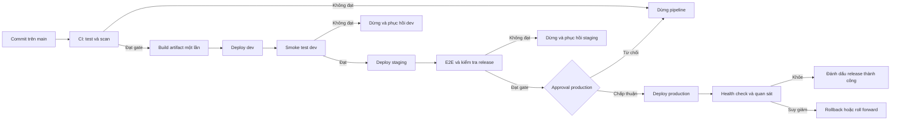

<Callout type="info" title="Mục tiêu của bài">
  Sau bài này, bạn có thể phân biệt Continuous Integration, Continuous Delivery và Continuous Deployment; thiết kế luồng `dev` → `staging` → `production`; đồng thời dùng GitHub Environments, artifact bất biến, quality gate và tín hiệu vận hành để giảm rủi ro phát hành.
</Callout>

## Mục lục

- [Mental model của CD](#mental-model-của-cd)
  - [Phân biệt Continuous Integration Delivery và Deployment](#phân-biệt-continuous-integration-delivery-và-deployment)
  - [Điều kiện hoàn thành của một deployment](#điều-kiện-hoàn-thành-của-một-deployment)
- [Build once và promotion](#build-once-và-promotion)
  - [Artifact bất biến và định danh release](#artifact-bất-biến-và-định-danh-release)
  - [Promotion qua dev staging production](#promotion-qua-dev-staging-production)
  - [Hợp đồng metadata của release](#hợp-đồng-metadata-của-release)
- [Quality gates environments và secrets](#quality-gates-environments-và-secrets)
  - [Đặt quality gate đúng vị trí](#đặt-quality-gate-đúng-vị-trí)
  - [Bảo vệ môi trường và thông tin xác thực](#bảo-vệ-môi-trường-và-thông-tin-xác-thực)
- [Các chiến lược deployment](#các-chiến-lược-deployment)
  - [Recreate và rolling update](#recreate-và-rolling-update)
  - [Blue green và canary](#blue-green-và-canary)
- [Observability và rollback](#observability-và-rollback)
  - [Tín hiệu sức khỏe sau deployment](#tín-hiệu-sức-khỏe-sau-deployment)
  - [Quy trình rollback an toàn](#quy-trình-rollback-an-toàn)
- [Workflow tham chiếu](#workflow-tham-chiếu)
  - [Giả định và cấu hình trước](#giả-định-và-cấu-hình-trước)
  - [Workflow hoàn chỉnh](#workflow-hoàn-chỉnh)
  - [Những quyết định quan trọng trong workflow](#những-quyết-định-quan-trọng-trong-workflow)
- [Bài thực hành](#bài-thực-hành)
  - [Yêu cầu](#yêu-cầu)
  - [Các bước thực hiện](#các-bước-thực-hiện)
  - [Tiêu chí kiểm chứng](#tiêu-chí-kiểm-chứng)
- [Best practices](#best-practices)
- [Troubleshooting](#troubleshooting)
- [Tài liệu chính thức](#tài-liệu-chính-thức)
- [Các bài CD tiếp theo](#các-bài-cd-tiếp-theo)

## Mental model của CD

Deployment không chỉ là lệnh sao chép file lên máy chủ. Một deployment đáng tin cậy phải trả lời được bốn câu hỏi: **đang phát hành artifact nào**, **ai hoặc policy nào cho phép**, **release có khỏe không**, và **khôi phục phiên bản trước bằng cách nào**.

GitHub Actions điều phối các bước đó bằng workflow. GitHub Environments biểu diễn đích triển khai như `dev`, `staging` và `production`. Artifact hoặc registry giữ đầu ra đã build. Hệ thống quan sát cung cấp tín hiệu để quyết định tiếp tục, dừng hoặc rollback.

### Phân biệt Continuous Integration Delivery và Deployment

Từ viết tắt “CD” có thể chỉ hai thực hành khác nhau. Vì vậy, trong tài liệu thiết kế và postmortem, nên viết đầy đủ tên thay vì chỉ ghi “CD”.

| Thực hành | Câu hỏi chính | Điểm kết thúc điển hình | Production có tự động không? |
|---|---|---|---|
| **Continuous Integration** | Thay đổi mới có tích hợp an toàn với nhánh chính không? | Build, lint, test và kiểm tra bảo mật tạo tín hiệu xanh hoặc đỏ | Không |
| **Continuous Delivery** | Nhánh chính có luôn ở trạng thái sẵn sàng phát hành không? | Artifact đã kiểm chứng được promote đến production khi có quyết định hoặc approval | Không bắt buộc; thường có cổng phê duyệt |
| **Continuous Deployment** | Mọi thay đổi vượt qua policy có thể đến người dùng ngay không? | Pipeline tự động triển khai production và xác minh sau deploy | Có |

Ví dụ, workflow tự động deploy `dev` và `staging`, sau đó chờ reviewer ở environment `production`, là **Continuous Delivery**. Nếu bỏ approval và mọi commit hợp lệ tự đi tiếp đến production, đó là **Continuous Deployment**.

<Callout type="warn" title="Không dùng deployment để bù cho CI yếu">
  Approval thủ công không thay thế unit test, integration test hoặc security scan. Người duyệt nên đánh giá rủi ro kinh doanh và bằng chứng đã được pipeline tạo ra, không chạy lại bằng mắt những kiểm tra máy có thể tự động hóa.
</Callout>

### Điều kiện hoàn thành của một deployment

Job deploy trả exit code `0` mới chỉ chứng minh lệnh triển khai không báo lỗi. Deployment chỉ nên được xem là hoàn thành khi có đủ các bằng chứng sau:

1. Artifact đúng release đã tới đúng môi trường.
2. Readiness hoặc smoke test xác nhận ứng dụng có thể phục vụ.
3. Chỉ số lỗi, độ trễ và tài nguyên không vượt ngưỡng đã định trong cửa sổ quan sát.
4. Deployment record liên kết được environment, commit, artifact digest và workflow run.
5. Owner biết cách dừng rollout hoặc phục hồi last known good release.

Nói ngắn gọn: **“đã sao chép xong” không đồng nghĩa với “đã phát hành thành công”**.

## Build once và promotion

Nguyên tắc cốt lõi là **build once, deploy many**: build đúng một lần, sau đó promote cùng một artifact qua các môi trường. Nếu staging chạy artifact A nhưng production lại build artifact B từ cùng commit, kết quả test ở staging không còn chứng minh B an toàn.



### Artifact bất biến và định danh release

**Artifact bất biến** là đầu ra không bị sửa sau khi tạo. Artifact có thể là file `.tar.gz`, package, binary, hoặc container image. Với container, digest như `sha256:...` định danh nội dung; tag như `latest` hoặc `v1.4` chỉ là con trỏ có thể bị gán lại.

Trên GitHub.com, các thế hệ hiện hành của `actions/upload-artifact` tạo artifact bất biến. Ghi đè một tên sẽ tạo artifact mới với ID mới thay vì chỉnh sửa artifact cũ. Tuy vậy, tên artifact vẫn không phải căn cước đủ mạnh. Hãy lưu cả **artifact ID**, **artifact digest** và checksum của payload cần deploy.

Phân biệt ba loại dữ liệu thường bị nhầm:

| Loại | Mục đích | Có nên dùng làm release không? |
|---|---|---|
| Cache | Tăng tốc lần build sau; có thể bị thu hồi | Không |
| Workflow artifact | Chuyển output giữa các job hoặc giữ ngắn hạn theo retention | Có, cho pipeline và bài toán retention phù hợp |
| Package hoặc container registry | Phân phối release lâu dài, có version, digest và lifecycle policy | Có, thường phù hợp production hơn |

<Callout type="idea" title="Một phép thử đơn giản">
  Xóa toàn bộ cache không được làm thay đổi bytes của release. Nếu pipeline không thể deploy khi cache miss, cache đang bị dùng sai như kho artifact.
</Callout>

### Promotion qua dev staging production

Promotion không phải là build lại. Promotion là thay đổi trạng thái của **cùng một release** sau khi nó vượt qua gate của môi trường trước.

| Môi trường | Mục tiêu | Gate điển hình | Quyền truy cập |
|---|---|---|---|
| `dev` | Phản hồi nhanh, kiểm tra deploy adapter và cấu hình cơ bản | Smoke test, migration dry-run | Credential chỉ tới tài nguyên dev |
| `staging` | Mô phỏng production đủ gần để xác minh tích hợp | E2E, contract test, kiểm tra hiệu năng ngắn, scan cấu hình | Credential chỉ tới staging |
| `production` | Phục vụ người dùng thật | Branch policy, approval hoặc automated protection rule, change window khi cần | Credential production có quyền tối thiểu |

Staging nên tương đồng production về topology, runtime và cách cấu hình, nhưng không được dùng chung database, credential hoặc queue production. “Tương đồng” giúp bắt lỗi cấu hình; “cách ly” ngăn thử nghiệm làm hỏng dữ liệu thật.

Nếu nhiều release cùng chờ production, đừng giả định thứ tự chạy luôn trùng thứ tự commit. Hãy serialize deployment bằng `concurrency`, hiển thị release ID khi approval, và từ chối release cũ nếu release mới đã thay thế nó.

### Hợp đồng metadata của release

Mỗi deployment nên phát ra metadata tối thiểu dưới đây vào job summary, deployment record hoặc hệ thống release nội bộ.

<TypeTable
  type={{
    releaseId: {
      description: 'Định danh ổn định để tìm cùng release trong log, dashboard và incident.',
      type: 'string',
      required: true,
    },
    commitSha: {
      description: 'Commit nguồn đã tạo artifact; dùng full SHA thay vì tên branch.',
      type: 'string',
      required: true,
    },
    artifactId: {
      description: 'ID của workflow artifact hoặc định danh package trong registry.',
      type: 'string',
      required: true,
    },
    artifactDigest: {
      description: 'Digest hoặc checksum xác minh chính xác nội dung được deploy.',
      type: 'SHA-256',
      required: true,
    },
    environment: {
      description: 'Đích triển khai như dev, staging hoặc production.',
      type: "'dev' | 'staging' | 'production'",
      required: true,
    },
    deployedAt: {
      description: 'Thời điểm deploy theo UTC để đối chiếu metrics và logs.',
      type: 'RFC 3339 timestamp',
      required: true,
    },
  }}
/>

Metadata không chứa secret, access token hoặc dữ liệu người dùng. Nó là “nhãn vận chuyển” để truy vết release, không phải nơi lưu cấu hình nhạy cảm.

## Quality gates environments và secrets

Quality gate là điều kiện có kết quả rõ ràng: pass, fail, approve hoặc reject. Gate tốt dựa trên bằng chứng có thể lặp lại và có owner. Gate mơ hồ như “kiểm tra nhanh xem có ổn không” sẽ tạo quyết định không nhất quán.

### Đặt quality gate đúng vị trí

Đặt kiểm tra rẻ và phản hồi nhanh ở đầu pipeline. Đặt kiểm tra cần hạ tầng thật sau khi deploy môi trường phù hợp.

| Vị trí | Gate nên có | Khi fail |
|---|---|---|
| Trước merge | Lint, typecheck, unit test, dependency review, secret scan | Chặn merge |
| Trước khi tạo release | Integration test, build, SBOM hoặc vulnerability policy theo threat model | Không publish artifact phát hành |
| Sau deploy `dev` | Smoke test, kiểm tra revision, migration dry-run | Dừng promotion |
| Sau deploy `staging` | E2E, contract test, kiểm tra cấu hình và hiệu năng có ngưỡng | Dừng trước production |
| Trước production | Branch hoặc tag policy, required reviewer, change ticket khi tổ chức yêu cầu | Chờ hoặc từ chối deployment |
| Sau deploy production | Readiness, synthetic test, error rate và latency trong cửa sổ quan sát | Dừng rollout, rollback hoặc roll forward |

Mỗi gate cần timeout. Khi công cụ quan sát không phản hồi, pipeline không nên tự diễn giải thành “hệ thống khỏe”. Với gate bảo vệ production, lỗi lấy dữ liệu thường phải **fail closed**: không tiếp tục cho đến khi có bằng chứng hợp lệ.

### Bảo vệ môi trường và thông tin xác thực

Một job khai báo `environment: production` sẽ tạo deployment record theo mặc định. Trước khi job được gửi tới runner, GitHub áp dụng protection rules của environment. Environment secrets chỉ khả dụng cho job sau khi các rule đó đã vượt qua.

Cấu hình khuyến nghị:

- Tạo riêng `dev`, `staging` và `production` trong **Settings → Environments**.
- Chỉ cho nhánh hoặc tag phát hành được deploy production.
- Bật required reviewers và **Prevent self-review** khi cần phân tách trách nhiệm.
- Lưu giá trị không nhạy cảm như URL trong environment variables, truy cập qua `vars.APP_URL`.
- Lưu credential legacy trong environment secrets, truy cập qua `secrets.DEPLOY_TOKEN`.
- Ưu tiên OIDC để đổi identity của workflow lấy token cloud ngắn hạn thay vì giữ access key dài hạn.

Job dùng OIDC cần quyền tạo ID token. Chỉ cấp quyền này cho job deploy cần đăng nhập cloud:

```yaml
permissions:
  contents: read
  id-token: write
```

`id-token: write` chỉ cho phép workflow yêu cầu OIDC token; cloud provider vẫn phải kiểm tra issuer, audience và các claim như repository, ref hoặc environment trước khi cấp quyền. Trust policy phía cloud phải giới hạn đúng repository và environment production, không chấp nhận mọi repository trong organization.

<Callout type="warn" title="Environment không biến runner thành vùng tin cậy">
  Environment kiểm soát thời điểm job nhận secret, nhưng step độc hại chạy sau approval vẫn có thể đọc secret. Pin action theo chính sách supply chain, giới hạn `GITHUB_TOKEN`, review thay đổi workflow và harden self-hosted runner.
</Callout>

Tính khả dụng của required reviewers, wait timer và environment secrets phụ thuộc loại repository cùng GitHub plan. Luôn kiểm tra bảng hỗ trợ hiện hành trong GitHub Docs trước khi biến một rule thành yêu cầu tuân thủ.

## Các chiến lược deployment

Chiến lược deployment quyết định cách phiên bản cũ và mới cùng tồn tại trong lúc chuyển đổi. Chọn chiến lược theo khả năng của nền tảng, ngân sách tài nguyên, state của ứng dụng và mức downtime chấp nhận được.

### Recreate và rolling update

| Chiến lược | Cách hoạt động | Ưu điểm | Rủi ro và điều kiện dùng |
|---|---|---|---|
| **Recreate** | Dừng phiên bản cũ rồi khởi động phiên bản mới | Đơn giản, không cần chạy hai phiên bản | Có downtime; phù hợp môi trường nhỏ hoặc workload chấp nhận gián đoạn |
| **Rolling update** | Thay từng instance theo batch, giữ một phần capacity đang phục vụ | Ít hoặc không downtime, tiết kiệm hơn blue-green | Hai phiên bản cùng tồn tại; API và schema phải tương thích trong cửa sổ rollout |

Rolling update cần readiness probe đáng tin cậy và giới hạn số instance không sẵn sàng. Nếu readiness chỉ kiểm tra process còn chạy, load balancer có thể gửi traffic trước khi ứng dụng thật sự sẵn sàng.

### Blue green và canary

| Chiến lược | Cách hoạt động | Ưu điểm | Rủi ro và điều kiện dùng |
|---|---|---|---|
| **Blue-green** | Dựng môi trường mới song song, kiểm tra rồi chuyển traffic từ blue sang green | Chuyển đổi và quay lại nhanh | Gần gấp đôi tài nguyên trong thời gian chuyển; dữ liệu dùng chung vẫn cần tương thích |
| **Canary** | Đưa phiên bản mới tới một tỷ lệ nhỏ traffic hoặc nhóm người dùng trước | Giới hạn blast radius và kiểm chứng bằng traffic thật | Cần traffic routing, metrics phân tách theo version và tiêu chí tự động dừng |

Canary không đơn giản là “đợi 10 phút”. Pipeline cần so sánh error rate, latency và chỉ số nghiệp vụ của canary với baseline. Nếu lượng traffic quá thấp để có tín hiệu, hãy kéo dài cửa sổ hoặc dùng synthetic test; không tuyên bố canary an toàn chỉ vì chưa thấy lỗi.

<Callout type="info" title="Database quyết định khả năng rollback">
  Với mọi chiến lược không downtime, migration nên theo mẫu expand–migrate–contract: thêm schema tương thích trước, chuyển code và dữ liệu, rồi mới xóa cấu trúc cũ ở release sau. Migration phá vỡ tương thích có thể làm rollback ứng dụng thất bại dù artifact cũ vẫn còn.
</Callout>

## Observability và rollback

Observability là khả năng suy ra trạng thái bên trong hệ thống từ metrics, logs, traces và events. Trong deployment, mục tiêu không phải thu thập thật nhiều dữ liệu. Mục tiêu là trả lời nhanh: “release mới có làm hệ thống xấu đi không, ở đâu, và từ thời điểm nào?”.

### Tín hiệu sức khỏe sau deployment

Tối thiểu, dashboard hoặc gate sau deploy nên có:

- **Traffic:** request rate hoặc throughput để biết release đã nhận tải thật chưa.
- **Errors:** tỷ lệ HTTP 5xx, exception, failed job và lỗi dependency.
- **Latency:** các percentile như p50, p95 và p99; trung bình có thể che giấu tail latency.
- **Saturation:** CPU, memory, connection pool, queue depth hoặc giới hạn tài nguyên.
- **Business signal:** checkout thành công, đăng nhập thành công hoặc chỉ số quan trọng của sản phẩm.
- **Release dimension:** `release_id`, commit SHA hoặc image digest trên log, trace và metric.

Gửi deployment marker tới hệ thống quan sát ngay khi bắt đầu và kết thúc rollout. Marker cho phép đối chiếu đường tăng error rate với đúng release thay vì đoán theo timestamp.

Smoke test kiểm tra đường đi tối thiểu ngay sau deploy. Synthetic test chạy định kỳ từ góc nhìn người dùng. Cả hai bổ sung cho metrics từ traffic thật, không thay thế nhau.

### Quy trình rollback an toàn

Rollback là một deployment có kiểm soát tới **last known good artifact**, không phải chỉnh file trực tiếp trên server. Một quy trình tối thiểu gồm:

1. Phát hiện breach của SLO, health gate hoặc chỉ số nghiệp vụ.
2. Dừng promotion hay canary để blast radius không tăng.
3. Xác định release tốt gần nhất bằng deployment history và digest.
4. Chuyển traffic hoặc deploy lại đúng artifact đó; không rebuild từ branch cũ.
5. Chạy smoke test và quan sát lại bằng cùng bộ ngưỡng.
6. Ghi deployment status, thông báo incident owner và bảo toàn log phục vụ điều tra.

Tùy chiến lược, hành động phục hồi khác nhau:

- Rolling hoặc recreate: deploy lại digest trước.
- Blue-green: chuyển traffic về environment cũ nếu nó vẫn còn khỏe.
- Canary: đưa trọng số canary về `0`, sau đó điều tra ngoài đường phục vụ.
- Feature flag: tắt đường code lỗi nếu flag đã được thiết kế như kill switch.

Nếu dữ liệu đã bị ghi theo schema không tương thích, rollback binary có thể nguy hiểm hơn giữ phiên bản mới. Khi đó ưu tiên **roll forward** bằng bản vá tương thích, cô lập chức năng lỗi hoặc phục hồi dữ liệu theo runbook đã thử nghiệm.

## Workflow tham chiếu

Workflow dưới đây minh họa Continuous Delivery cho ứng dụng Node.js tạo thư mục `dist/`. Nó build đúng một lần, đóng gói `release.tgz`, lưu checksum, rồi tải cùng artifact ID trong ba job deployment.

### Giả định và cấu hình trước

Repository cần:

- `package-lock.json`, script `npm test` và `npm run build` tạo `dist/`;
- `scripts/deploy.sh <environment> <release.tgz>` triển khai idempotent, nghĩa là chạy lại cùng release không làm trạng thái sai;
- `scripts/smoke-test.sh <environment> <expected-commit>` trả khác `0` khi revision hoặc health check sai;
- ba GitHub Environments tên chính xác `dev`, `staging`, `production`;
- tùy adapter thật, environment variable `APP_URL` và secret `DEPLOY_TOKEN`, hoặc cấu hình OIDC tương ứng.

Production nên có required reviewer và chỉ cho `main` hoặc release tag phù hợp deploy. Workflow không thể khai báo reviewer trong YAML; đây là policy cấu hình ở **Settings → Environments → production**.

### Workflow hoàn chỉnh

Tạo `.github/workflows/delivery.yml`:

```yaml
name: Promote one immutable artifact

on:
  push:
    branches: [main]
  workflow_dispatch:

permissions:
  contents: read

concurrency:
  group: app-release-${{ github.repository }}
  cancel-in-progress: false
  queue: max

jobs:
  build:
    name: Test and build once
    runs-on: ubuntu-latest
    timeout-minutes: 20
    outputs:
      artifact-id: ${{ steps.upload.outputs.artifact-id }}
      artifact-name: ${{ steps.release.outputs.artifact_name }}
      artifact-digest: ${{ steps.upload.outputs.artifact-digest }}
      payload-digest: ${{ steps.release.outputs.payload_digest }}

    steps:
      - name: Checkout source
        uses: actions/checkout@v7
        with:
          persist-credentials: false

      - name: Set up Node.js
        uses: actions/setup-node@v6
        with:
          node-version: 24
          cache: npm

      - name: Install, test and build
        run: |
          set -Eeuo pipefail
          npm ci
          npm test
          npm run build
          test -d dist

      - name: Package deterministic release
        id: release
        shell: bash
        run: |
          set -Eeuo pipefail

          printf '%s\n' "$GITHUB_SHA" > dist/REVISION
          tar \
            --sort=name \
            --mtime='UTC 1970-01-01' \
            --owner=0 \
            --group=0 \
            --numeric-owner \
            -czf release.tgz dist

          payload_digest="$(sha256sum release.tgz | cut -d' ' -f1)"
          printf '%s  %s\n' "$payload_digest" release.tgz > release.tgz.sha256

          echo "artifact_name=webapp-${GITHUB_SHA}" >> "$GITHUB_OUTPUT"
          echo "payload_digest=${payload_digest}" >> "$GITHUB_OUTPUT"

      - name: Upload immutable release
        id: upload
        uses: actions/upload-artifact@v7
        with:
          name: ${{ steps.release.outputs.artifact_name }}
          path: |
            release.tgz
            release.tgz.sha256
          if-no-files-found: error
          retention-days: 14

      - name: Write release summary
        env:
          ARTIFACT_NAME: ${{ steps.release.outputs.artifact_name }}
          ARTIFACT_ID: ${{ steps.upload.outputs.artifact-id }}
          ARTIFACT_DIGEST: ${{ steps.upload.outputs.artifact-digest }}
          PAYLOAD_DIGEST: ${{ steps.release.outputs.payload_digest }}
        run: |
          {
            echo "### Release candidate"
            echo "- Commit: \`$GITHUB_SHA\`"
            echo "- Artifact: \`$ARTIFACT_NAME\`"
            echo "- Artifact ID: \`$ARTIFACT_ID\`"
            echo "- Artifact digest: \`$ARTIFACT_DIGEST\`"
            echo "- Payload digest: \`$PAYLOAD_DIGEST\`"
          } >> "$GITHUB_STEP_SUMMARY"

  deploy-dev:
    name: Deploy dev
    needs: build
    runs-on: ubuntu-latest
    timeout-minutes: 15
    environment: dev

    steps:
      - name: Checkout deployment adapter at release commit
        uses: actions/checkout@v7
        with:
          ref: ${{ github.sha }}
          persist-credentials: false

      - name: Download exact artifact by ID
        uses: actions/download-artifact@v8
        with:
          artifact-ids: ${{ needs.build.outputs.artifact-id }}
          path: release

      - name: Verify payload
        env:
          EXPECTED_DIGEST: ${{ needs.build.outputs.payload-digest }}
        run: |
          set -Eeuo pipefail
          echo "$EXPECTED_DIGEST  release/release.tgz" | sha256sum --check -
          mkdir release/verified
          tar -xzf release/release.tgz -C release/verified
          test "$(cat release/verified/dist/REVISION)" = "$GITHUB_SHA"

      - name: Deploy dev
        env:
          TARGET_ENV: dev
          TARGET_URL: ${{ vars.APP_URL }}
          DEPLOY_TOKEN: ${{ secrets.DEPLOY_TOKEN }}
        run: ./scripts/deploy.sh "$TARGET_ENV" release/release.tgz

      - name: Smoke test dev
        run: ./scripts/smoke-test.sh dev "$GITHUB_SHA"

  deploy-staging:
    name: Deploy staging
    needs: [build, deploy-dev]
    runs-on: ubuntu-latest
    timeout-minutes: 20
    environment: staging

    steps:
      - name: Checkout deployment adapter at release commit
        uses: actions/checkout@v7
        with:
          ref: ${{ github.sha }}
          persist-credentials: false

      - name: Download exact artifact by ID
        uses: actions/download-artifact@v8
        with:
          artifact-ids: ${{ needs.build.outputs.artifact-id }}
          path: release

      - name: Verify payload
        env:
          EXPECTED_DIGEST: ${{ needs.build.outputs.payload-digest }}
        run: |
          set -Eeuo pipefail
          echo "$EXPECTED_DIGEST  release/release.tgz" | sha256sum --check -
          mkdir release/verified
          tar -xzf release/release.tgz -C release/verified
          test "$(cat release/verified/dist/REVISION)" = "$GITHUB_SHA"

      - name: Deploy staging
        env:
          TARGET_ENV: staging
          TARGET_URL: ${{ vars.APP_URL }}
          DEPLOY_TOKEN: ${{ secrets.DEPLOY_TOKEN }}
        run: ./scripts/deploy.sh "$TARGET_ENV" release/release.tgz

      - name: Smoke and release tests
        run: |
          set -Eeuo pipefail
          ./scripts/smoke-test.sh staging "$GITHUB_SHA"
          npm ci
          npm run test:e2e --if-present

  deploy-production:
    name: Deploy production
    needs: [build, deploy-staging]
    runs-on: ubuntu-latest
    timeout-minutes: 20
    environment: production

    steps:
      - name: Checkout deployment adapter at release commit
        uses: actions/checkout@v7
        with:
          ref: ${{ github.sha }}
          persist-credentials: false

      - name: Download exact artifact by ID
        uses: actions/download-artifact@v8
        with:
          artifact-ids: ${{ needs.build.outputs.artifact-id }}
          path: release

      - name: Verify payload
        env:
          EXPECTED_DIGEST: ${{ needs.build.outputs.payload-digest }}
        run: |
          set -Eeuo pipefail
          echo "$EXPECTED_DIGEST  release/release.tgz" | sha256sum --check -
          mkdir release/verified
          tar -xzf release/release.tgz -C release/verified
          test "$(cat release/verified/dist/REVISION)" = "$GITHUB_SHA"

      - name: Deploy production
        env:
          TARGET_ENV: production
          TARGET_URL: ${{ vars.APP_URL }}
          DEPLOY_TOKEN: ${{ secrets.DEPLOY_TOKEN }}
        run: ./scripts/deploy.sh "$TARGET_ENV" release/release.tgz

      - name: Verify production
        run: ./scripts/smoke-test.sh production "$GITHUB_SHA"

      - name: Write deployment summary
        env:
          ARTIFACT_NAME: ${{ needs.build.outputs.artifact-name }}
          ARTIFACT_DIGEST: ${{ needs.build.outputs.artifact-digest }}
          PAYLOAD_DIGEST: ${{ needs.build.outputs.payload-digest }}
        run: |
          {
            echo "### Production deployment"
            echo "- Commit: \`$GITHUB_SHA\`"
            echo "- Artifact: \`$ARTIFACT_NAME\`"
            echo "- Artifact digest: \`$ARTIFACT_DIGEST\`"
            echo "- Payload digest: \`$PAYLOAD_DIGEST\`"
          } >> "$GITHUB_STEP_SUMMARY"
```

### Những quyết định quan trọng trong workflow

- `needs` tạo promotion tuần tự. Production không thể bắt đầu nếu staging fail.
- Mỗi job download bằng `artifact-id`, không dùng “artifact mới nhất”. Điều này tránh chọn nhầm release khi có nhiều workflow run.
- `download-artifact` xác minh digest của GitHub artifact. Workflow còn kiểm tra SHA-256 của `release.tgz` để xác minh đúng payload mà deploy adapter nhận.
- File `dist/REVISION` cho smoke test một cách đơn giản để chứng minh version đang chạy.
- Checkout trong job deploy chỉ lấy adapter ở đúng `github.sha`; ứng dụng không được build lại.
- Cùng tên secret `DEPLOY_TOKEN` có thể mang ba giá trị khác nhau vì mỗi job tham chiếu environment khác nhau.
- Production approval nằm ở protection rules. Secret production chưa được cấp cho runner trong lúc job còn chờ duyệt.
- `concurrency` serialize release của repository và giữ hàng đợi. Không đặt `cancel-in-progress: true` cho deployment production đang chạy.
- Artifact retention 14 ngày chỉ là ví dụ. Retention thực tế phải dài hơn cửa sổ rollback; release cần giữ lâu nên được publish vào package hoặc container registry.

<Callout type="warn" title="Kiểm tra phiên bản action và nền tảng">
  Ví dụ bám theo major hiện hành trên GitHub.com. GitHub Enterprise Server có ma trận hỗ trợ artifact action khác GitHub.com. Trước khi sao chép, kiểm tra README và release notes chính thức của từng action; với policy supply chain nghiêm ngặt, pin action bằng full commit SHA và cập nhật qua pull request.
</Callout>

## Bài thực hành

Bài thực hành bắt đầu bằng adapter mô phỏng trên runner để bạn kiểm chứng control plane mà không cần tài khoản cloud. Adapter này không tạo deployment bền vững. Sau khi pipeline chạy đúng, thay **duy nhất** nội dung adapter bằng lệnh deploy của nền tảng thật, còn hợp đồng artifact và promotion giữ nguyên.

### Yêu cầu

- Repository Node.js có `package-lock.json`.
- `npm test` chạy được và `npm run build` tạo ít nhất `dist/index.html`.
- Quyền tạo GitHub Environments và sửa workflow.
- Nhánh mặc định là `main`, hoặc cập nhật trigger cho đúng repository.

### Các bước thực hiện

<Steps>
<Step>

**Tạo ba environment**

Trong **Settings → Environments**, tạo `dev`, `staging` và `production`. Ở `production`, chỉ cho nhánh `main` deploy, thêm required reviewer và bật **Prevent self-review** nếu GitHub plan hỗ trợ.

Không thêm secret cho adapter mô phỏng. Biến và secret không tồn tại sẽ trở thành chuỗi rỗng; script mô phỏng không sử dụng chúng.

</Step>
<Step>

**Tạo deploy adapter mô phỏng**

Tạo `scripts/deploy.sh`:

```bash
#!/usr/bin/env bash
set -Eeuo pipefail

target_env="${1:?usage: deploy.sh ENV RELEASE_TGZ}"
bundle="${2:?usage: deploy.sh ENV RELEASE_TGZ}"
destination="${RUNNER_TEMP:?}/deployed/${target_env}"
temporary="$(mktemp -d)"

cleanup() {
  rm -rf "$temporary"
}
trap cleanup EXIT

tar -xzf "$bundle" -C "$temporary"
test -f "$temporary/dist/REVISION"

rm -rf "$destination"
mkdir -p "$(dirname "$destination")"
mv "$temporary/dist" "$destination"

echo "Deployed $(cat "$destination/REVISION") to $target_env"
```

Script dùng chiến lược recreate trong thư mục tạm của runner. Adapter production thật phải xác thực, deploy idempotent, chờ rollout hoàn tất và trả exit code khác `0` khi nền tảng báo lỗi.

</Step>
<Step>

**Tạo smoke test mô phỏng**

Tạo `scripts/smoke-test.sh`:

```bash
#!/usr/bin/env bash
set -Eeuo pipefail

target_env="${1:?usage: smoke-test.sh ENV EXPECTED_SHA}"
expected_sha="${2:?usage: smoke-test.sh ENV EXPECTED_SHA}"
root="${RUNNER_TEMP:?}/deployed/${target_env}"
port=8080
log_file="${RUNNER_TEMP}/smoke-${target_env}.log"

python3 -m http.server "$port" --directory "$root" >"$log_file" 2>&1 &
server_pid=$!
cleanup() {
  kill "$server_pid" >/dev/null 2>&1 || true
}
trap cleanup EXIT

for attempt in {1..15}; do
  if actual_sha="$(curl --fail --silent --show-error \
    "http://127.0.0.1:${port}/REVISION")"; then
    test "$actual_sha" = "$expected_sha"
    curl --fail --silent --show-error \
      "http://127.0.0.1:${port}/index.html" >/dev/null
    exit 0
  fi
  sleep 1
done

cat "$log_file" >&2 || true
echo "Deployment did not become ready in 15 seconds" >&2
exit 1
```

Sau đó cấp quyền thực thi và commit:

```bash
chmod +x scripts/deploy.sh scripts/smoke-test.sh
git add scripts/deploy.sh scripts/smoke-test.sh .github/workflows/delivery.yml
git commit -m "Add immutable artifact delivery pipeline"
git push
```

</Step>
<Step>

**Chạy và quan sát promotion**

Mở workflow run. Kiểm tra graph đi theo thứ tự `build` → `deploy-dev` → `deploy-staging` → `deploy-production`. Job production phải ở trạng thái chờ đến khi reviewer chấp thuận.

Mở phần **Artifacts** và job summary. Đối chiếu artifact ID, artifact digest, payload digest và commit SHA. Sau khi hoàn tất, mở **Deployments** của repository để xem lịch sử theo environment.

</Step>
<Step>

**Tạo lỗi có chủ đích**

Đổi smoke test để `expected_sha` luôn sai, hoặc xóa file `dist/REVISION` trong step package. Push commit mới và xác nhận promotion dừng trước production.

Khôi phục script, sau đó thử từ chối approval production. Job production không được chạy và không được đọc environment secret.

</Step>
<Step>

**Thay adapter bằng deployment thật**

Chọn một target như GitHub Pages, container registry, Kubernetes hoặc cloud provider. Giữ nguyên input `<environment> <release.tgz>`, checksum và smoke-test contract. Nếu provider hỗ trợ OIDC, bỏ secret dài hạn, thêm `id-token: write` ở đúng job và cấu hình trust policy theo environment.

</Step>
</Steps>

### Tiêu chí kiểm chứng

Bài hoàn thành khi tất cả tiêu chí sau đúng:

- [ ] Frontend hoặc ứng dụng được build đúng một lần trong job `build`.
- [ ] Cả ba job deploy dùng cùng artifact ID và cùng payload digest.
- [ ] Sửa nội dung `release.tgz` làm bước `sha256sum --check` thất bại.
- [ ] Revision đọc từ môi trường mô phỏng khớp full `GITHUB_SHA`.
- [ ] `dev` fail làm `staging` và `production` không chạy.
- [ ] `staging` fail làm `production` không chạy.
- [ ] Production chờ required reviewer và người kích hoạt không tự duyệt khi **Prevent self-review** được bật.
- [ ] Job summary ghi commit, artifact name, artifact digest và payload digest nhưng không lộ secret.
- [ ] Deployment history hiển thị các environment và workflow run liên quan.
- [ ] Hai run không triển khai đồng thời do cùng concurrency group.
- [ ] Bạn xác định được last known good artifact trước khi thay adapter bằng target thật.

## Best practices

- **Build một lần, promote nhiều lần.** Không chạy `npm run build`, `docker build` hoặc compiler trong job production.
- **Dùng digest làm căn cước.** Tag, branch và tên artifact giúp con người đọc; artifact ID cùng digest mới xác định output.
- **Tách artifact khỏi cache.** Cache được phép mất. Release phải có retention và quyền truy cập phù hợp với RTO rollback.
- **Giữ environment độc lập.** Không dùng chung credential, database hoặc queue giữa staging và production.
- **Cấp quyền tối thiểu.** Đặt `permissions: contents: read` mặc định; chỉ thêm `packages: write`, `deployments: write` hoặc `id-token: write` ở job thật sự cần.
- **Ưu tiên credential ngắn hạn.** Dùng OIDC khi provider hỗ trợ. Nếu buộc dùng secret, đặt ở environment scope, xoay vòng và giới hạn tài nguyên đích.
- **Không deploy code không tin cậy bằng secret production.** Không chạy deployment đặc quyền từ pull request của fork hoặc checkout ref do input tùy ý cung cấp.
- **Serialize theo target.** Mọi workflow có thể chạm cùng production phải dùng cùng concurrency group hoặc cơ chế khóa ở nền tảng đích.
- **Đặt timeout và retry có giới hạn.** Chỉ retry thao tác idempotent. Retry mù một migration hoặc lệnh tạo tài nguyên có thể nhân đôi tác động.
- **Tự động hóa gate lặp lại được.** Dành approval cho đánh giá rủi ro, không dùng con người thay cho test.
- **Quan sát theo release.** Gắn release ID hoặc digest vào log, trace, metric và deployment marker.
- **Thử rollback định kỳ.** Runbook chưa được diễn tập chỉ là giả thuyết. Đo thời gian phục hồi và kiểm tra artifact cũ còn truy cập được.
- **Thiết kế migration tương thích ngược.** Tách thay đổi schema phá vỡ tương thích khỏi rollout ứng dụng.
- **Bảo vệ workflow như source code production.** Bắt buộc review thư mục `.github/workflows`, pin action theo threat model và giới hạn allowed actions ở cấp tổ chức khi cần.

## Troubleshooting

| Triệu chứng | Nguyên nhân thường gặp | Cách xử lý |
|---|---|---|
| Job production chạy ngay, không chờ | Environment chưa có required reviewer, tên environment sai, hoặc plan không hỗ trợ rule đó | Kiểm tra **Settings → Environments → production**, tên trong YAML và khả năng của GitHub plan |
| Secret production là chuỗi rỗng | Secret chưa tạo ở environment, job không tham chiếu đúng environment, hoặc tên secret sai | Tạo secret đúng scope; kiểm tra `environment: production`; không in secret để debug |
| Job chờ approval nhưng reviewer không thấy nút duyệt | Reviewer không nằm trong danh sách, thiếu quyền đọc, hoặc protection rule khác vẫn pending | Mở chi tiết deployment, kiểm tra reviewer, branch policy, wait timer và custom rule |
| `download-artifact` không tìm thấy artifact | Sai artifact ID, artifact hết retention, hoặc cố tải từ workflow run khác mà chưa truyền token và run ID | Truyền output `artifact-id` qua `needs`; tăng retention; làm theo hướng dẫn cross-run của action |
| Digest của artifact không khớp | Artifact tải xuống bị sai hoặc validation phát hiện bất thường | Dừng deployment; không bỏ qua cảnh báo; kiểm tra artifact ID, run nguồn và log upload/download |
| Payload checksum fail | File `release.tgz` bị thay, download path sai hoặc checksum lấy từ release khác | Dùng cùng output `payload-digest`, kiểm tra path và không dùng “latest” |
| `REVISION` khác `GITHUB_SHA` | Job deploy build lại, lấy nhầm artifact hoặc adapter đang phục vụ release cũ | Loại bước rebuild, deploy theo ID hoặc digest, chờ rollout và kiểm tra routing/cache |
| Staging xanh nhưng production lỗi cấu hình | Hai môi trường khác runtime, topology hoặc biến cấu hình quan trọng | So sánh cấu hình không nhạy cảm, dùng policy-as-code và giữ staging gần production nhưng vẫn cách ly |
| Hai deployment production chồng nhau | Workflow khác không dùng cùng concurrency group hoặc nền tảng đích không có khóa | Chuẩn hóa group trên mọi workflow deploy và thêm locking phía platform nếu cần |
| Run mới làm run đang deploy bị hủy | `cancel-in-progress: true` được dùng cho group production | Đặt `false`; dùng queue phù hợp; chỉ hủy an toàn trước khi deployment bắt đầu |
| Smoke test chập chờn | Dùng `sleep` cố định, readiness chưa đúng hoặc phụ thuộc ngoài không ổn định | Poll có deadline, in log khi timeout, tách readiness nội bộ khỏi dependency check |
| Rolling update bị kẹt | Readiness fail, thiếu capacity hoặc phiên bản mới không tương thích schema | Xem rollout event và resource metrics; dừng rollout; deploy digest cũ nếu schema cho phép |
| Rollback binary làm lỗi nặng hơn | Migration dữ liệu không tương thích ngược | Dừng rollback, cô lập chức năng, roll forward; áp dụng expand–migrate–contract cho release sau |
| GitHub-hosted runner không tới mạng nội bộ | Firewall không cho dải IP runner hoặc target chỉ có private endpoint | Dùng self-hosted runner đã harden, private networking được hỗ trợ, hoặc cơ chế deploy pull-based |
| Action major trong ví dụ không chạy trên GHES | GitHub.com và GHES hỗ trợ phiên bản artifact action khác nhau | Kiểm tra README chính thức và tài liệu GHES đúng phiên bản; không hạ cấp mù |

<Accordions type="single">
  <Accordion title="Có nên dùng workflow_dispatch để chọn tùy ý artifact production không?">
    Chỉ nên làm vậy khi input được xác minh với allowlist hoặc deployment catalog. Không nhận một URL hay tag tùy ý rồi deploy bằng credential production. Mẫu an toàn hơn là chọn artifact ID đã được pipeline tin cậy tạo ra, xác minh digest, commit và trạng thái gate trước khi tiếp tục.
  </Accordion>
  <Accordion title="Có cần approval cho mọi môi trường không?">
    Không. Approval trên `dev` thường làm chậm phản hồi mà không giảm nhiều rủi ro. Hãy tự động hóa dev và staging, rồi đặt approval ở ranh giới có rủi ro kinh doanh hoặc tuân thủ. Hệ thống Continuous Deployment trưởng thành có thể thay approval bằng automated protection rules và canary gate.
  </Accordion>
  <Accordion title="Rollback có phải là git revert không?">
    Không hoàn toàn. `git revert` tạo thay đổi source mới và cần build artifact mới, nên phù hợp để sửa lịch sử nhánh. Rollback vận hành ưu tiên redeploy artifact tốt đã biết để phục hồi nhanh. Sau khi ổn định, vẫn có thể revert hoặc sửa source để nhánh chính phản ánh trạng thái mong muốn.
  </Accordion>
</Accordions>

## Tài liệu chính thức

- [GitHub Docs — Deploying with GitHub Actions](https://docs.github.com/en/actions/how-tos/deploy/configure-and-manage-deployments/control-deployments)
- [GitHub Docs — Deployment environments](https://docs.github.com/en/actions/concepts/workflows-and-actions/deployment-environments)
- [GitHub Docs — Managing environments for deployment](https://docs.github.com/en/actions/how-tos/deploy/configure-and-manage-deployments/manage-environments)
- [GitHub Docs — Deployments and environments reference](https://docs.github.com/en/actions/reference/workflows-and-actions/deployments-and-environments)
- [GitHub Docs — Reviewing deployments](https://docs.github.com/en/actions/how-tos/deploy/configure-and-manage-deployments/review-deployments)
- [GitHub Docs — Viewing deployment history](https://docs.github.com/en/actions/how-tos/deploy/configure-and-manage-deployments/view-deployment-history)
- [GitHub Docs — Store and share data with workflow artifacts](https://docs.github.com/en/actions/how-tos/writing-workflows/choosing-what-your-workflow-does/storing-and-sharing-data-from-a-workflow)
- [GitHub Docs — Control workflow concurrency](https://docs.github.com/en/actions/how-tos/write-workflows/choose-when-workflows-run/control-workflow-concurrency)
- [GitHub Docs — OpenID Connect](https://docs.github.com/en/actions/concepts/security/openid-connect)
- [GitHub Docs — Security hardening for deployments](https://docs.github.com/en/actions/how-tos/secure-your-work/security-harden-deployments)
- [actions/upload-artifact — input, output và tính bất biến](https://github.com/actions/upload-artifact)
- [actions/download-artifact — tải artifact theo ID và kiểm tra digest](https://github.com/actions/download-artifact)
- [GitHub Docs — Secure use reference](https://docs.github.com/en/actions/reference/security/secure-use)

## Các bài CD tiếp theo

<Cards>
  <Card title="Environments và approvals" href="/docs/cd/02-environments-approvals/" description="Cấu hình protection rules, reviewer, branch policy và secret theo môi trường." />
  <Card title="Release management" href="/docs/cd/03-release-management/" description="Thiết kế version, tag, release notes và vòng đời phát hành." />
  <Card title="Deploy GitHub Pages" href="/docs/cd/04-deploy-github-pages/" description="Áp dụng pipeline deployment cho website tĩnh trên GitHub Pages." />
  <Card title="Publish container registry" href="/docs/cd/05-publish-container-registry/" description="Publish image bất biến và dùng digest làm đơn vị promotion." />
  <Card title="Deploy Kubernetes" href="/docs/cd/06-deploy-kubernetes/" description="Triển khai workload với rollout, readiness và policy phù hợp." />
  <Card title="Rollback strategies" href="/docs/cd/09-rollback-strategies/" description="Đi sâu vào phát hiện lỗi, rollback, roll forward và diễn tập phục hồi." />
</Cards>
