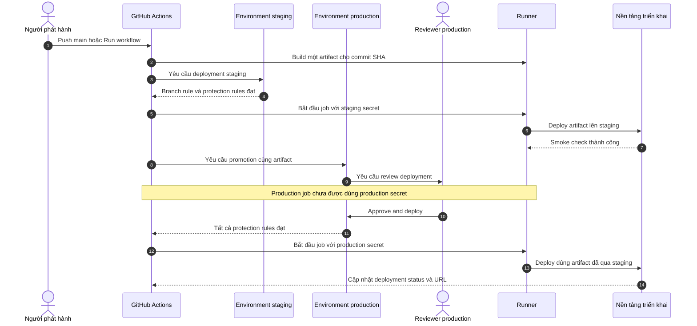

<Callout type="info" title="Kết quả sau bài học">
  Bạn sẽ tạo hai environment `staging` và `production`, cấu hình cổng phê duyệt trên giao diện GitHub, chạy một workflow promotion có thể kiểm chứng và hiểu chính xác thời điểm deployment job được phép nhận secret.
</Callout>

## Mục lục

- [Mô hình môi trường và cổng triển khai](#mô-hình-môi-trường-và-cổng-triển-khai)
  - [Environment giải quyết điều gì](#environment-giải-quyết-điều-gì)
  - [Luồng phê duyệt và cấp secrets](#luồng-phê-duyệt-và-cấp-secrets)
- [Khả dụng theo plan và loại repository](#khả-dụng-theo-plan-và-loại-repository)
- [Gắn environment vào job](#gắn-environment-vào-job)
  - [Cú pháp job environment](#cú-pháp-job-environment)
  - [Environment secrets và variables](#environment-secrets-và-variables)
  - [Quyền tối thiểu cho deployment job](#quyền-tối-thiểu-cho-deployment-job)
- [Deployment protection rules](#deployment-protection-rules)
  - [Required reviewers và prevent self review](#required-reviewers-và-prevent-self-review)
  - [Wait timer](#wait-timer)
  - [Giới hạn branch và tag](#giới-hạn-branch-và-tag)
  - [Quyền bypass của quản trị viên](#quyền-bypass-của-quản-trị-viên)
  - [Custom deployment protection rules](#custom-deployment-protection-rules)
- [Cấu hình staging và production trên giao diện](#cấu-hình-staging-và-production-trên-giao-diện)
  - [Chính sách đề xuất cho staging](#chính-sách-đề-xuất-cho-staging)
  - [Chính sách đề xuất cho production](#chính-sách-đề-xuất-cho-production)
  - [Cách phê duyệt hoặc từ chối](#cách-phê-duyệt-hoặc-từ-chối)
- [Pipeline promotion staging production](#pipeline-promotion-staging-production)
  - [Workflow hoàn chỉnh](#workflow-hoàn-chỉnh)
  - [Cách workflow thực thi](#cách-workflow-thực-thi)
  - [Concurrency không thay thế approval](#concurrency-không-thay-thế-approval)
- [Bài thực hành và kiểm chứng](#bài-thực-hành-và-kiểm-chứng)
  - [Chuẩn bị](#chuẩn-bị)
  - [Chạy happy path](#chạy-happy-path)
  - [Kiểm thử các đường lỗi](#kiểm-thử-các-đường-lỗi)
- [Best practices cho production](#best-practices-cho-production)
- [Troubleshooting](#troubleshooting)
- [Câu hỏi thường gặp](#câu-hỏi-thường-gặp)
- [Tài liệu tham khảo](#tài-liệu-tham-khảo)
- [Các bài liên quan](#các-bài-liên-quan)

## Mô hình môi trường và cổng triển khai

GitHub Actions **environment** là một tài nguyên có tên trong phạm vi repository, ví dụ `staging` hoặc `production`. Environment gom ba nhóm cấu hình vào cùng một ranh giới triển khai:

- **deployment protection rules** quyết định job có được bắt đầu hay chưa;
- **environment secrets và variables** cung cấp cấu hình đúng cho môi trường đích;
- **deployment records** ghi nhận commit, trạng thái và URL môi trường để truy vết.

Environment không phải máy chủ, namespace Kubernetes hay tài khoản cloud. Nó là cổng điều phối ở GitHub. Workflow vẫn cần action hoặc command thực sự để triển khai lên hạ tầng đích.

### Environment giải quyết điều gì

Nếu chỉ đặt `if: github.ref == 'refs/heads/main'`, workflow mới kiểm tra một điều kiện trong YAML. Người có quyền sửa workflow có thể thay đổi điều kiện đó trong commit tiếp theo. Environment bổ sung chính sách do quản trị viên cấu hình ngoài workflow, đồng thời trì hoãn việc cấp secret cho đến khi cổng được thông qua.

Ví dụ, một job production có thể đồng thời chịu các điều kiện sau:

1. ref phải là branch `main`;
2. wait timer phải kết thúc;
3. một reviewer hợp lệ phải phê duyệt;
4. hệ thống change management bên ngoài phải trả về `approved`;
5. không có deployment production khác đang chạy trong cùng concurrency group.

Protection rules và concurrency xử lý hai bài toán khác nhau. Protection rules trả lời **ai hoặc điều kiện nào cho phép deploy**. Concurrency trả lời **bao nhiêu deployment được chạy cùng lúc**.

### Luồng phê duyệt và cấp secrets



Chỉ job khai báo `environment: production` mới có thể dùng secret của `production`. Nếu environment yêu cầu approval, GitHub không cấp environment secret cho job trước khi một required reviewer hợp lệ phê duyệt và các protection rule khác đều đạt. Việc approve không làm secret hiển thị cho reviewer; nó chỉ cho phép deployment job tiếp tục.

<Callout type="warn" title="Approval không sửa được ranh giới secret sai">
  Nếu credential production cũng tồn tại ở repository secret hoặc organization secret mà job khác được phép đọc, build job có thể tiếp cận credential đó mà không đi qua production gate. Hãy lưu credential ở scope hẹp nhất và tránh nhân bản cùng credential production ở scope rộng hơn.
</Callout>

## Khả dụng theo plan và loại repository

Tại thời điểm tài liệu này được biên soạn năm 2026, tài liệu GitHub công bố ma trận khả dụng sau. GitHub có thể thay đổi plan hoặc đưa tính năng preview lên general availability, vì vậy hãy đối chiếu trang chính thức trước khi thiết kế policy bắt buộc.

| Repository và plan | Environment, secrets, variables, deployment branch hoặc tag | Required reviewers và wait timer | Custom protection rules |
|---|---|---|---|
| Public repository trên các plan hiện hành | Có | Có | Có, đang ở public preview |
| Private hoặc internal trên GitHub Pro hay GitHub Team | Có environment, environment secret, variable và deployment branch hoặc tag | Không; các rule này chỉ có cho public repository trên Free, Pro và Team | Không; private hoặc internal cần GitHub Enterprise |
| Private hoặc internal trên GitHub Enterprise | Có | Có | Có, đang ở public preview |
| Legacy plan Bronze, Silver hoặc Gold | Không | Không | Không |

Các điểm cần đọc kỹ:

- GitHub Free chỉ cấu hình environment cho **public repository**.
- Với private repository cá nhân, quyền truy cập environment yêu cầu GitHub Pro hoặc Enterprise phù hợp. Với organization private repository, GitHub Team hoặc Enterprise là lựa chọn tương ứng.
- Custom deployment protection rule dùng GitHub App. Tính năng này có trên public repository cho mọi plan hiện hành, nhưng private hoặc internal repository cần GitHub Enterprise.
- GitHub Enterprise Server có vòng đời phiên bản riêng. Hãy chọn đúng phiên bản GHES trong GitHub Docs thay vì suy luận từ tài liệu GitHub.com.

<Callout type="warn" title="Visibility thay đổi có thể vô hiệu policy">
  Theo GitHub Docs, khi repository trên GitHub Free đổi từ public thành private, protection rules và environment secrets đã cấu hình bị bỏ qua và environment không còn cấu hình được. Nếu đổi lại thành public, cấu hình trước đó xuất hiện lại. Luôn kiểm tra một deployment test sau khi thay đổi visibility hoặc plan.
</Callout>

## Gắn environment vào job

Protection rules chỉ chạy khi **job** tham chiếu environment. Khai báo biến tên `ENVIRONMENT=production`, đặt tên job là `deploy-production` hoặc dùng `if` không tạo ra environment gate.

### Cú pháp job environment

Dạng ngắn chỉ đặt tên environment:

```yaml
jobs:
  deploy:
    runs-on: ubuntu-latest
    environment: production
    steps:
      - run: ./deploy.sh
```

Dạng object đặt cả tên và URL. GitHub hiển thị URL trên deployment record và trong giao diện run:

```yaml
jobs:
  deploy:
    runs-on: ubuntu-latest
    environment:
      name: production
      url: ${{ vars.APP_URL }}
    steps:
      - run: ./deploy.sh
```

Một workflow chạy thủ công có thể dùng input kiểu `environment`. GitHub hiển thị danh sách environment thay vì nhận chuỗi tùy ý:

```yaml
on:
  workflow_dispatch:
    inputs:
      target:
        description: Environment cần triển khai
        type: environment
        required: true

jobs:
  deploy:
    runs-on: ubuntu-latest
    environment:
      name: ${{ inputs.target }}
    steps:
      - run: echo "Deployment gate đã đạt"
```

<Callout type="error" title="Tên sai có thể tạo environment không được bảo vệ">
  Khi workflow tham chiếu một environment chưa tồn tại, GitHub có thể tự tạo environment đó mà không có protection rule hoặc secret. Ví dụ `prodution` thay vì `production` tạo một ranh giới khác. Hãy dùng input kiểu `environment`, review thay đổi workflow và kiểm tra tên chính xác trong **Settings → Environments**.
</Callout>

Khi job tham chiếu environment, GitHub tạo deployment object và cập nhật deployment status theo tiến trình job. Nếu workflow khai báo `environment.url`, giá trị đó được ghi thành `environment_url`. Có thể truy vấn các bản ghi qua REST API, GraphQL API hoặc nhận webhook để phục vụ audit và dashboard vận hành.

### Environment secrets và variables

| Loại dữ liệu | Cú pháp đọc | Nên lưu | Không nên lưu |
|---|---|---|---|
| Environment secret | `${{ secrets.DEPLOY_TOKEN }}` | Token triển khai, passphrase, client secret còn bắt buộc phải lưu | URL công khai, region, tên namespace |
| Environment variable | `${{ vars.APP_URL }}` | URL, region, cluster name, account ID không bí mật, feature flag triển khai | Password, private key, bearer token |

Environment secret và variable chỉ khả dụng cho job tham chiếu đúng environment. Điểm khác biệt quan trọng là variable **không phải secret**. Giá trị trong `vars` có thể xuất hiện trong expression, summary hoặc log, nên không dùng nó để giấu dữ liệu.

Hãy truyền secret vào đúng step cần dùng thay vì đặt ở cấp workflow:

```yaml
- name: Deploy
  env:
    DEPLOY_TOKEN: ${{ secrets.DEPLOY_TOKEN }}
  run: ./deploy.sh "$DEPLOY_TOKEN"
```

Cách tốt hơn là để công cụ nhận token qua environment variable hoặc standard input. Tránh đặt secret trực tiếp vào command line vì process list hoặc audit log của hệ điều hành có thể ghi lại tham số. Không in secret để “kiểm tra”; GitHub masking là lớp giảm thiểu rò rỉ, không phải quyền truy cập.

Nếu expression tham chiếu một secret chưa được cấu hình, giá trị nhận được là chuỗi rỗng. Vì vậy deployment script nên fail closed:

```yaml
- name: Validate deployment inputs
  shell: bash
  env:
    DEPLOY_TOKEN: ${{ secrets.DEPLOY_TOKEN }}
    APP_URL: ${{ vars.APP_URL }}
  run: |
    test -n "$DEPLOY_TOKEN" || { echo "DEPLOY_TOKEN is missing" >&2; exit 1; }
    test -n "$APP_URL" || { echo "APP_URL is missing" >&2; exit 1; }
```

### Quyền tối thiểu cho deployment job

Environment approval không làm `GITHUB_TOKEN` mạnh hơn. Khóa `permissions` vẫn kiểm soát quyền token do GitHub cấp cho từng job.

- Workflow chỉ chạy shell và artifact trong cùng run có thể bắt đầu với `permissions: {}`.
- Job checkout source private thường cần `contents: read`.
- Job dùng OIDC để nhận credential ngắn hạn từ cloud cần `id-token: write`; quyền này chỉ cho phép yêu cầu OIDC token, không tự cấp quyền trên cloud.
- Job ghi package cần `packages: write`.
- Job tự gọi Deployments REST API cần `deployments: write`. Việc khai báo `environment` tự tạo deployment record không yêu cầu bạn mở quyền này cho script.

Ví dụ tách quyền theo job:

```yaml
permissions: {}

jobs:
  build:
    permissions:
      contents: read
    runs-on: ubuntu-latest
    steps:
      - uses: actions/checkout@v6

  deploy:
    needs: build
    permissions:
      contents: read
      id-token: write
    environment: production
    runs-on: ubuntu-latest
    steps:
      - run: ./exchange-oidc-and-deploy.sh
```

Khi khai báo bất kỳ permission nào, các permission không khai báo được đặt thành `none`. Đừng dùng `write-all` chỉ để xử lý lỗi 403. Hãy xác định API hoặc action nào cần scope nào, rồi chỉ cấp scope đó cho job thực sự gọi API.

## Deployment protection rules

Một job phải vượt qua tất cả rule đang bật cho environment trước khi tiếp tục. Rule không thay thế test, scan hay branch protection. Chúng là cổng cuối quanh deployment credential và môi trường đích.

### Required reviewers và prevent self review

Required reviewers cho phép chọn tối đa **sáu user hoặc team**. Reviewer phải có ít nhất quyền đọc repository. Chỉ **một** reviewer trong danh sách cần approve để job tiếp tục; đây không phải cơ chế “tất cả sáu người cùng ký”.

Bật **Prevent self-review** để người khởi tạo workflow run không thể tự approve deployment đó, kể cả khi họ nằm trong danh sách required reviewers. “Người khởi tạo” là actor tạo run, không nhất thiết là tác giả commit.

Chọn reviewer theo trách nhiệm vận hành:

- team on-call cho dịch vụ có vòng trực rõ ràng;
- service owner cho thay đổi có blast radius lớn;
- change manager nếu tổ chức có quy trình kiểm soát thay đổi bắt buộc.

Tránh chọn một cá nhân duy nhất. Deployment sẽ bị kẹt khi người đó nghỉ phép hoặc mất quyền repository. Team reviewer giảm phụ thuộc nhưng cần quản lý membership và on-call cẩn thận.

<Callout type="info" title="PR review và deployment review là hai cổng khác nhau">
  Pull request đã được approve không tự động approve production deployment. PR review xác nhận thay đổi có thể merge; environment review xác nhận đúng commit và artifact đã sẵn sàng được phát hành tại thời điểm đó.
</Callout>

### Wait timer

Wait timer trì hoãn job từ **1 đến 43.200 phút**, tương đương tối đa 30 ngày. Khoảng chờ không tính vào billable time của Actions.

Wait timer hữu ích cho:

- soak time sau staging hoặc canary;
- change window cố định;
- tạo khoảng quan sát metric trước promotion.

Timer không quan sát sức khỏe hệ thống. Hết 30 phút không có nghĩa error rate đang tốt. Nếu quyết định cần dựa trên SLO, metric hoặc ticket change, hãy dùng custom protection rule hoặc một job kiểm tra có dữ liệu rõ ràng.

### Giới hạn branch và tag

Mục **Deployment branches and tags** có ba chế độ:

| Chế độ | Hành vi | Lưu ý |
|---|---|---|
| No restriction | Mọi branch hoặc tag đều có thể yêu cầu deploy | Chỉ phù hợp environment tạm thời hoặc sandbox ít rủi ro |
| Protected branches only | Chỉ branch có branch protection được deploy | Nếu repository không có branch protection nào, GitHub cho phép mọi branch; đây là gotcha quan trọng |
| Selected branches and tags | Chỉ ref khớp pattern đã cấu hình | Branch rule và tag rule phải tạo riêng |

Rule được so với `GITHUB_REF` của workflow run. Với production triển khai từ `main`, thêm branch rule chính xác `main`. Với phát hành theo tag, thêm tag rule như `v*` và trigger workflow bằng `push.tags`.

Pattern của environment dùng quy tắc gần với Ruby `File.fnmatch`; ký tự `*` không khớp dấu `/`. Ví dụ `release/*` khớp `release/1.2` nhưng không khớp `release/team/1.2`. Muốn thêm một cấp slash, dùng `release/*/*`.

Không dùng branch filter trong `on.push` như lớp bảo vệ duy nhất. Trigger filter ngăn một số run được tạo, còn deployment branch hoặc tag rule bảo vệ chính environment nếu workflow được gọi bằng event hoặc đường khác.

### Quyền bypass của quản trị viên

Mặc định, administrator có thể bypass protection rules và buộc các deployment đang chờ tiếp tục. Trong environment production, bỏ chọn **Allow administrators to bypass configured protection rules** nếu chính sách yêu cầu không ai được đi vòng qua cổng.

Nếu vẫn cho phép bypass, tổ chức nên yêu cầu:

- chỉ dùng trong incident đã khai báo;
- ghi lý do cụ thể trong comment bypass;
- đối soát deployment record và audit log sau sự cố;
- tạo retrospective nếu bypass làm thay đổi production.

GitHub chỉ hiển thị khả năng bypass khi job đang ở trạng thái chờ phù hợp. Không thể bypass nếu environment đã cấm administrator bypass.

### Custom deployment protection rules

Custom rule kết nối environment với hệ thống bên ngoài qua GitHub App. Ví dụ:

- Datadog hoặc Honeycomb xác nhận error rate dưới ngưỡng;
- ServiceNow xác nhận change request đã được duyệt và đang trong change window;
- hệ thống nội bộ kiểm tra freeze calendar, SLO hoặc trạng thái incident.

Luồng kỹ thuật gồm bốn bước:

1. GitHub App đăng ký quyền **Actions read-only** và **Deployments read and write**.
2. App subscribe sự kiện **Deployment protection rule** và được cài vào repository.
3. Environment bật rule tương ứng. Khi deployment tới gate, GitHub gửi webhook payload cho App.
4. App xác thực webhook, đánh giá hệ thống ngoài rồi gọi REST API để trả về `approved` hoặc `rejected`.

Custom rule hiện ở **public preview** và có thể thay đổi. Một repository có thể cài nhiều App, nhưng mỗi environment chỉ bật tối đa sáu custom deployment protection rules. Rule có thể chờ phản hồi tối đa 30 ngày; hết thời hạn thì workflow job thất bại.

<Callout type="warn" title="Fail closed cho hệ thống phê duyệt ngoài">
  Không tự approve khi API observability hoặc change management timeout. Trạng thái “không biết” phải giữ deployment ở pending hoặc reject, đồng thời cảnh báo on-call. Nếu không, chính hệ thống bảo vệ trở thành đường bỏ qua policy.
</Callout>

## Cấu hình staging và production trên giao diện

Bạn cần quyền owner với repository cá nhân hoặc quyền `admin` với repository thuộc organization để tạo và cấu hình environment.

<Steps>
<Step>

Mở repository, chọn **Settings → Environments → New environment**. Nhập chính xác `staging`, sau đó chọn **Configure environment**.

</Step>
<Step>

Cấu hình protection rules, deployment branch hoặc tag và dữ liệu của `staging` theo chính sách ở phần dưới. Environment name không phân biệt chữ hoa chữ thường, phải duy nhất trong repository và dài tối đa 255 ký tự.

</Step>
<Step>

Quay lại **Settings → Environments**, tạo `production`. Bật required reviewers, prevent self-review và branch restriction trước khi thêm production secret.

</Step>
<Step>

Trong từng environment, thêm `APP_URL` dưới **Environment variables** và `DEPLOY_TOKEN` dưới **Environment secrets**. Dùng giá trị khác nhau cho staging và production dù cùng tên key.

</Step>
<Step>

Lưu mọi protection rule. Mở lại cả hai environment và đối chiếu tên, reviewer, ref policy, quyền bypass, variable và secret trước khi chạy workflow lần đầu.

</Step>
</Steps>

Có thể thêm secret bằng GitHub CLI sau khi environment tồn tại:

```bash
gh secret set --env staging DEPLOY_TOKEN
gh secret set --env production DEPLOY_TOKEN
gh secret list --env staging
gh secret list --env production
```

CLI chỉ liệt kê tên và metadata, không đọc lại plaintext của secret. Protection rules nên được quản lý qua giao diện hoặc REST API có review, không nhúng credential vào script bootstrap.

### Chính sách đề xuất cho staging

Dùng cấu hình sau cho bài thực hành:

| Thiết lập | Giá trị |
|---|---|
| Environment name | `staging` |
| Required reviewers | Không bật để có continuous delivery tự động tới staging |
| Wait timer | Không bật |
| Deployment branches and tags | **Selected branches and tags**, branch `main` |
| Environment variable | `APP_URL=https://staging.example.com` |
| Environment secret | `DEPLOY_TOKEN` với giá trị giả dùng riêng cho lab |

Staging vẫn cần branch restriction và secret riêng. “Không cần approval” không đồng nghĩa “không cần bảo vệ”. Mục tiêu là cho mọi commit đã qua build được triển khai sớm, nhưng không để branch tùy ý nhận staging credential.

### Chính sách đề xuất cho production

| Thiết lập | Giá trị |
|---|---|
| Environment name | `production` |
| Required reviewers | Một team hoặc user có ít nhất read access |
| Prevent self-review | Bật |
| Wait timer | Tùy chọn 5 phút cho lab; production chọn theo change policy |
| Allow administrators to bypass configured protection rules | Bỏ chọn nếu tổ chức cấm bypass |
| Deployment branches and tags | **Selected branches and tags**, branch `main` |
| Environment variable | `APP_URL=https://production.example.com` |
| Environment secret | `DEPLOY_TOKEN` khác hoàn toàn staging |

Bài thực hành dùng branch `main` để cùng một workflow run promotion từ staging sang production. Nếu quy trình thật chỉ phát hành tag `v*`, hãy đổi production sang tag rule, thêm `push.tags` vào workflow và quyết định staging có chấp nhận cùng tag hay dùng một workflow promotion khác.

### Cách phê duyệt hoặc từ chối

Khi production job chờ review:

<Steps>
<Step>

Mở **Actions**, chọn workflow **Promote staging to production**, rồi mở run đang chờ.

</Step>
<Step>

Chọn **Review deployments**. Kiểm tra environment, commit SHA, kết quả staging, artifact digest và change ticket trước khi quyết định.

</Step>
<Step>

Chọn `production`, ghi comment có ý nghĩa, rồi chọn **Approve and deploy**. Khi các rule khác cũng đạt, job tiếp tục và lúc này mới có thể dùng production environment secrets.

</Step>
<Step>

Nếu bằng chứng không đạt, chọn **Reject** và ghi lý do. Job bị reject làm workflow thất bại; tác giả phải sửa hoặc tạo run mới thay vì tiếp tục bằng secret cũ.

</Step>
</Steps>

Nếu bật prevent self-review, actor đã khởi tạo run không thể approve chính run đó. Hãy dùng hai tài khoản hợp lệ khi kiểm chứng negative path; không tắt rule chỉ để demo cho nhanh.

## Pipeline promotion staging production

Thiết kế dưới đây tạo artifact đúng một lần. Staging và production tải cùng artifact theo tên trong cùng workflow run. Cách này giảm rủi ro “build lại cho production” tạo ra bytes khác với bản đã kiểm thử.

### Workflow hoàn chỉnh

Tạo file `.github/workflows/promote.yml` với nội dung sau:

```yaml
name: Promote staging to production
run-name: "Promote ${{ github.sha }} by @${{ github.actor }}"

on:
  push:
    branches: [main]
  workflow_dispatch:

permissions: {}

env:
  ARTIFACT_NAME: release-bundle

jobs:
  build:
    name: Build immutable artifact
    runs-on: ubuntu-latest
    outputs:
      artifact_digest: ${{ steps.upload.outputs.artifact-digest }}
    steps:
      - name: Create release bundle
        shell: bash
        env:
          COMMIT_SHA: ${{ github.sha }}
          RUN_ID: ${{ github.run_id }}
        run: |
          mkdir -p dist
          printf '{"sha":"%s","run_id":"%s"}\n' \
            "$COMMIT_SHA" "$RUN_ID" > dist/release.json

      - name: Upload release bundle
        id: upload
        uses: actions/upload-artifact@v4
        with:
          name: ${{ env.ARTIFACT_NAME }}
          path: dist/
          if-no-files-found: error
          retention-days: 7

  deploy-staging:
    name: Deploy staging
    needs: build
    runs-on: ubuntu-latest
    environment:
      name: staging
      url: ${{ vars.APP_URL }}
    concurrency:
      group: deploy-${{ github.repository }}-staging
      cancel-in-progress: true
    steps:
      - name: Download tested artifact
        uses: actions/download-artifact@v4
        with:
          name: ${{ env.ARTIFACT_NAME }}
          path: release/

      - name: Validate staging inputs
        shell: bash
        env:
          DEPLOY_TOKEN: ${{ secrets.DEPLOY_TOKEN }}
          APP_URL: ${{ vars.APP_URL }}
        run: |
          test -f release/release.json
          test -n "$DEPLOY_TOKEN" || { echo "DEPLOY_TOKEN is missing" >&2; exit 1; }
          test -n "$APP_URL" || { echo "APP_URL is missing" >&2; exit 1; }

      - name: Simulate staging deployment
        shell: bash
        env:
          APP_URL: ${{ vars.APP_URL }}
          ARTIFACT_DIGEST: ${{ needs.build.outputs.artifact_digest }}
        run: |
          echo "Deploying the immutable artifact to staging"
          {
            echo "### Staging deployment"
            echo "- URL: $APP_URL"
            echo "- Artifact digest: $ARTIFACT_DIGEST"
          } >> "$GITHUB_STEP_SUMMARY"

  deploy-production:
    name: Deploy production
    needs: [build, deploy-staging]
    runs-on: ubuntu-latest
    environment:
      name: production
      url: ${{ vars.APP_URL }}
    concurrency:
      group: deploy-${{ github.repository }}-production
      queue: max
    steps:
      - name: Download the same artifact
        uses: actions/download-artifact@v4
        with:
          name: ${{ env.ARTIFACT_NAME }}
          path: release/

      - name: Validate production inputs
        shell: bash
        env:
          DEPLOY_TOKEN: ${{ secrets.DEPLOY_TOKEN }}
          APP_URL: ${{ vars.APP_URL }}
        run: |
          test -f release/release.json
          test -n "$DEPLOY_TOKEN" || { echo "DEPLOY_TOKEN is missing" >&2; exit 1; }
          test -n "$APP_URL" || { echo "APP_URL is missing" >&2; exit 1; }

      - name: Simulate production deployment
        shell: bash
        env:
          APP_URL: ${{ vars.APP_URL }}
          ARTIFACT_DIGEST: ${{ needs.build.outputs.artifact_digest }}
        run: |
          echo "Deploying the staging-approved artifact to production"
          {
            echo "### Production deployment"
            echo "- URL: $APP_URL"
            echo "- Artifact digest: $ARTIFACT_DIGEST"
          } >> "$GITHUB_STEP_SUMMARY"
```

<Callout type="info" title="Bước deploy được mô phỏng có chủ đích">
  Workflow chạy được trên mọi repository và kiểm chứng đầy đủ environment gate mà không gọi hạ tầng thật. Khi áp dụng, thay hai step `Simulate ... deployment` bằng CLI hoặc action của nền tảng đích. Giữ nguyên bước validate, ranh giới environment, artifact promotion và concurrency.
</Callout>

Workflow dùng major tag của official actions để ví dụ dễ chạy. Trong production có yêu cầu supply-chain nghiêm ngặt, pin action vào full commit SHA đã review và dùng công cụ quản lý dependency để cập nhật SHA có kiểm soát.

### Cách workflow thực thi

1. `build` tạo `release.json` chứa commit SHA và run ID, sau đó upload artifact. Job này không khai báo environment nên không thể đọc `staging` hoặc `production` secrets.
2. `deploy-staging` chỉ bắt đầu khi `build` thành công. Job tham chiếu `staging`, vì vậy nhận `staging` variable và secret sau khi rule của staging đạt.
3. Nếu staging thất bại, quan hệ `needs` ngăn production đi tiếp.
4. `deploy-production` tham chiếu `production` và chuyển sang trạng thái chờ review. Trong thời gian này, các step production chưa được phép dùng `DEPLOY_TOKEN` của production.
5. Sau approval, wait timer và custom rule nếu có đều phải đạt. Job tải lại chính artifact trong run, kiểm tra input rồi triển khai.
6. `environment.url` lấy từ `vars.APP_URL`, nên deployment record trỏ tới URL của đúng environment.

Artifact digest là bằng chứng hữu ích, nhưng workflow mẫu chưa ký artifact. Với production rủi ro cao, hãy bổ sung artifact attestation hoặc chữ ký, xác minh trước deploy và đưa digest vào nội dung review.

### Concurrency không thay thế approval

Environment không tự tuần tự hóa deployment. Hai run được approve gần nhau có thể cùng sửa production nếu không khai báo `concurrency`.

Trong workflow mẫu:

- staging dùng `cancel-in-progress: true`, nên commit mới hơn có thể hủy deployment staging cũ;
- production dùng `queue: max`, cho phép tối đa 100 job chờ trong cùng group và xử lý từng job thay vì âm thầm thay thế pending job cũ;
- group có chứa `${{ github.repository }}` để tên thể hiện phạm vi, dù concurrency group vốn chỉ phối hợp trong cùng repository;
- group không phân biệt chữ hoa chữ thường.

Nếu không dùng `queue: max`, mặc định chỉ có tối đa một job đang chạy và một job pending trong group. Job pending mới sẽ thay thế job pending cũ. Điều này nguy hiểm với release queue vì một run đang chờ approval có thể bị hủy bởi run đến sau.

Concurrency không phải distributed lock trên cloud. Một repository khác hoặc công cụ deploy ngoài GitHub vẫn có thể thay đổi cùng cluster. Với tài nguyên dùng chung, bổ sung lock hoặc cơ chế single-writer ở deployment controller.

<Callout type="warn" title="Kiểm tra phiên bản GitHub Enterprise Server">
  Thuộc tính `queue: max` là cú pháp hiện hành trên GitHub.com. Nếu dùng GHES, kiểm tra tài liệu workflow syntax đúng phiên bản. Đừng xóa concurrency mà không đánh giá lại cách pending deployment được thay thế.
</Callout>

## Bài thực hành và kiểm chứng

Mục tiêu của lab không chỉ là thấy run màu xanh. Bạn cần chứng minh branch rule, approval, prevent self-review, secret boundary và concurrency hoạt động như thiết kế.

### Chuẩn bị

- [ ] Repository có GitHub Actions được bật và plan hỗ trợ rule cần thực hành.
- [ ] Có quyền admin để cấu hình environment.
- [ ] Có branch `main` và workflow từ default branch.
- [ ] Có hai tài khoản hoặc một team phù hợp để kiểm chứng prevent self-review.
- [ ] Đã tạo `staging` và `production` đúng chữ thường.
- [ ] Mỗi environment có `APP_URL` và một `DEPLOY_TOKEN` giả khác nhau.
- [ ] Production có required reviewer, prevent self-review và branch rule `main`.
- [ ] Đã lưu workflow thành `.github/workflows/promote.yml`.

Không dùng credential cloud thật trong lab. Một chuỗi ngẫu nhiên riêng cho từng environment đủ để kiểm tra secret có tồn tại mà không in giá trị.

### Chạy happy path

<Steps>
<Step>

Push workflow lên `main`, hoặc mở **Actions → Promote staging to production → Run workflow** và chọn branch `main`.

</Step>
<Step>

Quan sát `build` và `deploy-staging` thành công. Mở summary của staging, ghi lại artifact digest và URL. Xác nhận log không chứa giá trị `DEPLOY_TOKEN`.

</Step>
<Step>

Khi `deploy-production` chờ, mở log run. Xác nhận chưa có step production nào chạy và giao diện hiển thị yêu cầu review cho `production`.

</Step>
<Step>

Đăng nhập bằng reviewer không phải actor khởi tạo run. Chọn **Review deployments**, đối chiếu SHA và digest, ghi comment rồi chọn **Approve and deploy**.

</Step>
<Step>

Xác nhận production job hoàn tất, summary có cùng artifact digest với staging và URL là `https://production.example.com`. Mở deployment history để kiểm tra actor, environment, commit và trạng thái.

</Step>
</Steps>

Tiêu chí đạt:

- [ ] Build không tham chiếu environment và không dùng deployment secret.
- [ ] Staging chạy tự động chỉ từ ref được phép.
- [ ] Production ở pending trước approval.
- [ ] Actor khởi tạo run không tự approve được.
- [ ] Reviewer hợp lệ approve được và comment được lưu.
- [ ] Staging và production dùng cùng artifact digest.
- [ ] Secret không xuất hiện trong log hoặc job summary.
- [ ] Deployment URL và status xuất hiện đúng environment.

### Kiểm thử các đường lỗi

Thực hiện từng test trên run riêng và hoàn nguyên cấu hình sau khi ghi bằng chứng:

| Test | Cách tạo tình huống | Kết quả mong đợi |
|---|---|---|
| Thiếu secret | Xóa `DEPLOY_TOKEN` khỏi staging rồi chạy lại | Staging qua gate nhưng fail ở bước validate với thông báo thiếu secret; production không chạy |
| Self-review | Actor khởi tạo run đồng thời là required reviewer | Nút approve không cho actor tự duyệt khi prevent self-review bật |
| Reject | Reviewer chọn **Reject** và ghi lý do | Production job và workflow thất bại, production step không chạy |
| Ref không hợp lệ | Chạy workflow từ branch khác `main` qua `workflow_dispatch` | Job tham chiếu environment bị từ chối do deployment branch policy |
| Tên environment sai | Chỉ review diff, không merge thay đổi `production` thành `prodution` | Nhận diện nguy cơ tạo environment không protection; sửa typo trước khi chạy |
| Hai production run | Tạo hai run gần nhau và đưa cả hai tới production | Chỉ một production job chạy; job còn lại chờ trong concurrency queue |
| Reviewer mất quyền | Gỡ read access hoặc team membership của reviewer thử nghiệm | Người đó không còn là reviewer hợp lệ; deployment vẫn pending |

<Callout type="idea" title="Negative path là bằng chứng của policy">
  Một cổng chưa từng được thử từ chối chưa thể coi là đã kiểm chứng. Lưu run URL, ảnh trạng thái pending hoặc rejected, SHA và comment review vào change record của bài lab.
</Callout>

## Best practices cho production

1. **Build once, promote the same bytes.** Build trước khi cấp deployment secret. Dùng digest, attestation hoặc chữ ký để reviewer biết artifact nào sắp được promotion.
2. **Tách environment theo blast radius.** `staging` và `production` phải có credential, cloud role, account hoặc namespace khác nhau. Không chỉ đổi một biến URL.
3. **Đặt secret ở scope hẹp nhất.** Production credential thuộc production environment. Ưu tiên OIDC và credential ngắn hạn thay cho cloud key sống lâu.
4. **Bật prevent self-review cho production.** Quy tắc bốn mắt chỉ có ý nghĩa khi actor không tự phê duyệt run của mình.
5. **Dùng team reviewer có ownership rõ ràng.** Kết hợp CODEOWNERS, on-call và quy trình thay đổi team membership. Không phụ thuộc một tài khoản cá nhân.
6. **Giới hạn ref ở cả trigger và environment.** Trigger giảm run không cần thiết; deployment branch hoặc tag rule bảo vệ environment.
7. **Không chọn Protected branches only mà quên tạo branch protection.** Khi repository không có protected branch, chế độ này không tạo giới hạn như tên gọi gợi ý.
8. **Serialize production deployment.** Dùng concurrency group ổn định. Quyết định rõ muốn giữ hàng đợi, thay pending cũ hay hủy run đang chạy.
9. **Không chạy code không tin cậy sau khi nhận secret.** Deployment job không nên checkout và chạy script tùy ý từ pull request fork. Deploy artifact đã build và kiểm chứng từ ref tin cậy.
10. **Tách deploy và rollback nhưng bảo vệ như nhau.** Rollback vẫn thay đổi production, nên cũng tham chiếu environment `production`, có audit và policy break-glass rõ ràng.
11. **Dùng custom rule khi quyết định dựa trên dữ liệu ngoài GitHub.** Đừng biến reviewer thành người thủ công mở năm dashboard nếu một rule có thể đánh giá SLO và change ticket nhất quán.
12. **Ghi URL và metadata deployment.** Commit SHA, run ID, artifact digest, release version và change ticket giúp điều tra nhanh hơn khi có incident.
13. **Pin actions trong workflow nhạy cảm.** Full commit SHA chống thay đổi tag ngoài ý muốn. Tự động hóa PR cập nhật để SHA không bị bỏ quên.
14. **Diễn tập reject, timeout, bypass và rollback.** Happy path chỉ chứng minh script chạy; các đường lỗi mới chứng minh governance hoạt động.

Approval là một risk-control, không phải bảo đảm deployment an toàn. Reviewer cần dữ liệu ngắn gọn và có thể hành động: test status, artifact digest, diff release, metric staging, migration plan và rollback instruction.

## Troubleshooting

| Triệu chứng | Nguyên nhân cần kiểm tra | Hướng xử lý |
|---|---|---|
| Không thấy **Settings → Environments** | Thiếu quyền admin, repository visibility hoặc plan không hỗ trợ | Kiểm tra owner/admin access, plan và public/private theo ma trận khả dụng |
| Job đứng ở `Waiting` hoặc `Pending` | Chờ reviewer, wait timer, custom rule hoặc concurrency group | Mở phần **Deployment protection rules** và job dependency; xác định đúng gate đang pending thay vì rerun ngẫu nhiên |
| Reviewer không thể approve | Reviewer không nằm trong user/team đã chọn, thiếu read access, hoặc chính là actor khi prevent self-review bật | Kiểm tra team membership và repository access; dùng reviewer độc lập |
| Chỉ một trong nhiều reviewer approve là job chạy | Required reviewers dùng logic “một trong số”, không phải “tất cả” | Đây là hành vi thiết kế. Nếu cần nhiều chữ ký, dùng hệ thống change management và custom rule phù hợp |
| `DEPLOY_TOKEN is missing` sau approval | Secret chưa tạo, tạo ở sai environment, tên sai hoặc job tham chiếu environment khác | Mở environment đúng tên, kiểm tra secret metadata và key; không in giá trị secret |
| `vars.APP_URL` rỗng | Variable được tạo ở sai scope, sai environment hoặc sai tên | Thêm `APP_URL` dưới **Environment variables** của environment mà job tham chiếu |
| Environment lạ xuất hiện không có rule | Workflow viết sai tên environment và GitHub tự tạo tên mới | Sửa YAML, xóa environment nhầm sau khi kiểm tra pending job; thêm review/ruleset cho workflow changes |
| Job báo branch hoặc tag không được phép deploy | `GITHUB_REF` không khớp policy, nhầm branch rule với tag rule hoặc pattern `*` không khớp `/` | Xem event và ref thực tế, tạo rule riêng đúng loại, sửa pattern có slash |
| Chọn **Protected branches only** nhưng feature branch vẫn deploy | Repository chưa có branch protection nào | Tạo branch protection thật hoặc dùng **Selected branches and tags** với `main` |
| Run pending cũ bị hủy khi run mới tới | Concurrency mặc định chỉ giữ một pending job | Dùng `queue: max` trên nền tảng hỗ trợ hoặc thiết kế release queue ngoài workflow |
| Hai deployment vẫn chạy song song | Khác concurrency group, khác repository hoặc một đường deploy nằm ngoài Actions | Chuẩn hóa group và bổ sung lock ở deployment controller hoặc cloud target |
| Custom rule chờ mãi rồi fail | GitHub App chưa cài, thiếu permission, webhook lỗi, không trả trạng thái hoặc quá hạn 30 ngày | Kiểm tra App delivery log, chữ ký webhook, installation token và API response; alert trước timeout |
| Không thấy nút bypass | Environment cấm admin bypass, user không có quyền hoặc job không ở trạng thái pending | Giữ nguyên nếu policy có chủ đích; nếu break-glass được phép, xác minh cấu hình và ghi lý do |
| Xóa environment làm pending job thất bại | Xóa environment cũng xóa secrets và protection rules | Tạo run mới sau khi khôi phục cấu hình; không xóa environment đang có deployment chờ |
| Production dùng sai artifact | Production build lại source hoặc tải artifact theo tên không bất biến | Build một lần, truyền digest qua output, ký và xác minh artifact trước deploy |

## Câu hỏi thường gặp

<Accordions type="single">
  <Accordion title="Mỗi job tham chiếu production có cần qua gate không?">
    Có. Protection rules áp dụng ở cấp job tham chiếu environment. Nếu workflow tách production thành nhiều job cùng khai báo `environment: production`, giao diện có thể tạo nhiều yêu cầu deployment cần xử lý. Ưu tiên một job deployment có các step rõ ràng, hoặc thiết kế reusable workflow sao cho ranh giới environment nằm đúng nơi sử dụng secret.
  </Accordion>
  <Accordion title="Có thể cấu hình required reviewers hoàn toàn trong workflow YAML không?">
    Không. YAML chỉ khai báo job dùng environment nào. Reviewers, wait timer, branch hoặc tag policy, bypass và custom rule được quản lý ở environment qua Settings hoặc API. Sự tách biệt này ngăn một thay đổi workflow đơn lẻ tự hạ cổng production.
  </Accordion>
  <Accordion title="Approval có khóa được người sửa workflow không?">
    Approval trì hoãn environment secret, nhưng người có quyền sửa workflow vẫn có thể thay logic deployment hoặc tham chiếu một environment tên khác. Hãy bảo vệ default branch, yêu cầu review cho `.github/workflows/**`, giới hạn Actions policy và giám sát environment mới được tạo.
  </Accordion>
  <Accordion title="Wait timer có thay thế health check không?">
    Không. Timer chỉ chứng minh đủ thời gian đã trôi qua. Muốn tự động quyết định theo error rate, latency hoặc change ticket, dùng custom protection rule hoặc một cơ chế promotion đọc dữ liệu đáng tin cậy và fail closed.
  </Accordion>
  <Accordion title="Approval thành công có tự rollback khi deploy lỗi không?">
    Không. Approval chỉ cho phép job bắt đầu. Deployment command vẫn có thể thất bại một phần. Hãy thiết kế idempotency, health check, deployment strategy và rollback workflow riêng; rollback production cũng phải dùng environment production.
  </Accordion>
</Accordions>

## Tài liệu tham khảo

- [Managing environments for deployment](https://docs.github.com/en/actions/how-tos/deploy/configure-and-manage-deployments/manage-environments) — tạo environment, secrets, variables, reviewers và branch policy.
- [Deployments and environments](https://docs.github.com/en/actions/reference/workflows-and-actions/deployments-and-environments) — hành vi và giới hạn của từng protection rule.
- [Reviewing deployments](https://docs.github.com/en/actions/how-tos/deploy/configure-and-manage-deployments/review-deployments) — approve, reject và bypass deployment.
- [Workflow syntax for GitHub Actions](https://docs.github.com/en/actions/reference/workflows-and-actions/workflow-syntax#jobsjob_idenvironment) — cú pháp `jobs.<job_id>.environment` và `permissions`.
- [Control the concurrency of workflows and jobs](https://docs.github.com/en/actions/how-tos/write-workflows/choose-when-workflows-run/control-workflow-concurrency) — group, cancel và queue semantics.
- [Using secrets in GitHub Actions](https://docs.github.com/en/actions/how-tos/write-workflows/choose-what-workflows-do/use-secrets) — tạo, scope và sử dụng secret an toàn.
- [Configuring custom deployment protection rules](https://docs.github.com/en/actions/how-tos/deploy/configure-and-manage-deployments/configure-custom-protection-rules) — cài GitHub App và bật custom rule trên environment.
- [Creating custom deployment protection rules](https://docs.github.com/en/actions/how-tos/deploy/configure-and-manage-deployments/create-custom-protection-rules) — webhook, permissions và API approve hoặc reject.
- [REST API endpoints for deployment environments](https://docs.github.com/en/rest/deployments/environments) — quản lý environment và deployment branch policy bằng automation.

## Các bài liên quan

<Cards>
  <Card
    title="Nền tảng deployment"
    href="/docs/cd/01-deployment-fundamentals/"
    description="Thiết kế pipeline delivery, deployment và promotion trước khi thêm cổng môi trường."
  />
  <Card
    title="Release management"
    href="/docs/cd/03-release-management/"
    description="Gắn version, changelog và GitHub Release với artifact được promotion."
  />
  <Card
    title="Rollback strategies"
    href="/docs/cd/09-rollback-strategies/"
    description="Thiết kế phát hiện lỗi, rollback và đường break-glass cho production."
  />
</Cards>
