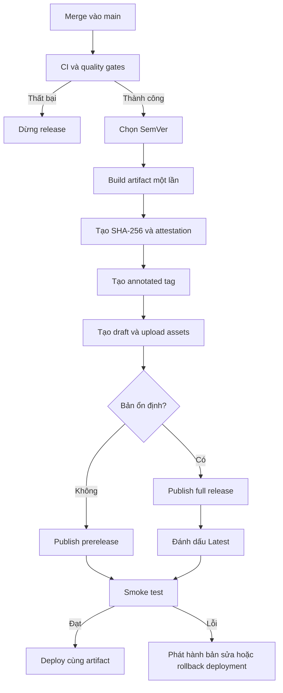

<Callout type="info" title="Kết quả sau bài này">
  Bạn sẽ thiết kế được một quy trình release dựa trên Semantic Versioning, annotated tag và GitHub Releases. Ví dụ cuối bài build một lần, tạo checksum và provenance cho artifact, rồi phát hành bằng GitHub CLI với quyền tối thiểu.
</Callout>

## Mục lục

- [Tổng quan](#tổng-quan)
  - [Release khác deployment như thế nào](#release-khác-deployment-như-thế-nào)
  - [Luồng phát hành chuẩn](#luồng-phát-hành-chuẩn)
- [Phiên bản và tag](#phiên-bản-và-tag)
  - [Semantic Versioning](#semantic-versioning)
  - [Chính sách tag](#chính-sách-tag)
  - [Annotated tag và ký tag](#annotated-tag-và-ký-tag)
- [Changelog và release notes](#changelog-và-release-notes)
  - [Chọn nguồn thay đổi](#chọn-nguồn-thay-đổi)
  - [Cấu hình generated release notes](#cấu-hình-generated-release-notes)
- [Vòng đời GitHub Release](#vòng-đời-github-release)
  - [Draft prerelease và latest](#draft-prerelease-và-latest)
  - [Artifact checksum provenance và immutability](#artifact-checksum-provenance-và-immutability)
- [Trigger và quyền trong GitHub Actions](#trigger-và-quyền-trong-github-actions)
  - [Sự kiện tag và release](#sự-kiện-tag-và-release)
  - [Quyền contents write](#quyền-contents-write)
  - [Tránh vòng lặp workflow](#tránh-vòng-lặp-workflow)
- [Tạo release bằng GitHub CLI và REST API](#tạo-release-bằng-github-cli-và-rest-api)
  - [GitHub CLI](#github-cli)
  - [REST API](#rest-api)
- [Workflow phát hành artifact và checksum](#workflow-phát-hành-artifact-và-checksum)
  - [Giả định và thiết kế](#giả-định-và-thiết-kế)
  - [Workflow hoàn chỉnh](#workflow-hoàn-chỉnh)
  - [Cách vận hành](#cách-vận-hành)
- [Lựa chọn công cụ tự động hóa version](#lựa-chọn-công-cụ-tự-động-hóa-version)
  - [release-please](#release-please)
  - [semantic-release](#semantic-release)
  - [Cách chọn](#cách-chọn)
- [Bài thực hành](#bài-thực-hành)
  - [Yêu cầu chuẩn bị](#yêu-cầu-chuẩn-bị)
  - [Các bước thực hiện](#các-bước-thực-hiện)
  - [Tiêu chí kiểm chứng](#tiêu-chí-kiểm-chứng)
- [Best practices](#best-practices)
- [Troubleshooting](#troubleshooting)
- [Tài liệu tham khảo](#tài-liệu-tham-khảo)
- [Bài liên quan](#bài-liên-quan)

## Tổng quan

Release management là quá trình biến một commit đã qua kiểm thử thành một phiên bản có tên, có lịch sử thay đổi và có sản phẩm phân phối xác định. Với GitHub, một release thường nối các đối tượng sau:

```text
Commit SHA → Git tag → GitHub Release → Release assets → Deployment
```

Mỗi mũi tên phải có thể kiểm chứng. Người vận hành cần trả lời được artifact đến từ commit nào, workflow nào đã build, checksum là gì và phiên bản có bị thay đổi sau khi công bố hay không.

### Release khác deployment như thế nào

**Release** công bố một phiên bản để người dùng hoặc hệ thống khác có thể tiêu thụ. **Deployment** đưa đúng phiên bản đó vào một môi trường đang chạy. Hai hoạt động có thể xảy ra liền nhau, nhưng không nên bị đồng nhất.

| Khái niệm | Câu hỏi chính | Ví dụ |
|---|---|---|
| Build | Đã tạo ra bytes nào? | `my-app-v1.4.0.tar.gz` |
| Release | Phiên bản nào đã được công bố? | GitHub Release `v1.4.0` |
| Deploy | Artifact nào đang chạy ở đâu? | digest của `v1.4.0` trên production |
| Rollback | Cần đưa môi trường về artifact nào? | redeploy artifact của `v1.3.2` |

Không build lại trong job deploy. Hai lần build từ cùng source vẫn có thể khác nhau vì dependency, timestamp hoặc toolchain. Nguyên tắc an toàn là **build một lần, kiểm chứng một lần, rồi promote cùng artifact**.

### Luồng phát hành chuẩn



Ranh giới quan trọng nhất nằm trước bước publish. Draft còn có thể sửa. Khi repository bật immutable releases, release đã publish sẽ khóa tag và assets.

## Phiên bản và tag

### Semantic Versioning

[Semantic Versioning 2.0.0](https://semver.org/) dùng định dạng `MAJOR.MINOR.PATCH`. Tiền tố `v` trong tag, chẳng hạn `v2.3.1`, là quy ước phổ biến nhưng không thuộc phần số của SemVer.

| Loại thay đổi | Từ `1.4.2` thành | Ví dụ |
|---|---|---|
| Sửa lỗi tương thích ngược | `1.4.3` | sửa timeout nhưng giữ API cũ |
| Thêm tính năng tương thích ngược | `1.5.0` | thêm một option không bắt buộc |
| Thay đổi không tương thích | `2.0.0` | xóa field hoặc đổi hành vi mặc định |
| Bản thử nghiệm | `2.0.0-rc.1` | release candidate trước `2.0.0` |
| Thêm metadata build | `2.0.0+build.81` | ghi định danh build; không đổi precedence |

SemVer chỉ có ý nghĩa khi nhóm đã định nghĩa **public API**. API có thể là endpoint, CLI flags, schema dữ liệu, cấu hình, output hoặc hành vi mà consumer đang phụ thuộc.

Các điểm dễ bỏ sót:

- `0.y.z` biểu thị giai đoạn phát triển ban đầu; API chưa được xem là ổn định.
- Prerelease có precedence thấp hơn bản thường tương ứng. Ví dụ `2.0.0-rc.2` đứng trước `2.0.0`.
- Build metadata sau dấu `+` không tham gia so sánh precedence.
- Nội dung của một version đã phát hành không được sửa. Nếu artifact sai, tạo version mới.
- Breaking change về runtime, quyền cần cấp hoặc format cấu hình vẫn là breaking change dù function signature không đổi.

<Callout type="warn" title="Version không tự chứng minh compatibility">
  Đổi một output ở `v1.4.2` rồi gọi đó là patch không làm thay đổi trở nên tương thích. CI contract test, changelog và review API mới là bằng chứng hỗ trợ quyết định SemVer.
</Callout>

### Chính sách tag

Git tag là tên bất biến theo chính sách dùng để trỏ tới một object Git. GitHub Release là lớp công bố dựa trên tag đó. Ngày tạo tag và ngày publish release có thể khác nhau.

Một chính sách dễ vận hành:

- Dùng exact tag `v1.4.0` cho từng release.
- Không xóa, force-push hoặc tái sử dụng exact tag đã công bố.
- Chỉ tạo tag từ commit đã nằm trên protected branch và đã qua required checks.
- Prerelease dùng exact tag rõ ràng như `v2.0.0-beta.1` hoặc `v2.0.0-rc.1`.
- Nếu cần moving tag như `v1`, xem đó là con trỏ có thể thay đổi. Không gắn immutable GitHub Release với moving tag.
- Bảo vệ pattern tag bằng repository ruleset và giới hạn người hoặc GitHub App được tạo tag.

Lightweight tag chỉ là một ref trỏ tới object. Annotated tag là object riêng chứa tagger, thời điểm, message và target. Release chính thức nên dùng annotated tag vì metadata rõ hơn và có thể ký.

### Annotated tag và ký tag

Tạo annotated tag từ full commit SHA đã xác minh:

```bash
VERSION=v1.4.0
TARGET_SHA=0123456789abcdef0123456789abcdef01234567

git fetch origin main --tags
git cat-file -e "${TARGET_SHA}^{commit}"
git merge-base --is-ancestor "$TARGET_SHA" origin/main

if git ls-remote --exit-code --tags origin "refs/tags/$VERSION" >/dev/null 2>&1; then
  printf 'Tag %s đã tồn tại; không ghi đè\n' "$VERSION" >&2
  exit 1
fi

git tag -a "$VERSION" "$TARGET_SHA" -m "Release $VERSION"
git push origin "refs/tags/$VERSION"
```

`git tag -s` tạo signed tag khi máy phát hành đã cấu hình GPG. Git cũng hỗ trợ ký bằng SSH nếu tổ chức đã chuẩn hóa `gpg.format=ssh`. Chữ ký tag chứng minh danh tính khóa ký; nó không chứng minh test đã chạy hay artifact được build từ tag. Vì vậy vẫn cần branch protection, workflow log và provenance.

Kiểm tra local:

```bash
git show v1.4.0
git verify-tag v1.4.0
git rev-list -n 1 v1.4.0
```

Nếu không áp dụng ký tag, vẫn dùng annotated tag và tài liệu hóa rõ ai hoặc workflow nào được quyền tạo tag.

## Changelog và release notes

### Chọn nguồn thay đổi

**Changelog** là lịch sử thay đổi lâu dài trong repository, thường ở `CHANGELOG.md`. **Release notes** là nội dung gắn với một GitHub Release cụ thể. Hai nội dung có thể dùng chung nguồn nhưng phục vụ ngữ cảnh khác nhau.

| Cách làm | Ưu điểm | Hạn chế |
|---|---|---|
| Changelog viết tay | diễn đạt migration và tác động chính xác | dễ quên cập nhật; dễ conflict trong PR |
| GitHub generated release notes | lấy PR, contributor và compare range tự động | phụ thuộc label và title PR có kỷ luật |
| Conventional Commits | máy có thể suy ra nhóm thay đổi và version | commit history phải tuân thủ; squash title cần chuẩn |
| Release PR | reviewer thấy version và changelog trước khi publish | thêm một PR và trạng thái cần quản lý |

Một release note hữu ích nên có:

1. tóm tắt giá trị của release;
2. breaking changes và hướng dẫn migration;
3. tính năng, sửa lỗi và thay đổi bảo mật;
4. thay đổi permission, cấu hình hoặc runtime;
5. liên kết compare, issue và pull request;
6. commit SHA, tên artifact và cách xác minh checksum;
7. known issues và cách rollback hoặc downgrade.

<Callout type="idea" title="Viết cho người nâng cấp">
  Danh sách commit chưa phải là release notes tốt. Hãy nói consumer cần làm gì khác đi sau khi nâng version, đặc biệt với breaking change, migration dữ liệu và quyền mới.
</Callout>

### Cấu hình generated release notes

GitHub có thể sinh release notes từ pull request đã merge. File `.github/release.yml` nhóm nội dung theo label:

```yaml
changelog:
  exclude:
    labels:
      - skip-changelog
  categories:
    - title: Breaking changes
      labels:
        - breaking-change
    - title: Features
      labels:
        - enhancement
    - title: Fixes
      labels:
        - bug
    - title: Other changes
      labels:
        - "*"
```

Sau đó dùng `gh release create --generate-notes`. Nếu cần phần migration do người viết kiểm soát, tạo file `release-notes.md` rồi dùng `--notes-file`. Một lựa chọn khác là dùng `--notes` để prepend đoạn viết tay vào notes được sinh tự động.

Generated notes chỉ tốt bằng metadata đầu vào. Hãy enforce PR title, label và liên kết issue trước khi merge. Đừng cố suy ra breaking change chỉ từ số file thay đổi.

## Vòng đời GitHub Release

### Draft prerelease và latest

Một GitHub Release có thể đi qua các trạng thái sau:

| Trạng thái | Hiển thị | Có thể sửa assets | Có thể là Latest | Dùng khi |
|---|---|---:|---:|---|
| Draft | chỉ người có quyền phù hợp thấy trong trang quản lý | Có | Không | upload và kiểm tra đủ assets trước publish |
| Prerelease | công khai sau publish | tùy chính sách immutability | Không | alpha, beta, RC hoặc early access |
| Full release | công khai sau publish | tùy chính sách immutability | Có | phiên bản ổn định cho consumer |
| Latest | badge/con trỏ tới full release được chọn | không phải trạng thái lưu trữ riêng | chính nó | mặc định tải hoặc điều hướng tới bản ổn định khuyến nghị |

`Latest` không đồng nghĩa với tag mới nhất theo thời gian. REST API cho phép `make_latest` nhận `true`, `false` hoặc `legacy`. Draft và prerelease không thể được đặt làm Latest. Với CLI, dùng `--latest` cho bản ổn định hoặc `--latest=false` khi không muốn thay đổi con trỏ này.

Quy ước đề xuất:

- `v2.0.0-rc.1`: publish với `--prerelease --latest=false`.
- `v1.9.5`: full release của nhánh bảo trì, có thể dùng `--latest=false` nếu `v2` vẫn là kênh mặc định.
- `v2.1.0`: full release và `--latest` sau khi smoke test đạt.

Nếu release cần nhiều assets, tạo draft, upload đầy đủ, kiểm checksum rồi publish. `gh release create` khi nhận danh sách assets sẽ dùng các API calls theo trình tự draft → upload → publish; immutability chỉ có hiệu lực sau publish.

### Artifact checksum provenance và immutability

Ba cơ chế sau giải quyết ba câu hỏi khác nhau:

| Cơ chế | Trả lời câu hỏi | Không tự chứng minh |
|---|---|---|
| SHA-256 checksum | file tải về có cùng bytes với file được công bố không? | ai đã build và build bằng workflow nào |
| Artifact attestation | artifact bắt nguồn từ repository, commit và workflow nào? | phần mềm không có lỗ hổng |
| Immutable release | tag và assets có bị thay thế sau publish không? | release ban đầu đã đúng hoặc an toàn |

Tạo checksum ngay sau build:

```bash
mkdir -p release
tar -czf release/my-app-v1.4.0.tar.gz dist/
(
  cd release
  sha256sum my-app-v1.4.0.tar.gz > SHA256SUMS
)
```

Consumer kiểm tra:

```bash
sha256sum -c SHA256SUMS
gh attestation verify my-app-v1.4.0.tar.gz -R OWNER/REPOSITORY
```

GitHub artifact attestations dùng Sigstore để lập bằng chứng provenance. Workflow tạo attestation cho binary cần `id-token: write`, `attestations: write` và `contents: read`. Attestation phải áp dụng đúng file cuối cùng được upload lên Release; attest thư mục trước khi đóng gói không chứng minh archive sau đó.

Khi bật **immutable releases**:

- tag gắn với release bị khóa vào commit và không thể xóa khi release còn tồn tại;
- release assets không thể sửa hoặc xóa sau publish;
- GitHub tự tạo release attestation chứa tag, commit SHA và assets;
- nếu xóa immutable release, tag có thể được xóa nhưng tên tag đó không được tái sử dụng;
- draft vẫn sửa được, vì immutability chỉ bắt đầu sau publish.

<Callout type="warn" title="Workflow artifact không phải release asset">
  Artifact do `actions/upload-artifact` lưu có retention hữu hạn và phục vụ trao đổi giữa jobs hoặc điều tra run. Release asset phục vụ phân phối lâu dài. Hãy promote đúng bytes từ workflow artifact thành release asset, thay vì build lại.
</Callout>

## Trigger và quyền trong GitHub Actions

### Sự kiện tag và release

Có ba điểm bắt đầu phổ biến:

| Trigger | Điểm mạnh | Rủi ro cần kiểm soát |
|---|---|---|
| `workflow_dispatch` | có input, phù hợp approval và release có chủ đích | người chạy phải chọn đúng ref/version |
| `push` với `tags` | đơn giản; tag là tín hiệu release | tag sai có thể publish trước khi review assets |
| `release` | phù hợp deploy/notify sau khi publish | không nên dùng để tạo lại chính release đó |

Trigger khi exact SemVer tag được push:

```yaml
on:
  push:
    tags:
      - "v[0-9]+.[0-9]+.[0-9]+"
```

Glob của GitHub không phải regex đầy đủ. Workflow vẫn phải validate version bằng script trước khi publish.

Trigger downstream khi release được publish:

```yaml
on:
  release:
    types: [published]
```

`release` hỗ trợ các activity types như `published`, `unpublished`, `created`, `edited`, `deleted`, `prereleased` và `released`. Dùng `published` nếu cần nhận cả full release lẫn prerelease lúc chúng được publish. Các hoạt động `created`, `edited` và `deleted` không chạy workflow cho draft; `prereleased` cũng không bao phủ đầy đủ trường hợp prerelease được publish từ draft. Workflow file phải tồn tại trên default branch để event này kích hoạt workflow.

Phân nhánh trong downstream workflow:

```yaml
jobs:
  deploy:
    if: ${{ !github.event.release.prerelease }}
    runs-on: ubuntu-latest
    steps:
      - run: printf 'Deploy %s\n' "$TAG"
        env:
          TAG: ${{ github.event.release.tag_name }}
```

Không checkout `main` trong workflow `on: release` rồi gọi đó là mã của release. Dùng `github.event.release.tag_name` hoặc commit SHA đã xác minh từ tag.

### Quyền contents write

`GITHUB_TOKEN` mặc định không nên được giả định có quyền ghi. Tạo tag, tạo GitHub Release và upload release asset cần:

```yaml
permissions:
  contents: write
```

Đặt quyền này ở **job publish**, không đặt toàn workflow nếu job build chỉ cần đọc. Khi khai báo bất kỳ permission nào, các permission không khai báo được đặt thành `none`; hãy thêm riêng `id-token: write` và `attestations: write` cho job provenance.

Mô hình quyền tối thiểu:

```yaml
permissions: {}

jobs:
  build:
    permissions:
      contents: read
      id-token: write
      attestations: write

  publish:
    permissions:
      contents: write
```

Job có token ghi không nên chạy lifecycle script hoặc code từ pull request không tin cậy. Tách build và publish giúp giảm tác động nếu dependency build bị chiếm quyền.

Nếu gặp `Resource not accessible by integration`, kiểm tra đồng thời:

- `permissions: contents: write` ở đúng job;
- **Settings → Actions → General → Workflow permissions** và policy cấp organization;
- ruleset bảo vệ tag;
- environment approval;
- repository là fork hay source repository;
- target commit có sửa `.github/workflows/` theo cách API yêu cầu token có quyền workflow bổ sung hay không.

### Tránh vòng lặp workflow

GitHub ngăn phần lớn chuỗi sự kiện do `GITHUB_TOKEN` tạo. Ngoại trừ `workflow_dispatch` và `repository_dispatch`, event được tạo bằng `GITHUB_TOKEN` thường không khởi động workflow run mới. Vì vậy, release tạo bởi một workflow có thể **không** kích hoạt workflow `on: release` mà bạn đang trông chờ.

Thiết kế an toàn:

1. Đặt build, verify và publish bắt buộc trong cùng workflow hoặc gọi reusable workflow bằng `workflow_call`.
2. Nếu cần downstream riêng, kích hoạt tường minh bằng `workflow_dispatch`/`repository_dispatch`, hoặc dùng GitHub App token với phạm vi tối thiểu.
3. Workflow downstream chỉ tiêu thụ release. Nó không tạo hoặc chỉnh lại release vừa kích hoạt nó.
4. Giới hạn `release.types` thành `[published]` thay vì nhận mọi thay đổi.
5. Thêm `concurrency` theo tag để tránh hai run xử lý cùng release.
6. Không kết hợp hai chiều: `push tag → tạo release` và `release published → tạo lại tag/release`.

Ví dụ khóa theo tag:

```yaml
concurrency:
  group: release-${{ github.event.release.tag_name || inputs.version }}
  cancel-in-progress: false
```

<Callout type="error" title="Đừng đổi sang PAT chỉ để event tự chạy">
  PAT dài hạn làm tăng blast radius và có thể biến lỗi logic thành vòng lặp thật. Ưu tiên một workflow có `needs`, reusable workflow hoặc GitHub App token ngắn hạn. Chỉ dùng trigger chéo khi đã tài liệu hóa owner, quyền và điều kiện dừng.
</Callout>

## Tạo release bằng GitHub CLI và REST API

### GitHub CLI

GitHub-hosted runner có sẵn `gh`. CLI đọc token từ `GH_TOKEN`:

```bash
export GH_TOKEN="$GITHUB_TOKEN"

gh release create v1.4.0 \
  release/my-app-v1.4.0.tar.gz \
  release/SHA256SUMS \
  --verify-tag \
  --title "v1.4.0" \
  --generate-notes \
  --latest
```

Các flags quan trọng:

| Flag | Tác dụng |
|---|---|
| `--verify-tag` | dừng nếu remote chưa có tag; tránh CLI tự tạo tag ở default branch |
| `--draft` | lưu release chưa publish để kiểm tra và bổ sung asset |
| `--prerelease` | đánh dấu alpha, beta hoặc RC |
| `--latest` | đặt full release làm Latest |
| `--latest=false` | không thay đổi Latest |
| `--generate-notes` | sinh title/notes từ GitHub Release Notes API |
| `--notes-file FILE` | dùng nội dung release notes đã review |
| `--notes-from-tag` | lấy message của annotated tag |
| `--fail-on-no-commits` | dừng khi không có commit mới so với release trước |

Các lệnh vận hành thường dùng:

```bash
gh release view v1.4.0 --json tagName,isDraft,isPrerelease,isImmutable,assets
gh api "repos/$GITHUB_REPOSITORY/releases/latest" --jq '.tag_name'
gh release upload v1.4.0 release/SBOM.spdx.json
gh release download v1.4.0 --pattern "*.tar.gz"
gh release edit v1.4.0 --draft=false --latest
gh release delete v1.4.0
```

Không dùng `gh release delete` làm rollback thông thường. Consumer có thể đã tải asset, package có thể đã được publish, và immutable tag name không thể được tái sử dụng.

### REST API

REST endpoint tạo release là `POST /repos/{owner}/{repo}/releases`. Các trường chính:

<TypeTable
  type={{
    tag_name: {
      description: 'Exact Git tag gắn với release.',
      type: 'string',
      required: true,
    },
    target_commitish: {
      description: 'Branch hoặc SHA dùng khi tag chưa tồn tại; bị bỏ qua nếu tag đã tồn tại.',
      type: 'string',
    },
    name: {
      description: 'Tên hiển thị của release.',
      type: 'string',
    },
    body: {
      description: 'Release notes ở dạng Markdown.',
      type: 'string',
    },
    draft: {
      description: 'Tạo draft khi true.',
      type: 'boolean',
      default: 'false',
    },
    prerelease: {
      description: 'Đánh dấu prerelease khi true.',
      type: 'boolean',
      default: 'false',
    },
    generate_release_notes: {
      description: 'Yêu cầu GitHub tự sinh release notes.',
      type: 'boolean',
      default: 'false',
    },
    make_latest: {
      description: 'Điều khiển con trỏ Latest.',
      type: "'true' | 'false' | 'legacy'",
      default: "'true'",
    },
  }}
/>

<Tabs items={['GitHub CLI', 'REST với curl']}>
  <Tab value="GitHub CLI">

```bash
VERSION=v1.4.0

gh api --method POST "repos/$GITHUB_REPOSITORY/releases" \
  -f tag_name="$VERSION" \
  -f name="$VERSION" \
  -F draft=false \
  -F prerelease=false \
  -F generate_release_notes=true \
  -f make_latest=true
```

  </Tab>
  <Tab value="REST với curl">

```bash
VERSION=v1.4.0

jq -n --arg tag "$VERSION" '{
  tag_name: $tag,
  name: $tag,
  draft: false,
  prerelease: false,
  generate_release_notes: true,
  make_latest: "true"
}' > release-request.json

curl --fail-with-body --location \
  --request POST \
  --header "Accept: application/vnd.github+json" \
  --header "Authorization: Bearer $GITHUB_TOKEN" \
  --header "X-GitHub-Api-Version: 2026-03-10" \
  "https://api.github.com/repos/$GITHUB_REPOSITORY/releases" \
  --data-binary @release-request.json
```

  </Tab>
</Tabs>

API tạo release không tự upload file vào endpoint JSON trên. Response trả về `upload_url`; có thể gọi release assets API tiếp theo. Trong workflow thông thường, `gh release create TAG FILE...` đơn giản hơn vì CLI điều phối create, upload và publish.

<Callout type="warn" title="Tạo tag trước khi gọi Releases API">
  Nếu tag chưa tồn tại, GitHub có thể tạo tag từ `target_commitish` hoặc default branch. Hãy tạo annotated tag từ exact SHA trước, rồi dùng `--verify-tag` hoặc xác minh ref qua API. Cách này loại bỏ target mơ hồ.
</Callout>

## Workflow phát hành artifact và checksum

### Giả định và thiết kế

Ví dụ này dành cho một dự án Node.js có các script `npm test` và `npm run build`. Script build tạo thư mục `dist/`. Workflow được chạy thủ công từ branch `main` với input version.

Thiết kế có các cổng sau:

- `validate` kiểm tra dạng SemVer, ref chạy và exact tag chưa tồn tại;
- `build` chỉ có quyền đọc, tạo archive một lần, checksum và artifact attestation;
- workflow artifact chuyển đúng bytes sang job `publish`;
- `publish` xác minh checksum trước khi tạo annotated tag;
- GitHub CLI tạo Release cùng archive và `SHA256SUMS`;
- prerelease không được đặt làm Latest;
- `concurrency` ngăn hai run phát hành cùng version.

Workflow dùng official actions thay vì một action release bên thứ ba. Với production, pin official actions bằng full commit SHA đã review và để Dependabot đề xuất cập nhật.

### Workflow hoàn chỉnh

Tạo `.github/workflows/release.yml`:

```yaml
name: Release

on:
  workflow_dispatch:
    inputs:
      version:
        description: Exact SemVer tag, ví dụ v1.4.0 hoặc v2.0.0-rc.1
        required: true
        type: string
      prerelease:
        description: Publish dưới dạng prerelease
        required: true
        type: boolean
        default: false

permissions: {}

concurrency:
  group: release-${{ inputs.version }}
  cancel-in-progress: false

jobs:
  validate:
    runs-on: ubuntu-latest
    timeout-minutes: 5
    permissions:
      contents: read
    outputs:
      version: ${{ steps.input.outputs.version }}
      target_sha: ${{ steps.input.outputs.target_sha }}
    steps:
      - name: Validate release input
        id: input
        shell: bash
        env:
          VERSION: ${{ inputs.version }}
          TARGET_SHA: ${{ github.sha }}
          SELECTED_REF: ${{ github.ref }}
          REPOSITORY: ${{ github.repository }}
          IS_PRERELEASE: ${{ inputs.prerelease }}
          GH_TOKEN: ${{ github.token }}
        run: |
          set -euo pipefail

          VERSION_PATTERN='^v(0|[1-9][0-9]*)\.(0|[1-9][0-9]*)\.(0|[1-9][0-9]*)(-[0-9A-Za-z-]+(\.[0-9A-Za-z-]+)*)?(\+[0-9A-Za-z-]+(\.[0-9A-Za-z-]+)*)?$'

          [[ "$VERSION" =~ $VERSION_PATTERN ]] || {
            printf 'Version không phải SemVer hợp lệ: %s\n' "$VERSION" >&2
            exit 1
          }

          VERSION_WITHOUT_BUILD="${VERSION%%+*}"
          if [[ "$VERSION_WITHOUT_BUILD" == *-* ]]; then
            PRERELEASE_PART="${VERSION_WITHOUT_BUILD#*-}"
            IFS='.' read -r -a IDENTIFIERS <<< "$PRERELEASE_PART"
            for IDENTIFIER in "${IDENTIFIERS[@]}"; do
              if [[ "$IDENTIFIER" =~ ^[0-9]+$ && "$IDENTIFIER" != "0" && "$IDENTIFIER" == 0* ]]; then
                printf 'Numeric prerelease identifier không được có leading zero: %s\n' "$IDENTIFIER" >&2
                exit 1
              fi
            done
            [[ "$IS_PRERELEASE" == "true" ]] || {
              printf 'Version có suffix prerelease nhưng input prerelease=false\n' >&2
              exit 1
            }
          elif [[ "$IS_PRERELEASE" == "true" ]]; then
            printf 'Input prerelease=true yêu cầu version có suffix như -rc.1\n' >&2
            exit 1
          fi

          [[ "$SELECTED_REF" == "refs/heads/main" ]] || {
            printf 'Hãy chạy workflow từ branch main, không phải %s\n' "$SELECTED_REF" >&2
            exit 1
          }

          if gh api "repos/$REPOSITORY/git/ref/tags/$VERSION" >/dev/null 2>&1; then
            printf 'Tag %s đã tồn tại; không ghi đè\n' "$VERSION" >&2
            exit 1
          fi

          printf 'version=%s\n' "$VERSION" >> "$GITHUB_OUTPUT"
          printf 'target_sha=%s\n' "$TARGET_SHA" >> "$GITHUB_OUTPUT"

  build:
    needs: validate
    runs-on: ubuntu-latest
    timeout-minutes: 20
    permissions:
      contents: read
      id-token: write
      attestations: write
    env:
      VERSION: ${{ needs.validate.outputs.version }}
      TARGET_SHA: ${{ needs.validate.outputs.target_sha }}
    steps:
      - name: Checkout exact candidate
        uses: actions/checkout@v7
        with:
          ref: ${{ env.TARGET_SHA }}
          persist-credentials: false

      - name: Test and build
        shell: bash
        run: |
          set -euo pipefail
          test "$(git rev-parse HEAD)" = "$TARGET_SHA"
          npm ci
          npm test
          npm run build
          test -d dist

      - name: Package and checksum
        shell: bash
        run: |
          set -euo pipefail
          mkdir -p release
          ARCHIVE="my-app-${VERSION}.tar.gz"
          tar -czf "release/$ARCHIVE" dist/
          (
            cd release
            sha256sum "$ARCHIVE" > SHA256SUMS
            sha256sum -c SHA256SUMS
          )

      - name: Generate build provenance
        uses: actions/attest@v4
        with:
          subject-path: release/my-app-${{ env.VERSION }}.tar.gz

      - name: Store release candidate
        uses: actions/upload-artifact@v7
        with:
          name: release-candidate-${{ github.run_id }}-${{ github.run_attempt }}
          path: release/
          if-no-files-found: error
          retention-days: 7

  publish:
    needs: [validate, build]
    runs-on: ubuntu-latest
    timeout-minutes: 10
    environment: release
    permissions:
      contents: write
    env:
      VERSION: ${{ needs.validate.outputs.version }}
      TARGET_SHA: ${{ needs.validate.outputs.target_sha }}
      IS_PRERELEASE: ${{ inputs.prerelease }}
      GH_TOKEN: ${{ github.token }}
      REPOSITORY: ${{ github.repository }}
    steps:
      - name: Checkout tag target
        uses: actions/checkout@v7
        with:
          ref: ${{ env.TARGET_SHA }}
          fetch-depth: 0
          persist-credentials: false

      - name: Download exact release candidate
        uses: actions/download-artifact@v8
        with:
          name: release-candidate-${{ github.run_id }}-${{ github.run_attempt }}
          path: release/

      - name: Verify release candidate
        shell: bash
        run: |
          set -euo pipefail
          test "$(git rev-parse HEAD)" = "$TARGET_SHA"
          test -f "release/my-app-${VERSION}.tar.gz"
          test -f release/SHA256SUMS
          (cd release && sha256sum -c SHA256SUMS)

          VERSION_WITHOUT_BUILD="${VERSION%%+*}"
          if [[ "$VERSION_WITHOUT_BUILD" == *-* ]]; then
            [[ "$IS_PRERELEASE" == "true" ]] || {
              printf 'Version prerelease phải bật input prerelease\n' >&2
              exit 1
            }
          elif [[ "$IS_PRERELEASE" == "true" ]]; then
            printf 'Stable version không được publish với prerelease=true\n' >&2
            exit 1
          fi

          if git ls-remote --exit-code --tags origin "refs/tags/$VERSION" >/dev/null 2>&1; then
            printf 'Tag %s vừa được tạo bởi tiến trình khác\n' "$VERSION" >&2
            exit 1
          fi

      - name: Create annotated tag
        shell: bash
        run: |
          set -euo pipefail
          git config user.name "github-actions[bot]"
          git config user.email "41898282+github-actions[bot]@users.noreply.github.com"
          gh auth setup-git
          git tag -a "$VERSION" "$TARGET_SHA" -m "Release $VERSION"
          git push origin "refs/tags/$VERSION"

      - name: Publish GitHub Release
        shell: bash
        run: |
          set -euo pipefail

          RELEASE_FLAGS=(
            --repo "$REPOSITORY"
            --verify-tag
            --title "$VERSION"
            --generate-notes
          )

          if [[ "$IS_PRERELEASE" == "true" ]]; then
            RELEASE_FLAGS+=(--prerelease --latest=false)
          else
            RELEASE_FLAGS+=(--latest)
          fi

          gh release create "$VERSION" \
            "release/my-app-${VERSION}.tar.gz" \
            release/SHA256SUMS \
            "${RELEASE_FLAGS[@]}"
```

`actions/checkout@v7` được viết dễ đọc trong ví dụ học tập. Release workflow production nên pin action theo full SHA và ghi comment version. Các phiên bản `upload-artifact@v7`, `download-artifact@v8` và `actions/attest@v4` áp dụng cho GitHub.com hiện hành; hãy kiểm tra README chính thức nếu chạy GitHub Enterprise Server.

Workflow cố ý không tự tính version. Input version làm quyết định SemVer trở thành một bước được review. Phần sau trình bày khi nào nên giao quyết định này cho release automation.

<Callout type="warn" title="Xử lý lỗi một phần">
  Tag được push trước khi Release được tạo. Nếu `gh release create` lỗi do mạng, chạy lại toàn workflow sẽ bị chặn vì tag đã tồn tại. Hãy điều tra checksum và SHA, rồi tạo Release từ tag hiện có bằng một thao tác recovery có phê duyệt. Không xóa hoặc di chuyển tag để chạy lại mù quáng.
</Callout>

### Cách vận hành

<Steps>
<Step>

**Chuẩn bị cổng release.** Bảo vệ `main`, yêu cầu CI và review. Tạo environment `release`; nếu gói GitHub hỗ trợ, thêm required reviewers và giới hạn deployment branch là `main`.

</Step>
<Step>

**Chọn version.** Đọc thay đổi từ release trước, xác định public API bị ảnh hưởng và cập nhật `CHANGELOG.md` trong pull request trước khi merge.

</Step>
<Step>

**Chạy workflow.** Mở **Actions → Release → Run workflow**, chọn branch `main`, nhập `v1.4.0`. Chỉ bật `prerelease` cho version như `v2.0.0-rc.1`.

</Step>
<Step>

**Phê duyệt publish.** Reviewer kiểm tra target SHA, log test, checksum, attestation và tên version trước khi cho job `publish` qua environment.

</Step>
<Step>

**Xác minh sau publish.** Tải asset, kiểm checksum và provenance. Kiểm tra Release không phải draft, cờ prerelease đúng và Latest chỉ trỏ tới full release mong muốn.

</Step>
</Steps>

Các lệnh kiểm chứng:

```bash
REPOSITORY=OWNER/REPOSITORY
VERSION=v1.4.0

gh release view "$VERSION" --repo "$REPOSITORY" \
  --json tagName,isDraft,isPrerelease,isImmutable,url

gh api "repos/$REPOSITORY/releases/latest" --jq '.tag_name'

gh release download "$VERSION" --repo "$REPOSITORY" \
  --pattern "my-app-*.tar.gz" \
  --pattern SHA256SUMS \
  --dir verify

(cd verify && sha256sum -c SHA256SUMS)
gh attestation verify "verify/my-app-${VERSION}.tar.gz" -R "$REPOSITORY"
gh release verify "$VERSION" --repo "$REPOSITORY"
```

## Lựa chọn công cụ tự động hóa version

Không phải nhóm nào cũng nên nhập version thủ công. Hai công cụ phổ biến là release-please và semantic-release. Đây là lựa chọn kiến trúc, không phải yêu cầu của workflow mẫu.

### release-please

release-please phân tích lịch sử commit, mở hoặc cập nhật một **release pull request** chứa version và changelog. Khi PR được merge, quy trình có thể tạo tag và Release.

Phù hợp khi:

- nhóm muốn review version và changelog như code;
- cần một điểm approval tự nhiên trước publish;
- repository có nhiều package hoặc cần manifest version;
- chấp nhận độ trễ của một release PR.

Trade-off là cần quản lý trạng thái PR và quy ước commit/PR title. Nếu tích hợp bằng GitHub Action, pin action bằng full SHA, giới hạn `contents`/`pull-requests` và đọc output được tài liệu hóa thay vì giả định event tiếp theo sẽ tự chạy.

### semantic-release

semantic-release phân tích Conventional Commits, tính version và chạy pipeline publish theo plugin. Công cụ thường publish trực tiếp sau khi branch release đạt điều kiện.

Phù hợp khi:

- trunk có commit history rất kỷ luật;
- nhóm muốn release hoàn toàn tự động và thường xuyên;
- package ecosystem đã dùng plugin semantic-release ổn định;
- rollback và credential boundary đã được thiết kế rõ.

Trade-off là quyết định version và publish diễn ra sát nhau. Một commit message sai có thể tạo major/minor sai. Plugin có quyền publish là một phần chuỗi cung ứng và phải được pin, audit, nâng cấp có kiểm soát.

### Cách chọn

| Nhu cầu | Lựa chọn khởi đầu |
|---|---|
| Repository nhỏ, ít release, cần hiểu rõ cơ chế | workflow `workflow_dispatch` + `gh` |
| Muốn review version/changelog trước publish | release-please hoặc release PR tự xây |
| Muốn publish tự động từ commit convention | semantic-release |
| Chỉ cần notes từ PR labels | GitHub generated release notes |
| Môi trường kiểm soát chặt | tách build, approval, publish; ưu tiên GitHub App ngắn hạn và immutable release |

<Accordions type="single">
  <Accordion title="Có nên tự viết script tính version không?">
    Chỉ nên tự viết khi quy tắc rất nhỏ và có test đầy đủ cho precedence, prerelease, monorepo và nhánh bảo trì. SemVer có nhiều edge cases. Một script ghép chuỗi đơn giản dễ tạo version sai hoặc dùng lại version đã phát hành.
  </Accordion>
  <Accordion title="Có cần cả CHANGELOG.md và GitHub Release notes không?">
    Không bắt buộc, nhưng hai lớp có giá trị khác nhau. Changelog nằm cùng source và dễ đọc offline; Release notes hỗ trợ download assets, notification và API. Có thể sinh cả hai từ cùng metadata để tránh nhập hai lần.
  </Accordion>
  <Accordion title="Có thể phát hành chỉ từ tag push không?">
    Có. Tuy nhiên tag phải được bảo vệ và chỉ được tạo sau quality gates. Với immutable releases và nhiều assets, workflow dispatch có environment approval thường cho điểm kiểm soát rõ hơn.
  </Accordion>
</Accordions>

## Bài thực hành

### Yêu cầu chuẩn bị

- Một repository thử nghiệm có default branch `main`.
- Một dự án Node.js với `package-lock.json`, script `test`, script `build` và output `dist/`.
- GitHub Actions được bật.
- Quyền tạo environment và chỉnh workflow.
- GitHub CLI cài local để kiểm chứng sau release.

Không thực hành lần đầu trên repository hoặc package production. Release và tag là tài nguyên công bố; thao tác xóa không thay thế được lịch sử audit sạch.

### Các bước thực hiện

<Steps>
<Step>

**Tạo thay đổi tương thích ngược.** Thêm một tính năng nhỏ, test và cập nhật `CHANGELOG.md`. Merge pull request sau khi CI xanh. Giả sử release trước là `v1.3.2`; version mới dự kiến là `v1.4.0`.

</Step>
<Step>

**Thêm workflow mẫu.** Tạo `.github/workflows/release.yml` từ phần trên. Nếu output không phải `dist/`, sửa duy nhất bước package và tên artifact cho đúng dự án.

</Step>
<Step>

**Tạo environment.** Vào **Settings → Environments**, tạo `release` và thêm reviewer nếu plan hỗ trợ. Giới hạn branch thành `main`.

</Step>
<Step>

**Phát hành RC.** Chạy workflow với `v1.4.0-rc.1` và bật `prerelease`. Tải archive, chạy checksum, verify attestation và smoke test.

</Step>
<Step>

**Phát hành stable.** Nếu RC đạt, tạo commit cần thiết qua PR rồi chạy `v1.4.0` với `prerelease=false`. Không đổi tag RC thành stable.

</Step>
<Step>

**Kiểm tra event downstream.** Tạo một workflow thử nghiệm `on: release: types: [published]` chỉ ghi `tag_name` và cờ prerelease. Publish release thủ công để quan sát event; sau đó so sánh với release tạo bằng `GITHUB_TOKEN` và ghi nhận cơ chế chống vòng lặp.

</Step>
</Steps>

### Tiêu chí kiểm chứng

Bài thực hành đạt khi:

- [ ] `v1.4.0-rc.1` và `v1.4.0` là hai exact tags khác nhau.
- [ ] Mỗi tag trỏ đúng commit dự kiến và hiển thị annotation `Release VERSION`.
- [ ] RC có `isPrerelease=true` và endpoint `/releases/latest` không trả về tag RC.
- [ ] Stable có `isDraft=false`, `isPrerelease=false`; endpoint `/releases/latest` trả về tag stable nếu đó là kênh mặc định.
- [ ] Release stable có archive và `SHA256SUMS`.
- [ ] `sha256sum -c SHA256SUMS` trả về `OK` sau khi tải assets.
- [ ] `gh attestation verify` xác nhận provenance đúng owner/repository.
- [ ] Job build không có `contents: write`; chỉ job publish có quyền này.
- [ ] Chạy lại cùng version bị chặn thay vì ghi đè tag.
- [ ] Workflow không tạo vòng lặp release hoặc deploy lặp.
- [ ] Release notes có ít nhất tóm tắt, thay đổi, SHA/checksum và hướng dẫn nâng cấp.

## Best practices

- **Định nghĩa public API trước khi áp dụng SemVer.** Version phải phản ánh hợp đồng với consumer.
- **Dùng exact annotated tag.** Không dùng lại hoặc force-push `vX.Y.Z` đã công bố.
- **Tạo tag từ full SHA đã qua required checks.** Không tag working tree local chưa được review.
- **Review changelog trước publish.** Generated notes hỗ trợ tổng hợp, không thay thế migration note.
- **Build một lần và promote cùng bytes.** Dùng workflow artifact để chuyển sản phẩm giữa jobs; không rebuild trong job có quyền ghi.
- **Phát hành checksum cùng artifact.** Kiểm tra checksum cả trước upload và sau download.
- **Tạo artifact attestation cho file cuối cùng.** Provenance phải gắn với archive thực sự được phân phối.
- **Bật immutable releases khi phù hợp.** Upload đủ asset vào draft trước khi publish.
- **Tách quyền theo job.** Build dùng `contents: read`; publish mới dùng `contents: write`.
- **Đặt environment approval trước job publish.** Release là thay đổi production-facing.
- **Pin third-party và official actions bằng full SHA trong production.** Theo dõi update bằng Dependabot.
- **Không dựa vào side effect của `GITHUB_TOKEN`.** Dùng `needs`, `workflow_call` hoặc trigger tường minh.
- **Giới hạn `release` event thành `published`.** Downstream chỉ đọc và deploy, không chỉnh release nguồn.
- **Dùng concurrency theo version.** Không cancel job publish đang chạy.
- **Phát hành version mới để sửa lỗi.** Không thay asset hoặc di chuyển exact tag.
- **Tài liệu hóa recovery cho lỗi một phần.** Phân biệt tag đã tạo, draft còn tồn tại và release đã publish.
- **Giữ release notes có thể kiểm toán.** Ghi commit SHA, workflow run, checksum, provenance và known issues.

## Troubleshooting

| Triệu chứng | Nguyên nhân cần kiểm tra | Hướng xử lý |
|---|---|---|
| `Resource not accessible by integration` | Job thiếu `contents: write`, policy organization chặn hoặc environment chưa được duyệt | Cấp `contents: write` chỉ cho job publish; kiểm tra Actions settings, ruleset và approval |
| `gh release create` tự tạo tag sai commit | Không dùng `--verify-tag` và remote chưa có tag | Tạo annotated tag từ exact SHA trước; luôn thêm `--verify-tag` |
| Tag đã tồn tại | Version đã được dùng hoặc run song song vừa tạo tag | Không ghi đè; kiểm tra target SHA và audit log, rồi chọn version mới hoặc recovery từ tag đúng |
| Release đã tồn tại | Workflow được chạy lại sau khi publish | Chuyển workflow thành idempotent có kiểm tra rõ hoặc dừng và xác minh release hiện có; không tạo bản trùng |
| Release tạo xong nhưng workflow `on: release` không chạy | Release được tạo bằng `GITHUB_TOKEN`; cơ chế chống recursion chặn event | Đặt downstream trong cùng workflow, dùng reusable workflow hoặc kích hoạt tường minh bằng token phù hợp |
| Workflow release chạy lặp | Downstream dùng App/PAT rồi chỉnh release hoặc tạo tag mới | Giới hạn `types: [published]`, tách producer/consumer và thêm điều kiện cùng concurrency |
| Prerelease bất ngờ thành stable | Input prerelease không khớp suffix version | Validate cả hai chiều; yêu cầu version có `-...` phải bật prerelease và stable không dùng suffix |
| `Latest` trỏ sai release | Bản bảo trì cũ được publish với mặc định latest hoặc RC không đặt `--latest=false` | Dùng `--latest`/`--latest=false` tường minh và kiểm tra tag từ endpoint `/releases/latest` sau publish |
| Generated notes thiếu PR | PR không nằm trong compare range, label/title sai hoặc merge không theo quy trình | Kiểm tra previous tag, `.github/release.yml`, label và merge history; bổ sung notes viết tay |
| `sha256sum -c` thất bại | Archive bị đổi, tải nhầm release hoặc `SHA256SUMS` chứa path không đúng | Dừng deploy; tải lại đúng tag, đối chiếu asset digest/API và điều tra provenance |
| `gh attestation verify` không tìm thấy attestation | Job thiếu `id-token`/`attestations`, attest nhầm path hoặc feature không khả dụng theo plan/repository | Kiểm tra permissions, log `actions/attest`, owner/repository và đúng file cuối cùng |
| Không upload thêm được asset | Immutable release đã publish | Tạo version mới; lần sau dùng draft và upload đủ asset trước publish |
| Không xóa hoặc di chuyển tag | Tag gắn với immutable release hoặc bị ruleset bảo vệ | Không phá immutability để sửa release; phát hành version mới. Chỉ thay policy theo quy trình quản trị riêng |
| Job download không tìm thấy workflow artifact | Sai tên có `run_attempt`, artifact hết hạn hoặc job ở run khác | Dùng đúng run/name hoặc artifact ID; kiểm tra retention và quyền Actions read |
| Annotated tag trỏ tới tag object khi API trả SHA | API ref trả SHA của tag object thay vì commit | Dereference tag object hoặc dùng `git rev-list -n 1 TAG` để lấy commit SHA |
| REST API trả `422 Validation failed` | Tag/name trùng, payload sai hoặc request tạo quá nhanh | In response body, validate JSON, kiểm tra release/tag hiện có và áp dụng retry có backoff cho lỗi tạm thời |
| REST API trả `404` khi target sửa workflow | Token không được phép sửa workflow hoặc target không hợp lệ | Dùng target đã merge trên default branch; với token ngoài Actions, cấp workflow permission tối thiểu khi thật sự cần |
| Workflow chạy từ branch khác | Người vận hành chọn ref khác khi `workflow_dispatch` | Giữ validation `github.ref == refs/heads/main` và giới hạn deployment branch của environment |

## Tài liệu tham khảo

- [About releases](https://docs.github.com/en/repositories/releasing-projects-on-github/about-releases)
- [Managing releases in a repository](https://docs.github.com/en/repositories/releasing-projects-on-github/managing-releases-in-a-repository)
- [Automatically generated release notes](https://docs.github.com/en/repositories/releasing-projects-on-github/automatically-generated-release-notes)
- [Configuring automatically generated release notes](https://docs.github.com/en/repositories/releasing-projects-on-github/configuring-automatically-generated-release-notes)
- [Events that trigger workflows — release](https://docs.github.com/en/actions/writing-workflows/choosing-when-your-workflow-runs/events-that-trigger-workflows#release)
- [Use GITHUB_TOKEN for authentication in workflows](https://docs.github.com/en/actions/security-for-github-actions/security-guides/automatic-token-authentication)
- [Workflow syntax — permissions](https://docs.github.com/en/actions/reference/workflows-and-actions/workflow-syntax#permissions)
- [REST API endpoints for releases](https://docs.github.com/en/rest/releases/releases)
- [GitHub CLI manual — gh release create](https://cli.github.com/manual/gh_release_create)
- [GitHub CLI manual — gh release](https://cli.github.com/manual/gh_release)
- [Using artifact attestations to establish provenance](https://docs.github.com/en/actions/how-tos/secure-your-work/use-artifact-attestations/use-artifact-attestations)
- [Immutable releases](https://docs.github.com/en/code-security/concepts/supply-chain-security/immutable-releases)
- [Preventing changes to releases](https://docs.github.com/en/code-security/how-tos/secure-your-supply-chain/establish-provenance-and-integrity/prevent-release-changes)
- [Git tagging](https://git-scm.com/book/en/v2/Git-Basics-Tagging)
- [Semantic Versioning 2.0.0](https://semver.org/)
- [Keep a Changelog](https://keepachangelog.com/en/1.1.0/)
- [release-please](https://github.com/googleapis/release-please)
- [semantic-release](https://semantic-release.gitbook.io/semantic-release/)

## Bài liên quan

<Cards>
  <Card title="Environments và approvals" href="/docs/cd/02-environments-approvals/" description="Đặt approval và protection rules trước job publish." />
  <Card title="Artifacts" href="/docs/dieu-khien-workflow/08-artifacts/" description="Chuyển đúng build output giữa jobs và kiểm tra tính toàn vẹn." />
  <Card title="Publish container registry" href="/docs/cd/05-publish-container-registry/" description="Áp dụng version và provenance khi phát hành container image." />
  <Card title="Rollback strategies" href="/docs/cd/09-rollback-strategies/" description="Thiết kế rollback mà không viết lại lịch sử release." />
</Cards>
