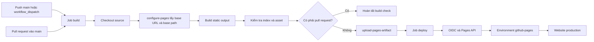

<Callout type="info" title="Kết quả của chương">
  Bạn sẽ cấu hình Pages dùng nguồn **GitHub Actions**, build một website tĩnh có xử lý đúng base path, rồi triển khai bằng ba action chính thức của GitHub. Workflow cũng kiểm tra pull request mà không ghi đè website production.
</Callout>

## Mục lục

- [Kết quả cần đạt](#kết-quả-cần-đạt)
- [GitHub Pages xuất bản website như thế nào](#github-pages-xuất-bản-website-như-thế-nào)
  - [Chọn source GitHub Actions](#chọn-source-github-actions)
  - [Luồng build, artifact và deploy](#luồng-build-artifact-và-deploy)
- [Static output và base path](#static-output-và-base-path)
  - [Yêu cầu đối với static output](#yêu-cầu-đối-với-static-output)
  - [Base path của từng loại Pages site](#base-path-của-từng-loại-pages-site)
  - [Ghi chú cho Next.js static export](#ghi-chú-cho-nextjs-static-export)
- [Bài thực hành](#bài-thực-hành)
  - [Chuẩn bị repository](#chuẩn-bị-repository)
  - [Tạo website tĩnh bằng Node.js](#tạo-website-tĩnh-bằng-nodejs)
  - [Tạo workflow triển khai](#tạo-workflow-triển-khai)
  - [Chạy lần đầu](#chạy-lần-đầu)
  - [Tiêu chí kiểm chứng](#tiêu-chí-kiểm-chứng)
- [Giải thích workflow](#giải-thích-workflow)
  - [Ba action dành riêng cho Pages](#ba-action-dành-riêng-cho-pages)
  - [Permissions tối thiểu](#permissions-tối-thiểu)
  - [Environment github-pages](#environment-github-pages)
  - [Concurrency cho production và pull request](#concurrency-cho-production-và-pull-request)
  - [Vì sao tách build và deploy](#vì-sao-tách-build-và-deploy)
- [Custom domain và HTTPS](#custom-domain-và-https)
  - [Cấu hình domain](#cấu-hình-domain)
  - [Bật HTTPS](#bật-https)
- [Preview cho pull request](#preview-cho-pull-request)
- [Rollback và redeploy](#rollback-và-redeploy)
  - [Khôi phục bằng revert](#khôi-phục-bằng-revert)
  - [Triển khai lại một tag ổn định](#triển-khai-lại-một-tag-ổn-định)
  - [Chạy lại khi deploy lỗi tạm thời](#chạy-lại-khi-deploy-lỗi-tạm-thời)
- [Best practices](#best-practices)
- [Troubleshooting](#troubleshooting)
- [Tài liệu tham khảo](#tài-liệu-tham-khảo)
- [Bài liên quan](#bài-liên-quan)

## Kết quả cần đạt

Sau khi hoàn thành, repository có một pipeline với các thuộc tính sau:

- `push` vào nhánh mặc định build và triển khai website production;
- `pull_request` chỉ build và kiểm tra static output, không triển khai;
- `workflow_dispatch` cho phép triển khai lại bằng tay;
- job build chỉ có quyền đọc nội dung repository và metadata Pages;
- job deploy có đúng `pages: write` và `id-token: write`;
- artifact chứa `index.html` cùng các asset đã build, không chứa source hoặc secret không cần thiết;
- website hoạt động cả ở project URL dạng `/<repository>` lẫn custom domain;
- deployment được ghi nhận trong environment `github-pages`.

<Callout type="warn" title="Pages là public hosting">
  Website GitHub Pages được công khai trên Internet, kể cả khi gói dịch vụ cho phép tạo Pages từ private repository. Không đưa secret, `.env`, dữ liệu nội bộ hoặc source map chứa thông tin nhạy cảm vào static output.
</Callout>

## GitHub Pages xuất bản website như thế nào

GitHub Pages là dịch vụ phục vụ file tĩnh. Trình duyệt nhận HTML, CSS, JavaScript, ảnh và font đã có sẵn. Pages không chạy Node.js server, container, database, Server Actions hoặc API backend của ứng dụng.

Với source **GitHub Actions**, repository không cần commit thư mục build vào nhánh `gh-pages`. Workflow tự build, upload một Pages artifact rồi yêu cầu Pages phát hành artifact đó.

### Chọn source GitHub Actions

Người có quyền admin hoặc maintainer thực hiện một lần:

1. Mở repository trên GitHub.
2. Chọn **Settings → Pages**.
3. Trong **Build and deployment**, đặt **Source** thành **GitHub Actions**.
4. Nếu GitHub gợi ý workflow template, có thể bỏ qua vì chương này tạo custom workflow riêng.

Pages không khóa cứng vào một tên workflow. Trang Settings liên kết tới workflow run gần nhất đã triển khai thành công.

<Callout type="warn" title="Đừng chọn Deploy from a branch">
  Mẫu trong chương upload artifact trực tiếp bằng Actions. Nếu source vẫn là **Deploy from a branch**, cơ chế phát hành, branch rule và cách chẩn đoán sẽ không khớp với workflow bên dưới.
</Callout>

### Luồng build, artifact và deploy



Job `build` tạo đầu ra có thể kiểm tra độc lập. Job `deploy` chỉ bắt đầu sau khi artifact đã upload thành công. Cạnh `needs: build` là điều bảo đảm thứ tự này.

## Static output và base path

### Yêu cầu đối với static output

Thư mục truyền vào `actions/upload-pages-artifact` phải là **kết quả build**, không phải thư mục source. Tối thiểu, thư mục gốc cần có `index.html`:

```text
dist/
├── index.html
├── 404.html
└── styles.css
```

Một static output tốt có các đặc điểm:

- mọi route cần thiết đã được render thành HTML hoặc được xử lý hoàn toàn ở trình duyệt;
- URL của CSS, JavaScript, ảnh và font trỏ đúng vị trí sau khi deploy;
- không phụ thuộc vào filesystem của runner sau khi job kết thúc;
- không chứa symbolic link hoặc hard link;
- kích thước nhỏ hơn giới hạn Pages; GitHub khuyến nghị Pages artifact dưới 1 GB;
- có trang `404.html` nếu ứng dụng cần trải nghiệm lỗi tùy chỉnh.

`upload-pages-artifact` đóng gói thư mục thành đúng định dạng Pages mong đợi. Không thay action này bằng `actions/upload-artifact` trừ khi bạn tự tạo chính xác một gzip archive chứa một tar file hợp lệ và đặt đúng tên artifact.

### Base path của từng loại Pages site

**Base path** là tiền tố đứng trước route của website. Giá trị này phải được đưa vào lúc build vì URL thường được ghi thẳng vào HTML hoặc JavaScript bundle.

| Loại site | URL mặc định | Base path |
|---|---|---|
| User hoặc organization site, repository tên `<owner>.github.io` | `https://<owner>.github.io/` | Chuỗi rỗng |
| Project site | `https://<owner>.github.io/<repository>/` | `/<repository>` |
| Site dùng custom domain | `https://docs.example.com/` | Thường là chuỗi rỗng |

Lỗi phổ biến là build asset thành `/styles.css` cho project site. Trình duyệt sẽ tìm ở `https://<owner>.github.io/styles.css` thay vì `https://<owner>.github.io/<repository>/styles.css`, nên trang có HTML nhưng mất CSS hoặc JavaScript.

`actions/configure-pages` trả về output `base_path` đúng theo cấu hình Pages hiện tại. Workflow thực hành truyền output này vào biến `BASE_PATH`, nhờ đó cùng một source build được cho cả project URL và custom domain.

### Ghi chú cho Next.js static export

Next.js phải dùng static export vì GitHub Pages không cung cấp Next.js server. Cấu hình tối thiểu trong `next.config.mjs` là:

```js
const basePath = process.env.PAGES_BASE_PATH ?? '';

/** @type {import('next').NextConfig} */
const nextConfig = {
  output: 'export',
  trailingSlash: true,
  basePath,
  images: {
    unoptimized: true,
  },
};

export default nextConfig;
```

Trong workflow, truyền base path vào build và upload thư mục `out/`:

```yaml
- name: Configure Pages
  id: pages
  uses: actions/configure-pages@v6

- name: Build Next.js static export
  run: npm run build
  env:
    PAGES_BASE_PATH: ${{ steps.pages.outputs.base_path }}

- name: Upload Pages artifact
  uses: actions/upload-pages-artifact@v5
  with:
    path: ./out
```

`next/link` tự thêm `basePath`, nhưng đường dẫn viết tay trong thẻ `<a>`, CSS hoặc dữ liệu vẫn cần được kiểm tra. `basePath` được inline lúc build nên đổi domain hoặc vị trí site phải build lại.

Static export không hỗ trợ tính năng cần server ở runtime, ví dụ cookie phía server, rewrite động, ISR, Server Actions và Image Optimization với loader mặc định. Với dynamic route, mọi path phải biết trước lúc build, chẳng hạn qua `generateStaticParams()`.

## Bài thực hành

Bài lab dùng Node.js nhưng không phụ thuộc framework. Script build tạo HTML và CSS vào `dist/`, vì vậy người học nhìn rõ ranh giới giữa source và static output.

### Chuẩn bị repository

Bạn cần:

- một repository trên GitHub và quyền ghi vào repository;
- quyền cấu hình **Settings → Pages**;
- Git cài trên máy;
- Node.js 20 trở lên để kiểm tra build cục bộ;
- nhánh mặc định là `main`. Nếu repository dùng tên khác, thay `main` trong workflow.

<Steps>
<Step>

### Tạo website tĩnh bằng Node.js

Tại thư mục gốc repository, tạo `package.json`:

```json
{
  "name": "github-pages-demo",
  "private": true,
  "version": "1.0.0",
  "type": "module",
  "engines": {
    "node": ">=20"
  },
  "scripts": {
    "build": "node scripts/build.mjs"
  }
}
```

Tạo `scripts/build.mjs`:

```js
import { mkdir, rm, writeFile } from 'node:fs/promises';

const rawBasePath = process.env.BASE_PATH ?? '';
const segment = rawBasePath.replace(/^\/+|\/+$/g, '');
const basePath = segment ? `/${segment}` : '';
const stylesheetUrl = `${basePath}/styles.css`;

const html = `<!doctype html>
<html lang="vi">
  <head>
    <meta charset="utf-8">
    <meta name="viewport" content="width=device-width, initial-scale=1">
    <title>GitHub Pages demo</title>
    <link rel="stylesheet" href="${stylesheetUrl}">
  </head>
  <body>
    <main>
      <h1>Deploy thành công</h1>
      <p>Commit: ${process.env.GITHUB_SHA ?? 'local'}</p>
      <p>Base path: ${basePath || '/'}</p>
    </main>
  </body>
</html>
`;

const css = `
body { font: 18px/1.6 system-ui, sans-serif; margin: 0; }
main { max-width: 720px; margin: 10vh auto; padding: 0 24px; }
h1 { color: #0969da; }
`;

await rm('dist', { recursive: true, force: true });
await mkdir('dist', { recursive: true });
await writeFile('dist/index.html', html);
await writeFile('dist/404.html', html);
await writeFile('dist/styles.css', css);

console.log(`Đã build dist/ với base path: ${basePath || '/'}`);
```

Tạo lockfile và chạy thử:

```bash
npm install --package-lock-only
BASE_PATH=/ten-repository npm run build
```

Đọc `dist/index.html` hoặc kiểm tra trực tiếp đường dẫn CSS:

```bash
grep -F 'href="/ten-repository/styles.css"' dist/index.html
```

Commit `package-lock.json`, nhưng không cần commit `dist/` vì workflow sẽ tái tạo nó.

</Step>
<Step>

### Tạo workflow triển khai

Tạo `.github/workflows/deploy-pages.yml` với nội dung hoàn chỉnh sau:

```yaml
name: Deploy GitHub Pages

on:
  push:
    branches: [main]
  pull_request:
    branches: [main]
  workflow_dispatch:

permissions:
  contents: read

concurrency:
  group: pages-${{ github.event_name == 'pull_request' && format('pr-{0}', github.event.pull_request.number) || 'production' }}
  cancel-in-progress: ${{ github.event_name == 'pull_request' }}

jobs:
  build:
    runs-on: ubuntu-latest
    timeout-minutes: 10
    permissions:
      contents: read
      pages: read
    steps:
      - name: Checkout source
        uses: actions/checkout@v7

      - name: Setup Node.js
        uses: actions/setup-node@v7
        with:
          node-version: 22
          cache: npm

      - name: Configure Pages
        id: pages
        uses: actions/configure-pages@v6

      - name: Install dependencies
        run: npm ci

      - name: Build static output
        run: npm run build
        env:
          BASE_PATH: ${{ steps.pages.outputs.base_path }}

      - name: Verify static output
        shell: bash
        env:
          BASE_PATH: ${{ steps.pages.outputs.base_path }}
        run: |
          test -f dist/index.html
          test -f dist/404.html
          test -f dist/styles.css
          grep -Fq "href=\"${BASE_PATH}/styles.css\"" dist/index.html

          if find dist -type l -print -quit | grep -q .; then
            echo "Static output không được chứa symbolic link" >&2
            exit 1
          fi

      - name: Upload Pages artifact
        if: github.event_name != 'pull_request'
        uses: actions/upload-pages-artifact@v5
        with:
          path: ./dist
          retention-days: 1

  deploy:
    if: github.event_name != 'pull_request'
    needs: build
    runs-on: ubuntu-latest
    timeout-minutes: 10
    permissions:
      pages: write
      id-token: write
    environment:
      name: github-pages
      url: ${{ steps.deployment.outputs.page_url }}
    steps:
      - name: Deploy to GitHub Pages
        id: deployment
        uses: actions/deploy-pages@v5
```

Các major version trong mẫu được đối chiếu với trang **Latest release** chính thức: `configure-pages@v6`, `upload-pages-artifact@v5` và `deploy-pages@v5`. `checkout@v7` cùng `setup-node@v7` cũng là major hiện hành tại thời điểm rà soát.

</Step>
<Step>

### Chạy lần đầu

1. Trong **Settings → Pages**, chọn source **GitHub Actions**.
2. Commit `package.json`, `package-lock.json`, `scripts/build.mjs` và workflow.
3. Push vào một nhánh rồi mở pull request vào `main`.
4. Xác nhận job `build` xanh và job `deploy` bị **Skipped**.
5. Merge pull request vào `main`.
6. Mở **Actions → Deploy GitHub Pages** và chọn run mới nhất.
7. Mở job `deploy`, sau đó chọn URL trong environment hoặc output `page_url`.

Các lệnh Git tham khảo:

```bash
git add package.json package-lock.json scripts/build.mjs .github/workflows/deploy-pages.yml
git commit -m "ci: deploy static site to GitHub Pages"
git push
```

</Step>
</Steps>

### Tiêu chí kiểm chứng

Bài lab hoàn tất khi có đủ bằng chứng sau:

| Tiêu chí | Cách xác nhận |
|---|---|
| Pages dùng đúng publishing source | **Settings → Pages → Source** hiển thị **GitHub Actions**. |
| Pull request không deploy | Run của PR có `build` thành công và `deploy` ở trạng thái **Skipped**. |
| Static output đúng | Step **Verify static output** tìm thấy `index.html`, `404.html`, CSS và không có symbolic link. |
| Artifact đúng | Run từ `main` có artifact tên `github-pages`; step upload không báo thiếu file. |
| Quyền deploy đúng | Job `deploy` không báo thiếu `pages: write` hoặc `id-token: write`. |
| Environment được ghi nhận | Trang run hiển thị deployment tới environment `github-pages`. |
| URL hoạt động | `steps.deployment.outputs.page_url` trả HTTP thành công và trang có dòng **Deploy thành công**. |
| Asset dùng đúng base path | Trang có CSS; DevTools Network không có `404` cho `styles.css`. |
| Commit có thể truy vết | Nội dung trang hiển thị SHA của commit vừa deploy. |

Có thể kiểm tra HTTP từ terminal sau khi thay URL:

```bash
curl --fail --location --show-error https://OWNER.github.io/REPOSITORY/
```

GitHub lưu ý quá trình xuất bản có thể mất vài phút sau khi workflow hoàn tất. Nếu `curl` ngay lập tức vẫn thấy nội dung cũ, chờ ngắn rồi thử lại trước khi kết luận deployment lỗi.

## Giải thích workflow

### Ba action dành riêng cho Pages

| Action | Vai trò | Dữ liệu quan trọng |
|---|---|---|
| `actions/configure-pages@v6` | Đọc metadata site và hỗ trợ cấu hình static site generator | `base_url`, `origin`, `host`, `base_path` |
| `actions/upload-pages-artifact@v5` | Đóng gói static output theo định dạng Pages rồi upload artifact | `path`, tên mặc định `github-pages`, retention mặc định ngắn |
| `actions/deploy-pages@v5` | Tạo Pages deployment từ artifact và chờ trạng thái phát hành | output `page_url` |

`configure-pages` không thay thế bước bật source trong Settings. Input `enablement` của action không dùng `GITHUB_TOKEN` mặc định để tự bật Pages; cách rõ ràng và ít quyền nhất là quản trị viên bật source một lần trong UI.

`upload-pages-artifact` mặc định chỉ đưa static output vào artifact. File ẩn không được gồm vào trừ khi bật `include-hidden-files: true`. Không bật tùy chọn đó nếu chưa rà soát `.env`, khóa, cấu hình nội bộ và source map.

### Permissions tối thiểu

Workflow đặt quyền mặc định:

```yaml
permissions:
  contents: read
```

Job `build` khai báo rõ hai quyền chỉ đọc:

```yaml
permissions:
  contents: read
  pages: read
```

`contents: read` cho phép checkout source. `pages: read` cho phép `configure-pages` đọc URL và metadata của site qua Pages API. Job build không thể tạo deployment hoặc xin OIDC token.

Job `deploy` ghi đè quyền ở cấp job:

```yaml
permissions:
  pages: write
  id-token: write
```

Hai quyền có mục đích khác nhau:

- `pages: write` cho `GITHUB_TOKEN` quyền gọi API tạo Pages deployment;
- `id-token: write` cho job xin JSON Web Token qua OpenID Connect, viết tắt là OIDC. Pages dùng claim trong token để xác minh workflow, repository, ref và environment được phép triển khai.

<Callout type="error" title="Không bỏ id-token: write">
  `pages: write` không tự bao gồm quyền xin OIDC token. Thiếu một trong hai quyền làm `deploy-pages` thất bại dù build và upload artifact đã thành công.
</Callout>

### Environment github-pages

Khối environment liên kết deployment với môi trường chuẩn của Pages:

```yaml
environment:
  name: github-pages
  url: ${{ steps.deployment.outputs.page_url }}
```

`url` làm GitHub hiển thị liên kết trực tiếp tới site trong deployment. Environment còn là nơi đặt protection rule. Trong **Settings → Environments → github-pages**, nên chỉ cho nhánh `main` và các tag rollback đã được kiểm soát triển khai.

Có thể thêm required reviewer nếu gói GitHub và chính sách repository hỗ trợ. Khi đó job deploy chờ phê duyệt sau khi build thành công, còn artifact vẫn giữ nguyên.

### Concurrency cho production và pull request

Workflow tạo hai loại khóa:

- mọi deploy production dùng group `pages-production`;
- mỗi pull request dùng group riêng như `pages-pr-42`.

`cancel-in-progress` chỉ bật cho PR. Commit mới vào cùng PR hủy build cũ vì kết quả đó đã lỗi thời. Production không bị hủy giữa lúc deploy; run mới chờ khóa. Với hàng đợi concurrency mặc định, nếu nhiều run production cùng chờ, GitHub có thể thay run pending cũ bằng run mới nhất. Kết quả cuối cùng vẫn hướng tới commit mới nhất của `main`.

### Vì sao tách build và deploy

Tách job tạo một ranh giới quyền rõ ràng:

1. `build` xử lý source và dependency không đáng tin cậy với quyền chỉ đọc source cùng metadata Pages.
2. Artifact là đầu vào duy nhất chuyển sang giai đoạn phát hành.
3. `deploy` không checkout source và chỉ chạy action chính thức với quyền ghi Pages.

Cách này giảm phạm vi mà script build có thể sử dụng quyền triển khai. `needs: build` cũng ngăn deploy tìm artifact trước khi upload hoàn tất.

## Custom domain và HTTPS

### Cấu hình domain

Luôn thêm domain trong GitHub trước khi tạo DNS record. Thứ tự này giảm nguy cơ người khác chiếm subdomain chưa được liên kết.

<Steps>
<Step>

1. Mở **Settings → Pages → Custom domain**.
2. Nhập domain, ví dụ `docs.example.com`, rồi chọn **Save**.
3. Với custom workflow, GitHub không tạo file `CNAME`; file `CNAME` có sẵn trong artifact cũng bị bỏ qua. Cấu hình trong Settings hoặc Pages API mới là nguồn chính xác.

</Step>
<Step>

Tạo DNS record phù hợp:

| Trường hợp | Record | Giá trị |
|---|---|---|
| Subdomain `docs.example.com` | `CNAME` | `OWNER.github.io` — không thêm tên repository |
| Apex `example.com` | `ALIAS` hoặc `ANAME` | `OWNER.github.io` |
| Apex không hỗ trợ `ALIAS`/`ANAME` | Bốn record `A` | Các địa chỉ GitHub Pages đang công bố trong tài liệu chính thức |

Không dùng wildcard record như `*.example.com`. Wildcard làm tăng nguy cơ domain takeover. GitHub cũng khuyến nghị verify custom domain ở cấp tài khoản trước khi gắn vào repository.

</Step>
<Step>

Kiểm tra DNS:

```bash
dig docs.example.com +noall +answer -t CNAME
```

DNS có thể mất tới 24 giờ để lan truyền. Khi đổi sang custom domain, `configure-pages` sẽ trả `base_path` rỗng trong build tiếp theo. Hãy chạy lại workflow để bundle không còn tiền tố `/<repository>`.

</Step>
</Steps>

### Bật HTTPS

Sau khi DNS hợp lệ và GitHub cấp certificate, mở **Settings → Pages** rồi bật **Enforce HTTPS**. Tùy chọn có thể chưa sẵn sàng ngay; quá trình cấp certificate có thể mất thời gian.

Kiểm tra cả redirect và asset:

```bash
curl --head http://docs.example.com
curl --fail --head https://docs.example.com
```

Trang HTTPS vẫn có thể bị cảnh báo nếu HTML tải asset qua `http://`. Tìm mixed content trong static output:

```bash
grep -R "http://" dist/ || true
```

Chỉ thay URL asset sang HTTPS sau khi xác nhận endpoint đích hỗ trợ HTTPS.

## Preview cho pull request

GitHub Pages không cung cấp một URL preview biệt lập cho mỗi pull request ở chế độ public hiện hành. Input `preview` của `actions/deploy-pages` vẫn được action chính thức mô tả là alpha và **không khả dụng công khai**. Vì vậy, không thêm `preview: true` với kỳ vọng nhận URL PR.

Workflow trong bài áp dụng giới hạn an toàn hơn:

- PR vẫn checkout, cài dependency, build và kiểm tra base path;
- PR không upload Pages artifact và không gọi `deploy-pages`;
- website production chỉ đổi sau khi code vào `main` hoặc có manual dispatch được phép.

Nếu bắt buộc có preview URL cho từng PR, dùng một nền tảng preview hosting riêng hoặc triển khai tới hạ tầng có namespace theo PR. Không dùng chung environment `github-pages`, vì mỗi Pages repository chỉ có một project site production và các deploy sẽ ghi đè nội dung đang phục vụ.

## Rollback và redeploy

Pages phát hành static artifact nhưng repository mới là nguồn sự thật. Một rollback tốt tạo deployment mới từ source đã biết, thay vì sửa file trực tiếp trên hạ tầng Pages.

### Khôi phục bằng revert

Đây là cách mặc định vì lịch sử `main` phản ánh đúng trạng thái production:

```bash
git switch main
git pull --ff-only
git revert BAD_COMMIT_SHA
git push origin main
```

Push mới kích hoạt workflow. Theo dõi run đến khi job `deploy` thành công, rồi kiểm tra `page_url`. Nếu commit xấu là merge commit, đọc kỹ diff và dùng tùy chọn mainline phù hợp thay vì chạy lệnh máy móc.

### Triển khai lại một tag ổn định

Khi cần khôi phục chính xác snapshot cũ mà chưa muốn revert ngay, tạo tag tại commit tốt:

```bash
git tag pages-rollback-2026-08-15 GOOD_COMMIT_SHA
git push origin pages-rollback-2026-08-15
gh workflow run deploy-pages.yml --ref pages-rollback-2026-08-15
gh run watch
```

Điều kiện để cách này hoạt động:

- commit được tag đã chứa workflow `deploy-pages.yml` và script build tương thích;
- workflow có trigger `workflow_dispatch`;
- protection rule của environment `github-pages` cho phép tag đó;
- dependency lockfile của snapshot vẫn tải được.

Tag là ref bất biến về mặt quy trình nếu tổ chức chặn sửa/xóa tag. Sau sự cố, vẫn nên revert hoặc sửa `main`; nếu không, lần push tiếp theo vào `main` có thể triển khai lại bản xấu.

### Chạy lại khi deploy lỗi tạm thời

Nếu `build` và upload artifact đã thành công nhưng job `deploy` lỗi do sự cố dịch vụ hoặc mạng, dùng **Re-run failed jobs**. Job deploy sẽ dùng artifact còn được giữ trong run đó.

Nếu artifact đã hết hạn, hoặc cần phát hành lại một phiên bản đã chạy từ lâu, hãy tạo workflow run mới bằng `workflow_dispatch` tại tag ổn định. Workflow mẫu giữ Pages artifact một ngày, đủ cho chẩn đoán ngắn hạn nhưng không phải kho release dài hạn.

<Callout type="info" title="Redeploy không phải rebuild cache cũ">
  Re-run và workflow dispatch là hai thao tác khác nhau. Re-run dùng cùng commit và định nghĩa workflow của run gốc. Dispatch tại tag tạo run mới, build artifact mới từ snapshot được chọn và tạo deployment mới có thể audit.
</Callout>

## Best practices

- **Chỉ deploy từ ref được bảo vệ.** Giới hạn push vào `main`, bật pull request review và cấu hình deployment branch/tag rule cho environment `github-pages`.
- **Giữ quyền ở cấp job.** Build chỉ cần `contents: read` và `pages: read`; chỉ job deploy nhận `pages: write` và `id-token: write`.
- **Pin action có chủ đích.** Tutorial dùng major tag chính thức hiện hành để nhận bản vá tương thích. Môi trường yêu cầu chuỗi cung ứng chặt chẽ nên pin full commit SHA và bật Dependabot cho GitHub Actions.
- **Build một lần, deploy đúng artifact đó.** Không chạy lại lệnh build trong job deploy. `needs` cùng Pages artifact tạo ranh giới rõ ràng.
- **Fail sớm khi output sai.** Kiểm tra `index.html`, asset bắt buộc, link theo base path và symbolic link trước khi upload.
- **Không commit thư mục build nếu không cần.** Source GitHub Actions loại bỏ nhu cầu duy trì `gh-pages` branch chỉ để chứa file đã compile.
- **Dùng lockfile và Node version cố định.** `npm ci` cùng `node-version: 22` giúp build có thể lặp lại. Nâng phiên bản qua pull request và chạy build check trước.
- **Không deploy code PR có quyền ghi.** PR từ fork có thể thay script build. Workflow mẫu chỉ cấp `pages: read` cho build và không deploy trên `pull_request`.
- **Bảo vệ custom domain.** Verify domain, tránh wildcard DNS, bật HTTPS và xóa DNS record nếu site bị vô hiệu hóa.
- **Theo dõi action release notes.** Major version có thể đổi runtime Node hoặc yêu cầu nền tảng. Kiểm tra compatibility riêng nếu dùng GitHub Enterprise Server.
- **Giữ rollback ref.** Tạo protected release tag cho các phiên bản đã xác minh thay vì dựa vào trí nhớ hoặc artifact sắp hết hạn.
- **Kiểm tra liên kết sau deploy.** Một run xanh chỉ chứng minh API nhận deployment. Smoke test URL thật mới phát hiện sai base path, cache hoặc DNS.

## Troubleshooting

| Triệu chứng | Nguyên nhân cần kiểm tra | Hướng xử lý |
|---|---|---|
| Không có Pages URL dù workflow xanh | Source chưa chọn **GitHub Actions**, hoặc job deploy bị skip | Kiểm tra **Settings → Pages**, event của run và điều kiện `if` |
| `configure-pages` báo không tìm thấy site | Pages chưa được bật hoặc token không đọc được metadata | Chọn source **GitHub Actions** trong Settings rồi chạy lại; không tự cấp PAT quyền rộng nếu UI giải quyết được |
| `deploy-pages` báo thiếu quyền | Job thiếu `pages: write` hoặc `id-token: write`, hay organization policy ghi đè token | Giữ hai quyền ở job `deploy`; kiểm tra **Settings → Actions → General** và policy tổ chức |
| Deploy tìm artifact mãi rồi timeout | Thiếu `needs: build`, upload bị skip trên event deploy, hoặc tên artifact bị đổi | Giữ `needs: build`; dùng tên mặc định `github-pages` ở cả upload và deploy |
| Upload báo không tìm thấy file | `path` khác thư mục build thực tế hoặc build không tạo output | In danh sách file sau build; dùng `dist/` cho lab, `out/` cho Next static export |
| Trang mở được nhưng mất CSS hoặc JavaScript | Asset URL bỏ quên `/<repository>` | Truyền `${{ steps.pages.outputs.base_path }}` vào build; xem request `404` trong DevTools Network |
| Route con trả 404 | Static generator không emit HTML cho route, hoặc SPA phụ thuộc server rewrite | Dùng static generation cho từng route, `trailingSlash` phù hợp, hoặc thêm chiến lược `404.html` phía client |
| Next.js build lỗi về dynamic feature | Ứng dụng dùng Server Actions, cookie, ISR, rewrite hoặc dynamic route chưa biết trước | Loại tính năng runtime; thêm `generateStaticParams()`; dùng hosting có Next.js server nếu không thể static export |
| PR làm thay đổi website production | Workflow deploy không lọc event hoặc job PR có quyền Pages | Thêm `if: github.event_name != 'pull_request'`; giữ quyền deploy chỉ ở job riêng |
| Không thấy URL preview cho PR | Pages preview chưa khả dụng công khai | Chỉ chạy build check hoặc dùng dịch vụ preview hosting khác; không bật `preview: true` |
| Custom domain vẫn trỏ site cũ | DNS chưa lan truyền, record sai hoặc custom domain chưa lưu trong Pages Settings | Kiểm tra bằng `dig`; CNAME phải trỏ `OWNER.github.io` không kèm repository; chờ tối đa 24 giờ |
| Không bật được Enforce HTTPS | DNS chưa hợp lệ, certificate đang cấp hoặc có record xung đột | Xóa record thừa, xác nhận DNS theo tài liệu chính thức, chờ certificate rồi thử lại |
| Site HTTPS nhưng trình duyệt cảnh báo | HTML còn tải asset qua HTTP | Tìm `http://` trong static output và đổi endpoint asset sang HTTPS |
| Run production mới bị pending hoặc run pending cũ biến mất | Các run dùng cùng concurrency group; hàng đợi mặc định chỉ giữ phần tử pending mới nhất | Đây là hành vi mong đợi cho site cần trạng thái mới nhất; kiểm tra run mới nhất thay vì ép mọi commit deploy |
| Re-run deploy không còn artifact | Artifact đã hết retention | Dispatch workflow mới tại protected tag hoặc commit tốt để build và upload artifact mới |
| Rollback tag bị environment từ chối | Protection rule chỉ cho `main` | Cho phép mẫu tag rollback đã kiểm soát hoặc dùng `git revert` trên `main` |

## Tài liệu tham khảo

- [Configuring a publishing source for GitHub Pages](https://docs.github.com/en/pages/getting-started-with-github-pages/configuring-a-publishing-source-for-your-github-pages-site)
- [Using custom workflows with GitHub Pages](https://docs.github.com/en/pages/getting-started-with-github-pages/using-custom-workflows-with-github-pages)
- [What is GitHub Pages?](https://docs.github.com/en/pages/getting-started-with-github-pages/what-is-github-pages)
- [README và release của `actions/configure-pages`](https://github.com/actions/configure-pages)
- [Latest release của `actions/configure-pages`](https://github.com/actions/configure-pages/releases/latest)
- [README và release của `actions/upload-pages-artifact`](https://github.com/actions/upload-pages-artifact)
- [Latest release của `actions/upload-pages-artifact`](https://github.com/actions/upload-pages-artifact/releases/latest)
- [README và release của `actions/deploy-pages`](https://github.com/actions/deploy-pages)
- [Latest release của `actions/deploy-pages`](https://github.com/actions/deploy-pages/releases/latest)
- [Managing a custom domain for GitHub Pages](https://docs.github.com/en/pages/configuring-a-custom-domain-for-your-github-pages-site/managing-a-custom-domain-for-your-github-pages-site)
- [Securing a GitHub Pages site with HTTPS](https://docs.github.com/en/pages/getting-started-with-github-pages/securing-your-github-pages-site-with-https)
- [Next.js static exports](https://nextjs.org/docs/app/guides/static-exports)
- [Next.js basePath](https://nextjs.org/docs/app/api-reference/config/next-config-js/basePath)

## Bài liên quan

<Cards>
  <Card title="Environments và approvals" href="/docs/cd/02-environments-approvals/" description="Bảo vệ environment bằng branch rule và phê duyệt triển khai." />
  <Card title="Release management" href="/docs/cd/03-release-management/" description="Quản lý phiên bản, tag và quy trình phát hành có thể truy vết." />
  <Card title="Rollback strategies" href="/docs/cd/09-rollback-strategies/" description="Thiết kế rollback nhất quán cho nhiều loại hạ tầng." />
  <Card title="Concurrency" href="/docs/dieu-khien-workflow/05-concurrency/" description="Hiểu khóa, hủy run cũ và hàng đợi triển khai." />
</Cards>
