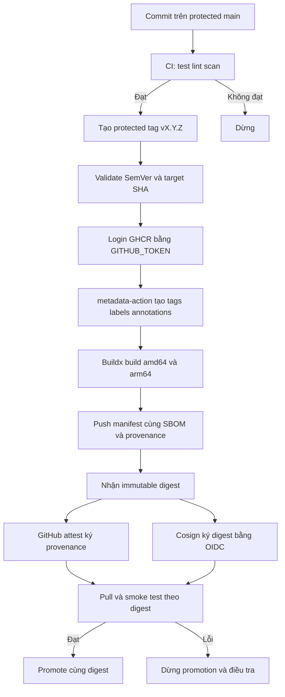

<Callout type="info" title="Kết quả sau bài này">
  Bạn sẽ tạo một workflow chỉ phát hành khi có Git tag SemVer, đăng nhập `ghcr.io` bằng `GITHUB_TOKEN`, build image `linux/amd64` và `linux/arm64`, rồi push các tag SemVer, SHA và `latest` có điều kiện. Workflow còn tạo OCI metadata, cache layer, SBOM, provenance, GitHub artifact attestation, chữ ký keyless và pull test theo digest.
</Callout>

## Mục lục

- [Mục tiêu và phạm vi](#mục-tiêu-và-phạm-vi)
  - [Kết quả cần đạt](#kết-quả-cần-đạt)
  - [Luồng phát hành](#luồng-phát-hành)
- [GHCR naming quyền và visibility](#ghcr-naming-quyền-và-visibility)
  - [Naming và liên kết package](#naming-và-liên-kết-package)
  - [Visibility và quyền pull](#visibility-và-quyền-pull)
  - [GITHUB_TOKEN và packages write](#github_token-và-packages-write)
- [Tag label và digest](#tag-label-và-digest)
  - [Chính sách SemVer SHA và latest](#chính-sách-semver-sha-và-latest)
  - [OCI labels và annotations](#oci-labels-và-annotations)
  - [Digest là release identity](#digest-là-release-identity)
- [Workflow publish hoàn chỉnh](#workflow-publish-hoàn-chỉnh)
  - [Giả định trước khi chạy](#giả-định-trước-khi-chạy)
  - [Workflow YAML](#workflow-yaml)
  - [Vai trò của từng action](#vai-trò-của-từng-action)
  - [Cache và multi-platform](#cache-và-multi-platform)
  - [Pull test sau publish](#pull-test-sau-publish)
- [SBOM provenance signing và attestation](#sbom-provenance-signing-và-attestation)
  - [Bốn cơ chế không thay thế nhau](#bốn-cơ-chế-không-thay-thế-nhau)
  - [Kiểm chứng metadata chuỗi cung ứng](#kiểm-chứng-metadata-chuỗi-cung-ứng)
  - [Giới hạn cần hiểu](#giới-hạn-cần-hiểu)
- [Promotion và rollback theo digest](#promotion-và-rollback-theo-digest)
  - [Promote không rebuild](#promote-không-rebuild)
  - [Rollback bằng digest cũ](#rollback-bằng-digest-cũ)
- [Bài thực hành](#bài-thực-hành)
  - [Chuẩn bị ứng dụng mẫu](#chuẩn-bị-ứng-dụng-mẫu)
  - [Chạy release](#chạy-release)
  - [Tiêu chí kiểm chứng](#tiêu-chí-kiểm-chứng)
- [Best practices](#best-practices)
- [Troubleshooting](#troubleshooting)
- [Tài liệu tham khảo](#tài-liệu-tham-khảo)
- [Bài liên quan](#bài-liên-quan)

## Mục tiêu và phạm vi

GitHub Container Registry, viết tắt là **GHCR**, lưu Docker image và OCI artifact tại `ghcr.io`. Một lần publish đáng tin cậy không chỉ tạo được tag. Nó phải chứng minh image đến từ commit nào, digest nào đã được kiểm tra, ai được quyền ghi package và consumer phải pull chính xác artifact nào.

Trang này bắt đầu ở ranh giới Continuous Delivery. Dockerfile và commit phát hành được giả định đã vượt qua CI. Workflow không chạy trên pull request và không cấp token ghi cho code từ fork.

### Kết quả cần đạt

Sau khi hoàn thành, pipeline có các thuộc tính sau:

- image có tên chuẩn `ghcr.io/<owner-or-org>/<image>` và được liên kết với source repository;
- chỉ Git tag hợp lệ như `v1.4.0` hoặc `v2.0.0-rc.1` mới được phát hành;
- stable release nhận tag `1.4.0`, `1.4`, `1`, `sha-<full-sha>` và `latest`;
- prerelease chỉ nhận exact tag như `2.0.0-rc.1` cùng SHA, không cập nhật `latest`;
- cùng một lần Buildx build tạo các biến thể `linux/amd64` và `linux/arm64`;
- output được push bằng `GITHUB_TOKEN` với `packages: write`;
- digest từ registry là căn cước dùng cho pull test, deployment, promotion và rollback;
- image có OCI labels, manifest annotations, SBOM, BuildKit provenance, GitHub artifact attestation và chữ ký Cosign;
- cache GitHub Actions chỉ tăng tốc, không trở thành nguồn dữ liệu bắt buộc.

<Callout type="warn" title="Publish không thay thế CI">
  Workflow cuối bài có pull smoke test để phát hiện lỗi registry và runtime cơ bản. Nó không thay thế lint Dockerfile, unit test, vulnerability scan hoặc runtime test trên từng kiến trúc. Hãy đặt các quality gate đó trước khi cho phép tạo release tag.
</Callout>

### Luồng phát hành



Điểm chuyển giao quan trọng là bước nhận digest. Từ đó trở đi, mọi thao tác phải dùng `IMAGE@sha256:...`, không dùng `latest` để quyết định artifact nào được triển khai.

## GHCR naming quyền và visibility

### Naming và liên kết package

Một reference GHCR có dạng:

```text
ghcr.io/<namespace>/<image>:<tag>
ghcr.io/<namespace>/<image>@sha256:<digest>
```

- `namespace` là tài khoản cá nhân hoặc organization sở hữu package.
- Tên image phải viết thường. Workflow chuẩn hóa `${GITHUB_REPOSITORY}` thành chữ thường trước khi push.
- Với repository `Acme/Payments`, tên mặc định trong bài là `ghcr.io/acme/payments`.
- Tag giúp con người chọn phiên bản. Digest định danh manifest hoặc manifest list bằng nội dung.

GHCR package và source repository là hai tài nguyên khác nhau. Label sau tạo liên kết rõ ràng:

```text
org.opencontainers.image.source=https://github.com/OWNER/REPOSITORY
```

Khi workflow trong repository publish bằng `GITHUB_TOKEN`, GitHub thường tự liên kết package với repository đó. Label `source` vẫn nên có vì nó hiển thị nguồn, hỗ trợ trường hợp package đã tồn tại và giúp consumer kiểm tra metadata.

<Callout type="warn" title="Package trùng tên đã được tạo thủ công">
  Nếu ai đó từng push cùng namespace bằng PAT nhưng chưa liên kết package với repository, `GITHUB_TOKEN` có thể nhận lỗi quyền dù workflow khai báo `packages: write`. Mở **Package settings**, kết nối source repository hoặc thêm repository vào **Manage Actions access**, rồi cấp đúng role.
</Callout>

### Visibility và quyền pull

Package mới trên GHCR mặc định là **private**. Visibility của repository không tự động quyết định visibility của package. Package liên kết có thể kế thừa **quyền truy cập** từ repository, nhưng không kế thừa **visibility**.

| Visibility | Ai có thể pull | Cách xác thực thường dùng |
|---|---|---|
| Public | Bất kỳ ai | Có thể `docker pull` ẩn danh |
| Private | Người, team hoặc repository được cấp quyền | PAT classic có `read:packages`, hoặc `GITHUB_TOKEN` từ repository được cấp Actions access |
| Internal | Thành viên organization hoặc enterprise theo policy | Token hợp lệ và quyền organization tương ứng |

Sau lần push đầu tiên, vào **Profile/Organization → Packages → package → Package settings** để xác nhận:

1. source repository đã được liên kết;
2. package đang inherit access hay dùng granular permissions riêng;
3. repository consumer đã được thêm trong **Manage Actions access** nếu cần;
4. visibility đúng với dữ liệu và mô hình phân phối.

<Callout type="error" title="Public là thay đổi khó đảo ngược">
  GitHub cảnh báo package đã chuyển public không thể đổi lại thành private. Không publish secret, source nội bộ hoặc dependency thương mại vào layer rồi kỳ vọng visibility sẽ sửa được sự cố.
</Callout>

### GITHUB_TOKEN và packages write

Mỗi workflow run nhận một `GITHUB_TOKEN` ngắn hạn. Với GHCR cùng repository, dùng token này thay PAT dài hạn:

```yaml
permissions:
  contents: read
  packages: write
```

`docker/login-action` đăng nhập như sau:

```yaml
- name: Log in to GHCR
  uses: docker/login-action@v4
  with:
    registry: ghcr.io
    username: ${{ github.actor }}
    password: ${{ secrets.GITHUB_TOKEN }}
```

`packages: write` cho phép upload package và cũng bao gồm khả năng đọc cần thiết trong job. `contents: read` phục vụ checkout. Workflow hoàn chỉnh còn cần:

- `id-token: write` để Cosign và `actions/attest` lấy OIDC token, rồi nhận certificate ký ngắn hạn;
- `attestations: write` để lưu GitHub artifact attestation.

Khai báo bất kỳ permission nào làm các permission không khai báo trở thành `none`. Vì vậy, hãy liệt kê tường minh và đặt quyền ghi ở đúng job publish.

<Callout type="idea" title="Không lưu GITHUB_TOKEN thành secret riêng">
  `${{ secrets.GITHUB_TOKEN }}` và `${{ github.token }}` tham chiếu token do GitHub tạo cho run hiện tại. Không copy token này vào repository secret. Nó hết hạn cùng job/run và nên giữ đúng tính ngắn hạn đó.
</Callout>

Ngoài GitHub Actions, GHCR hiện yêu cầu PAT **classic** cho Docker CLI. PAT chỉ pull cần `read:packages`; không cấp `write:packages` cho máy chỉ chạy deployment. Nếu organization dùng SSO, PAT còn phải được authorize cho SSO.

## Tag label và digest

### Chính sách SemVer SHA và latest

Workflow dùng Git tag có tiền tố `v`, nhưng bỏ `v` ở image tag:

| Git tag | Image tags được tạo | Ý nghĩa |
|---|---|---|
| `v1.4.2` | `1.4.2`, `1.4`, `1`, `sha-<full-sha>`, `latest` | stable release và các moving tags |
| `v2.0.0-rc.1` | `2.0.0-rc.1`, `sha-<full-sha>` | prerelease; không cập nhật `2`, `2.0` hoặc `latest` |
| `v0.7.0` | `0.7.0`, `0.7`, `0`, `sha-<full-sha>`, `latest` | stable `0.x`; cân nhắc có cần moving tag `0` hay không |

Ba nhóm tag có tính chất khác nhau:

- **Exact SemVer** như `1.4.2` phải bất biến theo policy. Không push lại tag này cho bytes khác.
- **SHA tag** truy vết source commit. Nó vẫn là tag có thể bị ghi lại về mặt registry, nên policy phải cấm di chuyển.
- **Moving tag** như `1`, `1.4` và `latest` phục vụ khám phá hoặc kênh cập nhật. Consumer production không nên dùng chúng làm căn cước.

`docker/metadata-action` hiểu prerelease SemVer và chỉ phát exact version cho prerelease. Workflow còn đặt `flavor: latest=false`, sau đó tự bật `latest` khi tên Git tag không có dấu `-`. Cách này làm điều kiện stable trở nên tường minh.

Workflow không chấp nhận SemVer build metadata như `v1.4.2+build.9`. Ký tự `+` không hợp lệ trong Docker tag và công cụ sẽ phải sanitize, dễ tạo mapping gây nhầm lẫn. Hãy đưa build metadata vào OCI labels, provenance hoặc release notes thay vì tên image tag.

### OCI labels và annotations

OCI labels nằm trong image config của từng platform. `metadata-action` tạo các key phổ biến:

<TypeTable
  type={{
    'org.opencontainers.image.source': {
      description: 'URL source repository; giúp liên kết GHCR package với repository.',
      type: 'URL',
      required: true,
    },
    'org.opencontainers.image.revision': {
      description: 'Full commit SHA đã tạo image.',
      type: 'Git SHA',
      required: true,
    },
    'org.opencontainers.image.version': {
      description: 'Version ưu tiên được metadata-action suy ra từ tag.',
      type: 'string',
      required: true,
    },
    'org.opencontainers.image.created': {
      description: 'Thời điểm build theo RFC 3339.',
      type: 'timestamp',
    },
    'org.opencontainers.image.description': {
      description: 'Mô tả text hiển thị trên package page; GHCR giới hạn 512 ký tự.',
      type: 'string',
    },
    'org.opencontainers.image.licenses': {
      description: 'SPDX license identifier, chỉ thêm khi license của image đã rõ.',
      type: 'SPDX ID',
    },
  }}
/>

Với multi-platform image, package page có thể đọc description từ **annotation của image index**, không chỉ label trong từng platform manifest. Workflow đặt biến `DOCKER_METADATA_ANNOTATIONS_LEVELS=manifest,index` và truyền cả `labels` lẫn `annotations` vào `build-push-action`.

Không đưa secret, token, URL nội bộ nhạy cảm hoặc build argument bí mật vào label. Metadata registry thường đọc được bởi mọi principal có quyền đọc package.

### Digest là release identity

Digest có dạng:

```text
sha256:4c2f7b...<64 ký tự hex>
```

Với image đa nền tảng, output `steps.build.outputs.digest` thường là digest của **image index**. Index đó trỏ tới manifest `linux/amd64`, manifest `linux/arm64` và các manifest attestation do BuildKit tạo. Khi một máy AMD64 chạy:

```bash
docker pull ghcr.io/acme/payments@sha256:4c2f7b...
```

Docker chọn biến thể AMD64 từ index, nhưng reference gốc vẫn khóa toàn bộ release đa nền tảng. Nếu index thay đổi, digest cũng thay đổi.

<Callout type="warn" title="Tag không bất biến về mặt kỹ thuật">
  GHCR cho phép nhiều tag cùng trỏ một digest và có thể cho phép ghi lại tag tùy quyền. “Exact tag là immutable” là policy cần bảo vệ bằng workflow, ruleset và quyền package. Digest mới là định danh nội dung mà client có thể tự kiểm tra.
</Callout>

## Workflow publish hoàn chỉnh

### Giả định trước khi chạy

Workflow bên dưới giả định:

- default branch đã được bảo vệ và commit release đã vượt CI;
- repository có `Dockerfile` chạy HTTP server ở cổng `8080` và endpoint `/` trả thành công;
- Git tag phát hành có dạng `vMAJOR.MINOR.PATCH` hoặc prerelease tương ứng;
- package được publish dưới tên mặc định `ghcr.io/<owner>/<repository>`;
- runner GitHub-hosted có Docker; self-hosted runner phải cài Docker và đáp ứng phiên bản Buildx/BuildKit hiện hành;
- organization cho phép workflow tạo package và dùng OIDC/artifact attestations.

Nếu ứng dụng dùng cổng hoặc health endpoint khác, chỉ sửa step **Pull and smoke test published digest**. Không đổi reference từ digest về tag.

<Callout type="info" title="Artifact attestations và repository private">
  GitHub artifact attestations có trên public repository ở các plan hiện hành. Private hoặc internal repository cần GitHub Enterprise Cloud; GitHub Enterprise Server chưa hỗ trợ tính năng này. Nếu feature không khả dụng, bỏ riêng step `actions/attest`, nhưng vẫn giữ digest, BuildKit SBOM/provenance và signing theo policy của nền tảng.
</Callout>

### Workflow YAML

Tạo `.github/workflows/publish-image.yml`:

```yaml
name: Publish container image to GHCR

on:
  push:
    tags:
      - "v*.*.*"

permissions: {}

concurrency:
  group: ghcr-release-${{ github.ref }}
  cancel-in-progress: false

jobs:
  validate:
    name: Validate release tag
    runs-on: ubuntu-latest
    timeout-minutes: 5
    permissions:
      contents: read
    outputs:
      target_sha: ${{ steps.release.outputs.target_sha }}
    steps:
      - name: Checkout tagged source
        uses: actions/checkout@v7
        with:
          fetch-depth: 0
          persist-credentials: false

      - name: Validate SemVer and tag target
        id: release
        shell: bash
        env:
          VERSION: ${{ github.ref_name }}
          DEFAULT_BRANCH: ${{ github.event.repository.default_branch }}
        run: |
          set -Eeuo pipefail

          # SemVer không có build metadata (+...) vì Docker tag không hỗ trợ '+'.
          version_pattern='^v(0|[1-9][0-9]*)\.(0|[1-9][0-9]*)\.(0|[1-9][0-9]*)(-((0|[1-9][0-9]*|[0-9]*[A-Za-z-][0-9A-Za-z-]*)(\.(0|[1-9][0-9]*|[0-9]*[A-Za-z-][0-9A-Za-z-]*))*))?$'

          [[ "$VERSION" =~ $version_pattern ]] || {
            printf 'Tag không phải SemVer phát hành hợp lệ: %s\n' "$VERSION" >&2
            exit 1
          }

          target_sha="$(git rev-parse HEAD)"
          git fetch --no-tags origin \
            "+refs/heads/${DEFAULT_BRANCH}:refs/remotes/origin/${DEFAULT_BRANCH}"

          git merge-base --is-ancestor \
            "$target_sha" "refs/remotes/origin/${DEFAULT_BRANCH}" || {
            printf 'Commit %s không nằm trên default branch %s\n' \
              "$target_sha" "$DEFAULT_BRANCH" >&2
            exit 1
          }

          printf 'target_sha=%s\n' "$target_sha" >> "$GITHUB_OUTPUT"

  publish:
    name: Build, attest and publish
    needs: validate
    runs-on: ubuntu-latest
    timeout-minutes: 45
    environment: container-release
    permissions:
      contents: read
      packages: write
      id-token: write
      attestations: write
    env:
      REGISTRY: ghcr.io
      DOCKER_BUILD_RECORD_RETENTION_DAYS: 7
    steps:
      - name: Checkout exact release commit
        uses: actions/checkout@v7
        with:
          ref: ${{ needs.validate.outputs.target_sha }}
          persist-credentials: false

      - name: Normalize GHCR image name
        id: image
        shell: bash
        env:
          REPOSITORY: ${{ github.repository }}
        run: |
          set -Eeuo pipefail
          image="${REGISTRY}/${REPOSITORY,,}"
          printf 'name=%s\n' "$image" >> "$GITHUB_OUTPUT"

      - name: Log in to GHCR
        uses: docker/login-action@v4
        with:
          registry: ${{ env.REGISTRY }}
          username: ${{ github.actor }}
          password: ${{ secrets.GITHUB_TOKEN }}

      - name: Set up QEMU
        uses: docker/setup-qemu-action@v4
        with:
          platforms: arm64

      - name: Set up Docker Buildx
        uses: docker/setup-buildx-action@v4
        with:
          driver: docker-container

      - name: Generate tags, labels and annotations
        id: meta
        uses: docker/metadata-action@v6
        env:
          DOCKER_METADATA_ANNOTATIONS_LEVELS: manifest,index
        with:
          images: ${{ steps.image.outputs.name }}
          flavor: |
            latest=false
          tags: |
            type=semver,pattern={{version}}
            type=semver,pattern={{major}}.{{minor}}
            type=semver,pattern={{major}}
            type=sha,format=long
            type=raw,value=latest,enable=${{ !contains(github.ref_name, '-') }}
          labels: |
            org.opencontainers.image.source=https://github.com/${{ github.repository }}
            org.opencontainers.image.revision=${{ needs.validate.outputs.target_sha }}
            org.opencontainers.image.description=Container image for ${{ github.repository }}

      - name: Build and push multi-platform image
        id: build
        uses: docker/build-push-action@v7
        with:
          context: .
          file: ./Dockerfile
          platforms: linux/amd64,linux/arm64
          pull: true
          push: true
          tags: ${{ steps.meta.outputs.tags }}
          labels: ${{ steps.meta.outputs.labels }}
          annotations: ${{ steps.meta.outputs.annotations }}
          cache-from: type=gha,scope=ghcr-release
          cache-to: type=gha,mode=max,scope=ghcr-release
          sbom: true
          provenance: mode=max

      - name: Create signed GitHub provenance attestation
        id: attest
        uses: actions/attest@v4
        with:
          subject-name: ${{ steps.image.outputs.name }}
          subject-digest: ${{ steps.build.outputs.digest }}
          push-to-registry: true
          create-storage-record: false

      - name: Install Cosign
        uses: sigstore/cosign-installer@v4.1.2

      - name: Sign image digest with GitHub OIDC
        shell: bash
        env:
          IMAGE_NAME: ${{ steps.image.outputs.name }}
          DIGEST: ${{ steps.build.outputs.digest }}
        run: |
          set -Eeuo pipefail
          cosign sign --yes "${IMAGE_NAME}@${DIGEST}"

      - name: Pull and smoke test published digest
        shell: bash
        env:
          IMAGE_NAME: ${{ steps.image.outputs.name }}
          DIGEST: ${{ steps.build.outputs.digest }}
          EXPECTED_SHA: ${{ needs.validate.outputs.target_sha }}
        run: |
          set -Eeuo pipefail

          reference="${IMAGE_NAME}@${DIGEST}"
          container="ghcr-smoke-${GITHUB_RUN_ID}-${GITHUB_RUN_ATTEMPT}"
          cleanup() {
            docker rm --force "$container" >/dev/null 2>&1 || true
          }
          trap cleanup EXIT

          # Builder dùng driver docker-container và không load image local.
          # Lệnh này vì vậy đọc lại manifest/layer từ GHCR.
          docker buildx imagetools inspect "$reference"
          docker pull "$reference"

          revision="$(docker image inspect \
            --format '{{ index .Config.Labels "org.opencontainers.image.revision" }}' \
            "$reference")"
          test "$revision" = "$EXPECTED_SHA"

          docker run --detach \
            --name "$container" \
            --read-only \
            --tmpfs /tmp:rw,noexec,nosuid,size=32m \
            --cap-drop ALL \
            --security-opt no-new-privileges:true \
            --publish 127.0.0.1:18080:8080 \
            "$reference"

          ready=false
          for attempt in {1..30}; do
            if curl --fail --silent --show-error \
              http://127.0.0.1:18080/ >/dev/null; then
              ready=true
              break
            fi
            sleep 2
          done

          if [[ "$ready" != "true" ]]; then
            docker inspect "$container" >&2 || true
            docker logs "$container" >&2 || true
            exit 1
          fi

      - name: Write release summary
        shell: bash
        env:
          IMAGE_NAME: ${{ steps.image.outputs.name }}
          DIGEST: ${{ steps.build.outputs.digest }}
          TAGS: ${{ steps.meta.outputs.tags }}
          ATTESTATION_URL: ${{ steps.attest.outputs.attestation-url }}
        run: |
          {
            echo "### Published container image"
            echo "- Image: \`$IMAGE_NAME\`"
            echo "- Digest: \`$DIGEST\`"
            echo "- Commit: \`${{ needs.validate.outputs.target_sha }}\`"
            echo "- Git tag: \`${{ github.ref_name }}\`"
            echo "- Platforms: \`linux/amd64, linux/arm64\`"
            echo "- GitHub attestation: $ATTESTATION_URL"
            echo "- Tags:"
            while IFS= read -r tag; do
              printf '  - `%s`\n' "$tag"
            done <<< "$TAGS"
          } >> "$GITHUB_STEP_SUMMARY"
```

Job `publish` khai báo environment `container-release`. Repository chưa có environment này vẫn có thể tạo deployment, nhưng không có approval. Với production, vào **Settings → Environments → container-release**, giới hạn protected tags và thêm required reviewer nếu GitHub plan hỗ trợ.

Workflow dùng major version hiện hành đã đối chiếu với release chính thức tại thời điểm rà soát: `checkout@v7`, `login-action@v4`, `setup-qemu-action@v4`, `setup-buildx-action@v4`, `metadata-action@v6`, `build-push-action@v7` và `actions/attest@v4`. `cosign-installer@v4.1.2` là release cụ thể hiện hành được dùng trong ví dụ.

<Callout type="warn" title="Major tag phù hợp tutorial, chưa phải pin chặt nhất">
  Major tag dễ đọc và nhận bản vá tương thích. Với production có yêu cầu supply-chain nghiêm ngặt, pin mọi action bằng full commit SHA đã review, ghi comment release tương ứng và để Dependabot mở pull request cập nhật.
</Callout>

### Vai trò của từng action

| Action | Vai trò | Output hoặc side effect chính |
|---|---|---|
| `actions/checkout@v7` | Checkout đúng commit được tag | Workspace tại exact source SHA |
| `docker/login-action@v4` | Ghi credential GHCR vào Docker config của job | Buildx, Docker và Cosign có thể push/pull |
| `docker/setup-qemu-action@v4` | Đăng ký emulation cho ARM64 trên runner AMD64 | Builder có thể chạy lệnh ARM dưới QEMU |
| `docker/setup-buildx-action@v4` | Tạo Buildx builder dùng BuildKit | Hỗ trợ multi-platform, cache exporter và attestations |
| `docker/metadata-action@v6` | Suy ra SemVer/SHA tags và OCI metadata | `tags`, `labels`, `annotations`, `version` |
| `docker/build-push-action@v7` | Build một lần và push image index | `digest`, build record và registry manifests |
| `actions/attest@v4` | Ký GitHub provenance bằng certificate Sigstore ngắn hạn | Attestation trên GitHub API và OCI registry |
| `sigstore/cosign-installer@v4.1.2` | Cài Cosign đã được installer kiểm tra tính toàn vẹn | CLI `cosign` để ký digest |

`login-action` không tự cấp quyền. Nó chỉ sử dụng credential được truyền vào. `packages: write` ở job mới là quyền của `GITHUB_TOKEN`; package settings và organization policy vẫn có thể thu hẹp quyền đó.

`metadata-action` không push image. `build-push-action` nhận output metadata rồi build/push. Tách hai action giúp policy tag được review độc lập với logic Dockerfile.

### Cache và multi-platform

Hai dòng sau dùng GitHub Actions cache backend cho BuildKit:

```yaml
cache-from: type=gha,scope=ghcr-release
cache-to: type=gha,mode=max,scope=ghcr-release
```

- `cache-from` thử tái sử dụng layer từ run trước.
- `cache-to` xuất cả layer trung gian vì `mode=max`.
- `scope=ghcr-release` giữ namespace ổn định. Không dùng commit SHA làm scope vì mỗi release sẽ gần như luôn cache miss.
- Cache có thể hết hạn hoặc bị thu hồi. Xóa cache chỉ được làm build chậm hơn, không được làm thay đổi correctness.

Multi-platform image là một index trỏ tới các platform manifests. QEMU là cách dễ bắt đầu nhưng chậm với compile nặng. Nếu ARM64 là platform production quan trọng, ưu tiên runner ARM64 native hoặc cross-compilation có runtime test trên ARM thật.

Pull smoke test trong workflow chạy trên runner AMD64, vì vậy chỉ thực thi biến thể `linux/amd64`. Nó xác nhận index có thể pull và biến thể AMD64 chạy được. Nó không chứng minh ARM64 runtime đúng.

<Accordion title="Có nên tách build từng platform thành matrix?">
  Có thể. Mỗi runner native build một platform, push manifest theo digest, rồi một job cuối ghép image index bằng `docker buildx imagetools create`. Cách đó giảm QEMU và cho phép test runtime từng kiến trúc, nhưng workflow phức tạp hơn. Job ghép index phải dùng đúng platform digests từ cùng release run, không tìm tag “mới nhất”.
</Accordion>

### Pull test sau publish

Pull test dùng chính output digest:

```bash
IMAGE=ghcr.io/acme/payments
DIGEST=sha256:4c2f7b...

docker buildx imagetools inspect "$IMAGE@$DIGEST"
docker pull "$IMAGE@$DIGEST"
```

Đây là kiểm tra quan trọng hơn `docker pull "$IMAGE:latest"` vì `latest` có thể bị run khác cập nhật. Workflow còn kiểm tra label revision khớp target commit và chạy container với filesystem chỉ đọc, bỏ Linux capabilities, bật `no-new-privileges`.

Nếu ứng dụng cần ghi file, thêm `tmpfs` hoặc volume đúng path. Không bỏ toàn bộ hardening chỉ để smoke test xanh. Ví dụ ứng dụng ghi cache vào `/app/cache` có thể nhận:

```bash
--tmpfs /app/cache:rw,noexec,nosuid,size=32m
```

## SBOM provenance signing và attestation

### Bốn cơ chế không thay thế nhau

| Cơ chế | Câu hỏi được trả lời | Cách tạo trong workflow | Không tự chứng minh |
|---|---|---|---|
| SBOM | Image chứa package và file nào được scanner nhận diện? | `sbom: true` của BuildKit | package không có lỗ hổng hoặc license luôn phù hợp |
| BuildKit provenance | BuildKit dùng input, platform và tham số nào để build? | `provenance: mode=max` | statement đến từ workflow GitHub được tin cậy nếu chưa có policy chữ ký phù hợp |
| GitHub artifact attestation | Repository/workflow GitHub nào tuyên bố đã build digest này? | `actions/attest@v4` với OIDC và Sigstore | source an toàn, test đã đầy đủ hoặc image không có CVE |
| Cosign signature | Identity OIDC nào ký đúng image digest? | `cosign sign --yes IMAGE@DIGEST` | nội dung SBOM/provenance cụ thể nếu chỉ ký digest |

`sbom: true` và `provenance: mode=max` tạo **BuildKit attestations** gắn với image. Với multi-platform output, BuildKit tạo attestation manifests cho từng platform manifest và đưa chúng vào image index.

`actions/attest@v4` tạo một **SLSA build provenance statement** khác, ký bằng certificate Sigstore ngắn hạn lấy từ GitHub OIDC. Attestation được lưu qua GitHub Attestations API; `push-to-registry: true` còn đưa bundle vào OCI registry. Có hai provenance statements từ hai producer là chủ đích trong workflow mẫu, không phải bản sao đồng nhất.

Mẫu đặt `create-storage-record: false` để chạy được cho cả package thuộc tài khoản cá nhân. Repository thuộc organization có thể bật **Linked Artifacts** bằng cách bỏ dòng đó và cấp thêm `artifact-metadata: write` cho job. Storage record chỉ bổ sung liên kết vị trí lưu trữ; nó không thay digest hoặc attestation.

Cosign tạo chữ ký cho root image digest. Chữ ký không đổi digest của image; nó được lưu như OCI referrer. Consumer phải kiểm tra cả digest và signer identity, không chỉ hỏi “có chữ ký nào đó hay không”.

<Callout type="error" title="Không truyền secret bằng build args">
  Provenance `mode=max` có thể ghi build parameters, bao gồm giá trị build arguments. Không truyền token qua `ARG`, `ENV` hoặc `--build-arg`. Dùng BuildKit `secret`/`secret-envs` mount, bảo đảm Dockerfile không copy secret vào layer, rồi xoay mọi credential từng bị lộ.
</Callout>

### Kiểm chứng metadata chuỗi cung ứng

Đặt các biến sau ở máy kiểm chứng:

```bash
REPOSITORY=OWNER/REPOSITORY
IMAGE=ghcr.io/owner/repository
DIGEST=sha256:REPLACE_WITH_WORKFLOW_DIGEST
```

Nếu package private, đăng nhập trước. Với máy người dùng, dùng PAT classic chỉ có `read:packages`:

```bash
printf '%s' "$CR_PAT" |
  docker login ghcr.io --username GITHUB_USERNAME --password-stdin
```

Xem platform, BuildKit provenance và SBOM mà không pull toàn bộ layers:

```bash
docker buildx imagetools inspect "$IMAGE@$DIGEST"
docker buildx imagetools inspect "$IMAGE@$DIGEST" \
  --format '{{json .Provenance}}' | jq .
docker buildx imagetools inspect "$IMAGE@$DIGEST" \
  --format '{{json .SBOM}}' | jq .
```

Xác minh GitHub provenance attestation qua GitHub API và ràng buộc đúng signer workflow:

```bash
gh attestation verify "oci://$IMAGE@$DIGEST" \
  --repo "$REPOSITORY" \
  --signer-workflow "$REPOSITORY/.github/workflows/publish-image.yml"
```

Nếu muốn lấy bundle từ GHCR thay vì GitHub API, thêm `--bundle-from-oci`. Docker/GitHub CLI phải đang authenticated với registry khi package không public.

Xem cây OCI referrers và xác minh chữ ký Cosign keyless:

```bash
cosign tree "$IMAGE@$DIGEST"

cosign verify "$IMAGE@$DIGEST" \
  --certificate-oidc-issuer "https://token.actions.githubusercontent.com" \
  --certificate-identity-regexp \
  "^https://github.com/${REPOSITORY}/.github/workflows/publish-image\\.yml@refs/tags/v.*$"
```

Regex trên chỉ chấp nhận identity của workflow `publish-image.yml` chạy từ tag `v...` trong đúng repository. Production policy nên chặt hơn nữa bằng exact workflow path, source ref pattern, issuer và trusted builder/reusable workflow nếu tổ chức đã chuẩn hóa.

### Giới hạn cần hiểu

- **SBOM là ảnh chụp tại thời điểm build.** Vulnerability database thay đổi hằng ngày. Hãy scan lại image còn được hỗ trợ và rebuild base image định kỳ.
- **Attestation xác minh nguồn, không xác minh thiện chí.** Workflow bị sửa độc hại vẫn có thể tạo statement hợp lệ về artifact độc hại. Bảo vệ workflow, tag và branch; pin actions; review Dockerfile.
- **Chữ ký không thay digest pinning.** Luôn verify chữ ký trên exact `IMAGE@DIGEST`, không verify một moving tag rồi deploy tag sau đó.
- **BuildKit provenance và GitHub provenance có trust roots khác nhau.** Policy engine phải nói rõ predicate, signer và issuer nào được chấp nhận.
- **Private Sigstore khác public-good Sigstore.** Public repository dùng public-good instance; private/internal repository dùng GitHub private Sigstore. Công cụ verification phải hỗ trợ trust root tương ứng.
- **Multi-platform cần policy theo index và platform.** Root digest khóa index; runtime vẫn chọn một platform manifest. Nếu compliance yêu cầu, kiểm SBOM và test riêng từng platform.
- **Attestation feature phụ thuộc plan và nền tảng.** Không giả định workflow GitHub.com chạy nguyên trạng trên GitHub Enterprise Server.

<Accordions type="single">
  <Accordion title="Có cần cả actions/attest và Cosign không?">
    Không bắt buộc trong mọi threat model. `actions/attest` phù hợp khi consumer dùng GitHub CLI, GitHub policy và muốn provenance liên kết repository/workflow. Cosign phù hợp với ecosystem Sigstore và admission policy đa nền tảng. Workflow mẫu dùng cả hai để minh họa đúng ranh giới; production có thể chọn một trust model, miễn verification là bắt buộc và tài liệu hóa.
  </Accordion>
  <Accordion title="SBOM có nên upload thành file riêng không?">
    BuildKit đã gắn SBOM vào image. Có thể xuất thêm SPDX/CycloneDX file khi scanner, legal review hoặc archive cần file độc lập. Khi đó phải attest/checksum chính file được phân phối và quản lý retention; đừng tạo một SBOM khác từ source rồi gọi đó là SBOM của image.
  </Accordion>
  <Accordion title="Có nên ký mọi tag không?">
    Ký digest một lần là đủ để mọi tag đang trỏ cùng digest sử dụng cùng chữ ký. Không cần ký lại từng tên tag. Verification phải resolve tag thành digest rồi áp policy trên digest đó.
  </Accordion>
</Accordions>

## Promotion và rollback theo digest

### Promote không rebuild

Promotion là đưa **cùng digest** qua staging rồi production. Cách đơn giản nhất là truyền reference bất biến vào deployment workflow:

```text
ghcr.io/acme/payments@sha256:4c2f7b...
```

Không chạy lại `docker build` ở staging hoặc production. Nếu cần moving tag để con người nhìn trạng thái, tạo tag mới từ digest hiện có:

```bash
IMAGE=ghcr.io/acme/payments
DIGEST=sha256:4c2f7b...

docker buildx imagetools create \
  --tag "$IMAGE:staging" \
  "$IMAGE@$DIGEST"
```

Sau test và approval, promote cùng digest:

```bash
docker buildx imagetools create \
  --tag "$IMAGE:production" \
  "$IMAGE@$DIGEST"
```

Kiểm tra tag promotion vẫn trỏ đúng bytes bằng cách băm raw manifest:

```bash
actual="sha256:$(
  docker buildx imagetools inspect "$IMAGE:production" --raw |
    sha256sum | cut -d' ' -f1
)"

test "$actual" = "$DIGEST"
```

`staging` và `production` là moving tags, không phải bằng chứng bất biến. Deployment manifest và deployment record vẫn phải lưu `IMAGE@DIGEST`.

<Callout type="warn" title="Promotion khác registry cần kiểm tra lại digest">
  Build và push độc lập sang hai registry có thể tạo digest khác. Nếu phải mirror, copy manifest/layers bằng công cụ hỗ trợ OCI như `crane copy`, rồi xác minh digest ở đích và tạo attestation phù hợp cho vị trí lưu trữ đó. Không gắn nhãn “cùng artifact” chỉ vì hai image dùng cùng tag.
</Callout>

### Rollback bằng digest cũ

Rollback không xóa release mới và không di chuyển exact SemVer tag. Hãy lấy last known good digest từ deployment history, rồi tạo một deployment mới:

```bash
IMAGE=ghcr.io/acme/payments
LAST_GOOD=sha256:old_verified_digest

  # Xác minh artifact còn tồn tại và metadata nguồn hợp lệ.
docker buildx imagetools inspect "$IMAGE@$LAST_GOOD"
gh attestation verify "oci://$IMAGE@$LAST_GOOD" \
  --repo acme/payments \
  --signer-workflow acme/payments/.github/workflows/publish-image.yml

  # Adapter triển khai nhận immutable reference.
./scripts/deploy.sh production "$IMAGE@$LAST_GOOD"
./scripts/smoke-test.sh production "$LAST_GOOD"
```

Sau rollback, có thể cập nhật convenience tag `production` về digest cũ để phản ánh trạng thái. Không dùng việc cập nhật tag làm hành động rollback duy nhất nếu nền tảng đang giữ image đã pull hoặc deployment manifest đã pin digest mới.

Xóa package version là cleanup, không phải rollback. Workload đang chạy có thể vẫn dùng layers local; consumer khác có thể đã pull; audit trail lại bị mất.

## Bài thực hành

### Chuẩn bị ứng dụng mẫu

Bạn cần:

- một repository thử nghiệm có default branch `main`;
- quyền chỉnh GitHub Actions, package và environment;
- Docker/Buildx, GitHub CLI và Cosign ở máy local để kiểm chứng;
- branch protection hoặc ít nhất quy ước chỉ tag commit đã merge;
- organization policy cho phép tạo GHCR package.

Để thử độc lập với framework, tạo `index.html`:

```html
<!doctype html>
<html lang="vi">
  <head>
    <meta charset="utf-8">
    <title>GHCR release demo</title>
  </head>
  <body>
    <h1>Image đã chạy từ GHCR</h1>
  </body>
</html>
```

Tạo `Dockerfile`:

```dockerfile
FROM python:3.14-alpine

WORKDIR /app
COPY --chown=65532:65532 index.html ./index.html

USER 65532:65532
EXPOSE 8080

HEALTHCHECK --interval=5s --timeout=3s --start-period=5s --retries=3 \
  CMD ["python", "-c", "import urllib.request; urllib.request.urlopen('http://127.0.0.1:8080/', timeout=2)"]

CMD ["python", "-m", "http.server", "8080", "--bind", "0.0.0.0"]
```

Tạo `.dockerignore`:

```text
.git
.github
.env
.env.*
*.pem
*.key
```

Image mẫu chạy non-root và không ghi vào application directory. Tag base image dễ đọc nhưng có thể thay đổi. Production nên pin digest đã review và dùng Dependabot/Renovate cập nhật định kỳ thay vì pin rồi bỏ quên.

### Chạy release

<Steps>
<Step>

**Thêm workflow và quality gate.** Tạo `.github/workflows/publish-image.yml` từ mẫu. Nếu đã học bài CI Docker, giữ workflow CI riêng và đặt required checks trên `main`.

</Step>
<Step>

**Tạo environment phát hành.** Trong **Settings → Environments**, tạo `container-release`. Giới hạn deployment tags theo quy ước `v*`; thêm required reviewer nếu plan hỗ trợ.

</Step>
<Step>

**Commit qua pull request.** Merge `Dockerfile`, `.dockerignore`, `index.html` và workflow vào `main` sau khi CI xanh. Không chạy publish trên branch của pull request.

</Step>
<Step>

**Tạo stable tag đầu tiên.** Dùng annotated tag và push:

```bash
git switch main
git pull --ff-only
git tag -a v1.0.0 -m "Release v1.0.0"
git push origin refs/tags/v1.0.0
```

Mở **Actions → Publish container image to GHCR**. Nếu environment có approval, đối chiếu target SHA trước khi duyệt.

</Step>
<Step>

**Đặt visibility.** Mở package vừa tạo. Giữ private cho bài đầu tiên, hoặc chuyển public nếu nội dung thật sự được phép công khai. Xác nhận source repository và inherited access.

</Step>
<Step>

**Lưu digest.** Copy digest từ job summary, không copy digest của một platform con. Đặt vào biến local `DIGEST` rồi chạy các lệnh pull, attestation và signature verification trong phần trên.

</Step>
<Step>

**Thử prerelease.** Tạo `v1.1.0-rc.1`. Xác nhận package có `1.1.0-rc.1` và SHA tag, nhưng `latest` vẫn trỏ `v1.0.0`.

</Step>
<Step>

**Thử promotion.** Gắn `staging` rồi `production` vào digest của `v1.0.0` bằng `imagetools create`. Băm raw manifest và xác nhận hai tag cùng digest. Không build lần hai.

</Step>
</Steps>

### Tiêu chí kiểm chứng

Bài thực hành đạt khi:

- [ ] Workflow chỉ chạy khi push tag và từ chối tag không khớp SemVer nghiêm ngặt.
- [ ] Target commit nằm trên default branch và khớp label `org.opencontainers.image.revision`.
- [ ] Job validate chỉ có `contents: read`; quyền ghi package chỉ nằm ở job publish.
- [ ] `docker/login-action` dùng `github.actor` và `secrets.GITHUB_TOKEN`, không dùng PAT dài hạn.
- [ ] Image name trên GHCR hoàn toàn viết thường và package liên kết đúng source repository.
- [ ] `v1.0.0` tạo `1.0.0`, `1.0`, `1`, full SHA tag và `latest`.
- [ ] `v1.1.0-rc.1` không cập nhật `latest`, `1` hoặc `1.1`.
- [ ] `docker buildx imagetools inspect IMAGE@DIGEST` hiển thị `linux/amd64` và `linux/arm64`.
- [ ] Pull test tải image bằng digest, kiểm revision và gọi HTTP thành công.
- [ ] Re-run sau có cache hit; xóa cache vẫn build/push được cùng chức năng.
- [ ] `.Provenance` và `.SBOM` trả dữ liệu cho image digest.
- [ ] `gh attestation verify` xác minh đúng repository và signer workflow.
- [ ] `cosign verify` xác minh đúng OIDC issuer và workflow identity.
- [ ] Tag `staging` và `production` được tạo từ cùng digest, không có lần build mới.
- [ ] Bạn ghi lại được last known good digest và mô tả lệnh rollback không dùng `latest`.

## Best practices

- **Build release đúng một lần.** Push multi-platform index trong một release run, sau đó promote digest; không build lại theo môi trường.
- **Chỉ publish từ protected release tag.** Bảo vệ `main`, exact SemVer tags và thư mục `.github/workflows`; giới hạn ai hoặc GitHub App nào được tạo tag.
- **Validate tag bằng code.** GitHub tag glob không phải regex SemVer đầy đủ. Trigger rộng rồi fail sớm bằng validation rõ ràng.
- **Không tái sử dụng exact version.** Nếu `1.4.2` lỗi, phát hành `1.4.3`; không ghi đè tag cũ.
- **Dùng digest trong deployment.** Tag dùng cho UX và discovery; Kubernetes, Helm hoặc deploy adapter production phải lưu `IMAGE@DIGEST`.
- **Ghi digest vào release metadata.** Job summary, GitHub Release, deployment record và incident timeline phải cùng một root digest.
- **Đặt `latest` có điều kiện.** Chỉ stable release cập nhật `latest`; prerelease không được thay kênh mặc định.
- **Giữ quyền tối thiểu.** Validation/CI chỉ đọc. Publish mới có `packages: write`, `attestations: write` và `id-token: write`.
- **Ưu tiên `GITHUB_TOKEN`.** Chỉ dùng PAT classic khi thao tác ngoài Actions hoặc cross-repository không giải quyết được bằng package Actions access; cấp scope tối thiểu và xoay vòng.
- **Không publish từ untrusted PR context.** Không dùng `pull_request_target` để checkout Dockerfile PR rồi build với token ghi, registry credential hoặc OIDC.
- **Pin actions và base image có quy trình cập nhật.** Full action SHA cùng base digest tăng tính tái lập, nhưng phải có bot/SLA cập nhật bản vá.
- **Dùng BuildKit secret mounts.** Không đưa credential qua build args, labels, layer hoặc cache.
- **Giữ OCI metadata đầy đủ.** Source, revision, version và description giúp package có thể truy vết; thêm license chỉ khi đã xác minh.
- **Cache không phải artifact.** Cache miss không được đổi output logic hoặc chặn rollback.
- **Test platform được cam kết.** QEMU build-only là tín hiệu ban đầu; production ARM cần runtime test trên ARM native khi rủi ro yêu cầu.
- **Scan liên tục.** SBOM hỗ trợ inventory nhưng không thay vulnerability/license policy. Re-scan và rebuild image còn support khi base/CVE thay đổi.
- **Verify trước deploy.** Admission/deploy workflow phải kiểm digest, provenance signer và chữ ký; tạo metadata mà không enforce chỉ tăng storage.
- **Quản lý retention có chủ đích.** Giữ mọi digest còn trong cửa sổ rollback. Cleanup theo deployment history, không xóa chỉ vì tag trông cũ.
- **Serialize publish theo version.** Không hủy job đang push/sign; concurrency theo ref ngăn hai run cùng version chồng nhau.
- **Theo dõi release notes của actions.** GitHub.com và GHES có ma trận hỗ trợ khác nhau; self-hosted runner còn phụ thuộc Docker, Buildx và BuildKit.

## Troubleshooting

| Triệu chứng | Nguyên nhân cần kiểm tra | Hướng xử lý |
|---|---|---|
| `denied: permission_denied` khi push GHCR | Thiếu `packages: write`, organization chặn package, hoặc package cũ chưa cấp repository access | Kiểm job permissions; mở Package settings → **Manage Actions access**; liên kết source repository; không tăng PAT scope mù quáng |
| `Resource not accessible by integration` | `GITHUB_TOKEN` bị policy giới hạn hoặc step attestation thiếu permission | Thêm đúng `packages: write`, `attestations: write`, `id-token: write`; kiểm **Settings → Actions → General** và policy organization |
| Login thành công nhưng push thất bại | Login chỉ xác thực, package ACL vẫn từ chối write | Kiểm owner namespace, package role và repository đang phát hành; xóa credential cache không sửa được ACL |
| Image name báo `repository name must be lowercase` | Owner hoặc repository có chữ hoa | Giữ step chuẩn hóa `${REPOSITORY,,}` và dùng output đó cho metadata, attest, Cosign |
| Package không liên kết repository | Thiếu/sai `org.opencontainers.image.source`, package tạo thủ công trước workflow, hoặc inheritance bị tắt | Sửa source label; connect repository trong Package settings; bật inheritance hoặc grant role tường minh |
| Public repository nhưng pull ẩn danh bị `denied` | Package vẫn private; visibility không kế thừa từ repository | Mở Package settings và đổi visibility có chủ đích; không nhầm repository public với package public |
| Workflow chạy với tag như `v1.x.0` | Trigger glob `v*.*.*` rộng | Đây là lý do có validation step; giữ regex và không bỏ fail-fast |
| Prerelease cập nhật `latest` | Dùng latest auto của metadata-action hoặc điều kiện stable sai | Đặt `flavor: latest=false`; chỉ thêm raw `latest` khi tag không có prerelease suffix |
| Tag `1.4` hoặc `1` không xuất hiện cho RC | Hành vi SemVer prerelease có chủ đích | Dùng exact `1.5.0-rc.1`; chỉ stable mới cập nhật moving major/minor tags |
| Digest trong job summary khác platform digest | Summary ghi root index digest; inspect hiển thị thêm digest AMD64/ARM64 | Dùng root `steps.build.outputs.digest` cho release/promotion; dùng platform digest chỉ cho kiểm tra chuyên biệt |
| `docker pull IMAGE@DIGEST` không chạy trên ARM | Index không có ARM64, QEMU build lỗi, hoặc binary build sai kiến trúc | Inspect platforms; kiểm `TARGETPLATFORM`; build/test trên ARM native nếu cần; không sửa bằng cách dùng `latest` |
| Multi-platform build rất chậm | Compile hoặc package install chạy dưới QEMU | Dùng cross-compilation, cache hợp lý, multi-node builder hoặc native ARM runner |
| Cache luôn miss | Scope thay đổi, Dockerfile copy context quá sớm, lockfile/base image đổi | Giữ scope ổn định; tối ưu thứ tự `COPY`; đọc BuildKit log; nhớ cache miss không phải lỗi correctness |
| GHA cache exporter lỗi trên self-hosted runner | Runner, Buildx hoặc BuildKit quá cũ so với cache API hiện hành | Nâng runner/Docker/Buildx/BuildKit theo Docker Docs; không tắt cache rồi coi release khác bytes là bình thường |
| SBOM hoặc provenance không xuất hiện | Thiếu `sbom/provenance`, dùng `load: true`/Docker exporter, registry không giữ manifest attestation, hoặc client cũ | Push trực tiếp bằng registry exporter; nâng Buildx/BuildKit; inspect root digest bằng `imagetools` |
| Provenance lộ token | Secret đã được truyền qua build arg hoặc environment ghi vào metadata | Thu hồi/rotate token ngay; xóa version bị lộ theo incident process; chuyển sang BuildKit secret mount; review logs/cache |
| `actions/attest` báo feature unavailable | Repository private không có Enterprise Cloud hoặc đang dùng GHES | Kiểm plan/nền tảng; bỏ riêng GitHub attestation hoặc dùng signing/attestation service được tổ chức hỗ trợ |
| `gh attestation verify` không tìm thấy bundle | Sai digest/repository, chưa login registry, attestation chưa push hoặc đang tìm sai backend | Dùng exact `oci://IMAGE@DIGEST`; kiểm `-R`; login; thử `--bundle-from-oci`; xem output URL của step attest |
| `cosign sign` không lấy được certificate | Thiếu `id-token: write`, OIDC policy chặn hoặc job không chạy trong GitHub Actions phù hợp | Cấp quyền ở job; kiểm environment/proxy/time; không chuyển sang private key hard-code để né lỗi |
| `cosign verify` báo sai identity | Regex/exact identity không khớp workflow path/ref hoặc image do workflow khác ký | Đọc certificate identity từ output verification có kiểm soát; sửa policy theo signer thật, không dùng regex `.*` quá rộng |
| Pull smoke test timeout | App không nghe `0.0.0.0:8080`, sai endpoint, cần biến môi trường hoặc read-only chặn ghi | Đồng bộ port/health; truyền config không nhạy cảm; cấp `tmpfs` đúng path; in `docker inspect` và logs |
| `imagetools create` làm promotion digest khác | Source không phải root digest mong đợi hoặc công cụ/registry tái tạo manifest | Fail promotion; so sánh raw manifest; giữ deployment theo source digest; kiểm phiên bản Buildx và cách copy |
| Không thể pull private image từ repository khác | Consumer repository chưa có package Actions access hoặc token chỉ có quyền repository hiện tại | Thêm consumer repo trong **Manage Actions access** với read role; trong Actions dùng `packages: read`; ngoài Actions dùng PAT classic read-only |
| Không thể chuyển package public về private | GHCR visibility public là thay đổi không đảo ngược theo cảnh báo GitHub | Tạo package namespace mới nếu cần phân phối private; xử lý dữ liệu đã công khai như một incident |
| Xóa version làm rollback thất bại | Digest last known good đã bị garbage collect | Đặt retention theo RTO/RPO; bảo vệ digest đang deploy; cleanup dựa trên deployment inventory |

## Tài liệu tham khảo

- [GitHub Docs — Working with the Container registry](https://docs.github.com/en/packages/working-with-a-github-packages-registry/working-with-the-container-registry)
- [GitHub Docs — Publishing Docker images](https://docs.github.com/en/actions/use-cases-and-examples/publishing-packages/publishing-docker-images)
- [GitHub Docs — Package access control and visibility](https://docs.github.com/en/packages/learn-github-packages/configuring-a-packages-access-control-and-visibility)
- [GitHub Docs — GITHUB_TOKEN authentication](https://docs.github.com/en/actions/tutorials/authenticate-with-github_token)
- [GitHub Docs — Workflow permissions](https://docs.github.com/en/actions/reference/workflows-and-actions/workflow-syntax#permissions)
- [GitHub Docs — Artifact attestations](https://docs.github.com/en/actions/how-tos/secure-your-work/use-artifact-attestations/use-artifact-attestations)
- [GitHub CLI — gh attestation verify](https://cli.github.com/manual/gh_attestation_verify)
- [Docker Docs — GitHub Actions build and push](https://docs.docker.com/build/ci/github-actions/)
- [Docker Docs — Manage tags and labels](https://docs.docker.com/build/ci/github-actions/manage-tags-labels/)
- [Docker Docs — Cache management with GitHub Actions](https://docs.docker.com/build/ci/github-actions/cache/)
- [Docker Docs — Multi-platform builds](https://docs.docker.com/build/building/multi-platform/)
- [Docker Docs — SBOM and provenance in GitHub Actions](https://docs.docker.com/build/ci/github-actions/attestations/)
- [Docker Docs — Build attestations](https://docs.docker.com/build/metadata/attestations/)
- [Docker Docs — imagetools inspect](https://docs.docker.com/reference/cli/docker/buildx/imagetools/inspect/)
- [docker/login-action — repository và releases](https://github.com/docker/login-action)
- [docker/setup-qemu-action — repository và releases](https://github.com/docker/setup-qemu-action)
- [docker/setup-buildx-action — repository và releases](https://github.com/docker/setup-buildx-action)
- [docker/metadata-action — repository và releases](https://github.com/docker/metadata-action)
- [docker/build-push-action — repository và releases](https://github.com/docker/build-push-action)
- [actions/attest — repository chính thức](https://github.com/actions/attest)
- [Sigstore — Signing containers with Cosign](https://docs.sigstore.dev/cosign/signing/signing_with_containers/)
- [Sigstore — Verifying signatures](https://docs.sigstore.dev/cosign/verifying/verify/)
- [OCI Image Specification — annotations](https://github.com/opencontainers/image-spec/blob/main/annotations.md)
- [Semantic Versioning 2.0.0](https://semver.org/)

## Bài liên quan

<Cards>
  <Card title="CI cho Docker image" href="/docs/ci/07-ci-docker/" description="Build, smoke test, lint và scan image trước ranh giới publish." />
  <Card title="Release management" href="/docs/cd/03-release-management/" description="Thiết kế SemVer, protected tag, release notes và provenance của release." />
  <Card title="Deployment fundamentals" href="/docs/cd/01-deployment-fundamentals/" description="Áp dụng build-once, artifact bất biến và promotion qua nhiều môi trường." />
  <Card title="Deploy Kubernetes" href="/docs/cd/06-deploy-kubernetes/" description="Tiêu thụ image theo digest trong rollout Kubernetes." />
  <Card title="Rollback strategies" href="/docs/cd/09-rollback-strategies/" description="Lưu last known good digest và phục hồi mà không viết lại release." />
  <Card title="Supply-chain security" href="/docs/bao-mat/08-supply-chain-security/" description="Mở rộng signing, attestation, policy và kiểm soát dependency." />
</Cards>
