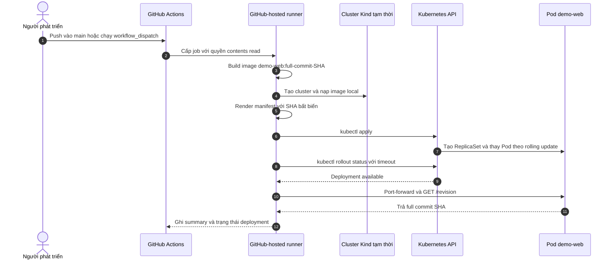

<Callout type="info" title="Mục tiêu của bài">
  Sau bài này, bạn có thể chọn giữa push-based deployment và GitOps; triển khai đúng image bằng digest hoặc tag bất biến; giới hạn quyền theo namespace; đồng thời kiểm chứng rollout, smoke test và rollback mà không lưu kubeconfig production dài hạn trong GitHub Secrets.
</Callout>

## Mục lục

- [Mô hình triển khai Kubernetes](#mô-hình-triển-khai-kubernetes)
  - [Push-based và GitOps](#push-based-và-gitops)
  - [Luồng push-based được chọn cho lab](#luồng-push-based-được-chọn-cho-lab)
- [Hợp đồng giữa pipeline và cluster](#hợp-đồng-giữa-pipeline-và-cluster)
  - [Image bất biến](#image-bất-biến)
  - [Environment namespace và context](#environment-namespace-và-context)
  - [Manifest Kustomize hay Helm](#manifest-kustomize-hay-helm)
- [Xác thực không giữ bí mật dài hạn](#xác-thực-không-giữ-bí-mật-dài-hạn)
  - [OIDC và kubeconfig ngắn hạn](#oidc-và-kubeconfig-ngắn-hạn)
  - [RBAC tối thiểu theo namespace](#rbac-tối-thiểu-theo-namespace)
- [Pipeline triển khai an toàn](#pipeline-triển-khai-an-toàn)
  - [Apply rollout và smoke test](#apply-rollout-và-smoke-test)
  - [Concurrency và quyền GitHub](#concurrency-và-quyền-github)
- [Bài lab push-based với cluster tạm thời](#bài-lab-push-based-với-cluster-tạm-thời)
  - [Chuẩn bị repository](#chuẩn-bị-repository)
  - [Manifest cho lab](#manifest-cho-lab)
  - [Workflow hoàn chỉnh](#workflow-hoàn-chỉnh)
  - [Chạy lab và kiểm chứng](#chạy-lab-và-kiểm-chứng)
- [Đưa workflow lên cluster thật](#đưa-workflow-lên-cluster-thật)
  - [Các giá trị bắt buộc phải thay](#các-giá-trị-bắt-buộc-phải-thay)
  - [Mẫu đăng nhập cloud bằng OIDC](#mẫu-đăng-nhập-cloud-bằng-oidc)
  - [Kiểm tra trước khi apply](#kiểm-tra-trước-khi-apply)
- [Progressive deployment](#progressive-deployment)
  - [Rolling update blue-green và canary](#rolling-update-blue-green-và-canary)
  - [Gate dựa trên tín hiệu](#gate-dựa-trên-tín-hiệu)
- [Rollback và giới hạn của rollback](#rollback-và-giới-hạn-của-rollback)
  - [Rollout undo](#rollout-undo)
  - [Database migration](#database-migration)
- [Best practices](#best-practices)
- [Troubleshooting](#troubleshooting)
- [Câu hỏi thường gặp](#câu-hỏi-thường-gặp)
- [Tài liệu chính thức](#tài-liệu-chính-thức)
- [Các bài liên quan](#các-bài-liên-quan)

## Mô hình triển khai Kubernetes

Một pipeline Kubernetes đáng tin cậy phải làm nhiều hơn việc chạy `kubectl apply`. Pipeline cần chứng minh bốn điều: **đúng artifact**, **đúng cluster và namespace**, **đúng quyền**, và **workload thật sự phục vụ được sau rollout**.

Kubernetes `Deployment` quản lý các `ReplicaSet` và thay Pod theo chiến lược rollout. GitHub Actions đóng vai trò bộ điều phối: nhận release, lấy identity, render cấu hình, gửi desired state tới Kubernetes API rồi kiểm tra kết quả.

### Push-based và GitOps

Hai mô hình khác nhau chủ yếu ở vị trí của tác nhân ghi vào cluster.

| Tiêu chí | Push-based từ GitHub Actions | GitOps pull-based |
|---|---|---|
| Tác nhân thay đổi cluster | Runner gọi Kubernetes API bằng `kubectl`, Helm hoặc API client | Controller trong cluster như Argo CD hoặc Flux đọc Git và reconcile |
| Nơi lưu desired state | Repository ứng dụng hoặc artifact đã render; runner đẩy trực tiếp | Git repository là nguồn sự thật đã khai báo |
| Credential mạng | Runner phải kết nối được API server và có identity deploy | Controller giữ kết nối nội bộ; CI thường chỉ cần quyền cập nhật repository cấu hình |
| Drift correction | Chỉ xảy ra khi pipeline chạy lại hoặc có công cụ khác phát hiện drift | Controller liên tục đưa live state về trạng thái trong Git |
| Audit | GitHub deployment record cộng với Kubernetes audit log | Git history, trạng thái reconcile và Kubernetes audit log |
| Độ phức tạp ban đầu | Thấp hơn, phù hợp lab hoặc hệ thống nhỏ | Cao hơn vì cần controller, promotion model và policy cho config repository |
| Rủi ro chính | Runner là đường ghi trực tiếp vào cluster | Commit sai có thể được controller tự động áp dụng trên diện rộng |

**GitOps không có nghĩa là không dùng GitHub Actions.** Actions vẫn có thể build, ký và publish image. Sau đó workflow mở pull request cập nhật image digest trong repository cấu hình. Controller trong cluster mới là thành phần thực hiện deployment.

<Callout type="idea" title="Khi nào nên chọn GitOps">
  Chọn GitOps khi cluster không nên mở API cho runner, khi cần tự động sửa drift, hoặc khi nhiều team cần một quy trình promotion có lịch sử Git rõ ràng. Chọn push-based khi cần đường đi đơn giản, phạm vi nhỏ và có thể cấp identity ngắn hạn với RBAC chặt.
</Callout>

### Luồng push-based được chọn cho lab

Bài lab dùng **push-based deployment vào một cluster Kind tạm thời trên runner**. Kind chạy Kubernetes bằng container Docker. Cluster bị xóa cùng runner sau workflow, nên lab không yêu cầu kubeconfig production, cloud credential hay GitHub Secret.



Lab này kiểm chứng logic deploy mà không giả vờ rằng một chuỗi kubeconfig base64 là cách production an toàn. Phần sau chỉ rõ cách thay cluster tạm bằng OIDC và identity ngắn hạn của cloud.

## Hợp đồng giữa pipeline và cluster

“Hợp đồng triển khai” là tập giá trị pipeline phải biết và phải kiểm tra trước khi thay đổi cluster. Đừng để script tự đoán cluster, namespace hoặc image mới nhất.

<TypeTable
  type={{
    environment: {
      description: 'GitHub Environment và blast radius tương ứng, ví dụ staging hoặc production.',
      type: 'string',
      required: true,
    },
    cluster: {
      description: 'Tên hoặc định danh cluster đích; phải được lấy từ biến environment đã review.',
      type: 'string',
      required: true,
    },
    namespace: {
      description: 'Namespace đã được platform team cấp trước cho ứng dụng và môi trường.',
      type: 'DNS label',
      required: true,
    },
    imageRef: {
      description: 'Tham chiếu image bằng digest hoặc tag không gán lại, không dùng latest.',
      type: 'registry/repository@sha256:digest | registry/repository:immutable-tag',
      required: true,
    },
    workload: {
      description: 'Tên Deployment dùng cho rollout status, diagnostics và rollback.',
      type: 'string',
      required: true,
    },
    smokeUrl: {
      description: 'Endpoint tối thiểu chứng minh revision mới có thể phục vụ.',
      type: 'URL hoặc đường dẫn qua port-forward',
      required: true,
    },
  }}
/>

### Image bất biến

Tag `latest` là một con trỏ có thể đổi nội dung. Nếu node A pull trước và node B pull sau lúc tag bị gán lại, cùng một Deployment có thể chạy hai image khác nhau.

Ưu tiên thứ tự sau:

1. **Digest:** `ghcr.io/acme/demo-web@sha256:8f...` xác định trực tiếp nội dung image.
2. **Tag bất biến:** `ghcr.io/acme/demo-web:git-2f4c...` chỉ an toàn khi registry policy cấm ghi đè tag.
3. **Tag phiên bản có thể gán lại:** `v1.4.0` dễ đọc nhưng phải được registry bảo vệ.
4. **Tag trôi:** `latest`, `main`, `stable` không nên là căn cước deployment.

Workflow production nên nhận digest từ job publish image, không truy vấn “digest mới nhất” tại thời điểm deploy:

```yaml
jobs:
  publish:
    outputs:
      image_ref: ${{ steps.image.outputs.image_ref }}
    steps:
      - id: image
        run: echo "image_ref=ghcr.io/<YOUR_ORG>/demo-web@sha256:<IMAGE_DIGEST>" >> "$GITHUB_OUTPUT"

  deploy:
    needs: publish
    env:
      IMAGE_REF: ${{ needs.publish.outputs.image_ref }}
```

Đoạn trên minh họa hợp đồng output. Phải thay `<YOUR_ORG>` và `<IMAGE_DIGEST>` bằng giá trị do bước publish thực tế tạo ra; không điền digest bằng tay trong pipeline production.

Lab dùng tag là **full `GITHUB_SHA`** vì image chỉ nằm trong cluster tạm và không được push lên registry. Đây là tag bất biến trong phạm vi một run. Khi đưa lên registry, bật immutable tags hoặc chuyển sang digest.

<Callout type="warn" title="Image bất biến bắt đầu từ base image">
  Image đầu ra có SHA không tự làm quá trình build tái lập được. Production nên pin `FROM` bằng digest, lưu SBOM và provenance, quét image, rồi ký hoặc tạo artifact attestation trước khi promotion.
</Callout>

### Environment namespace và context

GitHub Environment và Kubernetes namespace có vai trò khác nhau:

- **GitHub Environment** như `production` áp dụng approval, branch policy, variables và deployment record.
- **Kubernetes namespace** như `demo-production` giới hạn tên tài nguyên, quota, network policy và phạm vi RBAC.
- **Kubeconfig context** chọn tổ hợp cluster, user và namespace mặc định cho `kubectl`.

Đừng chỉ dựa vào namespace mặc định trong context. Mỗi lệnh production nên truyền `--namespace "$NAMESPACE"`, đồng thời kiểm tra context và namespace trước khi apply:

```bash
set -Eeuo pipefail

kubectl config current-context
kubectl cluster-info
kubectl auth can-i patch deployments.apps --namespace "$NAMESPACE"
kubectl auth can-i get secrets --namespace "$NAMESPACE" | grep -qx 'no'
```

Lệnh kiểm tra secret minh họa nguyên tắc quyền tối thiểu. Nếu ứng dụng cần tạo `Secret`, tốt hơn là dùng External Secrets, Secrets Store CSI Driver hoặc platform controller. Deployment identity hiếm khi cần đọc plaintext của mọi secret.

Mỗi environment nên có namespace và cloud role riêng. Ví dụ, `staging` không dùng chung `demo-production`, ngay cả khi hai environment nằm trên cùng cluster.

### Manifest Kustomize hay Helm

Không có một lựa chọn đúng cho mọi repository. Chọn công cụ nhỏ nhất vẫn diễn đạt được biến thể môi trường và policy của hệ thống.

| Cách quản lý | Phù hợp khi | Ưu điểm | Trade-off |
|---|---|---|---|
| Manifest YAML thuần | Một workload nhỏ, ít biến thể | Dễ đọc, ít công cụ, `kubectl apply -f` trực tiếp | Dễ copy-paste giữa môi trường; thay giá trị bằng shell có thể mong manh |
| Kustomize | Cùng base, khác patch theo environment | Tích hợp trong `kubectl -k`, không cần template language | Patch chồng nhiều lớp khó theo dõi; composition phức tạp cần kỷ luật |
| Helm | Đóng gói chart dùng lại, nhiều tham số và release lifecycle | Values, chart dependencies, hooks, `helm upgrade --install`, rollback riêng | Template có thể tạo YAML khó debug; hooks và state release tăng độ phức tạp |

Lab dùng **manifest YAML thuần** với hai token được render bằng Python: `${NAMESPACE}` và `${IMAGE_REF}`. Script chỉ chấp nhận giá trị do workflow kiểm soát và xác minh không còn token sau render.

Trong production:

- dùng `kubectl apply -k k8s/overlays/production` nếu biến thể chủ yếu là patch;
- dùng `helm template` để review output rồi `helm upgrade --install --atomic --wait` nếu chart là đơn vị phát hành;
- không trộn `kubectl apply`, Helm và GitOps controller để cùng sở hữu một field. Nhiều field manager có thể ghi đè lẫn nhau.

## Xác thực không giữ bí mật dài hạn

Kubeconfig không nhất thiết là một secret tĩnh. Nó có thể chứa cluster endpoint cùng `exec` plugin để CLI lấy token ngắn hạn từ cloud identity hiện tại.

### OIDC và kubeconfig ngắn hạn

OpenID Connect (OIDC) cho phép GitHub job chứng minh identity bằng token có claim như repository, ref và environment. Cloud Security Token Service kiểm tra trust policy rồi cấp credential sống ngắn.

Luồng production khuyến nghị:

1. Job tham chiếu GitHub Environment đúng tên, ví dụ `production`.
2. Job có `id-token: write`, chỉ ở job cần đăng nhập cloud.
3. Action chính thức hoặc CLI đổi OIDC token lấy cloud credential ngắn hạn.
4. CLI cloud tạo context kubeconfig trong `$RUNNER_TEMP` hoặc cấu hình `exec` plugin.
5. `kubectl` dùng token ngắn hạn để gọi API server.
6. Runner tạm bị hủy sau job; workflow không upload kubeconfig thành artifact.

```yaml
permissions:
  contents: read
  id-token: write

environment: production
env:
  KUBECONFIG: ${{ runner.temp }}/kubeconfig
```

<Callout type="error" title="Không lưu kubeconfig production dạng base64 nếu cloud hỗ trợ federation">
  Một kubeconfig chứa client certificate, private key hoặc bearer token dài hạn là credential production. Không dán nó vào workflow, repository variable, artifact hay log. Nếu nền tảng chưa hỗ trợ OIDC, đặt credential ở production environment secret, giới hạn thời hạn và quyền, xoay vòng định kỳ, rồi lập kế hoạch thay thế.
</Callout>

Trust policy phía cloud phải khóa ít nhất organization, repository và environment hoặc ref được phép. `id-token: write` không tự cấp quyền cloud; cloud role và Kubernetes RBAC vẫn quyết định job làm được gì.

### RBAC tối thiểu theo namespace

RBAC — Role-Based Access Control — quyết định subject nào được thực hiện verb nào trên resource nào. `Role` chỉ có hiệu lực trong một namespace. `ClusterRole` có thể chứa rule dùng lại hoặc quyền cluster-wide; phạm vi thực tế còn phụ thuộc `RoleBinding` hay `ClusterRoleBinding`.

Platform team nên tạo namespace, quota, network policy, Role và RoleBinding trước. Deployment job không nên được cấp `cluster-admin` và không nên tự cấp quyền cho chính nó.

Mẫu dưới đây đủ cho một pipeline quản lý `Deployment`, `Service` và `ConfigMap` trong namespace đã có, đồng thời đọc Pod, ReplicaSet và Event để kiểm tra rollout. Mẫu **không cấp quyền đọc hoặc sửa Secret**, namespace, Role hay RoleBinding.

```yaml
apiVersion: rbac.authorization.k8s.io/v1
kind: Role
metadata:
  name: demo-web-deployer
  namespace: demo-production
rules:
  - apiGroups: ["apps"]
    resources: ["deployments"]
    verbs: ["get", "list", "watch", "create", "update", "patch"]
  - apiGroups: ["apps"]
    resources: ["replicasets"]
    verbs: ["get", "list", "watch"]
  - apiGroups: [""]
    resources: ["services", "configmaps"]
    verbs: ["get", "list", "watch", "create", "update", "patch"]
  - apiGroups: [""]
    resources: ["pods", "pods/log", "events"]
    verbs: ["get", "list", "watch"]
---
apiVersion: rbac.authorization.k8s.io/v1
kind: RoleBinding
metadata:
  name: demo-web-deployer
  namespace: demo-production
subjects:
  - kind: Group
    name: <CLOUD_IDENTITY_GROUP>
    apiGroup: rbac.authorization.k8s.io
roleRef:
  kind: Role
  name: demo-web-deployer
  apiGroup: rbac.authorization.k8s.io
```

`<CLOUD_IDENTITY_GROUP>` phải được platform team thay bằng group hoặc subject mà cơ chế xác thực managed Kubernetes ánh xạ vào Kubernetes. AWS EKS, AKS và GKE có mô hình ánh xạ khác nhau; không sao chép giá trị giữa các cloud.

Nếu pipeline quản lý Ingress, custom resource hoặc job migration, thêm đúng API group và resource cần thiết. Kiểm tra thực tế bằng `kubectl auth can-i`, không mở `*` chỉ vì gặp lỗi `Forbidden`.

## Pipeline triển khai an toàn

Pipeline nên thất bại ở bước gần nguyên nhân nhất. Một workflow xanh chỉ sau `kubectl apply` chưa đủ vì API server có thể chấp nhận manifest trong khi Pod sau đó rơi vào `ImagePullBackOff` hoặc readiness probe không bao giờ đạt.

### Apply rollout và smoke test

Một đường triển khai tối thiểu gồm:

1. **Render và validate** manifest với đúng image reference.
2. **Preview** thay đổi bằng `kubectl diff` hoặc server-side dry-run khi RBAC cho phép.
3. **Apply** desired state bằng `kubectl apply` hoặc công cụ sở hữu release.
4. **Chờ rollout** bằng `kubectl rollout status` có timeout hữu hạn.
5. **Xác minh image live** khớp digest hoặc immutable tag dự kiến.
6. **Smoke test** đường phục vụ tối thiểu và revision endpoint.
7. **Thu diagnostics khi lỗi** nhưng không in Secret.

Ví dụ lõi:

```bash
set -Eeuo pipefail

kubectl apply --namespace "$NAMESPACE" -f rendered/app.yaml
kubectl rollout status \
  --namespace "$NAMESPACE" \
  deployment/demo-web \
  --timeout=180s

actual_image="$(kubectl get deployment/demo-web \
  --namespace "$NAMESPACE" \
  -o jsonpath='{.spec.template.spec.containers[?(@.name=="web")].image}')"
test "$actual_image" = "$IMAGE_REF"
```

`rollout status` mặc định theo dõi rollout mới nhất. Concurrency giảm khả năng một run khác thay revision giữa lúc chờ. Với quy trình có nhiều writer, lấy revision cụ thể và dùng `--revision` khi phù hợp, hoặc chuyển quyền sở hữu sang một deployment controller duy nhất.

Smoke test phải trả exit code khác `0` khi:

- endpoint không sẵn sàng trước deadline;
- HTTP status không thuộc tập cho phép;
- body hoặc header revision không khớp release;
- một dependency bắt buộc cho user journey không hoạt động.

Không dùng `sleep 60` rồi mặc định thành công. Hãy poll có deadline và in response hữu ích khi thất bại.

### Concurrency và quyền GitHub

`concurrency` ngăn hai run trong cùng repository cùng ghi vào một target. Group phải ổn định theo application và environment:

```yaml
concurrency:
  group: deploy-demo-web-${{ github.repository }}-production
  cancel-in-progress: false
```

Không hủy một production deployment đang chạy nếu chưa biết thao tác dừng có an toàn. Với staging tạm thời, `cancel-in-progress: true` có thể hợp lý để ưu tiên commit mới.

Concurrency của GitHub không khóa được:

- workflow ở repository khác;
- thao tác từ laptop của quản trị viên;
- GitOps controller hoặc công cụ release khác;
- một cluster khác dùng nhầm cùng namespace.

Do đó production cần một **single writer** rõ ràng. Nếu có nhiều đường deploy, dùng deployment controller hoặc lock phía nền tảng.

Quyền GitHub mặc định nên là:

```yaml
permissions:
  contents: read
```

Chỉ thêm `packages: write` ở job publish image và `id-token: write` ở job đăng nhập cloud. Job deploy không cần quyền ghi toàn repository.

## Bài lab push-based với cluster tạm thời

Lab tạo cluster Kind ngay trên GitHub-hosted runner, build image local bằng full commit SHA, nạp image vào node Kind, chạy `kubectl apply`, chờ rollout và smoke test `/revision`.

<Callout type="info" title="Phạm vi an toàn của lab">
  Cluster chỉ sống trong một job và không chứa dữ liệu thật. Workflow không kết nối production, không push image và không đọc secret. Đây là lab để kiểm chứng control flow; không phải topology production.
</Callout>

### Chuẩn bị repository

Bạn cần repository có nhánh `main` và GitHub Actions được bật. Tạo GitHub Environment tên `kubernetes-lab`; environment này không cần secret hoặc reviewer.

<Steps>
<Step>

**Tạo ứng dụng tĩnh có revision endpoint**

Tạo `index.html`:

```html
<!doctype html>
<html lang="vi">
  <head><meta charset="utf-8"><title>Kubernetes deployment lab</title></head>
  <body><h1>demo-web đang chạy</h1></body>
</html>
```

Tạo `Dockerfile`:

```dockerfile
FROM nginx:1.27.4-alpine

ARG REVISION
RUN test -n "$REVISION" \
    && printf '%s\n' "$REVISION" > /usr/share/nginx/html/revision
COPY index.html /usr/share/nginx/html/index.html
```

Tag output của lab là bất biến theo full commit SHA. Khi dùng production, pin cả dòng `FROM` bằng digest đã kiểm chứng thay vì chỉ dựa vào version tag.

</Step>
<Step>

**Tạo thư mục manifest**

Tạo thư mục `k8s/lab/`, sau đó lưu manifest ở phần kế tiếp thành `k8s/lab/app.yaml`.

Không dùng component `Files` vì project này không đăng ký component đó. Cấu trúc cần có là:

```text
.
├── .github/workflows/deploy-kind.yaml
├── Dockerfile
├── index.html
└── k8s/lab/app.yaml
```

</Step>
<Step>

**Thêm workflow**

Lưu workflow ở phần “Workflow hoàn chỉnh” thành `.github/workflows/deploy-kind.yaml`.

Workflow dùng action bên thứ ba để tạo Kind. Trước khi áp dụng trong tổ chức, pin mọi action vào full commit SHA đã review và dùng công cụ dependency update để cập nhật có kiểm soát.

</Step>
</Steps>

### Manifest cho lab

Tạo `k8s/lab/app.yaml`:

```yaml
apiVersion: v1
kind: Namespace
metadata:
  name: ${NAMESPACE}
  labels:
    app.kubernetes.io/part-of: demo-web
---
apiVersion: apps/v1
kind: Deployment
metadata:
  name: demo-web
  namespace: ${NAMESPACE}
  labels:
    app.kubernetes.io/name: demo-web
spec:
  replicas: 2
  revisionHistoryLimit: 3
  progressDeadlineSeconds: 120
  strategy:
    type: RollingUpdate
    rollingUpdate:
      maxUnavailable: 0
      maxSurge: 1
  selector:
    matchLabels:
      app.kubernetes.io/name: demo-web
  template:
    metadata:
      labels:
        app.kubernetes.io/name: demo-web
    spec:
      containers:
        - name: web
          image: ${IMAGE_REF}
          imagePullPolicy: Never
          ports:
            - name: http
              containerPort: 80
          readinessProbe:
            httpGet:
              path: /revision
              port: http
            initialDelaySeconds: 1
            periodSeconds: 2
            timeoutSeconds: 1
            failureThreshold: 15
          livenessProbe:
            httpGet:
              path: /
              port: http
            initialDelaySeconds: 5
            periodSeconds: 10
          resources:
            requests:
              cpu: 10m
              memory: 16Mi
            limits:
              cpu: 200m
              memory: 64Mi
---
apiVersion: v1
kind: Service
metadata:
  name: demo-web
  namespace: ${NAMESPACE}
spec:
  selector:
    app.kubernetes.io/name: demo-web
  ports:
    - name: http
      port: 80
      targetPort: http
```

`imagePullPolicy: Never` chỉ đúng vì workflow nạp image trực tiếp vào node Kind. Trên cluster thật, dùng registry có xác thực và `IfNotPresent` hoặc policy do platform quy định. Nếu image dùng digest, kubelet vẫn xác định đúng content dù cache đã có.

Namespace nằm trong manifest để lab tự đủ. Production nên để platform team tạo namespace cùng quota, RBAC và network policy trước; deployment identity khi đó không cần quyền tạo namespace.

### Workflow hoàn chỉnh

Tạo `.github/workflows/deploy-kind.yaml`:

```yaml
name: Deploy Kubernetes lab

on:
  push:
    branches: [main]
    paths:
      - Dockerfile
      - index.html
      - k8s/**
      - .github/workflows/deploy-kind.yaml
  workflow_dispatch:

permissions:
  contents: read

concurrency:
  group: deploy-kind-${{ github.repository }}
  cancel-in-progress: false

env:
  CLUSTER_NAME: actions-lab
  NAMESPACE: demo-lab
  IMAGE_NAME: demo-web

jobs:
  deploy:
    name: Build deploy and verify
    runs-on: ubuntu-latest
    timeout-minutes: 15
    environment: kubernetes-lab

    steps:
      - name: Checkout trusted source
        uses: actions/checkout@v4
        with:
          persist-credentials: false

      - name: Create an ephemeral Kind cluster
        uses: helm/kind-action@v1
        with:
          cluster_name: ${{ env.CLUSTER_NAME }}
          wait: 120s

      - name: Build an immutable local image
        shell: bash
        run: |
          set -Eeuo pipefail
          docker build \
            --build-arg "REVISION=$GITHUB_SHA" \
            --tag "$IMAGE_NAME:$GITHUB_SHA" \
            .
          docker image inspect "$IMAGE_NAME:$GITHUB_SHA" >/dev/null

      - name: Load the image into Kind
        shell: bash
        run: |
          set -Eeuo pipefail
          kind load docker-image \
            "$IMAGE_NAME:$GITHUB_SHA" \
            --name "$CLUSTER_NAME"

      - name: Render manifests with controlled values
        shell: bash
        env:
          IMAGE_REF: ${{ env.IMAGE_NAME }}:${{ github.sha }}
        run: |
          set -Eeuo pipefail
          mkdir -p rendered

          python3 - <<'PY'
          import os
          from pathlib import Path

          source = Path("k8s/lab/app.yaml").read_text()
          for key in ("NAMESPACE", "IMAGE_REF"):
              value = os.environ[key]
              if not value or "\n" in value:
                  raise SystemExit(f"Giá trị {key} không hợp lệ")
              source = source.replace("${" + key + "}", value)

          if "${" in source:
              raise SystemExit("Manifest vẫn còn token chưa được render")
          Path("rendered/app.yaml").write_text(source)
          PY

          grep -F "image: $IMAGE_REF" rendered/app.yaml

      - name: Apply manifests
        shell: bash
        run: |
          set -Eeuo pipefail
          kubectl apply -f rendered/app.yaml

      - name: Wait for rollout and verify the live image
        shell: bash
        env:
          IMAGE_REF: ${{ env.IMAGE_NAME }}:${{ github.sha }}
        run: |
          set -Eeuo pipefail

          kubectl rollout status \
            --namespace "$NAMESPACE" \
            deployment/demo-web \
            --timeout=180s

          actual_image="$(kubectl get deployment/demo-web \
            --namespace "$NAMESPACE" \
            -o jsonpath='{.spec.template.spec.containers[?(@.name=="web")].image}')"
          test "$actual_image" = "$IMAGE_REF"

      - name: Smoke test through the Service
        shell: bash
        run: |
          set -Eeuo pipefail

          kubectl port-forward \
            --namespace "$NAMESPACE" \
            service/demo-web 18080:80 \
            >"$RUNNER_TEMP/port-forward.log" 2>&1 &
          port_forward_pid=$!
          trap 'kill "$port_forward_pid" >/dev/null 2>&1 || true' EXIT

          for attempt in {1..30}; do
            if revision="$(curl --fail --silent --show-error \
              http://127.0.0.1:18080/revision)"; then
              test "$revision" = "$GITHUB_SHA"
              curl --fail --silent --show-error \
                http://127.0.0.1:18080/ >/dev/null
              exit 0
            fi
            sleep 2
          done

          cat "$RUNNER_TEMP/port-forward.log" >&2 || true
          echo "Smoke test không thành công trước deadline" >&2
          exit 1

      - name: Collect safe diagnostics on failure
        if: failure()
        shell: bash
        run: |
          kubectl get deployment,replicaset,pod,service \
            --namespace "$NAMESPACE" -o wide || true
          kubectl describe deployment/demo-web \
            --namespace "$NAMESPACE" || true
          kubectl get events \
            --namespace "$NAMESPACE" \
            --sort-by=.lastTimestamp || true
          kubectl logs \
            --namespace "$NAMESPACE" \
            --selector app.kubernetes.io/name=demo-web \
            --all-containers \
            --tail=100 || true

      - name: Write deployment summary
        if: success()
        shell: bash
        run: |
          {
            echo "### Kubernetes lab deployment"
            echo "- Cluster: \`$CLUSTER_NAME\` (ephemeral Kind)"
            echo "- Namespace: \`$NAMESPACE\`"
            echo "- Image: \`$IMAGE_NAME:$GITHUB_SHA\`"
            echo "- Deployment: \`demo-web\`"
            echo "- Smoke test: passed"
          } >> "$GITHUB_STEP_SUMMARY"
```

Những quyết định quan trọng:

- Trigger không chạy từ `pull_request`, nên job không triển khai source không tin cậy từ fork.
- Full `GITHUB_SHA` là tag image; workflow kiểm tra image trong live Deployment trước smoke test.
- `persist-credentials: false` tránh để GitHub token trong Git config sau checkout.
- Manifest được render bằng danh sách token đóng. Script fail nếu còn token chưa xử lý.
- `kubectl apply` gửi desired state; `rollout status` chứng minh Deployment đã Available trước deadline.
- Smoke test đi qua `Service` và đối chiếu `/revision` với commit hiện tại.
- Diagnostics không chạy `kubectl get secret -o yaml` và không dump kubeconfig.
- `concurrency` serialize các run lab. Production cần group riêng theo application và environment.

<Callout type="warn" title="Pin action theo policy supply chain">
  Major tag giúp ví dụ dễ đọc nhưng có thể dịch chuyển. Workflow production nên thay `actions/checkout@v4` và `helm/kind-action@v1` bằng full commit SHA đã review. Ghi chú phiên bản cạnh SHA và cập nhật bằng pull request tự động.
</Callout>

### Chạy lab và kiểm chứng

<Steps>
<Step>

**Commit các file lab lên một branch**

Mở pull request để review Dockerfile, manifest và workflow. Chỉ merge vào `main` sau khi kiểm tra workflow không đọc secret và không có target production.

</Step>
<Step>

**Chạy happy path**

Merge vào `main` hoặc dùng **Actions → Deploy Kubernetes lab → Run workflow**. Mở log và xác nhận thứ tự: tạo Kind → build image → load image → apply → rollout → smoke test.

</Step>
<Step>

**Đối chiếu revision**

Trong log bước smoke test, workflow phải kiểm tra nội dung `/revision` bằng full `GITHUB_SHA`. Job summary phải ghi đúng namespace, image tag và trạng thái smoke test.

</Step>
<Step>

**Tạo lỗi rollout có chủ đích**

Tạm đổi `readinessProbe.httpGet.path` thành `/khong-ton-tai`. Workflow phải timeout ở `kubectl rollout status`; bước smoke test không được chạy và diagnostics phải hiển thị Pod không Ready.

Hoàn nguyên thay đổi sau khi lưu bằng chứng.

</Step>
<Step>

**Tạo lỗi smoke test có chủ đích**

Đổi so sánh thành `test "$revision" = "sai-revision"`. Rollout phải thành công nhưng smoke test phải fail. Tình huống này chứng minh Available không đồng nghĩa đúng release hoặc đúng hành vi.

Hoàn nguyên thay đổi.

</Step>
<Step>

**Kiểm tra concurrency**

Khởi chạy hai run gần nhau. Vì `cancel-in-progress: false`, chỉ một job trong group được chạy tại một thời điểm; run còn lại ở trạng thái pending theo semantics của GitHub concurrency.

</Step>
</Steps>

Lab đạt khi:

- [ ] Workflow không có kubeconfig, cloud key hoặc token cluster trong YAML và GitHub Secrets.
- [ ] Live Deployment dùng chính xác `demo-web:<full-GITHUB_SHA>`.
- [ ] Hai Pod Ready trước khi rollout thành công.
- [ ] `/revision` trả đúng full commit SHA.
- [ ] Readiness sai làm rollout fail trước smoke test.
- [ ] Revision sai làm smoke test fail dù rollout đã Available.
- [ ] Diagnostics hữu ích nhưng không in Secret hoặc kubeconfig.
- [ ] Hai run không cùng apply vào target do concurrency group.

## Đưa workflow lên cluster thật

Không thay Kind bằng production cluster chỉ bằng cách thêm một kubeconfig secret. Việc chuyển đổi phải đồng thời thay identity, image distribution, namespace ownership, RBAC, network path và policy môi trường.

### Các giá trị bắt buộc phải thay

| Token hoặc giá trị lab | Thay bằng gì trong hệ thống thật | Nơi nên cấu hình |
|---|---|---|
| `kubernetes-lab` | `staging` hoặc `production` đúng tên đã có protection rules | `jobs.deploy.environment` |
| `actions-lab` | Cluster ID hoặc tên cluster thật | GitHub Environment variable như `vars.CLUSTER_NAME` |
| `demo-lab` | Namespace được platform team cấp trước | `vars.K8S_NAMESPACE` |
| `demo-web:$GITHUB_SHA` | `registry/repo@sha256:<DIGEST_DO_JOB_PUBLISH_TẠO>` | Output của job publish, không nhập tay |
| `imagePullPolicy: Never` | Thường là `IfNotPresent`, theo platform policy | Overlay production hoặc chart values |
| `helm/kind-action@v1` | Bước đăng nhập cloud bằng OIDC và tạo context ngắn hạn | Job deploy |
| `port-forward` | URL nội bộ, synthetic endpoint hoặc probe qua gateway | `vars.SMOKE_URL` hoặc test runner trong mạng phù hợp |
| Namespace nằm trong app manifest | Namespace, quota, RBAC và network policy do platform bootstrap | Repository hạ tầng hoặc platform pipeline |
| Quyền `contents: read` | Giữ nguyên, cộng `id-token: write` ở job OIDC | `jobs.deploy.permissions` |

Các chuỗi `<YOUR_ORG>`, `<CLOUD_IDENTITY_GROUP>`, `<PINNED_COMMIT_SHA>` và `<DIGEST_DO_JOB_PUBLISH_TẠO>` trong tài liệu là **marker bắt buộc thay**. Workflow production phải fail nếu một marker còn tồn tại:

```bash
if grep -R -E '<(YOUR_ORG|CLOUD_IDENTITY_GROUP|PINNED_COMMIT_SHA|DIGEST_DO_JOB_PUBLISH_TẠO)>' rendered/; then
  echo "Cấu hình vẫn còn marker chưa thay" >&2
  exit 1
fi
```

### Mẫu đăng nhập cloud bằng OIDC

Các đoạn dưới đây là **khung tích hợp**, không chạy được trước khi thay marker và pin action. Luôn làm theo tài liệu chính thức của cloud, vì tên input và mô hình identity có thể thay đổi.

<Tabs items={['Amazon EKS', 'Azure AKS', 'Google GKE']}>
  <Tab value="Amazon EKS">

```yaml
permissions:
  contents: read
  id-token: write

env:
  KUBECONFIG: ${{ runner.temp }}/kubeconfig

steps:
  - name: Exchange GitHub OIDC for an AWS role
    uses: aws-actions/configure-aws-credentials@<PINNED_COMMIT_SHA>
    with:
      role-to-assume: arn:aws:iam::<AWS_ACCOUNT_ID>:role/<EKS_DEPLOY_ROLE>
      aws-region: <AWS_REGION>

  - name: Create a short-lived EKS context
    run: |
      aws eks update-kubeconfig \
        --name "${{ vars.CLUSTER_NAME }}" \
        --region "${{ vars.AWS_REGION }}" \
        --kubeconfig "$KUBECONFIG"
      kubectl auth can-i patch deployments.apps \
        --namespace "${{ vars.K8S_NAMESPACE }}"
```

Trust policy của IAM role phải giới hạn đúng repository và GitHub Environment. Quyền IAM để mô tả cluster không thay thế Kubernetes access entry hoặc RBAC trong cluster.

  </Tab>
  <Tab value="Azure AKS">

```yaml
permissions:
  contents: read
  id-token: write

steps:
  - name: Sign in to Azure with federated identity
    uses: azure/login@<PINNED_COMMIT_SHA>
    with:
      client-id: ${{ vars.AZURE_CLIENT_ID }}
      tenant-id: ${{ vars.AZURE_TENANT_ID }}
      subscription-id: ${{ vars.AZURE_SUBSCRIPTION_ID }}

  - name: Create an AKS context
    uses: azure/aks-set-context@<PINNED_COMMIT_SHA>
    with:
      resource-group: ${{ vars.AKS_RESOURCE_GROUP }}
      cluster-name: ${{ vars.CLUSTER_NAME }}
      admin: 'false'
```

Không đặt `admin: 'true'` để xử lý nhanh lỗi quyền. Với Microsoft Entra và Kubernetes RBAC, identity liên kết phải được cấp đúng role ở cả Azure và cluster.

  </Tab>
  <Tab value="Google GKE">

```yaml
permissions:
  contents: read
  id-token: write

steps:
  - name: Authenticate with Workload Identity Federation
    uses: google-github-actions/auth@<PINNED_COMMIT_SHA>
    with:
      workload_identity_provider: ${{ vars.WIF_PROVIDER }}
      service_account: ${{ vars.GKE_DEPLOY_SERVICE_ACCOUNT }}

  - name: Create a GKE context
    uses: google-github-actions/get-gke-credentials@<PINNED_COMMIT_SHA>
    with:
      cluster_name: ${{ vars.CLUSTER_NAME }}
      location: ${{ vars.GKE_LOCATION }}
      project_id: ${{ vars.GCP_PROJECT_ID }}
```

Giới hạn attribute condition của Workload Identity Provider theo organization, repository và ref hoặc environment. Cloud IAM và Kubernetes RBAC phải cùng tuân thủ quyền tối thiểu.

  </Tab>
</Tabs>

Nếu API server chỉ có private endpoint, GitHub-hosted runner công cộng có thể không kết nối được. Chọn self-hosted runner đã harden trong mạng phù hợp, private networking do provider hỗ trợ, hoặc GitOps để controller trong cluster tự pull desired state. Không mở API server ra Internet với `0.0.0.0/0` chỉ để workflow chạy.

### Kiểm tra trước khi apply

Production nên thêm các gate sau trước `kubectl apply`:

```bash
set -Eeuo pipefail

kubectl config current-context
kubectl cluster-info
kubectl auth can-i get deployments.apps --namespace "$NAMESPACE" | grep -qx yes
kubectl auth can-i patch deployments.apps --namespace "$NAMESPACE" | grep -qx yes
kubectl auth can-i get secrets --namespace "$NAMESPACE" | grep -qx no

kubectl apply \
  --server-side \
  --dry-run=server \
  --field-manager=github-actions-demo-web \
  --namespace "$NAMESPACE" \
  -f rendered/app.yaml >/dev/null

kubectl diff --namespace "$NAMESPACE" -f rendered/app.yaml || diff_exit=$?
if [[ "${diff_exit:-0}" -gt 1 ]]; then
  exit "$diff_exit"
fi
```

`kubectl diff` trả `1` khi có khác biệt và lớn hơn `1` khi có lỗi. Script phải phân biệt hai trường hợp. Server-side dry-run và diff cần quyền gần với apply, thường gồm `get`, `create` và `patch` trên tài nguyên liên quan.

Không in toàn bộ manifest đã render nếu manifest có `Secret`. Tốt hơn, không để pipeline ứng dụng render secret plaintext; dùng tham chiếu tới secret manager hoặc controller chuyên dụng.

## Progressive deployment

Progressive deployment giới hạn blast radius bằng cách đưa release mới tới một phần instance hoặc traffic trước. Kubernetes Deployment hỗ trợ rolling update, nhưng không tự cung cấp canary theo phần trăm traffic hay tự phân tích metric.

### Rolling update blue-green và canary

- **Rolling update:** `maxUnavailable` và `maxSurge` kiểm soát số Pod cũ và mới. Readiness probe phải phản ánh khả năng nhận traffic thật.
- **Blue-green:** chạy hai Deployment, kiểm tra “green”, sau đó đổi selector hoặc route. Chuyển lại nhanh nhưng cần thêm capacity và schema tương thích.
- **Canary:** chạy revision mới với tỷ lệ traffic nhỏ. Cần Ingress, service mesh, Gateway API implementation hoặc progressive delivery controller để chia traffic.

Công cụ như Argo Rollouts hoặc Flagger bổ sung CRD, traffic routing và metric analysis. Khi dùng chúng, workflow nên apply custom resource rồi chờ trạng thái của controller; không đồng thời chạy `kubectl rollout status deployment/...` như thể Deployment chuẩn là nguồn trạng thái duy nhất.

<Callout type="warn" title="Hai Pod không tạo thành canary đáng tin cậy">
  Giảm replica canary không bảo đảm nó nhận đúng 10% request. Traffic distribution phụ thuộc load balancer, connection reuse và routing. Canary cần cơ chế chia traffic cùng metrics phân tách theo revision.
</Callout>

### Gate dựa trên tín hiệu

Một progressive rollout cần tiêu chí định lượng:

- error rate của canary không vượt baseline quá ngưỡng;
- p95 hoặc p99 latency nằm trong SLO;
- readiness và restart count ổn định;
- synthetic transaction thành công;
- business metric quan trọng không suy giảm;
- đủ request để kết luận có ý nghĩa.

Pipeline hoặc controller phải có timeout và fail closed. “Không lấy được metric” không được diễn giải thành “không có lỗi”. Khi gate fail, dừng tăng traffic, giữ bằng chứng và kích hoạt rollback hoặc roll forward theo runbook.

## Rollback và giới hạn của rollback

Rollback Kubernetes không phải thao tác thần kỳ. Nó chỉ khôi phục Pod template đã lưu trong lịch sử ReplicaSet. Service, ConfigMap, Secret, CRD, job migration và dữ liệu có thể không tự quay lại.

### Rollout undo

Xem lịch sử trước khi rollback:

```bash
kubectl rollout history \
  --namespace "$NAMESPACE" \
  deployment/demo-web
```

Rollback về revision trước và kiểm chứng lại:

```bash
set -Eeuo pipefail

kubectl rollout undo \
  --namespace "$NAMESPACE" \
  deployment/demo-web

kubectl rollout status \
  --namespace "$NAMESPACE" \
  deployment/demo-web \
  --timeout=180s

kubectl get deployment/demo-web \
  --namespace "$NAMESPACE" \
  -o jsonpath='{.spec.template.spec.containers[?(@.name=="web")].image}{"\n"}'
```

Có thể chọn revision rõ ràng bằng `--to-revision=N`. Luôn xác định image của revision đó và chạy lại smoke test. Revision “trước” chưa chắc là last known good nếu nhiều deployment lỗi liên tiếp.

`revisionHistoryLimit` quá thấp có thể xóa ReplicaSet cần rollback. Ngược lại, giữ lịch sử trong cluster không thay thế retention image trong registry. Nếu digest cũ đã bị garbage collection, Pod rollback có thể rơi vào `ImagePullBackOff`.

<Callout type="info" title="Rollback workflow vẫn là production deployment">
  Workflow rollback phải tham chiếu GitHub Environment `production`, dùng identity ngắn hạn, concurrency group giống đường deploy và ghi audit. Không cấp một kubeconfig mạnh hơn chỉ vì đang có incident.
</Callout>

Với GitOps, `rollout undo` chỉ là thay đổi live state tạm thời; controller có thể reconcile ngay về commit lỗi. Hãy revert commit cấu hình hoặc promote digest tốt trong source of truth, rồi để controller reconcile.

### Database migration

`kubectl rollout undo` không rollback database. Nếu release mới đã xóa cột, đổi định dạng dữ liệu hoặc chạy migration không thể đảo ngược, binary cũ có thể không còn tương thích.

Dùng mẫu **expand–migrate–contract**:

1. **Expand:** thêm schema mới theo cách code cũ vẫn chạy được.
2. **Migrate:** deploy code đọc/ghi tương thích, backfill dữ liệu và kiểm chứng.
3. **Contract:** chỉ xóa schema cũ ở release sau khi không còn reader hoặc writer cũ.

Migration nên là một release unit có owner, timeout, idempotency và backup/restore plan. Không tự động chạy down migration phá dữ liệu chỉ vì smoke test HTTP thất bại. Khi schema không cho phép rollback binary, lựa chọn an toàn có thể là tắt feature, cô lập traffic hoặc **roll forward** bằng bản vá.

## Best practices

1. **Build một lần, promote cùng digest.** Không build lại image trong job production và không resolve `latest` lúc deploy.
2. **Tách build identity khỏi deploy identity.** Job publish cần quyền registry; job deploy cần quyền cluster. Không gộp thành một credential toàn năng.
3. **Ưu tiên OIDC và token ngắn hạn.** Không giữ cloud key hoặc kubeconfig production dài hạn khi provider hỗ trợ federation.
4. **Giới hạn theo environment và namespace.** Mỗi environment có cloud role, namespace, quota, network policy và GitHub protection rules riêng.
5. **Không cấp `cluster-admin`.** Pre-provision namespace và RBAC. Dùng `kubectl auth can-i` để bổ sung đúng resource khi cần.
6. **Chỉ có một field owner.** Chọn `kubectl`, Helm hoặc GitOps controller làm writer chính; tránh nhiều công cụ cùng sửa một field.
7. **Render rồi validate.** Chặn token chưa thay, validate schema, chạy policy-as-code và preview diff trước apply.
8. **Đặt timeout mọi bước chờ.** Rollout, smoke test, metric gate và migration đều phải có deadline hữu hạn.
9. **Smoke test đúng revision.** HTTP 200 từ Pod cũ không chứng minh release mới khỏe. Trả commit hoặc digest qua endpoint an toàn.
10. **Serialize theo target.** Concurrency group phải chứa application và environment. Dùng lock phía platform nếu có writer ngoài repository.
11. **Không deploy pull request không tin cậy.** Workflow có quyền production chỉ chạy ref tin cậy, được review và bị environment branch policy giới hạn.
12. **Pin action và toolchain.** Pin action bằng full commit SHA, pin kubectl phù hợp cluster và kiểm tra checksum binary tải về.
13. **Giữ diagnostics an toàn.** Thu events, describe, logs có giới hạn; không dump Secret, token hoặc kubeconfig vào log và artifact.
14. **Bảo toàn image để rollback.** Registry retention phải dài hơn cửa sổ rollback; diễn tập pull lại digest cũ.
15. **Thiết kế progressive delivery theo metric.** Canary cần traffic routing, baseline, ngưỡng và đủ mẫu; không chỉ chờ một khoảng thời gian.
16. **Tách database khỏi giả định rollback ứng dụng.** Áp dụng migration tương thích ngược và có runbook roll forward.
17. **Ghi metadata release.** Summary hoặc deployment record nên có cluster, namespace, image digest, commit, actor và kết quả smoke test.
18. **Diễn tập đường lỗi.** Thử readiness fail, image pull fail, RBAC deny, smoke fail và rollback trước khi cần dùng trong incident.

## Troubleshooting

| Triệu chứng | Nguyên nhân cần kiểm tra | Hướng xử lý |
|---|---|---|
| `The connection to the server ... was refused` | Context chưa tạo, `KUBECONFIG` sai path, API private không reachable hoặc credential đã hết hạn | In `kubectl config current-context` và `cluster-info`; tạo lại credential ngắn hạn; kiểm tra network path, không in kubeconfig |
| `Unauthorized` | Token OIDC/cloud đã hết hạn, audience hoặc trust claim sai, exec plugin thiếu | Đăng nhập lại trong cùng job; kiểm tra trust policy theo repository/environment và cài đúng auth plugin |
| `Forbidden` | Kubernetes RBAC thiếu verb hoặc resource | Dùng `kubectl auth can-i <verb> <resource> -n <namespace>`; bổ sung quyền tối thiểu, không cấp `cluster-admin` |
| `namespaces ... is forbidden` | Deployment identity không có quyền cluster-scoped | Đây thường là thiết kế đúng. Yêu cầu platform team pre-provision namespace hoặc tách bootstrap pipeline |
| `ImagePullBackOff` | Sai registry, digest không tồn tại, node thiếu pull credential, architecture không khớp | Kiểm tra Pod events, registry retention và multi-arch manifest; không đổi sang `latest` để né lỗi |
| Kind báo `ErrImageNeverPull` | Image chưa được `kind load` hoặc tag trong manifest khác tag local | Đối chiếu full SHA; chạy `kind load docker-image IMAGE --name CLUSTER` trước apply |
| `rollout status` timeout | Readiness fail, thiếu resource, quota, scheduling, image pull hoặc `progressDeadlineSeconds` | Xem `describe deployment`, Pod status và events; sửa nguyên nhân trước khi tăng timeout |
| Deployment Available nhưng smoke test fail | Service selector/port sai, endpoint sai, revision không khớp hoặc dependency lỗi | Kiểm tra EndpointSlice, port-forward, `/revision`, logs và routing; không coi rollout xanh là đủ |
| `kubectl diff` làm step fail dù chỉ có thay đổi | `kubectl diff` trả exit code `1` khi có diff | Chấp nhận code `0` và `1`; chỉ fail khi code lớn hơn `1` |
| `kubectl apply` xóa hoặc đổi field ngoài ý muốn | Nhiều field manager, manifest render sai hoặc một công cụ khác cùng sở hữu resource | Xem `managedFields`, chuẩn hóa single writer, review diff và dùng server-side apply có field manager rõ ràng |
| Run mới hủy run production đang deploy | `cancel-in-progress: true` hoặc concurrency group dùng chung sai | Đặt `false` cho production và dùng group theo app/environment; xác định queue semantics mong muốn |
| Hai deploy vẫn chạy song song | Khác repository/group hoặc có writer ngoài Actions | Chuẩn hóa group, dùng platform lock hoặc GitOps controller làm single writer |
| `rollout undo` thành công nhưng ứng dụng vẫn lỗi | Config, Secret, Service hoặc database không được rollback cùng Pod template | Xác minh toàn bộ release unit; restore config có kiểm soát hoặc roll forward |
| Rollback rơi vào `ImagePullBackOff` | Image revision cũ đã bị xóa khỏi registry | Tăng retention, bảo vệ digest đã release và kiểm tra định kỳ khả năng pull artifact cũ |
| GitOps controller hoàn tác lệnh sửa trực tiếp | Live state khác source of truth | Revert hoặc cập nhật Git; không dùng `rollout undo` như thay đổi bền vững khi controller đang reconcile |
| Log diagnostics lộ dữ liệu nhạy cảm | Script in environment, kubeconfig, Secret hoặc log ứng dụng chứa token | Dừng run, thu hồi credential, xóa log/artifact theo quy trình incident và giới hạn diagnostics từ đầu |

## Câu hỏi thường gặp

<Accordions type="single">
  <Accordion title="Có nên lưu KUBECONFIG dưới dạng GitHub Secret không?">
    Chỉ dùng như phương án legacy khi nền tảng không hỗ trợ identity federation và phải có kế hoạch thay thế. Đặt secret trong đúng GitHub Environment, dùng credential quyền tối thiểu có thời hạn ngắn nhất có thể, ghi file vào `runner.temp`, đặt permission file chặt và xóa sau job. Không upload kubeconfig hoặc in nội dung để debug.
  </Accordion>
  <Accordion title="kubectl apply có tự rollback khi rollout fail không?">
    Không. `apply` cập nhật desired state, còn `rollout status` chỉ quan sát. Nếu cần rollback tự động, pipeline phải gọi hành động phục hồi có điều kiện và vẫn kiểm chứng sau đó. Với Helm, `--atomic` có semantics rollback riêng; với progressive controller, làm theo trạng thái và policy của controller.
  </Accordion>
  <Accordion title="Dùng tag Git SHA có đủ an toàn không?">
    Chỉ khi registry cấm ghi đè tag và pipeline xác minh nội dung. Digest mạnh hơn vì gắn trực tiếp với manifest content. Lab dùng SHA tag do image chỉ sống trong run; production nên promotion bằng digest.
  </Accordion>
  <Accordion title="GitHub Environment có thay Kubernetes namespace không?">
    Không. Environment kiểm soát deployment job ở GitHub. Namespace và RBAC giới hạn tài nguyên trong cluster. Một pipeline production an toàn thường dùng cả hai và ánh xạ rõ `environment → cluster → namespace → identity`.
  </Accordion>
  <Accordion title="Khi nào nên chuyển lab push-based sang GitOps?">
    Chuyển khi API cluster không nên reachable từ runner, khi drift correction là yêu cầu, hoặc khi nhiều service cần promotion và audit qua config repository. Giữ CI để publish image bất biến; thay bước `kubectl apply` bằng pull request cập nhật digest rồi để controller reconcile.
  </Accordion>
</Accordions>

## Tài liệu chính thức

- [GitHub Docs — Deployments and environments](https://docs.github.com/en/actions/reference/workflows-and-actions/deployments-and-environments)
- [GitHub Docs — OpenID Connect](https://docs.github.com/en/actions/concepts/security/openid-connect)
- [GitHub Docs — Configuring OIDC in cloud providers](https://docs.github.com/en/actions/how-tos/secure-your-work/security-harden-deployments/oidc-in-cloud-providers)
- [GitHub Docs — Control workflow concurrency](https://docs.github.com/en/actions/how-tos/write-workflows/choose-when-workflows-run/control-workflow-concurrency)
- [GitHub Docs — Secure use reference](https://docs.github.com/en/actions/reference/security/secure-use)
- [Kubernetes — Declarative management with kubectl apply](https://kubernetes.io/docs/tasks/manage-kubernetes-objects/declarative-config/)
- [Kubernetes — Deployments](https://kubernetes.io/docs/concepts/workloads/controllers/deployment/)
- [Kubernetes — kubectl rollout status](https://kubernetes.io/docs/reference/kubectl/generated/kubectl_rollout/kubectl_rollout_status/)
- [Kubernetes — kubectl rollout undo](https://kubernetes.io/docs/reference/kubectl/generated/kubectl_rollout/kubectl_rollout_undo/)
- [Kubernetes — Using RBAC authorization](https://kubernetes.io/docs/reference/access-authn-authz/rbac/)
- [Kubernetes — Images and image pull policy](https://kubernetes.io/docs/concepts/containers/images/)
- [Kubernetes — Kustomize](https://kubernetes.io/docs/tasks/manage-kubernetes-objects/kustomization/)
- [Helm — Chart template guide](https://helm.sh/docs/chart_template_guide/)
- [AWS — GitHub Actions OIDC provider for AWS](https://docs.aws.amazon.com/IAM/latest/UserGuide/id_roles_providers_create_oidc.html)
- [Microsoft Learn — Use GitHub Actions with OpenID Connect in Azure](https://learn.microsoft.com/en-us/azure/developer/github/connect-from-azure-openid-connect)
- [Google Cloud — Workload Identity Federation with deployment pipelines](https://cloud.google.com/iam/docs/workload-identity-federation-with-deployment-pipelines)
- [Kind — Quick start](https://kind.sigs.k8s.io/docs/user/quick-start/)

## Các bài liên quan

<Cards>
  <Card
    title="Publish container image"
    href="/docs/cd/05-publish-container-registry/"
    description="Build, kiểm tra và publish image trước khi promotion bằng digest."
  />
  <Card
    title="Deploy AWS bằng OIDC"
    href="/docs/cd/07-deploy-aws-oidc/"
    description="Thiết lập trust policy và credential ngắn hạn cho AWS."
  />
  <Card
    title="Deploy Azure và GCP bằng OIDC"
    href="/docs/cd/08-deploy-azure-gcp-oidc/"
    description="Dùng federated identity thay cho cloud key dài hạn."
  />
  <Card
    title="Rollback strategies"
    href="/docs/cd/09-rollback-strategies/"
    description="Thiết kế last known good release, roll forward và diễn tập phục hồi."
  />
</Cards>
