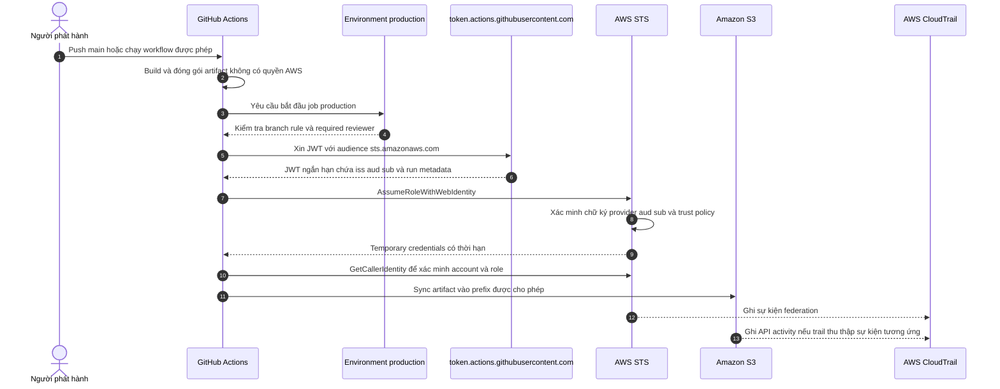

<Callout type="info" title="Kết quả sau bài học">
  Bạn sẽ cấu hình AWS tin cậy OIDC issuer của GitHub, giới hạn quyền assume role theo đúng repository và environment hoặc branch, rồi dùng credential STS ngắn hạn để triển khai static assets lên một prefix S3. Không có access key dài hạn nào được lưu trong GitHub.
</Callout>

## Mục lục

- [Phạm vi và mô hình tin cậy](#phạm-vi-và-mô-hình-tin-cậy)
  - [Ba lớp kiểm soát độc lập](#ba-lớp-kiểm-soát-độc-lập)
  - [Luồng federation và deployment](#luồng-federation-và-deployment)
- [Thiết kế OIDC provider và claims](#thiết-kế-oidc-provider-và-claims)
  - [Đăng ký GitHub OIDC provider trong AWS](#đăng-ký-github-oidc-provider-trong-aws)
  - [Các claim cần kiểm tra](#các-claim-cần-kiểm-tra)
  - [Chọn subject theo environment hoặc branch](#chọn-subject-theo-environment-hoặc-branch)
  - [Lưu ý về subject bất biến và subject tùy chỉnh](#lưu-ý-về-subject-bất-biến-và-subject-tùy-chỉnh)
- [Trust policy cho IAM role](#trust-policy-cho-iam-role)
  - [Trust theo environment production](#trust-theo-environment-production)
  - [Trust theo branch main](#trust-theo-branch-main)
  - [Những trust policy không nên dùng](#những-trust-policy-không-nên-dùng)
- [Permission policy quyền tối thiểu](#permission-policy-quyền-tối-thiểu)
  - [Policy cho một prefix S3](#policy-cho-một-prefix-s3)
  - [Tách trust khỏi permissions](#tách-trust-khỏi-permissions)
- [Workflow triển khai S3 an toàn](#workflow-triển-khai-s3-an-toàn)
  - [Cấu hình GitHub Environment](#cấu-hình-github-environment)
  - [Workflow hoàn chỉnh](#workflow-hoàn-chỉnh)
  - [Vì sao workflow được tách thành hai job](#vì-sao-workflow-được-tách-thành-hai-job)
  - [Phiên bản action và pin dependency](#phiên-bản-action-và-pin-dependency)
- [Session ngắn hạn và audit](#session-ngắn-hạn-và-audit)
  - [Xác minh caller identity](#xác-minh-caller-identity)
  - [Chọn session duration và session name](#chọn-session-duration-và-session-name)
  - [Điều tra bằng CloudTrail](#điều-tra-bằng-cloudtrail)
- [Bài thực hành](#bài-thực-hành)
  - [Yêu cầu](#yêu-cầu)
  - [Các bước thực hiện](#các-bước-thực-hiện)
  - [Tiêu chí kiểm chứng](#tiêu-chí-kiểm-chứng)
- [Role chaining khi triển khai nhiều tài khoản](#role-chaining-khi-triển-khai-nhiều-tài-khoản)
- [Best practices cho production](#best-practices-cho-production)
- [Troubleshooting](#troubleshooting)
  - [Chẩn đoán claim mà không in JWT](#chẩn-đoán-claim-mà-không-in-jwt)
  - [Bảng xử lý sự cố](#bảng-xử-lý-sự-cố)
- [Tài liệu chính thức](#tài-liệu-chính-thức)
- [Các bài liên quan](#các-bài-liên-quan)

## Phạm vi và mô hình tin cậy

OpenID Connect, viết tắt là OIDC, cho phép một job GitHub Actions chứng minh danh tính bằng JSON Web Token ngắn hạn. AWS Security Token Service, hay AWS STS, kiểm tra token đó rồi trả về temporary credentials gồm access key ID, secret access key và session token. Bộ credential này tự hết hạn và chỉ mang quyền của IAM role được phép assume.

Trang này tập trung vào cách áp dụng federation cho AWS: provider, claim, IAM trust policy, permission policy, workflow và audit. Phần threat model OIDC tổng quát được trình bày riêng tại [OIDC federation](/docs/bao-mat/03-oidc-federation/). Cách thiết kế cổng phê duyệt chi tiết nằm tại [GitHub Actions Environments và approvals](/docs/cd/02-environments-approvals/).

<Callout type="error" title="Không dùng access key dài hạn">
  Không tạo IAM user chỉ để đặt `AWS_ACCESS_KEY_ID` và `AWS_SECRET_ACCESS_KEY` vào GitHub Secrets. Ví dụ trong bài chỉ dùng `id-token: write` để đổi OIDC token lấy credential STS ngắn hạn. Role ARN, account ID, region và bucket name là định danh cấu hình, không phải credential bí mật.
</Callout>

### Ba lớp kiểm soát độc lập

Một cấu hình an toàn cần đủ ba lớp. Mỗi lớp trả lời một câu hỏi khác nhau:

| Lớp | Câu hỏi | Cơ chế |
|---|---|---|
| GitHub | Job nào được phép xin OIDC token và khi nào job được chạy? | `permissions: id-token: write`, branch protection, environment protection rules và review workflow |
| AWS trust | Token nào được phép assume role? | OIDC provider, `Principal`, `sts:AssumeRoleWithWebIdentity`, điều kiện `aud` và `sub` |
| AWS permissions | Session sau khi assume được làm gì? | Identity-based policy của role, permission boundary, SCP và resource policy nếu có |

`id-token: write` không cấp quyền ghi lên AWS. Nó chỉ cho job gọi endpoint OIDC của GitHub để nhận token. Ngược lại, permission policy S3 không đủ để đăng nhập nếu trust policy từ chối token. Hai policy phải được thiết kế và review riêng.

### Luồng federation và deployment



Token GitHub không được dùng trực tiếp để gọi S3. `aws-actions/configure-aws-credentials` gửi token tới `AssumeRoleWithWebIdentity`, sau đó export temporary credentials cho các step AWS CLI tiếp theo. Khi job kết thúc, action dọn biến credential; credential cũng tự hết hạn theo session duration.

## Thiết kế OIDC provider và claims

### Đăng ký GitHub OIDC provider trong AWS

Mỗi AWS account chỉ cần một IAM OIDC provider cho issuer GitHub.com. Hai giá trị quan trọng là:

<TypeTable
  type={{
    providerUrl: {
      description: 'Issuer URL phải khớp chính xác issuer của token GitHub Actions.',
      type: "'https://token.actions.githubusercontent.com'",
      required: true,
    },
    audience: {
      description: 'Client ID mà official configure-aws-credentials action yêu cầu cho AWS partition tiêu chuẩn.',
      type: "'sts.amazonaws.com'",
      required: true,
    },
    providerArn: {
      description: 'ARN được dùng làm Federated principal trong trust policy của role.',
      type: "'arn:aws:iam::ACCOUNT_ID:oidc-provider/token.actions.githubusercontent.com'",
      required: true,
    },
  }}
/>

Một quản trị viên có thể tạo provider bằng AWS CLI từ AWS CloudShell hoặc một session IAM Identity Center ngắn hạn:

```bash
aws iam create-open-id-connect-provider \
  --url https://token.actions.githubusercontent.com \
  --client-id-list sts.amazonaws.com
```

Nếu provider đã tồn tại, không tạo bản thứ hai. Hãy kiểm tra ARN và client ID hiện tại:

```bash
ACCOUNT_ID="$(aws sts get-caller-identity --query Account --output text)"
PROVIDER_ARN="arn:aws:iam::${ACCOUNT_ID}:oidc-provider/token.actions.githubusercontent.com"

aws iam get-open-id-connect-provider \
  --open-id-connect-provider-arn "$PROVIDER_ARN"
```

AWS hiện có thể lấy thumbprint khi tạo provider và thường xác minh TLS bằng thư viện root CA tin cậy. Không hard-code một thumbprint lấy từ bài viết cũ nếu tổ chức không có yêu cầu riêng. Nếu provisioning bằng Terraform hoặc CloudFormation, hãy đối chiếu hành vi thumbprint của provider và phiên bản công cụ đang dùng với tài liệu AWS hiện hành.

<Callout type="warn" title="Issuer và audience phải chính xác">
  Provider URL dùng `https://token.actions.githubusercontent.com`, nhưng ARN principal bỏ `https://`. Với AWS commercial partition và official action, audience mặc định là `sts.amazonaws.com`. AWS China dùng partition, ARN và audience khác; không sao chép policy commercial sang China mà không điều chỉnh.
</Callout>

### Các claim cần kiểm tra

Trust policy cơ bản nên kiểm tra tối thiểu `aud` và `sub`. Issuer `iss` được ràng buộc gián tiếp qua chính IAM OIDC provider được chọn trong `Principal`.

| Claim | Giá trị điển hình | Vai trò trong trust |
|---|---|---|
| `iss` | `https://token.actions.githubusercontent.com` | Chứng minh token do GitHub Actions OIDC issuer phát hành; AWS xác minh qua provider ARN |
| `aud` | `sts.amazonaws.com` | Ngăn token dành cho audience khác được dùng với role AWS |
| `sub` | `repo:ORG/REPO:environment:production` hoặc `repo:ORG/REPO:ref:refs/heads/main` | Giới hạn repository và ngữ cảnh chạy được assume role |
| `exp`, `nbf`, `iat` | Timestamp do GitHub phát hành | AWS dùng để từ chối token hết hạn hoặc chưa hợp lệ |

AWS và GitHub có thể bổ sung khả năng ánh xạ thêm claim theo thời gian. Baseline tương thích và dễ audit vẫn là kiểm tra chính xác `aud` cùng `sub`. Không thêm một key như `repository`, `workflow_ref` hoặc `actor` vào trust policy chỉ vì claim đó xuất hiện trong JWT; trước tiên phải xác nhận AWS STS đang ánh xạ claim đó thành IAM condition key được hỗ trợ.

<Callout type="warn" title="Không dùng ForAllValues cho claim bắt buộc">
  Với một Allow statement, một số set operator có thể đánh giá thành true khi key vắng mặt. Hãy dùng `StringEquals` cho giá trị chính xác. Chỉ dùng `StringLike` khi có wildcard đã được threat-model và review rõ ràng.
</Callout>

### Chọn subject theo environment hoặc branch

Subject mặc định phụ thuộc ngữ cảnh của job:

| Job context | `sub` mặc định theo định dạng tên truyền thống |
|---|---|
| Job khai báo `environment: production` | `repo:ORG/REPO:environment:production` |
| Job không dùng environment, chạy từ branch `main` | `repo:ORG/REPO:ref:refs/heads/main` |
| Job không dùng environment, chạy từ tag `v1.2.3` | `repo:ORG/REPO:ref:refs/tags/v1.2.3` |
| Job không dùng environment, chạy từ pull request | `repo:ORG/REPO:pull_request` |

Điểm dễ nhầm là **environment ưu tiên trong subject**. Khi job khai báo `environment: production`, `sub` không còn chứa `ref:refs/heads/main`. Vì vậy không thể lấy trust policy branch ở ví dụ sau rồi dùng nguyên trạng cho một job có environment.

Với production, lựa chọn khuyến nghị là:

1. trust policy khớp chính xác `repo:ORG/REPO:environment:production`;
2. GitHub Environment `production` chỉ cho branch `main` hoặc release tag đã chọn deploy;
3. environment yêu cầu reviewer và bật **Prevent self-review** nếu chính sách tổ chức cần phân tách trách nhiệm.

Cách này kết hợp ranh giới identity phía AWS với cổng approval phía GitHub. Nếu không dùng environment, hãy ràng buộc `sub` trực tiếp theo branch hoặc tag, nhưng bạn sẽ không có protection rules của environment.

### Lưu ý về subject bất biến và subject tùy chỉnh

Các ví dụ trust policy trong bài dùng định dạng tên truyền thống để dễ đọc. Tuy nhiên, GitHub.com hỗ trợ **immutable subject claim**, trong đó owner ID và repository ID được gắn vào subject để tránh rủi ro tái sử dụng namespace sau rename hoặc transfer:

```text
repo:octo-org@123456/octo-repo@789012:environment:production
```

Repository được áp dụng immutable subject hoặc subject template tùy chỉnh sẽ không khớp policy dạng `repo:octo-org/octo-repo:...`. Trước khi đưa role vào production, hãy xác định **subject thực tế** mà repository phát ra và dùng chính xác chuỗi đó. Nếu đổi cấu hình subject, hãy cập nhật trust policy theo rollout hai bước có kiểm soát để không làm gián đoạn deployment.

Dấu hai chấm trong metadata được mã hóa thành `%3A`. Ví dụ environment `Production:V1` xuất hiện trong subject dưới dạng `Production%3AV1`. Tên environment phân biệt hoa thường trong chuỗi subject, nên `production` và `Production` không thể dùng thay thế tùy ý.

## Trust policy cho IAM role

Trust policy quyết định **ai được assume role**. Thay các giá trị mẫu `111122223333`, `octo-org` và `static-site` bằng giá trị thật. Không lưu policy mẫu với wildcard rộng rồi dự định “siết lại sau”.

### Trust theo environment production

Đây là mẫu khuyến nghị cho workflow production ở phần sau:

```json
{
  "Version": "2012-10-17",
  "Statement": [
    {
      "Sid": "GitHubActionsProductionEnvironment",
      "Effect": "Allow",
      "Principal": {
        "Federated": "arn:aws:iam::111122223333:oidc-provider/token.actions.githubusercontent.com"
      },
      "Action": "sts:AssumeRoleWithWebIdentity",
      "Condition": {
        "StringEquals": {
          "token.actions.githubusercontent.com:aud": "sts.amazonaws.com",
          "token.actions.githubusercontent.com:sub": "repo:octo-org/static-site:environment:production"
        }
      }
    }
  ]
}
```

Lưu thành `trust-environment.json`, sau đó tạo role từ một session quản trị ngắn hạn:

```bash
aws iam create-role \
  --role-name GitHubActionsS3DeployProduction \
  --assume-role-policy-document file://trust-environment.json \
  --max-session-duration 3600
```

`MaxSessionDuration` của role có giá trị tối thiểu một giờ, nhưng request STS trong workflow vẫn có thể xin session ngắn hơn, ví dụ 900 giây. Nếu role đã tồn tại, dùng `aws iam update-assume-role-policy` sau khi review diff thay vì xóa và tạo lại.

### Trust theo branch main

Chỉ dùng mẫu này khi job **không** khai báo GitHub Environment:

```json
{
  "Version": "2012-10-17",
  "Statement": [
    {
      "Sid": "GitHubActionsMainBranch",
      "Effect": "Allow",
      "Principal": {
        "Federated": "arn:aws:iam::111122223333:oidc-provider/token.actions.githubusercontent.com"
      },
      "Action": "sts:AssumeRoleWithWebIdentity",
      "Condition": {
        "StringEquals": {
          "token.actions.githubusercontent.com:aud": "sts.amazonaws.com",
          "token.actions.githubusercontent.com:sub": "repo:octo-org/static-site:ref:refs/heads/main"
        }
      }
    }
  ]
}
```

Nếu nhiều subject hợp lệ cần cùng role, `StringEquals` có thể nhận một mảng các chuỗi chính xác. Tuy vậy, role riêng cho staging và production thường dễ audit hơn một role chứa danh sách dài repository, branch và environment.

### Những trust policy không nên dùng

Không dùng các mẫu sau cho production:

```json
{
  "StringLike": {
    "token.actions.githubusercontent.com:sub": "repo:*"
  }
}
```

Mẫu này mở role cho repository ngoài quyền kiểm soát. Mẫu `repo:octo-org/*` đỡ nguy hiểm hơn nhưng vẫn cho mọi repository hiện tại và tương lai trong organization assume cùng role. Một repository ít được bảo vệ có thể trở thành đường vào production.

Ngay cả `repo:octo-org/static-site:*` cũng cho phép branch, pull request context và environment khác của cùng repository. Chỉ dùng wildcard repository-wide cho sandbox có blast radius thấp và permission policy đã cô lập rõ ràng. Với production, ưu tiên `StringEquals` trên subject cụ thể.

Không đặt `Principal: "*"` rồi cố bù bằng condition. Federated principal phải trỏ tới đúng OIDC provider ARN trong đúng AWS account.

## Permission policy quyền tối thiểu

### Policy cho một prefix S3

Ví dụ triển khai static assets vào `s3://example-production-assets/site/`. Role không được sửa bucket policy, ACL, website configuration, IAM hay tài nguyên S3 ngoài prefix đó.

```json
{
  "Version": "2012-10-17",
  "Statement": [
    {
      "Sid": "ReadBucketLocation",
      "Effect": "Allow",
      "Action": "s3:GetBucketLocation",
      "Resource": "arn:aws:s3:::example-production-assets"
    },
    {
      "Sid": "ListDeploymentPrefix",
      "Effect": "Allow",
      "Action": "s3:ListBucket",
      "Resource": "arn:aws:s3:::example-production-assets",
      "Condition": {
        "StringLike": {
          "s3:prefix": [
            "site",
            "site/*"
          ]
        }
      }
    },
    {
      "Sid": "PublishDeploymentObjects",
      "Effect": "Allow",
      "Action": [
        "s3:PutObject",
        "s3:DeleteObject"
      ],
      "Resource": "arn:aws:s3:::example-production-assets/site/*"
    },
    {
      "Sid": "VerifyReleaseMarker",
      "Effect": "Allow",
      "Action": "s3:GetObject",
      "Resource": "arn:aws:s3:::example-production-assets/site/release.json"
    }
  ]
}
```

Gắn policy inline vào đúng role:

```bash
aws iam put-role-policy \
  --role-name GitHubActionsS3DeployProduction \
  --policy-name PublishStaticSitePrefix \
  --policy-document file://s3-permissions.json
```

`aws s3 sync --delete` cần `ListBucket`, `PutObject` và `DeleteObject`. `GetObject` chỉ được cấp cho `release.json` vì workflow đọc lại marker để xác minh commit. Nếu bỏ bước đọc marker, có thể bỏ statement đó.

<Callout type="warn" title="--delete là thao tác phá hủy">
  Chỉ dùng `--delete` trên một bucket hoặc prefix dành riêng cho artifact do workflow quản lý. Không trỏ cùng prefix tới dữ liệu người dùng hay file do hệ thống khác tạo. Với rollback nhanh, cân nhắc publish theo prefix bất biến `releases/COMMIT_SHA/` rồi chuyển routing hoặc manifest thay vì sửa tại chỗ.
</Callout>

Nếu bucket dùng customer-managed KMS key, deployment có thể cần quyền KMS bổ sung trên **đúng key ARN** và key policy phải cho role sử dụng key. Không thêm `kms:*` trên `*`. Nếu có CloudFront invalidation, cấp `cloudfront:CreateInvalidation` trên đúng distribution trong statement riêng; không mở toàn bộ CloudFront chỉ để làm sạch cache.

### Tách trust khỏi permissions

Hai file JSON có mục đích khác nhau:

- `trust-environment.json` nằm trong **Trust relationships** của role. Nó chỉ cho một subject GitHub gọi `sts:AssumeRoleWithWebIdentity`.
- `s3-permissions.json` nằm trong **Permissions** của role. Nó chỉ cho session đã đăng nhập thao tác với prefix S3.

Không đặt `s3:PutObject` vào trust policy. Không đặt OIDC provider làm `Principal` trong identity-based permission policy. Khi troubleshoot, luôn xác định lỗi xảy ra ở bước **assume role** hay bước **gọi dịch vụ AWS**.

Quyền thực tế của session là giao của mọi lớp áp dụng: role policy, session policy nếu có, permissions boundary, AWS Organizations SCP, resource policy và explicit deny. Session policy chỉ có thể thu hẹp quyền role, không thể mở rộng quyền mà role chưa có.

## Workflow triển khai S3 an toàn

### Cấu hình GitHub Environment

Tạo environment `production` tại **Settings → Environments** và cấu hình:

| Thiết lập | Giá trị đề xuất |
|---|---|
| Deployment branches and tags | Chỉ branch `main`, hoặc release tag theo quy trình của đội |
| Required reviewers | Team vận hành hoặc service owner phù hợp |
| Prevent self-review | Bật cho production nếu plan hỗ trợ |
| Allow administrators to bypass | Tắt nếu policy không cho phép bypass; nếu bật phải có break-glass audit |
| Environment variable `AWS_ACCOUNT_ID` | `111122223333` |
| Environment variable `AWS_REGION` | Ví dụ `ap-southeast-1` |
| Environment variable `AWS_ROLE_ARN` | `arn:aws:iam::111122223333:role/GitHubActionsS3DeployProduction` |
| Environment variable `S3_BUCKET` | `example-production-assets` |

Các giá trị trên không phải secret. AWS vẫn chỉ cấp credential nếu token khớp trust policy. Đừng thêm `AWS_ACCESS_KEY_ID`, `AWS_SECRET_ACCESS_KEY` hoặc `AWS_SESSION_TOKEN` vào GitHub Secrets.

Environment name trong workflow phải khớp subject của trust policy. Nếu trust dùng `environment:production` nhưng job ghi `environment: prod`, STS phải từ chối.

### Workflow hoàn chỉnh

Ví dụ giả định dự án Node.js có `package-lock.json` và `npm run build` tạo thư mục `dist/`.

```yaml
name: Deploy static assets to AWS with OIDC
run-name: "Deploy ${{ github.sha }} by @${{ github.actor }}"

on:
  push:
    branches: [main]
  workflow_dispatch:

permissions: {}

jobs:
  build:
    name: Build immutable artifact
    runs-on: ubuntu-latest
    timeout-minutes: 15
    permissions:
      contents: read

    steps:
      - name: Checkout source
        uses: actions/checkout@v6
        with:
          persist-credentials: false

      - name: Set up Node.js
        uses: actions/setup-node@v6
        with:
          node-version: 24
          cache: npm

      - name: Install and build
        shell: bash
        run: |
          set -Eeuo pipefail
          npm ci
          npm run build
          test -d dist

      - name: Add release marker
        shell: bash
        env:
          COMMIT_SHA: ${{ github.sha }}
          RUN_ID: ${{ github.run_id }}
          RUN_ATTEMPT: ${{ github.run_attempt }}
        run: |
          jq -n \
            --arg sha "$COMMIT_SHA" \
            --arg run_id "$RUN_ID" \
            --arg run_attempt "$RUN_ATTEMPT" \
            '{sha: $sha, run_id: $run_id, run_attempt: $run_attempt}' \
            > dist/release.json

      - name: Upload deployment artifact
        uses: actions/upload-artifact@v4
        with:
          name: static-site-${{ github.sha }}
          path: dist/
          if-no-files-found: error
          retention-days: 14

  deploy-production:
    name: Deploy production
    needs: build
    runs-on: ubuntu-latest
    timeout-minutes: 15
    environment: production
    permissions:
      id-token: write
    concurrency:
      group: aws-s3-${{ github.repository }}-production
      cancel-in-progress: false

    steps:
      - name: Download exact artifact from this run
        uses: actions/download-artifact@v4
        with:
          name: static-site-${{ github.sha }}
          path: release/

      - name: Validate artifact
        shell: bash
        env:
          EXPECTED_SHA: ${{ github.sha }}
        run: |
          set -Eeuo pipefail
          test -f release/release.json
          test "$(jq -r '.sha' release/release.json)" = "$EXPECTED_SHA"

      - name: Configure short-lived AWS credentials
        uses: aws-actions/configure-aws-credentials@v6.2.3
        with:
          role-to-assume: ${{ vars.AWS_ROLE_ARN }}
          aws-region: ${{ vars.AWS_REGION }}
          audience: sts.amazonaws.com
          role-duration-seconds: 900
          role-session-name: gha-${{ github.run_id }}-${{ github.run_attempt }}
          allowed-account-ids: ${{ vars.AWS_ACCOUNT_ID }}
          unset-current-credentials: true

      - name: Verify AWS caller identity
        shell: bash
        env:
          EXPECTED_ACCOUNT_ID: ${{ vars.AWS_ACCOUNT_ID }}
          EXPECTED_ROLE_NAME: GitHubActionsS3DeployProduction
        run: |
          set -Eeuo pipefail

          identity="$(aws sts get-caller-identity --output json)"
          account_id="$(jq -r '.Account' <<<"$identity")"
          caller_arn="$(jq -r '.Arn' <<<"$identity")"
          expected_prefix="arn:aws:sts::${EXPECTED_ACCOUNT_ID}:assumed-role/${EXPECTED_ROLE_NAME}/"

          test "$account_id" = "$EXPECTED_ACCOUNT_ID"
          [[ "$caller_arn" == "${expected_prefix}"* ]]

          jq '{Account, Arn, UserId}' <<<"$identity"

      - name: Publish static assets
        shell: bash
        env:
          S3_BUCKET: ${{ vars.S3_BUCKET }}
        run: |
          set -Eeuo pipefail
          test -n "$S3_BUCKET"

          aws s3 sync \
            release/ \
            "s3://${S3_BUCKET}/site/" \
            --delete \
            --no-progress \
            --only-show-errors

      - name: Verify deployed release marker
        shell: bash
        env:
          S3_BUCKET: ${{ vars.S3_BUCKET }}
          EXPECTED_SHA: ${{ github.sha }}
        run: |
          set -Eeuo pipefail

          remote_sha="$({
            aws s3 cp \
              "s3://${S3_BUCKET}/site/release.json" \
              - \
              --only-show-errors
          } | jq -r '.sha')"

          test "$remote_sha" = "$EXPECTED_SHA"
          echo "Verified deployment of ${EXPECTED_SHA}"
```

Workflow đặt `id-token: write` ở cấp job deploy thay vì toàn workflow. Build job không thể xin OIDC token và không có AWS credential. Deploy job không checkout source; nó chỉ tải artifact đã tạo trong cùng run, xác minh marker, đăng nhập rồi gọi AWS CLI.

<Callout type="info" title="Credential tạm thời vẫn là credential nhạy cảm">
  OIDC loại bỏ secret dài hạn, nhưng temporary credentials do STS trả về vẫn có quyền trong thời gian session còn hiệu lực. Không in các biến `AWS_ACCESS_KEY_ID`, `AWS_SECRET_ACCESS_KEY` hoặc `AWS_SESSION_TOKEN`. Không chạy script không tin cậy sau bước cấu hình credential.
</Callout>

### Vì sao workflow được tách thành hai job

Nếu chạy `npm install`, build và deploy sau khi nhận AWS credential trong cùng job, dependency hoặc build script bị xâm phạm có thể đọc credential và gọi AWS trong cửa sổ session. Tách job làm giảm bề mặt đó:

1. `build` checkout và thực thi code repository nhưng không có `id-token: write`.
2. artifact được tạo trước environment gate.
3. `deploy-production` vượt qua approval rồi mới có quyền xin token.
4. sau khi nhận credential, job chỉ chạy logic deploy tối thiểu và có thể review dễ dàng.

Tách job không tự động làm artifact đáng tin cậy. Production có yêu cầu cao nên bổ sung artifact digest, attestation hoặc chữ ký và xác minh trước khi assume role. Cũng cần pin action, review workflow và không cho pull request không tin cậy sửa artifact mà production sẽ dùng.

### Phiên bản action và pin dependency

Ví dụ dùng `aws-actions/configure-aws-credentials@v6.2.3`, là phiên bản hiện hành được tài liệu chính thức của action công bố tại thời điểm biên soạn. Trước khi áp dụng, kiểm tra release notes và `action.yml` chính thức vì input hoặc runtime có thể thay đổi.

Major tag hoặc version tag thuận tiện cho bài học, nhưng tag Git có thể dịch chuyển. Với workflow production:

1. lấy full commit SHA của release đã review;
2. thay `@v6.2.3` bằng `@FULL_COMMIT_SHA` và giữ comment phiên bản bên cạnh;
3. dùng Dependabot hoặc Renovate mở pull request cập nhật SHA;
4. review changelog, provenance và diff trước khi merge.

Áp dụng cùng chính sách cho `checkout`, `setup-node`, `upload-artifact` và `download-artifact`. GitHub Enterprise Server có ma trận tương thích riêng; đừng tự hạ version action nếu chưa đọc tài liệu đúng phiên bản GHES.

## Session ngắn hạn và audit

### Xác minh caller identity

`aws sts get-caller-identity` không chứng minh role có đủ quyền deploy, nhưng nó xác nhận ba điều trước khi tạo thay đổi:

- account ID đúng với environment đích;
- ARN có dạng `arn:aws:sts::ACCOUNT_ID:assumed-role/ROLE_NAME/SESSION_NAME`;
- session name liên kết được với workflow run.

Input `allowed-account-ids` làm action fail nếu AWS trả credential từ account ngoài allowlist. Step kiểm tra tiếp theo xác minh cả account và role name. Hai kiểm tra này hữu ích khi staging và production có ARN gần giống nhau.

Account ID và assumed-role ARN không phải secret theo mô hình AWS, nhưng có thể là metadata nội bộ. Nếu tổ chức không muốn log account ID, bật `mask-aws-account-id: true` trong action và ghi bằng chứng vào hệ thống audit kiểm soát truy cập thay vì job log công khai.

### Chọn session duration và session name

`AssumeRoleWithWebIdentity` mặc định tạo session một giờ. API chấp nhận từ 900 giây đến `MaxSessionDuration` của role, tối đa 12 giờ. Deployment mẫu xin 900 giây vì job có timeout 15 phút.

Chọn duration theo thời gian thao tác thực sự, cộng một biên nhỏ cho retry có giới hạn. Không đặt 12 giờ chỉ để tránh xử lý timeout. Nếu deployment thường xuyên vượt credential lifetime, hãy tối ưu quy trình, chia nhỏ job hoặc thiết kế cơ chế credential refresh có kiểm soát.

`role-session-name` mặc định của action là `GitHubActions`. Giá trị `gha-${{ github.run_id }}-${{ github.run_attempt }}` tốt hơn cho audit vì:

- `run_id` ánh xạ trực tiếp tới URL workflow run;
- `run_attempt` phân biệt lần re-run;
- chuỗi chỉ dùng ký tự AWS cho phép và nằm dưới giới hạn 64 ký tự.

Không đưa input tùy ý của người dùng vào session name. Nếu cần thêm workflow hoặc environment, bảo đảm chuỗi được allowlist, chuẩn hóa ký tự và không vượt giới hạn.

### Điều tra bằng CloudTrail

AWS CloudTrail ghi sự kiện `AssumeRoleWithWebIdentity`. Bản ghi có thể chứa subject của web identity token, role ARN và role session name. Sau đó, các API call S3 được gắn với assumed-role session tương ứng.

Dùng một audit role riêng để tra cứu. Không thêm `cloudtrail:LookupEvents` vào deployment role chỉ để workflow tự xem log:

```bash
aws cloudtrail lookup-events \
  --lookup-attributes \
    AttributeKey=EventName,AttributeValue=AssumeRoleWithWebIdentity \
  --max-results 20 \
  --output json \
| jq '
    .Events[]
    | .CloudTrailEvent
    | fromjson
    | {
        eventTime,
        awsRegion,
        eventName,
        sourceIPAddress,
        roleArn: .requestParameters.roleArn,
        roleSessionName: .requestParameters.roleSessionName,
        subject: .responseElements.subjectFromWebIdentityToken,
        audience: .responseElements.audience,
        principalId: .userIdentity.principalId
      }
  '
```

`lookup-events` chỉ bao phủ management events trong cửa sổ và region mà API hỗ trợ. Tổ chức production nên cấu hình organization trail hoặc CloudTrail Lake, bucket log bất biến, retention theo yêu cầu và cảnh báo cho:

- role bị assume từ subject ngoài allowlist mong đợi;
- session duration hoặc session name bất thường;
- API ngoài tập hành vi deployment bình thường;
- thay đổi OIDC provider, role trust policy, permission policy hoặc environment liên quan.

S3 object-level activity là data event và không mặc định xuất hiện chỉ vì đã bật management events. Nếu cần audit từng `PutObject` hoặc `DeleteObject`, cấu hình S3 data events có selector giới hạn bucket hoặc prefix để kiểm soát chi phí và độ nhiễu.

## Bài thực hành

### Yêu cầu

- [ ] Một repository GitHub thử nghiệm có branch `main`.
- [ ] Quyền quản trị GitHub Environment và workflow.
- [ ] Một AWS account sandbox cùng một bucket S3 dành riêng cho lab.
- [ ] Một session quản trị AWS ngắn hạn từ IAM Identity Center, CloudShell hoặc cơ chế được tổ chức phê duyệt.
- [ ] Dự án Node.js có `package-lock.json`; `npm run build` tạo `dist/`.
- [ ] CloudTrail management events khả dụng để kiểm tra federation.
- [ ] Không có IAM user access key nào được tạo cho lab.

Không thực hành lần đầu trên bucket production. Bật S3 Block Public Access trừ khi kiến trúc static website thực sự yêu cầu public origin. Phân phối qua CloudFront với Origin Access Control thường an toàn hơn public S3 website endpoint, nhưng cấu hình phân phối nằm ngoài phạm vi federation của bài này.

### Các bước thực hiện

<Steps>
<Step>

**Chuẩn bị biến và bucket sandbox**

Từ session AWS quản trị ngắn hạn, xác nhận account rồi tạo bucket có tên duy nhất. Ví dụ dùng region `ap-southeast-1`:

```bash
export AWS_REGION="ap-southeast-1"
export AWS_ACCOUNT_ID="$(aws sts get-caller-identity --query Account --output text)"
export S3_BUCKET="oidc-static-lab-${AWS_ACCOUNT_ID}"

aws s3api create-bucket \
  --bucket "$S3_BUCKET" \
  --region "$AWS_REGION" \
  --create-bucket-configuration LocationConstraint="$AWS_REGION"

aws s3api put-public-access-block \
  --bucket "$S3_BUCKET" \
  --public-access-block-configuration \
    BlockPublicAcls=true,IgnorePublicAcls=true,BlockPublicPolicy=true,RestrictPublicBuckets=true
```

Với `us-east-1`, lệnh tạo bucket không nhận `LocationConstraint`; điều chỉnh theo tài liệu S3.

</Step>
<Step>

**Tạo hoặc kiểm tra OIDC provider**

Chạy `get-open-id-connect-provider` trước. Chỉ khi provider chưa tồn tại mới chạy:

```bash
aws iam create-open-id-connect-provider \
  --url https://token.actions.githubusercontent.com \
  --client-id-list sts.amazonaws.com
```

Ghi lại provider ARN. ARN phải thuộc đúng account sandbox.

</Step>
<Step>

**Tạo trust policy khớp subject thực tế**

Thay organization và repository trong mẫu environment. Nếu repository dùng immutable hoặc custom subject, thay toàn bộ giá trị `sub` bằng chuỗi thực tế. Tạo role `GitHubActionsS3DeployProduction`, sau đó mở **Trust relationships** để đối chiếu lại `Principal`, `aud` và `sub`.

Không dùng wildcard tạm thời để “test cho chạy”. Nếu chưa biết subject, dùng bước chẩn đoán claim ở phần Troubleshooting trong một run không có AWS credential.

</Step>
<Step>

**Gắn permission policy vào role**

Thay `example-production-assets` trong policy bằng `$S3_BUCKET`, rồi chạy `put-role-policy`. Dùng IAM Policy Simulator hoặc Access Analyzer để review. Xác nhận role không có managed policy rộng như `AdministratorAccess`, `PowerUserAccess` hoặc `AmazonS3FullAccess`.

</Step>
<Step>

**Tạo GitHub Environment production**

Tại **Settings → Environments**, tạo `production`. Chỉ cho `main` deploy, thêm required reviewer và bật prevent self-review khi khả dụng. Thêm bốn environment variables: `AWS_ACCOUNT_ID`, `AWS_REGION`, `AWS_ROLE_ARN` và `S3_BUCKET`.

Không thêm AWS access key secret. Kiểm tra role ARN không có khoảng trắng và thuộc account sandbox.

</Step>
<Step>

**Thêm workflow và chạy happy path**

Lưu workflow thành `.github/workflows/deploy-aws-oidc.yml`, commit lên branch được review rồi merge vào `main`. Quan sát build hoàn thành trước. Production job phải chờ environment approval, sau đó mới gọi OIDC và STS.

Trong log, xác nhận caller ARN chứa role `GitHubActionsS3DeployProduction` và session `gha-RUN_ID-RUN_ATTEMPT`. Kiểm tra marker:

```bash
aws s3 cp "s3://${S3_BUCKET}/site/release.json" -
```

Giá trị `sha` phải bằng commit của workflow run.

</Step>
<Step>

**Kiểm thử đường từ chối**

Thực hiện từng test trên một run riêng:

1. đổi `sub` trong trust policy sang branch hoặc environment không khớp;
2. chạy workflow từ branch bị environment chặn;
3. thử self-review khi prevent self-review đang bật;
4. đổi `AWS_ACCOUNT_ID` thành account khác;
5. xóa `s3:DeleteObject` rồi kiểm tra `sync --delete` fail khi cần xóa object.

Khôi phục policy sau từng test bằng thay đổi đã review. Không mở wildcard để xử lý lỗi.

</Step>
<Step>

**Kiểm tra CloudTrail và dọn lab**

Tra sự kiện `AssumeRoleWithWebIdentity`, đối chiếu subject, role ARN, session name và thời gian với GitHub run. Sau khi hoàn tất, xóa object và bucket sandbox, xóa inline policy rồi xóa role. Chỉ xóa OIDC provider nếu chắc chắn không workflow nào khác trong account dùng provider chung đó.

</Step>
</Steps>

### Tiêu chí kiểm chứng

Bài thực hành đạt khi tất cả điều kiện sau đúng:

- [ ] GitHub không chứa `AWS_ACCESS_KEY_ID`, `AWS_SECRET_ACCESS_KEY` hoặc credential dài hạn tương đương.
- [ ] IAM OIDC provider có URL `https://token.actions.githubusercontent.com` và client ID `sts.amazonaws.com`.
- [ ] Trust policy dùng đúng provider ARN và `StringEquals` cho `aud` cùng `sub` cụ thể.
- [ ] Job có environment dùng subject environment, không nhầm với subject branch.
- [ ] Environment `production` giới hạn branch hoặc tag và yêu cầu approval theo policy.
- [ ] Chỉ job deploy có `id-token: write`; build job không có quyền này.
- [ ] `configure-aws-credentials` nhận role ARN, region, audience, account allowlist, duration và session name rõ ràng.
- [ ] `get-caller-identity` xác nhận đúng account và đúng assumed role trước deploy.
- [ ] Permission policy chỉ cho phép bucket và prefix của lab.
- [ ] Marker trên S3 chứa đúng full commit SHA.
- [ ] Sai `sub` tạo lỗi `AssumeRoleWithWebIdentity` thay vì vẫn nhận credential.
- [ ] Thiếu quyền S3 tạo `AccessDenied` sau khi assume thành công, chứng minh trust và permissions là hai lớp riêng.
- [ ] CloudTrail liên kết được subject và session name với GitHub run.

## Role chaining khi triển khai nhiều tài khoản

Kiến trúc đơn giản nhất là đăng ký GitHub OIDC provider và trust trực tiếp trong từng workload account. Production role ở account đích kiểm tra `aud` và `sub`, nên CloudTrail thể hiện rõ `AssumeRoleWithWebIdentity` tại ranh giới cần bảo vệ.

Một số tổ chức đặt OIDC role ở identity account rồi chain sang workload account. Khi đó:

1. role đầu tiên trust GitHub OIDC nhưng chỉ có `sts:AssumeRole` tới role đích cụ thể;
2. role đích trust ARN của role đầu tiên, không trust mọi principal trong identity account;
3. bước `configure-aws-credentials` thứ hai dùng `role-chaining: true`;
4. CloudTrail sẽ có hai sự kiện: `AssumeRoleWithWebIdentity` rồi `AssumeRole`;
5. role chaining bằng temporary credentials bị giới hạn session tối đa một giờ;
6. nếu truyền session tags, role đầu cần `sts:TagSession` và trust policy role đích phải cho phép phù hợp.

Ví dụ phần credential, chỉ dùng khi kiến trúc account bắt buộc:

```yaml
- name: Assume federation role with OIDC
  uses: aws-actions/configure-aws-credentials@v6.2.3
  with:
    role-to-assume: arn:aws:iam::111122223333:role/GitHubOidcFederation
    aws-region: ap-southeast-1
    role-duration-seconds: 900
    role-session-name: gha-${{ github.run_id }}-${{ github.run_attempt }}

- name: Chain into production deploy role
  uses: aws-actions/configure-aws-credentials@v6.2.3
  with:
    role-to-assume: arn:aws:iam::444455556666:role/ProductionS3Deploy
    aws-region: ap-southeast-1
    role-chaining: true
    role-duration-seconds: 900
    role-session-name: gha-${{ github.run_id }}-${{ github.run_attempt }}
    allowed-account-ids: "444455556666"
```

<Callout type="warn" title="Role chaining làm tăng số policy phải đúng">
  Cần đồng thời review trust và permissions của cả hai role. Nếu không có yêu cầu quản trị tập trung rõ ràng, direct OIDC vào role đích thường ít moving parts hơn, duration dễ hiểu hơn và audit trực tiếp hơn.
</Callout>

Official action không áp dụng custom session tags theo cùng cách trong flow OIDC web identity. Đừng xây policy ABAC dựa trên giả định rằng các default GitHub session tags luôn xuất hiện trong OIDC session. Dùng subject, session name, CloudTrail và các IAM condition key đã được AWS xác nhận hỗ trợ.

## Best practices cho production

1. **Không lưu access key dài hạn.** OIDC phải là đường đăng nhập duy nhất của workflow AWS; xóa và thu hồi credential legacy sau migration có kiểm chứng.
2. **Ràng buộc cả audience và subject.** Dùng `StringEquals` với `sts.amazonaws.com` và subject cụ thể cho repository cùng environment hoặc ref.
3. **Ưu tiên subject environment cho production.** Kết hợp trust AWS với required reviewers, prevent self-review và deployment branch hoặc tag rules.
4. **Không trộn subject environment và branch.** Khi job dùng environment, branch không nằm trong default `sub`; branch restriction phải được cấu hình ở environment.
5. **Xác minh subject thực tế.** Kiểm tra immutable IDs, custom subject template, chữ hoa thường và mã hóa `%3A` trước khi sửa trust production.
6. **Tách role theo account, environment và blast radius.** Không dùng một role mạnh cho staging lẫn production hoặc cho nhiều repository không liên quan.
7. **Cấp quyền trên ARN cụ thể.** Với S3, tách bucket actions khỏi object actions và giới hạn prefix. Với ECS, giới hạn cluster, service, task definition và `iam:PassRole` tới đúng task role cùng `iam:PassedToService`.
8. **Giữ deployment role ngoài IAM administration.** Workflow deploy thông thường không cần `iam:*`, `sts:*`, `organizations:*` hoặc quyền sửa trust của chính nó.
9. **Đặt session ngắn và timeout hữu hạn.** Bắt đầu từ 900 giây nếu deployment phù hợp; chỉ tăng dựa trên số liệu thời gian thực thi.
10. **Đặt session name truy vết được.** Dùng run ID và attempt; tránh dữ liệu người dùng hoặc chuỗi không được chuẩn hóa.
11. **Xác minh account và role trước thay đổi.** Dùng `allowed-account-ids` cùng `get-caller-identity`; fail closed khi lệch.
12. **Build trước khi cấp credential.** Tách build và deploy job, promote artifact bất biến, xác minh digest hoặc attestation trước federation.
13. **Không chạy code không tin cậy sau khi đăng nhập.** Tránh `pull_request_target`, script từ pull request fork, `curl | sh` và action chưa pin trong job đặc quyền.
14. **Pin action bằng full commit SHA trong production.** Tự động hóa pull request cập nhật và review release notes thay vì để dependency đóng băng mãi mãi.
15. **Bảo vệ workflow và environment như production code.** Yêu cầu CODEOWNERS cho `.github/workflows/**`, hạn chế allowed actions và theo dõi thay đổi protection rules.
16. **Audit cả control plane lẫn data plane.** Alert khi OIDC provider, role trust, role permissions hoặc environment thay đổi; bật data events khi cần truy vết object S3.
17. **Dùng account tách biệt cho production.** SCP và permission boundary tạo thêm giới hạn blast radius nếu role policy bị mở rộng nhầm.
18. **Thiết kế rollback trước `--delete`.** S3 Versioning, release prefix bất biến hoặc CloudFront routing giúp phục hồi tốt hơn build lại từ branch cũ.
19. **Dọn credential cũ trên self-hosted runner.** Dùng runner ephemeral, `unset-current-credentials: true` và không dùng chung workspace giữa job không tin cậy với deployment.
20. **Kiểm thử negative path định kỳ.** Sai audience, sai subject, branch bị chặn và permission thiếu phải fail đúng lớp; lưu run URL cùng CloudTrail event làm bằng chứng.

## Troubleshooting

### Chẩn đoán claim mà không in JWT

Khi không biết `sub` thực tế, có thể tạm thêm một job chẩn đoán chỉ có `id-token: write`. Step dưới đây giải mã payload trong bộ nhớ và chỉ in các claim cần thiết; nó không in JWT đầy đủ hoặc signature:

```yaml
permissions: {}

jobs:
  inspect-oidc-claims:
    runs-on: ubuntu-latest
    environment: production
    permissions:
      id-token: write
    steps:
      - name: Print selected OIDC claims only
        uses: actions/github-script@v8
        with:
          script: |
            const token = await core.getIDToken('sts.amazonaws.com');
            const payload = JSON.parse(
              Buffer.from(token.split('.')[1], 'base64url').toString('utf8')
            );

            core.info(JSON.stringify({
              iss: payload.iss,
              aud: payload.aud,
              sub: payload.sub,
              repository_id: payload.repository_id,
              repository_owner_id: payload.repository_owner_id,
              workflow_ref: payload.workflow_ref,
              environment: payload.environment
            }, null, 2));
```

Chỉ chạy diagnostic trên repository và log có quyền truy cập phù hợp. Claim metadata có thể tiết lộ cấu trúc nội bộ dù không phải credential. Xóa job sau khi cập nhật trust policy và không bao giờ gọi `core.info(token)`.

Để chẩn đoán branch subject, bỏ `environment: production`; nếu giữ environment thì token luôn phản ánh environment context. Audience truyền vào `core.getIDToken` phải giống audience mà action sẽ dùng.

### Bảng xử lý sự cố

| Triệu chứng | Nguyên nhân cần kiểm tra | Hướng xử lý an toàn |
|---|---|---|
| `Not authorized to perform sts:AssumeRoleWithWebIdentity` | `aud` hoặc `sub` không khớp, sai provider ARN, sai account, role trust sai action | In các claim đã chọn mà không in JWT; đối chiếu ký tự một-một với trust policy; giữ `StringEquals` và sửa đúng giá trị |
| Lỗi xuất hiện sau khi thêm `environment: production` | Trust vẫn chờ `ref:refs/heads/main`, nhưng `sub` đã chuyển sang `environment:production` | Đổi trust sang subject environment và giới hạn `main` bằng environment deployment branch rule |
| Policy tên truyền thống từng chạy nhưng nay bị từ chối | Repository bật immutable subject, bị rename, transfer hoặc áp dụng custom subject template | Lấy subject hiện tại; cập nhật trust theo quy trình có review; không thêm wildcard để tương thích cả hai vô thời hạn |
| Audience trong token không phải `sts.amazonaws.com` | Action hoặc script xin custom audience; provider client ID hoặc trust condition khác | Đồng bộ provider, trust và input `audience`; với AWS commercial dùng `sts.amazonaws.com` |
| Action báo không thể tải credential hoặc không lấy được OIDC token | Thiếu `permissions: id-token: write`, policy tổ chức chặn OIDC, hoặc endpoint GitHub không truy cập được | Cấp `id-token: write` chỉ cho job cần; kiểm tra Actions policy và network; không chuyển sang static key để né lỗi |
| `InvalidIdentityToken` hoặc `IDPRejectedClaim` | Token hết hạn, claim bị từ chối, JWKS hoặc IdP tạm thời không truy cập được, clock bất thường | Re-run để lấy token mới; retry có giới hạn; kiểm tra GitHub status, network và IAM provider; không cache JWT giữa job |
| `No OpenIDConnect provider found` | Provider chưa tồn tại trong account của role hoặc ARN provider sai | Tạo provider một lần trong đúng account; kiểm tra URL và client ID; không tạo provider ở account khác rồi tham chiếu chéo |
| `DurationSeconds exceeds the MaxSessionDuration` | `role-duration-seconds` lớn hơn cấu hình role | Giảm duration hoặc tăng role max bằng thay đổi IAM đã review; ưu tiên duration ngắn nhất đủ dùng |
| `get-caller-identity` trả account ngoài dự kiến | Role ARN hoặc environment variable trỏ sai account | Dừng ngay; dùng `allowed-account-ids`; sửa variable ở đúng environment và review lịch sử thay đổi |
| Assume role thành công nhưng `s3:ListBucket` bị `AccessDenied` | Permission policy thiếu bucket-level action, prefix condition không khớp hoặc SCP có deny | Giữ trust nguyên; sửa policy đúng bucket và prefix; kiểm tra SCP, boundary và bucket policy bằng CloudTrail hoặc policy simulator |
| `s3:PutObject` bị từ chối nhưng list được | Thiếu object-level ARN `bucket/prefix/*`, KMS key policy từ chối hoặc bucket policy có explicit deny | Sửa object ARN; nếu SSE-KMS, cấp hành động KMS tối thiểu trên đúng key và cập nhật key policy |
| `s3:DeleteObject` bị từ chối khi dùng `--delete` | Role cố ý không có quyền xóa hoặc object nằm ngoài prefix cho phép | Quyết định rõ có cần đồng bộ phá hủy; cấp quyền xóa chỉ cho prefix riêng hoặc bỏ `--delete` |
| Marker upload xong nhưng bước đọc lại bị từ chối | Policy không có `s3:GetObject` cho `site/release.json` | Cấp `GetObject` đúng một marker hoặc thay verification bằng cơ chế không cần đọc object |
| Job production chạy mà không chờ review | Environment chưa có required reviewer, tên environment sai hoặc plan không hỗ trợ rule | Kiểm tra **Settings → Environments → production**, tên job environment và khả năng plan; không coi trust policy là approval gate |
| Job chờ approval vô hạn | Reviewer, wait timer, branch rule, custom protection rule hoặc concurrency đang pending | Mở deployment details để xác định đúng gate; không rerun hoặc bypass mù |
| Self-hosted runner dùng nhầm credential cũ | Runner giữ `AWS_*` từ job trước hoặc credential chain ưu tiên nguồn khác | Dùng runner ephemeral, bật `unset-current-credentials: true`, làm sạch workspace và cấm credential instance role không cần thiết |
| Role thứ hai trong chain bị từ chối | Thiếu `sts:AssumeRole`, trust role đích không cho role nguồn, chưa bật `role-chaining`, hoặc session tag bị chặn | Review cả hai role; bật `role-chaining: true`; chỉ thêm `sts:TagSession` nếu thật sự truyền tag và policy cho phép |
| CloudTrail không thấy từng object S3 | Chỉ bật management events, chưa bật S3 data events hoặc tra sai region và time range | Cấu hình data event selector cho bucket/prefix cần audit; dùng trail hoặc Lake đúng region và retention |

<Accordions type="single">
  <Accordion title="Có cần lưu role ARN trong GitHub Secret không?">
    Không. Role ARN, AWS account ID, region và bucket name không phải credential bí mật. Đặt chúng trong environment variables giúp review và tái sử dụng dễ hơn. Quyền truy cập vẫn do trust policy và permission policy kiểm soát.
  </Accordion>
  <Accordion title="id-token write có làm mọi step nhận được AWS credential không?">
    Không. Quyền này chỉ cho job yêu cầu OIDC token. AWS credential chỉ xuất hiện sau khi action gọi STS thành công. Tuy nhiên, mọi step chạy sau đó trong cùng job có thể dùng credential đã export, nên phần hậu xác thực phải tối thiểu và đáng tin cậy.
  </Accordion>
  <Accordion title="Có thể giới hạn đồng thời environment và branch trong sub không?">
    Không với default subject format. Khi job dùng environment, subject chứa environment thay cho ref. Hãy ràng buộc environment trong AWS trust và ràng buộc branch hoặc tag bằng deployment protection rule của GitHub Environment.
  </Accordion>
  <Accordion title="Có nên thêm inline session policy trong workflow không?">
    Session policy có thể thu hẹp role và hữu ích cho workload động, nhưng JSON nằm trong workflow có thể tăng độ phức tạp và giới hạn packed policy. Với một deployment cố định, role riêng có permission policy tối thiểu thường dễ audit hơn. Session policy không bao giờ mở rộng được quyền role.
  </Accordion>
</Accordions>

## Tài liệu chính thức

- [GitHub Docs — Configuring OpenID Connect in Amazon Web Services](https://docs.github.com/en/actions/how-tos/secure-your-work/security-harden-deployments/oidc-in-aws) — provider URL, audience, trust condition và workflow AWS.
- [GitHub Docs — OpenID Connect reference](https://docs.github.com/en/actions/reference/security/oidc) — claim, subject theo environment hoặc ref, subject tùy chỉnh và immutable subject.
- [GitHub Docs — Security hardening for deployments](https://docs.github.com/en/actions/how-tos/secure-your-work/security-harden-deployments) — threat model và bảo vệ workflow deployment.
- [GitHub Docs — Managing environments for deployment](https://docs.github.com/en/actions/how-tos/deploy/configure-and-manage-deployments/manage-environments) — required reviewers, deployment branch rules và environment variables.
- [aws-actions/configure-aws-credentials](https://github.com/aws-actions/configure-aws-credentials) — phiên bản hiện hành, OIDC inputs, session duration, account allowlist và role chaining.
- [AWS IAM — Create a role for OIDC federation](https://docs.aws.amazon.com/IAM/latest/UserGuide/id_roles_create_for-idp_oidc.html) — cấu hình role và yêu cầu giới hạn GitHub `sub`.
- [AWS IAM — Create an OIDC identity provider](https://docs.aws.amazon.com/IAM/latest/UserGuide/id_roles_providers_create_oidc.html) — vòng đời provider, client ID và thumbprint.
- [AWS IAM — OIDC federation condition keys](https://docs.aws.amazon.com/IAM/latest/UserGuide/reference_policies_iam-condition-keys.html#condition-keys-wif) — các claim được ánh xạ thành IAM condition context key.
- [AWS STS — AssumeRoleWithWebIdentity API](https://docs.aws.amazon.com/STS/latest/APIReference/API_AssumeRoleWithWebIdentity.html) — duration, session policy, response, CloudTrail subject và mã lỗi.
- [AWS IAM — Grant least privilege](https://docs.aws.amazon.com/IAM/latest/UserGuide/best-practices.html#apply-least-privilege) — quy trình thu hẹp quyền bằng dữ liệu sử dụng thực tế.
- [AWS CloudTrail — Logging IAM and STS API calls](https://docs.aws.amazon.com/IAM/latest/UserGuide/cloudtrail-integration.html) — trường audit cho temporary credentials và assumed role.
- [Amazon S3 — Policy actions and condition keys](https://docs.aws.amazon.com/service-authorization/latest/reference/list_amazons3.html) — resource type và condition key dùng để giới hạn bucket cùng prefix.

## Các bài liên quan

<Cards>
  <Card
    title="OIDC federation"
    href="/docs/bao-mat/03-oidc-federation/"
    description="Threat model, vòng đời token và nguyên tắc federation dùng chung cho nhiều cloud provider."
  />
  <Card
    title="Environments và approvals"
    href="/docs/cd/02-environments-approvals/"
    description="Cấu hình reviewer, prevent self-review, branch rules và cổng production trên GitHub."
  />
  <Card
    title="Nền tảng deployment"
    href="/docs/cd/01-deployment-fundamentals/"
    description="Build một lần, promote artifact bất biến và đặt quality gate đúng vị trí."
  />
  <Card
    title="Rollback strategies"
    href="/docs/cd/09-rollback-strategies/"
    description="Thiết kế last known good release, rollback và break-glass cho production."
  />
</Cards>
