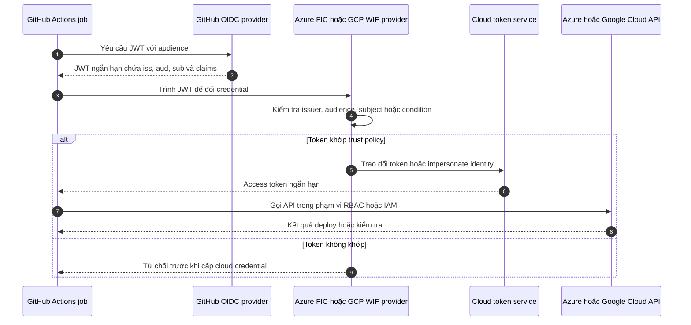

<Callout type="info" title="Kết quả sau bài này">
  Bạn sẽ tạo hai quan hệ tin cậy độc lập cho GitHub Environment `production`: một Microsoft Entra application dùng federated identity credential, và một Google Cloud Workload Identity Pool provider impersonate service account. Hai workflow hoàn chỉnh sẽ kiểm tra identity trước khi tùy chọn deploy lên Azure Container Apps hoặc Cloud Run.
</Callout>

## Mục lục

- [Tổng quan](#tổng-quan)
  - [Mô hình tin cậy](#mô-hình-tin-cậy)
  - [So sánh Azure và Google Cloud](#so-sánh-azure-và-google-cloud)
  - [Các claim và điều kiện quan trọng](#các-claim-và-điều-kiện-quan-trọng)
- [Chuẩn bị chung](#chuẩn-bị-chung)
  - [Chọn subject theo GitHub Environment](#chọn-subject-theo-github-environment)
  - [Chuẩn bị GitHub Environment](#chuẩn-bị-github-environment)
  - [Phiên bản action đã xác minh](#phiên-bản-action-đã-xác-minh)
- [Triển khai Azure OIDC](#triển-khai-azure-oidc)
  - [Thành phần Azure](#thành-phần-azure)
  - [Bước 1: Tạo Entra application và service principal](#bước-1-tạo-entra-application-và-service-principal)
  - [Bước 2: Tạo federated identity credential](#bước-2-tạo-federated-identity-credential)
  - [Bước 3: Gán quyền tối thiểu](#bước-3-gán-quyền-tối-thiểu)
  - [Bước 4: Lưu biến Azure trong GitHub](#bước-4-lưu-biến-azure-trong-github)
  - [Bước 5: Chạy workflow Azure độc lập](#bước-5-chạy-workflow-azure-độc-lập)
- [Triển khai Google Cloud Workload Identity Federation](#triển-khai-google-cloud-workload-identity-federation)
  - [Thành phần Google Cloud](#thành-phần-google-cloud)
  - [Bước 1: Bật API và tạo service account](#bước-1-bật-api-và-tạo-service-account)
  - [Bước 2: Tạo pool và OIDC provider](#bước-2-tạo-pool-và-oidc-provider)
  - [Bước 3: Cho principal GitHub impersonate service account](#bước-3-cho-principal-github-impersonate-service-account)
  - [Bước 4: Gán quyền deploy tối thiểu](#bước-4-gán-quyền-deploy-tối-thiểu)
  - [Bước 5: Lưu biến GCP trong GitHub](#bước-5-lưu-biến-gcp-trong-github)
  - [Bước 6: Chạy workflow GCP độc lập](#bước-6-chạy-workflow-gcp-độc-lập)
- [Bài thực hành](#bài-thực-hành)
  - [Mục tiêu và tiêu chí hoàn thành](#mục-tiêu-và-tiêu-chí-hoàn-thành)
  - [Lab Azure](#lab-azure)
  - [Lab Google Cloud](#lab-google-cloud)
  - [Thử nghiệm âm](#thử-nghiệm-âm)
- [Kiểm chứng và audit](#kiểm-chứng-và-audit)
  - [Kiểm chứng Azure](#kiểm-chứng-azure)
  - [Kiểm chứng Google Cloud](#kiểm-chứng-google-cloud)
- [Rollback workload và thu hồi trust](#rollback-workload-và-thu-hồi-trust)
  - [Rollback Azure Container Apps](#rollback-azure-container-apps)
  - [Rollback Cloud Run](#rollback-cloud-run)
  - [Thu hồi quyền federation](#thu-hồi-quyền-federation)
- [Best practices](#best-practices)
- [Troubleshooting](#troubleshooting)
  - [Lỗi GitHub OIDC](#lỗi-github-oidc)
  - [Lỗi Azure](#lỗi-azure)
  - [Lỗi Google Cloud](#lỗi-google-cloud)
- [Câu hỏi thường gặp](#câu-hỏi-thường-gặp)
- [Tài liệu tham khảo](#tài-liệu-tham-khảo)
- [Các bài liên quan](#các-bài-liên-quan)

## Tổng quan

OIDC, viết tắt của OpenID Connect, cho phép một job GitHub Actions nhận JSON Web Token ngắn hạn từ GitHub. Cloud kiểm tra token đó rồi cấp credential tạm thời. Repository không còn phải giữ client secret Azure hay service account key JSON của Google Cloud.

`id-token: write` chỉ cho phép job yêu cầu OIDC token từ GitHub. Quyền này **không** tự cấp quyền ghi lên cloud. Azure RBAC hoặc Google Cloud IAM vẫn quyết định job được đọc hay thay đổi tài nguyên nào.

<Callout type="error" title="Không quay lại khóa dài hạn">
  Không tạo `AZURE_CREDENTIALS` chứa client secret và không tải service account key JSON lên `GCP_CREDENTIALS`. Secret dài hạn có thể bị sao chép, khó xác định workflow nào đã dùng nó, và vẫn hợp lệ sau khi job kết thúc. Federation thay thế secret đó bằng token ngắn hạn gắn với repository và environment cụ thể.
</Callout>

### Mô hình tin cậy



Hai tầng phải cùng đúng:

1. **Identity trust:** cloud chỉ chấp nhận token có issuer, audience và identity claims mong đợi.
2. **Authorization:** identity đã đăng nhập chỉ có role cần cho tài nguyên đích.

Nới lỏng một trong hai tầng đều làm tăng blast radius. Ví dụ, trust chỉ kiểm tra organization nhưng service account có `roles/owner` vẫn là cấu hình nguy hiểm.

### So sánh Azure và Google Cloud

| Khía cạnh | Azure | Google Cloud |
|---|---|---|
| Đối tượng nhận trust | Microsoft Entra application hoặc user-assigned managed identity | Workload Identity Pool và OIDC provider |
| Cách biểu diễn GitHub identity | Federated identity credential khớp chính xác `issuer`, `subject`, `audiences` | Attribute mapping chuẩn hóa claims, attribute condition lọc token |
| Identity chạy deploy | Service principal của Entra application | External principal trực tiếp hoặc service account được impersonate |
| Action đăng nhập | `azure/login@v3` | `google-github-actions/auth@v3` |
| Audience mặc định | `api://AzureADTokenExchange` | Full resource name của Workload Identity Provider |
| Ràng buộc production | FIC có subject `repo:ORG/REPO:environment:production` | Provider condition kiểm tra repository ID, owner ID và environment |
| Cấp quyền | Azure RBAC role assignment tại resource scope | IAM role cho service account và `roles/iam.workloadIdentityUser` cho principal GitHub |
| Điểm cần tránh | Một FIC branch rộng hoặc role ở subscription scope | Provider không có condition, `principalSet` quá rộng, service account có basic role |

Azure FIC thiên về phép so khớp chính xác một subject. GCP WIF linh hoạt hơn vì có Common Expression Language, gọi tắt là CEL, để kết hợp nhiều claim. Đổi lại, GCP có nhiều lớp cấu hình hơn: pool, provider, mapping, condition, principal binding và service account impersonation.

### Các claim và điều kiện quan trọng

<TypeTable
  type={{
    issuer: {
      description: 'Nơi phát hành JWT. Với GitHub Actions là https://token.actions.githubusercontent.com.',
      type: 'string',
      required: true,
    },
    subject: {
      description: 'Identity của job. Khi job dùng environment production, dạng phổ biến là repo:ORG/REPO:environment:production.',
      type: 'string',
      required: true,
    },
    audience: {
      description: 'Dịch vụ dự kiến nhận token. Giá trị action yêu cầu phải khớp cấu hình cloud.',
      type: 'string',
      required: true,
    },
    attribute_mapping: {
      description: 'Quy tắc GCP chuyển GitHub claims thành google.subject hoặc attribute tùy chỉnh.',
      type: 'CEL mapping',
    },
    attribute_condition: {
      description: 'Biểu thức boolean của GCP quyết định token nào được phép đi qua provider.',
      type: 'CEL expression',
    },
  }}
/>

Ví dụ cụ thể cho job dùng environment `production`:

```text
iss = https://token.actions.githubusercontent.com
aud = api://AzureADTokenExchange                         # Azure
sub = repo:YOUR_GITHUB_ORG/YOUR_REPOSITORY:environment:production
```

Với GCP, `google-github-actions/auth` mặc định yêu cầu audience là full provider resource name. Không sao chép audience của Azure sang workflow GCP.

## Chuẩn bị chung

Bạn cần:

- quyền quản trị GitHub repository và quyền tạo GitHub Environment;
- Azure CLI đã đăng nhập bằng identity có quyền tạo Entra application, service principal, FIC và role assignment;
- Google Cloud CLI đã đăng nhập bằng identity có quyền quản lý Workload Identity Pool, service account và IAM;
- một Azure Container App có sẵn nếu muốn chạy nhánh deploy Azure;
- một Google Cloud project bật billing nếu muốn deploy Cloud Run;
- GitHub organization ID và repository ID bất biến cho condition GCP.

Lấy GitHub numeric IDs bằng GitHub CLI:

```bash
export GITHUB_ORG="YOUR_GITHUB_ORG"
export GITHUB_REPO="YOUR_REPOSITORY"

export GITHUB_OWNER_ID="$(gh api "orgs/${GITHUB_ORG}" --jq '.id')"
export GITHUB_REPOSITORY_ID="$(gh api "repos/${GITHUB_ORG}/${GITHUB_REPO}" --jq '.id')"

printf 'owner_id=%s\nrepository_id=%s\n' \
  "$GITHUB_OWNER_ID" "$GITHUB_REPOSITORY_ID"
```

Nếu owner là tài khoản cá nhân, thay endpoint `orgs/...` bằng `users/...`.

### Chọn subject theo GitHub Environment

Khi job có:

```yaml
jobs:
  deploy:
    environment: production
```

subject mặc định thường là:

```text
repo:YOUR_GITHUB_ORG/YOUR_REPOSITORY:environment:production
```

Environment làm thay đổi subject. Vì vậy FIC chỉ tin branch `main` sẽ không khớp với job đã khai báo environment. Với deployment production, đây là đặc tính mong muốn: trust gắn với environment, còn deployment protection rules kiểm soát branch và reviewer.

<Callout type="warn" title="Kiểm tra định dạng subject thực tế">
  GitHub hỗ trợ immutable subject chứa owner ID và repository ID. Repository mới hoặc repository đã opt in có thể không dùng định dạng chỉ chứa tên. Hãy xem cấu hình OIDC của organization/repository và dùng đúng subject thực tế, ví dụ `repo:ORG@OWNER_ID/REPO@REPO_ID:environment:production`. Không đoán subject khi xử lý lỗi federation.
</Callout>

### Chuẩn bị GitHub Environment

<Steps>
<Step>

Tạo environment tên chính xác là `production` tại **Settings → Environments → New environment**.

</Step>
<Step>

Thêm **Required reviewers** và tắt khả năng reviewer tự phê duyệt nếu chính sách tổ chức yêu cầu phân tách nhiệm vụ.

</Step>
<Step>

Giới hạn **Deployment branches and tags**. Ví dụ, chỉ cho phép protected branch `main` hoặc release tags phù hợp.

</Step>
<Step>

Lưu các ID không nhạy cảm dưới dạng environment variables. Không cần biến client ID, tenant ID, project ID hay provider name thành credential dài hạn.

</Step>
</Steps>

<Tabs items={['Azure variables', 'GCP variables']}>
  <Tab value="Azure variables">

| Variable | Giá trị minh họa cần thay |
|---|---|
| `AZURE_CLIENT_ID` | `00000000-0000-0000-0000-000000000000` |
| `AZURE_TENANT_ID` | `11111111-1111-1111-1111-111111111111` |
| `AZURE_SUBSCRIPTION_ID` | `22222222-2222-2222-2222-222222222222` |
| `AZURE_RESOURCE_GROUP` | `YOUR_AZURE_RESOURCE_GROUP` |
| `AZURE_CONTAINER_APP` | `YOUR_CONTAINER_APP` |

  </Tab>
  <Tab value="GCP variables">

| Variable | Giá trị minh họa cần thay |
|---|---|
| `GCP_PROJECT_ID` | `YOUR_GCP_PROJECT_ID` |
| `GCP_WIF_PROVIDER` | `projects/123456789012/locations/global/workloadIdentityPools/github-prod/providers/github` |
| `GCP_SERVICE_ACCOUNT` | `github-deployer@YOUR_GCP_PROJECT_ID.iam.gserviceaccount.com` |
| `GCP_REGION` | `asia-southeast1` |
| `GCP_CLOUD_RUN_SERVICE` | `YOUR_CLOUD_RUN_SERVICE` |
| `GCP_RUNTIME_SERVICE_ACCOUNT` | `cloud-run-runtime@YOUR_GCP_PROJECT_ID.iam.gserviceaccount.com` |

  </Tab>
</Tabs>

### Phiên bản action đã xác minh

Các ví dụ dùng major version hiện hành đã kiểm tra từ release chính thức:

| Action | Version dùng trong guide | Release được kiểm tra |
|---|---|---|
| Azure Login | `azure/login@v3` | `v3.0.0`, phát hành ngày 17-03-2026 |
| Google Cloud Auth | `google-github-actions/auth@v3` | floating major `v3`, phát hành ngày 03-09-2025 |
| Google Cloud SDK setup | `google-github-actions/setup-gcloud@v3` | `v3.0.1`, phát hành ngày 28-08-2025 |
| Checkout | `actions/checkout@v7` | `v7.0.1`, phát hành ngày 20-07-2026 |

Major tag giúp ví dụ dễ đọc nhưng có thể di chuyển. Production nên pin action bên thứ ba bằng full commit SHA, bật Dependabot hoặc Renovate để nhận cập nhật có review, và kiểm tra release notes trước khi nâng major.

## Triển khai Azure OIDC

### Thành phần Azure

Luồng Azure có bốn đối tượng riêng:

1. **Entra application:** định nghĩa application identity.
2. **Service principal:** instance của application trong tenant, nhận Azure RBAC role.
3. **Federated identity credential:** quan hệ trust giữa GitHub OIDC token và application.
4. **`azure/login`:** yêu cầu GitHub token với audience phù hợp rồi đăng nhập Azure CLI bằng service principal.

FIC không phải client secret. Nó chỉ là cấu hình cho Entra biết token nào được phép đổi thành Azure access token.

### Bước 1: Tạo Entra application và service principal

Đăng nhập Azure CLI bằng tài khoản bootstrap có đủ quyền, sau đó thay toàn bộ giá trị `YOUR_*`:

```bash
set -euo pipefail

export AZURE_APP_NAME="github-YOUR_REPOSITORY-production"
export AZURE_SUBSCRIPTION_ID="YOUR_AZURE_SUBSCRIPTION_ID"
export AZURE_RESOURCE_GROUP="YOUR_AZURE_RESOURCE_GROUP"
export AZURE_CONTAINER_APP="YOUR_CONTAINER_APP"
export GITHUB_ORG="YOUR_GITHUB_ORG"
export GITHUB_REPO="YOUR_REPOSITORY"
export GITHUB_ENVIRONMENT="production"

az account set --subscription "$AZURE_SUBSCRIPTION_ID"

export AZURE_CLIENT_ID="$(
  az ad app create \
    --display-name "$AZURE_APP_NAME" \
    --query appId \
    --output tsv
)"

az ad sp create --id "$AZURE_CLIENT_ID" --output none

export AZURE_SP_OBJECT_ID="$(
  az ad sp show --id "$AZURE_CLIENT_ID" --query id --output tsv
)"
export AZURE_TENANT_ID="$(az account show --query tenantId --output tsv)"

printf 'AZURE_CLIENT_ID=%s\nAZURE_TENANT_ID=%s\n' \
  "$AZURE_CLIENT_ID" "$AZURE_TENANT_ID"
```

`AZURE_CLIENT_ID` là application/client ID dùng cho `azure/login`. `AZURE_SP_OBJECT_ID` là object ID của service principal, phù hợp cho role assignment. Không hoán đổi hai giá trị này.

### Bước 2: Tạo federated identity credential

Tạo một FIC riêng cho environment production:

```bash
export AZURE_FEDERATED_SUBJECT="repo:${GITHUB_ORG}/${GITHUB_REPO}:environment:${GITHUB_ENVIRONMENT}"

cat > azure-federated-credential.json <<JSON
{
  "name": "github-production",
  "issuer": "https://token.actions.githubusercontent.com/",
  "subject": "${AZURE_FEDERATED_SUBJECT}",
  "description": "GitHub Actions production environment",
  "audiences": [
    "api://AzureADTokenExchange"
  ]
}
JSON

az ad app federated-credential create \
  --id "$AZURE_CLIENT_ID" \
  --parameters azure-federated-credential.json \
  --output none

az ad app federated-credential list \
  --id "$AZURE_CLIENT_ID" \
  --query '[].{name:name,issuer:issuer,subject:subject,audiences:audiences}' \
  --output table

rm azure-federated-credential.json
```

Ba giá trị phải khớp token mà `azure/login` yêu cầu:

- `issuer`: issuer GitHub Actions theo cấu hình Microsoft;
- `subject`: environment production của đúng repository;
- `audiences`: mặc định `api://AzureADTokenExchange` của `azure/login` trên Azure public cloud.

Azure FIC không hỗ trợ wildcard subject theo cách một số IAM policy khác hỗ trợ. Nếu staging và production cần cùng application, tạo hai FIC riêng. An toàn hơn nữa là dùng application riêng cho từng environment.

### Bước 3: Gán quyền tối thiểu

Ví dụ này chỉ cấp `Contributor` trên **một Container App đã tồn tại**, không cấp ở subscription hoặc resource group:

```bash
export AZURE_CONTAINER_APP_SCOPE="$(
  az containerapp show \
    --resource-group "$AZURE_RESOURCE_GROUP" \
    --name "$AZURE_CONTAINER_APP" \
    --query id \
    --output tsv
)"

az role assignment create \
  --assignee-object-id "$AZURE_SP_OBJECT_ID" \
  --assignee-principal-type ServicePrincipal \
  --role "Contributor" \
  --scope "$AZURE_CONTAINER_APP_SCOPE" \
  --output none

az role assignment list \
  --assignee-object-id "$AZURE_SP_OBJECT_ID" \
  --scope "$AZURE_CONTAINER_APP_SCOPE" \
  --query '[].{role:roleDefinitionName,scope:scope}' \
  --output table
```

`Contributor` vẫn rộng trong phạm vi Container App. Production nên thay bằng custom role chỉ có các `Microsoft.App/containerApps/*` actions thực sự cần cho cơ chế deploy của bạn. Nếu lab chỉ kiểm tra identity, cấp `Reader` ở scope tài nguyên là đủ.

<Callout type="warn" title="Phân biệt trust và RBAC">
  FIC trả lời “job nào được đăng nhập”. Role assignment trả lời “job đã đăng nhập được làm gì”. Login thành công nhưng `az containerapp update` trả `AuthorizationFailed` là lỗi RBAC, không phải lỗi OIDC.
</Callout>

### Bước 4: Lưu biến Azure trong GitHub

Lưu năm biến ở GitHub Environment `production`:

```text
AZURE_CLIENT_ID
AZURE_TENANT_ID
AZURE_SUBSCRIPTION_ID
AZURE_RESOURCE_GROUP
AZURE_CONTAINER_APP
```

Các ID trên không phải password. Tuy vậy, environment variables vẫn tốt hơn hard-code vì chúng tách cấu hình production khỏi workflow và chỉ xuất hiện sau khi environment protection rules được thỏa mãn.

### Bước 5: Chạy workflow Azure độc lập

Tạo `.github/workflows/deploy-azure-oidc.yml`. Workflow mặc định chỉ kiểm tra identity. Chọn `deploy` khi dispatch để cập nhật image của Container App.

```yaml
name: Deploy Azure with OIDC

on:
  workflow_dispatch:
    inputs:
      operation:
        description: Chỉ kiểm tra identity hoặc deploy
        required: true
        type: choice
        default: test
        options:
          - test
          - deploy
      image:
        description: Full container image dùng khi operation=deploy
        required: true
        default: mcr.microsoft.com/k8se/quickstart:latest

permissions:
  contents: read

jobs:
  deploy:
    name: Azure production
    runs-on: ubuntu-latest
    environment: production
    permissions:
      contents: read
      id-token: write
    env:
      AZURE_CORE_OUTPUT: none
    steps:
      - name: Login Azure bằng GitHub OIDC
        uses: azure/login@v3
        with:
          client-id: ${{ vars.AZURE_CLIENT_ID }}
          tenant-id: ${{ vars.AZURE_TENANT_ID }}
          subscription-id: ${{ vars.AZURE_SUBSCRIPTION_ID }}
          audience: api://AzureADTokenExchange

      - name: Kiểm tra identity và subscription
        shell: bash
        run: |
          set -euo pipefail
          actual_subscription="$(az account show --query id --output tsv)"
          test "$actual_subscription" = "${{ vars.AZURE_SUBSCRIPTION_ID }}"
          az account show \
            --query '{subscription:id,tenant:tenantId,user:user.name}' \
            --output json

      - name: Deploy Azure Container App
        if: ${{ inputs.operation == 'deploy' }}
        shell: bash
        run: |
          set -euo pipefail
          az containerapp update \
            --resource-group "${{ vars.AZURE_RESOURCE_GROUP }}" \
            --name "${{ vars.AZURE_CONTAINER_APP }}" \
            --image "${{ inputs.image }}" \
            --output none

      - name: Kiểm chứng revision
        if: ${{ inputs.operation == 'deploy' }}
        shell: bash
        run: |
          set -euo pipefail
          az containerapp revision list \
            --resource-group "${{ vars.AZURE_RESOURCE_GROUP }}" \
            --name "${{ vars.AZURE_CONTAINER_APP }}" \
            --query '[].{revision:name,active:properties.active,created:properties.createdTime}' \
            --output table
```

`AZURE_CORE_OUTPUT=none` giảm nguy cơ ghi dữ liệu lệnh Azure CLI ra log. Các lệnh cần làm bằng chứng kiểm chứng đặt `--output` rõ ràng để ghi đúng trường cần thiết.

## Triển khai Google Cloud Workload Identity Federation

### Thành phần Google Cloud

Guide này dùng WIF thông qua service account impersonation:

1. **Workload Identity Pool:** namespace quản lý external identities.
2. **OIDC provider:** tin GitHub issuer, map claims và áp dụng condition.
3. **External principal set:** tập GitHub identities được chọn qua mapped attribute.
4. **Deployer service account:** identity Google Cloud mà workflow impersonate.
5. **`google-github-actions/auth`:** đổi GitHub OIDC token qua Security Token Service rồi tạo credential ngắn hạn cho service account.

Google Cloud cũng hỗ trợ direct WIF, tức cấp IAM trực tiếp cho external principal. Impersonation được dùng ở đây vì nhiều deployment API và công cụ tương thích tốt với service account, đồng thời audit log hiển thị service account triển khai.

### Bước 1: Bật API và tạo service account

```bash
set -euo pipefail

export GCP_PROJECT_ID="YOUR_GCP_PROJECT_ID"
export GCP_REGION="asia-southeast1"
export GCP_DEPLOYER_SA_ID="github-deployer"
export GCP_RUNTIME_SA_ID="cloud-run-runtime"
export GCP_CLOUD_RUN_SERVICE="YOUR_CLOUD_RUN_SERVICE"

gcloud config set project "$GCP_PROJECT_ID"

gcloud services enable \
  iam.googleapis.com \
  cloudresourcemanager.googleapis.com \
  iamcredentials.googleapis.com \
  sts.googleapis.com \
  run.googleapis.com

gcloud iam service-accounts create "$GCP_DEPLOYER_SA_ID" \
  --display-name="GitHub Actions production deployer"

gcloud iam service-accounts create "$GCP_RUNTIME_SA_ID" \
  --display-name="Cloud Run runtime identity"

export GCP_DEPLOYER_SA="${GCP_DEPLOYER_SA_ID}@${GCP_PROJECT_ID}.iam.gserviceaccount.com"
export GCP_RUNTIME_SA="${GCP_RUNTIME_SA_ID}@${GCP_PROJECT_ID}.iam.gserviceaccount.com"
export GCP_PROJECT_NUMBER="$(
  gcloud projects describe "$GCP_PROJECT_ID" --format='value(projectNumber)'
)"
```

Deployer service account chỉ dành cho pipeline. Runtime service account chỉ dành cho container khi chạy. Không dùng một service account cho cả deploy và runtime vì hai vai trò cần permissions khác nhau.

### Bước 2: Tạo pool và OIDC provider

Dùng numeric owner/repository IDs để condition không phụ thuộc vào tên có thể đổi hoặc namespace có thể được tái sử dụng:

```bash
export GCP_WIF_POOL_ID="github-prod"
export GCP_WIF_PROVIDER_ID="github"
export GITHUB_OWNER_ID="YOUR_NUMERIC_GITHUB_OWNER_ID"
export GITHUB_REPOSITORY_ID="YOUR_NUMERIC_GITHUB_REPOSITORY_ID"

gcloud iam workload-identity-pools create "$GCP_WIF_POOL_ID" \
  --location="global" \
  --display-name="GitHub production" \
  --description="GitHub Actions identities for production"

gcloud iam workload-identity-pools providers create-oidc "$GCP_WIF_PROVIDER_ID" \
  --location="global" \
  --workload-identity-pool="$GCP_WIF_POOL_ID" \
  --display-name="GitHub Actions" \
  --issuer-uri="https://token.actions.githubusercontent.com/" \
  --attribute-mapping="google.subject=assertion.sub,attribute.repository_id=assertion.repository_id,attribute.repository_owner_id=assertion.repository_owner_id,attribute.environment=assertion.environment,attribute.ref=assertion.ref" \
  --attribute-condition="assertion.repository_owner_id == '${GITHUB_OWNER_ID}' && assertion.repository_id == '${GITHUB_REPOSITORY_ID}' && assertion.environment == 'production'"

export GCP_WIF_PROVIDER="projects/${GCP_PROJECT_NUMBER}/locations/global/workloadIdentityPools/${GCP_WIF_POOL_ID}/providers/${GCP_WIF_PROVIDER_ID}"
printf 'GCP_WIF_PROVIDER=%s\n' "$GCP_WIF_PROVIDER"
```

Mapping và condition có nhiệm vụ khác nhau:

- `google.subject=assertion.sub` tạo identity chuẩn xuất hiện trong log và có thể dùng trong `principal://` binding.
- `attribute.repository_id=assertion.repository_id` tạo thuộc tính dùng cho `principalSet://` binding.
- `attribute.environment=assertion.environment` chuẩn hóa environment để có thể dùng trong IAM sau này.
- `attribute-condition` là cửa vào provider. Token sai owner ID, repository ID hoặc environment bị từ chối trước khi impersonate service account.

Không đặt `--allowed-audiences` trong ví dụ. Khi danh sách này trống, GCP yêu cầu audience là canonical provider resource name. `google-github-actions/auth` tự dùng chính giá trị `workload_identity_provider` làm audience mặc định.

<Callout type="idea" title="Tách pool theo environment">
  Google khuyến nghị có pool riêng cho các môi trường như development, staging và production. Pool `github-prod` trong ví dụ làm blast radius rõ hơn và cho phép vô hiệu hóa toàn bộ trust production bằng một thao tác.
</Callout>

### Bước 3: Cho principal GitHub impersonate service account

Cấp `roles/iam.workloadIdentityUser` cho đúng repository ID trong pool production:

```bash
export GCP_GITHUB_PRINCIPAL_SET="principalSet://iam.googleapis.com/projects/${GCP_PROJECT_NUMBER}/locations/global/workloadIdentityPools/${GCP_WIF_POOL_ID}/attribute.repository_id/${GITHUB_REPOSITORY_ID}"

gcloud iam service-accounts add-iam-policy-binding "$GCP_DEPLOYER_SA" \
  --role="roles/iam.workloadIdentityUser" \
  --member="$GCP_GITHUB_PRINCIPAL_SET"
```

Binding chọn repository bằng numeric ID. Provider condition tiếp tục yêu cầu environment `production`. Hai lớp này ngăn một repository khác trong cùng organization impersonate deployer service account.

### Bước 4: Gán quyền deploy tối thiểu

Cloud Run deployer cần quyền tạo revision và quyền act as runtime service account:

```bash
gcloud projects add-iam-policy-binding "$GCP_PROJECT_ID" \
  --member="serviceAccount:${GCP_DEPLOYER_SA}" \
  --role="roles/run.developer"

gcloud iam service-accounts add-iam-policy-binding "$GCP_RUNTIME_SA" \
  --member="serviceAccount:${GCP_DEPLOYER_SA}" \
  --role="roles/iam.serviceAccountUser"
```

`roles/run.developer` là project-level role trong ví dụ lab. Với production, cân nhắc custom role chỉ chứa permissions cần cho quy trình deploy và tách project theo ứng dụng hoặc môi trường. Không cấp `roles/editor` hay `roles/owner` để “chữa” lỗi permission.

Nếu image nằm trong private Artifact Registry, cấp thêm `roles/artifactregistry.reader` cho **runtime service agent hoặc runtime identity phù hợp với kiến trúc registry**. Không cấp quyền ghi registry cho deployer nếu workflow chỉ deploy image đã được pipeline khác publish.

### Bước 5: Lưu biến GCP trong GitHub

Lưu các environment variables sau:

```text
GCP_PROJECT_ID
GCP_WIF_PROVIDER
GCP_SERVICE_ACCOUNT
GCP_REGION
GCP_CLOUD_RUN_SERVICE
GCP_RUNTIME_SERVICE_ACCOUNT
```

`GCP_WIF_PROVIDER` phải là full provider resource name bắt đầu bằng `projects/PROJECT_NUMBER/...`; dùng **project number**, không dùng project ID ở đoạn đầu.

### Bước 6: Chạy workflow GCP độc lập

Tạo `.github/workflows/deploy-gcp-oidc.yml`:

```yaml
name: Deploy GCP with Workload Identity Federation

on:
  workflow_dispatch:
    inputs:
      operation:
        description: Chỉ kiểm tra identity hoặc deploy
        required: true
        type: choice
        default: test
        options:
          - test
          - deploy
      image:
        description: Full container image dùng khi operation=deploy
        required: true
        default: us-docker.pkg.dev/cloudrun/container/hello:latest

permissions:
  contents: read

jobs:
  deploy:
    name: GCP production
    runs-on: ubuntu-latest
    environment: production
    permissions:
      contents: read
      id-token: write
    steps:
      - name: Checkout trước auth
        uses: actions/checkout@v7

      - name: Authenticate to Google Cloud
        id: auth
        uses: google-github-actions/auth@v3
        with:
          project_id: ${{ vars.GCP_PROJECT_ID }}
          workload_identity_provider: ${{ vars.GCP_WIF_PROVIDER }}
          service_account: ${{ vars.GCP_SERVICE_ACCOUNT }}
          create_credentials_file: true
          export_environment_variables: true

      - name: Cài Google Cloud CLI
        uses: google-github-actions/setup-gcloud@v3

      - name: Kiểm tra identity và project
        shell: bash
        run: |
          set -euo pipefail
          actual_project="$(gcloud config get-value project 2>/dev/null)"
          test "$actual_project" = "${{ vars.GCP_PROJECT_ID }}"
          gcloud auth list \
            --filter=status:ACTIVE \
            --format='table(account,status)'
          gcloud projects describe "${{ vars.GCP_PROJECT_ID }}" \
            --format='value(projectId)'

      - name: Deploy Cloud Run
        if: ${{ inputs.operation == 'deploy' }}
        shell: bash
        run: |
          set -euo pipefail
          gcloud run deploy "${{ vars.GCP_CLOUD_RUN_SERVICE }}" \
            --project="${{ vars.GCP_PROJECT_ID }}" \
            --region="${{ vars.GCP_REGION }}" \
            --platform=managed \
            --service-account="${{ vars.GCP_RUNTIME_SERVICE_ACCOUNT }}" \
            --image="${{ inputs.image }}" \
            --quiet

      - name: Kiểm chứng revision
        if: ${{ inputs.operation == 'deploy' }}
        shell: bash
        run: |
          set -euo pipefail
          gcloud run services describe "${{ vars.GCP_CLOUD_RUN_SERVICE }}" \
            --project="${{ vars.GCP_PROJECT_ID }}" \
            --region="${{ vars.GCP_REGION }}" \
            --format='yaml(metadata.name,status.latestCreatedRevisionName,status.latestReadyRevisionName,status.url)'
```

`checkout` chạy trước `auth` để credential file do action tạo nằm trong workspace ổn định và có thể được dọn bằng post action. Thêm mẫu `gha-creds-*.json` vào `.gitignore` và `.dockerignore` nếu workflow build artifact hoặc container sau bước auth.

## Bài thực hành

### Mục tiêu và tiêu chí hoàn thành

Hoàn thành lab khi có đủ bằng chứng sau:

- [ ] Repository không chứa Azure client secret hoặc GCP service account key.
- [ ] Cả hai job khai báo `environment: production` và chỉ job deploy có `id-token: write`.
- [ ] Chạy `operation=test` đăng nhập đúng subscription/project nhưng không đổi workload.
- [ ] Chạy `operation=deploy` tạo revision mới và revision sẵn sàng trùng revision mới nhất.
- [ ] Chạy từ identity không đúng environment hoặc repository bị từ chối.
- [ ] Azure role chỉ gán tại target resource; GCP deployer không có Owner/Editor.
- [ ] Production environment yêu cầu reviewer và giới hạn branch/tag.

### Lab Azure

<Steps>
<Step>

Chạy các lệnh tạo Entra application, service principal và FIC. Giữ lại `AZURE_CLIENT_ID`, `AZURE_TENANT_ID` và `AZURE_SUBSCRIPTION_ID`.

</Step>
<Step>

Gán `Reader` trên target Container App trước. Dispatch workflow với `operation=test` để chứng minh OIDC login hoạt động độc lập với quyền deploy.

</Step>
<Step>

Đổi sang role có đúng write actions tại scope Container App. Dispatch `operation=deploy` với một image bất biến theo digest nếu có.

</Step>
<Step>

Lưu tên revision mới nhất và URL/FQDN của app làm bằng chứng. Kiểm tra health endpoint theo runbook của ứng dụng.

</Step>
</Steps>

### Lab Google Cloud

<Steps>
<Step>

Tạo pool, provider và hai service accounts. Chờ tối đa khoảng năm phút để WIF và IAM propagation hoàn tất.

</Step>
<Step>

Cấp `roles/iam.workloadIdentityUser` cho principal set của repository ID. Chưa cấp Cloud Run role, sau đó chạy `operation=test`.

</Step>
<Step>

Cấp `roles/run.developer` cho deployer và `roles/iam.serviceAccountUser` trên runtime service account. Chạy `operation=deploy`.

</Step>
<Step>

So sánh `latestCreatedRevisionName` và `latestReadyRevisionName`. Hai giá trị bằng nhau cho biết revision mới đã ready, nhưng vẫn cần smoke test endpoint của ứng dụng.

</Step>
</Steps>

### Thử nghiệm âm

Negative test chứng minh trust policy thực sự chặn sai identity:

1. Tạo tạm environment `staging` và đổi job sang `environment: staging` nhưng giữ nguyên trust production. Login phải thất bại.
2. Bỏ `id-token: write`. Login action phải báo không thể lấy GitHub OIDC token.
3. Với Azure, đổi `audience` workflow thành `api://WRONG_AUDIENCE`. Entra phải từ chối.
4. Với GCP, đổi `GCP_WIF_PROVIDER` sang provider ID không tồn tại hoặc condition không khớp. STS phải từ chối.
5. Khôi phục cấu hình ngay sau test và lưu link workflow run vào bằng chứng kiểm soát.

<Callout type="warn" title="Không test bằng pull request không tin cậy">
  Không cho code từ fork hoặc pull request chưa review chạy job gắn production environment. Negative test nên thực hiện trên branch quản trị riêng, với thay đổi có review và không chạy lệnh deploy.
</Callout>

## Kiểm chứng và audit

### Kiểm chứng Azure

Kiểm tra cấu hình control plane:

```bash
az ad app federated-credential list \
  --id "$AZURE_CLIENT_ID" \
  --query '[].{name:name,issuer:issuer,subject:subject,audiences:audiences}' \
  --output json

az role assignment list \
  --assignee-object-id "$AZURE_SP_OBJECT_ID" \
  --all \
  --query '[].{role:roleDefinitionName,scope:scope}' \
  --output table
```

Kiểm tra deployment:

```bash
az containerapp show \
  --resource-group "$AZURE_RESOURCE_GROUP" \
  --name "$AZURE_CONTAINER_APP" \
  --query '{latestRevision:properties.latestRevisionName,fqdn:properties.configuration.ingress.fqdn}' \
  --output json
```

Trong Azure Activity Log, lọc theo service principal object ID, resource ID của Container App và thời gian workflow run. Ghép `github.run_id` vào annotation hoặc deployment metadata của ứng dụng nếu quy trình deploy hỗ trợ để truy vết nhanh hơn.

### Kiểm chứng Google Cloud

Kiểm tra provider:

```bash
gcloud iam workload-identity-pools providers describe "$GCP_WIF_PROVIDER_ID" \
  --location="global" \
  --workload-identity-pool="$GCP_WIF_POOL_ID" \
  --format='yaml(name,state,oidc.issuerUri,attributeMapping,attributeCondition)'

gcloud iam service-accounts get-iam-policy "$GCP_DEPLOYER_SA" \
  --format=json
```

Kiểm tra Cloud Run và Audit Logs:

```bash
gcloud run services describe "$GCP_CLOUD_RUN_SERVICE" \
  --region="$GCP_REGION" \
  --format='yaml(status.latestCreatedRevisionName,status.latestReadyRevisionName,status.url)'

gcloud logging read \
  'protoPayload.authenticationInfo.principalEmail="'"$GCP_DEPLOYER_SA"'"' \
  --freshness=1h \
  --limit=20 \
  --format='table(timestamp,protoPayload.methodName,resource.type)'
```

Không in JWT hoặc access token vào log để “kiểm chứng”. Bằng chứng đúng là identity, audience/subject cấu hình, IAM scope, API method và revision kết quả.

## Rollback workload và thu hồi trust

Rollback workload khôi phục phiên bản ứng dụng. Thu hồi trust chặn lần đăng nhập tiếp theo. Đây là hai thao tác khác nhau và có thể cần thực hiện đồng thời khi có sự cố bảo mật.

### Rollback Azure Container Apps

Liệt kê revisions rồi chuyển traffic về revision tốt trước đó. Lệnh phù hợp phụ thuộc chế độ single hoặc multiple revision của app:

```bash
az containerapp revision list \
  --resource-group "$AZURE_RESOURCE_GROUP" \
  --name "$AZURE_CONTAINER_APP" \
  --output table

export AZURE_GOOD_REVISION="YOUR_GOOD_REVISION"
az containerapp ingress traffic set \
  --resource-group "$AZURE_RESOURCE_GROUP" \
  --name "$AZURE_CONTAINER_APP" \
  --revision-weight "${AZURE_GOOD_REVISION}=100"
```

Nếu app dùng single revision mode, redeploy image digest đã biết tốt. Không rollback bằng mutable tag `latest` vì tag có thể đã trỏ sang image khác.

### Rollback Cloud Run

Liệt kê revisions rồi chuyển toàn bộ traffic về revision tốt:

```bash
gcloud run revisions list \
  --service="$GCP_CLOUD_RUN_SERVICE" \
  --region="$GCP_REGION"

gcloud run services update-traffic "$GCP_CLOUD_RUN_SERVICE" \
  --region="$GCP_REGION" \
  --to-revisions="YOUR_GOOD_REVISION=100"
```

Sau rollback, smoke test URL và xác nhận traffic allocation. Revision lỗi vẫn tồn tại để điều tra cho đến khi retention policy xóa nó.

### Thu hồi quyền federation

Azure: xóa FIC để chặn token exchange, rồi xóa role assignment nếu identity không còn dùng:

```bash
az ad app federated-credential delete \
  --id "$AZURE_CLIENT_ID" \
  --federated-credential-id "github-production"

az role assignment delete \
  --assignee-object-id "$AZURE_SP_OBJECT_ID" \
  --scope "$AZURE_CONTAINER_APP_SCOPE"
```

GCP: disable provider để chặn token exchange mới, rồi xóa impersonation binding:

```bash
gcloud iam workload-identity-pools providers update-oidc "$GCP_WIF_PROVIDER_ID" \
  --location="global" \
  --workload-identity-pool="$GCP_WIF_POOL_ID" \
  --disabled

gcloud iam service-accounts remove-iam-policy-binding "$GCP_DEPLOYER_SA" \
  --role="roles/iam.workloadIdentityUser" \
  --member="$GCP_GITHUB_PRINCIPAL_SET"
```

Token đã cấp có thể còn hiệu lực đến khi hết hạn. Trong incident, đồng thời dừng workflow, vô hiệu hóa environment và kiểm tra audit log trong cửa sổ token lifetime.

## Best practices

- **Đặt `id-token: write` ở job cần login:** không cấp ở workflow level nếu build/test jobs không dùng OIDC.
- **Luôn giữ `contents: read`:** khai báo `permissions` làm thay đổi quyền mặc định của `GITHUB_TOKEN`; chỉ thêm quyền thực sự cần.
- **Trust production theo environment:** subject/condition phải khớp `production`, còn environment dùng reviewer và branch/tag protection.
- **Ưu tiên numeric claims trên GCP:** `repository_id` và `repository_owner_id` bền hơn tên repository/organization.
- **Dùng identity riêng theo cloud và environment:** không dùng một service principal hoặc service account cho dev, staging và production.
- **Scope authorization nhỏ nhất:** Azure role ở resource scope; GCP role theo project môi trường hoặc resource khi dịch vụ hỗ trợ.
- **Tách deployer và runtime identity:** pipeline không cần quyền dữ liệu mà ứng dụng runtime sử dụng, và ngược lại.
- **Không log token:** không in `ACTIONS_ID_TOKEN_REQUEST_TOKEN`, JWT, generated credential file hoặc access token.
- **Pin action bằng commit SHA:** major tag trong guide dành cho khả năng đọc; production cần supply-chain policy và bot cập nhật.
- **Deploy image theo digest:** digest làm rollback và audit tái tạo được; mutable tag như `latest` không đủ làm bằng chứng release.
- **Gắn run metadata:** ghi `github.run_id`, `github.sha` và image digest vào annotation/label nếu nền tảng deploy hỗ trợ.
- **Audit định kỳ:** tìm FIC, providers, role assignments và service accounts không còn workflow owner; thu hồi theo change ticket.
- **Không chạy production deploy từ untrusted PR:** đặc biệt cẩn thận với fork, self-hosted runner và workflow dùng `pull_request_target`.

## Troubleshooting

### Lỗi GitHub OIDC

| Triệu chứng | Nguyên nhân thường gặp | Cách xử lý |
|---|---|---|
| `Unable to get ACTIONS_ID_TOKEN_REQUEST_URL env variable` | Job thiếu `id-token: write` | Đặt `permissions.id-token: write` trong đúng job gọi login action; re-run job mới |
| Có `id-token: write` nhưng login không chạy | Step bị condition skip hoặc environment chưa được approve | Kiểm tra job graph, environment review và `if` expression |
| `contents` hoặc checkout bị từ chối sau khi thêm permissions | Khai báo `permissions` đã thay default của `GITHUB_TOKEN` | Thêm `contents: read` rõ ràng |
| Subject không giống branch dự kiến | Job dùng `environment`, nên subject chuyển sang dạng environment | Cập nhật trust theo subject environment hoặc bỏ environment nếu thật sự không cần |
| Workflow từ fork không nhận secret/approval | GitHub cố ý hạn chế untrusted context | Không bypass; thiết kế deployment chỉ chạy từ protected branch sau review |

### Lỗi Azure

| Triệu chứng | Nguyên nhân thường gặp | Cách xử lý |
|---|---|---|
| `AADSTS70021` hoặc “No matching federated identity record found” | Sai issuer, subject hoặc audience | So sánh FIC với claim thực tế; kiểm tra environment và immutable subject |
| `AADSTS700213` và assertion subject không khớp | FIC tin branch nhưng job dùng environment, hoặc sai hoa/thường | Tạo FIC exact cho `repo:...:environment:production` |
| Audience mismatch | Workflow override audience khác `api://AzureADTokenExchange` | Dùng cùng audience trong FIC và `azure/login`; sovereign cloud cần giá trị riêng |
| Login thành công nhưng `AuthorizationFailed` | Service principal thiếu RBAC role hoặc scope quá hẹp/sai tài nguyên | Kiểm tra role assignment bằng service principal object ID; không tăng lên Owner |
| `No subscriptions found` | Sai tenant/subscription hoặc principal chưa có quyền trong subscription | Kiểm tra ba IDs và role assignment; chỉ dùng `allow-no-subscriptions` cho use case tenant-only |
| CLI ghi quá nhiều dữ liệu vào log | Azure CLI mặc định in stdout | Đặt `AZURE_CORE_OUTPUT=none`, chỉ override `--output` cho trường cần audit |

### Lỗi Google Cloud

| Triệu chứng | Nguyên nhân thường gặp | Cách xử lý |
|---|---|---|
| `invalid_target`, `invalid_grant` hoặc audience không hợp lệ | `workload_identity_provider` sai full resource name hoặc custom audience không được provider cho phép | Dùng `projects/PROJECT_NUMBER/.../providers/PROVIDER_ID`; bỏ custom audience để dùng mặc định |
| Token bị provider từ chối | Attribute condition false | Kiểm tra numeric IDs, `assertion.environment`, `assertion.ref` và job `environment` |
| `iam.serviceAccounts.getAccessToken` bị từ chối | Principal thiếu `roles/iam.workloadIdentityUser` trên deployer SA | Kiểm tra principalSet dùng project number, pool ID, mapped attribute và repository ID |
| `iam.serviceAccounts.actAs` bị từ chối khi deploy Cloud Run | Deployer thiếu `roles/iam.serviceAccountUser` trên runtime SA | Cấp role trên đúng runtime service account, không cấp toàn project nếu không cần |
| Auth vừa cấu hình vẫn lỗi dù mọi giá trị đúng | WIF hoặc IAM chưa propagation | Chờ khoảng năm phút rồi chạy lại; không liên tục thay đổi policy trong lúc chờ |
| `gcloud` không thấy credential | `setup-gcloud` chạy sai thứ tự hoặc auth không export credential file | Chạy checkout, `auth`, rồi `setup-gcloud`; giữ `create_credentials_file: true` |
| `gsutil` không dùng credential của auth action | `gsutil` không hỗ trợ credential export theo cách action này cung cấp | Dùng `gcloud storage` thay cho `gsutil` |

## Câu hỏi thường gặp

<Accordions type="single">
  <Accordion title="Client ID, tenant ID và project ID có phải secrets không?">
    Chúng là identifiers, không phải credential có thể tự đăng nhập. Có thể lưu dưới dạng GitHub Environment variables. Điều cần bảo vệ là khả năng sửa workflow, sửa environment protection và sửa cloud trust/IAM.
  </Accordion>
  <Accordion title="Có cần tạo một trust cho từng branch không?">
    Không nhất thiết. Với production, ưu tiên trust theo GitHub Environment và dùng deployment branch/tag rules ở environment. Nếu một job không dùng environment, subject theo branch hoặc tag mới phù hợp.
  </Accordion>
  <Accordion title="GCP có bắt buộc dùng service account không?">
    Không. Direct WIF có thể cấp quyền trực tiếp cho external principal khi API đích hỗ trợ. Guide dùng service account impersonation vì tương thích rộng với công cụ deploy và tách identity GitHub khỏi authorization của workload.
  </Accordion>
  <Accordion title="Tại sao login thành công nhưng deploy vẫn lỗi permission?">
    OIDC chỉ hoàn tất authentication. Azure RBAC hoặc GCP IAM vẫn có thể từ chối API call. Hãy đọc permission bị thiếu và bổ sung role hẹp nhất tại scope nhỏ nhất, thay vì cấp Owner, Contributor ở subscription, hoặc Editor ở project.
  </Accordion>
  <Accordion title="Có thể dùng cùng một identity cho Azure và GCP không?">
    Không theo nghĩa cloud principal. Cùng GitHub job có thể phát OIDC token cho từng audience, nhưng Azure service principal và Google service account vẫn là hai identities độc lập với trust và authorization riêng.
  </Accordion>
</Accordions>

## Tài liệu tham khảo

- [GitHub Docs — OpenID Connect reference](https://docs.github.com/en/actions/reference/security/oidc)
- [GitHub Docs — Configuring OpenID Connect in Azure](https://docs.github.com/en/actions/how-tos/secure-your-work/security-harden-deployments/oidc-in-azure)
- [GitHub Docs — Configuring OpenID Connect in Google Cloud Platform](https://docs.github.com/en/actions/how-tos/secure-your-work/security-harden-deployments/oidc-in-google-cloud-platform)
- [Microsoft Learn — Use Azure Login action with OpenID Connect](https://learn.microsoft.com/en-us/azure/developer/github/connect-from-azure-openid-connect)
- [Microsoft Learn — Azure workload identity federation with GitHub Actions](https://learn.microsoft.com/en-us/entra/workload-id/workload-identity-federation-create-trust)
- [Microsoft Learn — Azure CLI federated credential reference](https://learn.microsoft.com/en-us/cli/azure/ad/app/federated-credential)
- [Azure Login — repository và release chính thức](https://github.com/Azure/login)
- [Google Cloud — Configure WIF with deployment pipelines](https://docs.cloud.google.com/iam/docs/workload-identity-federation-with-deployment-pipelines)
- [Google Cloud — Workload Identity Federation overview](https://docs.cloud.google.com/iam/docs/workload-identity-federation)
- [Google Cloud — OIDC provider CLI reference](https://docs.cloud.google.com/sdk/gcloud/reference/iam/workload-identity-pools/providers/create-oidc)
- [Google GitHub Actions Auth — repository chính thức](https://github.com/google-github-actions/auth)
- [Google GitHub Actions Setup gcloud — repository chính thức](https://github.com/google-github-actions/setup-gcloud)

## Các bài liên quan

<Cards>
  <Card title="Environments và approvals" href="/docs/cd/02-environments-approvals/" description="Bảo vệ deployment production bằng reviewer và deployment rules." />
  <Card title="Deploy AWS bằng OIDC" href="/docs/cd/07-deploy-aws-oidc/" description="So sánh mô hình GitHub OIDC với IAM role trên AWS." />
  <Card title="OIDC federation" href="/docs/bao-mat/03-oidc-federation/" description="Đi sâu vào threat model, claims và kiểm soát federation." />
  <Card title="Rollback strategies" href="/docs/cd/09-rollback-strategies/" description="Thiết kế rollback workload tách biệt với thu hồi identity trust." />
</Cards>
