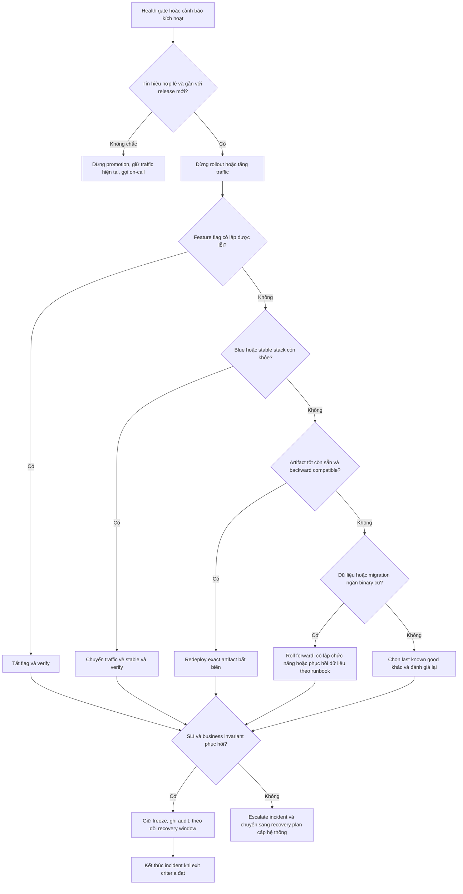
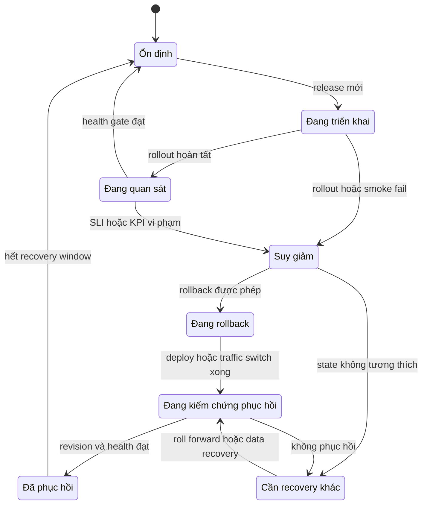

<Callout type="info" title="Kết quả sau bài này">
  Bạn sẽ biết khi nào nên rollback, roll forward, chuyển traffic hoặc tắt feature flag; cách bảo vệ dữ liệu và workload có trạng thái; đồng thời xây dựng một workflow rollback thủ công có validation, approval, concurrency, quyền tối thiểu và bước kiểm chứng sau phục hồi.
</Callout>

## Mục lục

- [Mental model của phục hồi](#mental-model-của-phục-hồi)
  - [Rollback và roll forward](#rollback-và-roll-forward)
  - [Mục tiêu phục hồi và đơn vị rollback](#mục-tiêu-phục-hồi-và-đơn-vị-rollback)
- [Ma trận chiến lược rollback](#ma-trận-chiến-lược-rollback)
  - [Redeploy artifact bất biến](#redeploy-artifact-bất-biến)
  - [Rolling blue green canary và feature flag](#rolling-blue-green-canary-và-feature-flag)
- [Tín hiệu sức khỏe và ngưỡng kích hoạt](#tín-hiệu-sức-khỏe-và-ngưỡng-kích-hoạt)
  - [Health checks SLO và error budget](#health-checks-slo-và-error-budget)
  - [Trigger tự động an toàn](#trigger-tự-động-an-toàn)
- [Luồng quyết định và trạng thái phục hồi](#luồng-quyết-định-và-trạng-thái-phục-hồi)
  - [Luồng quyết định](#luồng-quyết-định)
  - [Vòng đời một rollback](#vòng-đời-một-rollback)
- [Tự động hay thủ công](#tự-động-hay-thủ-công)
  - [So sánh auto và manual rollback](#so-sánh-auto-và-manual-rollback)
  - [Guardrails cho rollback tự động](#guardrails-cho-rollback-tự-động)
- [Database và thay đổi schema](#database-và-thay-đổi-schema)
  - [Expand migrate contract](#expand-migrate-contract)
  - [Backup restore không phải nút undo](#backup-restore-không-phải-nút-undo)
- [Rollback hệ thống có trạng thái](#rollback-hệ-thống-có-trạng-thái)
  - [Phân loại state và hành động](#phân-loại-state-và-hành-động)
  - [Reconciliation và chống tác động lặp](#reconciliation-và-chống-tác-động-lặp)
- [Workflow rollback với GitHub Actions](#workflow-rollback-với-github-actions)
  - [Hợp đồng đầu vào và cấu hình](#hợp-đồng-đầu-vào-và-cấu-hình)
  - [Workflow hoàn chỉnh](#workflow-hoàn-chỉnh)
  - [Cách workflow kiểm soát rủi ro](#cách-workflow-kiểm-soát-rủi-ro)
  - [Adapter platform neutral](#adapter-platform-neutral)
  - [Biến thể Kubernetes](#biến-thể-kubernetes)
  - [Vận hành workflow](#vận-hành-workflow)
- [Runbook và audit](#runbook-và-audit)
  - [Runbook tối thiểu](#runbook-tối-thiểu)
  - [Bằng chứng cần lưu](#bằng-chứng-cần-lưu)
- [Diễn tập game day](#diễn-tập-game-day)
  - [Chuẩn bị và hàng rào an toàn](#chuẩn-bị-và-hàng-rào-an-toàn)
  - [Kịch bản diễn tập](#kịch-bản-diễn-tập)
  - [Tiêu chí kiểm chứng](#tiêu-chí-kiểm-chứng)
- [Best practices](#best-practices)
- [Troubleshooting](#troubleshooting)
- [Tài liệu chính thức](#tài-liệu-chính-thức)
- [Quay lại series CD](#quay-lại-series-cd)

## Mental model của phục hồi

Rollback không phải là “quay ngược thời gian”. Đó là một **deployment mới có chủ đích** nhằm đưa hệ thống về trạng thái phục vụ chấp nhận được. Deployment này vẫn cần identity, approval, khóa đồng thời, health check và audit như mọi thay đổi production khác.

Một rollback tốt tối ưu thời gian khôi phục dịch vụ nhưng không đánh đổi tính toàn vẹn dữ liệu. Nếu binary cũ không còn đọc được dữ liệu mới, cố redeploy binary đó có thể làm sự cố nặng hơn. Trong trường hợp ấy, tắt đường code lỗi hoặc roll forward bằng bản vá tương thích thường an toàn hơn.

### Rollback và roll forward

Hai chiến lược giải quyết cùng một mục tiêu nhưng theo hai hướng khác nhau:

| Chiến lược | Hành động | Khi phù hợp | Rủi ro chính |
|---|---|---|---|
| **Rollback** | Redeploy last known good artifact, chuyển traffic về stack cũ hoặc đưa canary về `0%` | Artifact cũ còn dùng được; schema và state vẫn tương thích; cần phục hồi nhanh | Binary cũ không hiểu dữ liệu mới, dependency đã đổi hoặc artifact cũ không còn |
| **Roll forward** | Phát hành bản vá mới sửa lỗi của release hiện tại | Migration không thể đảo; dữ liệu đã đổi định dạng; lỗi đã hiểu rõ và patch nhỏ | Cần build, test và promotion nên có thể chậm hơn |
| **Mitigation bằng feature flag** | Tắt code path mới mà không đổi toàn bộ binary | Lỗi nằm sau flag độc lập và flag có kill switch đã kiểm thử | Không xử lý lỗi nằm ở startup, migration, shared library hoặc code ngoài flag |
| **Traffic rollback** | Đổi route từ green về blue hoặc ngắt canary | Stack cũ vẫn chạy và dùng chung dependency tương thích | Session, cache, database hoặc event schema vẫn có thể đã thay đổi |

`git revert` không đồng nghĩa với rollback vận hành. `git revert` tạo commit source mới và cần build artifact mới, vì vậy đó thường là một bước của roll forward. Để giảm Mean Time to Recovery, viết tắt là **MTTR**, rollback vận hành ưu tiên artifact tốt đã được build và kiểm chứng từ trước.

<Callout type="warn" title="Không tự động rollback chỉ vì deployment command fail">
  Một lệnh deploy thất bại có thể đã thay đổi một phần tài nguyên. Trước khi chạy lại hoặc rollback, cần biết nền tảng đang ở revision nào, traffic đang đi đâu và migration nào đã hoàn thành. Retry mù có thể nhân đôi side effect hoặc ghi đè bằng chứng điều tra.
</Callout>

### Mục tiêu phục hồi và đơn vị rollback

Trước khi thiết kế automation, định nghĩa ba mục tiêu:

- **RTO** — Recovery Time Objective — thời gian tối đa chấp nhận được để khôi phục dịch vụ.
- **RPO** — Recovery Point Objective — lượng dữ liệu tối đa có thể mất, thường biểu diễn bằng thời gian.
- **Recovery verification window** — khoảng quan sát sau hành động phục hồi để xác nhận hệ thống ổn định, không chỉ xanh trong một lần probe.

“Đơn vị rollback” phải rõ ràng. Với ứng dụng stateless, đó có thể là container digest. Với một hệ thống lớn, release unit còn gồm config version, schema compatibility, feature flags, queue consumer version và routing policy.

Một release catalog nên trả lời được:

| Dữ liệu | Ví dụ | Mục đích |
|---|---|---|
| Release ID | `v1.8.4` | Tên con người dùng trong incident và change record |
| Artifact identity | `ghcr.io/acme/payments@sha256:...` | Chọn đúng bytes, không phụ thuộc mutable tag |
| Commit | full Git SHA | Truy ngược source và CI evidence |
| Config version | `payments-prod-config@4fd2...` | Biết config nào đi cùng binary |
| Schema range | `orders schema 41–43` | Kiểm tra binary cũ còn tương thích database hiện tại |
| Deployment history | run URL, actor, timestamp | Xác định last known good thay vì chọn “bản liền trước” |
| Verification evidence | smoke, SLO, synthetic, business KPI | Chứng minh release từng khỏe trên target tương đương |

**Last known good** không nhất thiết là revision ngay trước. Nếu hai release lỗi liên tiếp, rollback một revision chỉ đưa hệ thống từ lỗi B về lỗi A. Hãy chọn bằng deployment history và evidence, không bằng khoảng cách version.

## Ma trận chiến lược rollback

Chiến lược deployment quyết định hành động phục hồi nhanh nhất. Cùng một lỗi nhưng rolling update, blue-green và canary sẽ có control plane khác nhau.

| Mô hình | Hành động phục hồi ưu tiên | Điều kiện để nhanh | Điều phải kiểm chứng lại |
|---|---|---|---|
| Recreate | Redeploy artifact tốt và khởi động lại toàn bộ | Artifact cũ sẵn có; downtime nằm trong RTO | Capacity, readiness, revision và dữ liệu khởi tạo |
| Rolling update | Dừng rollout rồi redeploy digest tốt | Probe đáng tin cậy; registry còn image; schema tương thích | Tất cả instance về đúng digest, không còn Pod mới lỗi |
| Blue-green | Chuyển route về stack cũ | Blue chưa bị xóa và vẫn được kiểm tra định kỳ | Route, session, shared database và background worker |
| Canary | Đặt traffic canary về `0%`, giữ bản canary để điều tra | Router và metric phân tách theo revision | Stable nhận đủ capacity; không còn request tới canary |
| Feature flag | Tắt flag hoặc kill switch | Flag độc lập, thay đổi có hiệu lực nhanh và đã diễn tập | Config propagation, cache và mọi segment người dùng |
| GitOps | Revert hoặc promote digest tốt trong source of truth | Controller khỏe; commit/config cũ còn hợp lệ | Reconciliation hoàn tất và live state khớp Git |

### Redeploy artifact bất biến

Cách rollback phổ biến nhất là **redeploy artifact bất biến**. Pipeline chọn exact digest, checksum hoặc artifact ID đã được phát hành trước đó rồi triển khai lại. Không checkout tag cũ và build lại trong incident.

Hai lần build cùng commit có thể khác nhau do base image, dependency, timestamp hoặc toolchain. Vì vậy, “build lại source cũ” là một release mới chưa được kiểm chứng, không phải rollback đáng tin cậy.

Quy trình redeploy an toàn:

1. Tra release catalog để lấy exact artifact và bằng chứng last known good.
2. Kiểm tra artifact còn trong retention và tải được từ target network.
3. Xác minh checksum, chữ ký hoặc provenance trước khi cấp deployment credential.
4. Kiểm tra compatibility với schema, config và external API hiện tại.
5. Deploy idempotent vào target đã khóa concurrency.
6. Đối chiếu revision live với digest dự kiến.
7. Chạy cùng bộ smoke, synthetic và SLO gate dùng cho deployment thường.

<Callout type="error" title="Không dùng latest hoặc previous làm căn cước">
  `latest`, `stable`, “artifact mới nhất” và “revision trước” đều là con trỏ tương đối. Trong incident, hãy ghi exact release ID cùng digest. Nếu registry cho phép gán lại tag, tag SemVer cũng chưa đủ để định danh bytes.
</Callout>

Retention của artifact phải dài hơn cửa sổ rollback và phù hợp RTO. Một runbook ghi digest cũ nhưng registry đã garbage collect image đó không tạo ra khả năng phục hồi thực tế.

### Rolling blue green canary và feature flag

**Rolling update** tiết kiệm capacity nhưng hai phiên bản cùng chạy trong rollout. API, message và schema phải tương thích trong cửa sổ này. Khi rollback, đừng chỉ chờ controller báo Available; hãy kiểm tra mọi replica đang dùng digest tốt và request không còn tới replica lỗi.

**Blue-green** cho phép đổi route nhanh. Tuy nhiên stack blue chỉ là phương án dự phòng nếu nó vẫn khỏe. Cần synthetic check định kỳ khi blue đứng ngoài traffic. Giữ blue quá lâu cũng tạo drift về config, certificate và dependency.

**Canary** giảm blast radius bằng traffic thật. Khi canary xấu, hành động đầu tiên là dừng tăng traffic và đưa trọng số về `0`. Sau đó mới quyết định xóa canary, redeploy stable hay roll forward. Đừng xóa ngay Pod lỗi nếu logs và traces ở đó là bằng chứng duy nhất.

**Feature flag** là một mitigation, không phải bản sao đầy đủ của rollback. Kill switch tốt có owner, thời hạn, default an toàn, audit và đường tắt không phụ thuộc dịch vụ flag đang lỗi. Nếu tắt flag vẫn yêu cầu deploy lại ứng dụng, flag đó không đáp ứng mục tiêu phục hồi nhanh.

## Tín hiệu sức khỏe và ngưỡng kích hoạt

Rollback chỉ đáng tin cậy khi trigger phân biệt được **release regression** với lỗi nền tảng, dependency hoặc tín hiệu quan sát bị hỏng. Nếu mọi lỗi 5xx đều rollback release mới, hệ thống có thể lặp deployment trong khi nguyên nhân thật là database hoặc nhà cung cấp bên ngoài.

### Health checks SLO và error budget

Các tín hiệu có vai trò khác nhau:

| Tín hiệu | Câu hỏi trả lời | Cửa sổ điển hình | Hành động khi fail |
|---|---|---|---|
| Startup check | Process có khởi động đúng không? | Giây đến phút | Dừng rollout; không cấp traffic |
| Readiness check | Instance có nhận request lúc này không? | Liên tục | Loại instance khỏi load balancer |
| Smoke test | User journey tối thiểu có chạy trên đúng revision không? | Ngay sau deploy | Dừng promotion hoặc rollback |
| Synthetic test | Hành vi end-to-end có còn hoạt động từ góc nhìn người dùng không? | Liên tục | Cảnh báo và đối chiếu metrics |
| SLI | Tỷ lệ request tốt, latency tốt hoặc freshness tốt là bao nhiêu? | Phút đến tháng | Đầu vào cho SLO và release gate |
| SLO | Mức độ tin cậy mục tiêu trong một khoảng thời gian | Thường 7 đến 30 ngày | Điều chỉnh tốc độ phát hành và ưu tiên reliability |
| Error budget | Phần unreliability được phép trước khi vi phạm SLO | Cùng cửa sổ SLO | Hạn chế thay đổi khi burn quá nhanh |

Ví dụ, SLO availability `99,9%` trong 30 ngày cho phép khoảng `0,1%` request không tốt. **Burn rate** đo tốc độ tiêu thụ error budget so với tốc độ đều được phép. Burn rate cao ở cả cửa sổ ngắn và dài là tín hiệu mạnh hơn một spike một phút.

Không nên dùng toàn bộ SLO 30 ngày làm trigger trực tiếp cho từng rollback. Trigger deployment cần tín hiệu nhanh và gắn được với revision, chẳng hạn:

- canary error rate vượt baseline `2` điểm phần trăm trong 10 phút;
- p95 latency của revision mới vượt SLO và xấu hơn stable trong hai cửa sổ;
- synthetic checkout fail liên tiếp trong khi dependency health vẫn tốt;
- business conversion giảm vượt ngưỡng có đủ sample;
- error-budget burn rate vượt policy nhiều cửa sổ sau deployment marker.

Ngưỡng trên chỉ là ví dụ. Hãy tính từ baseline và SLO của dịch vụ. Nếu traffic thấp, kéo dài cửa sổ hoặc bổ sung synthetic traffic; “không thấy lỗi” khi không có request không phải bằng chứng khỏe.

### Trigger tự động an toàn

Một trigger tự động cần đủ năm thuộc tính:

1. **Scoped:** metric có dimension theo service, environment và release.
2. **Sustained:** vi phạm tồn tại qua nhiều lần lấy mẫu, không phải một điểm nhiễu.
3. **Comparative:** nếu có canary, so sánh với stable để loại lỗi chung của dependency.
4. **Fail closed:** không lấy được metric thì dừng promotion và gọi người trực; không tự kết luận healthy.
5. **Bounded:** mỗi release chỉ được tự rollback tối đa một lần, có cooldown và không tự roll forward lại release lỗi.

Trigger nên tạo incident event chứa release ID, ngưỡng, cửa sổ, query và dashboard link. Automation không được chỉ phát một chuỗi “health failed” thiếu dữ liệu để con người kiểm chứng.

<Callout type="warn" title="Health endpoint không được luôn trả 200">
  Readiness chỉ hữu ích khi phản ánh khả năng phục vụ thật. Tuy nhiên đừng buộc readiness phụ thuộc mọi downstream không thiết yếu, vì một dependency lỗi có thể làm toàn bộ fleet tự loại khỏi load balancer. Tách critical dependency, degraded mode và liveness theo threat model của ứng dụng.
</Callout>

## Luồng quyết định và trạng thái phục hồi

### Luồng quyết định

Luồng dưới đây ưu tiên dừng blast radius trước, sau đó mới chọn rollback hay roll forward.



Điểm quyết định “backward compatible” bao gồm database, message schema, config, cache format và external API. Chỉ kiểm tra binary start được là chưa đủ.

### Vòng đời một rollback



Trạng thái **Recovered** chưa đồng nghĩa incident đã kết thúc. Cần giữ change freeze trong recovery window, kiểm tra backlog và side effect, rồi mới quay lại Stable.

## Tự động hay thủ công

### So sánh auto và manual rollback

| Tiêu chí | Rollback tự động | Rollback thủ công có approval |
|---|---|---|
| Tốc độ | Nhanh, phù hợp RTO tính bằng phút | Chậm hơn do cần đánh giá và phê duyệt |
| Điều kiện tốt | Stateless, artifact bất biến, metric đáng tin, hành động idempotent, không có migration phá vỡ | State phức tạp, tín hiệu mơ hồ, security incident, dependency lỗi, thay đổi nhiều hệ thống |
| Quyền | Controller hoặc workflow có authority hẹp và được pre-authorize | GitHub Environment bảo vệ credential bằng reviewer và branch policy |
| Rủi ro | Flapping, rollback nhầm nguyên nhân, lặp side effect | Chậm quyết định, thao tác sai dưới áp lực, phụ thuộc người trực |
| Bằng chứng bắt buộc | Trigger payload, policy version, old/new digest, kết quả verify | Người yêu cầu, reviewer, reason, ticket, old/new digest, kết quả verify |

Rollback thủ công không có nghĩa chạy lệnh tùy ý từ laptop. Mẫu an toàn là `workflow_dispatch` với input bị giới hạn, GitHub Environment, exact artifact và adapter đã review.

Rollback tự động phù hợp nhất ở progressive delivery controller. Controller đã biết revision, traffic weight và metric analysis. Nếu production environment yêu cầu human reviewer, một job GitHub Actions không thể vừa hoàn toàn tự động vừa chờ reviewer. Đừng âm thầm bypass protection rule; hãy thiết kế authority phục hồi riêng, hẹp và được quản trị rõ.

### Guardrails cho rollback tự động

Chỉ bật auto rollback khi toàn bộ checklist sau đạt:

- [ ] Trigger đọc metric theo đúng release và có ít nhất hai cửa sổ đánh giá.
- [ ] Deployment marker xác nhận regression bắt đầu sau release.
- [ ] Last known good artifact được pin bằng digest và đã pull-test gần đây.
- [ ] Compatibility matrix xác nhận artifact cũ chạy với schema và config hiện tại.
- [ ] Hành động rollback idempotent và có timeout.
- [ ] Concurrency hoặc platform lock bảo đảm single writer.
- [ ] Mỗi release chỉ auto rollback một lần; không tạo vòng lặp deploy–rollback.
- [ ] Recovery verification dùng tín hiệu độc lập với trigger khi có thể.
- [ ] Khi metric backend không khả dụng, automation dừng và page on-call.
- [ ] Mọi hành động phát deployment event và giữ diagnostics.

<Callout type="error" title="Không auto rollback destructive migration">
  Không tự chạy down migration, restore database hoặc rewind event offset chỉ vì HTTP smoke test thất bại. Đây là thao tác dữ liệu có blast radius và RPO riêng. Chúng cần runbook, owner, backup đã kiểm chứng và quyết định incident command.
</Callout>

## Database và thay đổi schema

Database thường là ranh giới làm rollback binary thất bại. Code mới có thể đã ghi dữ liệu mà code cũ không hiểu, ngay cả khi schema SQL chưa bị xóa cột.

### Expand migrate contract

Mẫu **expand–migrate–contract** tách một thay đổi phá vỡ tương thích thành nhiều release có thể rollback:

1. **Expand:** thêm cột, bảng, index hoặc field mới theo cách code cũ vẫn hoạt động. Tránh đổi tên hoặc xóa ngay.
2. **Migrate:** deploy code có thể đọc cả format cũ và mới. Nếu cần, dual-write có đo lường và backfill theo batch idempotent.
3. **Switch:** chuyển read path sang format mới sau khi đối soát dữ liệu. Giữ fallback trong cửa sổ rollback.
4. **Contract:** chỉ xóa cấu trúc cũ sau khi không còn binary, consumer, job hoặc query nào dùng nó.

Ví dụ, đổi `customer_name` thành `display_name` không nên thực hiện bằng một lệnh rename cùng release ứng dụng. Hãy thêm `display_name`, backfill, deploy code đọc ưu tiên field mới nhưng fallback field cũ, rồi xóa `customer_name` ở release sau.

Compatibility cần xét cả hai chiều trong lúc rollout:

| Thành phần | Câu hỏi bắt buộc |
|---|---|
| Code cũ với schema mới | Rollback binary có đọc và ghi an toàn không? |
| Code mới với schema cũ | Rolling update có khởi động trước khi migration expand hoàn tất không? |
| Worker cũ với event mới | Message schema có default và versioning không? |
| Worker mới với event cũ | Consumer có đọc backlog được tạo trước deployment không? |
| Backfill chạy dở | Chạy lại có idempotent và có checkpoint không? |

Migration nên có ID, owner, trạng thái, timeout và số hàng đã xử lý. Không giấu migration trong startup của mọi replica; nhiều Pod khởi động đồng thời có thể tranh lock hoặc chạy cùng side effect.

### Backup restore không phải nút undo

Backup là bảo hiểm cho mất mát hoặc corruption dữ liệu. Nó không phải cách rollback ứng dụng hằng ngày.

Các caveat quan trọng:

- Restore về một thời điểm cũ có thể loại bỏ giao dịch hợp lệ phát sinh sau thời điểm đó. Đây là tác động trực tiếp tới RPO.
- Full restore thường chậm hơn redeploy binary và có thể vượt RTO của dịch vụ.
- Backup logic, snapshot volume và point-in-time recovery có semantics khác nhau. Snapshot crash-consistent chưa chắc application-consistent.
- Restore toàn database có thể ảnh hưởng nhiều service cùng dùng dữ liệu.
- Backup chỉ có giá trị khi đã diễn tập restore, kiểm checksum và kiểm ứng dụng đọc được dữ liệu phục hồi.
- Encryption key, extension, role, external object và transaction ngoài database có thể không nằm trong backup.

Phương án an toàn thường là restore vào **một database cô lập**, đối chiếu dữ liệu rồi replay hoặc reconcile phần bị hỏng. Chỉ cut over toàn bộ khi incident commander chấp nhận RPO, RTO và blast radius.

<Callout type="warn" title="Down migration có thể hủy bằng chứng">
  Một down migration xóa cột hoặc rewrite dữ liệu có thể làm mất dữ liệu mới cần cho điều tra và roll forward. Mặc định giữ schema expand, rollback binary tương thích và trì hoãn contract. Chỉ chạy thao tác đảo dữ liệu đã được review riêng.
</Callout>

## Rollback hệ thống có trạng thái

State tồn tại ngoài database quan hệ. Một rollback hoàn chỉnh phải lập inventory mọi nơi release mới đã ghi hoặc đã kích hoạt side effect.

### Phân loại state và hành động

| Loại state | Failure mode khi rollback | Hành động phục hồi điển hình |
|---|---|---|
| Session và cache | Binary cũ không đọc format mới; cache key collision | Version cache key, chấp nhận cache miss, invalidate có giới hạn |
| Queue và event stream | Consumer cũ không hiểu event mới; rewind tạo xử lý lặp | Version schema, pause consumer, dùng dead-letter queue, replay idempotent |
| Search index | Mapping mới không tương thích query cũ | Dùng index alias blue-green, chuyển alias về index tốt hoặc reindex |
| Object storage | Release mới đã ghi file hoặc metadata mới | Giữ object version, dùng manifest, reconcile thay vì xóa hàng loạt |
| Workflow dài hạn | Instance đang chạy giữ code hoặc state machine version mới | Version workflow definition, cho run cũ hoàn tất hoặc dùng migration được hỗ trợ |
| Payment email webhook | Side effect ngoài hệ thống không thể “un-send” | Idempotency key, ledger bù trừ, suppression và quy trình đối soát |
| Local persistent volume | Replica cũ không đọc on-disk format mới | Snapshot, version format, rolling migration riêng; không recreate mù |
| Configuration | Binary cũ nhận config chỉ dành cho code mới | Version config, schema validate và gắn compatibility range |

Kubernetes StatefulSet giữ identity và volume ổn định, nhưng rollback Pod template không tự rollback nội dung volume. Tương tự, `kubectl rollout undo` cho Deployment không khôi phục ConfigMap, Secret, Service, CRD hoặc migration Job.

### Reconciliation và chống tác động lặp

Với hệ thống có state, phục hồi thường là **reconciliation** — đưa từng record về invariant đúng — thay vì rewind toàn bộ thời gian.

Ví dụ, nếu release lỗi gửi trùng lệnh thanh toán, rollback binary chỉ ngăn lệnh mới. Hệ thống vẫn cần đối chiếu ledger, tìm idempotency key trùng và phát giao dịch bù theo quy trình tài chính. Xóa record để “làm sạch” có thể phá audit trail.

Các primitive cần thiết:

- idempotency key cho request và message;
- monotonic sequence hoặc event ID để phát hiện duplicate;
- schema version và consumer compatibility policy;
- checkpoint có thể resume cho backfill;
- tombstone hoặc compensating event thay cho xóa lịch sử;
- pause và drain queue có timeout;
- reconciliation job có dry-run, giới hạn batch và báo cáo diff;
- immutable audit log cho side effect quan trọng.

Nói ngắn gọn: rollback code chặn lỗi tiếp diễn; reconciliation sửa hậu quả đã xảy ra.

## Workflow rollback với GitHub Actions

Workflow dưới đây là đường rollback **thủ công** và platform-neutral. Operator chọn exact `version` cùng GitHub `environment`. Job đầu tiên validate input mà không nhận deployment secret. Job thứ hai tham chiếu environment, vì vậy production approval và environment secret chỉ được cấp sau khi protection rules đạt.

Workflow giả định quy trình [Release management](/docs/cd/03-release-management/) đã publish hai assets:

- `my-app-vX.Y.Z.tar.gz` — artifact đã build và attested;
- `SHA256SUMS` — checksum của archive.

### Hợp đồng đầu vào và cấu hình

<TypeTable
  type={{
    version: {
      description: 'Exact SemVer tag đã publish, ví dụ v1.8.4. Production không chấp nhận prerelease.',
      type: 'string',
      required: true,
    },
    environment: {
      description: 'GitHub Environment đã tồn tại. Workflow còn giới hạn allowlist staging và production.',
      type: "'staging' | 'production'",
      required: true,
    },
    APP_URL: {
      description: 'URL health và revision endpoint của đúng environment.',
      type: 'environment variable',
      required: true,
    },
    VERIFY_WINDOW_SECONDS: {
      description: 'Cửa sổ quan sát sau deploy. Nếu bỏ trống, adapter dùng 300 giây.',
      type: 'environment variable',
      default: '300',
    },
    DEPLOY_TOKEN: {
      description: 'Credential legacy ở environment scope. Bỏ secret này nếu adapter đổi OIDC lấy credential ngắn hạn.',
      type: 'environment secret',
    },
  }}
/>

Cấu hình `production` trong **Settings → Environments** với required reviewers, prevent self-review và deployment branch chỉ cho `main`. Rollback vẫn là production change nên không bỏ gate chỉ vì đang có incident.

Adapter cần hai script đã review trên `main`:

```text
scripts/deploy-version.sh ENV ARCHIVE VERSION
scripts/verify-version.sh ENV VERSION APP_URL WINDOW_SECONDS
```

`deploy-version.sh` phải idempotent và triển khai đúng archive được truyền vào. `verify-version.sh` phải trả exit code khác `0` nếu revision, smoke test hoặc health window không đạt.

### Workflow hoàn chỉnh

Tạo `.github/workflows/rollback.yml`:

```yaml
name: Manual rollback
run-name: "Rollback ${{ inputs.environment }} to ${{ inputs.version }} by @${{ github.actor }}"

on:
  workflow_dispatch:
    inputs:
      version:
        description: Exact stable SemVer tag, ví dụ v1.8.4
        required: true
        type: string
      environment:
        description: Environment cần phục hồi
        required: true
        type: environment

permissions: {}

concurrency:
  group: deploy-${{ github.repository }}-${{ inputs.environment }}
  cancel-in-progress: false

jobs:
  validate:
    name: Validate trusted release
    runs-on: ubuntu-latest
    timeout-minutes: 5
    permissions:
      contents: read
    outputs:
      version: ${{ steps.input.outputs.version }}
      environment: ${{ steps.input.outputs.environment }}
      archive: ${{ steps.input.outputs.archive }}

    steps:
      - name: Validate ref environment and release metadata
        id: input
        shell: bash
        env:
          VERSION: ${{ inputs.version }}
          TARGET_ENV: ${{ inputs.environment }}
          SELECTED_REF: ${{ github.ref }}
          REPOSITORY: ${{ github.repository }}
          GH_TOKEN: ${{ github.token }}
        run: |
          set -Eeuo pipefail

          [[ "$SELECTED_REF" == "refs/heads/main" ]] || {
            echo "Run rollback workflow từ branch main" >&2
            exit 1
          }

          VERSION_PATTERN='^v(0|[1-9][0-9]*)\.(0|[1-9][0-9]*)\.(0|[1-9][0-9]*)$'
          [[ "$VERSION" =~ $VERSION_PATTERN ]] || {
            echo "Production rollback chỉ nhận exact stable SemVer vX.Y.Z" >&2
            exit 1
          }

          case "$TARGET_ENV" in
            staging|production) ;;
            *)
              echo "Environment không nằm trong allowlist" >&2
              exit 1
              ;;
          esac

          metadata="$(gh release view "$VERSION" \
            --repo "$REPOSITORY" \
            --json tagName,isDraft,isPrerelease)"

          jq -e --arg version "$VERSION" '
            .tagName == $version and
            .isDraft == false and
            .isPrerelease == false
          ' <<<"$metadata" >/dev/null

          archive="my-app-${VERSION}.tar.gz"
          assets="$(gh release view "$VERSION" \
            --repo "$REPOSITORY" \
            --json assets \
            --jq '.assets[].name')"

          grep -Fx "$archive" <<<"$assets" >/dev/null
          grep -Fx "SHA256SUMS" <<<"$assets" >/dev/null

          echo "version=$VERSION" >>"$GITHUB_OUTPUT"
          echo "environment=$TARGET_ENV" >>"$GITHUB_OUTPUT"
          echo "archive=$archive" >>"$GITHUB_OUTPUT"

  rollback:
    name: Rollback and verify
    needs: validate
    runs-on: ubuntu-latest
    timeout-minutes: 30
    environment:
      name: ${{ needs.validate.outputs.environment }}
      url: ${{ vars.APP_URL }}
    permissions:
      contents: read
      attestations: read

    steps:
      - name: Checkout trusted deployment adapter
        uses: actions/checkout@v7
        with:
          ref: ${{ github.sha }}
          persist-credentials: false

      - name: Download exact release assets and verify provenance
        shell: bash
        env:
          VERSION: ${{ needs.validate.outputs.version }}
          ARCHIVE: ${{ needs.validate.outputs.archive }}
          REPOSITORY: ${{ github.repository }}
          GH_TOKEN: ${{ github.token }}
        run: |
          set -Eeuo pipefail
          mkdir -p release

          gh release download "$VERSION" \
            --repo "$REPOSITORY" \
            --pattern "$ARCHIVE" \
            --pattern SHA256SUMS \
            --dir release

          test -f "release/$ARCHIVE"
          test -f release/SHA256SUMS

          awk -v file="$ARCHIVE" \
            'NF == 2 && $2 == file { print }' \
            release/SHA256SUMS >release/SELECTED_SHA256SUMS
          test "$(wc -l <release/SELECTED_SHA256SUMS)" -eq 1

          (
            cd release
            sha256sum --check --strict SELECTED_SHA256SUMS
          )

          gh attestation verify "release/$ARCHIVE" \
            --repo "$REPOSITORY"

      - name: Validate environment configuration
        shell: bash
        env:
          TARGET_ENV: ${{ needs.validate.outputs.environment }}
          APP_URL: ${{ vars.APP_URL }}
          DEPLOY_TOKEN: ${{ secrets.DEPLOY_TOKEN }}
        run: |
          set -Eeuo pipefail
          test -n "$APP_URL" || {
            echo "APP_URL is missing" >&2
            exit 1
          }
          test -n "$DEPLOY_TOKEN" || {
            echo "DEPLOY_TOKEN is missing; use OIDC or configure the environment secret" >&2
            exit 1
          }
          test -x scripts/deploy-version.sh
          test -x scripts/verify-version.sh

      - name: Deploy selected last known good release
        shell: bash
        env:
          TARGET_ENV: ${{ needs.validate.outputs.environment }}
          VERSION: ${{ needs.validate.outputs.version }}
          ARCHIVE: ${{ needs.validate.outputs.archive }}
          DEPLOY_TOKEN: ${{ secrets.DEPLOY_TOKEN }}
        run: |
          set -Eeuo pipefail
          ./scripts/deploy-version.sh \
            "$TARGET_ENV" \
            "release/$ARCHIVE" \
            "$VERSION"

      - name: Verify revision smoke tests and recovery window
        shell: bash
        env:
          TARGET_ENV: ${{ needs.validate.outputs.environment }}
          VERSION: ${{ needs.validate.outputs.version }}
          APP_URL: ${{ vars.APP_URL }}
          VERIFY_WINDOW_SECONDS: ${{ vars.VERIFY_WINDOW_SECONDS }}
        run: |
          set -Eeuo pipefail
          window="${VERIFY_WINDOW_SECONDS:-300}"
          [[ "$window" =~ ^[0-9]+$ ]]
          (( window >= 60 && window <= 1800 ))

          ./scripts/verify-version.sh \
            "$TARGET_ENV" \
            "$VERSION" \
            "$APP_URL" \
            "$window"

      - name: Write rollback audit summary
        if: always()
        shell: bash
        env:
          TARGET_ENV: ${{ needs.validate.outputs.environment }}
          VERSION: ${{ needs.validate.outputs.version }}
          ARCHIVE: ${{ needs.validate.outputs.archive }}
          RUN_URL: ${{ github.server_url }}/${{ github.repository }}/actions/runs/${{ github.run_id }}
        run: |
          {
            echo "### Rollback record"
            echo "- Environment: \`$TARGET_ENV\`"
            echo "- Requested version: \`$VERSION\`"
            echo "- Release asset: \`$ARCHIVE\`"
            echo "- Actor: \`$GITHUB_ACTOR\`"
            echo "- Source ref: \`$GITHUB_REF\`"
            echo "- Workflow run: $RUN_URL"
            echo "- Final job status: \`${{ job.status }}\`"
          } >>"$GITHUB_STEP_SUMMARY"
```

Workflow dùng major tag để dễ đọc. Trong repository production, pin `actions/checkout` bằng full commit SHA đã review và cập nhật SHA qua pull request.

Nếu repository chưa tạo artifact attestation, `gh attestation verify` sẽ fail closed. Đây là hành vi có chủ đích. Hãy bổ sung provenance vào workflow release; không xóa verification chỉ để incident run chuyển xanh.

### Cách workflow kiểm soát rủi ro

- Input `environment` dùng kiểu GitHub Environment, sau đó vẫn kiểm tra allowlist để tránh deploy vào environment tùy ý.
- Input `version` chỉ chấp nhận stable SemVer chính xác. Workflow không nhận URL, branch, `latest` hoặc shell fragment.
- `validate` chạy trên `main`, chỉ có `contents: read` và không tham chiếu environment. Job này không nhận production secret.
- `rollback` tham chiếu environment động. Required reviewer, prevent self-review và branch policy được áp dụng trước khi job nhận environment secret.
- Cùng concurrency group `deploy-REPOSITORY-ENVIRONMENT` phải được dùng cho cả workflow deploy thường và rollback. Nếu hai workflow dùng group khác nhau, chúng vẫn có thể ghi production đồng thời.
- `cancel-in-progress: false` không hủy một deployment đang chạy. GitHub concurrency không thay platform lock nếu có writer từ repository khác hoặc từ laptop.
- Release metadata được kiểm tra lại bằng exact tag. Archive được kiểm checksum và provenance trước khi gọi adapter.
- `permissions: {}` ở workflow scope làm mọi quyền mặc định thành `none`; mỗi job chỉ mở quyền đọc cần thiết.
- Secret chỉ được truyền vào step deploy và validation. Không ghi secret vào summary hoặc command argument.
- Verify kiểm tra version, smoke test và recovery window. Job deploy thành công chưa đủ để tuyên bố phục hồi.

Nếu cloud hỗ trợ OIDC, bỏ `DEPLOY_TOKEN`, thêm `id-token: write` **chỉ ở job `rollback`**, rồi dùng action chính thức để đổi GitHub identity lấy credential ngắn hạn. Trust policy phải giới hạn đúng repository và GitHub Environment.

<Callout type="warn" title="Validation không thay thế release catalog">
  SemVer hợp lệ và Release tồn tại chưa chứng minh đó là last known good cho environment hiện tại. Production thực tế nên truy vấn deployment catalog hoặc CMDB để kiểm tra release đã từng pass production gate, digest, schema range và trạng thái thu hồi trước khi cho phép deploy.
</Callout>

### Adapter platform neutral

Adapter phải tách **prepare**, **switch**, **verify** và **cleanup**. Cách tách này cho phép chuẩn bị artifact mà chưa đổi traffic, rồi thực hiện cutover ngắn và có thể quan sát.

<Tabs items={['Platform neutral', 'Blue green']}>
  <Tab value="Platform neutral">

Hợp đồng đề xuất cho `deploy-version.sh`:

```bash
#!/usr/bin/env bash
set -Eeuo pipefail

target_env="${1:?ENV is required}"
archive="${2:?ARCHIVE is required}"
version="${3:?VERSION is required}"

# Các hàm này do platform adapter triển khai.
resolve_target "$target_env"
acquire_platform_lock "$target_env"
inspect_current_release "$target_env"
check_schema_compatibility "$version" "$target_env"
stage_exact_archive "$archive" "$version"
activate_staged_release "$target_env" "$version"
record_deployment_marker "$target_env" "$version" "rollback"
```

`activate_staged_release` phải idempotent. Chạy lại cùng `version` không được tạo thêm side effect hoặc chọn artifact khác.

  </Tab>
  <Tab value="Blue green">

Với blue-green, adapter không redeploy nếu blue đang giữ đúng digest và vẫn khỏe:

```bash
stable_slot="$(get_current_stable_slot)"
rollback_slot="$(get_slot_for_exact_version "$version")"

test "$stable_slot" != "$rollback_slot"
verify_slot_revision "$rollback_slot" "$version"
run_smoke_against_slot "$rollback_slot"
set_traffic_weight "$rollback_slot" 100
set_traffic_weight "$stable_slot" 0
verify_public_revision "$version"
```

Không xóa slot vừa rời traffic cho đến khi recovery window kết thúc. Nếu cả hai slot dùng chung database, compatibility check vẫn bắt buộc.

  </Tab>
</Tabs>

`verify-version.sh` nên poll có deadline thay vì `sleep` cố định. Tối thiểu, script phải:

1. gọi revision endpoint và xác nhận exact version hoặc digest;
2. chạy smoke test trên user journey quan trọng;
3. query error rate và latency trong recovery window;
4. xác nhận queue depth, restart count hoặc business invariant không xấu đi;
5. fail khi observability API timeout hoặc thiếu dữ liệu;
6. in dashboard link và query ID, không in credential.

### Biến thể Kubernetes

Với Kubernetes, ưu tiên redeploy exact image digest từ release catalog. `kubectl rollout undo` chỉ dùng khi đã đối chiếu revision với digest mong muốn.

<Tabs items={['Redeploy digest', 'Rollout undo', 'GitOps']}>
  <Tab value="Redeploy digest">

```bash
set -Eeuo pipefail

NAMESPACE="${NAMESPACE:?}"
DEPLOYMENT="${DEPLOYMENT:?}"
CONTAINER="${CONTAINER:?}"
IMAGE_REF="$(./scripts/resolve-image-digest.sh "$VERSION")"

[[ "$IMAGE_REF" =~ @sha256:[0-9a-f]{64}$ ]] || {
  echo "Resolver không trả exact image digest" >&2
  exit 1
}

kubectl auth can-i patch deployments.apps \
  --namespace "$NAMESPACE" | grep -qx yes

kubectl set image \
  --namespace "$NAMESPACE" \
  "deployment/$DEPLOYMENT" \
  "$CONTAINER=$IMAGE_REF"

kubectl annotate \
  --namespace "$NAMESPACE" \
  "deployment/$DEPLOYMENT" \
  "delivery.example.com/rollback-version=$VERSION" \
  "delivery.example.com/workflow-run=$GITHUB_RUN_ID" \
  --overwrite

kubectl rollout status \
  --namespace "$NAMESPACE" \
  "deployment/$DEPLOYMENT" \
  --timeout=180s

actual_image="$(kubectl get deployment "$DEPLOYMENT" \
  --namespace "$NAMESPACE" \
  -o json | jq -er --arg name "$CONTAINER" \
  '.spec.template.spec.containers[] | select(.name == $name) | .image')"
test "$actual_image" = "$IMAGE_REF"

./scripts/smoke-kubernetes.sh "$NAMESPACE" "$VERSION"
```

`resolve-image-digest.sh` phải đọc release catalog hoặc signed manifest. Không biến `v1.8.4` thành `image:v1.8.4` rồi giả định tag chưa bị gán lại.

  </Tab>
  <Tab value="Rollout undo">

```bash
kubectl rollout history \
  --namespace "$NAMESPACE" \
  "deployment/$DEPLOYMENT"

kubectl rollout undo \
  --namespace "$NAMESPACE" \
  "deployment/$DEPLOYMENT" \
  --to-revision="$TARGET_REVISION"

kubectl rollout status \
  --namespace "$NAMESPACE" \
  "deployment/$DEPLOYMENT" \
  --timeout=180s
```

Trước `undo`, lấy Pod template của `TARGET_REVISION` và đối chiếu image digest với release catalog. Revision gần nhất chưa chắc là last known good. Sau `undo`, kiểm tra live image và smoke test như đường redeploy digest.

`rollout undo` không khôi phục ConfigMap, Secret, Service, CRD, Helm hook, migration Job hoặc dữ liệu trên volume. `revisionHistoryLimit` và registry retention cũng có thể làm revision cũ không chạy được.

  </Tab>
  <Tab value="GitOps">

Không sửa live Deployment như thay đổi bền vững khi Argo CD hoặc Flux đang reconcile. Controller có thể lập tức đưa cluster về digest lỗi.

```bash
# Luồng khái niệm: cập nhật exact digest trong source of truth.
./scripts/update-gitops-digest.sh \
  --environment "$TARGET_ENV" \
  --version "$VERSION" \
  --digest "$IMAGE_DIGEST"

./scripts/open-or-merge-emergency-change.sh
./scripts/wait-for-reconciliation.sh "$VERSION"
```

Emergency commit hoặc pull request vẫn cần signer, reason, review policy và audit. Sau reconcile, xác minh live digest thay vì chỉ kiểm tra commit đã merge.

  </Tab>
</Tabs>

Với Helm, `helm rollback RELEASE REVISION --wait --timeout ...` quay về release revision đã lưu. Helm hook và external side effect cần đánh giá riêng. `--atomic` trên upgrade có thể tự rollback chart resources, nhưng không biến migration phá dữ liệu thành thao tác có thể đảo.

### Vận hành workflow

<Steps>
<Step>

**Khai báo incident và đóng băng thay đổi.** Tạo incident hoặc change ticket, chỉ định incident commander và tạm dừng promotion khác tới cùng target. Ghi current release, candidate lỗi và thời điểm suy giảm.

</Step>
<Step>

**Chọn last known good.** Tra deployment history và release catalog. Kiểm artifact digest, provenance, retention, schema range, config compatibility và lý do release đó được xem là tốt.

</Step>
<Step>

**Chạy workflow từ `main`.** Mở **Actions → Manual rollback → Run workflow**. Chọn exact version và environment. Không nhập moving tag hoặc URL artifact.

</Step>
<Step>

**Review deployment.** Reviewer độc lập đối chiếu version, digest, incident, migration state và runbook. Nếu dữ liệu không tương thích, reject workflow và chuyển sang roll forward hoặc data recovery.

</Step>
<Step>

**Theo dõi deploy và verify.** Quan sát revision endpoint, rollout status, synthetic transaction, SLI, business metric và backlog. Không kết thúc incident ngay khi job chuyển xanh.

</Step>
<Step>

**Đóng recovery.** Sau recovery window, lưu workflow URL, deployment record, dashboard snapshot, timeline và reconciliation task. Giữ freeze cho tới khi exit criteria đạt.

</Step>
</Steps>

## Runbook và audit

### Runbook tối thiểu

Một rollback runbook phải dùng được khi người viết không có mặt. Tối thiểu gồm:

1. **Phạm vi:** service, environment, dependency và loại sự cố runbook xử lý.
2. **Điều kiện vào:** health gate nào fail, severity nào cho phép kích hoạt, ai có quyền quyết định.
3. **Điều kiện cấm rollback:** migration không tương thích, security compromise, artifact bị thu hồi hoặc dependency breaking change.
4. **Cách chọn last known good:** query, dashboard hoặc catalog cụ thể; không ghi “chọn bản cũ”.
5. **Lệnh và workflow:** exact URL, input, expected output, timeout và quyền cần thiết.
6. **Pre-check:** current revision, traffic, schema, queue, capacity, artifact availability và platform lock.
7. **Verification:** revision, smoke, SLI, KPI, backlog và recovery window.
8. **Abort condition:** khi nào dừng rollback và chuyển sang roll forward, failover hoặc restore.
9. **Communication:** kênh incident, stakeholder, status page và cadence cập nhật.
10. **Reconciliation:** xử lý message, payment, index, cache hoặc record được tạo trong cửa sổ lỗi.
11. **Exit criteria:** điều kiện gỡ freeze và kết thúc incident.
12. **Owner và ngày diễn tập gần nhất:** runbook quá hạn phải được review lại.

Đừng đặt token, kubeconfig hoặc password trong runbook. Tài liệu chỉ trỏ tới secret manager, GitHub Environment hoặc quy trình break-glass.

### Bằng chứng cần lưu

| Trường audit | Nội dung |
|---|---|
| Incident hoặc change ID | Liên kết tới timeline và quyết định |
| Trigger | Alert ID, query, threshold, cửa sổ và dashboard |
| Actor và reviewer | Người yêu cầu, người phê duyệt, thời điểm |
| Target | Repository, service, environment, cluster hoặc account |
| Before và after | Current release, bad release, target release, exact digests |
| Compatibility decision | Schema/config/event range và người xác nhận |
| Workflow evidence | Run ID, attempt, ref, commit của adapter và action versions |
| Deployment evidence | Platform operation ID, traffic change, rollout revision |
| Verification | Revision endpoint, smoke, SLI, KPI và recovery window |
| Data actions | Pause, replay, restore, reconciliation và kết quả |
| Exceptions | Bypass, break-glass, policy bị vô hiệu và lý do |
| Follow-up | Bug fix, postmortem, owner và deadline |

GitHub deployment history là một nguồn bằng chứng, không phải nguồn duy nhất. Đối chiếu với cloud audit log, Kubernetes audit event, observability marker và change management. Đồng bộ timestamp theo UTC để dựng timeline chính xác.

<Callout type="idea" title="Audit không chỉ dành cho compliance">
  Trong incident thứ hai, record của incident thứ nhất giúp xác định artifact nào từng phục hồi thành công, mất bao lâu và bước nào dễ sai. Audit tốt trực tiếp làm giảm MTTR.
</Callout>

## Diễn tập game day

Game day là buổi diễn tập có kiểm soát để chứng minh runbook, quyền, artifact retention và health gate hoạt động trước sự cố thật. Bắt đầu ở staging hoặc môi trường production-like. Chỉ diễn tập production khi tổ chức có change window, owner và abort criteria rõ.

### Chuẩn bị và hàng rào an toàn

- Chọn một service có blast radius nhỏ và owner trực tiếp tham gia.
- Định nghĩa steady state: version đang chạy, SLI baseline, queue depth và business invariant.
- Đặt mục tiêu RTO cho bài, ví dụ 15 phút; không chọn số sau khi diễn tập xong.
- Xác nhận backup gần nhất nhưng không thực hiện destructive restore trong bài đầu tiên.
- Chuẩn bị exact last known good digest và pull-test artifact từ mạng deployment.
- Đặt stop condition: error budget tiêu thụ tối đa, số request lỗi, queue depth hoặc thời gian.
- Đóng băng deployment khác và xác nhận concurrency group dùng chung.
- Có observer ghi timeline; operator thực hiện theo runbook mà không nhận chỉ dẫn ngoài tài liệu.
- Chuẩn bị cách hủy traffic injection và cách fail safe nếu automation lỗi.

### Kịch bản diễn tập

<Steps>
<Step>

**Tạo release lỗi có kiểm soát.** Ở staging, deploy một revision làm endpoint synthetic trả `500` hoặc làm readiness fail. Không inject corruption dữ liệu trong game day đầu tiên.

</Step>
<Step>

**Đo phát hiện.** Ghi thời điểm deployment marker, probe fail, alert mở và on-call acknowledge. Kiểm tra alert có chỉ đúng environment và revision hay không.

</Step>
<Step>

**Dừng blast radius.** Với canary, dừng tăng traffic. Với blue-green, giữ green để lấy diagnostics. Với rolling, pause rollout nếu nền tảng hỗ trợ.

</Step>
<Step>

**Chạy manual rollback.** Operator dùng workflow `workflow_dispatch`, chọn exact version và environment. Reviewer kiểm tra evidence rồi approve. Ghi thời gian chờ gate.

</Step>
<Step>

**Kiểm chứng phục hồi.** Đối chiếu live digest, chạy smoke và quan sát SLI trong recovery window. Kiểm tra traffic không còn tới revision lỗi và backlog bắt đầu giảm.

</Step>
<Step>

**Thử negative path.** Chạy một bài riêng với version không tồn tại, prerelease hoặc environment ngoài allowlist. Workflow phải fail ở `validate` trước khi nhận production secret.

</Step>
<Step>

**Review và sửa hệ thống.** So sánh RTO thực tế với mục tiêu. Tạo issue cho permission thiếu, artifact tải chậm, alert nhiễu, runbook mơ hồ và bước audit thủ công.

</Step>
</Steps>

Bài nâng cao có thể thêm schema expand tương thích, queue backlog và feature flag. Destructive restore, payment side effect hoặc failover vùng cần một kế hoạch game day riêng với owner dữ liệu và business.

### Tiêu chí kiểm chứng

Game day đạt khi:

- [ ] Alert chỉ đúng service, environment và release lỗi.
- [ ] Deployment hoặc traffic progression dừng trước khi blast radius vượt stop condition.
- [ ] Operator xác định last known good bằng catalog, không đoán revision trước.
- [ ] Artifact cũ tải được, checksum và provenance hợp lệ.
- [ ] Production secret không khả dụng trong job `validate`.
- [ ] Required reviewer và prevent self-review hoạt động.
- [ ] Workflow deploy thường và rollback không chạy đồng thời trên cùng target.
- [ ] Live revision hoặc digest sau rollback khớp exact target.
- [ ] Smoke test, SLI và business invariant phục hồi trong RTO đã đặt.
- [ ] Recovery window không xuất hiện regression hoặc rollback flapping.
- [ ] Queue, event và side effect được kiểm tra; không có duplicate ngoài invariant.
- [ ] Run summary, deployment history, platform audit và incident timeline liên kết được với nhau.
- [ ] Negative input bị từ chối trước deployment gate.
- [ ] Có owner và deadline cho mọi khoảng trống phát hiện trong diễn tập.

## Best practices

1. **Xem rollback như một deployment production.** Giữ approval, least privilege, concurrency, timeout, verification và audit.
2. **Build once và redeploy exact bytes.** Dùng digest, checksum, artifact ID và provenance; không rebuild commit cũ trong incident.
3. **Duy trì release catalog.** Ghi current, candidate, last known good, schema range, config version và trạng thái thu hồi.
4. **Giữ artifact lâu hơn cửa sổ rollback.** Diễn tập tải từ registry bằng chính identity và network path production.
5. **Dùng cùng concurrency group cho deploy và rollback.** GitHub khóa theo chuỗi chính xác; khác tên group là khác khóa.
6. **Dừng blast radius trước khi sửa.** Pause rollout, ngắt canary hoặc tắt flag trước khi điều tra sâu.
7. **Phân biệt mitigation và recovery.** Feature flag có thể giảm lỗi nhanh nhưng vẫn cần xử lý state và release lỗi.
8. **Thiết kế schema tương thích ngược.** Dùng expand–migrate–contract và trì hoãn bước contract qua cửa sổ rollback.
9. **Không auto rollback state mơ hồ.** Database restore, down migration, offset rewind và external side effect cần quyết định có owner.
10. **Dùng SLO nhưng trigger theo release.** Kết hợp burn rate, baseline, nhiều cửa sổ và đủ sample; không rollback theo một spike.
11. **Fail closed khi observability mất dữ liệu.** Dừng progression và page on-call thay vì coi “không có metric” là healthy.
12. **Giới hạn auto rollback.** Một lần cho mỗi release, có cooldown, circuit breaker và không tự redeploy release vừa bị loại.
13. **Xác minh recovery độc lập.** Kiểm exact revision, smoke, synthetic, SLI, KPI và backlog trong một cửa sổ hữu hạn.
14. **Bảo toàn diagnostics.** Giữ logs, traces, bad replica và deployment events đủ lâu; không xóa bằng chứng ngay khi chuyển traffic.
15. **Ưu tiên OIDC.** Rollback job chỉ nhận credential ngắn hạn gắn với repository và environment.
16. **Bảo vệ deployment adapter.** Review `.github/workflows/**` và `scripts/deploy-version.sh`; pin actions theo full SHA trong production.
17. **Thiết kế state cho replay.** Dùng idempotency key, schema version, checkpoint và reconciliation report.
18. **Diễn tập định kỳ.** Đo MTTD, thời gian approval, thời gian deploy, thời gian verify và tổng MTTR.
19. **Cập nhật source of truth sau emergency change.** Nếu có hotfix trực tiếp, reconcile Git hoặc catalog ngay để tránh drift.
20. **Làm postmortem sau rollback.** Rollback phục hồi dịch vụ, không sửa nguyên nhân gốc hoặc ngăn tái diễn.

## Troubleshooting

| Triệu chứng | Nguyên nhân cần kiểm tra | Hướng xử lý |
|---|---|---|
| Workflow không xuất hiện nút **Run workflow** | File chưa ở default branch hoặc thiếu `workflow_dispatch` | Merge workflow đã review vào default branch; kiểm tra Actions policy |
| Input environment không có production | Environment chưa tồn tại hoặc người chạy thiếu quyền thấy repository | Tạo environment đúng tên, kiểm tra quyền và không đổi input sang string để đi vòng |
| Validate từ chối ref | Operator chạy workflow từ branch khác `main` | Chọn `main`; không bỏ kiểm tra vì adapter ở branch tùy ý có thể chạy với production secret |
| `gh release view` trả not found | Version sai, release là draft hoặc token không đọc được repository | Đối chiếu exact tag, trạng thái publish và `contents: read` |
| Version hợp lệ nhưng không phải last known good | Workflow chỉ kiểm SemVer và release assets, chưa tích hợp deployment catalog | Dừng trước approval; tra deployment history và thêm policy/catalog check |
| Không tìm thấy archive | Quy ước tên asset khác hoặc release thiếu asset | Sửa adapter theo hợp đồng release đã chuẩn hóa; không tải asset bằng wildcard rộng |
| Checksum fail | Asset và checksum không cùng release, file bị thay hoặc release không immutable | Dừng rollback; kiểm release ID, provenance và audit; không bỏ bước checksum |
| Attestation verify fail | Release cũ chưa được attest, provenance sai repository hoặc artifact bị đổi | Chọn artifact có provenance hợp lệ hoặc kích hoạt quy trình exception có phê duyệt; không rebuild rồi gọi là cùng release |
| Job production không chờ approval | Tên environment sai, protection rule chưa bật hoặc plan không hỗ trợ | Kiểm **Settings → Environments**, exact YAML name, plan và deployment history |
| `DEPLOY_TOKEN is missing` | Secret chưa có ở environment hoặc hệ thống đã chuyển sang OIDC | Cấu hình đúng scope; nếu dùng OIDC, sửa workflow và adapter có chủ đích thay vì đặt secret giả |
| Hai deployment chạy cùng lúc | Deploy và rollback dùng concurrency group khác nhau hoặc writer ở repository khác | Chuẩn hóa group; bổ sung platform lock hoặc single deployment controller |
| Run pending cũ bị thay thế | GitHub concurrency chỉ giữ số pending hữu hạn theo semantics của nền tảng | Không dispatch trùng; kiểm tra queue hiện tại và dùng release controller nếu cần hàng đợi bền vững |
| Deploy thành công nhưng revision endpoint vẫn là bản lỗi | Cache, route chưa đổi, rollout chưa hoàn tất hoặc endpoint không phân tách revision | Kiểm live digest trên platform, load balancer, CDN và từng replica; không chỉ gọi một URL |
| Rollback Kubernetes bị `ImagePullBackOff` | Digest cũ đã bị garbage collect hoặc pull credential không đọc được | Khôi phục artifact theo policy, sửa retention và diễn tập pull định kỳ |
| `kubectl rollout undo` không khôi phục config | Undo chỉ khôi phục Pod template trong lịch sử Deployment | Version ConfigMap/Secret và apply release unit tương ứng; kiểm database và Service riêng |
| GitOps controller hoàn tác rollback trực tiếp | Live state khác source of truth | Revert hoặc promote digest tốt trong Git; chờ controller reconcile |
| Rollback xong error rate vẫn cao | Nguyên nhân là dependency, dữ liệu hỏng, backlog hoặc release cũ cũng lỗi | Dừng vòng lặp rollback; chuyển incident sang failover, roll forward hoặc data recovery |
| Binary cũ crash sau rollback | Schema, event hoặc config mới không backward compatible | Chuyển traffic khỏi binary cũ; roll forward; áp dụng expand–migrate–contract cho lần sau |
| Queue xử lý trùng sau rewind | Consumer không idempotent hoặc checkpoint bị lùi | Pause consumer, đối chiếu event ID, dùng idempotency key và reconciliation thay vì rewind tiếp |
| Restore backup vượt RTO | Restore chưa được diễn tập, dataset lớn hoặc backup phụ thuộc key/plugin thiếu | Duy trì restore drill, incremental recovery và runbook RPO/RTO; ưu tiên restore cô lập để đối chiếu |
| Auto rollback lặp liên tục | Trigger nhiễu, không có cooldown hoặc deploy controller tự promote lại release lỗi | Mở circuit breaker, giới hạn một lần mỗi release, freeze promotion và page on-call |
| Verify timeout vì observability API lỗi | Gate không lấy được metric | Fail closed, giữ trạng thái pending/degraded, dùng tín hiệu độc lập và gọi on-call |
| Summary có audit nhưng cloud không có event | Adapter không tạo deployment marker hoặc dùng identity ngoài chuẩn | Bổ sung operation ID, cloud/Kubernetes audit và correlation ID; không coi summary là bằng chứng duy nhất |

## Tài liệu chính thức

- [GitHub Docs — Manually running a workflow](https://docs.github.com/en/actions/how-tos/manage-workflow-runs/manually-run-a-workflow) — `workflow_dispatch`, chọn ref và inputs.
- [GitHub Docs — Workflow syntax for GitHub Actions](https://docs.github.com/en/actions/reference/workflows-and-actions/workflow-syntax) — inputs, `permissions`, `environment` và concurrency.
- [GitHub Docs — Managing environments for deployment](https://docs.github.com/en/actions/how-tos/deploy/configure-and-manage-deployments/manage-environments) — reviewers, branch policy, secrets và variables.
- [GitHub Docs — Reviewing deployments](https://docs.github.com/en/actions/how-tos/deploy/configure-and-manage-deployments/review-deployments) — approve, reject và bypass.
- [GitHub Docs — Control workflow concurrency](https://docs.github.com/en/actions/how-tos/write-workflows/choose-when-workflows-run/control-workflow-concurrency) — serialize deployment và semantics của pending run.
- [GitHub Docs — Viewing deployment history](https://docs.github.com/en/actions/how-tos/deploy/configure-and-manage-deployments/view-deployment-history) — truy vết deployment theo environment.
- [GitHub Docs — Immutable releases](https://docs.github.com/en/code-security/concepts/supply-chain-security/immutable-releases) — khóa tag và assets sau publish.
- [GitHub Docs — Verifying artifact attestations with GitHub CLI](https://docs.github.com/en/actions/how-tos/secure-your-work/use-artifact-attestations/verify-artifact-attestations) — kiểm provenance trước deploy.
- [GitHub CLI — gh release download](https://cli.github.com/manual/gh_release_download) — tải exact release assets.
- [GitHub CLI — gh attestation verify](https://cli.github.com/manual/gh_attestation_verify) — xác minh attestation từ command line.
- [Kubernetes — Deployments](https://kubernetes.io/docs/concepts/workloads/controllers/deployment/) — rollout, revision history và rollback behavior.
- [Kubernetes — kubectl rollout undo](https://kubernetes.io/docs/reference/kubectl/generated/kubectl_rollout/kubectl_rollout_undo/) — cú pháp rollback Deployment.
- [Kubernetes — StatefulSets](https://kubernetes.io/docs/concepts/workloads/controllers/statefulset/) — identity, ordering và persistent storage của workload có trạng thái.
- [Helm — helm rollback](https://helm.sh/docs/helm/helm_rollback/) — rollback một Helm release revision.
- [Google SRE Workbook — Alerting on SLOs](https://sre.google/workbook/alerting-on-slos/) — burn rate và multi-window alerting.
- [Google SRE Book — Embracing risk](https://sre.google/sre-book/embracing-risk/) — SLO và error budget.
- [PostgreSQL — Continuous archiving and point-in-time recovery](https://www.postgresql.org/docs/current/continuous-archiving.html) — backup, WAL và PITR caveats.

## Quay lại series CD

<Cards>
  <Card title="Nền tảng deployment" href="/docs/cd/01-deployment-fundamentals/" description="Ôn lại build once, promotion, health gate và artifact bất biến." />
  <Card title="Environments và approvals" href="/docs/cd/02-environments-approvals/" description="Bảo vệ production rollback bằng reviewer, branch policy và secret boundary." />
  <Card title="Release management" href="/docs/cd/03-release-management/" description="Tạo exact version, checksum, provenance và release assets dùng cho rollback." />
  <Card title="Publish container image" href="/docs/cd/05-publish-container-registry/" description="Giữ image theo digest và retention phù hợp với cửa sổ phục hồi." />
  <Card title="Deploy Kubernetes" href="/docs/cd/06-deploy-kubernetes/" description="Áp dụng rollout, readiness, smoke test và rollback trên Kubernetes." />
</Cards>
