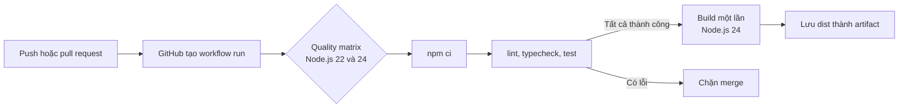

<Callout type="info" title="Bạn sẽ làm được gì?">
  Sau bài này, bạn có thể tạo một workflow CI kiểm tra `lint`, kiểu dữ liệu, test và build cho dự án Node.js. Workflow chạy trên các bản Node.js LTS còn được hỗ trợ, nhưng chỉ build một lần để tránh lãng phí runner.
</Callout>

## Mục lục

- [Mục tiêu và điều kiện đầu vào](#mục-tiêu-và-điều-kiện-đầu-vào)
- [Mental model của CI](#mental-model-của-ci)
  - [Luồng từ commit đến artifact](#luồng-từ-commit-đến-artifact)
  - [Cache không phải artifact](#cache-không-phải-artifact)
- [Chuẩn bị dự án Node.js](#chuẩn-bị-dự-án-nodejs)
  - [Chuẩn hóa package scripts](#chuẩn-hóa-package-scripts)
  - [Commit lockfile và dùng npm ci](#commit-lockfile-và-dùng-npm-ci)
- [Workflow production-ready](#workflow-production-ready)
  - [Workflow hoàn chỉnh](#workflow-hoàn-chỉnh)
  - [Vì sao cấu trúc thành hai job](#vì-sao-cấu-trúc-thành-hai-job)
  - [Cấu hình setup-node và cache đúng lockfile](#cấu-hình-setup-node-và-cache-đúng-lockfile)
  - [Matrix Node LTS](#matrix-node-lts)
  - [Artifacts phục vụ kiểm tra và triển khai](#artifacts-phục-vụ-kiểm-tra-và-triển-khai)
  - [Timeout permissions và concurrency](#timeout-permissions-và-concurrency)
- [Bài thực hành](#bài-thực-hành)
  - [Các bước thực hiện](#các-bước-thực-hiện)
  - [Tiêu chí xác minh](#tiêu-chí-xác-minh)
- [Troubleshooting](#troubleshooting)
- [Best practices](#best-practices)
- [Tài liệu tham khảo](#tài-liệu-tham-khảo)

## Mục tiêu và điều kiện đầu vào

CI, viết tắt của **Continuous Integration** hay tích hợp liên tục, là quá trình tự động kiểm tra mỗi thay đổi trước khi hợp nhất vào nhánh chính. Một pipeline tốt phải trả lời nhanh ba câu hỏi:

1. Mã nguồn có tuân thủ quy ước và kiểm tra kiểu dữ liệu không?
2. Mã nguồn có chạy đúng trên các phiên bản Node.js được hỗ trợ không?
3. Dự án có tạo được đầu ra dùng để phát hành không?

Hướng dẫn dùng npm và giả định repository có:

- `package.json` cùng `package-lock.json` đã commit;
- các script `lint`, `typecheck`, `test` và `build` chạy được ở máy local;
- thư mục build là `dist/` và báo cáo coverage là `coverage/`;
- nhánh chính tên `main`.

Nếu công cụ của bạn tạo thư mục khác, hãy đổi `path` của artifact cho phù hợp. Ví dụ, Next.js thường tạo `.next/`, còn một thư viện có thể tạo `lib/`.

<Callout type="warn" title="CI không sửa lỗi thay bạn">
  Hãy chạy cùng lệnh ở máy local trước khi đẩy code. CI phải là môi trường xác minh lặp lại được, không phải nơi đầu tiên phát hiện package script chưa tồn tại.
</Callout>

## Mental model của CI

Một **workflow** là tệp YAML trong `.github/workflows/`. Mỗi sự kiện như `push` hoặc `pull_request` tạo một **workflow run**, tức một lần chạy cụ thể. Trong run có các **job**; mỗi job chạy trên một máy ảo gọi là **runner** và gồm nhiều **step** thực thi tuần tự.

**Matrix** là cách GitHub nhân một job thành nhiều biến thể. Với `node-version: [22.x, 24.x]`, cùng bộ kiểm tra sẽ chạy độc lập một lần trên Node.js 22 và một lần trên Node.js 24.

### Luồng từ commit đến artifact



Mỗi job nhận một runner sạch. Vì vậy, đừng giả định `node_modules/` hoặc `dist/` từ job trước tự xuất hiện ở job sau. Dữ liệu cần chuyển giữa các job phải được upload thành artifact rồi download ở job nhận, hoặc phải được tạo lại.

### Cache không phải artifact

Hai khái niệm đều lưu dữ liệu ngoài vòng đời runner, nhưng phục vụ mục đích khác nhau:

| Thuộc tính | Cache | Artifact |
|---|---|---|
| Mục đích | Tăng tốc lần chạy sau | Lưu hoặc chuyển đầu ra của một run |
| Ví dụ | Kho tải xuống của npm tại `~/.npm` | `dist/`, coverage, log, ảnh chụp test |
| Có thể không khớp | Có; cache miss chỉ làm job chậm hơn | Không nên; thiếu build artifact thường là lỗi |
| Khóa nhận diện | Tạo từ hệ điều hành, package manager và hash lockfile | Tên artifact trong workflow run |
| Dùng để deploy | Không | Có thể, sau khi download và xác minh |

`actions/setup-node` cache kho package toàn cục của npm, **không cache `node_modules/`**. Sau khi restore cache, vẫn phải chạy `npm ci`. Lệnh này dựng lại `node_modules/` đúng theo lockfile, nhưng tải package nhanh hơn nhờ dữ liệu đã có trong `~/.npm`.

<Callout type="idea" title="Quy tắc dễ nhớ">
  Cache là tối ưu hiệu năng và phải an toàn khi bị xóa. Artifact là sản phẩm hoặc bằng chứng của một workflow run và phải có vòng đời lưu trữ rõ ràng.
</Callout>

## Chuẩn bị dự án Node.js

### Chuẩn hóa package scripts

CI nên gọi package scripts thay vì nhúng lệnh phụ thuộc công cụ trực tiếp vào YAML. Cách này giữ lệnh local và CI giống nhau. Ví dụ cho dự án TypeScript dùng ESLint và Vitest:

```json
{
  "scripts": {
    "lint": "eslint .",
    "typecheck": "tsc --noEmit",
    "test": "vitest run --coverage",
    "build": "tsc -p tsconfig.build.json"
  },
  "engines": {
    "node": "^22.0.0 || ^24.0.0"
  }
}
```

`typecheck` chỉ kiểm tra kiểu mà không phát sinh file JavaScript. `test` chạy một lần rồi thoát; tránh chế độ watch vì runner sẽ chờ vô hạn. Trường `engines` mô tả phạm vi Node.js được hỗ trợ, nhưng npm thường chỉ cảnh báo khi phiên bản không khớp. Matrix CI mới là bằng chứng thực tế rằng dự án chạy được trên từng major.

Chạy toàn bộ cổng chất lượng ở local:

```bash
npm ci
npm run lint
npm run typecheck
npm test
npm run build
```

Không dùng `--if-present` cho các cổng bắt buộc. Nếu script `typecheck` bị xóa nhầm, CI nên thất bại thay vì âm thầm bỏ qua.

### Commit lockfile và dùng npm ci

`package-lock.json` là **lockfile**, tức tệp khóa chính xác cây dependency đã được giải quyết. Hãy tạo và commit nó cùng thay đổi trong `package.json`:

```bash
npm install

git add package.json package-lock.json
git commit -m "chore: update dependencies"
```

Trong CI, dùng:

```bash
npm ci
```

`npm ci` yêu cầu lockfile tồn tại và nhất quán với `package.json`. Lệnh xóa `node_modules/` hiện có, cài đúng phiên bản trong lockfile và không tự sửa lockfile. Các đặc tính này làm bản build dễ tái tạo hơn `npm install`.

Nếu local tạo lockfile với cờ ảnh hưởng cây dependency, CI phải dùng cùng cấu hình. Ví dụ, khi dự án cần `legacy-peer-deps=true`, hãy commit thiết lập đó trong `.npmrc`; nếu không, `npm ci` có thể dựng cây khác hoặc thất bại.

## Workflow production-ready

### Workflow hoàn chỉnh

Tạo `.github/workflows/ci.yml`:

```yaml
name: Node.js CI

on:
  push:
    branches: [main]
  pull_request:
    branches: [main]

# CI chỉ cần đọc mã nguồn. Mọi quyền không khai báo được đặt thành none.
permissions:
  contents: read

# Một branch hoặc pull request chỉ giữ run mới nhất đang hoạt động.
concurrency:
  group: ci-${{ github.workflow }}-${{ github.event.pull_request.number || github.ref }}
  cancel-in-progress: true

jobs:
  quality:
    name: Quality / Node.js ${{ matrix.node-version }}
    runs-on: ubuntu-latest
    timeout-minutes: 15
    strategy:
      fail-fast: false
      matrix:
        node-version: [22.x, 24.x]

    steps:
      - name: Checkout source
        uses: actions/checkout@v7
        with:
          persist-credentials: false

      - name: Set up Node.js ${{ matrix.node-version }}
        uses: actions/setup-node@v7
        with:
          node-version: ${{ matrix.node-version }}
          cache: npm
          cache-dependency-path: package-lock.json

      - name: Install dependencies
        run: npm ci

      - name: Lint
        run: npm run lint

      - name: Typecheck
        run: npm run typecheck

      - name: Test
        run: npm test

      - name: Upload coverage from the primary LTS job
        if: ${{ always() && matrix.node-version == '24.x' }}
        uses: actions/upload-artifact@v7
        with:
          name: coverage-node-24-${{ github.run_id }}-${{ github.run_attempt }}
          path: coverage/
          if-no-files-found: ignore
          retention-days: 7

  build:
    name: Build / Node.js 24
    needs: quality
    runs-on: ubuntu-latest
    timeout-minutes: 15

    steps:
      - name: Checkout source
        uses: actions/checkout@v7
        with:
          persist-credentials: false

      - name: Set up Node.js 24
        uses: actions/setup-node@v7
        with:
          node-version: 24.x
          cache: npm
          cache-dependency-path: package-lock.json

      - name: Install dependencies
        run: npm ci

      - name: Build
        run: npm run build

      - name: Upload build artifact
        uses: actions/upload-artifact@v7
        with:
          name: dist-node-24-${{ github.run_id }}-${{ github.run_attempt }}
          path: dist/
          if-no-files-found: error
          retention-days: 14
```

Ví dụ dùng các major hiện hành của official actions: `actions/checkout@v7`, `actions/setup-node@v7` và `actions/upload-artifact@v7`. Major tag giúp nhận bản vá tương thích trong cùng major. Với repository yêu cầu kiểm soát chuỗi cung ứng nghiêm ngặt, hãy pin action bằng full commit SHA và dùng Dependabot để cập nhật SHA có kiểm duyệt.

<Callout type="warn" title="Không dùng pull_request_target để chạy code không tin cậy">
  Workflow trên dùng `pull_request`, phù hợp để test code từ pull request. Không đổi sang `pull_request_target` rồi checkout và chạy code của contributor nếu chưa thiết kế mô hình bảo mật; trigger đó có thể chạy trong ngữ cảnh nhánh đích với token hoặc secrets có quyền cao hơn.
</Callout>

### Vì sao cấu trúc thành hai job

Job `quality` dùng matrix vì thư viện và ứng dụng cần chứng minh lint, typecheck và test hoạt động trên mọi Node.js LTS được hỗ trợ. `fail-fast: false` cho phép cả hai phiên bản hoàn tất, nên một run cho biết đầy đủ phiên bản nào hỏng.

Job `build` có `needs: quality`, vì vậy chỉ chạy sau khi **tất cả** biến thể matrix thành công. Job này cố định Node.js 24 và chỉ chạy một lần. Nếu đặt `npm run build` trong `quality`, cùng output sẽ bị build hai lần mà không tạo thêm tín hiệu hữu ích trong phần lớn dự án JavaScript thuần túy.

Cách tách job đánh đổi một lần `npm ci` bổ sung để đổi lấy trách nhiệm rõ ràng và build duy nhất. Cache npm làm lần cài thứ hai nhanh hơn. Nếu build của bạn phụ thuộc hành vi khác nhau giữa các major Node.js, hãy chủ động build trong matrix; tính tương thích khi đó quan trọng hơn chi phí runner.

### Cấu hình setup-node và cache đúng lockfile

Ba dòng sau phải đi cùng nhau:

```yaml
with:
  node-version: 24.x
  cache: npm
  cache-dependency-path: package-lock.json
```

- `node-version` không phụ thuộc phiên bản Node.js tình cờ có sẵn trên runner.
- `cache: npm` bật cache package toàn cục của npm thông qua `setup-node`.
- `cache-dependency-path` chỉ rõ lockfile dùng để tạo cache key. Khi lockfile đổi, key đổi theo.

Với monorepo có nhiều lockfile, truyền một pattern nhiều dòng:

```yaml
with:
  node-version: 24.x
  cache: npm
  cache-dependency-path: |
    package-lock.json
    packages/*/package-lock.json
```

Sau đó, lệnh cài phải chạy đúng workspace hoặc thư mục tương ứng. Ví dụ npm workspaces ở root vẫn thường dùng một `package-lock.json` gốc và một lệnh `npm ci` tại root; không thêm pattern con nếu các file đó không tồn tại.

### Matrix Node LTS

Tại thời điểm viết, Node.js 22 và 24 là các nhánh LTS còn được hỗ trợ phù hợp cho production. Node.js 20 đã hết vòng đời hỗ trợ, nên không đưa vào matrix mới. Hãy kiểm tra lịch phát hành chính thức định kỳ vì trạng thái LTS thay đổi theo thời gian.

Dùng `22.x` và `24.x` để tự nhận bản minor/patch mới nhất trong mỗi major. Dùng phiên bản chính xác như `24.12.0` khi môi trường phải tái tạo tuyệt đối, nhưng bạn cần quy trình cập nhật bản vá bảo mật thường xuyên.

Chọn matrix theo cam kết hỗ trợ thực tế:

- **Ứng dụng nội bộ:** thường test bản LTS dùng ở production và bản LTS kế tiếp.
- **Thư viện npm:** test mọi major còn được khai báo trong `engines.node`.
- **Không test phiên bản EOL:** EOL là *End of Life*, tức phiên bản không còn nhận bản vá bảo mật chính thức.

### Artifacts phục vụ kiểm tra và triển khai

Workflow lưu hai loại đầu ra:

- `coverage-node-24-...` giúp reviewer xem báo cáo coverage. Điều kiện `always()` vẫn thử upload khi test lỗi, nhưng `if-no-files-found: ignore` không che mất lỗi test nếu công cụ chưa tạo báo cáo.
- `dist-node-24-...` là output build. `if-no-files-found: error` làm job thất bại nếu script báo thành công nhưng không tạo `dist/`.

Tên có `github.run_id` và `github.run_attempt` để mỗi lần chạy hoặc chạy lại có tên riêng. `retention-days` giới hạn thời gian lưu, giảm chi phí lưu trữ. Không upload `.env`, token, source map chứa source nhạy cảm hoặc file ẩn chưa được kiểm tra.

Artifact có thể làm đầu vào cho job deploy bằng `actions/download-artifact`. Cách đó bảo đảm deploy đúng output đã qua CI, thay vì build lại và có nguy cơ tạo kết quả khác.

### Timeout permissions và concurrency

Các guardrail trong workflow giải quyết ba rủi ro độc lập:

- `timeout-minutes: 15` dừng job bị treo, ví dụ test vô tình chạy watch mode hoặc không đóng kết nối database.
- `permissions: contents: read` áp dụng nguyên tắc quyền tối thiểu cho `GITHUB_TOKEN`. Workflow CI này không cần ghi repository, package hay pull request.
- `concurrency` hủy run cũ khi cùng pull request hoặc cùng branch có commit mới. **Concurrency group** là khóa nhận diện nhóm run không nên chạy đồng thời.

Biểu thức `${{ github.event.pull_request.number || github.ref }}` dùng số pull request khi sự kiện là `pull_request`; với `push`, toán tử `||` rơi về Git ref như `refs/heads/main`. Thêm `github.workflow` tránh workflow khác vô tình dùng cùng group.

<Callout type="info" title="Self-hosted runner">
  Các major action mới chạy bằng Node.js runtime mới bên trong action. Nếu dùng self-hosted runner, hãy cập nhật GitHub Actions Runner theo yêu cầu trong release notes của action trước khi nâng major.
</Callout>

## Bài thực hành

Mục tiêu của bài thực hành là chứng minh pipeline không chỉ có YAML hợp lệ mà còn chặn được thay đổi lỗi và tạo đúng output.

### Các bước thực hiện

1. Kiểm tra bốn package script ở local bằng `npm ci`, `npm run lint`, `npm run typecheck`, `npm test` và `npm run build`.
2. Xác nhận `package-lock.json` đã được commit và thư mục build thật sự là `dist/`.
3. Tạo `.github/workflows/ci.yml` từ workflow hoàn chỉnh ở trên.
4. Tạo branch `ci/node-workflow`, commit tệp workflow rồi mở pull request vào `main`.
5. Mở tab **Actions**, chọn run tương ứng và kiểm tra có hai job `Quality` cho Node.js 22, 24. Sau khi cả hai pass, kiểm tra job `Build` chỉ xuất hiện một lần.
6. Tải artifact `dist-node-24-...` từ trang run. Giải nén và xác nhận có file build mong đợi.
7. Tạo một commit thử nghiệm làm test thất bại. Xác nhận `Build` bị skip và pull request không đạt CI. Sau đó sửa test và đẩy commit mới.
8. Quan sát run cũ bị hủy nếu nó còn chạy khi commit mới được push. Đây là bằng chứng `concurrency` hoạt động.

### Tiêu chí xác minh

Hoàn thành bài khi tất cả tiêu chí sau đúng:

- [ ] Workflow được kích hoạt trên pull request vào `main` và push vào `main`.
- [ ] Hai biến thể `Quality / Node.js 22.x` và `Quality / Node.js 24.x` đều chạy `npm ci`, lint, typecheck và test.
- [ ] Log `setup-node` cho thấy cache npm được tìm bằng `package-lock.json`; cache miss đầu tiên vẫn không làm job lỗi.
- [ ] `Build / Node.js 24` chỉ chạy một lần và chỉ sau toàn bộ matrix thành công.
- [ ] Khi test lỗi, check CI đỏ và job build không chạy.
- [ ] Khi CI xanh, trang run có build artifact chứa nội dung của `dist/`.
- [ ] Workflow run mới thay thế run cũ trên cùng pull request khi hai run chồng lấp.
- [ ] Repository có thể cấu hình branch protection yêu cầu các check `Quality` và `Build` trước khi merge.

## Troubleshooting

| Triệu chứng | Nguyên nhân thường gặp | Cách xử lý |
|---|---|---|
| `npm ci` báo cần lockfile | `package-lock.json` chưa được commit hoặc lockfile quá cũ | Chạy `npm install` bằng npm phù hợp, review thay đổi rồi commit `package-lock.json` |
| `npm ci` báo `package.json` và lockfile không đồng bộ | Dependency được sửa thủ công nhưng chưa cập nhật lockfile | Chạy `npm install` ở local, commit cả hai tệp; không đổi sang `npm install` trong CI để né lỗi |
| `ERESOLVE` chỉ xuất hiện trên CI | Local và CI dùng npm khác nhau, hoặc thiếu cấu hình peer dependency | So sánh `node --version` và `npm --version`; commit cấu hình bắt buộc trong `.npmrc` và tái tạo lockfile |
| Cache luôn miss | Sai `cache-dependency-path`, lockfile đổi ở mỗi commit hoặc monorepo trỏ nhầm file | Kiểm tra đường dẫn tính từ root repository và xem log `setup-node`; cache miss không phải lỗi chức năng |
| `Missing script: lint` | `package.json` không có script đúng tên | Thêm script hoặc đổi lệnh workflow cho khớp; không dùng `--if-present` cho gate bắt buộc |
| Test không kết thúc | Test runner chạy watch mode hoặc còn handle mở như server, timer, database | Dùng chế độ CI như `vitest run`, đóng resource trong teardown và giữ `timeout-minutes` |
| Chỉ một phiên bản matrix thất bại | Code hoặc dependency không hỗ trợ major Node.js đó | Tái hiện bằng đúng major ở local; sửa compatibility hoặc cập nhật phạm vi `engines` và chính sách hỗ trợ |
| Job `Build` bị skipped | Một biến thể trong `quality` đã lỗi hoặc bị hủy | Mở từng job matrix để tìm step đầu tiên lỗi; đây là hành vi đúng của `needs: quality` |
| Upload build báo không tìm thấy file | Script build ghi sang thư mục khác hoặc không tạo output | Kiểm tra log build và sửa `path`; giữ `if-no-files-found: error` để tránh artifact rỗng |
| Upload artifact báo trùng tên | Nhiều job upload cùng tên artifact bất biến | Thêm giá trị matrix, `github.run_id` hoặc `github.run_attempt` vào tên |
| Run bị hủy ngoài ý muốn | Nhiều run cùng `concurrency.group` | Giữ cả `github.workflow` và định danh PR/ref trong group; tắt `cancel-in-progress` nếu mọi run đều cần lưu |
| Action mới không chạy trên self-hosted runner | Phiên bản runner không hỗ trợ Node.js runtime bên trong action | Nâng GitHub Actions Runner theo release notes hoặc tạm pin major action tương thích đã được tổ chức phê duyệt |
| Workflow không xuất hiện | Tệp không nằm trong `.github/workflows/` hoặc YAML sai | Kiểm tra đường dẫn, tab Actions và lỗi annotation của GitHub; validate YAML nhưng giữ nguyên expression `${{ ... }}` |

## Best practices

- **Giữ local và CI cùng giao diện:** CI chỉ gọi `npm run lint`, `npm run typecheck`, `npm test`, `npm run build`.
- **Commit và review lockfile:** thay đổi lockfile là thay đổi mã nguồn chuỗi cung ứng, không phải file phát sinh có thể bỏ qua.
- **Dùng `npm ci` trong CI:** không để runner tự cập nhật dependency hoặc lockfile.
- **Khai báo rõ phiên bản Node.js:** không dựa vào phiên bản cài sẵn của `ubuntu-latest`.
- **Chỉ matrix những gì tạo tín hiệu:** test trên mọi Node.js được hỗ trợ; build một lần nếu output không phụ thuộc major.
- **Không cache `node_modules/`:** ưu tiên cache npm tích hợp trong `setup-node`, được khóa theo lockfile và vẫn cài sạch bằng `npm ci`.
- **Coi cache là dữ liệu có thể mất:** pipeline phải đúng khi cache miss hoặc cache bị xóa.
- **Coi artifact là dữ liệu có chủ đích:** đặt tên duy nhất, thời gian lưu ngắn hợp lý và lỗi khi output bắt buộc không tồn tại.
- **Không đưa secrets vào artifact hoặc log:** kiểm tra kỹ file ẩn, `.env`, source map và báo cáo có dữ liệu người dùng.
- **Áp dụng quyền tối thiểu:** bắt đầu từ `contents: read`; chỉ thêm quyền ở job thật sự cần và không truyền secrets vào CI của fork.
- **Giới hạn thời gian và run trùng:** đặt `timeout-minutes` cùng `concurrency` để tránh tốn runner vô ích.
- **Bảo vệ nhánh chính:** yêu cầu các status check CI và review trước khi merge.
- **Cập nhật action có kiểm soát:** dùng major chính thức hiện hành như ví dụ, hoặc pin full SHA cho threat model nghiêm ngặt; tự động mở PR cập nhật bằng Dependabot.
- **Theo dõi lịch Node.js:** bỏ phiên bản EOL và thêm LTS mới theo chính sách hỗ trợ đã công bố.

## Tài liệu tham khảo

- [GitHub Docs — Building and testing Node.js](https://docs.github.com/en/actions/use-cases-and-examples/building-and-testing/building-and-testing-nodejs)
- [GitHub Docs — Workflow syntax for GitHub Actions](https://docs.github.com/en/actions/reference/workflows-and-actions/workflow-syntax)
- [GitHub Docs — Dependency caching reference](https://docs.github.com/en/actions/reference/workflows-and-actions/dependency-caching)
- [GitHub Docs — Store and share data with workflow artifacts](https://docs.github.com/en/actions/tutorials/store-and-share-data)
- [GitHub Docs — Control workflow concurrency](https://docs.github.com/en/actions/how-tos/write-workflows/choose-when-workflows-run/control-workflow-concurrency)
- [GitHub Docs — Assign permissions to jobs](https://docs.github.com/en/actions/how-tos/write-workflows/choose-what-workflows-do/control-job-permissions)
- [GitHub Docs — Secure use reference](https://docs.github.com/en/actions/reference/security/secure-use)
- [actions/checkout — official repository](https://github.com/actions/checkout)
- [actions/setup-node — official repository](https://github.com/actions/setup-node)
- [actions/upload-artifact — official repository](https://github.com/actions/upload-artifact)
- [npm Docs — npm ci](https://docs.npmjs.com/cli/commands/npm-ci)
- [Node.js — Release schedule and LTS status](https://nodejs.org/en/about/previous-releases)
