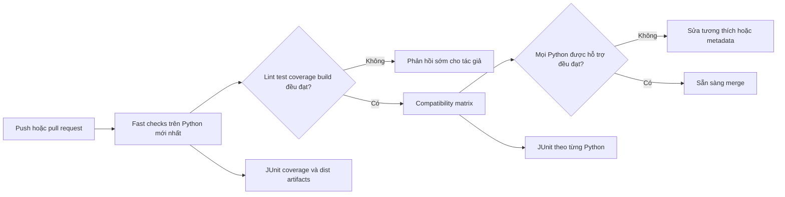

<Callout type="info" title="Phạm vi">
  Hướng dẫn dùng dự án `src` layout, `pyproject.toml` và `pip` làm luồng chính. Ví dụ hỗ trợ CPython 3.11–3.14 trên GitHub.com; hãy đổi tên package, ngưỡng coverage và dải Python theo metadata thật của dự án.
</Callout>

## Mục lục

- [Mô hình tư duy](#mô-hình-tư-duy)
  - [Pipeline chứng minh điều gì](#pipeline-chứng-minh-điều-gì)
  - [Luồng phản hồi](#luồng-phản-hồi)
- [Chuẩn bị dự án và khóa phụ thuộc](#chuẩn-bị-dự-án-và-khóa-phụ-thuộc)
  - [Nguồn cấu hình pyproject](#nguồn-cấu-hình-pyproject)
  - [Requirements và dependency locking](#requirements-và-dependency-locking)
  - [Điều chỉnh cho Poetry hoặc uv](#điều-chỉnh-cho-poetry-hoặc-uv)
- [Thiết kế pipeline production](#thiết-kế-pipeline-production)
  - [Fast checks và compatibility](#fast-checks-và-compatibility)
  - [Matrix Python có chủ đích](#matrix-python-có-chủ-đích)
  - [Cache và artifact](#cache-và-artifact)
  - [Quyền và giới hạn chạy](#quyền-và-giới-hạn-chạy)
- [Workflow hoàn chỉnh](#workflow-hoàn-chỉnh)
  - [Điều cần đổi trước khi dùng](#điều-cần-đổi-trước-khi-dùng)
  - [Giải thích từng job](#giải-thích-từng-job)
- [Chạy và xác minh cục bộ](#chạy-và-xác-minh-cục-bộ)
- [Bài thực hành](#bài-thực-hành)
  - [Yêu cầu](#yêu-cầu)
  - [Tiêu chí xác minh](#tiêu-chí-xác-minh)
- [Troubleshooting](#troubleshooting)
- [Best practices](#best-practices)
- [Tài liệu tham khảo](#tài-liệu-tham-khảo)

## Mô hình tư duy

CI (Continuous Integration, tích hợp liên tục) là một phép kiểm chứng có thể lặp lại cho mỗi thay đổi. Runner phải tạo môi trường mới, cài đúng tập phụ thuộc đã duyệt, rồi chứng minh mã nguồn và gói phân phối đều hoạt động. CI không nên thành một máy phát hành bí mật chỉ chạy được nhờ trạng thái còn sót lại trên máy của lập trình viên.

### Pipeline chứng minh điều gì

Một pipeline Python tốt trả lời lần lượt năm câu hỏi:

1. **Mã có tuân thủ quy ước không?** Ruff kiểm tra lỗi tĩnh, import và định dạng.
2. **Hành vi có đúng không?** pytest chạy test trong môi trường sạch.
3. **Test có chạm đủ phần quan trọng không?** coverage đo phần mã được thực thi và áp ngưỡng tối thiểu.
4. **Metadata có nói đúng phạm vi hỗ trợ không?** matrix chạy test trên mọi minor version được công bố.
5. **Người dùng có cài được sản phẩm không?** `python -m build`, `twine check` và một virtual environment sạch kiểm tra wheel thực tế.

<Callout type="warn" title="Test source chưa đủ">
  `pytest` có thể xanh khi chạy trực tiếp từ repository nhưng wheel lại thiếu module hoặc file dữ liệu. Vì vậy, bước build và cài thử wheel không phải phần trang trí; nó kiểm tra đúng thứ sẽ được phát hành.
</Callout>

### Luồng phản hồi



Job nhanh chạy trước để tránh tiêu tốn cả matrix cho một lỗi format đơn giản. Đổi lại, tổng thời gian khi mọi thứ đều xanh dài hơn một chút vì matrix phải chờ. Với repository ưu tiên độ trễ hơn chi phí, có thể bỏ `needs: fast-checks` để hai lớp chạy song song.

## Chuẩn bị dự án và khóa phụ thuộc

Cấu trúc tối thiểu nên tách mã package khỏi repository root:

```text
python-project/
├── .github/workflows/ci.yml
├── src/ci_demo/__init__.py
├── tests/test_smoke.py
├── pyproject.toml
└── requirements-dev.lock
```

`src` layout ngăn test vô tình import mã ngay từ thư mục làm việc thay vì package đã cài. Tên distribution `ci-demo` có thể khác tên import `ci_demo`; workflow sẽ khai báo rõ tên import bằng `PACKAGE_IMPORT`.

### Nguồn cấu hình pyproject

`pyproject.toml` là nguồn sự thật cho metadata, dải Python, build backend và cấu hình công cụ. Mẫu sau dùng Hatchling; có thể thay bằng Setuptools hoặc Flit mà không đổi kiến trúc pipeline.

```toml title="pyproject.toml"
[build-system]
requires = ["hatchling==1.31.0"]
build-backend = "hatchling.build"

[project]
name = "ci-demo"
version = "0.1.0"
description = "Package minh họa CI Python"
requires-python = ">=3.11,<3.15"
dependencies = []

[project.optional-dependencies]
dev = [
  "build>=1,<2",
  "pytest>=8,<10",
  "pytest-cov>=5,<8",
  "ruff>=0.9,<1",
  "twine>=5,<7",
]

[tool.hatch.build.targets.wheel]
packages = ["src/ci_demo"]

[tool.ruff]
target-version = "py311"
line-length = 100

[tool.ruff.lint]
select = ["E", "F", "I", "B", "UP"]

[tool.pytest.ini_options]
testpaths = ["tests"]
addopts = ["-ra", "--strict-config", "--strict-markers"]

[tool.coverage.run]
branch = true
source = ["src"]

[tool.coverage.report]
show_missing = true
skip_covered = true
fail_under = 90
```

`requires-python` là hợp đồng công khai. Nếu metadata ghi `>=3.11,<3.15`, matrix phải có 3.11, 3.12, 3.13 và 3.14. `target-version = "py311"` yêu cầu Ruff không tự động viết cú pháp mới hơn phiên bản thấp nhất.

Các khoảng phiên bản trong `dev` mô tả ý định của dự án. File lock ở phần tiếp theo mới cố định phiên bản chuyển tiếp và hash cụ thể mà CI cài đặt.

### Requirements và dependency locking

Dependency locking là việc chốt toàn bộ cây phụ thuộc, kể cả phụ thuộc chuyển tiếp. Chỉ ghi `pytest>=8` trong `pyproject.toml` chưa đủ: một bản mới của plugin hoặc thư viện chuyển tiếp có thể làm cùng commit cho kết quả khác vào tuần sau.

Luồng `pip-tools` giữ hai vai trò riêng biệt:

- `pyproject.toml`: dependency trực tiếp và khoảng phiên bản con người có thể duy trì.
- `requirements-dev.lock`: kết quả resolve đầy đủ, ghim `==` và hash; phải commit vào Git.

Tạo hoặc cập nhật lock bằng đúng Python dùng cho fast checks:

```bash
python3.14 -m venv .venv-lock
. .venv-lock/bin/activate
python -m pip install "pip-tools==7.6.0"
python -m piptools compile \
  --extra dev \
  --all-build-deps \
  --generate-hashes \
  --output-file requirements-dev.lock \
  pyproject.toml
```

CI cài lock bằng:

```bash
python -m pip install --require-hashes -r requirements-dev.lock
python -m pip install --no-build-isolation --no-deps -e .
```

`--all-build-deps` đưa cả dependency trong `[build-system]` và các phụ thuộc chuyển tiếp của build backend vào lock. `--require-hashes` khiến job dừng nếu package không có hash đã duyệt. Khi cài project, `--no-deps` ngăn resolve lại dependency runtime còn `--no-build-isolation` buộc build backend dùng đúng các package đã cài từ lock. Cache của `setup-python` phải băm đúng `requirements-dev.lock`, không chỉ `pyproject.toml`, vì lock mới mô tả artifact thực tế được tải.

<Callout type="warn" title="Lock phụ thuộc vào môi trường resolve">
  `pip-compile` xử lý environment marker theo Python và hệ điều hành đang chạy. Nếu dependency chuyển tiếp khác nhau giữa Python 3.11 và 3.14, hãy tạo lock riêng như `requirements-py311.lock` và ánh xạ `lock-file` trong matrix. Với package đa nền tảng, tạo lock trên từng hệ điều hành mục tiêu hoặc dùng định dạng lock đa nền tảng của công cụ quản lý dự án.
</Callout>

Với ứng dụng deploy, nên dùng cùng lock trong CI và image production. Với thư viện, lock chỉ làm môi trường phát triển và CI tái lập được; metadata phát hành vẫn nên giữ khoảng phiên bản để người dùng có thể resolve cùng ứng dụng của họ.

### Điều chỉnh cho Poetry hoặc uv

Workflow chính bên dưới cố ý chỉ dùng `pip`. Nếu repository đã chọn công cụ khác, đừng trộn ba cơ chế lock trong cùng một job.

**Poetry:** commit `poetry.lock`, pin phiên bản Poetry ở một nơi có bot cập nhật, rồi thay các bước setup và cài đặt bằng mẫu sau. `setup-python` cần Poetry có mặt trước khi tính cache virtual environment.

```yaml
- uses: actions/checkout@v7
- name: Install Poetry
  run: pipx install "poetry==2.4.1"
- uses: actions/setup-python@v7
  with:
    python-version: "3.14"
    cache: poetry
    cache-dependency-path: poetry.lock
- name: Install locked dependencies
  run: poetry sync --with dev
- name: Run checks
  run: |
    poetry run ruff check --output-format=github .
    poetry run ruff format --check .
    poetry run pytest
- name: Build and inspect package
  run: |
    poetry build
    poetry run twine check dist/*
```

**uv:** commit `uv.lock`, dùng action chính thức của Astral, bật cache dựa trên lock và yêu cầu chế độ khóa. SHA dưới đây tương ứng `setup-uv` v9.0.0; tham số `version` ghim chính binary uv.

```yaml
- uses: actions/checkout@v7
- name: Set up uv
  uses: astral-sh/setup-uv@c771a70e6277c0a99b617c7a806ffedaca235ff9 # v9.0.0
  with:
    version: "0.12.0"
    python-version: "3.14"
    enable-cache: true
    cache-dependency-glob: uv.lock
- name: Install locked dependencies
  run: uv sync --locked --all-extras --dev
- name: Run checks
  run: |
    uv run ruff check --output-format=github .
    uv run ruff format --check .
    uv run pytest
- name: Build and inspect package
  run: |
    uv build
    uv run twine check dist/*
```

Trong matrix uv, truyền `${{ matrix.python-version }}` cho `python-version` và vẫn dùng `uv sync --locked`. Với Poetry, truyền cùng giá trị cho `actions/setup-python`. Các lệnh Ruff, pytest và tiêu chí artifact không thay đổi; chỉ lớp tạo môi trường thay đổi.

## Thiết kế pipeline production

### Fast checks và compatibility

Hai job có trách nhiệm khác nhau:

| Job | Chạy gì | Mục tiêu |
|---|---|---|
| `fast-checks` | Ruff, pytest + coverage, build, `twine check`, cài thử wheel | Phản hồi đầy đủ trên Python mới nhất; tạo reports và `dist/` |
| `compatibility` | pytest trên mọi minor version được hỗ trợ | Bắt lỗi cú pháp, dependency marker và hành vi khác phiên bản |

Không cần chạy Ruff và build lặp lại bốn lần nếu các bước đó không phụ thuộc interpreter. Nếu dự án có C extension hoặc tạo wheel theo ABI, build là việc phụ thuộc interpreter/hệ điều hành; khi đó chuyển build vào matrix và đặt tên artifact theo cả OS lẫn Python.

### Matrix Python có chủ đích

Đừng dùng duy nhất `3.x`: giá trị đó chỉ kiểm tra bản mới nhất tại thời điểm chạy và bỏ sót bản thấp nhất. Cũng đừng thêm mọi Python từng tồn tại. Matrix phải phản chiếu `project.requires-python` và chính sách hỗ trợ đã công bố.

Mẫu này kiểm tra tất cả phiên bản từ 3.11 đến 3.14. `fail-fast: false` cho phép các ô còn lại hoàn thành để thấy toàn bộ phạm vi hỏng. Nếu chỉ muốn một smoke matrix tiết kiệm chi phí, ít nhất hãy chọn **phiên bản thấp nhất** và **mới nhất**, rồi chạy matrix đầy đủ theo lịch hằng đêm.

### Cache và artifact

Hai khái niệm phục vụ hai đối tượng khác nhau:

- **Cache** là tối ưu hiệu năng cho runner. `setup-python` với `cache: pip` lưu kho download của pip, không lưu virtual environment và không thay thế bước `pip install`.
- **Artifact** là đầu ra để con người hoặc job khác tải về. Ví dụ: JUnit XML, coverage XML, wheel và source distribution.

Cache key phải thay đổi khi lock thay đổi. `cache-dependency-path: requirements-dev.lock` thực hiện điều đó. Không cache `.venv` giữa các job: đường dẫn tuyệt đối và binary trong môi trường có thể phụ thuộc image hoặc patch version của Python.

Artifact của `upload-artifact` là bất biến trong một workflow run. Vì vậy, mỗi matrix entry dùng tên riêng như `reports-python-3.11`. `if-no-files-found: error` phù hợp với `dist/`, còn report dùng `warn` và `if: always()` để không che mất lỗi gốc nếu test dừng sớm.

### Quyền và giới hạn chạy

- `permissions: contents: read` áp dụng nguyên tắc quyền tối thiểu. CI chỉ đọc code, không cần quyền ghi repository hay OIDC.
- `concurrency` hủy run cũ trên cùng pull request hoặc branch. Điều này tiết kiệm phút runner khi tác giả push liên tục.
- `timeout-minutes` chặn test treo vô hạn. Đặt theo dữ liệu lịch sử, không chọn một con số quá lớn để né lỗi.
- Không chạy code không tin cậy bằng `pull_request_target` cùng secrets. Với CI thông thường, dùng `pull_request` như workflow dưới đây.

Nếu sau này tách publish sang workflow riêng, chỉ job publish mới cần `id-token: write` để dùng PyPI Trusted Publishing. Không cấp quyền đó cho workflow kiểm tra pull request.

## Workflow hoàn chỉnh

Tạo `.github/workflows/ci.yml` với nội dung sau. Các major action `actions/checkout@v7`, `actions/setup-python@v7` và `actions/upload-artifact@v7` là major hiện hành đã được kiểm tra từ repository chính thức tại thời điểm viết.

```yaml title=".github/workflows/ci.yml"
name: Python CI

on:
  push:
    branches: [main]
  pull_request:
  workflow_dispatch:

permissions:
  contents: read

concurrency:
  group: python-ci-${{ github.workflow }}-${{ github.event.pull_request.number || github.ref }}
  cancel-in-progress: true

env:
  PIP_DISABLE_PIP_VERSION_CHECK: "1"
  PYTHONUNBUFFERED: "1"
  PACKAGE_IMPORT: ci_demo

jobs:
  fast-checks:
    name: Fast checks / Python 3.14
    runs-on: ubuntu-latest
    timeout-minutes: 15

    steps:
      - name: Check out source
        uses: actions/checkout@v7
        with:
          persist-credentials: false

      - name: Set up Python
        uses: actions/setup-python@v7
        with:
          python-version: "3.14"
          cache: pip
          cache-dependency-path: requirements-dev.lock

      - name: Install locked dependencies
        run: |
          python -m pip install --require-hashes -r requirements-dev.lock
          python -m pip install --no-build-isolation --no-deps -e .

      - name: Lint with Ruff
        run: python -m ruff check --output-format=github .

      - name: Check formatting with Ruff
        run: python -m ruff format --check .

      - name: Test with coverage
        run: |
          mkdir -p reports
          python -m pytest \
            --junitxml=reports/junit.xml \
            --cov=src \
            --cov-report=term-missing \
            --cov-report=xml:reports/coverage.xml

      - name: Build distributions from locked build dependencies
        run: python -m build --no-isolation

      - name: Validate distribution metadata
        run: python -m twine check dist/*

      - name: Install and import the wheel in a clean environment
        run: |
          python -m venv "$RUNNER_TEMP/package-check"
          "$RUNNER_TEMP/package-check/bin/python" -m pip install dist/*.whl
          "$RUNNER_TEMP/package-check/bin/python" -m pip check
          "$RUNNER_TEMP/package-check/bin/python" -c \
            'import importlib, os; importlib.import_module(os.environ["PACKAGE_IMPORT"])'

      - name: Upload test reports
        if: always()
        uses: actions/upload-artifact@v7
        with:
          name: reports-fast-python-3.14
          path: reports/
          if-no-files-found: warn
          retention-days: 14

      - name: Upload distributions
        uses: actions/upload-artifact@v7
        with:
          name: dist-python
          path: dist/
          if-no-files-found: error
          retention-days: 14

  compatibility:
    name: Compatibility / Python ${{ matrix.python-version }}
    needs: fast-checks
    runs-on: ubuntu-latest
    timeout-minutes: 15
    strategy:
      fail-fast: false
      matrix:
        python-version: ["3.11", "3.12", "3.13", "3.14"]

    steps:
      - name: Check out source
        uses: actions/checkout@v7
        with:
          persist-credentials: false

      - name: Set up Python ${{ matrix.python-version }}
        uses: actions/setup-python@v7
        with:
          python-version: ${{ matrix.python-version }}
          cache: pip
          cache-dependency-path: requirements-dev.lock

      - name: Install locked dependencies
        run: |
          python -m pip install --require-hashes -r requirements-dev.lock
          python -m pip install --no-build-isolation --no-deps -e .

      - name: Run compatibility tests
        run: |
          mkdir -p reports
          python -m pytest -q --junitxml=reports/junit.xml

      - name: Upload compatibility report
        if: always()
        uses: actions/upload-artifact@v7
        with:
          name: reports-python-${{ matrix.python-version }}
          path: reports/
          if-no-files-found: warn
          retention-days: 14
```

### Điều cần đổi trước khi dùng

1. Đổi `PACKAGE_IMPORT: ci_demo` thành module import thật. Distribution `my-service` thường có module `my_service`, nhưng không có quy tắc bắt buộc.
2. Đồng bộ `3.11`–`3.14` ở matrix, Python của `fast-checks`, `requires-python` và `tool.ruff.target-version`.
3. Đổi `--cov=src` nếu code không nằm trong `src/`. Có thể dùng `--cov=my_package` để chỉ đo một package.
4. Đặt `fail_under` theo baseline hiện tại rồi tăng dần. Không hạ ngưỡng chỉ để làm pull request xanh.
5. Nếu default branch không phải `main`, sửa trigger `push.branches`.
6. Nếu dùng self-hosted runner, xác nhận runner hỗ trợ runtime Node của action major hiện hành. Với GitHub Enterprise Server, kiểm tra ma trận hỗ trợ riêng; phiên bản artifact action trên GitHub.com không mặc nhiên chạy được trên GHES.

<Callout type="idea" title="Hardening action">
  Major tag dễ đọc và nhận bản vá trong cùng major, nhưng tag là tham chiếu có thể thay đổi. Repository yêu cầu chuỗi cung ứng chặt nên pin action bên thứ ba và action GitHub vào full commit SHA, ghi chú major bên cạnh, rồi dùng Dependabot hoặc Renovate để mở pull request nâng SHA.
</Callout>

### Giải thích từng job

`fast-checks` cài đúng lock, cài project editable không resolve lại dependency, rồi chạy Ruff trước pytest để phản hồi nhanh. Coverage thất bại khi thấp hơn `fail_under = 90`. Sau khi test xanh, job tạo cả sdist (`.tar.gz`) và wheel (`.whl`), kiểm tra metadata bằng Twine, rồi cài wheel trong virtual environment mới.

`compatibility` chỉ chạy sau fast checks. Mỗi ô matrix có interpreter riêng và report riêng. `fail-fast: false` giúp thấy ví dụ 3.11 và 3.12 cùng hỏng thay vì chỉ lỗi đầu tiên. Vì job không đo coverage, kết quả compatibility không làm thay đổi ngưỡng coverage đã được kiểm tra một lần trên 3.14.

`if: always()` chỉ đặt ở bước upload report. Không đặt nó lên test hoặc build, vì làm vậy có thể chạy bước sau trên trạng thái không hợp lệ. Artifact `dist-python` chỉ xuất hiện khi build, metadata và smoke install đều thành công.

## Chạy và xác minh cục bộ

Trước khi push, chạy cùng lệnh với CI trong virtual environment sạch:

```bash
python3.14 -m venv .venv
. .venv/bin/activate
python -m pip install --require-hashes -r requirements-dev.lock
python -m pip install --no-build-isolation --no-deps -e .
python -m ruff check .
python -m ruff format --check .
python -m pytest --cov=src --cov-report=term-missing
python -m build --no-isolation
python -m twine check dist/*
```

Nếu lệnh local và CI khác nhau, hãy đưa tham số ổn định vào `pyproject.toml` hoặc một script dùng chung. Tránh tạo hai định nghĩa kiểm tra độc lập vì chúng sẽ lệch nhau theo thời gian.

Để xác minh wheel thay vì source tree, tạo môi trường mới ngoài repository hoặc đổi thư mục trước khi import:

```bash
python -m venv /tmp/ci-demo-wheel
/tmp/ci-demo-wheel/bin/python -m pip install dist/*.whl
cd /tmp
/tmp/ci-demo-wheel/bin/python -c "import ci_demo; print(ci_demo.__file__)"
/tmp/ci-demo-wheel/bin/python -m pip check
```

Đường dẫn in ra phải nằm trong `/tmp/ci-demo-wheel`, không nằm trong working tree.

## Bài thực hành

### Yêu cầu

1. Tạo package `ci_demo` theo `src` layout và ít nhất hai test pytest.
2. Thêm cấu hình Ruff, pytest và coverage vào `pyproject.toml`.
3. Sinh `requirements-dev.lock` có pin và hash, rồi commit file.
4. Thêm workflow hoàn chỉnh ở trên, đã đổi `PACKAGE_IMPORT` và dải Python cho dự án.
5. Cố ý tạo một lỗi Ruff và một test fail trong hai commit riêng để quan sát annotation và JUnit artifact; sau đó sửa lại.
6. Tạo pull request và bật branch protection yêu cầu các check `Fast checks / Python 3.14` cùng các ô compatibility trước khi merge.

### Tiêu chí xác minh

- [ ] Run chỉ có quyền `contents: read`; không có secret hoặc quyền ghi không cần thiết.
- [ ] Thay đổi `requirements-dev.lock` làm cache key đổi; log setup cho thấy cache miss lần đầu và có thể hit ở run sau.
- [ ] Ruff kiểm tra cả lint lẫn format mà không tự sửa code trong CI.
- [ ] pytest tạo `reports/junit.xml`; coverage tạo `reports/coverage.xml` và job fail khi dưới ngưỡng.
- [ ] Matrix có đúng mọi minor version trong `requires-python`; mỗi ô đều chạy test thật.
- [ ] Artifacts có tên riêng: report fast, report cho từng Python và `dist-python`.
- [ ] `dist-python` chứa cả `.whl` và `.tar.gz`; `twine check` đạt và wheel import được trong môi trường sạch.
- [ ] Push thêm commit vào cùng pull request khiến run cũ đang chạy bị hủy bởi `concurrency`.
- [ ] Một test treo không thể giữ runner quá `timeout-minutes` đã cấu hình.

## Troubleshooting

| Triệu chứng | Nguyên nhân cần kiểm tra | Hướng xử lý |
|---|---|---|
| `No file in ... matched to [**/requirements-dev.lock]` | Sai đường dẫn hoặc checkout chưa chạy trước setup | Commit lock, đặt `actions/checkout` trước `setup-python`, sửa `cache-dependency-path` theo working directory |
| Cache hit nhưng `pip install` vẫn chạy | Cache pip chỉ lưu file download, không cài package vào environment | Giữ bước install; đánh giá tốc độ qua lượng download, không bỏ cài đặt |
| `THESE PACKAGES DO NOT MATCH THE HASHES` | Lock cũ, index trả artifact khác, hoặc lock sinh cho môi trường khác | Không tắt `--require-hashes`; xác minh package index rồi tái sinh lock qua quy trình review |
| Lock cài được trên 3.14 nhưng fail trên 3.11 | Marker hoặc dependency chuyển tiếp phụ thuộc Python | Sinh lock theo từng minor version và ánh xạ file lock trong `matrix.include`, hoặc chuyển sang lock đa nền tảng của uv/Poetry |
| Ruff local xanh nhưng CI đỏ | Phiên bản Ruff hoặc cấu hình local khác lock | Chạy Ruff từ environment cài bằng lock; không dựa vào Ruff global |
| Coverage local và CI khác nhau | Local còn file `.coverage`, chạy tập test khác, hoặc import source tree khác package | Xóa dữ liệu coverage cũ, dùng cùng command/config và kiểm tra đường dẫn module được import |
| pytest không tạo JUnit artifact | Job dừng ở bước install/lint trước pytest hoặc sai `path` | Xem lỗi gốc trước; giữ `if: always()` và `if-no-files-found: warn` cho report |
| Upload artifact báo conflict | Nhiều matrix job dùng cùng tên artifact | Thêm `${{ matrix.python-version }}` và `${{ matrix.os }}` vào tên |
| `twine check` đỏ | README/content type, metadata hoặc file sdist không hợp lệ | Đọc lỗi Twine, sửa metadata trong `pyproject.toml`, xóa `dist/` rồi build lại |
| Import smoke test lấy module từ repository | Editable install hoặc current directory che wheel | Dùng virtual environment mới và chạy import từ thư mục ngoài repository |
| Job bị `Cancelled` bất ngờ | Run mới cùng concurrency group đã bắt đầu | Đây là hành vi mong đợi; nếu các branch khác nhau bị gom chung, kiểm tra biểu thức `group` |
| Action v7 không chạy trên self-hosted runner hoặc GHES | Runner quá cũ hoặc action chưa được GHES hỗ trợ | Nâng runner theo release notes; trên GHES chọn phiên bản được tài liệu instance hỗ trợ thay vì sao chép cấu hình GitHub.com |
| Test native dependency chỉ fail trên Windows hoặc macOS | Matrix hiện chỉ kiểm tra Ubuntu | Thêm trục `os` có chủ đích, khóa dependency theo OS và đặt tên artifact bằng cả OS lẫn Python |

## Best practices

- **Một nguồn sự thật:** metadata và cấu hình công cụ ở `pyproject.toml`; dependency đã resolve ở đúng một lock được commit.
- **Reproducible trước, cache sau:** lock và hash đảm bảo đầu vào; cache chỉ tăng tốc. Không dùng cache để che dependency chưa khóa.
- **Đồng bộ phạm vi hỗ trợ:** thay đổi `requires-python` phải đi cùng matrix và Ruff target trong cùng pull request.
- **Kiểm tra bản thấp nhất:** lỗi cú pháp và dependency thường xuất hiện ở rìa hỗ trợ, không phải chỉ ở Python mới nhất.
- **Build một lần khi có thể:** package thuần Python có thể build ở fast job. Wheel theo ABI hoặc OS phải build và test trong matrix phù hợp.
- **Test artifact phát hành:** luôn chạy `twine check`; với package quan trọng, cài và chạy smoke test cho cả wheel lẫn sdist trong môi trường isolated.
- **Giữ tên check ổn định:** branch protection phụ thuộc tên job. Review cấu hình protection khi đổi matrix hoặc tên job.
- **Pin công cụ và review nâng cấp:** cập nhật lock định kỳ bằng pull request; không chạy `pip install -U` không kiểm soát trong CI.
- **Quyền tối thiểu:** CI pull request không cần secret phát hành. Tách workflow publish và ưu tiên PyPI Trusted Publishing thay API token dài hạn.
- **Pin action bằng SHA khi threat model yêu cầu:** dùng bot nâng SHA để vừa kiểm soát nguồn cung vừa nhận bản vá có review.
- **Artifacts có hạn dùng:** report ngắn hạn thường chỉ cần 7–14 ngày. Release asset dài hạn nên lưu ở GitHub Release hoặc package registry, không dựa vào workflow artifact.
- **Không bỏ qua lỗi chất lượng:** tránh `continue-on-error` cho lint, test, coverage hoặc package check. Chỉ dùng cho thử nghiệm được đánh dấu rõ và không phải required check.
- **Theo dõi thời gian:** nếu matrix quá đắt, chạy min/max trên pull request và matrix đầy đủ theo `schedule`; không âm thầm xóa bản thấp nhất khỏi kiểm thử.

## Tài liệu tham khảo

- [GitHub Docs — Building and testing Python](https://docs.github.com/en/actions/use-cases-and-examples/building-and-testing/building-and-testing-python)
- [GitHub Docs — Workflow syntax](https://docs.github.com/en/actions/reference/workflows-and-actions/workflow-syntax)
- [GitHub Docs — Dependency caching](https://docs.github.com/en/actions/reference/workflows-and-actions/dependency-caching)
- [GitHub Docs — Store and share data with workflow artifacts](https://docs.github.com/en/actions/tutorials/store-and-share-data)
- [GitHub Docs — Secure use reference](https://docs.github.com/en/actions/reference/security/secure-use)
- [`actions/setup-python` — phiên bản, matrix và pip cache](https://github.com/actions/setup-python)
- [`actions/checkout` — usage và recommended permissions](https://github.com/actions/checkout)
- [`actions/upload-artifact` — artifact bất biến và tên trong matrix](https://github.com/actions/upload-artifact)
- [Python Packaging User Guide — `pyproject.toml`](https://packaging.python.org/en/latest/guides/writing-pyproject-toml/)
- [Python Packaging User Guide — Build distributions](https://packaging.python.org/en/latest/tutorials/packaging-projects/)
- [pip-tools documentation](https://pip-tools.readthedocs.io/)
- [Ruff — GitHub Actions integration](https://docs.astral.sh/ruff/integrations/)
- [pytest — JUnit XML](https://docs.pytest.org/en/stable/how-to/output.html#creating-junitxml-format-files)
- [pytest-cov documentation](https://pytest-cov.readthedocs.io/)
- [Poetry dependency specification and lock](https://python-poetry.org/docs/dependency-specification/)
- [uv — Using uv in GitHub Actions](https://docs.astral.sh/uv/guides/integration/github/)
