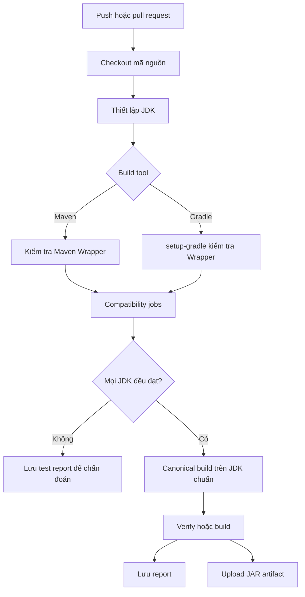

<Callout type="info" title="Phạm vi">
  Trang này dành cho repository Java đã có `pom.xml` hoặc `build.gradle(.kts)`. Ví dụ dùng Ubuntu, Eclipse Temurin và JDK 21 làm bản build chuẩn; hãy đổi ma trận JDK theo hợp đồng hỗ trợ thật của dự án.
</Callout>

## Mục lục

- [Kết quả cần đạt](#kết-quả-cần-đạt)
- [Chọn Maven hay Gradle](#chọn-maven-hay-gradle)
  - [Quy tắc chọn build tool](#quy-tắc-chọn-build-tool)
  - [Wrapper là một phần của mã nguồn](#wrapper-là-một-phần-của-mã-nguồn)
- [Thiết kế pipeline](#thiết-kế-pipeline)
  - [Luồng CI đề xuất](#luồng-ci-đề-xuất)
  - [Tách compatibility và canonical build](#tách-compatibility-và-canonical-build)
- [Cấu hình JDK và cache](#cấu-hình-jdk-và-cache)
  - [Dùng setup-java đúng mục đích](#dùng-setup-java-đúng-mục-đích)
  - [Chọn distribution và ma trận JDK](#chọn-distribution-và-ma-trận-jdk)
  - [Cache dependency an toàn](#cache-dependency-an-toàn)
- [Workflow Maven hoàn chỉnh](#workflow-maven-hoàn-chỉnh)
  - [Điều kiện của repository Maven](#điều-kiện-của-repository-maven)
  - [Workflow có thể sao chép](#workflow-có-thể-sao-chép)
  - [Cách workflow Maven hoạt động](#cách-workflow-maven-hoạt-động)
- [Biến thể Gradle hoàn chỉnh](#biến-thể-gradle-hoàn-chỉnh)
  - [Khác biệt quan trọng với Maven](#khác-biệt-quan-trọng-với-maven)
  - [Workflow Gradle có thể sao chép](#workflow-gradle-có-thể-sao-chép)
- [Test report package và artifact](#test-report-package-và-artifact)
  - [Chọn verify check hay build](#chọn-verify-check-hay-build)
  - [Lưu report kể cả khi test thất bại](#lưu-report-kể-cả-khi-test-thất-bại)
  - [Chỉ phát hành JAR từ canonical build](#chỉ-phát-hành-jar-từ-canonical-build)
- [Bảo mật và kiểm soát tài nguyên](#bảo-mật-và-kiểm-soát-tài-nguyên)
  - [Permissions tối thiểu](#permissions-tối-thiểu)
  - [Concurrency và timeout](#concurrency-và-timeout)
  - [Khóa phiên bản action và Wrapper](#khóa-phiên-bản-action-và-wrapper)
- [Bài thực hành](#bài-thực-hành)
  - [Mục tiêu và chuẩn bị](#mục-tiêu-và-chuẩn-bị)
  - [Các bước thực hiện](#các-bước-thực-hiện)
  - [Tiêu chí xác minh](#tiêu-chí-xác-minh)
- [Best practices](#best-practices)
- [Troubleshooting](#troubleshooting)
- [Tài liệu tham khảo chính thức](#tài-liệu-tham-khảo-chính-thức)

## Kết quả cần đạt

Continuous Integration (CI) là việc tự động kiểm tra mỗi thay đổi trước khi hợp nhất. Với Java, một pipeline đáng tin cậy phải kiểm soát cả **JDK** và **build tool**. JDK cung cấp trình biên dịch `javac` cùng các công cụ phát triển; Maven hoặc Gradle chịu trách nhiệm tải dependency, chạy test và đóng gói ứng dụng.

Sau khi hoàn thành trang này, bạn có thể:

- chọn đúng Maven hoặc Gradle mà không duy trì hai pipeline trùng chức năng;
- dùng Maven Wrapper hoặc Gradle Wrapper để cố định phiên bản build tool;
- kiểm tra mã nguồn trên nhiều JDK nhưng chỉ tạo JAR từ một môi trường chuẩn;
- cache dependency mà không cache thư mục output của dự án;
- giữ test report khi job thất bại và lưu JAR dưới dạng workflow artifact;
- giới hạn quyền, thời gian chạy và số workflow dư thừa.

## Chọn Maven hay Gradle

### Quy tắc chọn build tool

CI phải chạy cùng build tool mà dự án đã dùng ở máy phát triển. Ví dụ, repository có `pom.xml` và `mvnw` thì chạy `./mvnw`; repository có `build.gradle.kts` và `gradlew` thì chạy `./gradlew`.

| Dấu hiệu trong repository | Chọn | Đặc điểm |
|---|---|---|
| `pom.xml`, `.mvn/`, `mvnw` | Maven | Lifecycle chuẩn như `test`, `package`, `verify`; cấu hình XML mang tính khai báo |
| `build.gradle` hoặc `build.gradle.kts`, `gradle/`, `gradlew` | Gradle | Task graph linh hoạt; hỗ trợ Groovy DSL hoặc Kotlin DSL |
| Có cả hai bộ file | Xác định công cụ chính | Chỉ chạy cả hai nếu repository thật sự phát hành bằng cả hai hoặc đang trong giai đoạn migration |

Đừng đổi build tool chỉ để viết CI. Ví dụ, gọi Maven toàn cục cho dự án Gradle có thể bỏ qua plugin, task và quy tắc dependency mà dự án đã định nghĩa.

### Wrapper là một phần của mã nguồn

**Wrapper** là script nhỏ được commit cùng repository để tải đúng phiên bản Maven hoặc Gradle đã khai báo. Nhờ đó, laptop và runner không phụ thuộc vào phiên bản `mvn` hay `gradle` được cài sẵn.

Một repository Maven nên commit tối thiểu:

```text
mvnw
mvnw.cmd
.mvn/wrapper/maven-wrapper.properties
```

Một repository Gradle nên commit:

```text
gradlew
gradlew.bat
gradle/wrapper/gradle-wrapper.jar
gradle/wrapper/gradle-wrapper.properties
```

<Callout type="warn" title="Wrapper là mã có thể thực thi">
  Không chấp nhận thay đổi Wrapper chỉ vì diff hiển thị “binary file”. Maven Wrapper nên khai báo `distributionSha256Sum`; nếu dùng kiểu có `maven-wrapper.jar`, khai báo thêm `wrapperSha256Sum`. `gradle/actions/setup-gradle` từ v4 trở lên tự kiểm tra checksum của Gradle Wrapper JAR trước khi build.
</Callout>

Maven không có action chính thức tương đương danh sách checksum Wrapper của Gradle. Workflow Maven bên dưới kiểm tra rằng SHA-256 của distribution đã được khai báo. Sau đó chính Maven Wrapper đối chiếu file tải về với giá trị này. Reviewer vẫn phải bảo vệ `mvnw`, `mvnw.cmd` và `.mvn/wrapper/**`, vì một pull request độc hại có thể sửa đồng thời script và checksum.

Khi tạo hoặc cập nhật Maven Wrapper, dùng goal chính thức `mvn wrapper:wrapper`, chọn rõ phiên bản Maven và commit toàn bộ file sinh ra. Lấy checksum từ nguồn tin cậy độc lập trước khi truyền vào tham số `distributionSha256Sum`; không tính checksum từ một file chưa được xác minh rồi xem đó là bằng chứng an toàn.

## Thiết kế pipeline

### Luồng CI đề xuất



Pipeline tách việc chứng minh tính tương thích khỏi việc tạo binary. Cách này làm nguồn gốc JAR rõ ràng: chỉ job chuẩn mới được phép tạo artifact dùng cho bước sau.

### Tách compatibility và canonical build

**Compatibility job** chạy test trên các JDK mà dự án cam kết hỗ trợ. Ví dụ, thư viện hỗ trợ Java 17 đến Java 25 có thể test JDK 17 và 25 để bắt lỗi ở hai đầu phạm vi.

**Canonical build** là bản build chuẩn duy nhất. Ví dụ, tổ chức triển khai ứng dụng bằng Temurin 21 thì job này chạy Temurin 21, chạy toàn bộ quality gate và upload JAR. “Quality gate” là điều kiện bắt buộc như unit test, integration test, kiểm tra style hoặc coverage threshold.

Tách hai loại job có ba lợi ích:

1. Artifact không bị tạo nhiều lần với tên hoặc bytecode khác nhau từ matrix.
2. Branch protection có thể yêu cầu cả compatibility và canonical build.
3. Canonical build có thể dùng đúng môi trường production, còn matrix chỉ mở rộng phạm vi kiểm tra.

<Callout type="info" title="JDK chạy build không tự quyết định bytecode">
  Nếu thư viện phải chạy trên Java 17, hãy cấu hình `maven.compiler.release=17` hoặc Java toolchain của Gradle. Chỉ chạy Maven bằng JDK 17 không thay thế cấu hình target bytecode trong build file.
</Callout>

## Cấu hình JDK và cache

### Dùng setup-java đúng mục đích

`actions/setup-java` cài JDK, đặt `JAVA_HOME`, thêm Java vào `PATH` và có thể cache dependency của Maven hoặc Gradle. Một cấu hình tối thiểu như sau:

```yaml
- name: Thiết lập Temurin 21
  uses: actions/setup-java@03ad4de0992f5dab5e18fcb136590ce7c4a0ac95 # v5.6.0
  with:
    distribution: temurin
    java-version: '21'
    cache: maven
    cache-dependency-path: pom.xml
```

Dùng JDK thay vì JRE, vì CI phải biên dịch mã nguồn. `java-version` được đặt trong dấu nháy để YAML không diễn giải sai giá trị phiên bản.

### Chọn distribution và ma trận JDK

**Distribution** là bản đóng gói OpenJDK do một nhà cung cấp phát hành. `temurin`, `zulu`, `corretto` và `microsoft` đều là input hợp lệ của `setup-java`; giấy phép, nền tảng và lịch cập nhật của chúng khác nhau.

Quy tắc thực tế:

- dùng `temurin` khi dự án không có ràng buộc nhà cung cấp;
- dùng distribution giống production nếu ứng dụng phụ thuộc provider hoặc cần giảm chênh lệch môi trường;
- chỉ tạo ma trận nhiều distribution khi đó là hợp đồng hỗ trợ thật;
- không nhân chéo mọi JDK với mọi distribution theo thói quen, vì hai danh sách ba phần tử tạo chín job.

Ví dụ matrix có thể mở rộng nhưng vẫn dễ đọc:

```yaml
strategy:
  fail-fast: false
  matrix:
    java: ['17', '25']
    distribution: [temurin]
```

`fail-fast: false` cho phép tất cả phiên bản hoàn tất. Nhờ đó, một lần chạy cho biết JDK nào hỏng thay vì hủy toàn bộ matrix sau lỗi đầu tiên.

### Cache dependency an toàn

Cache là dữ liệu tái sử dụng giữa các workflow run để giảm thời gian tải dependency. Cache **không phải artifact**: cache là tối ưu hiệu năng và có thể bị xóa; artifact là output cần tải xuống hoặc truyền sang job khác.

Với Maven, dùng cache tích hợp của `setup-java`:

```yaml
with:
  cache: maven
  cache-dependency-path: pom.xml
```

Với Maven monorepo, liệt kê các file quyết định dependency thay vì chỉ root POM:

```yaml
with:
  cache: maven
  cache-dependency-path: |
    pom.xml
    services/*/pom.xml
```

Với Gradle, workflow ở trang này dùng `gradle/actions/setup-gradle` và `cache-provider: basic`. Provider `basic` là implementation MIT dựa trên GitHub Actions cache. Không bật thêm `cache: gradle` trong `setup-java`, vì hai cơ chế cùng quản lý Gradle User Home có thể ghi đè nhau.

<Callout type="idea" title="Cache chỉ nên tăng tốc">
  Pipeline phải vẫn đúng khi cache miss. Không cache `target/`, `build/`, secret, file ký số hoặc output đã biên dịch để né một bước build.
</Callout>

Với Maven, cache tích hợp của `setup-java` không có chế độ chỉ đọc. Mỗi job thành công có thể đề nghị lưu cache, nhưng cache GitHub là bất biến theo key nên lần lưu đầu tiên thắng; các lần lưu trùng key không ghi đè dữ liệu đã có. Nếu tổ chức bắt buộc matrix chỉ được đọc cache và chỉ nhánh `main` được ghi, hãy dùng `actions/cache/restore` và `actions/cache/save` thành hai bước riêng thay cho `cache: maven`. Với Gradle, `setup-gradle` hỗ trợ trực tiếp `cache-read-only`, nên workflow biến thể bên dưới áp dụng policy chỉ ghi từ canonical build trên `main`.

## Workflow Maven hoàn chỉnh

### Điều kiện của repository Maven

Workflow giả định:

- `mvnw` có executable bit trong Git, thường được đặt bằng `git update-index --chmod=+x mvnw`;
- `.mvn/wrapper/maven-wrapper.properties` có `distributionSha256Sum` gồm 64 ký tự hex viết thường;
- `./mvnw verify` chạy được từ root repository;
- unit test dùng Surefire và integration test, nếu có, được gắn vào lifecycle `verify` bằng Failsafe;
- JAR được tạo trong một hoặc nhiều thư mục `target/`.

Lưu file sau thành `.github/workflows/ci-java-maven.yml`.

### Workflow có thể sao chép

```yaml
name: Java CI - Maven

on:
  push:
    branches: [main]
  pull_request:
    branches: [main]

permissions:
  contents: read

concurrency:
  group: java-ci-maven-${{ github.workflow }}-${{ github.ref }}
  cancel-in-progress: true

jobs:
  compatibility:
    name: Compatibility - ${{ matrix.distribution }} JDK ${{ matrix.java }}
    runs-on: ubuntu-latest
    timeout-minutes: 20
    strategy:
      fail-fast: false
      matrix:
        java: ['17', '25']
        distribution: [temurin]

    steps:
      - name: Checkout
        uses: actions/checkout@3d3c42e5aac5ba805825da76410c181273ba90b1 # v7.0.1
        with:
          persist-credentials: false

      - name: Thiết lập JDK
        uses: actions/setup-java@03ad4de0992f5dab5e18fcb136590ce7c4a0ac95 # v5.6.0
        with:
          distribution: ${{ matrix.distribution }}
          java-version: ${{ matrix.java }}
          cache: maven
          cache-dependency-path: pom.xml

      - name: Kiểm tra Maven Wrapper
        shell: bash
        run: |
          properties=.mvn/wrapper/maven-wrapper.properties
          test -x mvnw
          test -f "$properties"
          grep -Eq '^distributionSha256Sum=[0-9a-f]{64}$' "$properties"
          if ! grep -Eq '^distributionType=only-script$' "$properties"; then
            grep -Eq '^wrapperSha256Sum=[0-9a-f]{64}$' "$properties"
          fi

      - name: Verify
        run: ./mvnw --batch-mode --no-transfer-progress verify

      - name: Upload test reports
        if: always()
        uses: actions/upload-artifact@043fb46d1a93c77aae656e7c1c64a875d1fc6a0a # v7.0.1
        with:
          name: maven-reports-${{ matrix.distribution }}-jdk-${{ matrix.java }}
          path: |
            **/target/surefire-reports/**
            **/target/failsafe-reports/**
          if-no-files-found: ignore
          retention-days: 7

  canonical-build:
    name: Canonical build - Temurin JDK 21
    needs: compatibility
    runs-on: ubuntu-latest
    timeout-minutes: 30

    steps:
      - name: Checkout
        uses: actions/checkout@3d3c42e5aac5ba805825da76410c181273ba90b1 # v7.0.1
        with:
          persist-credentials: false

      - name: Thiết lập JDK 21
        uses: actions/setup-java@03ad4de0992f5dab5e18fcb136590ce7c4a0ac95 # v5.6.0
        with:
          distribution: temurin
          java-version: '21'
          cache: maven
          cache-dependency-path: pom.xml

      - name: Kiểm tra Maven Wrapper
        shell: bash
        run: |
          properties=.mvn/wrapper/maven-wrapper.properties
          test -x mvnw
          test -f "$properties"
          grep -Eq '^distributionSha256Sum=[0-9a-f]{64}$' "$properties"
          if ! grep -Eq '^distributionType=only-script$' "$properties"; then
            grep -Eq '^wrapperSha256Sum=[0-9a-f]{64}$' "$properties"
          fi

      - name: Clean và verify
        run: ./mvnw --batch-mode --no-transfer-progress clean verify

      - name: Upload test reports
        if: always()
        uses: actions/upload-artifact@043fb46d1a93c77aae656e7c1c64a875d1fc6a0a # v7.0.1
        with:
          name: maven-reports-canonical-jdk-21
          path: |
            **/target/surefire-reports/**
            **/target/failsafe-reports/**
          if-no-files-found: ignore
          retention-days: 7

      - name: Upload JAR
        uses: actions/upload-artifact@043fb46d1a93c77aae656e7c1c64a875d1fc6a0a # v7.0.1
        with:
          name: java-package-${{ github.sha }}
          path: |
            **/target/*.jar
            !**/target/*-sources.jar
            !**/target/*-javadoc.jar
            !**/target/original-*.jar
          if-no-files-found: error
          retention-days: 14
```

### Cách workflow Maven hoạt động

`verify` là pha gần cuối Maven lifecycle. Nó chạy các pha trước đó, gồm compile, unit test và package. Nếu dự án cấu hình Failsafe đúng chuẩn, integration test cũng hoàn tất trước khi `verify` thành công.

Job `canonical-build` có `needs: compatibility`, nên JAR chỉ được tạo sau khi các JDK trong matrix đều đạt. `clean` được dùng ở canonical build để chứng minh output đến từ mã nguồn hiện tại; runner mới vốn đã sạch, nhưng lệnh này cũng giữ hành vi giống bản build phát hành cục bộ.

`if: always()` chỉ áp dụng cho report. Bước upload JAR giữ điều kiện mặc định `success()`, vì một package từ build lỗi không nên được xem là output hợp lệ.

## Biến thể Gradle hoàn chỉnh

### Khác biệt quan trọng với Maven

Gradle dùng task thay vì lifecycle phase. Với Java plugin chuẩn:

- `check` chạy các verification task, thường gồm `test`;
- `build` phụ thuộc cả `check` và `assemble`, nên vừa kiểm tra vừa tạo JAR;
- report test thường nằm ở `build/test-results/test/` và `build/reports/tests/test/`;
- JAR thường nằm ở `build/libs/`.

`gradle/actions/setup-gradle` tự xác minh mọi `gradle-wrapper.jar` tìm thấy, cấu hình cache và tạo Job Summary. Workflow dùng `cache-provider: basic` để chọn rõ provider mã nguồn mở. Nếu tổ chức muốn Enhanced Caching mặc định của action, hãy đọc điều khoản phân phối và chính sách dữ liệu trước khi bỏ input này.

### Workflow Gradle có thể sao chép

Lưu file sau thành `.github/workflows/ci-java-gradle.yml`. Repository chỉ nên bật workflow Maven **hoặc** Gradle, trừ khi thật sự cần cả hai.

```yaml
name: Java CI - Gradle

on:
  push:
    branches: [main]
  pull_request:
    branches: [main]

permissions:
  contents: read

concurrency:
  group: java-ci-gradle-${{ github.workflow }}-${{ github.ref }}
  cancel-in-progress: true

jobs:
  compatibility:
    name: Compatibility - ${{ matrix.distribution }} JDK ${{ matrix.java }}
    runs-on: ubuntu-latest
    timeout-minutes: 20
    strategy:
      fail-fast: false
      matrix:
        java: ['17', '25']
        distribution: [temurin]

    steps:
      - name: Checkout
        uses: actions/checkout@3d3c42e5aac5ba805825da76410c181273ba90b1 # v7.0.1
        with:
          persist-credentials: false

      - name: Thiết lập JDK
        uses: actions/setup-java@03ad4de0992f5dab5e18fcb136590ce7c4a0ac95 # v5.6.0
        with:
          distribution: ${{ matrix.distribution }}
          java-version: ${{ matrix.java }}

      - name: Thiết lập Gradle và kiểm tra Wrapper
        uses: gradle/actions/setup-gradle@3f131e8634966bd73d06cc69884922b02e6faf92 # v6.2.0
        with:
          cache-provider: basic
          cache-read-only: true

      - name: Check
        run: ./gradlew --no-daemon check

      - name: Upload test reports
        if: always()
        uses: actions/upload-artifact@043fb46d1a93c77aae656e7c1c64a875d1fc6a0a # v7.0.1
        with:
          name: gradle-reports-${{ matrix.distribution }}-jdk-${{ matrix.java }}
          path: |
            **/build/test-results/test/**
            **/build/reports/tests/test/**
          if-no-files-found: ignore
          retention-days: 7

  canonical-build:
    name: Canonical build - Temurin JDK 21
    needs: compatibility
    runs-on: ubuntu-latest
    timeout-minutes: 30

    steps:
      - name: Checkout
        uses: actions/checkout@3d3c42e5aac5ba805825da76410c181273ba90b1 # v7.0.1
        with:
          persist-credentials: false

      - name: Thiết lập JDK 21
        uses: actions/setup-java@03ad4de0992f5dab5e18fcb136590ce7c4a0ac95 # v5.6.0
        with:
          distribution: temurin
          java-version: '21'

      - name: Thiết lập Gradle và kiểm tra Wrapper
        uses: gradle/actions/setup-gradle@3f131e8634966bd73d06cc69884922b02e6faf92 # v6.2.0
        with:
          cache-provider: basic
          cache-read-only: ${{ github.ref != 'refs/heads/main' }}

      - name: Clean và build
        run: ./gradlew --no-daemon clean build

      - name: Upload test reports
        if: always()
        uses: actions/upload-artifact@043fb46d1a93c77aae656e7c1c64a875d1fc6a0a # v7.0.1
        with:
          name: gradle-reports-canonical-jdk-21
          path: |
            **/build/test-results/test/**
            **/build/reports/tests/test/**
          if-no-files-found: ignore
          retention-days: 7

      - name: Upload JAR
        uses: actions/upload-artifact@043fb46d1a93c77aae656e7c1c64a875d1fc6a0a # v7.0.1
        with:
          name: java-package-${{ github.sha }}
          path: |
            **/build/libs/*.jar
            !**/build/libs/*-sources.jar
            !**/build/libs/*-javadoc.jar
          if-no-files-found: error
          retention-days: 14
```

Nếu `gradlew` mất executable bit, sửa trong Git thay vì thêm `chmod +x` để che lỗi:

```bash
git update-index --chmod=+x gradlew
git commit -m "Mark Gradle Wrapper executable"
```

## Test report package và artifact

### Chọn verify check hay build

Không nên nối nhiều lệnh chỉ vì tên của chúng có vẻ khác nhau. Ví dụ, `./mvnw test package verify` lặp lại các pha trước, vì Maven lifecycle tự chạy tuần tự đến `verify`. Lệnh đúng là:

```bash
./mvnw --batch-mode --no-transfer-progress verify
```

Với Gradle Java plugin, compatibility chỉ cần verification:

```bash
./gradlew --no-daemon check
```

Canonical build phải tạo package nên dùng:

```bash
./gradlew --no-daemon clean build
```

Dự án có task riêng như `integrationTest`, `spotlessCheck` hoặc `jacocoTestCoverageVerification` phải nối các task đó vào `check`, hoặc gọi rõ trong workflow. Kết luận thực hành: lệnh CI phải kích hoạt toàn bộ quality gate mà branch protection dựa vào.

### Lưu report kể cả khi test thất bại

Test report là file XML hoặc HTML mô tả test case đã chạy và lỗi nhận được. Maven Surefire thường ghi unit-test report vào `target/surefire-reports`; Failsafe ghi integration-test report vào `target/failsafe-reports`. Gradle Java plugin ghi XML và HTML dưới `build/`.

`if: always()` bảo đảm bước upload report vẫn chạy sau lỗi test. `if-no-files-found: ignore` tránh che nguyên nhân gốc khi build thất bại trước lúc test bắt đầu, chẳng hạn compile error.

Upload artifact chỉ lưu file để tải xuống; nó không tự biến JUnit XML thành giao diện test annotation. Nếu cần hiển thị từng test ngay trong pull request, hãy thêm một reporter action đã được duyệt, khóa bằng commit SHA và cấp đúng quyền tối thiểu.

### Chỉ phát hành JAR từ canonical build

JAR là Java Archive chứa class và resource đã đóng gói. Workflow đặt tên artifact bằng `${{ github.sha }}`, nên mỗi artifact truy ngược được commit tạo ra nó.

`if-no-files-found: error` biến việc “build thành công nhưng không có JAR” thành lỗi rõ ràng. Đây là tín hiệu quan trọng khi module đổi packaging sang `pom`, task `jar` bị tắt hoặc đường dẫn output đã thay đổi.

Workflow artifact không phải GitHub Release và không phải Maven repository. Dùng artifact để kiểm thử hoặc truyền output giữa job. Khi cần phát hành chính thức, thêm workflow riêng cho tag, provenance, ký số và publish lên Maven Central, GitHub Packages hoặc artifact repository của tổ chức.

## Bảo mật và kiểm soát tài nguyên

### Permissions tối thiểu

`permissions: contents: read` giới hạn `GITHUB_TOKEN` ở quyền đọc mã nguồn. CI chỉ build và upload artifact không cần `contents: write`, `packages: write` hay `pull-requests: write`.

Nếu thêm dependency submission, comment pull request hoặc publish package, cấp quyền ở đúng job cần dùng thay vì mở rộng toàn workflow. Không chạy secret trong code đến từ pull request không tin cậy.

### Concurrency và timeout

`concurrency` gom các run cùng workflow và cùng ref. Khi developer push commit mới lên một pull request, `cancel-in-progress: true` hủy run cũ để tiết kiệm runner minute.

`timeout-minutes` chặn job treo vì test deadlock, Gradle daemon hoặc repository dependency không phản hồi. Chọn timeout lớn hơn thời gian p95 của build — tức thời gian mà 95% run hoàn tất — rồi điều tra khi chạm ngưỡng thay vì tăng vô hạn.

### Khóa phiên bản action và Wrapper

Các workflow mẫu khóa action bằng commit SHA và ghi version tag trong comment. SHA là định danh commit bất biến; tag major như `@v7` có thể được cập nhật sang code mới.

Các SHA trong trang tương ứng với:

- `actions/checkout` v7.0.1;
- `actions/setup-java` v5.6.0;
- `actions/upload-artifact` v7.0.1;
- `gradle/actions/setup-gradle` v6.2.0.

Dùng Dependabot để đề xuất cập nhật GitHub Actions. Reviewer phải đọc release notes rồi cập nhật cả SHA và comment. Với self-hosted runner, kiểm tra phiên bản runner đáp ứng runtime Node mà action major yêu cầu trước khi nâng cấp.

Bảo vệ thêm các file sau bằng CODEOWNERS hoặc rule yêu cầu review:

```text
.github/workflows/**
mvnw
mvnw.cmd
.mvn/wrapper/**
gradlew
gradlew.bat
gradle/wrapper/**
```

## Bài thực hành

### Mục tiêu và chuẩn bị

Chọn **một** repository Java nhỏ. Repository phải có ít nhất một unit test và dùng Maven Wrapper hoặc Gradle Wrapper đã commit. Xác định trước ba giá trị:

- JDK tối thiểu được hỗ trợ;
- JDK của production, dùng làm canonical build;
- JDK mới nhất mà dự án cam kết hỗ trợ.

Nếu ba giá trị trùng nhau, giảm matrix còn một compatibility job hoặc bỏ matrix và giữ canonical build. Không thêm job chỉ để workflow trông phức tạp.

### Các bước thực hiện

1. Chạy `./mvnw verify` hoặc `./gradlew clean build` thành công ở máy local.
2. Xác minh Wrapper version đã được khóa trong `maven-wrapper.properties` hoặc `gradle-wrapper.properties`.
3. Với Maven, thêm checksum distribution vào Wrapper properties. Với Gradle, giữ `gradle-wrapper.jar` trong Git để `setup-gradle` xác minh.
4. Sao chép workflow đúng build tool vào `.github/workflows/`.
5. Thay `17`, `21`, `25` và `temurin` theo hợp đồng hỗ trợ thật.
6. Push một branch và mở pull request vào `main`.
7. Cố ý làm một unit test thất bại, push lại và kiểm tra report artifact.
8. Sửa test, push lại và tải JAR từ run thành công.
9. Bật branch protection, yêu cầu compatibility jobs và canonical build trước khi merge.

### Tiêu chí xác minh

Bài thực hành đạt khi tất cả điều kiện sau đúng:

- [ ] Workflow chỉ dùng Maven hoặc Gradle theo build file của repository.
- [ ] Log hiển thị đúng distribution và JDK cho từng matrix job.
- [ ] Lần chạy thứ hai có bước cache restore; cache miss vẫn build thành công.
- [ ] Wrapper validation chạy trước lệnh build.
- [ ] Khi test cố ý thất bại, job đỏ nhưng report artifact vẫn xuất hiện.
- [ ] Khi mọi test đạt, canonical build tạo đúng một artifact `java-package-<commit-sha>`.
- [ ] Artifact chứa JAR chạy được hoặc đúng library JAR mong đợi, không chỉ có sources hoặc Javadoc JAR.
- [ ] Push mới trên cùng pull request hủy run cũ.
- [ ] Workflow token chỉ có `contents: read`.
- [ ] Pull request không thể merge khi một JDK trong matrix thất bại.

## Best practices

- **Chạy cùng lệnh ở local và CI.** Ví dụ, dùng `./mvnw verify` ở cả hai nơi thay vì để CI gọi một chuỗi plugin riêng không ai chạy local.
- **Giữ matrix theo hợp đồng hỗ trợ.** Test JDK tối thiểu, JDK production và phiên bản mới đáng quan tâm; bỏ tổ hợp không mang lại quyết định tương thích.
- **Cấu hình Java release hoặc toolchain trong build file.** Runner JDK chỉ là JVM thực thi build, không phải lời cam kết bytecode.
- **Chỉ có một canonical artifact.** Matrix chứng minh tương thích; canonical build tạo binary truy vết được.
- **Để build tool sở hữu dependency graph.** Cache `~/.m2` hoặc Gradle User Home qua action chính thức, không tự cache `target/` hay `build/`.
- **Upload report với `always()`, upload package với `success()`.** Report phục vụ chẩn đoán lỗi; package chỉ hợp lệ sau quality gate.
- **Khóa action bằng SHA và tự động đề xuất update.** Dependabot giảm nguy cơ workflow dùng action cũ nhưng vẫn giữ bước review release notes.
- **Review Wrapper như code.** Kiểm tra URL, version, checksum và binary JAR; yêu cầu owner review khi các file này thay đổi.
- **Không dùng `-DskipTests` hoặc `-x test` trong canonical build.** Nếu package nhanh là nhu cầu riêng, tạo job package sau một job test bắt buộc và ghi dependency bằng `needs`.
- **Không bật hai cache Gradle cùng lúc.** Chọn `setup-gradle`, hoặc `setup-java cache: gradle`, hoặc cấu hình `actions/cache` thủ công; không trộn cả ba.
- **Giữ log đủ đọc.** Maven dùng batch/no-transfer-progress; Gradle dùng `--no-daemon` trên runner tạm thời và chỉ bật `--stacktrace` khi cần chẩn đoán.

## Troubleshooting

| Triệu chứng | Nguyên nhân cần kiểm tra | Hướng xử lý |
|---|---|---|
| `Permission denied: ./mvnw` hoặc `./gradlew` | Executable bit chưa được commit | Chạy `git update-index --chmod=+x mvnw` hoặc `gradlew`, rồi commit thay đổi |
| Maven Wrapper checksum check thất bại trước build | Thiếu `distributionSha256Sum`, sai định dạng hoặc dùng chữ hoa | Tạo lại Wrapper bằng plugin chính thức, lấy SHA-256 từ quy trình tin cậy và commit properties |
| Maven báo checksum distribution không khớp | File tải xuống hỏng, proxy thay nội dung hoặc checksum/URL bị sửa | Không bỏ validation; kiểm tra `distributionUrl`, proxy, nguồn checksum và thay đổi trong pull request |
| Gradle Wrapper validation báo checksum không xác định | `gradle-wrapper.jar` bị thay, là snapshot, phiên bản cũ không xác minh được hoặc Git LFS chỉ checkout pointer | Dừng build, tạo lại Wrapper từ Gradle tin cậy; nếu dùng LFS, cấu hình checkout với `lfs: true` |
| `Unsupported class file major version` | JDK chạy Gradle/Maven, plugin hoặc bytecode target không tương thích | Kiểm tra `java --version`, `./mvnw --version` hoặc `./gradlew --version`; nâng Wrapper/plugin hoặc chỉnh matrix |
| Test chạy local nhưng lỗi trên CI | Khác timezone, locale, filesystem case-sensitive, network hoặc test phụ thuộc thứ tự | Cố định timezone/locale nếu là yêu cầu; loại bỏ shared state; không dựa vào dịch vụ ngoài không được khai báo |
| Integration test không chạy với Maven | Failsafe chưa gắn vào lifecycle hoặc chỉ gọi `test` | Cấu hình Maven Failsafe Plugin và chạy `./mvnw verify` |
| Gradle `build` không chạy task kiểm tra riêng | Task custom chưa nối vào `check` | Thêm dependency task trong `build.gradle(.kts)` hoặc gọi task rõ trong workflow |
| Cache luôn miss | File hash thay đổi liên tục, `cache-dependency-path` thiếu POM/module hoặc matrix dùng key khác | Kiểm tra log cache, liệt kê đúng build files và chấp nhận cache tách theo OS/JDK khi cần |
| Gradle báo cache bị vô hiệu do Gradle User Home tồn tại | Một action khác hoặc self-hosted runner đã tạo cache trước `setup-gradle` | Bỏ cache trùng; trên self-hosted runner, làm sạch workspace/User Home hoặc cấu hình theo tài liệu `setup-gradle` |
| Upload report không thấy file | Test chưa bắt đầu hoặc plugin đổi output directory | Xem log build, kiểm tra đường dẫn thật và cập nhật glob; giữ `if-no-files-found: ignore` cho report |
| Upload JAR lỗi `No files were found` | Module không tạo JAR, output path khác hoặc packaging là WAR/POM | Kiểm tra `target/` hay `build/libs/`; đổi glob sang output thật, không hạ thành `ignore` nếu JAR là sản phẩm bắt buộc |
| Artifact name conflict trong matrix | Nhiều job upload cùng tên artifact bất biến | Thêm distribution, JDK hoặc matrix key vào tên artifact; chỉ dùng tên chung cho canonical build |
| Job bị hủy bất ngờ | Run mới cùng ref kích hoạt concurrency | Đây là hành vi mong đợi; đổi `group` hoặc tắt `cancel-in-progress` cho workflow không được phép hủy |
| Action chạy trên GitHub-hosted nhưng lỗi trên self-hosted | Runner quá cũ cho runtime Node của action major | Nâng GitHub Actions Runner theo release notes của action trước khi cập nhật SHA |

## Tài liệu tham khảo chính thức

- [GitHub Docs — Building and testing Java with Maven](https://docs.github.com/en/actions/use-cases-and-examples/building-and-testing/building-and-testing-java-with-maven)
- [GitHub Docs — Building and testing Java with Gradle](https://docs.github.com/en/actions/use-cases-and-examples/building-and-testing/building-and-testing-java-with-gradle)
- [GitHub Docs — Workflow syntax](https://docs.github.com/en/actions/reference/workflows-and-actions/workflow-syntax)
- [GitHub Docs — Dependency caching](https://docs.github.com/en/actions/using-workflows/caching-dependencies-to-speed-up-workflows)
- [GitHub Docs — Store and share workflow artifacts](https://docs.github.com/en/actions/tutorials/store-and-share-data)
- [GitHub Docs — Secure use reference](https://docs.github.com/en/actions/reference/security/secure-use)
- [`actions/setup-java`](https://github.com/actions/setup-java)
- [`actions/upload-artifact`](https://github.com/actions/upload-artifact)
- [Apache Maven Wrapper](https://maven.apache.org/wrapper/)
- [Apache Maven lifecycle](https://maven.apache.org/guides/introduction/introduction-to-the-lifecycle.html)
- [Maven Surefire Plugin](https://maven.apache.org/surefire/maven-surefire-plugin/)
- [Maven Failsafe Plugin](https://maven.apache.org/surefire/maven-failsafe-plugin/)
- [`gradle/actions/setup-gradle`](https://github.com/gradle/actions/blob/main/docs/setup-gradle.md)
- [Gradle Wrapper](https://docs.gradle.org/current/userguide/gradle_wrapper.html)
- [Gradle Java testing](https://docs.gradle.org/current/userguide/java_testing.html)
