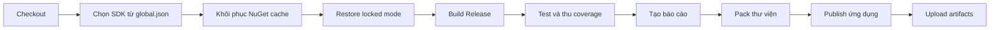

<Callout type="info" title="Phạm vi">
  Hướng dẫn dùng dự án SDK-style, `PackageReference` và GitHub-hosted runner. Ví dụ chính nhắm tới .NET 8 LTS, nhưng các nguyên tắc restore, build, test và đóng gói cũng áp dụng cho các phiên bản .NET còn được hỗ trợ.
</Callout>

## Mục lục

- [Tổng quan](#tổng-quan)
- [1. Chuẩn hóa repository](#1-chuẩn-hóa-repository)
  - [Bố cục solution và project](#bố-cục-solution-và-project)
  - [Ghim SDK bằng global json](#ghim-sdk-bằng-global-json)
  - [Khóa đồ thị NuGet](#khóa-đồ-thị-nuget)
  - [Ghim công cụ tạo báo cáo](#ghim-công-cụ-tạo-báo-cáo)
- [2. Luồng lệnh dotnet đúng](#2-luồng-lệnh-dotnet-đúng)
  - [Restore một lần](#restore-một-lần)
  - [Build và test không làm lại công việc](#build-và-test-không-làm-lại-công-việc)
  - [Test result và coverage](#test-result-và-coverage)
  - [Pack và publish](#pack-và-publish)
- [3. Workflow production ready](#3-workflow-production-ready)
  - [Workflow hoàn chỉnh](#workflow-hoàn-chỉnh)
  - [Giải thích các chốt kiểm soát](#giải-thích-các-chốt-kiểm-soát)
- [4. Cache và artifacts](#4-cache-và-artifacts)
  - [Cache NuGet đúng cách](#cache-nuget-đúng-cách)
  - [Chỉ lưu đầu ra có giá trị](#chỉ-lưu-đầu-ra-có-giá-trị)
- [5. Matrix có mục đích](#5-matrix-có-mục-đích)
  - [Khi nào cần matrix](#khi-nào-cần-matrix)
  - [Matrix SDK và hệ điều hành](#matrix-sdk-và-hệ-điều-hành)
- [6. Quyền hạn và kiểm soát tài nguyên](#6-quyền-hạn-và-kiểm-soát-tài-nguyên)
- [Bài thực hành](#bài-thực-hành)
  - [Yêu cầu](#yêu-cầu)
  - [Các bước thực hiện](#các-bước-thực-hiện)
  - [Tiêu chí kiểm chứng](#tiêu-chí-kiểm-chứng)
- [Best Practices](#best-practices)
- [Troubleshooting](#troubleshooting)
- [Tài liệu tham khảo](#tài-liệu-tham-khảo)

## Tổng quan

Một pipeline .NET đáng tin cậy phải trả lời được ba câu hỏi: dùng SDK nào, khôi phục đúng tập dependency nào và đầu ra nào đủ điều kiện phát hành. Nếu để runner tự chọn SDK mới nhất hoặc để mỗi lệnh tự restore, cùng một commit có thể cho kết quả khác nhau theo thời gian.

Trong trang này, **solution** là tệp gom nhiều project để build và test cùng nhau. **Artifact** là tệp đầu ra được GitHub lưu sau job, chẳng hạn gói NuGet, ứng dụng đã publish hoặc báo cáo test. **Coverage** là tỷ lệ mã nguồn được test thực thi; con số này hữu ích để phát hiện vùng chưa được kiểm thử, nhưng không tự chứng minh chất lượng test.

Luồng chính được giữ tuyến tính để lỗi xuất hiện ở đúng giai đoạn:



## 1. Chuẩn hóa repository

### Bố cục solution và project

Tách mã nguồn chạy thật khỏi mã kiểm thử. Đặt các tệp cấu hình dùng chung ở root để cả máy lập trình viên và CI đều tìm thấy cùng một cấu hình.

```text
Acme/
├── .config/
│   └── dotnet-tools.json
├── .github/
│   └── workflows/
│       └── ci-dotnet.yml
├── src/
│   ├── Acme.Api/
│   │   ├── Acme.Api.csproj
│   │   └── packages.lock.json
│   └── Acme.Core/
│       ├── Acme.Core.csproj
│       └── packages.lock.json
├── tests/
│   └── Acme.Core.Tests/
│       ├── Acme.Core.Tests.csproj
│       └── packages.lock.json
├── Acme.sln
├── Directory.Build.props
├── Directory.Packages.props
├── NuGet.config
└── global.json
```

- `Acme.sln` là điểm vào duy nhất cho restore, build và test toàn repository.
- `Directory.Build.props` chứa thuộc tính MSBuild áp dụng cho mọi project bên dưới.
- `Directory.Packages.props` quản lý phiên bản package tập trung nếu repository dùng NuGet Central Package Management.
- `NuGet.config` khai báo nguồn package. Không ghi token hoặc mật khẩu vào tệp này.
- Mỗi `packages.lock.json` ghi lại toàn bộ đồ thị dependency trực tiếp và bắc cầu của project tương ứng.

Một cấu hình nền phù hợp cho CI là:

```xml title="Directory.Build.props"
<Project>
  <PropertyGroup>
    <ContinuousIntegrationBuild Condition="'$(CI)' == 'true'">true</ContinuousIntegrationBuild>
    <RestorePackagesWithLockFile>true</RestorePackagesWithLockFile>
    <DisableImplicitNuGetFallbackFolder>true</DisableImplicitNuGetFallbackFolder>
  </PropertyGroup>
</Project>
```

`ContinuousIntegrationBuild` bật hành vi build xác định dành cho CI, ví dụ chuẩn hóa đường dẫn được ghi vào output. `DisableImplicitNuGetFallbackFolder` tránh việc restore âm thầm lấy package từ fallback folder của máy thay vì global packages folder đang được cache.

### Ghim SDK bằng global json

SDK là bộ compiler, MSBuild và `dotnet` CLI; nó khác với runtime được khai báo bằng `TargetFramework` trong `.csproj`. Ghim SDK giúp local và CI dùng cùng toolchain.

```json title="global.json"
{
  "sdk": {
    "version": "8.0.423",
    "rollForward": "disable",
    "allowPrerelease": false
  }
}
```

`version` phải là phiên bản SDK đầy đủ, không chấp nhận `8.0.x`. `rollForward: "disable"` yêu cầu đúng phiên bản `8.0.423`; vì vậy việc nâng SDK trở thành một pull request có thể review. Nếu đội muốn tự nhận bản vá trong cùng feature band, dùng `latestPatch`, nhưng khi đó đây không còn là ghim tuyệt đối.

`actions/setup-dotnet` đọc tệp này bằng `global-json-file`. Không cần lặp lại `dotnet-version` trong workflow chính, vì hai nguồn cấu hình có thể trôi lệch nhau.

<Callout type="warn" title="Đừng tin SDK có sẵn trên runner">
  Danh sách SDK cài sẵn trên GitHub-hosted runner thay đổi theo image. Luôn dùng `setup-dotnet` và `global.json`; nếu không, SDK mới nhất trên `PATH` có thể được chọn ngoài ý muốn.
</Callout>

### Khóa đồ thị NuGet

NuGet giải quyết cả dependency trực tiếp lẫn dependency bắc cầu. Lock file ghi lại kết quả giải quyết đó. Sau khi thêm hoặc nâng package, tạo lại lock file ở local rồi commit:

```bash
dotnet restore Acme.sln --use-lock-file
```

CI phải dùng:

```bash
dotnet restore Acme.sln --locked-mode
```

`--locked-mode` không sửa lock file. Lệnh thất bại nếu `.csproj`, `Directory.Packages.props` hoặc đồ thị package không còn khớp. Khi chủ động cập nhật dependency, chạy `dotnet restore Acme.sln --force-evaluate` ở local, review thay đổi trong lock file rồi commit.

Đối với application hoặc executable ở đầu đồ thị dependency, nên commit lock file để build có thể lặp lại. Với thư viện dùng chung được tiêu thụ qua `ProjectReference`, cân nhắc hướng dẫn chính thức của NuGet vì lock file của thư viện không quyết định đồ thị cuối cùng của application tiêu thụ nó.

### Ghim công cụ tạo báo cáo

`coverlet.collector` thu coverage khi chạy test. Template `dotnet new xunit` hiện đại thường đã tham chiếu collector; nếu project cũ chưa có, thêm package này vào từng test project và commit lock file mới.

ReportGenerator chuyển các tệp Cobertura XML thành HTML dễ đọc. Dùng local tool manifest để phiên bản công cụ cũng nằm trong source control:

```bash
dotnet new tool-manifest
dotnet tool install dotnet-reportgenerator-globaltool --version 5.5.11
```

Hai lệnh tạo `.config/dotnet-tools.json`. Workflow chỉ cần `dotnet tool restore`, không cài phiên bản trôi nổi ở mỗi lần chạy.

## 2. Luồng lệnh dotnet đúng

### Restore một lần

Chạy restore tường minh trước. Đây là nơi xác thực source NuGet, lock file và cache:

```bash
dotnet restore Acme.sln --locked-mode
```

Không cache `bin/` hoặc `obj/`. Hai thư mục đó chứa output phụ thuộc SDK, hệ điều hành và cấu hình build. Khôi phục chúng từ cache dễ tạo build cũ hoặc lỗi khó tái hiện.

### Build và test không làm lại công việc

Sau restore, build toàn solution ở cấu hình `Release`:

```bash
dotnet build Acme.sln --configuration Release --no-restore
```

Sau build, test không cần compile lại:

```bash
dotnet test Acme.sln --configuration Release --no-build
```

`--no-restore` buộc build dùng kết quả restore vừa kiểm tra. `--no-build` trên `dotnet test`, `dotnet pack` và `dotnet publish` đồng thời ngăn implicit restore, nên không cần lặp thêm `--no-restore`. Điều kiện quan trọng là các lệnh phải dùng cùng solution hoặc project, cùng `Release` và cùng target framework.

<Callout type="warn" title="Không dùng cờ bỏ qua quá sớm">
  Nếu chưa có bước restore, đừng dùng `--no-restore`. Nếu chưa build đúng project và configuration, đừng dùng `--no-build`. Các cờ này là ràng buộc tính nhất quán, không phải mẹo che lỗi.
</Callout>

### Test result và coverage

VSTest gọi **logger** để ghi kết quả test. TRX là định dạng kết quả test của Visual Studio. Cobertura là định dạng XML coverage được nhiều công cụ đọc được.

```bash
dotnet test Acme.sln \
  --configuration Release \
  --no-build \
  --logger "trx;LogFilePrefix=test-results" \
  --results-directory "$RUNNER_TEMP/test-results" \
  --collect:"XPlat Code Coverage"
```

`LogFilePrefix` tránh việc nhiều test project ghi đè cùng một tên TRX. Coverlet tạo `coverage.cobertura.xml` trong thư mục con của results directory. Sau khi test thành công, tạo báo cáo HTML và một tệp Cobertura đã gộp:

```bash
dotnet reportgenerator \
  "-reports:${RUNNER_TEMP}/test-results/**/coverage.cobertura.xml" \
  "-targetdir:${RUNNER_TEMP}/coverage-report" \
  "-reporttypes:Html;Cobertura"
```

Không nên chỉ nhìn phần trăm tổng. Hãy ưu tiên test cho nhánh nghiệp vụ quan trọng. Nếu áp coverage threshold, tăng dần theo baseline thực tế để tránh đội ngũ viết test hình thức chỉ nhằm đạt số.

### Pack và publish

`dotnet pack` tạo `.nupkg` để phân phối thư viện. `dotnet publish` tạo thư mục ứng dụng sẵn cho bước deploy. Hai đầu ra có mục đích khác nhau:

```bash
dotnet pack src/Acme.Core/Acme.Core.csproj \
  --configuration Release \
  --no-build \
  --output "$RUNNER_TEMP/packages"

dotnet publish src/Acme.Api/Acme.Api.csproj \
  --configuration Release \
  --no-build \
  --output "$RUNNER_TEMP/publish"
```

Không `dotnet nuget push` hoặc deploy từ workflow kiểm tra pull request. CI chỉ sản xuất và kiểm chứng output. Workflow release riêng nên tải đúng artifact đã qua kiểm tra, dùng environment approval và quyền ghi tối thiểu.

## 3. Workflow production ready

### Workflow hoàn chỉnh

Ví dụ giả định repository có đúng layout ở trên và đã commit tất cả lock file cùng tool manifest. Lưu thành `.github/workflows/ci-dotnet.yml`:

```yaml title=".github/workflows/ci-dotnet.yml"
name: .NET CI

on:
  push:
    branches: [main]
  pull_request:
    branches: [main]
  workflow_dispatch:

permissions:
  contents: read

concurrency:
  group: dotnet-ci-${{ github.workflow }}-${{ github.ref }}
  cancel-in-progress: true

env:
  DOTNET_NOLOGO: true
  DOTNET_CLI_TELEMETRY_OPTOUT: true
  NUGET_PACKAGES: ${{ github.workspace }}/.nuget/packages
  SOLUTION: Acme.sln

jobs:
  build-test-pack:
    name: Build, test, pack and publish
    runs-on: ubuntu-latest
    timeout-minutes: 20

    steps:
      - name: Checkout source
        uses: actions/checkout@v7
        with:
          persist-credentials: false

      - name: Setup .NET SDK and NuGet cache
        uses: actions/setup-dotnet@v6
        with:
          global-json-file: global.json
          cache: true
          cache-dependency-path: |
            **/packages.lock.json
            .config/dotnet-tools.json

      - name: Show selected SDK
        run: dotnet --version

      - name: Restore local tools
        run: dotnet tool restore

      - name: Restore dependencies
        run: dotnet restore "$SOLUTION" --locked-mode

      - name: Build
        run: dotnet build "$SOLUTION" --configuration Release --no-restore

      - name: Test with coverage
        run: >-
          dotnet test "$SOLUTION"
          --configuration Release
          --no-build
          --logger "trx;LogFilePrefix=test-results"
          --results-directory "$RUNNER_TEMP/test-results"
          --collect:"XPlat Code Coverage"

      - name: Generate coverage report
        run: >-
          dotnet reportgenerator
          "-reports:${RUNNER_TEMP}/test-results/**/coverage.cobertura.xml"
          "-targetdir:${RUNNER_TEMP}/coverage-report"
          "-reporttypes:Html;Cobertura"

      - name: Upload test and coverage reports
        if: ${{ !cancelled() }}
        uses: actions/upload-artifact@v7
        with:
          name: test-and-coverage-${{ github.run_attempt }}
          path: |
            ${{ runner.temp }}/test-results/**/*.trx
            ${{ runner.temp }}/test-results/**/coverage.cobertura.xml
            ${{ runner.temp }}/coverage-report/**
          if-no-files-found: warn
          retention-days: 14

      - name: Pack library
        run: >-
          dotnet pack src/Acme.Core/Acme.Core.csproj
          --configuration Release
          --no-build
          --output "$RUNNER_TEMP/packages"

      - name: Publish application
        run: >-
          dotnet publish src/Acme.Api/Acme.Api.csproj
          --configuration Release
          --no-build
          --output "$RUNNER_TEMP/publish"

      - name: Upload deployable outputs
        uses: actions/upload-artifact@v7
        with:
          name: deployables-${{ github.sha }}-${{ github.run_attempt }}
          path: |
            ${{ runner.temp }}/packages/*.nupkg
            ${{ runner.temp }}/publish/**
          if-no-files-found: error
          retention-days: 14
```

Tại thời điểm rà soát trang này, major hiện hành trong repository chính thức là `actions/checkout@v7`, `actions/setup-dotnet@v6` và `actions/upload-artifact@v7`. Major mới có thể đổi runtime Node và yêu cầu phiên bản runner mới. Với self-hosted runner, đọc release notes trước khi nâng. Tổ chức yêu cầu bảo mật chuỗi cung ứng nghiêm ngặt nên ghim action bằng full commit SHA và để Dependabot cập nhật SHA.

### Giải thích các chốt kiểm soát

- `permissions: contents: read` giới hạn `GITHUB_TOKEN` ở quyền đủ để checkout source. Job CI này không cần ghi package, pull request hoặc deployment.
- `persist-credentials: false` xóa nhu cầu giữ credential Git trong các bước sau checkout.
- `timeout-minutes: 20` dừng job bị treo thay vì tiêu thụ runner vô hạn. Chọn ngưỡng dựa trên p95 thời gian chạy thực tế, cộng biên hợp lý.
- `concurrency` chỉ giữ lần chạy mới nhất của cùng workflow và ref. Một commit PR cũ bị hủy khi commit mới được push.
- `${{ github.run_attempt }}` làm tên artifact duy nhất khi re-run. Artifact của action hiện hành là bất biến và không thể được nhiều job cùng sửa.
- Bước upload report dùng `!cancelled()` nên vẫn lưu TRX và coverage khi test thất bại, nhưng không cố upload khi người dùng chủ động hủy job.
- Pack và publish không chạy nếu test thất bại. Đây là fail-fast: dừng dây chuyền ngay khi một điều kiện chất lượng không đạt.

## 4. Cache và artifacts

### Cache NuGet đúng cách

`setup-dotnet` chỉ cache NuGet global packages folder. Nó không thay thế `dotnet restore`; restore vẫn phải tạo `project.assets.json`, kiểm tra lock file và đánh giá MSBuild.

Workflow đặt `NUGET_PACKAGES` vào `${{ github.workspace }}/.nuget/packages` để đường dẫn cache nhất quán. Khóa cache được tạo từ nội dung các `packages.lock.json` và tool manifest. Khi dependency hoặc phiên bản ReportGenerator đổi, khóa cũng đổi.

Các quy tắc cần giữ:

1. Commit lock file trước khi bật `cache: true`; nếu pattern không khớp tệp nào, `setup-dotnet` sẽ báo lỗi.
2. Dùng `cache-dependency-path` trong monorepo để hash tất cả lock file liên quan.
3. Luôn chạy `dotnet restore --locked-mode` cả khi cache hit. Cache hit chỉ có nghĩa package có thể đã tải sẵn, không có nghĩa project đã restore.
4. Không cache credential, `NuGet.config` chứa secret, `bin/`, `obj/` hoặc toàn bộ workspace.
5. Cache từ pull request không đáng tin như artifact phát hành. Không thực thi file tùy ý lấy từ cache.

### Chỉ lưu đầu ra có giá trị

Artifact dùng để chẩn đoán hoặc chuyển giao giữa các job. Trong ví dụ:

| Artifact | Nội dung | Mục đích |
|---|---|---|
| `test-and-coverage-*` | TRX, Cobertura XML, HTML coverage | Điều tra test fail và review vùng chưa được test |
| `deployables-*` | `.nupkg`, thư mục publish | Đầu vào bất biến cho workflow release hoặc kiểm thử tiếp theo |

Đặt `if-no-files-found: error` cho output bắt buộc để lỗi đường dẫn không bị biến thành workflow xanh. Với report chẩn đoán, dùng `warn` vì restore hoặc build có thể thất bại trước khi test tạo tệp. Chọn retention ngắn theo nhu cầu audit và chi phí lưu trữ; artifact không phải nơi lưu release lâu dài.

## 5. Matrix có mục đích

### Khi nào cần matrix

Matrix nhân một job thành nhiều biến thể. Chi phí runner cũng tăng tương ứng, nên chỉ dùng khi biến thể đại diện cho một cam kết hỗ trợ cụ thể:

- Dùng matrix OS khi thư viện có native dependency, xử lý path hoặc cam kết chạy trên Linux và Windows.
- Dùng matrix SDK khi đội hỗ trợ build bằng nhiều toolchain. Đây không giống multi-targeting runtime.
- Với thư viện có `<TargetFrameworks>net8.0;net10.0</TargetFrameworks>`, thường chỉ cần SDK mới đủ khả năng build cả hai TFM. TFM, hay target framework moniker, là tên runtime/API surface mà output nhắm tới.
- Không tạo tích Descartes mọi OS × mọi SDK nếu không có rủi ro cần kiểm chứng. Dùng `matrix.include` để chọn vài cặp có ý nghĩa.

### Matrix SDK và hệ điều hành

`global.json` chính ghim một SDK, nên matrix SDK phải chủ động tạo tệp tạm theo phiên bản chính xác mà `setup-dotnet` vừa giải quyết. Ví dụ sau kiểm tra SDK 8 trên Linux/Windows và SDK 10 trên Linux:

```yaml
jobs:
  compatibility:
    strategy:
      fail-fast: false
      matrix:
        include:
          - os: ubuntu-latest
            dotnet: 8.0.x
          - os: windows-latest
            dotnet: 8.0.x
          - os: ubuntu-latest
            dotnet: 10.0.x

    runs-on: ${{ matrix.os }}
    timeout-minutes: 20
    permissions:
      contents: read

    steps:
      - uses: actions/checkout@v7
        with:
          persist-credentials: false

      - name: Install matrix SDK
        id: setup-dotnet
        uses: actions/setup-dotnet@v6
        with:
          dotnet-version: ${{ matrix.dotnet }}

      - name: Select exact matrix SDK
        shell: pwsh
        run: |
          $json = @{
            sdk = @{
              version = '${{ steps.setup-dotnet.outputs.dotnet-version }}'
              rollForward = 'disable'
              allowPrerelease = $false
            }
          } | ConvertTo-Json -Depth 3
          Set-Content -Path global.json -Value $json -Encoding utf8

      - run: dotnet restore Acme.sln --locked-mode
      - run: dotnet build Acme.sln --configuration Release --no-restore
      - run: dotnet test Acme.sln --configuration Release --no-build
```

`pwsh` có trên cả GitHub-hosted Linux và Windows, nên bước ghi JSON không phụ thuộc cú pháp shell của OS. `fail-fast: false` cho phép xem đầy đủ biến thể nào hỏng. Nếu chỉ cần bảo vệ nhánh nhanh, có thể giữ job Linux chuẩn là required check và chạy matrix rộng theo lịch đêm.

## 6. Quyền hạn và kiểm soát tài nguyên

Pipeline production cần giới hạn blast radius, tức phạm vi thiệt hại nếu workflow hoặc dependency bị xâm nhập:

- Khai báo `permissions` ở workflow hoặc từng job; bắt đầu từ `contents: read`, chỉ thêm `packages: write`, `id-token: write` hoặc quyền khác trong job phát hành thật sự cần chúng.
- Tránh chạy code không tin cậy bằng `pull_request_target`. Trigger này dùng context của nhánh gốc và có thể tiếp cận quyền mạnh hơn pull request thông thường.
- Không truyền secret NuGet vào pull request từ fork. GitHub không cấp repository secrets cho fork PR theo mặc định.
- Dùng `concurrency` theo ref cho CI. Không dùng chung group giữa release của các tag khác nhau nếu không muốn chúng hủy lẫn nhau.
- Đặt timeout cho từng job. Tách integration test chậm sang job riêng nếu cần timeout và runner khác.
- Đặt branch protection yêu cầu job build/test thành công trước merge.
- Với private feed, ưu tiên token ngắn hạn và quyền đọc. Chỉ job publish mới cần token ghi.

## Bài thực hành

### Yêu cầu

- Một repository GitHub trống.
- Bash trên Linux, macOS hoặc Git Bash.
- .NET SDK `8.0.423` đã cài ở local để khớp `global.json`.
- Quyền tạo workflow và bật GitHub Actions trong repository.

### Các bước thực hiện

1. Tạo solution, application, library và test project:

   ```bash
   dotnet new globaljson --sdk-version 8.0.423 --roll-forward disable
   dotnet new sln --name Acme
   dotnet new webapi --name Acme.Api --output src/Acme.Api --framework net8.0
   dotnet new classlib --name Acme.Core --output src/Acme.Core --framework net8.0
   dotnet new xunit --name Acme.Core.Tests --output tests/Acme.Core.Tests --framework net8.0

   dotnet sln Acme.sln add src/Acme.Api/Acme.Api.csproj
   dotnet sln Acme.sln add src/Acme.Core/Acme.Core.csproj
   dotnet sln Acme.sln add tests/Acme.Core.Tests/Acme.Core.Tests.csproj
   dotnet add src/Acme.Api/Acme.Api.csproj reference src/Acme.Core/Acme.Core.csproj
   dotnet add tests/Acme.Core.Tests/Acme.Core.Tests.csproj reference src/Acme.Core/Acme.Core.csproj
   ```

2. Tạo `Directory.Build.props` theo mẫu ở phần bố cục. Xác nhận test project có `PackageReference` tới `coverlet.collector`; template xUnit của SDK này tạo sẵn dependency đó.

3. Tạo và ghim ReportGenerator:

   ```bash
   dotnet new tool-manifest
   dotnet tool install dotnet-reportgenerator-globaltool --version 5.5.11
   ```

4. Tạo lock file, sau đó chạy chính xác chuỗi lệnh CI ở local:

   ```bash
   dotnet restore Acme.sln --use-lock-file
   dotnet tool restore
   dotnet restore Acme.sln --locked-mode
   dotnet build Acme.sln --configuration Release --no-restore
   dotnet test Acme.sln --configuration Release --no-build
   ```

5. Tạo `.github/workflows/ci-dotnet.yml` từ workflow hoàn chỉnh. Commit `global.json`, tool manifest, `Directory.Build.props`, mọi `.csproj`, `Acme.sln` và mọi `packages.lock.json`.

6. Push nhánh và mở pull request vào `main`. Sau lần chạy xanh, push thêm một commit nhỏ để quan sát lần chạy cũ trên cùng ref bị hủy bởi `concurrency`.

7. Thử thay đổi phiên bản package trong test project nhưng chưa cập nhật lock file. `dotnet restore --locked-mode` phải thất bại. Sau đó chạy `dotnet restore Acme.sln --force-evaluate`, review lock file, commit và xác nhận CI xanh trở lại.

### Tiêu chí kiểm chứng

- [ ] Log `Show selected SDK` in đúng `8.0.423`.
- [ ] Restore, build và test chạy theo thứ tự; build có `--no-restore`, test có `--no-build`.
- [ ] Lần chạy thứ hai báo NuGet cache được khôi phục hoặc tìm thấy cache phù hợp, nhưng vẫn thực thi restore locked mode.
- [ ] Artifact `test-and-coverage-*` chứa ít nhất một `.trx`, một `coverage.cobertura.xml` và `coverage-report/index.html`.
- [ ] Artifact `deployables-*` chứa `Acme.Core.*.nupkg` và `publish/Acme.Api.dll`.
- [ ] Thay đổi dependency mà không cập nhật lock file làm workflow đỏ ở bước restore.
- [ ] Khi cố ý làm một test thất bại, job đỏ nhưng artifact chẩn đoán vẫn được upload nếu test runner đã tạo kết quả.
- [ ] Pull request không được merge khi required check này thất bại.

## Best Practices

- Ghim SDK bằng `global.json`; cập nhật SDK qua pull request có log build và test.
- Commit lock file phù hợp với loại project, rồi dùng `dotnet restore --locked-mode` trong CI.
- Restore đúng một lần. Sau đó dùng `--no-restore` cho build và `--no-build` cho test, pack, publish khi các bước trước đã tạo đúng output.
- Build và test ở cùng `Release`. Đừng build `Debug` rồi pack `Release --no-build`.
- Ghim local tools bằng `.config/dotnet-tools.json`; không cài `latest` trong workflow.
- Cache chỉ NuGet global packages folder. Cache là tối ưu hiệu năng, không phải bằng chứng build đúng.
- Giữ test result và coverage đủ lâu để điều tra, nhưng đặt retention hữu hạn.
- Đặt tên artifact duy nhất trong matrix và re-run. Không để nhiều job upload vào cùng một artifact bất biến.
- Tách CI khỏi release. Publish package hoặc deploy chỉ từ artifact của commit đã qua quality gate.
- Dùng `contents: read`, timeout và concurrency mặc định; mở rộng quyền theo từng job, không theo toàn workflow.
- Ghim third-party action bằng full commit SHA. Với official action, major tag dễ bảo trì hơn nhưng SHA vẫn cho tính bất biến cao hơn.
- Chỉ thêm matrix khi có hợp đồng hỗ trợ OS, SDK hoặc TFM rõ ràng. Theo dõi thời gian và chi phí runner sau khi mở rộng.
- Không biến coverage thành mục tiêu duy nhất. Review chất lượng assertion và các nhánh nghiệp vụ rủi ro cao.

## Troubleshooting

| Triệu chứng | Nguyên nhân thường gặp | Cách xử lý |
|---|---|---|
| `A compatible .NET SDK was not found` | `global.json` ghim SDK chưa được cài, hoặc workflow chạy `dotnet` trước `setup-dotnet` | Đặt checkout rồi `setup-dotnet` trước mọi lệnh `dotnet`; kiểm tra `global-json-file` và chạy `dotnet --info` |
| `The specified global.json file does not exist` | Sai working directory hoặc sai đường dẫn trong `global-json-file` | Dùng đường dẫn tính từ repository root; với monorepo, trỏ đúng `subdir/global.json` và đặt `working-directory` nhất quán |
| `No file in ... matched to [**/packages.lock.json]` | Chưa commit lock file hoặc glob cache sai | Tạo lock bằng `dotnet restore --use-lock-file`, commit tệp và sửa `cache-dependency-path` |
| Restore locked mode báo `NU1004` hoặc lock file không nhất quán | `.csproj` hay `Directory.Packages.props` đã đổi nhưng lock file chưa cập nhật | Chạy local `dotnet restore Acme.sln --force-evaluate`, review rồi commit lock file; không bỏ `--locked-mode` để né lỗi |
| `NU1403` sau cache hit | Package trong global packages folder không khớp metadata hoặc fallback folder ảnh hưởng restore | Xóa cache nghi ngờ, giữ `DisableImplicitNuGetFallbackFolder=true`, rồi restore lại từ nguồn tin cậy |
| `project.assets.json not found` | Build dùng `--no-restore` trước khi restore thành công | Bổ sung bước `dotnet restore`; kiểm tra project có nằm trong solution không |
| `The argument ... testhost.dll is invalid` hoặc không tìm thấy data collector | Test adapter, `Microsoft.NET.Test.Sdk` hoặc `coverlet.collector` thiếu/không tương thích | Kiểm tra package trong test project, cập nhật lock file, rồi chạy restore sạch |
| Chỉ có một TRX khi solution có nhiều test project | Các project ghi đè cùng `LogFileName` | Dùng `LogFilePrefix=test-results` và một results directory như workflow mẫu |
| ReportGenerator báo không tìm thấy coverage | Test không chạy collector, glob sai hoặc test thất bại trước khi ghi XML | Kiểm tra `--collect:"XPlat Code Coverage"`, package collector và đường dẫn `**/coverage.cobertura.xml`; upload raw test directory để điều tra |
| `dotnet pack --no-build` hoặc `dotnet publish --no-build` thiếu output | Project chưa được build hoặc build khác configuration/TFM | Build solution chứa project đó với cùng `Release`; tạm bỏ `--no-build` để xác định sai lệch rồi sửa thứ tự pipeline |
| Upload artifact báo không có tệp | Đường dẫn dùng workspace trong khi lệnh ghi vào runner temp, hoặc bước trước bị skip | So sánh `--output` với `path`; giữ `if-no-files-found: error` cho deployable bắt buộc |
| Restore private feed trả `401` | Token thiếu, hết hạn, sai scope hoặc fork PR không nhận secret | Dùng secret chỉ trên event tin cậy, cấp quyền đọc tối thiểu và cấu hình source/token theo tài liệu `setup-dotnet`; không log token |
| Chỉ Windows hoặc Linux thất bại | Khác biệt path separator, chữ hoa chữ thường hoặc native dependency | Dùng API path đa nền tảng, kiểm tra package native và thêm đúng biến thể OS vào matrix |
| Action JavaScript không chạy trên self-hosted runner | Runner quá cũ so với runtime Node của major action mới | Nâng Actions Runner theo release notes của action hoặc tạm dùng major tương thích trong lúc lên kế hoạch nâng |

## Tài liệu tham khảo

- [GitHub Docs — Building and testing .NET](https://docs.github.com/en/actions/how-tos/use-cases-and-examples/building-and-testing/building-and-testing-net)
- [GitHub Docs — Workflow syntax, permissions, concurrency và timeout](https://docs.github.com/en/actions/reference/workflows-and-actions/workflow-syntax)
- [GitHub Docs — Dependency caching](https://docs.github.com/en/actions/using-workflows/caching-dependencies-to-speed-up-workflows)
- [GitHub Docs — Store and share data with workflow artifacts](https://docs.github.com/en/actions/using-workflows/storing-workflow-data-as-artifacts)
- [actions/setup-dotnet — README, cache và release notes](https://github.com/actions/setup-dotnet)
- [actions/checkout — release notes](https://github.com/actions/checkout/releases)
- [actions/upload-artifact — README và release notes](https://github.com/actions/upload-artifact)
- [Microsoft Learn — global.json overview](https://learn.microsoft.com/en-us/dotnet/core/tools/global-json)
- [Microsoft Learn — dotnet restore](https://learn.microsoft.com/en-us/dotnet/core/tools/dotnet-restore)
- [Microsoft Learn — dotnet build](https://learn.microsoft.com/en-us/dotnet/core/tools/dotnet-build)
- [Microsoft Learn — dotnet test](https://learn.microsoft.com/en-us/dotnet/core/tools/dotnet-test)
- [Microsoft Learn — dotnet pack](https://learn.microsoft.com/en-us/dotnet/core/tools/dotnet-pack)
- [Microsoft Learn — dotnet publish](https://learn.microsoft.com/en-us/dotnet/core/tools/dotnet-publish)
- [NuGet — Locking dependencies](https://learn.microsoft.com/en-us/nuget/consume-packages/package-references-in-project-files#locking-dependencies)
- [Coverlet — coverage collector](https://github.com/coverlet-coverage/coverlet)
- [ReportGenerator — coverage report tool](https://github.com/danielpalme/ReportGenerator)
