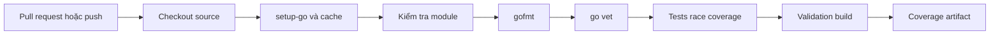

<Callout type="info" title="Phạm vi">
  Trang này xây dựng một pipeline **Continuous Integration (CI)** production-ready cho
  một Go module ở thư mục gốc repository. CI ở đây có nhiệm vụ xác nhận mỗi thay đổi
  vẫn format đúng, không làm bẩn dependency graph, vượt qua phân tích tĩnh, tests và
  build. Việc phát hành phiên bản chính thức được tách khỏi pipeline kiểm chứng này.
</Callout>

## Mục lục

- [Tổng quan](#tổng-quan)
- [Quản lý module và phiên bản Go](#quản-lý-module-và-phiên-bản-go)
  - [Vai trò của go.mod và go.sum](#vai-trò-của-gomod-và-gosum)
  - [Giữ dependency graph sạch](#giữ-dependency-graph-sạch)
  - [Cấu hình setup-go và cache](#cấu-hình-setup-go-và-cache)
- [Workflow CI hoàn chỉnh](#workflow-ci-hoàn-chỉnh)
  - [Luồng kiểm tra](#luồng-kiểm-tra)
  - [Tệp workflow có thể sao chép](#tệp-workflow-có-thể-sao-chép)
  - [Permissions concurrency và timeout](#permissions-concurrency-và-timeout)
- [Format và phân tích tĩnh](#format-và-phân-tích-tĩnh)
  - [Kiểm tra gofmt](#kiểm-tra-gofmt)
  - [Chạy go vet](#chạy-go-vet)
- [Tests race và coverage](#tests-race-và-coverage)
  - [Unit tests](#unit-tests)
  - [Race detector](#race-detector)
  - [Báo cáo coverage](#báo-cáo-coverage)
- [Build và metadata](#build-và-metadata)
  - [Validation build](#validation-build)
  - [Nhúng metadata khi phù hợp](#nhúng-metadata-khi-phù-hợp)
- [Matrix phiên bản Go có chủ đích](#matrix-phiên-bản-go-có-chủ-đích)
- [Cross-build và artifacts](#cross-build-và-artifacts)
  - [Workflow cross-build](#workflow-cross-build)
  - [Ranh giới giữa CI validation và release](#ranh-giới-giữa-ci-validation-và-release)
- [Bài thực hành](#bài-thực-hành)
  - [Yêu cầu](#yêu-cầu)
  - [Các bước thực hiện](#các-bước-thực-hiện)
  - [Tiêu chí kiểm chứng](#tiêu-chí-kiểm-chứng)
- [Troubleshooting](#troubleshooting)
- [Best practices](#best-practices)
- [Tài liệu tham khảo](#tài-liệu-tham-khảo)

## Tổng quan

Một pipeline Go hữu ích phải phát hiện lỗi ở đúng lớp thay vì chỉ chạy `go test`.
Ví dụ, test có thể xanh trong khi một file chưa qua `gofmt`, `go.mod` thiếu dependency,
hoặc package `main` không còn build được. Pipeline trong trang này tạo các cổng kiểm
tra theo thứ tự từ rẻ đến đắt:

1. chuẩn bị đúng Go toolchain và khôi phục cache;
2. xác minh module files;
3. kiểm tra format và chạy `go vet`;
4. chạy tests với race detector và thu coverage;
5. build toàn bộ packages;
6. lưu coverage dưới dạng artifact phục vụ phân tích.

**Toolchain** là bộ compiler và công cụ đi kèm một phiên bản Go. **Cache** là dữ liệu
được tái sử dụng giữa các workflow runs để giảm thời gian tải module và biên dịch.
**Artifact** là file đầu ra được GitHub lưu cùng một workflow run để người dùng tải về.



<Callout type="idea" title="Fail fast">
  Thứ tự trên chạy các kiểm tra nhanh trước. Một lỗi format vì thế dừng job trước khi
  race detector tiêu tốn thêm CPU và thời gian.
</Callout>

## Quản lý module và phiên bản Go

### Vai trò của go.mod và go.sum

Một **module** là tập hợp các Go packages được version và phân phối cùng nhau.
`go.mod` khai báo module path, phiên bản Go tối thiểu và các module phụ thuộc trực
tiếp hoặc gián tiếp. Ví dụ:

```go title="go.mod"
module example.com/acme/orders

go 1.25.0

require golang.org/x/sync v0.16.0
```

`go.sum` lưu checksum của nội dung module đã tải và file `go.mod` của dependency.
Checksum giúp Go phát hiện nội dung dependency bị thay đổi ngoài dự kiến. `go.sum`
không phải lockfile theo nghĩa khóa nguyên một dependency tree; thuật toán Minimal
Version Selection của Go vẫn tính build list từ `go.mod`.

Hãy commit cả `go.mod` và `go.sum` khi dự án có dependency bên ngoài. Một module chỉ
dùng standard library có thể chưa sinh `go.sum`; trường hợp đó dùng `go.mod` làm
`cache-dependency-path` trong các ví dụ bên dưới.

<Callout type="warn" title="Không dùng go get để cài dependency trong CI">
  `go get` có thể sửa `go.mod` và `go.sum`. CI nên kiểm chứng trạng thái đã commit bằng
  `go mod download`, `go mod verify` và `go mod tidy`, không tự chọn thêm phiên bản
  dependency rồi tiếp tục như thể source tree vẫn sạch.
</Callout>

### Giữ dependency graph sạch

Ba lệnh có ba mục tiêu khác nhau:

```bash
# Tải modules trong build list về module cache.
go mod download

# Kiểm tra nội dung trong module cache vẫn khớp checksum đã ghi.
go mod verify

# Thêm dependency còn thiếu và bỏ dependency không còn dùng.
go mod tidy
```

Sau `go mod tidy`, CI phải thất bại nếu module files thay đổi. `git diff` không nhìn
thấy một `go.sum` hoàn toàn mới chưa được track, nên kiểm tra `git status --porcelain`
thay vì chỉ dùng `git diff --exit-code`:

```bash
set -euo pipefail

go mod tidy

if [ -n "$(git status --porcelain -- go.mod go.sum)" ]; then
  echo "::error::go.mod hoặc go.sum chưa đồng bộ; hãy chạy 'go mod tidy' và commit kết quả."
  git diff -- go.mod go.sum
  git status --short -- go.mod go.sum
  exit 1
fi
```

Chạy `go mod tidy` bằng cùng dòng Go mà CI sử dụng. Các phiên bản Go khác nhau có thể
cập nhật chỉ thị trong `go.mod` hoặc tập checksum cần thiết khác nhau.

### Cấu hình setup-go và cache

`actions/setup-go` tải hoặc chọn Go từ tool cache của runner rồi thêm binary vào
`PATH`. Action cũng có cache tích hợp cho module cache và Go build cache. Không cần
xếp thêm `actions/cache` nếu không có yêu cầu cache đặc biệt.

```yaml
- name: Setup Go
  uses: actions/setup-go@v7
  with:
    go-version: '1.26.x'
    cache: true
    cache-dependency-path: go.sum
```

Luôn đặt version trong dấu nháy. YAML có thể hiểu một giá trị như `1.20` là số và làm
mất số `0` cuối. Mẫu `'1.26.x'` chọn patch mới nhất thuộc dòng Go 1.26 mà action tìm
được.

Nếu repository xem chỉ thị `go` hoặc `toolchain` trong `go.mod` là nguồn duy nhất cho
CI toolchain, có thể đọc version trực tiếp từ file:

```yaml
- name: Setup Go from go.mod
  uses: actions/setup-go@v7
  with:
    go-version-file: go.mod
    cache: true
    cache-dependency-path: go.sum
```

Với `setup-go@v7`, chỉ thị `toolchain` được ưu tiên nếu có; nếu không, action dùng chỉ
thị `go`. Chọn cách này khi file thực sự biểu diễn toolchain CI. Nếu chỉ thị `go` chỉ
là phiên bản tối thiểu mà library hỗ trợ, dùng `go-version` tường minh hoặc matrix sẽ
thể hiện policy rõ hơn. Không khai báo đồng thời cả hai nếu không cần, vì
`go-version` được ưu tiên hơn `go-version-file`.

`cache-dependency-path` phải trỏ tới file thực sự mô tả dependency. Với monorepo có
nhiều modules, action hỗ trợ glob nhiều dòng:

```yaml
cache-dependency-path: |
  services/api/go.sum
  services/worker/go.sum
```

Cache chỉ tối ưu hiệu năng. Cache miss hoặc cache cũ không được làm thay đổi tính đúng
đắn của build vì Go vẫn tải dependency theo module files.

<Callout type="info" title="Phiên bản action đã kiểm chứng">
  Các workflow trên trang dùng major hiện hành của action chính thức:
  `actions/checkout@v7`, `actions/setup-go@v7` và `actions/upload-artifact@v7`.
  Major tags tiện cho ví dụ có thể sao chép. Repository có yêu cầu supply-chain chặt
  hơn nên pin full commit SHA và dùng Dependabot hoặc Renovate để cập nhật SHA.
</Callout>

## Workflow CI hoàn chỉnh

### Luồng kiểm tra

Workflow chính chạy cho pull request nhắm vào `main` và push lên `main`. Job dùng
Ubuntu vì race detector trên Linux runner đã có C compiler cần cho cgo. Workflow giả
định `go.mod` và `go.sum` nằm ở repository root.

| Bước | Lệnh hoặc action | Điều kiện đạt |
|---|---|---|
| Checkout | `actions/checkout` | Source của đúng commit có trong workspace |
| Toolchain | `actions/setup-go` | `go version` thuộc dòng đã chọn |
| Modules | `download`, `verify`, `tidy` | Dependency tải được, checksum đúng, working tree sạch |
| Format | `gofmt -l` | Không trả về tên file |
| Static analysis | `go vet ./...` | Không có lỗi do analyzer báo |
| Tests | `go test -race` | Tests xanh và không phát hiện data race |
| Coverage | `-coverprofile=coverage.out` | Sinh profile đọc được bởi `go tool cover` |
| Build | `go build -trimpath ./...` | Tất cả packages biên dịch được |
| Artifact | `actions/upload-artifact` | `coverage.out` được lưu trong 7 ngày |

### Tệp workflow có thể sao chép

Tạo `.github/workflows/go-ci.yml`:

```yaml title=".github/workflows/go-ci.yml"
name: Go CI

on:
  pull_request:
    branches: [main]
  push:
    branches: [main]

permissions:
  contents: read

concurrency:
  group: go-ci-${{ github.workflow }}-${{ github.event.pull_request.number || github.ref }}
  cancel-in-progress: true

jobs:
  validate:
    name: Validate
    runs-on: ubuntu-latest
    timeout-minutes: 15

    steps:
      - name: Checkout source
        uses: actions/checkout@v7
        with:
          persist-credentials: false

      - name: Setup Go
        uses: actions/setup-go@v7
        with:
          go-version: '1.26.x'
          cache: true
          cache-dependency-path: go.sum

      - name: Show Go environment
        run: |
          go version
          go env GOMOD GOMODCACHE GOCACHE

      - name: Download and verify modules
        run: |
          go mod download
          go mod verify

      - name: Check module files are tidy
        shell: bash
        run: |
          set -euo pipefail
          go mod tidy
          if [ -n "$(git status --porcelain -- go.mod go.sum)" ]; then
            echo "::error::go.mod hoặc go.sum chưa đồng bộ; chạy 'go mod tidy' và commit kết quả."
            git diff -- go.mod go.sum
            git status --short -- go.mod go.sum
            exit 1
          fi

      - name: Check formatting
        shell: bash
        run: |
          set -euo pipefail
          files="$(gofmt -l .)"
          if [ -n "$files" ]; then
            echo "::error::Các file sau chưa qua gofmt:"
            printf '%s\n' "$files"
            gofmt -d .
            exit 1
          fi

      - name: Run go vet
        run: go vet ./...

      - name: Run tests with race detector and coverage
        run: go test -race -covermode=atomic -coverprofile=coverage.out ./...

      - name: Print coverage summary
        run: go tool cover -func=coverage.out

      - name: Build all packages
        run: go build -trimpath ./...

      - name: Upload coverage profile
        uses: actions/upload-artifact@v7
        with:
          name: coverage-${{ github.run_id }}
          path: coverage.out
          if-no-files-found: error
          retention-days: 7
```

Workflow không cần `go install` hoặc `go get`. `go test` và `go build` tự tải phần
module còn thiếu nếu cache miss, còn bước `go mod download` làm lỗi mạng hoặc lỗi xác
thực xuất hiện sớm và rõ hơn.

Nếu project không có `go.sum`, đổi duy nhất dòng cache thành
`cache-dependency-path: go.mod`. Không tạo một `go.sum` rỗng chỉ để thỏa workflow.

### Permissions concurrency và timeout

`permissions: contents: read` áp dụng nguyên tắc **least privilege**, tức token chỉ có
quyền tối thiểu cần để đọc source. `persist-credentials: false` ngăn checkout giữ
credential trong Git config vì các bước sau không cần push commit.

`concurrency` gom các runs của cùng pull request hoặc cùng Git ref vào một nhóm.
`cancel-in-progress: true` hủy run cũ khi commit mới được push, nhờ đó runner không
tiếp tục kiểm tra source đã lỗi thời. Biểu thức dùng số pull request khi có, nếu không
thì dùng `github.ref`.

`timeout-minutes: 15` chặn một test deadlock hoặc lệnh mạng treo chiếm runner vô hạn.
Đặt ngưỡng theo số liệu thực tế: thường cao hơn p95 của job nhưng vẫn đủ thấp để cảnh
báo bất thường. Test tích hợp dài nên ở job riêng với timeout riêng.

<Callout type="warn" title="Không chạy code PR không tin cậy bằng pull_request_target">
  Workflow build và test code từ contributor nên dùng `pull_request`. Không đổi sang
  `pull_request_target` để lấy secrets; event đó chạy trong ngữ cảnh có quyền của base
  repository và có thể biến checkout rồi thực thi code PR thành lỗ hổng bảo mật.
</Callout>

## Format và phân tích tĩnh

### Kiểm tra gofmt

`gofmt` là formatter chuẩn đi cùng Go toolchain. CI chỉ nên **kiểm tra**, không tự sửa
và commit. Lệnh sau liệt kê file chưa đúng format, in diff để chẩn đoán rồi trả exit
code khác `0`:

```bash
set -euo pipefail
files="$(gofmt -l .)"
if [ -n "$files" ]; then
  printf 'Chưa format:\n%s\n' "$files"
  gofmt -d .
  exit 1
fi
```

Developer sửa bằng lệnh cụ thể sau trước khi push:

```bash
gofmt -w .
```

Không dùng `go fmt ./...` làm điều kiện trực tiếp vì lệnh đó format source tại chỗ.
Một CI run xanh sau khi tự sửa sẽ che giấu việc commit ban đầu chưa tuân thủ format.

### Chạy go vet

`go vet` chạy các analyzer để tìm cấu trúc code đáng ngờ mà compiler vẫn chấp nhận.
Ví dụ thường gặp là format string không khớp đối số hoặc copy một giá trị chứa lock.
Lệnh chuẩn cho module là:

```bash
go vet ./...
```

`go vet` không thay thế compiler, tests hoặc static-analysis suite chuyên sâu. Tuy
nhiên, nó là baseline ít cấu hình và đi cùng đúng Go toolchain đã chọn. Khi một cảnh
báo là hợp lệ theo thiết kế, hãy sửa cấu trúc code hoặc cấu hình analyzer ở phạm vi
hẹp có giải thích; không thêm `|| true` để vô hiệu hóa toàn bộ cổng kiểm tra.

## Tests race và coverage

### Unit tests

Mẫu `./...` yêu cầu Go chạy tests của package hiện tại và mọi package con thuộc module:

```bash
go test ./...
```

Go cache kết quả test thành công khi inputs không đổi. Đây là cache có nội dung được
xác định bởi Go, không phải bỏ qua tests một cách tùy ý. Khi điều tra test không ổn
định và cần ép chạy lại, dùng `go test -count=1 ./...` trong lần chẩn đoán.

Tách unit tests khỏi integration tests bằng build tags hoặc package conventions nếu
integration tests cần database, network hay credentials. Cổng merge nhanh không nên
phụ thuộc âm thầm vào dịch vụ bên ngoài không được khai báo.

### Race detector

**Data race** xảy ra khi hai goroutines truy cập cùng vùng nhớ đồng thời, có ít nhất
một thao tác ghi và không có đồng bộ đúng. Race detector quan sát hành vi thực tế khi
test chạy:

```bash
go test -race ./...
```

Nó chỉ tìm race trên code path đã được thực thi. Vì vậy coverage tốt làm race detector
hữu ích hơn, nhưng một run xanh không chứng minh chương trình không có race.

Race detector cần cgo và C compiler trên các nền tảng được Go hỗ trợ. Nó cũng có thể
tốn khoảng 2–20 lần thời gian chạy và 5–10 lần bộ nhớ so với chạy bình thường. Với
repository lớn, chạy unit tests nhanh ở mọi commit và chuyển full `-race` sang job
song song hoặc workflow theo lịch. Không nên bỏ hẳn race detector chỉ vì job chậm.

### Báo cáo coverage

**Coverage** đo phần code được tests thực thi. Kết hợp race detector với coverage cần
`atomic` mode để cập nhật counter an toàn khi có nhiều goroutines:

```bash
go test -race -covermode=atomic -coverprofile=coverage.out ./...
go tool cover -func=coverage.out
```

Lệnh thứ hai in coverage theo function và dòng `total`. Để xem HTML ở máy local:

```bash
go tool cover -html=coverage.out -o coverage.html
```

Coverage là tín hiệu, không phải bằng chứng về chất lượng assertion. Một test gọi qua
nhiều dòng nhưng không kiểm tra kết quả vẫn làm tỷ lệ tăng. Nếu đặt threshold, hãy
bắt đầu từ baseline thực tế và tăng có chủ đích thay vì chọn một con số tùy ý.

## Build và metadata

### Validation build

Tests biên dịch test binaries nhưng không nhất thiết kiểm chứng mọi đường build của
các command packages. Bước sau xác nhận toàn bộ packages build được:

```bash
go build -trimpath ./...
```

`-trimpath` loại đường dẫn filesystem tuyệt đối khỏi object và executable. Với nhiều
packages, Go dùng build như phép kiểm tra và không tạo một bộ binaries để phân phối.
Đây chính là **validation build**: mục tiêu là chứng minh source biên dịch được, không
phải sản xuất release asset.

Nếu ứng dụng có một entry point cụ thể, có thể thêm smoke build rõ ràng:

```bash
mkdir -p dist
go build -trimpath -o dist/orders-api ./cmd/orders-api
./dist/orders-api version
```

Chỉ chạy dòng cuối nếu command thực sự có subcommand `version` và không yêu cầu dịch
vụ bên ngoài khi khởi động.

### Nhúng metadata khi phù hợp

Metadata build hữu ích cho executable cần tự báo version, commit và thời điểm build.
Ví dụ `cmd/orders-api/main.go` khai báo ba **biến string**; linker flag `-X` không sửa
được `const` hoặc biến có giá trị được tính bằng biểu thức:

```go title="cmd/orders-api/main.go"
package main

import "fmt"

var (
	version   = "dev"
	commit    = "none"
	buildDate = "unknown"
)

func main() {
	fmt.Printf("orders-api %s commit=%s built=%s\n", version, commit, buildDate)
}
```

Một build CI cụ thể có thể nhúng metadata như sau:

```bash
set -euo pipefail
mkdir -p dist

version="ci-${GITHUB_RUN_NUMBER}"
build_date="$(date -u +'%Y-%m-%dT%H:%M:%SZ')"
ldflags="-X main.version=${version} -X main.commit=${GITHUB_SHA} -X main.buildDate=${build_date}"

go build -trimpath -ldflags "$ldflags" -o dist/orders-api ./cmd/orders-api
```

Thời điểm build làm binary không còn byte-for-byte reproducible. Nếu khả năng tái lập
quan trọng, lấy timestamp từ release metadata cố định hoặc bỏ `buildDate`. Library
packages thường không cần nhúng metadata; Go đã có build information có thể đọc bằng
`runtime/debug.ReadBuildInfo` khi phù hợp.

## Matrix phiên bản Go có chủ đích

**Matrix** cho phép GitHub tạo nhiều biến thể của cùng một job. Không nên matrix mọi
patch Go hoặc mọi hệ điều hành theo thói quen. Mỗi trục phải gắn với một cam kết hỗ trợ.

Ví dụ một library cam kết chạy trên Go 1.25 và 1.26 nên kiểm tra patch mới nhất của
hai dòng đó:

```yaml
jobs:
  compatibility:
    name: Go ${{ matrix.go-version }}
    runs-on: ubuntu-latest
    timeout-minutes: 15
    strategy:
      fail-fast: false
      matrix:
        go-version: ['1.25.x', '1.26.x']

    steps:
      - name: Checkout source
        uses: actions/checkout@v7
        with:
          persist-credentials: false

      - name: Setup Go
        uses: actions/setup-go@v7
        with:
          go-version: ${{ matrix.go-version }}
          cache: true
          cache-dependency-path: go.sum

      - name: Test compatibility
        env:
          GOTOOLCHAIN: local
        run: go test ./...
```

`fail-fast: false` để cả hai dòng Go trả kết quả, thay vì hủy dòng còn lại ngay khi
một dòng thất bại. `GOTOOLCHAIN=local` ngăn lệnh `go` tự tải toolchain mới hơn và vô
tình biến ô matrix Go cũ thành một run bằng Go mới.

Đặt các kiểm tra độc lập phiên bản như `gofmt` một lần trong job chính. Matrix chỉ cần
kiểm tra điều matrix muốn chứng minh, thường là compile và tests. Với service chỉ deploy
bằng một toolchain được khóa, một job dùng đúng toolchain production thường có giá trị
hơn matrix rộng.

<Callout type="idea" title="Cập nhật support policy">
  Go phát hành theo chu kỳ và chỉ hỗ trợ các dòng gần nhất. Khi dự án đổi phiên bản tối
  thiểu, hãy cập nhật đồng thời chỉ thị `go` trong `go.mod`, matrix CI và tài liệu hỗ trợ.
  Hai dòng trong ví dụ là một quyết định support cụ thể, không phải danh sách tồn tại
  vĩnh viễn.
</Callout>

## Cross-build và artifacts

**Cross-build** hay cross-compilation là biên dịch trên một hệ điều hành cho hệ điều
hành hoặc kiến trúc khác bằng `GOOS` và `GOARCH`. Ví dụ runner Linux có thể tạo binary
cho Linux, macOS và Windows nếu ứng dụng thuần Go.

### Workflow cross-build

Workflow sau chạy thủ công hoặc sau push lên `main`. Nó build một command cụ thể tại
`./cmd/orders-api`, đóng gói từng binary rồi upload artifact có tên duy nhất:

```yaml title=".github/workflows/go-cross-build.yml"
name: Go cross-build validation

on:
  workflow_dispatch:
  push:
    branches: [main]

permissions:
  contents: read

concurrency:
  group: go-cross-build-${{ github.ref }}
  cancel-in-progress: true

jobs:
  cross-build:
    name: ${{ matrix.goos }}/${{ matrix.goarch }}
    runs-on: ubuntu-latest
    timeout-minutes: 20
    strategy:
      fail-fast: false
      matrix:
        include:
          - goos: linux
            goarch: amd64
          - goos: linux
            goarch: arm64
          - goos: darwin
            goarch: arm64
          - goos: windows
            goarch: amd64

    env:
      APP_NAME: orders-api
      PACKAGE: ./cmd/orders-api
      GOOS: ${{ matrix.goos }}
      GOARCH: ${{ matrix.goarch }}
      CGO_ENABLED: '0'

    steps:
      - name: Checkout source
        uses: actions/checkout@v7
        with:
          persist-credentials: false

      - name: Setup Go
        uses: actions/setup-go@v7
        with:
          go-version: '1.26.x'
          cache: true
          cache-dependency-path: go.sum

      - name: Build and package
        id: package
        shell: bash
        run: |
          set -euo pipefail
          mkdir -p dist/package

          binary="${APP_NAME}"
          if [ "${GOOS}" = "windows" ]; then
            binary="${binary}.exe"
          fi

          version="ci-${GITHUB_RUN_NUMBER}"
          build_date="$(date -u +'%Y-%m-%dT%H:%M:%SZ')"
          ldflags="-X main.version=${version} -X main.commit=${GITHUB_SHA} -X main.buildDate=${build_date}"

          go build -trimpath -ldflags "$ldflags" -o "dist/package/${binary}" "$PACKAGE"

          if [ "${GOOS}" = "windows" ]; then
            archive="${GITHUB_WORKSPACE}/dist/${APP_NAME}-${GOOS}-${GOARCH}.zip"
            (cd dist/package && zip -q "$archive" "$binary")
          else
            archive="${GITHUB_WORKSPACE}/dist/${APP_NAME}-${GOOS}-${GOARCH}.tar.gz"
            tar -C dist/package -czf "$archive" "$binary"
          fi

          echo "archive=${archive}" >> "$GITHUB_OUTPUT"

      - name: Upload packaged binary
        uses: actions/upload-artifact@v7
        with:
          name: ${{ env.APP_NAME }}-${{ matrix.goos }}-${{ matrix.goarch }}
          path: ${{ steps.package.outputs.archive }}
          if-no-files-found: error
          retention-days: 7
```

`CGO_ENABLED=0` làm ví dụ phù hợp với ứng dụng thuần Go. Nếu project import package
cần cgo, chỉ đổi biến này thành `1` là chưa đủ. Mỗi target cần C cross-compiler, system
libraries và cấu hình `CC` tương ứng; cách an toàn thường là build native trên runner
cùng hệ điều hành hoặc dùng toolchain cross-compilation đã được quản trị riêng.

Các file `.tar.gz` giữ executable bit của binary Unix. Upload trực tiếp một file rồi
giải nén artifact có thể không giữ permission gốc, vì artifact storage chuẩn hóa file
mode. Tên artifact chứa cả `GOOS` và `GOARCH`, tránh nhiều matrix jobs cùng ghi vào một
artifact.

Cross-build chỉ chứng minh compiler tạo được binary. Runner Linux không thực thi được
binary macOS hoặc Windows, nên vẫn cần native tests hoặc smoke tests trên từng OS nếu
đó là cam kết hỗ trợ thực sự.

### Ranh giới giữa CI validation và release

| Khía cạnh | CI validation | Release pipeline |
|---|---|---|
| Trigger | Pull request, push, chạy thủ công | Tag được bảo vệ như `v1.4.0` hoặc phê duyệt thủ công |
| Mục tiêu | Phản hồi nhanh về tính đúng đắn của source | Tạo và phân phối phiên bản bất biến |
| Version | Dòng Go theo support policy, metadata `ci-*` | Version lấy từ tag đã kiểm chứng |
| Artifacts | Ngắn hạn, phục vụ review hoặc smoke test | Release assets có retention theo chính sách sản phẩm |
| Bảo đảm | Build được; chưa chắc chạy được trên target | Native tests, checksum, ký số, provenance hoặc attestation khi cần |
| Quyền | Thường chỉ `contents: read` | Chỉ cấp quyền ghi ở release job và môi trường được bảo vệ |

<Callout type="warn" title="Artifact CI không tự trở thành release">
  Không lấy binary từ một pull request không tin cậy rồi publish. Release workflow phải
  kiểm tra tag trỏ tới commit đã qua required checks, dùng quyền tối thiểu và tạo
  checksum hoặc chữ ký theo chính sách supply-chain của dự án.
</Callout>

## Bài thực hành

### Yêu cầu

Bài thực hành áp dụng cho một repository có:

- một Go module ở thư mục gốc;
- `go.mod` và, nếu có dependency ngoài standard library, `go.sum` đã được commit;
- ít nhất một file `_test.go`;
- default branch tên `main`;
- GitHub CLI `gh` đã đăng nhập nếu muốn kiểm chứng bằng terminal.

Chạy baseline ở máy local trước khi tạo workflow:

```bash
go mod tidy
gofmt -w .
go vet ./...
go test -race ./...
go build ./...
git status --short
```

Dòng cuối không được hiển thị thay đổi ngoài những thay đổi bạn chủ động chuẩn bị để
commit.

### Các bước thực hiện

1. Tạo `.github/workflows/go-ci.yml` bằng workflow hoàn chỉnh ở phần trên.
2. Nếu module chưa có `go.sum`, đổi `cache-dependency-path` thành `go.mod`.
3. Nếu support policy chưa dùng Go 1.26, đổi `go-version` sang dòng Go project hỗ trợ
   và ghi cùng policy đó trong tài liệu repository.
4. Commit workflow trên feature branch rồi mở pull request vào `main`.
5. Xác nhận run mới nhất bằng GitHub CLI:

```bash
run_id="$(gh run list --workflow go-ci.yml --limit 1 --json databaseId --jq '.[0].databaseId')"
gh run view "$run_id"
gh run view "$run_id" --log
```

6. Tạo một negative test có kiểm soát: thêm khoảng trắng format sai vào một file `.go`,
   commit và push. Bước **Check formatting** phải đỏ và log phải in tên file cùng diff.
7. Chạy `gofmt -w .`, commit bản sửa và push lại. Run cũ phải bị hủy nếu còn chạy; run
   mới phải tiếp tục qua các cổng còn lại.
8. Sau khi run xanh, tải coverage artifact:

```bash
run_id="$(gh run list --workflow go-ci.yml --limit 1 --json databaseId --jq '.[0].databaseId')"
rm -rf .artifacts/coverage
mkdir -p .artifacts/coverage
gh run download "$run_id" --dir .artifacts/coverage
find .artifacts/coverage -type f -name coverage.out -print
```

### Tiêu chí kiểm chứng

Hoàn thành bài thực hành khi tất cả tiêu chí sau đúng:

- [ ] Pull request hiển thị check **Go CI / Validate** thành công.
- [ ] Log **Show Go environment** in đúng dòng Go đã cấu hình và đường dẫn `go.mod`.
- [ ] Negative test làm bước format thất bại; commit sửa làm bước đó xanh trở lại.
- [ ] `go mod tidy` không tạo thay đổi trong `go.mod` hoặc `go.sum`.
- [ ] `go vet ./...` và `go test -race` đều trả exit code `0`.
- [ ] Log coverage có dòng `total` và artifact chứa `coverage.out`.
- [ ] `go build -trimpath ./...` thành công.
- [ ] Khi push commit mới liên tiếp, run cũ của cùng pull request được cancel.
- [ ] `GITHUB_TOKEN` của workflow chỉ có `contents: read`.

Nếu áp dụng thêm cross-build, tiêu chí bổ sung là có bốn artifacts tên
`orders-api-linux-amd64`, `orders-api-linux-arm64`, `orders-api-darwin-arm64` và
`orders-api-windows-amd64`. Mỗi artifact phải chứa đúng một archive có tên target
tương ứng.

## Troubleshooting

| Triệu chứng | Nguyên nhân thường gặp | Cách xử lý |
|---|---|---|
| `No file in ... matched to [go.sum]` hoặc cảnh báo cache | Module không có `go.sum`, file nằm ở subdirectory, hoặc glob sai | Dùng `go.mod` cho module không có dependency ngoài; nếu là monorepo, đặt đúng các đường dẫn `**/go.sum` cần cache |
| `updates to go.mod needed; to update it: go mod tidy` | Source import dependency chưa được ghi hoặc module files được tạo bằng dòng Go khác | Chạy `go mod tidy` bằng dòng Go của CI, review diff rồi commit cả `go.mod` và `go.sum` |
| `go mod verify` báo checksum mismatch | Module cache bị hỏng hoặc nội dung tải về không khớp `go.sum` | Xóa module cache local bằng `go clean -modcache`; trong CI rerun không dùng cache và điều tra proxy trước khi thay checksum |
| Cache luôn miss | `cache-dependency-path` không ổn định hoặc mỗi job dùng OS, arch hay Go version khác | Kiểm tra log của `setup-go`; chấp nhận miss hợp lệ giữa các toolchain và chỉ cache đúng module files |
| Bước format in danh sách file | Source chưa qua formatter chuẩn | Chạy `gofmt -w .`, review và commit thay đổi; không thêm `continue-on-error` |
| `go vet` xanh local nhưng đỏ trên CI | Local và CI dùng khác Go version, build tags hoặc environment | In `go version` và `go env`; tái hiện bằng đúng toolchain, tags và package pattern của CI |
| Race detector báo `WARNING: DATA RACE` | Có truy cập bộ nhớ đồng thời thiếu mutex, channel hoặc atomic operation | Đọc hai stack traces xung đột, sửa đồng bộ rồi thêm regression test; không loại test bằng build tag chỉ để làm CI xanh |
| `-race requires cgo` hoặc thiếu C compiler | `CGO_ENABLED=0`, target không được hỗ trợ hoặc self-hosted runner thiếu compiler | Chạy race job native trên target được Go hỗ trợ với `CGO_ENABLED=1` và C compiler phù hợp |
| Không có `coverage.out` | Test thất bại trước khi hoàn tất hoặc package pattern không khớp | Sửa lỗi test trước; giữ `if-no-files-found: error` để artifact không âm thầm trống |
| Metadata vẫn là `dev` | Tên biến không phải string variable, dùng `const`, hoặc `-X` trỏ sai package symbol | Với ví dụ này dùng chính xác `main.version`, `main.commit`, `main.buildDate`; kiểm tra binary bằng command version có thật |
| Cross-build lỗi `C compiler ... not found` | Dependency dùng cgo trong khi đang cross-compile | Build native theo OS hoặc cung cấp cross-compiler và target libraries; không giả định `GOOS` và `GOARCH` là đủ cho cgo |
| Matrix jobs báo artifact đã tồn tại | Nhiều jobs upload cùng một artifact name | Đưa `matrix.goos`, `matrix.goarch` hoặc Go version vào tên artifact |
| Binary tải từ artifact mất executable bit | Artifact archive chuẩn hóa permissions | Đóng gói binary Unix thành `.tar.gz` trước khi upload như workflow cross-build |
| Action dùng Node 24 không chạy trên self-hosted runner | Actions Runner quá cũ so với runtime của action major hiện hành | Nâng Actions Runner theo release notes của action; không hạ action về major đã ngừng hỗ trợ chỉ để né nâng runner |
| Job hết `timeout-minutes` | Deadlock, test treo, tải private module chờ xác thực hoặc ngưỡng quá thấp | Xác định step cuối trong log, thêm timeout ở test hoặc network layer, sửa deadlock; chỉ tăng job timeout sau khi có số liệu |

Khi module private tải thất bại, kiểm tra `GOPRIVATE`, `GONOSUMDB`, Git credentials và
quyền đọc repository dependency. Không in token hoặc toàn bộ environment vào log để
chẩn đoán.

## Best practices

- **Commit module files và kiểm tra tidy.** Không để CI tự sửa dependency graph rồi bỏ
  qua diff.
- **Dùng `go mod download`, không dùng `go get` trong validation.** Validation phải đọc
  cấu hình dependency đã review thay vì thay đổi nó.
- **Dùng `setup-go` dù runner đã có Go.** Tool cache của runner có thể thay đổi; action
  làm lựa chọn toolchain thành một phần rõ ràng của workflow.
- **Cache bằng dependency file phù hợp.** Với module có dependencies, hash `go.sum`;
  với module chỉ dùng standard library và chưa có `go.sum`, hash `go.mod`.
- **Chạy kiểm tra rẻ trước.** Module, format và vet nên thất bại trước race tests hoặc
  cross-build tốn tài nguyên.
- **Giữ format check ở chế độ read-only.** CI báo diff; developer hoặc pre-commit hook
  mới thực hiện `gofmt -w`.
- **Không coi `go vet` là toàn bộ static analysis.** Có thể bổ sung linter đã pin version,
  nhưng phải quản lý cấu hình và thời gian chạy của linter đó như một dependency CI.
- **Chạy race detector trên code path có ý nghĩa.** Tăng chất lượng tests và tách job nếu
  chi phí cao, thay vì chỉ chạy `-race` trên một package nhỏ để lấy nhãn xanh.
- **Không tối ưu coverage theo con số đơn lẻ.** Review code chưa được test và chất lượng
  assertion trước khi tăng threshold.
- **Matrix theo support policy.** Test phiên bản tối thiểu và phiên bản production hoặc
  stable hiện hành; bỏ ô matrix không đại diện cho cam kết nào.
- **Tách validation artifacts khỏi release assets.** Dùng retention ngắn, tên artifact
  duy nhất và release workflow có quyền, trigger, ký số riêng.
- **Đóng gói trước khi upload.** `.tar.gz` giữ Unix executable mode; archive cũng làm cấu
  trúc artifact rõ ràng hơn.
- **Giới hạn quyền và thời gian.** Khai báo `permissions`, `concurrency` và
  `timeout-minutes` thay vì phụ thuộc defaults của organization.
- **Bảo vệ action dependency.** Dùng official action major đang được hỗ trợ; môi trường
  yêu cầu mức bảo đảm cao nên pin commit SHA và tự động hóa cập nhật.
- **Không đưa secrets vào job chạy code PR không tin cậy.** Ưu tiên `pull_request`, token
  chỉ đọc và không lưu checkout credentials khi không cần Git write.

## Tài liệu tham khảo

- [GitHub Docs — Building and testing Go](https://docs.github.com/en/actions/tutorials/build-and-test-code/go)
- [GitHub Docs — Workflow syntax for GitHub Actions](https://docs.github.com/en/actions/reference/workflows-and-actions/workflow-syntax)
- [GitHub Docs — Store and share data with workflow artifacts](https://docs.github.com/en/actions/tutorials/store-and-share-data)
- [GitHub Docs — Control workflow concurrency](https://docs.github.com/en/actions/how-tos/write-workflows/choose-when-workflows-run/control-workflow-concurrency)
- [actions/checkout — action chính thức và release notes](https://github.com/actions/checkout)
- [actions/setup-go — version resolution và cache tích hợp](https://github.com/actions/setup-go)
- [actions/upload-artifact — inputs, retention và giới hạn artifact](https://github.com/actions/upload-artifact)
- [Go Modules Reference](https://go.dev/ref/mod)
- [Go command reference](https://pkg.go.dev/cmd/go)
- [gofmt command](https://pkg.go.dev/cmd/gofmt)
- [go vet command](https://pkg.go.dev/cmd/vet)
- [Go Data Race Detector](https://go.dev/doc/articles/race_detector)
- [The cover story — coverage tooling của Go](https://go.dev/blog/cover)
- [Go Release Policy](https://go.dev/doc/devel/release#policy)
