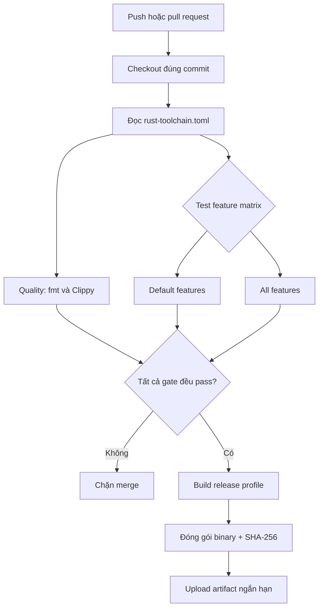

<Callout type="info" title="Kết quả sau bài này">
  Bạn sẽ có một workflow CI tái lập được cho ứng dụng hoặc workspace Rust. Workflow dùng cùng toolchain ở local và CI, khóa dependency bằng `Cargo.lock`, chặn lỗi định dạng/cảnh báo, test hai cấu hình feature có giá trị, build binary và lưu artifact có checksum.
</Callout>

## Mục lục

- [Phạm vi và mục tiêu](#phạm-vi-và-mục-tiêu)
  - [Các cổng chất lượng của CI Rust](#các-cổng-chất-lượng-của-ci-rust)
  - [CI không phải release hay cross compilation](#ci-không-phải-release-hay-cross-compilation)
- [Chuẩn bị dự án](#chuẩn-bị-dự-án)
  - [Cố định toolchain bằng rust-toolchain.toml](#cố-định-toolchain-bằng-rust-toolchaintoml)
  - [Commit Cargo.lock và dùng --locked](#commit-cargolock-và-dùng---locked)
  - [Chạy các cổng chất lượng ở local](#chạy-các-cổng-chất-lượng-ở-local)
- [Thiết kế pipeline](#thiết-kế-pipeline)
  - [Luồng từ commit đến binary artifact](#luồng-từ-commit-đến-binary-artifact)
  - [fmt và Clippy là hai kiểm tra khác nhau](#fmt-và-clippy-là-hai-kiểm-tra-khác-nhau)
  - [Feature matrix vừa đủ](#feature-matrix-vừa-đủ)
  - [Cache không phải artifact](#cache-không-phải-artifact)
- [Workflow production-ready](#workflow-production-ready)
  - [Giả định của workflow](#giả-định-của-workflow)
  - [Workflow hoàn chỉnh](#workflow-hoàn-chỉnh)
  - [Cài toolchain và components đáng tin cậy](#cài-toolchain-và-components-đáng-tin-cậy)
  - [Cache Cargo có khóa đúng ngữ cảnh](#cache-cargo-có-khóa-đúng-ngữ-cảnh)
  - [Đóng gói binary artifact an toàn](#đóng-gói-binary-artifact-an-toàn)
  - [Permissions concurrency và timeout](#permissions-concurrency-và-timeout)
  - [Lựa chọn và pin action bên thứ ba](#lựa-chọn-và-pin-action-bên-thứ-ba)
- [Bài thực hành](#bài-thực-hành)
  - [Các bước thực hiện](#các-bước-thực-hiện)
  - [Tiêu chí kiểm chứng](#tiêu-chí-kiểm-chứng)
- [Troubleshooting](#troubleshooting)
- [Best practices](#best-practices)
- [Tài liệu tham khảo](#tài-liệu-tham-khảo)

## Phạm vi và mục tiêu

**CI** (*Continuous Integration*, tích hợp liên tục) là quá trình kiểm tra tự động mỗi thay đổi trước khi hợp nhất. Với Rust, một pipeline đáng tin cậy không chỉ chạy `cargo test`. Nó còn phải kiểm soát compiler, components, dependency, feature và đầu ra build.

Hướng dẫn này dùng GitHub-hosted runner `ubuntu-24.04` và phù hợp nhất với ứng dụng hoặc workspace có ít nhất một binary target. **Workspace** là tập hợp nhiều package Cargo được quản lý từ một `Cargo.toml` gốc. Nếu repository chỉ chứa library, vẫn giữ các job `quality` và `test`, nhưng bỏ bước đóng gói binary.

### Các cổng chất lượng của CI Rust

Pipeline mẫu trả lời lần lượt các câu hỏi sau:

1. Mã nguồn có đúng định dạng chuẩn của `rustfmt` không?
2. Compiler và Clippy có phát hiện warning hoặc lint nào không?
3. Test có pass với default features và toàn bộ features không?
4. Workspace có build được ở release profile bằng đúng dependency đã khóa không?
5. Binary build thành công có được đóng gói thành artifact để kiểm tra không?

**Clippy** là bộ lint chính thức của Rust. Lint là phép kiểm tra tĩnh phát hiện code đáng ngờ, không tối ưu hoặc khó bảo trì mà compiler vẫn có thể chấp nhận. Pipeline truyền `-D warnings`, nghĩa là nâng mọi warning thành lỗi CI.

### CI không phải release hay cross compilation

Workflow bên dưới chạy `cargo build --release`, nhưng từ `release` ở đây chỉ là **Cargo release profile**: build có tối ưu hóa theo cấu hình `[profile.release]`. Nó chưa phải quy trình phát hành sản phẩm.

| Mối quan tâm | CI trong bài này | Release pipeline | Cross compilation |
|---|---|---|---|
| Trigger | `push` và `pull_request` vào `main` | Tag phiên bản hoặc `workflow_dispatch` có phê duyệt | Theo target/OS được hỗ trợ |
| Mục tiêu | Chặn thay đổi lỗi, phản hồi nhanh | Phát hành tài sản chính thức | Tạo binary cho kiến trúc/hệ điều hành khác host |
| Quyền token | Chỉ `contents: read` | Có thể cần `contents: write`, OIDC hoặc package write | Thường chỉ read, trừ khi kết hợp release |
| Đầu ra | Artifact ngắn hạn để kiểm tra | GitHub Release, registry, image hoặc package đã ký | Binary theo target triple |
| Bảo đảm bổ sung | Test, lint, build | Changelog, ký số, provenance, SBOM, approval | Target Rust, linker, thư viện hệ thống, test trên kiến trúc thật |

**Target triple** là chuỗi mô tả kiến trúc, nhà cung cấp, hệ điều hành và ABI, ví dụ `x86_64-unknown-linux-gnu`. Chỉ chạy `rustup target add` chưa đủ để cross-compile mọi dự án. Crate có mã C/C++, OpenSSL hoặc dependency hệ thống còn cần linker và thư viện đúng target.

<Callout type="warn" title="Không dùng artifact CI như bản phát hành chính thức">
  Artifact trong bài chưa được ký, chưa có provenance và chỉ build native trên Ubuntu x86-64. Hãy tạo workflow release riêng cho tag đã bảo vệ, dùng environment approval và cấp thêm quyền đúng ở job phát hành.
</Callout>

## Chuẩn bị dự án

### Cố định toolchain bằng rust-toolchain.toml

Commit `rust-toolchain.toml` ở root repository:

```toml title="rust-toolchain.toml"
[toolchain]
channel = "1.97.1"
profile = "minimal"
components = ["rustfmt", "clippy"]
```

Ví dụ cố định Rust `1.97.1`, bản stable được kênh phân phối chính thức công bố ngày 2026-07-16. Một phiên bản chính xác giúp local và CI dùng cùng compiler, cùng `rustfmt` và cùng tập lint Clippy. Điều này quan trọng vì kết quả format hoặc warning có thể thay đổi khi stable channel trượt sang bản mới.

- `channel` chọn phiên bản compiler.
- `profile = "minimal"` chỉ cài thành phần nền tảng cần thiết, giảm thời gian tải so với `default` hoặc `complete`.
- `components` thêm `rustfmt` và `clippy` vào đúng toolchain đã chọn.

Khi nâng Rust, hãy sửa file này trong một pull request riêng rồi review thay đổi của format, lint, test và `Cargo.lock`. Không đổi sang `channel = "stable"` nếu mục tiêu là build lặp lại được. Với nightly, luôn pin cả ngày, ví dụ `nightly-2026-07-01`, vì `nightly` có thể thay đổi mỗi ngày và đôi khi thiếu component.

`rust-version` trong `Cargo.toml` có ý nghĩa khác:

```toml title="Cargo.toml"
[package]
name = "rust-ci-demo"
version = "0.1.0"
edition = "2024"
rust-version = "1.97"
```

`rust-version` khai báo **MSRV** (*Minimum Supported Rust Version*, phiên bản Rust thấp nhất được hỗ trợ) cho Cargo và người dùng crate. `rust-toolchain.toml` chọn phiên bản thực sự dùng khi phát triển và chạy CI. Với ứng dụng nội bộ, hai giá trị thường gần nhau. Với library hỗ trợ MSRV cũ, hãy thêm một job MSRV riêng thay vì nhân mọi job thành ma trận nhiều compiler.

### Commit Cargo.lock và dùng --locked

`Cargo.lock` là **lockfile**, tức ảnh chụp chính xác các phiên bản dependency mà Cargo đã resolve thành công. Commit file này cho ứng dụng và workspace để cùng commit mã nguồn tạo cùng cây dependency ở local và CI:

```bash
cargo generate-lockfile
git add Cargo.toml Cargo.lock rust-toolchain.toml
git commit -m "build: pin Rust toolchain and dependencies"
```

Trong CI, thêm `--locked` vào `cargo clippy`, `cargo test` và `cargo build`. Nếu `Cargo.toml` cần làm thay đổi lockfile, Cargo sẽ thoát lỗi thay vì âm thầm sửa workspace trên runner.

Với library, `Cargo.lock` không quyết định dependency mà downstream consumer nhận; `Cargo.toml` mới quyết định phạm vi đó. Tuy vậy, commit lockfile vẫn làm CI của chính repository ổn định và hữu ích cho kiểm tra MSRV. Để không bỏ sót dependency mới trong phạm vi cho phép, dùng Dependabot/Renovate hoặc một workflow theo lịch chạy `cargo update` rồi mở pull request có review. Không biến mọi pull request thành một lần resolve dependency ngẫu nhiên.

<Callout type="idea" title="Quy tắc thực dụng">
  Commit `Cargo.lock`, chạy các lệnh CI với `--locked`, và cập nhật lockfile bằng pull request riêng. Pipeline sẽ ổn định nhưng dependency vẫn được nâng có kiểm soát.
</Callout>

### Chạy các cổng chất lượng ở local

Trước khi viết YAML, xác minh giao diện lệnh mà CI sẽ gọi:

```bash
rustup show active-toolchain
cargo fmt --all -- --check
cargo clippy --workspace --all-targets --all-features --locked -- -D warnings
cargo test --workspace --locked
cargo test --workspace --all-features --locked
cargo build --release --workspace --locked
```

Dấu `--` trong lệnh Clippy phân cách option của Cargo với option truyền xuống compiler/Clippy. Vì vậy `-D warnings` nằm sau dấu `--`.

Nếu dự án cần dịch vụ như PostgreSQL, feature độc quyền hoặc system package, hãy làm cho lệnh local thể hiện rõ yêu cầu đó trước. CI không nên chứa một biến thể bí mật khác với cách developer kiểm tra code.

## Thiết kế pipeline

### Luồng từ commit đến binary artifact



Ba job có trách nhiệm riêng:

- `quality` phản hồi nhanh về format và lint;
- `test` dùng matrix để chứng minh hai cấu hình feature;
- `build` chỉ chạy một lần sau khi toàn bộ gate pass.

Mỗi job nhận một runner sạch. Dữ liệu trong `target/` không tự truyền sang job kế tiếp. Cache chỉ giúp tái sử dụng compilation của dependency khi có thể; build job vẫn phải chạy lệnh build của chính nó.

### fmt và Clippy là hai kiểm tra khác nhau

`cargo fmt --all -- --check` không sửa file. Nó trả exit code khác 0 nếu code chưa đúng format. Không chạy `cargo fmt` không có `--check` trong CI, vì runner sửa code rồi kết thúc mà pull request vẫn không nhận commit đó.

`cargo clippy --workspace --all-targets --all-features --locked -- -D warnings` kiểm tra phạm vi rộng hơn test mặc định:

- `--workspace` bao phủ mọi member;
- `--all-targets` gồm library, binary, test, benchmark và example target;
- `--all-features` compile code bị ẩn sau feature flag;
- `--locked` cấm thay đổi lockfile;
- `-D warnings` biến warning thành gate bắt buộc.

Đặt `-D warnings` ngay trên lệnh Clippy thay vì ép toàn bộ developer dùng `RUSTFLAGS=-D warnings`. Local build vẫn có thể hiển thị warning để developer sửa dần, còn nhánh chính luôn warning-clean.

Nếu repository đang có warning lịch sử, đừng thêm `|| true`. Hãy sửa warning hoặc tạm deny một tập lint đã thống nhất, rồi tăng dần độ nghiêm ngặt. Một gate luôn xanh dù lệnh lỗi không còn là gate.

### Feature matrix vừa đủ

**Cargo feature** là cờ compile-time bật hoặc tắt API/dependency tùy chọn. Tất cả tổ hợp của `n` feature có thể tạo `2^n` biến thể, nên brute-force nhanh chóng làm CI chậm mà vẫn khó diễn giải.

Baseline trong bài chỉ test:

| Biến thể | Lệnh | Tín hiệu nhận được |
|---|---|---|
| `default` | `cargo test --workspace --locked` | Trải nghiệm mà đa số người dùng nhận mặc định |
| `all` | `cargo test --workspace --all-features --locked` | Khả năng compile và chạy khi mọi feature được bật |

Đây là matrix vừa đủ cho nhiều ứng dụng. Chỉ thêm `--no-default-features` khi crate cam kết hoạt động không có default feature. Chỉ thêm từng feature riêng lẻ khi chúng độc lập hoặc loại trừ nhau. Với library có nhiều feature phức tạp, `cargo-hack` có thể kiểm tra tổ hợp, nhưng đó là công cụ bên thứ ba cần pin phiên bản và cân nhắc chi phí runner.

`fail-fast: false` cho phép cả `default` và `all` chạy xong. Reviewer sẽ biết chính xác biến thể nào hỏng thay vì chỉ thấy job đầu tiên bị lỗi.

### Cache không phải artifact

| Thuộc tính | Cargo cache | Binary artifact |
|---|---|---|
| Mục đích | Rút ngắn lần compile sau | Lưu đầu ra của đúng workflow run |
| Nội dung | Cargo registry, git dependencies, build output dependency trong `target/` | Tarball binary và file checksum |
| Cache miss | Job phải vẫn đúng, chỉ chậm hơn | Thiếu artifact bắt buộc phải làm job lỗi |
| Khóa | OS, compiler, job, Cargo files, Rust config và feature key | Tên gắn với run ID/run attempt |
| Dùng để release | Không | Chưa; cần quy trình release riêng |

Không skip `cargo test` hoặc `cargo build` khi cache hit. Cache có thể bị xóa, hết hạn hoặc restore từ prefix gần đúng. Nó là tối ưu hiệu năng, không phải bằng chứng rằng commit hiện tại đã qua kiểm tra.

## Workflow production-ready

### Giả định của workflow

Workflow tổng quát cho repository thỏa các điều kiện sau:

- có `rust-toolchain.toml`, `Cargo.toml` và `Cargo.lock` ở root;
- là một package hoặc Cargo workspace;
- có một binary canonical nếu giữ bước đóng gói artifact;
- binary canonical build được với `--all-features`;
- không cần service hoặc system package bổ sung;
- nhánh được bảo vệ tên `main`.

Workflow khai báo rõ package và binary canonical qua `BINARY_PACKAGE` và `BINARY_NAME`. Hãy đổi hai giá trị này theo `Cargo.toml`; khai báo tường minh tránh nhầm output khi nhiều package trong workspace có binary trùng tên hoặc khi một binary yêu cầu feature riêng. Với library thuần, xóa job `build`; hai job `quality` và `test` vẫn giữ nguyên giá trị.

### Workflow hoàn chỉnh

Tạo `.github/workflows/ci.yml`:

```yaml title=".github/workflows/ci.yml"
name: Rust CI

on:
  push:
    branches: [main]
  pull_request:
    branches: [main]

permissions:
  contents: read

concurrency:
  group: rust-ci-${{ github.workflow }}-${{ github.event.pull_request.number || github.ref }}
  cancel-in-progress: true

env:
  CARGO_TERM_COLOR: always
  RUST_BACKTRACE: short
  BINARY_PACKAGE: rust-ci-demo
  BINARY_NAME: rust-ci-demo

jobs:
  quality:
    name: Quality / fmt + clippy
    runs-on: ubuntu-24.04
    timeout-minutes: 15

    steps:
      - name: Checkout source
        uses: actions/checkout@3d3c42e5aac5ba805825da76410c181273ba90b1 # v7.0.1
        with:
          persist-credentials: false

      - name: Install pinned Rust toolchain
        uses: actions-rust-lang/setup-rust-toolchain@166cdcfd11aee3cb47222f9ddb555ce30ddb9659 # v1.17.0
        with:
          rustflags: ""
          cache: true
          cache-key: quality
          cache-bin: false
          cache-on-failure: false
          cache-save-if: ${{ github.ref == 'refs/heads/main' }}

      - name: Verify toolchain and components
        run: |
          rustc --version --verbose
          cargo --version --verbose
          cargo fmt --version
          cargo clippy --version

      - name: Check formatting
        run: cargo fmt --all -- --check

      - name: Run Clippy and deny warnings
        run: cargo clippy --workspace --all-targets --all-features --locked -- -D warnings

  test:
    name: Test / ${{ matrix.feature-set }} features
    runs-on: ubuntu-24.04
    timeout-minutes: 20
    strategy:
      fail-fast: false
      matrix:
        feature-set: [default, all]

    steps:
      - name: Checkout source
        uses: actions/checkout@3d3c42e5aac5ba805825da76410c181273ba90b1 # v7.0.1
        with:
          persist-credentials: false

      - name: Install pinned Rust toolchain
        uses: actions-rust-lang/setup-rust-toolchain@166cdcfd11aee3cb47222f9ddb555ce30ddb9659 # v1.17.0
        with:
          rustflags: ""
          cache: true
          cache-key: test-${{ matrix.feature-set }}
          cache-bin: false
          cache-on-failure: false
          cache-save-if: ${{ github.ref == 'refs/heads/main' }}

      - name: Test with default features
        if: matrix.feature-set == 'default'
        run: cargo test --workspace --locked

      - name: Test with all features
        if: matrix.feature-set == 'all'
        run: cargo test --workspace --all-features --locked

  build:
    name: Build / native release binary
    needs: [quality, test]
    runs-on: ubuntu-24.04
    timeout-minutes: 20

    steps:
      - name: Checkout source
        uses: actions/checkout@3d3c42e5aac5ba805825da76410c181273ba90b1 # v7.0.1
        with:
          persist-credentials: false

      - name: Install pinned Rust toolchain
        uses: actions-rust-lang/setup-rust-toolchain@166cdcfd11aee3cb47222f9ddb555ce30ddb9659 # v1.17.0
        with:
          rustflags: ""
          cache: true
          cache-key: build-release
          cache-bin: false
          cache-on-failure: false
          cache-save-if: ${{ github.ref == 'refs/heads/main' }}

      - name: Build canonical release binary
        run: >-
          cargo build --release --locked --all-features
          --package "$BINARY_PACKAGE"
          --bin "$BINARY_NAME"

      - name: Package native binary
        shell: bash
        run: |
          set -euo pipefail
          mkdir -p dist

          source_path="target/release/${BINARY_NAME}"
          if [[ ! -x "$source_path" ]]; then
            echo "Expected executable not found: $source_path" >&2
            exit 1
          fi

          install -m 0755 "$source_path" "dist/$BINARY_NAME"
          tar -C dist -czf rust-binaries-x86_64-unknown-linux-gnu.tar.gz .
          sha256sum rust-binaries-x86_64-unknown-linux-gnu.tar.gz \
            > rust-binaries-x86_64-unknown-linux-gnu.tar.gz.sha256

      - name: Upload native binaries
        uses: actions/upload-artifact@043fb46d1a93c77aae656e7c1c64a875d1fc6a0a # v7.0.1
        with:
          name: rust-binaries-linux-x86_64-${{ github.run_id }}-${{ github.run_attempt }}
          path: |
            rust-binaries-x86_64-unknown-linux-gnu.tar.gz
            rust-binaries-x86_64-unknown-linux-gnu.tar.gz.sha256
          if-no-files-found: error
          retention-days: 14
          compression-level: 0
```

Workflow dùng full commit SHA cho mọi action. Comment phiên bản giúp con người review, còn SHA làm ref bất biến. Các SHA trong ví dụ tương ứng với `actions/checkout` v7.0.1, `actions-rust-lang/setup-rust-toolchain` v1.17.0 và `actions/upload-artifact` v7.0.1 tại thời điểm tài liệu được kiểm chứng.

<Callout type="warn" title="Yêu cầu với self-hosted runner">
  Các major action mới có thể dùng Node.js runtime mới và yêu cầu GitHub Actions Runner mới. Workflow còn cần Bash 5, `rustup`, `tar` và `sha256sum`. GitHub-hosted `ubuntu-24.04` đã cung cấp các công cụ này; hãy quản lý phiên bản và isolation rõ ràng nếu chuyển sang self-hosted runner.
</Callout>

### Cài toolchain và components đáng tin cậy

`actions-rust-lang/setup-rust-toolchain` tìm `rust-toolchain.toml` ở root khi không truyền input `toolchain`. Action sau đó dùng `rustup` để cài channel, profile và components trong file. Không truyền lại `1.97.1`, `rustfmt` hay `clippy` trong YAML, nên repository chỉ có một nguồn sự thật.

Step `Verify toolchain and components` không chỉ in version để debug. Lệnh `cargo fmt --version` và `cargo clippy --version` cũng làm job lỗi ngay nếu component bị thiếu. Việc này tạo thông báo rõ hơn so với chờ đến gate tương ứng.

Input `rustflags: ""` tắt mặc định `-D warnings` của setup action. Pipeline chủ động đặt `-D warnings` ở lệnh Clippy để tránh ghi đè `build.rustflags` trong `.cargo/config.toml` và tránh vô tình thay đổi mọi lệnh test/build.

Không tải một script cài Rust không version rồi `curl | sh` ở mỗi job nếu runner đã có `rustup`. Với self-hosted runner chưa có Rust, hãy bootstrap `rustup` từ `https://sh.rustup.rs` trong image provisioning có kiểm soát, dùng TLS, review script/checksum theo chính sách tổ chức và không lặp bootstrap đặc quyền trong từng pull request.

### Cache Cargo có khóa đúng ngữ cảnh

Setup action tích hợp `Swatinem/rust-cache`, một action cache Rust phổ biến. Nó tạo khóa từ các dữ liệu có ảnh hưởng trực tiếp đến compilation, gồm:

- job ID và `cache-key` bổ sung;
- hệ điều hành cùng thông tin `rustc`;
- `Cargo.lock`, `Cargo.toml`, `rust-toolchain.toml` và `.cargo/config.toml`;
- các biến môi trường compiler như `RUSTFLAGS`, `CARGO_*`, `CC` và `CFLAGS`.

Nó cache Cargo registry/git dependencies và phần build output dependency trong `target/`, đồng thời dọn incremental output và artifact workspace không hữu ích. Cách này đáng tin cậy hơn một `actions/cache` thủ công chỉ khóa theo `Cargo.lock`; cache thủ công dễ restore object được compile bằng compiler, target hoặc flags khác.

Các input trong workflow siết hành vi cache:

- `cache-key` tách quality, từng feature test và release build;
- `cache-bin: false` không restore các executable tùy ý từ `~/.cargo/bin`;
- `cache-on-failure: false` không lưu trạng thái từ job lỗi;
- `cache-save-if` chỉ cho run trên `main` ghi cache, giảm khả năng pull request không tin cậy làm bẩn cache dùng chung.

Cache của base branch vẫn có thể được pull request restore theo quy tắc GitHub. Mọi lệnh Cargo vẫn chạy với `--locked`; cache hit không bỏ qua gate. Nếu cache backend lỗi hoặc cache bị evict, pipeline phải chậm hơn nhưng kết quả không đổi.

Với workspace nằm ngoài root hoặc custom target directory, khai báo rõ input `cache-workspaces`. Ví dụ:

```yaml
with:
  cache-workspaces: |
    crates/api -> target
    crates/worker -> target
```

Chỉ thêm cấu hình này khi repository thực sự có hai workspace độc lập. Một Cargo workspace gốc với nhiều member vẫn dùng mặc định `. -> target`.

### Đóng gói binary artifact an toàn

Workflow build đúng một cặp package/binary được khai báo. `--all-features` bảo đảm binary có `required-features` vẫn được tạo khi tập feature của package tương thích với nhau. Đường dẫn output được kiểm tra tồn tại và có quyền execute trước khi đóng gói, nên sai `BINARY_PACKAGE`, sai `BINARY_NAME` hoặc build output thiếu sẽ làm job lỗi thay vì upload artifact rỗng. Với workspace có nhiều ứng dụng, dùng matrix chứa từng cặp package/binary và đặt mỗi output vào artifact mang tên riêng.

Tarball giải quyết một chi tiết quan trọng: artifact dạng ZIP có thể không giữ executable bit của file Unix. Quyền thực thi được bảo toàn bên trong `.tar.gz`. File `.sha256` cho phép người tải kiểm tra tarball:

```bash
sha256sum --check rust-binaries-x86_64-unknown-linux-gnu.tar.gz.sha256
tar -xzf rust-binaries-x86_64-unknown-linux-gnu.tar.gz
```

`compression-level: 0` tránh nén lại tarball đã gzip. `if-no-files-found: error` biến đường dẫn sai thành lỗi rõ ràng. `retention-days: 14` giữ bằng chứng đủ lâu cho review mà không tích lũy storage vô hạn.

Không đưa `.env`, private key, token, file cấu hình production hoặc dữ liệu test nhạy cảm vào `dist/`. Artifact của workflow run có quyền truy cập riêng nhưng vẫn là dữ liệu được lưu ngoài runner.

### Permissions concurrency và timeout

Ba guardrail trong workflow xử lý ba rủi ro độc lập:

- `permissions: contents: read` áp dụng quyền tối thiểu cho `GITHUB_TOKEN`. Khi khai báo một quyền, các quyền không khai báo được đặt thành `none`.
- `concurrency` gom các run theo workflow và pull request/ref. Commit mới hủy run cũ trên cùng nhánh hoặc pull request, nhưng không hủy run của nhánh khác.
- `timeout-minutes` dừng test treo, deadlock hoặc tiến trình chờ vô hạn. Quality có 15 phút; test/build có 20 phút.

`persist-credentials: false` ngăn checkout giữ token cho các lệnh Git sau đó. CI chỉ cần đọc source nên không có lý do để `git push`.

Dùng event `pull_request`, không dùng `pull_request_target` để checkout rồi compile code từ contributor. `pull_request_target` chạy trong ngữ cảnh nhánh đích có thể có token, secrets và cache đặc quyền hơn. Đây là mẫu “pwn request” nguy hiểm nếu thực thi code không tin cậy.

### Lựa chọn và pin action bên thứ ba

Workflow dùng hai official actions của GitHub (`actions/checkout`, `actions/upload-artifact`) và một action cộng đồng (`actions-rust-lang/setup-rust-toolchain`). Action cộng đồng được chọn vì nó giải quyết đúng ba việc Rust-specific:

1. đọc đầy đủ `rust-toolchain.toml`;
2. cài toolchain/components qua `rustup` và thêm problem matcher;
3. tích hợp `Swatinem/rust-cache` với khóa hiểu compiler và Cargo workspace.

Sự tiện lợi này mở rộng **software supply chain**, tức chuỗi phần mềm được tin cậy để build sản phẩm. Một action bị chiếm quyền có thể đọc workspace và token của job. Vì vậy workflow pin action cộng đồng bằng full 40-character commit SHA, không dùng branch `main`, tag `v1` hoặc tag version có thể bị di chuyển.

Full SHA cũng được dùng cho official actions để áp dụng cùng một chính sách. Khi nâng action:

1. mở release chính thức và đọc breaking changes;
2. xác minh SHA thuộc repository gốc, không phải fork;
3. review thay đổi source/action dependencies;
4. cập nhật comment version cùng SHA;
5. để Dependabot tạo pull request cập nhật GitHub Actions và chạy toàn bộ CI trước khi merge.

<Callout type="info" title="Major tag và full SHA">
  `@v1` hoặc `@v7` thuận tiện vì tự nhận patch, nhưng tag có thể thay đổi. Theo GitHub Secure Use, full commit SHA là cách duy nhất để dùng action như một release bất biến. Nếu tổ chức chấp nhận major tag, hãy ghi nhận đây là trade-off về chuỗi cung ứng chứ không phải mức bảo vệ tương đương.
</Callout>

Nếu threat model không cho phép action Rust bên thứ ba, hãy cài toolchain bằng `rustup` và dùng `actions/cache` đã pin SHA với khóa gồm OS, `rustc -Vv`, hash Cargo files và `.cargo/config.toml`. Giải pháp đó giảm số publisher được tin cậy nhưng tăng code shell/cache mà đội ngũ phải tự bảo trì. Không có lựa chọn “không cần tin cậy”; chỉ có ranh giới tin cậy khác nhau.

## Bài thực hành

Mục tiêu bài thực hành là chứng minh workflow tạo tín hiệu đúng khi code tốt, code lỗi, lockfile lệch và feature bị hỏng.

### Các bước thực hiện

1. Commit `rust-toolchain.toml` như ví dụ. Nếu tổ chức chưa phê duyệt Rust `1.97.1`, thay bằng phiên bản stable chính xác đã phê duyệt và cập nhật `rust-version` phù hợp.
2. Xác nhận `Cargo.lock` có trong Git bằng `git ls-files --error-unmatch Cargo.lock`.
3. Chạy sáu lệnh ở phần local và sửa toàn bộ lỗi trước khi tạo workflow.
4. Tạo `.github/workflows/ci.yml` từ workflow hoàn chỉnh. Với library thuần, bỏ hai step artifact như đã hướng dẫn.
5. Tạo branch `ci/rust-pipeline`, push và mở pull request vào `main`.
6. Trong tab **Actions**, xác nhận có một job quality, hai job test (`default`, `all`) và một job build. Job build chỉ bắt đầu sau ba gate còn lại thành công.
7. Tải artifact, chạy `sha256sum --check`, giải nén và chạy một binary với option an toàn như `--help` hoặc `--version`.
8. Thêm một thay đổi format sai, ví dụ bỏ chạy `cargo fmt`, rồi push. Xác nhận step `Check formatting` đỏ. Chạy `cargo fmt`, commit và push lại.
9. Tạo tạm một warning như biến không dùng. Xác nhận Clippy đỏ vì `-D warnings`, sau đó sửa warning.
10. Sửa `Cargo.toml` nhưng không cập nhật `Cargo.lock`. Xác nhận lệnh có `--locked` thất bại, rồi chạy lệnh Cargo thích hợp ở local và commit lockfile đã review.
11. Làm một test chỉ thuộc `#[cfg(feature = "...")]` thất bại. Xác nhận job `all` đỏ trong khi `default` có thể vẫn xanh. Sau đó sửa test.
12. Push hai commit liên tiếp khi run đầu còn hoạt động. Xác nhận run cũ trên cùng pull request bị hủy bởi `concurrency`.

### Tiêu chí kiểm chứng

Hoàn thành bài khi tất cả tiêu chí sau đúng:

- [ ] Repository có `rust-toolchain.toml` pin phiên bản chính xác, profile `minimal`, components `rustfmt` và `clippy`.
- [ ] `Cargo.lock` được commit và các lệnh resolve dependency trong CI dùng `--locked`.
- [ ] Log hiển thị đúng `rustc`, Cargo, rustfmt và Clippy theo toolchain đã pin.
- [ ] `cargo fmt --check` chặn code sai format mà không sửa file trên runner.
- [ ] Clippy chạy cho workspace, all targets, all features và thất bại khi có warning.
- [ ] Hai biến thể test `default` và `all` đều chạy; một biến thể lỗi không hủy biến thể còn lại.
- [ ] Build chỉ chạy sau quality và toàn bộ test matrix thành công.
- [ ] Cache miss đầu tiên không làm job lỗi; run sau có log restore cache phù hợp với job/feature.
- [ ] Pull request không ghi cache dùng chung; run trên `main` có thể lưu cache sau khi thành công.
- [ ] Artifact có tên duy nhất theo run, chứa tarball và checksum, và checksum kiểm tra thành công.
- [ ] Binary sau giải nén giữ quyền execute trên Linux.
- [ ] Run cũ trên cùng pull request bị hủy khi commit mới đến.
- [ ] Branch protection yêu cầu các check quality, test và build trước khi merge.

## Troubleshooting

| Triệu chứng | Nguyên nhân thường gặp | Cách xử lý |
|---|---|---|
| `rustup` không tìm thấy toolchain | `rust-toolchain.toml` sai vị trí/cú pháp, hoặc setup action được truyền input `toolchain` ghi đè file | Đặt file ở root, chạy `rustup show`, bỏ input ghi đè và kiểm tra TOML |
| `component 'clippy' ... is unavailable` | Toolchain/nightly đã pin không phát hành component đó cho host | Với stable, chọn patch hợp lệ; với nightly, pin ngày khác có đủ component, không dùng `--force` để che lỗi |
| Local và CI dùng Rust khác nhau | Local có `RUSTUP_TOOLCHAIN`, command `cargo +...` hoặc directory override ưu tiên hơn file | Chạy `rustup show`; bỏ environment/override ngoài ý muốn và gọi Cargo không có `+toolchain` |
| `cargo ... --locked` báo lockfile cần cập nhật | `Cargo.toml` thay đổi nhưng `Cargo.lock` chưa được regenerate | Chạy Cargo ở local bằng toolchain đã pin, review và commit lockfile; không bỏ `--locked` |
| `cargo fmt --check` chỉ lỗi trên CI | Local dùng rustfmt khác phiên bản hoặc chưa format toàn workspace | Cài toolchain từ file, chạy `cargo fmt --all`; không dùng stable trượt ở local |
| Clippy có lint mới sau khi nâng Rust | Bộ lint thay đổi theo compiler/toolchain | Nâng toolchain bằng PR riêng, review từng lint và sửa hoặc cấu hình lint có lý do; không thêm `|| true` |
| `-D warnings` làm dependency lỗi | Warning phát sinh từ build script/path dependency hoặc flags bị áp dụng rộng ngoài ý muốn | Giữ `-D warnings` ở cuối lệnh Clippy; kiểm tra `RUSTFLAGS` và `.cargo/config.toml`; cập nhật dependency/path crate sở hữu được |
| `default` pass nhưng `all` fail | Feature tùy chọn chưa compile/test cùng nhau, hoặc features loại trừ nhau | Sửa tương thích; nếu features thực sự loại trừ, thay `all` bằng các tổ hợp sản phẩm được hỗ trợ và ghi rõ chính sách |
| Test treo đến timeout | Test chờ network, deadlock, server không shutdown hoặc dùng watch mode | Thêm timeout cấp test, teardown resource, mock dependency ngoài và giữ `timeout-minutes` |
| Cache luôn miss | Toolchain/Cargo files thay đổi, key khác theo job/feature, hoặc cache chưa từng được lưu từ `main` | Đọc log khóa cache; chạy một commit xanh trên `main`; không ép các job khác ngữ cảnh dùng chung key |
| Cache quá lớn hoặc bị evict | `target/` dependency lớn, nhiều toolchain/feature/branch tạo nhiều entry | Giảm matrix, giữ `cache-bin: false`, cân nhắc `cache-targets: false` để chỉ cache registry, xóa cache cũ qua API/UI |
| Pull request cảnh báo không thể save cache | Token của fork có quyền cache chỉ đọc, hoặc `cache-save-if` là false | Đây là hành vi mong đợi; PR chỉ restore, main mới lưu cache đáng tin cậy |
| Build job báo không tìm thấy package hoặc binary | `BINARY_PACKAGE` hay `BINARY_NAME` không khớp `Cargo.toml`, hoặc repository chỉ là library | Sửa hai biến theo package/binary canonical; với library, bỏ job artifact |
| `Expected executable not found` | Tên target khác file output hoặc build dùng `--target` | Kiểm tra `BINARY_NAME` và `target/release`; nếu cross-build, dùng `target/<triple>/release` trong workflow riêng |
| Artifact mất quyền execute | Upload trực tiếp file binary qua ZIP thay vì tar | Giữ bước tạo `.tar.gz`, tải rồi giải nén tarball thay vì chạy file từ lớp ZIP |
| Artifact upload báo trùng tên | Nhiều matrix job dùng cùng tên artifact hoặc rerun ghi cùng tên | Giữ `github.run_id` và `github.run_attempt`; thêm giá trị matrix nếu nhiều job cùng upload |
| Workflow mới không chạy trên self-hosted runner | Runner quá cũ cho Node runtime của action hoặc thiếu Bash/tar/rustup | Nâng GitHub Actions Runner theo release notes; provision tool rõ ràng hoặc dùng GitHub-hosted runner cô lập |
| Run bị hủy ngoài ý muốn | `concurrency.group` giống nhau giữa các nhánh/workflow | Giữ `github.workflow` và định danh PR/ref trong group; tắt `cancel-in-progress` cho run không được phép hủy |

## Best practices

- **Một nguồn sự thật cho Rust:** commit `rust-toolchain.toml`; không lặp version/components trong nhiều workflow.
- **Pin compiler chính xác:** tránh stable/nightly trượt làm format hoặc lint đổi ngoài pull request dependency/toolchain.
- **Commit và review `Cargo.lock`:** dùng `--locked` trong CI; cập nhật dependency bằng pull request riêng có lịch rõ ràng.
- **Giữ local và CI cùng lệnh:** developer phải chạy được `fmt`, `clippy`, `test` và `build` mà không cần đoán logic YAML.
- **Không để CI tự sửa code:** dùng `cargo fmt --check`; formatter chạy ghi file thuộc pre-commit/editor/local command.
- **Deny warning có chủ đích:** đặt `-D warnings` cho Clippy; không che lỗi bằng `continue-on-error` hoặc `|| true`.
- **Matrix theo cam kết hỗ trợ:** test default và all features trước; chỉ thêm no-default, feature riêng, OS hoặc MSRV khi sản phẩm thật sự hỗ trợ chúng.
- **Tối ưu sau khi pipeline đúng:** cache miss phải an toàn; không skip test/build dựa trên cache hit.
- **Không cache executable tùy ý:** giữ `cache-bin: false`; pin riêng mọi Cargo tool nếu phải cài bằng `cargo install`.
- **Chỉ lưu cache từ ngữ cảnh tin cậy:** PR có thể restore cache của base branch nhưng main mới save cache chuẩn.
- **Phân biệt cache và artifact:** cache tăng tốc; artifact lưu đầu ra của run. Không dùng cache làm nguồn binary deploy.
- **Fail khi artifact thiếu:** dùng `if-no-files-found: error`, checksum và thời gian lưu hữu hạn.
- **Đóng gói để giữ permission:** tar binary Linux trước khi upload qua artifact service.
- **Cấp quyền tối thiểu:** CI chỉ cần `contents: read`, không secrets và không trigger `pull_request_target` để chạy code PR.
- **Pin mọi action bằng full SHA:** thêm comment version, Dependabot, CODEOWNERS cho `.github/workflows/` và review release notes khi nâng.
- **Giới hạn tài nguyên:** pin runner image, đặt timeout và hủy run cũ bằng concurrency.
- **Tách CI khỏi release/cross compilation:** release cần tag/approval/signing/provenance; cross-build cần target, linker và test nền tảng riêng.
- **Bảo vệ nhánh chính:** yêu cầu các status check cố định và review trước merge; tránh đổi tên job tùy tiện vì branch protection dựa vào tên check.

## Tài liệu tham khảo

Nguồn chính thức:

- [The rustup book — Overrides và `rust-toolchain.toml`](https://rust-lang.github.io/rustup/overrides.html)
- [Rust stable channel manifest](https://static.rust-lang.org/dist/channel-rust-stable.toml)
- [Cargo Book — Continuous Integration](https://doc.rust-lang.org/cargo/guide/continuous-integration.html)
- [Cargo FAQ — Vì sao theo dõi `Cargo.lock`](https://doc.rust-lang.org/cargo/faq.html#why-have-cargolock-in-version-control)
- [Cargo reference — Features](https://doc.rust-lang.org/cargo/reference/features.html)
- [Cargo reference — Workspaces](https://doc.rust-lang.org/cargo/reference/workspaces.html)
- [Cargo commands — `cargo test`](https://doc.rust-lang.org/cargo/commands/cargo-test.html)
- [Cargo commands — `cargo build`](https://doc.rust-lang.org/cargo/commands/cargo-build.html)
- [Clippy Book — Continuous Integration](https://doc.rust-lang.org/clippy/continuous_integration/index.html)
- [rustfmt — Checking style on a CI server](https://github.com/rust-lang/rustfmt#checking-style-on-a-ci-server)
- [rustup — Cross-compilation](https://rust-lang.github.io/rustup/cross-compilation.html)
- [GitHub Docs — Workflow syntax](https://docs.github.com/en/actions/reference/workflows-and-actions/workflow-syntax)
- [GitHub Docs — Dependency caching](https://docs.github.com/en/actions/reference/workflows-and-actions/dependency-caching)
- [GitHub Docs — Store and share data with artifacts](https://docs.github.com/en/actions/tutorials/store-and-share-data)
- [GitHub Docs — Secure use reference](https://docs.github.com/en/actions/reference/security/secure-use)
- [GitHub Docs — Control workflow concurrency](https://docs.github.com/en/actions/how-tos/write-workflows/choose-when-workflows-run/control-workflow-concurrency)
- [GitHub Docs — Assign permissions to jobs](https://docs.github.com/en/actions/how-tos/write-workflows/choose-what-workflows-do/control-job-permissions)
- [actions/checkout — repository chính thức](https://github.com/actions/checkout)
- [actions/upload-artifact — repository chính thức](https://github.com/actions/upload-artifact)

Nguồn action cộng đồng được dùng và cần audit/pin:

- [actions-rust-lang/setup-rust-toolchain](https://github.com/actions-rust-lang/setup-rust-toolchain)
- [Swatinem/rust-cache](https://github.com/Swatinem/rust-cache)
