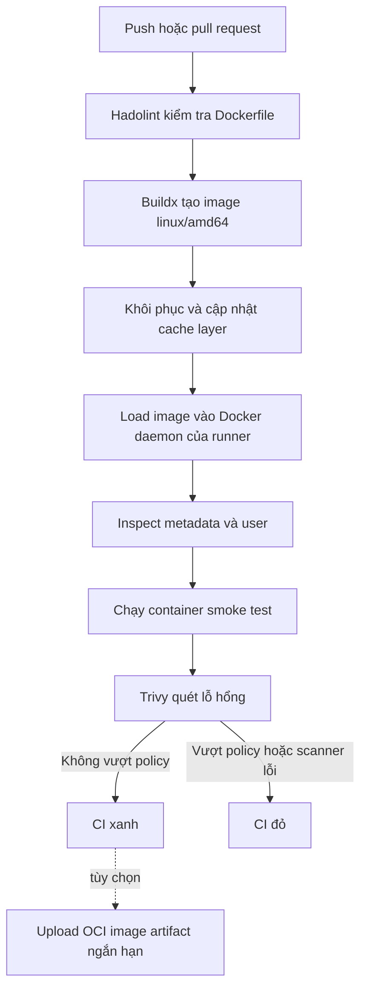

<Callout type="info" title="Phạm vi của bài">
  Bài này dừng ở **Continuous Integration**: build image, chạy các cổng chất lượng và lưu OCI artifact khi thật sự cần. Workflow không đăng nhập, không push registry và không dùng secret phát hành; phần đó thuộc pipeline CD.
</Callout>

## Mục lục

- [Phạm vi và mental model](#phạm-vi-và-mental-model)
  - [Luồng CI của image](#luồng-ci-của-image)
  - [Cache artifact và registry khác nhau](#cache-artifact-và-registry-khác-nhau)
- [Chuẩn bị Dockerfile](#chuẩn-bị-dockerfile)
  - [Dockerfile multi-stage non-root và healthcheck](#dockerfile-multi-stage-non-root-và-healthcheck)
  - [Thu hẹp build context bằng dockerignore](#thu-hẹp-build-context-bằng-dockerignore)
  - [Kiểm tra ở máy local](#kiểm-tra-ở-máy-local)
- [Workflow CI production-ready](#workflow-ci-production-ready)
  - [Workflow hoàn chỉnh](#workflow-hoàn-chỉnh)
  - [Buildx cache và metadata](#buildx-cache-và-metadata)
  - [Smoke test container](#smoke-test-container)
  - [Lint Dockerfile và quét lỗ hổng](#lint-dockerfile-và-quét-lỗ-hổng)
  - [Permissions concurrency và timeout](#permissions-concurrency-và-timeout)
  - [Chính sách phiên bản action](#chính-sách-phiên-bản-action)
- [OCI image artifact khi cần](#oci-image-artifact-khi-cần)
  - [Export từ cùng một lần build](#export-từ-cùng-một-lần-build)
  - [Khi nào nên và không nên dùng](#khi-nào-nên-và-không-nên-dùng)
- [Multi-platform và các đánh đổi](#multi-platform-và-các-đánh-đổi)
  - [Chọn chiến lược theo tín hiệu cần có](#chọn-chiến-lược-theo-tín-hiệu-cần-có)
  - [Mẫu build-only cho amd64 và arm64](#mẫu-build-only-cho-amd64-và-arm64)
- [Bài thực hành](#bài-thực-hành)
  - [Yêu cầu](#yêu-cầu)
  - [Tiêu chí kiểm chứng](#tiêu-chí-kiểm-chứng)
- [Troubleshooting](#troubleshooting)
- [Best practices và lưu ý chuỗi cung ứng](#best-practices-và-lưu-ý-chuỗi-cung-ứng)
- [Tài liệu tham khảo](#tài-liệu-tham-khảo)
- [Bài liên quan](#bài-liên-quan)

## Phạm vi và mental model

CI cho Docker image không chỉ hỏi “Dockerfile có build được không?”. Một image đạt cổng CI nên trả lời được các câu hỏi sau:

1. Dockerfile có tuân thủ quy tắc cơ bản và tạo được image bằng BuildKit không?
2. Container có khởi động, phục vụ endpoint tối thiểu và chuyển sang trạng thái `healthy` không?
3. Process mặc định có chạy bằng người dùng không phải `root` không?
4. Image có lỗ hổng vượt quá ngưỡng mà nhóm đã chấp nhận không?
5. Kết quả có được định danh theo commit đã kiểm tra không?

**BuildKit** là backend build hiện đại của Docker. **Buildx** là plugin CLI điều khiển BuildKit và mở khóa các tính năng như cache ngoài, nhiều nền tảng và nhiều kiểu output. Workflow trong bài dùng `docker/setup-buildx-action` để tạo builder với driver `docker-container`, rồi dùng `docker/build-push-action` để build.

### Luồng CI của image



Workflow cố ý dùng `load: true` cho **một** nền tảng. Image nhờ đó xuất hiện trong Docker daemon của runner và có thể dùng ngay với `docker inspect`, `docker run` và Trivy. Không có bước `docker login` hoặc `push`.

### Cache artifact và registry khác nhau

Ba cơ chế đều có thể chứa bytes liên quan tới image, nhưng không thay thế nhau:

| Cơ chế | Mục đích | Ví dụ trong bài | Có phải đầu ra để chạy không? | Vòng đời điển hình |
|---|---|---|---|---|
| Build cache | Tăng tốc build sau bằng cách tái sử dụng layer trung gian | `cache-from: type=gha` và `cache-to: type=gha` | Không; cache miss phải chỉ làm build chậm hơn | Bị giới hạn dung lượng và có thể bị thu hồi |
| Workflow artifact | Giữ hoặc chuyển đúng output của một workflow run | `ci-image.oci.tar` | Có, nếu consumer hỗ trợ OCI layout | Gắn với run và hết hạn theo retention |
| Container registry | Phân phối image bằng tag, manifest và digest cho nhiều môi trường | GHCR, Docker Hub, ECR | Có; client dùng `pull` | Kho package dài hạn theo policy phát hành |

<Callout type="idea" title="Quy tắc dễ nhớ">
  Cache là tối ưu hiệu năng. Artifact là gói của một run. Registry là kênh phân phối image. CI trong bài dùng cache, có thể dùng artifact, nhưng không dùng registry.
</Callout>

`docker/build-push-action` còn tạo **build record** có đuôi `.dockerbuild` theo mặc định. Build record chứa log và thống kê để chẩn đoán Buildx; nó không phải OCI image và không thể đem đi chạy như image.

## Chuẩn bị Dockerfile

Ví dụ dưới đây dành cho ứng dụng Node.js có `package-lock.json`, script `npm run build`, output `dist/server.js` và endpoint `GET /health` trên cổng `8080`. Server phải bind `0.0.0.0`, không chỉ `127.0.0.1`, để cổng publish từ container hoạt động.

### Dockerfile multi-stage non-root và healthcheck

Tạo `Dockerfile`:

```dockerfile
# syntax=docker/dockerfile:1
FROM node:24-bookworm-slim AS base
WORKDIR /app

FROM base AS dependencies
COPY package.json package-lock.json ./
RUN npm ci

FROM dependencies AS build
COPY . .
RUN npm run build \
    && npm prune --omit=dev

FROM base AS runtime
ENV NODE_ENV=production \
    PORT=8080

COPY --from=build --chown=node:node /app/package.json ./package.json
COPY --from=build --chown=node:node /app/node_modules ./node_modules
COPY --from=build --chown=node:node /app/dist ./dist

USER node
EXPOSE 8080

HEALTHCHECK --interval=5s --timeout=3s --start-period=10s --retries=3 \
  CMD ["node", "-e", "fetch('http://127.0.0.1:8080/health').then(r => { if (!r.ok) process.exit(1) }).catch(() => process.exit(1))"]

CMD ["node", "dist/server.js"]
```

Mỗi lựa chọn giải quyết một rủi ro cụ thể:

- **Multi-stage build** tách stage cài và build khỏi stage runtime. Compiler, source TypeScript và dev dependency không bị copy vào image cuối.
- `npm ci` cài đúng dependency trong lockfile. Thay đổi `package-lock.json` cũng làm layer dependency mất cache đúng lúc.
- `npm prune --omit=dev` giữ dependency runtime sau khi build.
- `COPY --chown=node:node` đặt ownership trước khi đổi user. Image Node chính thức đã cung cấp user `node` không phải root.
- `USER node` đặt mặc định an toàn. Workflow còn inspect lại cấu hình này để tránh regression.
- `HEALTHCHECK` dùng chính runtime Node.js, nên không phải cài `curl` chỉ để kiểm tra sức khỏe.
- `CMD` dùng exec form dạng mảng. Process Node nhận signal dừng trực tiếp thay vì bị bọc bởi shell.

Healthcheck chỉ nên kiểm tra khả năng phục vụ tối thiểu của chính process. Endpoint `/health` không nên phụ thuộc một API bên ngoài không ổn định; nếu không, container khỏe có thể bị đánh dấu lỗi do sự cố mạng ngoài phạm vi của nó.

<Callout type="warn" title="Tag base image vẫn có thể thay đổi">
  `node:24-bookworm-slim` dễ đọc và tự nhận bản vá mới khi build với `pull: true`, nhưng tag không bất biến. Với yêu cầu tái lập hoặc supply-chain nghiêm ngặt, hãy pin thêm digest `sha256` đã review và để Dependabot hoặc Renovate mở pull request cập nhật digest. Không pin rồi quên cập nhật bản vá.
</Callout>

### Thu hẹp build context bằng dockerignore

Build context là tập file BuildKit có thể đọc khi thực hiện `COPY` hoặc `ADD`. Tạo `.dockerignore` để không gửi dependency local, lịch sử Git và báo cáo test vào builder:

```text title=".dockerignore"
.git
.github
node_modules
npm-debug.log*
coverage
reports
dist
.env
.env.*
*.pem
*.key
```

Không đưa file cần cho build vào danh sách bỏ qua. Ví dụ Dockerfile trên cần `package.json`, `package-lock.json` và source, nên ba nhóm đó phải còn trong context.

`.dockerignore` giảm thời gian truyền context và giảm nguy cơ copy nhầm secret. Tuy vậy, nó không phải cơ chế quản lý secret. Khi build thật sự cần credential, dùng BuildKit secret mount thay vì `ARG`, `ENV` hoặc `COPY`, vì các cách sau có thể để credential trong metadata hay layer.

### Kiểm tra ở máy local

Chạy cùng platform và các giới hạn gần với CI:

```bash
docker buildx create --use --name local-ci
docker buildx build \
  --platform linux/amd64 \
  --load \
  --pull \
  --tag local/ci-docker:dev \
  .

docker image inspect local/ci-docker:dev --format '{{.Config.User}}'

docker run --rm \
  --read-only \
  --tmpfs /tmp:rw,noexec,nosuid,size=64m \
  --cap-drop ALL \
  --security-opt no-new-privileges:true \
  --publish 127.0.0.1:18080:8080 \
  local/ci-docker:dev
```

Ở terminal khác, gọi:

```bash
curl --fail --show-error http://127.0.0.1:18080/health
```

Nếu ứng dụng hợp lệ vẫn cần ghi file, hãy cấp một volume hoặc `tmpfs` đúng path thay vì bỏ toàn bộ `--read-only`. Ví dụ, ứng dụng tạo file tạm ở `/app/tmp` có thể nhận thêm `--tmpfs /app/tmp:rw,noexec,nosuid,size=32m`.

## Workflow CI production-ready

### Workflow hoàn chỉnh

Tạo `.github/workflows/docker-ci.yml`:

```yaml
name: Docker image CI

on:
  push:
    branches: [main]
  pull_request:
    branches: [main]
  workflow_dispatch:

permissions:
  contents: read

concurrency:
  group: docker-ci-${{ github.workflow }}-${{ github.event.pull_request.number || github.ref }}
  cancel-in-progress: true

env:
  IMAGE_NAME: local/ci-docker
  DOCKER_BUILD_RECORD_RETENTION_DAYS: 7

jobs:
  validate-image:
    name: Build and validate image
    runs-on: ubuntu-latest
    timeout-minutes: 25

    steps:
      - name: Checkout source
        uses: actions/checkout@v7
        with:
          persist-credentials: false

      - name: Lint Dockerfile with Hadolint
        uses: hadolint/hadolint-action@2a66e89f53d0771bb131a7fa31f3136336094aa6 # v3.4.0
        with:
          dockerfile: Dockerfile
          failure-threshold: warning

      - name: Set up Docker Buildx
        uses: docker/setup-buildx-action@v4
        with:
          driver: docker-container

      - name: Generate CI tag and OCI labels
        id: meta
        uses: docker/metadata-action@v6
        with:
          images: ${{ env.IMAGE_NAME }}
          tags: |
            type=sha,format=long,prefix=ci-

      - name: Build and load test image
        id: build
        uses: docker/build-push-action@v7
        with:
          context: .
          file: Dockerfile
          platforms: linux/amd64
          pull: true
          push: false
          load: true
          tags: ${{ steps.meta.outputs.tags }}
          labels: ${{ steps.meta.outputs.labels }}
          cache-from: type=gha,scope=docker-ci
          cache-to: type=gha,mode=max,scope=docker-ci

      - name: Inspect image metadata
        env:
          IMAGE_REF: ${{ steps.meta.outputs.tags }}
          BUILD_DIGEST: ${{ steps.build.outputs.digest }}
        shell: bash
        run: |
          set -Eeuo pipefail

          configured_user="$(docker image inspect --format '{{.Config.User}}' "$IMAGE_REF")"
          case "$configured_user" in
            ""|0|root)
              echo "Image must configure a non-root USER, got: ${configured_user:-empty}" >&2
              exit 1
              ;;
          esac

          revision="$(docker image inspect \
            --format '{{ index .Config.Labels "org.opencontainers.image.revision" }}' \
            "$IMAGE_REF")"
          test "$revision" = "$GITHUB_SHA"

          {
            echo "### Docker image"
            echo "- Reference: \`$IMAGE_REF\`"
            echo "- Configured user: \`$configured_user\`"
            echo "- Build digest: \`${BUILD_DIGEST:-not-reported}\`"
          } >> "$GITHUB_STEP_SUMMARY"

      - name: Smoke test container
        env:
          IMAGE_REF: ${{ steps.meta.outputs.tags }}
        shell: bash
        run: |
          set -Eeuo pipefail

          container="docker-ci-smoke"
          cleanup() {
            docker rm --force "$container" >/dev/null 2>&1 || true
          }
          trap cleanup EXIT

          docker run --detach \
            --name "$container" \
            --read-only \
            --tmpfs /tmp:rw,noexec,nosuid,size=64m \
            --cap-drop ALL \
            --security-opt no-new-privileges:true \
            --publish 127.0.0.1:18080:8080 \
            "$IMAGE_REF"

          if ! runtime_uid="$(
            docker exec "$container" \
              node -e 'process.stdout.write(String(process.getuid()))'
          )"; then
            echo "Could not determine the runtime UID" >&2
            docker logs "$container" >&2 || true
            exit 1
          fi

          if [[ "$runtime_uid" == "0" ]]; then
            echo "Container process is running as UID 0" >&2
            exit 1
          fi

          ready=false
          for attempt in {1..30}; do
            state="$(docker inspect --format '{{.State.Status}}' "$container")"
            health="$(docker inspect \
              --format '{{if .State.Health}}{{.State.Health.Status}}{{else}}missing{{end}}' \
              "$container")"

            if [[ "$state" == "exited" || "$state" == "dead" ]]; then
              echo "Container stopped before becoming healthy" >&2
              docker logs "$container" >&2
              exit 1
            fi

            if curl --fail --silent --show-error \
              http://127.0.0.1:18080/health >/dev/null \
              && [[ "$health" == "healthy" ]]; then
              ready=true
              break
            fi

            sleep 2
          done

          if [[ "$ready" != "true" ]]; then
            echo "Container did not become healthy within 60 seconds" >&2
            docker inspect "$container" >&2
            docker logs "$container" >&2
            exit 1
          fi

      - name: Scan image vulnerabilities with Trivy
        uses: aquasecurity/trivy-action@ed142fd0673e97e23eac54620cfb913e5ce36c25 # v0.36.0
        with:
          image-ref: ${{ steps.meta.outputs.tags }}
          scanners: vuln
          vuln-type: os,library
          severity: CRITICAL,HIGH
          ignore-unfixed: true
          format: table
          exit-code: '1'
          timeout: 10m
```

Workflow chỉ tạo một job vì image phải còn trong Docker daemon để step sau inspect, run và scan. Tách build và smoke test thành hai job sẽ tạo runner mới; khi đó phải chuyển image bằng artifact hoặc registry.

### Buildx cache và metadata

`setup-buildx-action@v4` tạo builder `docker-container`. Driver này hỗ trợ GitHub Actions cache exporter và OCI exporter, trong khi builder mặc định cũ có thể không hỗ trợ đủ.

Hai dòng cache có vai trò đối xứng:

```yaml
cache-from: type=gha,scope=docker-ci
cache-to: type=gha,mode=max,scope=docker-ci
```

- `cache-from` thử khôi phục layer của run trước.
- `cache-to` lưu layer mới sau build thành công.
- `mode=max` gồm cả layer trung gian, hữu ích cho multi-stage build.
- `scope=docker-ci` tránh đụng cache Buildx của workflow khác. GitHub vẫn áp dụng branch scope cho cache.

Cache miss không được làm job lỗi. Nếu xóa toàn bộ cache mà workflow không build được, pipeline đang dùng cache như nguồn dữ liệu bắt buộc và cần được sửa.

Thứ tự `COPY` trong Dockerfile quyết định hiệu quả cache. Ví dụ, copy hai file package rồi chạy `npm ci` trước khi `COPY . .` giúp thay đổi source không vô hiệu hóa layer dependency. Đừng dùng `github.sha` làm cache scope; mỗi commit sẽ tạo namespace mới và gần như không tái sử dụng được.

`metadata-action@v6` tạo một tag như `local/ci-docker:ci-<full-commit-sha>` và các label OCI chuẩn. Với pull request, SHA mặc định là merge commit tổng hợp mà GitHub thực sự kiểm tra. Tag này chỉ tồn tại trên runner vì `push: false`.

Tag là tên có thể thay đổi. **Digest** là hàm băm của nội dung manifest và phù hợp hơn khi cần định danh bytes. Workflow ghi output digest vào job summary khi exporter trả về giá trị, nhưng không xem local tag là bằng chứng phát hành.

<Callout type="warn" title="Cache của RUN mount là trường hợp riêng">
  `type=gha` lưu build cache của BuildKit, nhưng không tự xuất nội dung của mọi `RUN --mount=type=cache` sang GitHub cache. Chỉ thêm các cache mount như `/root/.npm` sau khi đo lợi ích và hiểu cơ chế lưu riêng; layer `npm ci` trong Dockerfile mẫu đã được cache theo lockfile.
</Callout>

### Smoke test container

Smoke test là kiểm tra ngắn để chứng minh artifact vừa build có thể chạy. Nó không thay thế unit test hoặc integration test đầy đủ.

Workflow kiểm tra năm điều gần nhau:

1. Image có khai báo `USER` rõ ràng thay vì để trống, `0` hoặc `root`.
2. Process thật trong container có UID khác `0`; kiểm tra runtime này bắt được cả trường hợp tên user khác `root` nhưng vẫn ánh xạ tới UID 0.
3. Label `org.opencontainers.image.revision` khớp `GITHUB_SHA`.
4. Container chạy được với root filesystem chỉ đọc, bỏ mọi Linux capability và bật `no-new-privileges`.
5. Endpoint `/health` trả thành công và Docker health status đạt `healthy` trong 60 giây.

`trap cleanup EXIT` bảo đảm container được xóa cả khi test pass lẫn fail. Khi container chết sớm hoặc hết thời gian, workflow in `docker inspect` và `docker logs` trước khi thoát để người đọc không phải chạy lại chỉ nhằm lấy chẩn đoán.

Không dùng `sleep 10` cố định rồi kiểm tra một lần. Máy runner và thời gian khởi động thay đổi; vòng lặp có deadline cho tín hiệu ổn định hơn mà vẫn dừng đúng hạn.

### Lint Dockerfile và quét lỗ hổng

Hadolint kiểm tra Dockerfile trước khi build. `failure-threshold: warning` làm warning và error trở thành lỗi CI. Nếu cần ngoại lệ, ưu tiên cấu hình rule cụ thể trong `.hadolint.yaml` và ghi lý do trong review; không đặt `no-fail: true` cho cổng bắt buộc.

Trivy quét hai nhóm package:

- `os`: package do hệ điều hành trong base image quản lý.
- `library`: dependency ứng dụng mà Trivy nhận diện, ví dụ package npm.

Cấu hình mẫu chỉ xét `HIGH` và `CRITICAL`. `ignore-unfixed: true` bỏ qua finding chưa có bản vá upstream để tránh chặn vĩnh viễn một lỗi chưa thể xử lý. Đây là một lựa chọn policy, không phải chân lý chung. Hệ thống rủi ro cao có thể đặt `false`, hoặc quản lý ngoại lệ có owner và ngày hết hạn trong `.trivyignore.yaml`.

Hiểu `exit-code` như sau:

| Kết quả Trivy | Trạng thái step với cấu hình mẫu | Cách hiểu |
|---|---|---|
| Không có finding khớp severity và filter | `0` | Cổng vulnerability đạt tại thời điểm database hiện tại |
| Có ít nhất một finding khớp policy | `1` do `exit-code: '1'` | CI bị chặn; nâng dependency hoặc base image, rồi scan lại |
| Lỗi vận hành như không tải được DB, timeout hoặc không thấy image | Khác `0`, thường cũng có thể là `1` | Scanner không hoàn tất; đọc log, không được diễn giải thành “đã tìm thấy CVE” chỉ dựa vào số |

`exit-code: '0'` vẫn in finding nhưng không chặn merge. Chỉ dùng cách đó cho giai đoạn quan sát có thời hạn. Khi đã chốt baseline, chuyển sang gate khác `0` và quản lý ngoại lệ có chủ đích.

<Callout type="warn" title="Một lần scan không chứng minh image an toàn mãi mãi">
  Database lỗ hổng thay đổi sau khi CI kết thúc. Hãy rebuild và scan định kỳ image còn được hỗ trợ, đồng thời cập nhật base image. “CI xanh tuần trước” không phải bằng chứng rằng hôm nay không có CVE mới.
</Callout>

### Permissions concurrency và timeout

Ba guardrail giải quyết ba vấn đề độc lập:

- `permissions: contents: read` áp dụng quyền tối thiểu cho `GITHUB_TOKEN`. Workflow không cần `packages: write`, `id-token: write` hoặc secret registry vì không publish.
- `concurrency` hủy run cũ trên cùng pull request hoặc Git ref khi commit mới tới. Thêm `github.workflow` vào group tránh workflow khác vô tình dùng chung khóa.
- `timeout-minutes: 25` dừng build, healthcheck hoặc scanner bị treo. Trivy còn có timeout riêng `10m`, nên lỗi scanner xuất hiện trước timeout toàn job.

Workflow dùng sự kiện `pull_request`, không dùng `pull_request_target`. Không checkout rồi build Dockerfile không tin cậy trong ngữ cảnh `pull_request_target` có token hoặc secret quyền cao.

### Chính sách phiên bản action

Ví dụ dùng các major hiện hành của action do GitHub hoặc Docker duy trì: `actions/checkout@v7`, `docker/setup-buildx-action@v4`, `docker/metadata-action@v6` và `docker/build-push-action@v7`. Major tag dễ đọc và nhận bản vá tương thích trong cùng major.

Hadolint Action và Trivy Action là dependency bên thứ ba, nên workflow pin full commit SHA:

- `hadolint/hadolint-action@2a66...` tương ứng release `v3.4.0`.
- `aquasecurity/trivy-action@ed142...` tương ứng release `v0.36.0`.

Comment phiên bản giữ khả năng đọc, còn SHA ngăn tag bị di chuyển âm thầm. Dependabot nên mở pull request cập nhật SHA để thay đổi vẫn được review. Với threat model nghiêm ngặt, pin **mọi** action, kể cả action chính thức, bằng full SHA và giới hạn allowed actions ở cấp organization.

<Callout type="info" title="Self-hosted runner">
  Action major mới và GitHub cache backend hiện hành cần runner, Buildx và BuildKit đủ mới. Trước khi nâng action, kiểm tra release notes và cập nhật self-hosted runner; GitHub-hosted runner đã được GitHub quản lý phiên bản.
</Callout>

## OCI image artifact khi cần

Đa số pull request không cần upload cả image. Image có thể lớn, tiêu tốn storage và thời gian truyền. Chỉ tạo artifact khi job sau cần đúng output, người review cần tải để điều tra, hoặc môi trường cách ly không có registry trung gian.

### Export từ cùng một lần build

Buildx phiên bản hiện hành hỗ trợ nhiều exporter trong một lần build. Đổi step build trong workflow thành phiên bản sau để vừa load image cho smoke test, vừa tạo OCI layout tarball:

```yaml
      - name: Build, load and export OCI image
        id: build
        uses: docker/build-push-action@v7
        with:
          context: .
          file: Dockerfile
          platforms: linux/amd64
          pull: true
          push: false
          load: true
          outputs: type=oci,dest=${{ runner.temp }}/ci-image.oci.tar
          tags: ${{ steps.meta.outputs.tags }}
          labels: ${{ steps.meta.outputs.labels }}
          cache-from: type=gha,scope=docker-ci
          cache-to: type=gha,mode=max,scope=docker-ci
```

Sau step Trivy thành công, upload file:

```yaml
      - name: Upload validated OCI image
        uses: actions/upload-artifact@v7
        with:
          name: ci-image-oci-${{ github.run_id }}-${{ github.run_attempt }}
          path: ${{ runner.temp }}/ci-image.oci.tar
          archive: false
          if-no-files-found: error
          retention-days: 7
```

`type=oci` tạo tarball theo **OCI image layout**. Nó khác `type=docker,dest=...`, vốn tạo Docker image archive có thể nạp trực tiếp bằng `docker load`. Consumer OCI nên dùng công cụ hỗ trợ `oci-archive`, hoặc giải nén để thấy `oci-layout`, `index.json` và thư mục `blobs/`.

Đặt upload sau vulnerability gate bảo đảm artifact hiển thị là output đã qua các kiểm tra trong job. Tên gồm `run_id` và `run_attempt` để không xung đột khi re-run. `archive: false` tránh bọc tarball lớn trong một lớp archive artifact nữa.

### Khi nào nên và không nên dùng

Dùng OCI artifact khi:

- cần chuyển image sang job khác trong cùng run mà không có registry;
- cần giữ đúng image phục vụ điều tra ngắn hạn;
- consumer đã hỗ trợ OCI layout và có kiểm tra digest.

Không dùng OCI artifact như registry tự chế khi:

- nhiều môi trường cần pull image theo manifest và platform;
- cần retention dài, lifecycle package, quyền pull riêng hoặc garbage collection;
- cần phát hành chính thức bằng digest, SBOM, provenance và chữ ký.

Artifact vẫn có retention hữu hạn và quyền đọc gắn với Actions. Nếu output sẽ được promote sang production, hãy xác minh digest sau download và bổ sung provenance hoặc artifact attestation theo threat model. Phần đăng nhập và push registry nên nằm trong workflow CD riêng, sau approval phù hợp.

<Callout type="warn" title="Build record không phải image artifact">
  File `.dockerbuild` do `build-push-action` tạo mặc định chỉ phục vụ chẩn đoán. Khi dùng `download-artifact` không truyền tên, hãy loại pattern `!*.dockerbuild`; nếu không, job có thể tải nhầm cả build record cùng OCI artifact.
</Callout>

## Multi-platform và các đánh đổi

Một multi-platform image gồm manifest list trỏ tới từng biến thể như `linux/amd64` và `linux/arm64`. Build thành công cho hai kiến trúc chứng minh Dockerfile có thể tạo hai biến thể; nó chưa chứng minh cả hai container đều chạy đúng.

### Chọn chiến lược theo tín hiệu cần có

| Chiến lược | Tín hiệu nhận được | Chi phí và giới hạn |
|---|---|---|
| Build và smoke test `linux/amd64` | Đường chạy chính trên GitHub-hosted runner x86 hoạt động | Nhanh; không phát hiện lỗi runtime chỉ có trên ARM |
| Build ARM bằng QEMU | Phát hiện nhiều lỗi build theo kiến trúc | Emulation chậm, nhất là compile và nén; test runtime có thể không phản ánh native |
| Matrix trên runner native AMD64 và ARM64 | Build và runtime test thật trên từng kiến trúc | Tốn runner và cần hạ tầng/label phù hợp |
| Cross-compilation trong multi-stage | Tránh emulation cho ngôn ngữ hỗ trợ tốt như Go hoặc Rust | Dockerfile phức tạp hơn; vẫn nên runtime-test binary trên kiến trúc đích |

`load: true` truyền image vào image store của Docker daemon. Image store cổ điển thường chỉ load thuận tiện một platform, nên workflow chính cố định `linux/amd64`. Với nhiều platform, hãy xuất OCI layout, dùng containerd image store hỗ trợ manifest list, hoặc push registry ở pipeline phát hành.

Nói ngắn gọn: chỉ thêm `arm64` khi sản phẩm thật sự cam kết hỗ trợ ARM. Sau đó chọn native runner nếu tín hiệu runtime quan trọng hơn chi phí.

### Mẫu build-only cho amd64 và arm64

Có thể thêm một job riêng sau job smoke test. Job này xác minh hai biến thể build được nhưng không push và không load:

```yaml
  validate-platforms:
    name: Build linux/amd64 and linux/arm64
    needs: validate-image
    runs-on: ubuntu-latest
    timeout-minutes: 35
    permissions:
      contents: read

    steps:
      - name: Checkout source
        uses: actions/checkout@v7
        with:
          persist-credentials: false

      - name: Set up QEMU
        uses: docker/setup-qemu-action@v4
        with:
          platforms: arm64

      - name: Set up Docker Buildx
        uses: docker/setup-buildx-action@v4

      - name: Build platform variants without publishing
        uses: docker/build-push-action@v7
        with:
          context: .
          platforms: linux/amd64,linux/arm64
          pull: true
          push: false
          cache-from: type=gha,scope=docker-ci-multiplatform
          cache-to: type=gha,mode=max,scope=docker-ci-multiplatform
```

Không khai báo exporter làm kết quả chỉ nằm trong build cache và build record. Đây là chủ đích cho **build-only validation**. Nếu cần chạy ARM, thay job này bằng matrix trên runner ARM64 native hoặc thiết kế smoke test dưới emulation với kỳ vọng rõ ràng.

QEMU phải được setup trước Buildx. Nó là cách bắt đầu đơn giản, nhưng có thể làm timeout với workload compile nặng; khi đó ưu tiên cross-compilation hoặc builder có node native.

## Bài thực hành

### Yêu cầu

1. Chuẩn bị ứng dụng Node.js có lockfile, script `build`, output `dist/server.js` và endpoint `/health` trên cổng `8080`.
2. Thêm Dockerfile multi-stage cùng `.dockerignore` như bài, rồi xác nhận server bind `0.0.0.0`.
3. Chạy build và container với `--read-only`, `--cap-drop ALL` ở local.
4. Tạo `.github/workflows/docker-ci.yml` từ workflow hoàn chỉnh.
5. Mở pull request vào `main` và quan sát Hadolint, Buildx, smoke test, Trivy.
6. Push thêm một commit khi run trước còn hoạt động để kiểm tra concurrency hủy run cũ.
7. Bật OCI exporter và upload artifact theo phần tùy chọn. Tải artifact rồi kiểm tra layout.
8. Tạo một thay đổi lỗi có chủ đích, ví dụ xóa `USER node` hoặc làm `/health` trả HTTP 500. Xác nhận CI đỏ, sau đó hoàn tác.

### Tiêu chí kiểm chứng

Bài hoàn thành khi tất cả tiêu chí sau đúng:

- [ ] Workflow chạy trên pull request và push vào `main`, không có bước login hoặc push registry.
- [ ] Hadolint chặn Dockerfile vi phạm từ mức `warning`.
- [ ] Buildx build `linux/amd64`, load image và dùng `type=gha` cache.
- [ ] Re-run cùng commit cho thấy nhiều layer được lấy từ cache; xóa cache chỉ làm build chậm hơn.
- [ ] Tag local chứa full commit SHA và label revision khớp `GITHUB_SHA`.
- [ ] Image cấu hình user không phải root; xóa `USER node` làm step inspect thất bại.
- [ ] Container chạy với filesystem chỉ đọc, capability bị bỏ và đạt trạng thái `healthy` trong deadline.
- [ ] Endpoint lỗi hoặc process chết làm smoke test in log rồi thất bại.
- [ ] Trivy trả lỗi khi có finding `HIGH` hoặc `CRITICAL` thuộc policy; lỗi tải database cũng không bị bỏ qua.
- [ ] OCI artifact chứa `oci-layout`, `index.json` và `blobs/` sau khi giải nén.
- [ ] Artifact có tên duy nhất, retention 7 ngày và không bị nhầm với `.dockerbuild`.
- [ ] `GITHUB_TOKEN` chỉ có `contents: read`; workflow không nhận secret registry.
- [ ] Run mới trên cùng pull request hủy run cũ và job dừng sau tối đa 25 phút.

## Troubleshooting

| Triệu chứng | Nguyên nhân thường gặp | Cách xử lý |
|---|---|---|
| Buildx báo `No output specified` | Job build-only không có `load`, `push` hoặc `outputs` | Với smoke test, đặt `load: true`; với build-only, warning là dự kiến; với file, dùng exporter `oci` hoặc `docker` |
| `docker run` báo không tìm thấy image | `load: true` bị thiếu, tag smoke test khác output metadata, hoặc build ở job khác | Giữ build và smoke trong cùng job, hoặc chuyển image qua artifact rồi import đúng định dạng |
| Load multi-platform thất bại | Docker image store hiện tại không nhận manifest list theo cách exporter đang dùng | Load một platform để test; dùng OCI artifact, containerd image store hoặc registry cho manifest đa nền tảng |
| Cache luôn miss | Scope khác nhau, Dockerfile hoặc lockfile đổi, context chứa file biến động | So sánh log cache, giữ scope ổn định, tối ưu thứ tự `COPY`; nhớ rằng cache miss không phải lỗi chức năng |
| Lỗi cache service legacy trên self-hosted runner | Buildx hoặc BuildKit chỉ hỗ trợ GitHub Cache API cũ | Nâng runner, Buildx và BuildKit lên phiên bản được Docker yêu cầu; `setup-buildx-action@v4` giúp cài Buildx hiện hành |
| Hadolint báo rule không phù hợp dự án | Rule đúng chung nhưng có ngoại lệ đã đánh giá | Cấu hình đúng rule trong `.hadolint.yaml`, ghi lý do và review; không tắt toàn bộ lint |
| Step inspect báo user rỗng hoặc `root` | Dockerfile thiếu `USER`, hoặc stage runtime không kế thừa thiết lập mong đợi | Thêm user không root trong stage cuối và `COPY --chown`; inspect đúng image tag vừa build |
| Container thoát ngay | Sai `CMD`, thiếu runtime dependency, biến môi trường bắt buộc hoặc file không được copy | Đọc `docker logs`, inspect image và chạy local cùng command; kiểm tra output stage build |
| Curl không kết nối được | Server bind `127.0.0.1` bên trong container, sai cổng hoặc process chưa sẵn sàng | Bind `0.0.0.0`, đồng bộ `EXPOSE`, `PORT`, publish port và endpoint |
| Endpoint trả 200 nhưng health vẫn `starting` | Healthcheck có `start-period` hoặc interval dài hơn vòng chờ | Điều chỉnh deadline và tham số healthcheck dựa trên thời gian khởi động đo được; không bỏ healthcheck |
| Chạy với `--read-only` bị lỗi permission | Ứng dụng ghi cache, PID hoặc file tạm vào root filesystem | Chuyển dữ liệu bền sang volume; cấp `tmpfs` tối thiểu cho path tạm; không bỏ read-only mà chưa điều tra |
| Trivy tìm thấy CVE từ base image | Base tag cũ hoặc package có bản vá | Pull/rebuild base mới, nâng dependency, đọc fixed version; chỉ ignore finding có owner, lý do và ngày hết hạn |
| Trivy lỗi tải database hoặc timeout | Rate limit, mạng, cache DB hỏng hoặc timeout quá ngắn | Giữ cache Trivy mặc định, retry có giới hạn, kiểm tra status/network và tăng timeout khi có số liệu; không đặt `continue-on-error` |
| Trivy không thấy image | Scan dùng tag khác hoặc image không được load vào daemon | Truyền chính `${{ steps.meta.outputs.tags }}` và giữ scan trong job build |
| OCI artifact không tồn tại | Thiếu `outputs: type=oci,dest=...` hoặc path upload khác `dest` | Dùng cùng `${{ runner.temp }}` và giữ `if-no-files-found: error` |
| `docker load` không nhận OCI tar | OCI layout không phải Docker image archive | Dùng công cụ hỗ trợ `oci-archive`, hoặc export `type=docker` nếu consumer bắt buộc dùng `docker load` |
| Download mọi artifact bị lỗi với `.dockerbuild` | Build record bị tải chung với artifact ứng dụng | Chỉ định `name`, hoặc dùng pattern loại `!*.dockerbuild` |
| Build ARM dưới QEMU quá chậm | Compile hoặc nén chạy qua emulation | Dùng native ARM runner, multi-node builder hoặc cross-compilation; đặt timeout riêng theo dữ liệu đo |

## Best practices và lưu ý chuỗi cung ứng

- **Build đúng thứ sẽ phát hành.** Smoke test và scanner phải dùng chính tag/output từ step Buildx, không tự build lại bằng lệnh khác.
- **Giữ CI tách khỏi CD.** Không thêm registry credential và `packages: write` chỉ để kiểm tra image. Publish trong workflow riêng có policy và approval.
- **Dùng multi-stage và runtime tối thiểu.** Chỉ copy binary, production dependency và file cấu hình thật sự cần.
- **Chạy non-root theo mặc định.** Kiểm tra cả Dockerfile lẫn metadata image; khi có thể, smoke test với read-only filesystem, capability tối thiểu và `no-new-privileges`.
- **Thiết kế healthcheck nhỏ và ổn định.** Kiểm tra process có phục vụ được, đặt deadline thực tế và tránh phụ thuộc dịch vụ ngoài.
- **Commit lockfile và thu hẹp context.** `.dockerignore` giảm dữ liệu gửi vào builder nhưng không thay thế secret management.
- **Không truyền secret bằng build arg.** Dùng BuildKit secret hoặc SSH mount và bảo đảm secret không xuất hiện trong layer, log hay artifact.
- **Coi cache là dữ liệu có thể mất.** Dùng key/scope ổn định, đo thời gian tiết kiệm và không dùng cache để chuyển image bắt buộc giữa jobs.
- **Chỉ upload OCI artifact khi có consumer.** Đặt retention ngắn, tên duy nhất, kiểm tra digest và không nhầm với build record.
- **Không dùng tag làm căn cước bảo mật.** Tag theo SHA giúp truy vết; digest mới định danh nội dung. Khi promote, khóa theo digest và xác minh nguồn tạo.
- **Pin base image có quy trình cập nhật.** Digest tăng tính tái lập nhưng sẽ giữ cả lỗ hổng cũ nếu không có bot và SLA cập nhật.
- **Pin action theo threat model.** Full SHA cho dependency bên thứ ba là mức tối thiểu tốt; tổ chức nghiêm ngặt nên pin mọi action và dùng allowlist.
- **Đặt vulnerability policy rõ ràng.** Chốt severity, cách xử lý unfixed, SLA sửa và ngoại lệ có ngày hết hạn. Không dùng `exit-code: 0` vô thời hạn.
- **Lint không phải kiểm chứng bảo mật.** Hadolint tìm anti-pattern trong Dockerfile; Trivy tìm vulnerability đã biết. Cả hai không chứng minh ứng dụng không có lỗi logic.
- **Tạo SBOM và provenance ở ranh giới phát hành.** Local Docker exporter chủ yếu phục vụ test. Image chính thức cần metadata nguồn gốc gắn với digest, được ký hoặc attested và kiểm tra trước khi deploy.
- **Rebuild định kỳ.** Base image và database CVE thay đổi dù source không đổi. Lên lịch rebuild/scan cho image còn được hỗ trợ.
- **Chọn multi-platform có chủ đích.** Build-only dưới QEMU là tín hiệu ban đầu; cam kết hỗ trợ kiến trúc nên đi cùng runtime test trên phần cứng native.

## Tài liệu tham khảo

- [Docker Docs — Multi-stage builds](https://docs.docker.com/build/building/multi-stage/)
- [Docker Docs — Dockerfile best practices](https://docs.docker.com/build/building/best-practices/)
- [Dockerfile reference — HEALTHCHECK](https://docs.docker.com/reference/dockerfile/#healthcheck)
- [Docker Docs — GitHub Actions build and push](https://docs.docker.com/build/ci/github-actions/)
- [Docker Docs — Cache management with GitHub Actions](https://docs.docker.com/build/ci/github-actions/cache/)
- [Docker Docs — Test before push](https://docs.docker.com/build/ci/github-actions/test-before-push/)
- [Docker Docs — Manage tags and labels](https://docs.docker.com/build/ci/github-actions/manage-tags-labels/)
- [Docker Docs — OCI and Docker exporters](https://docs.docker.com/build/exporters/oci-docker/)
- [Docker Docs — Multi-platform builds](https://docs.docker.com/build/building/multi-platform/)
- [docker/setup-buildx-action — repository chính thức](https://github.com/docker/setup-buildx-action)
- [docker/build-push-action — repository chính thức](https://github.com/docker/build-push-action)
- [docker/metadata-action — repository chính thức](https://github.com/docker/metadata-action)
- [Hadolint — Dockerfile linter](https://github.com/hadolint/hadolint)
- [Hadolint Action — input và cấu hình](https://github.com/hadolint/hadolint-action)
- [Trivy Docs — vulnerability scanning](https://trivy.dev/latest/docs/scanner/vulnerability/)
- [Trivy Docs — filtering và exit code](https://trivy.dev/latest/docs/configuration/filtering/)
- [Trivy Action — input và ví dụ](https://github.com/aquasecurity/trivy-action)
- [GitHub Docs — Workflow syntax](https://docs.github.com/en/actions/reference/workflows-and-actions/workflow-syntax)
- [GitHub Docs — Control workflow concurrency](https://docs.github.com/en/actions/how-tos/write-workflows/choose-when-workflows-run/control-workflow-concurrency)
- [GitHub Docs — Assign permissions to jobs](https://docs.github.com/en/actions/how-tos/write-workflows/choose-what-workflows-do/control-job-permissions)
- [GitHub Docs — Store and share data with workflow artifacts](https://docs.github.com/en/actions/tutorials/store-and-share-data)
- [GitHub Docs — Secure use reference](https://docs.github.com/en/actions/reference/security/secure-use)

## Bài liên quan

<Cards>
  <Card title="Artifacts" href="/docs/dieu-khien-workflow/08-artifacts/" description="Lưu và chuyển output bất biến giữa các job." />
  <Card title="Dependency caching" href="/docs/dieu-khien-workflow/09-dependency-caching/" description="Hiểu vòng đời, key và rủi ro của cache." />
  <Card title="Publish container image" href="/docs/cd/05-publish-container-registry/" description="Tiếp tục sang CD khi cần đăng nhập và push registry." />
  <Card title="Supply-chain security" href="/docs/bao-mat/08-supply-chain-security/" description="Mở rộng với provenance, SBOM, signing và policy." />
</Cards>
