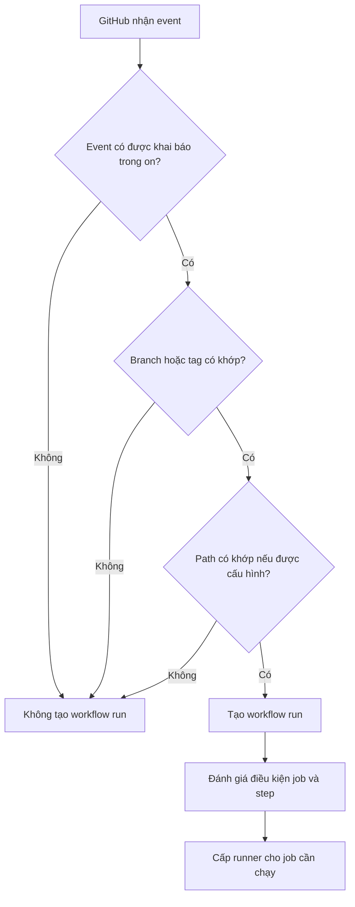

<Callout type="info" title="Mục tiêu">
  Sau bài này, bạn có thể giới hạn một workflow theo branch đích, tag và file thay đổi; dự đoán chính xác khi nào workflow được tạo; và tự kiểm chứng cấu hình bằng một workflow chạy được.
</Callout>

## Mục lục

- [Mô hình lọc trước khi chạy](#mô-hình-lọc-trước-khi-chạy)
  - [Bộ lọc branch và tag](#bộ-lọc-branch-và-tag)
  - [Bộ lọc đường dẫn](#bộ-lọc-đường-dẫn)
  - [Khi kết hợp nhiều bộ lọc](#khi-kết-hợp-nhiều-bộ-lọc)
- [Cú pháp branch và tag](#cú-pháp-branch-và-tag)
  - [Lọc push theo branch](#lọc-push-theo-branch)
  - [Lọc pull request theo branch đích](#lọc-pull-request-theo-branch-đích)
  - [Lọc tag](#lọc-tag)
  - [Mẫu phủ định và thứ tự khai báo](#mẫu-phủ-định-và-thứ-tự-khai-báo)
- [Cú pháp path](#cú-pháp-path)
  - [Chỉ chạy khi file liên quan thay đổi](#chỉ-chạy-khi-file-liên-quan-thay-đổi)
  - [Bỏ qua thay đổi chỉ thuộc tài liệu](#bỏ-qua-thay-đổi-chỉ-thuộc-tài-liệu)
  - [Kết hợp mẫu dương và mẫu âm](#kết-hợp-mẫu-dương-và-mẫu-âm)
- [GitHub xác định danh sách file thay đổi](#github-xác-định-danh-sách-file-thay-đổi)
  - [Cách tạo diff](#cách-tạo-diff)
  - [Các giới hạn cần biết](#các-giới-hạn-cần-biết)
- [Ví dụ workflow hoàn chỉnh](#ví-dụ-workflow-hoàn-chỉnh)
- [Tình huống áp dụng](#tình-huống-áp-dụng)
- [Bài thực hành](#bài-thực-hành)
  - [Chuẩn bị](#chuẩn-bị)
  - [Các bước thực hiện](#các-bước-thực-hiện)
  - [Tiêu chí kiểm chứng](#tiêu-chí-kiểm-chứng)
- [Best practices](#best-practices)
- [Troubleshooting](#troubleshooting)
- [Nguồn chính thức](#nguồn-chính-thức)
- [Tiếp tục trong series](#tiếp-tục-trong-series)

## Mô hình lọc trước khi chạy

Branch filter là điều kiện so khớp tên branch hoặc tag với một mẫu. Path filter là điều kiện so khớp danh sách file thay đổi với một mẫu đường dẫn. GitHub đánh giá các điều kiện này tại trigger `on`, trước khi cấp runner cho bất kỳ job nào.

Vì vậy, một event không khớp filter sẽ không tạo workflow run. Đây là điểm khác với `jobs.<job_id>.if`: điều kiện `if` tạo run trước, rồi mới đánh dấu job là `skipped` nếu điều kiện sai.



### Bộ lọc branch và tag

Với event `push`, `branches` so khớp branch được push. `tags` so khớp tag được push.

Với `pull_request` và `pull_request_target`, `branches` so khớp **branch đích** của pull request, còn gọi là base branch. Ví dụ, PR từ `feature/login` vào `main` được kiểm tra với `main`, không phải `feature/login`.

Các khóa loại trừ tương ứng là `branches-ignore` và `tags-ignore`. Trong cùng một event, không được dùng đồng thời `branches` với `branches-ignore`. Quy tắc tương tự áp dụng cho `tags` và `tags-ignore`.

### Bộ lọc đường dẫn

`paths` tạo run khi, sau khi GitHub xét các mẫu theo thứ tự, còn ít nhất một file thay đổi được include. `paths-ignore` bỏ qua run chỉ khi **mọi** file thay đổi đều khớp danh sách bỏ qua.

Path filter dùng được với `push`, `pull_request` và `pull_request_target`. GitHub không đánh giá path filter cho một lần push tag.

Trong cùng một event, không được dùng đồng thời `paths` và `paths-ignore`. Nếu cần vừa lấy vào vừa loại ra, hãy dùng các mẫu bắt đầu bằng `!` bên trong `paths`.

### Khi kết hợp nhiều bộ lọc

Các event khác nhau có quan hệ **HOẶC**. Một `push` hoặc một `pull_request` khớp đều có thể tạo run riêng.

Trong cùng một event, branch filter và path filter có quan hệ **VÀ**. Cả hai nhóm đều phải khớp.

Ví dụ sau chỉ chạy khi PR nhắm vào `main` **và** thay đổi ít nhất một file trong `services/api/**`:

```yaml
on:
  pull_request:
    branches:
      - main
    paths:
      - 'services/api/**'
```

Một PR vào `develop` có sửa API vẫn không chạy. Một PR vào `main` nhưng chỉ sửa `README.md` cũng không chạy.

## Cú pháp branch và tag

Các filter dùng glob pattern. Glob là mẫu có ký tự đại diện. `*` thường khớp trong một cấp tên, còn `**` có thể đi qua nhiều cấp phân tách bằng `/`.

Hãy đặt glob trong dấu nháy đơn. Việc này tránh YAML diễn giải các ký tự như `*` hoặc `!` theo nghĩa riêng của YAML.

### Lọc push theo branch

```yaml
on:
  push:
    branches:
      - main
      - 'releases/**'
```

Cấu hình này nhận push vào `main`, `releases/1.0` và `releases/mobile/2.0`. Nó không nhận push vào `feature/login`.

Nếu chỉ muốn loại trừ một số branch, dùng `branches-ignore`:

```yaml
on:
  push:
    branches-ignore:
      - 'experimental/**'
      - 'archive/**'
```

Workflow trên nhận push vào mọi branch trừ hai nhóm đã nêu.

### Lọc pull request theo branch đích

```yaml
on:
  pull_request:
    branches:
      - main
      - 'releases/**'
```

PR từ bất kỳ source branch nào vẫn có thể chạy nếu branch đích là `main` hoặc thuộc `releases/**`.

Nếu cần xét source branch, trigger filter không đáp ứng trực tiếp nhu cầu đó. Hãy tạo run bằng `pull_request`, sau đó dùng điều kiện job với `github.head_ref`:

```yaml
jobs:
  preview:
    if: ${{ startsWith(github.head_ref, 'feature/') }}
    runs-on: ubuntu-latest
    steps:
      - run: echo "PR đến từ feature branch"
```

Cách này vẫn tạo workflow run. Chỉ job `preview` bị bỏ qua khi source branch không khớp.

### Lọc tag

```yaml
on:
  push:
    tags:
      - 'v*'
      - '!v*-alpha'
```

Mẫu trên nhận `v1.0.0` nhưng loại `v2.0.0-alpha`.

Có hai quy tắc dễ bỏ sót:

- Nếu event `push` chỉ khai báo `branches` hoặc `branches-ignore`, push tag không tạo run.
- Nếu event `push` chỉ khai báo `tags` hoặc `tags-ignore`, push branch không tạo run.

Muốn nhận cả hai loại ref, hãy cấu hình cả nhóm branch và nhóm tag. Nếu không khai báo nhóm nào, `push` mặc định nhận cả branch lẫn tag.

### Mẫu phủ định và thứ tự khai báo

Mẫu phủ định bắt đầu bằng `!`. Khi dùng mẫu phủ định trong `branches`, `tags` hoặc `paths`, danh sách phải có ít nhất một mẫu dương không bắt đầu bằng `!`.

Thứ tự có ý nghĩa:

1. Mẫu âm khớp sau một mẫu dương sẽ loại giá trị đó.
2. Mẫu dương khớp sau một mẫu âm có thể đưa giá trị đó vào lại.

```yaml
on:
  push:
    branches:
      - 'releases/**'
      - '!releases/**-alpha'
      - 'releases/special-alpha'
```

Kết quả:

- `releases/1.0` được nhận.
- `releases/1.0-alpha` bị loại.
- `releases/special-alpha` được nhận lại bởi mẫu cuối.

Nếu chỉ cần loại trừ, `branches-ignore` hoặc `tags-ignore` dễ đọc hơn.

## Cú pháp path

Path được tính từ thư mục gốc repository. Dùng dấu `/` trong mẫu, kể cả khi runner sau đó là Windows.

### Chỉ chạy khi file liên quan thay đổi

```yaml
on:
  push:
    paths:
      - 'src/**'
      - 'package.json'
      - 'package-lock.json'
```

Workflow chạy nếu lần push thay đổi ít nhất một file trong `src`, hoặc một trong hai manifest ở root.

### Bỏ qua thay đổi chỉ thuộc tài liệu

```yaml
on:
  pull_request:
    paths-ignore:
      - 'docs/**'
      - '**/*.md'
```

Nếu PR chỉ đổi file Markdown và file trong `docs`, workflow không chạy. Nếu cùng PR còn đổi `src/app.js`, workflow vẫn chạy vì có một file nằm ngoài danh sách bỏ qua.

Đây là khác biệt quan trọng giữa `paths-ignore` và “bỏ qua từng file khớp”. GitHub đánh giá toàn bộ tập file thay đổi trước khi quyết định tạo run.

### Kết hợp mẫu dương và mẫu âm

```yaml
on:
  pull_request:
    paths:
      - 'services/api/**'
      - '!services/api/docs/**'
```

PR đổi `services/api/src/server.js` sẽ chạy. PR chỉ đổi `services/api/docs/openapi.md` sẽ không chạy.

Nếu PR đổi cả hai file, workflow vẫn chạy. File source còn lại trong tập khớp mẫu dương và không bị mẫu âm loại.

## GitHub xác định danh sách file thay đổi

Path filter không quét trạng thái checkout trên runner. GitHub tạo danh sách file từ diff của event trước khi workflow tồn tại.

### Cách tạo diff

- **Pull request:** dùng three-dot diff. Đây là so sánh giữa phiên bản mới nhất của branch làm PR và commit nơi branch đó đồng bộ gần nhất với base branch.
- **Push vào branch đã tồn tại:** dùng two-dot diff giữa base SHA và head SHA.
- **Push tạo branch mới:** dùng two-dot diff với parent của ancestor sâu nhất trong tập commit được push.

Do cách so sánh khác nhau, cùng một nhánh có thể cho danh sách file khác giữa event `push` và `pull_request`. Khi debug, hãy xem đúng event và đúng dải commit.

### Các giới hạn cần biết

Theo tài liệu GitHub hiện hành:

- Nếu một push chứa hơn **1.000 commit**, workflow luôn chạy.
- Nếu quá trình tạo diff hết thời gian, workflow luôn chạy.
- Nếu diff có hơn **3.000 file**, GitHub chỉ xét các file đầu tiên được trả về. Nếu file cần khớp không nằm trong 3.000 file đó, workflow có thể không chạy.
- Nếu không có file thay đổi, workflow không chạy theo path filter.

<Callout type="warn" title="Required check có thể bị Pending">
  Khi toàn bộ workflow bị bỏ qua bởi branch filter, path filter hoặc chỉ thị skip trong commit message, check gắn với workflow có thể giữ trạng thái Pending. Nếu ruleset yêu cầu check đó, pull request sẽ bị chặn merge. Một job bị skip bằng `if` có hành vi khác: check của job bị skip được báo thành công.
</Callout>

## Ví dụ workflow hoàn chỉnh

Lưu nội dung sau thành `.github/workflows/backend-ci.yml`. Workflow không cần source code hay dependency nên có thể chạy trong mọi repository.

```yaml
name: Backend scoped CI

on:
  push:
    branches:
      - main
      - 'releases/**'
    paths:
      - 'services/api/**'
      - '.github/workflows/backend-ci.yml'
      - '!services/api/docs/**'
  pull_request:
    branches:
      - main
    paths:
      - 'services/api/**'
      - '.github/workflows/backend-ci.yml'
      - '!services/api/docs/**'
  workflow_dispatch:

permissions: {}

jobs:
  explain-trigger:
    runs-on: ubuntu-latest
    steps:
      - name: Hiển thị event đã qua bộ lọc
        env:
          EVENT_NAME: ${{ github.event_name }}
          REF_NAME: ${{ github.ref_name }}
          HEAD_BRANCH: ${{ github.head_ref }}
          BASE_BRANCH: ${{ github.base_ref }}
        run: |
          printf 'event=%s\n' "$EVENT_NAME"
          printf 'ref=%s\n' "$REF_NAME"
          printf 'head=%s\n' "$HEAD_BRANCH"
          printf 'base=%s\n' "$BASE_BRANCH"

      - name: Mô phỏng kiểm tra backend
        run: echo "Backend checks passed"
```

`workflow_dispatch` không kế thừa branch và path filter của hai event còn lại. Nó cho phép bạn chạy thủ công workflow để xác nhận YAML và job trước khi tạo các thay đổi thử nghiệm.

## Tình huống áp dụng

| Nhu cầu | Cấu hình phù hợp | Lý do |
|---|---|---|
| CI chỉ cho PR vào `main` | `pull_request.branches: [main]` | `branches` của PR xét base branch. |
| Build một service trong monorepo | `paths: ['services/payments/**']` | Tránh cấp runner khi service không đổi. |
| Bỏ qua PR chỉ sửa tài liệu | `paths-ignore: ['docs/**', '**/*.md']` | Chỉ bỏ qua khi mọi file đều thuộc nhóm tài liệu. |
| Phát hành theo semantic tag | `push.tags: ['v*']` | Tag filter tách release khỏi push branch thường. |
| Nhận tag ổn định theo dạng `vX.Y.Z` | `tags: ['v[0-9]+.[0-9]+.[0-9]+']` | Mẫu dương chỉ nhận ba nhóm chữ số, nên không nhận hậu tố prerelease như `-rc.1`. |
| Chỉ kiểm tra source branch PR | Job-level `if` với `github.head_ref` | Trigger branch filter của PR chỉ xét branch đích. |

## Bài thực hành

### Chuẩn bị

Bạn cần:

- Một repository GitHub có quyền tạo branch và workflow.
- Branch mặc định tên `main`. Nếu repository dùng tên khác, thay `main` trong ví dụ.
- Quyền chạy GitHub Actions trong repository.

Không cần cài package. Workflow chỉ dùng shell có sẵn trên `ubuntu-latest`.

### Các bước thực hiện

1. Tạo file `.github/workflows/backend-ci.yml` bằng ví dụ hoàn chỉnh ở trên.
2. Merge file vào `main`. Có thể dùng một PR thiết lập riêng.
3. Chạy thủ công bằng **Actions → Backend scoped CI → Run workflow** để xác nhận cú pháp.
4. Từ `main`, tạo branch `lab/api-source`. Thêm `services/api/src/app.txt`, rồi mở PR vào `main`.
5. Từ `main`, tạo branch mới `lab/api-docs`. Chỉ thêm `services/api/docs/guide.md`, rồi mở PR vào `main`.
6. Từ `main`, tạo branch mới `lab/readme`. Chỉ sửa `README.md`, rồi mở PR vào `main`.
7. Từ `main`, tạo branch `feature/filter-lab`. Thêm một file trong `services/api/src/**` và push branch, nhưng chưa mở PR.

<Callout type="info" title="Mỗi ca dùng một branch sạch">
  Path filter của pull request xét toàn bộ diff của PR, không chỉ commit cuối. Tạo từng branch từ `main` giúp mỗi PR chỉ chứa đúng nhóm file cần kiểm thử.
</Callout>

### Tiêu chí kiểm chứng

| Thao tác | Kết quả mong đợi |
|---|---|
| Chạy bằng `workflow_dispatch` | Có run và job `explain-trigger` thành công. |
| PR `lab/api-source` vào `main` | Có run do branch và path đều khớp. |
| PR `lab/api-docs` chỉ đổi `services/api/docs/**` | Không có run do mẫu path âm. |
| PR `lab/readme` chỉ đổi `README.md` | Không có run vì không khớp mẫu dương. |
| Push API vào `feature/filter-lab` | Không có run `push` vì branch không khớp. |
| Mọi run được tạo | Log ghi đúng `event`, `ref`, `head` và `base`. |

Nếu thêm commit source vào PR tài liệu, PR đó không còn là ca “chỉ đổi docs”. Hãy đóng PR thử nghiệm hoặc tạo lại branch sạch trước khi kết luận filter sai.

## Best practices

- **Lọc ở trigger cho công việc thực sự đắt:** build image hoặc test monorepo nên tránh tạo run khi chắc chắn không liên quan.
- **Giữ required check ổn định:** nếu một check là bắt buộc, cân nhắc workflow luôn được trigger và dùng job nhẹ làm cổng. Đừng để cả workflow biến mất chỉ vì path filter.
- **Viết mẫu dương trước mẫu âm:** người đọc thấy tập được nhận trước, rồi mới thấy ngoại lệ.
- **Thêm chính file workflow vào `paths`:** thay đổi CI sẽ tự chạy để kiểm chứng, như `.github/workflows/backend-ci.yml` trong ví dụ.
- **Tách workflow theo miền thay đổi:** trong monorepo, một workflow nhỏ cho từng service thường dễ hiểu hơn một danh sách glob khổng lồ.
- **Không nhầm branch đích và branch nguồn:** `pull_request.branches` xét base branch. Dùng `github.head_ref` ở job nếu thật sự cần source branch.
- **Không dựa vào path filter như ranh giới bảo mật:** filter chỉ quyết định có tạo run hay không. Quyền token, environment protection và review mới bảo vệ thao tác nhạy cảm.
- **Ghi chú glob khó đọc:** đặc biệt khi có nhiều mẫu âm hoặc một mẫu dương đưa giá trị vào lại.
- **Thử từng ca bằng PR nhỏ:** diff quá lớn vừa khó debug vừa có thể chạm giới hạn số file.
- **Quote mọi glob:** đây là thói quen đơn giản để tránh YAML diễn giải `*` hoặc `!`.

## Troubleshooting

| Triệu chứng | Nguyên nhân thường gặp | Cách xử lý |
|---|---|---|
| Workflow không xuất hiện trong Actions | File không nằm trong `.github/workflows`, phần mở rộng sai hoặc YAML lỗi. | Dùng `.yml` hoặc `.yaml`, kiểm tra thụt lề và merge workflow vào default branch khi cần chạy thủ công. |
| PR từ `feature/x` không khớp `branches: ['feature/**']` | Filter của `pull_request` xét branch đích. | Lọc base branch bằng `branches`; xét source branch bằng `github.head_ref` trong job `if`. |
| Push tag không tạo run | Event chỉ khai báo `branches`, hoặc tag không khớp `tags`. | Thêm nhóm `tags` phù hợp. |
| Push branch không tạo run | Event chỉ khai báo `tags`, hoặc branch không khớp glob. | Thêm nhóm `branches` phù hợp. |
| Tag khớp nhưng path filter có vẻ bị bỏ qua | GitHub không đánh giá path filter cho push tag. | Dùng tag filter và điều kiện job riêng nếu quy trình release cần kiểm tra bổ sung. |
| `paths-ignore` vẫn tạo run | Có ít nhất một file thay đổi nằm ngoài các mẫu bỏ qua. | Xem toàn bộ file trong diff, không chỉ commit cuối hoặc file đang mở. |
| Mẫu bắt đầu bằng `!` gây lỗi YAML | Mẫu không được quote hoặc không có mẫu dương. | Viết `'!path/**'` và đặt ít nhất một mẫu dương trước nó. |
| Branch bị loại rồi lại chạy | Một mẫu dương phía sau đã đưa branch vào lại. | Đọc danh sách từ trên xuống và sắp xếp lại thứ tự glob. |
| Cả branch và path có vẻ khớp riêng nhưng không chạy | Một trong hai nhóm không khớp trên cùng event. | Nhớ quan hệ VÀ; kiểm tra branch đích và diff của đúng event. |
| Workflow không chạy với diff rất lớn | File khớp nằm ngoài giới hạn 3.000 file được xét. | Chia PR nhỏ hơn hoặc thiết kế filter cụ thể hơn. |
| Workflow chạy dù path không khớp | Push có hơn 1.000 commit hoặc quá trình tạo diff hết thời gian. | Chia push nhỏ hơn và xem đây là cơ chế chạy an toàn của GitHub. |
| Required check đứng ở Pending | Toàn bộ workflow bị branch hoặc path filter bỏ qua. | Điều chỉnh ruleset, hoặc dùng workflow luôn trigger với job cổng báo kết quả ổn định. |
| Thay đổi docs âm vẫn kích hoạt PR workflow | PR còn file source từ commit trước trong three-dot diff. | Xem tab **Files changed** hoặc tạo PR riêng chỉ chứa thay đổi docs. |

## Nguồn chính thức

- [Workflow syntax for GitHub Actions](https://docs.github.com/en/actions/reference/workflows-and-actions/workflow-syntax#onpull_requestpull_request_targetbranchesbranches-ignore)
- [Path filters và cách GitHub tạo diff](https://docs.github.com/en/actions/reference/workflows-and-actions/workflow-syntax#onpushpull_requestpull_request_targetpathspaths-ignore)
- [Filter pattern cheat sheet](https://docs.github.com/en/actions/reference/workflows-and-actions/workflow-syntax#filter-pattern-cheat-sheet)
- [Triggering a workflow](https://docs.github.com/en/actions/how-tos/write-workflows/choose-when-workflows-run/trigger-a-workflow)
- [Using conditions to control job execution](https://docs.github.com/en/actions/how-tos/write-workflows/choose-when-workflows-run/control-jobs-with-conditions)
- [About comparing branches in pull requests](https://docs.github.com/en/pull-requests/collaborating-with-pull-requests/proposing-changes-to-your-work-with-pull-requests/about-comparing-branches-in-pull-requests)
- [Skipping workflow runs](https://docs.github.com/en/actions/how-tos/manage-workflow-runs/skip-workflow-runs)

## Tiếp tục trong series

<Cards>
  <Card title="Job dependencies" href="/docs/dieu-khien-workflow/02-job-dependencies/" description="Biến các job độc lập thành một đồ thị thực thi bằng needs." />
  <Card title="Conditionals" href="/docs/dieu-khien-workflow/03-conditionals/" description="Điều khiển job và step sau khi workflow run đã được tạo." />
  <Card title="Matrix strategy" href="/docs/dieu-khien-workflow/04-matrix-strategy/" description="Mở rộng một job thành nhiều cấu hình chạy song song." />
</Cards>
