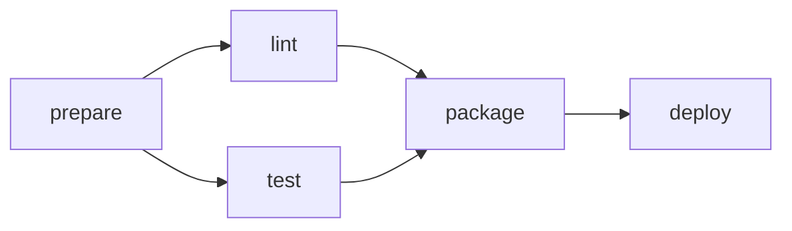
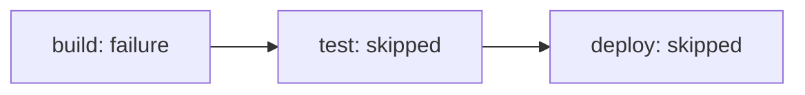
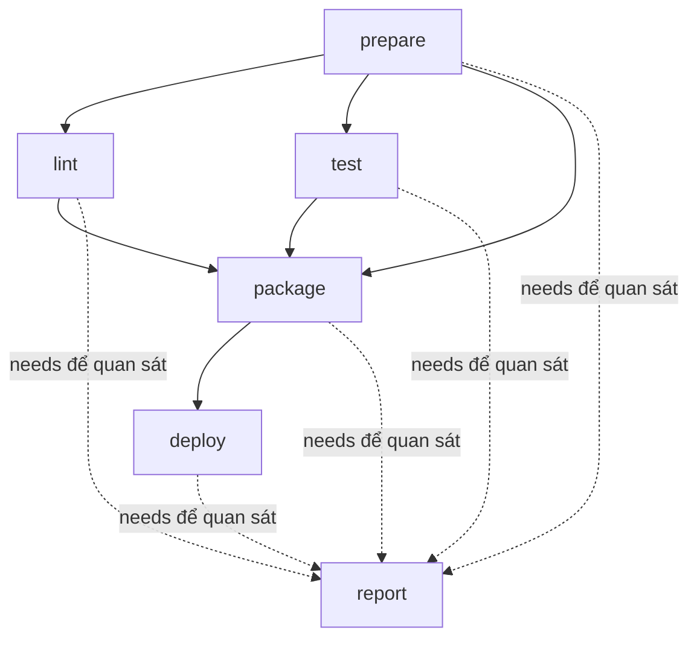

<Callout type="info" title="Mục tiêu">
  Sau bài này, bạn có thể thiết kế đồ thị phụ thuộc giữa các job, dự đoán ảnh hưởng của trạng thái failure hoặc skipped, truyền output qua `needs`, và tự kiểm chứng một pipeline nhiều nhánh.
</Callout>

## Mục lục

- [Từ danh sách job đến đồ thị phụ thuộc](#từ-danh-sách-job-đến-đồ-thị-phụ-thuộc)
  - [Job không có needs](#job-không-có-needs)
  - [Job có một hoặc nhiều dependency](#job-có-một-hoặc-nhiều-dependency)
  - [Dependency trực tiếp và bắc cầu](#dependency-trực-tiếp-và-bắc-cầu)
- [Cơ chế trạng thái](#cơ-chế-trạng-thái)
  - [Mặc định chỉ đi tiếp sau success](#mặc-định-chỉ-đi-tiếp-sau-success)
  - [Chạy job tổng kết sau lỗi](#chạy-job-tổng-kết-sau-lỗi)
  - [Đọc result từ needs](#đọc-result-từ-needs)
- [Truyền dữ liệu giữa các job](#truyền-dữ-liệu-giữa-các-job)
  - [Từ step output đến job output](#từ-step-output-đến-job-output)
  - [Đọc output ở job phía sau](#đọc-output-ở-job-phía-sau)
  - [Output không phải file dùng chung](#output-không-phải-file-dùng-chung)
- [Ví dụ workflow hoàn chỉnh](#ví-dụ-workflow-hoàn-chỉnh)
  - [Đồ thị của ví dụ](#đồ-thị-của-ví-dụ)
  - [Workflow chạy được](#workflow-chạy-được)
  - [Dự đoán hai nhánh kết quả](#dự-đoán-hai-nhánh-kết-quả)
- [Tình huống áp dụng](#tình-huống-áp-dụng)
- [Bài thực hành](#bài-thực-hành)
  - [Chuẩn bị](#chuẩn-bị)
  - [Các bước thực hiện](#các-bước-thực-hiện)
  - [Tiêu chí kiểm chứng](#tiêu-chí-kiểm-chứng)
- [Best practices](#best-practices)
- [Troubleshooting](#troubleshooting)
- [Nguồn chính thức](#nguồn-chính-thức)
- [Tiếp tục trong series](#tiếp-tục-trong-series)

## Từ danh sách job đến đồ thị phụ thuộc

Mỗi job là một đơn vị thực thi có runner riêng. `needs` khai báo job nào phải hoàn tất thành công trước khi job hiện tại được chạy.

Tập quan hệ này tạo thành một DAG. DAG là “directed acyclic graph”, tức đồ thị có hướng và không có chu trình. Cạnh đi từ job trước đến job sau. Không có đường nào quay lại điểm xuất phát.



Sơ đồ trên thể hiện ba ý:

- `lint` và `test` cùng chờ `prepare`.
- Sau `prepare`, `lint` và `test` có thể chạy song song.
- `package` chỉ bắt đầu khi cả `lint` và `test` thành công.

### Job không có needs

Các job không khai báo `needs` đủ điều kiện bắt đầu độc lập. GitHub có thể chạy chúng song song nếu runner sẵn sàng.

```yaml
jobs:
  lint:
    runs-on: ubuntu-latest
    steps:
      - run: echo "lint"

  test:
    runs-on: ubuntu-latest
    steps:
      - run: echo "test"
```

Thứ tự xuất hiện trong YAML không tạo dependency. Đặt `lint` trước `test` không có nghĩa `lint` chạy trước.

### Job có một hoặc nhiều dependency

Một dependency có thể viết bằng chuỗi:

```yaml
jobs:
  build:
    runs-on: ubuntu-latest
    steps:
      - run: echo "build"

  deploy:
    needs: build
    runs-on: ubuntu-latest
    steps:
      - run: echo "deploy"
```

Nhiều dependency được viết bằng danh sách:

```yaml
jobs:
  package:
    needs: [lint, test]
    runs-on: ubuntu-latest
    steps:
      - run: echo "package"
```

`package` đợi cả `lint` và `test`. Mặc định, cả hai phải thành công.

### Dependency trực tiếp và bắc cầu

Giả sử `build` cần `prepare`, còn `deploy` cần `build`:

```yaml
jobs:
  prepare:
    # ...

  build:
    needs: prepare
    # ...

  deploy:
    needs: build
    # ...
```

`prepare` là dependency bắc cầu của `deploy`. `build` là dependency trực tiếp.

Context `needs` của một job chỉ chứa các dependency **trực tiếp** được liệt kê trong chính job đó. Vì vậy, `deploy` đọc được `needs.build`, nhưng không đọc được `needs.prepare` trong cấu hình trên.

Nếu `deploy` cần output của `prepare`, có hai lựa chọn:

1. Chuyển tiếp output qua `build`.
2. Thêm `prepare` vào `needs` của `deploy`.

```yaml
  deploy:
    needs: [prepare, build]
```

Cách thứ hai tạo một dependency trực tiếp. Nó không làm `deploy` chạy sớm hơn, vì `deploy` vẫn phải đợi `build`.

## Cơ chế trạng thái

Một job kết thúc với một kết quả như `success`, `failure`, `cancelled` hoặc `skipped`. Dependency graph truyền ảnh hưởng của kết quả đó sang các job phía sau.

### Mặc định chỉ đi tiếp sau success

Nếu một job thất bại hoặc bị skip, các job cần nó cũng bị skip theo mặc định. Ảnh hưởng tiếp tục lan xuống chuỗi dependency.



Điều này bảo vệ pipeline khỏi deploy một bản build lỗi. Đây là hành vi đúng cho các cổng chất lượng như test, scan và package.

<Callout type="warn" title="Skipped cũng chặn downstream">
  Một job có thể bị skip vì `if` của chính nó là false. Nếu job khác khai báo `needs` job đó, job downstream cũng bị skip theo mặc định. Hãy thiết kế nhánh tùy chọn rõ ràng thay vì giả định skipped tương đương success.
</Callout>

### Chạy job tổng kết sau lỗi

Job gửi báo cáo hoặc thu thập log thường cần chạy sau khi dependency thất bại. Hãy đặt một status check function trong `if` để thay hành vi mặc định.

Status check function là hàm đọc trạng thái workflow. Các hàm thường dùng gồm:

- `success()`: đúng khi các bước hoặc dependency liên quan thành công.
- `failure()`: đúng khi có lỗi trong chuỗi liên quan.
- `cancelled()`: đúng khi workflow bị hủy.
- `always()`: luôn đúng, kể cả khi workflow bị hủy.

Ví dụ tổng kết chạy sau success hoặc failure, nhưng không chạy sau khi người dùng hủy workflow:

```yaml
  report:
    needs: [lint, test]
    if: ${{ !cancelled() }}
    runs-on: ubuntu-latest
    steps:
      - run: echo "Tổng kết kết quả"
```

Tài liệu expression hiện hành của GitHub khuyến nghị `!cancelled()` cho job hoặc step cần chạy bất kể success hay failure. `always()` vẫn hữu ích cho tác vụ rất ngắn cần chạy cả sau cancellation, nhưng có thể khiến công việc lỗi nghiêm trọng tiếp tục chờ đến timeout.

### Đọc result từ needs

Mỗi dependency trực tiếp có thuộc tính `result`:

```yaml
  report:
    needs: [lint, test]
    if: ${{ !cancelled() }}
    runs-on: ubuntu-latest
    steps:
      - name: In trạng thái
        env:
          LINT_RESULT: ${{ needs.lint.result }}
          TEST_RESULT: ${{ needs.test.result }}
        run: |
          echo "lint=$LINT_RESULT"
          echo "test=$TEST_RESULT"
```

Giá trị `result` là một trong `success`, `failure`, `cancelled` hoặc `skipped`. Việc đưa expression vào `env` giúp tách dữ liệu khỏi script và làm lệnh shell dễ đọc hơn.

## Truyền dữ liệu giữa các job

`needs` không chỉ điều khiển thứ tự. Context này còn cho job phía sau đọc output của dependency trực tiếp.

### Từ step output đến job output

Một step ghi output vào file được chỉ bởi biến môi trường `GITHUB_OUTPUT`. Step phải có `id` để job ánh xạ output đó.

```yaml
jobs:
  prepare:
    runs-on: ubuntu-latest
    outputs:
      build_id: ${{ steps.meta.outputs.build_id }}
    steps:
      - name: Tạo mã build
        id: meta
        run: echo "build_id=${GITHUB_RUN_ID}-${GITHUB_RUN_ATTEMPT}" >> "$GITHUB_OUTPUT"
```

Luồng dữ liệu gồm ba tên:

1. Step `meta` ghi output `build_id`.
2. `jobs.prepare.outputs.build_id` ánh xạ từ step output.
3. Job downstream đọc bằng `needs.prepare.outputs.build_id`.

### Đọc output ở job phía sau

```yaml
  package:
    needs: prepare
    runs-on: ubuntu-latest
    steps:
      - name: Dùng mã build
        env:
          BUILD_ID: ${{ needs.prepare.outputs.build_id }}
        run: echo "Packaging build $BUILD_ID"
```

Output được biểu diễn dưới dạng chuỗi. Nếu cần boolean, số, mảng hoặc object, hãy serialize thành JSON ở job trước và dùng `fromJSON()` ở job sau.

Không đặt secret vào job output. GitHub có cơ chế che secret trong log, nhưng output không phải kênh truyền bí mật phù hợp. Dùng context `secrets` và giới hạn quyền truy cập theo job.

### Output không phải file dùng chung

Mỗi GitHub-hosted job thường chạy trên máy ảo mới. `needs` không chia sẻ filesystem của runner trước.

- Dùng **job output** cho metadata nhỏ như version, tên môi trường hoặc cờ quyết định.
- Dùng **artifact** để chuyển file build, report hoặc log giữa các job.
- Dùng **cache** để tái sử dụng dependency có thể tạo lại, không dùng cache như nơi lưu artifact phát hành.

Ví dụ `echo "dist/app.zip"` thành output chỉ truyền chuỗi đường dẫn. Nó không chuyển file `dist/app.zip` sang runner của job sau.

## Ví dụ workflow hoàn chỉnh

Ví dụ này cho phép chủ động làm job `test` thất bại. Nhờ đó, bạn quan sát được cả đường success và đường skip.

### Đồ thị của ví dụ

Các cạnh liền là pipeline chính. Job `report` khai báo dependency trực tiếp với mọi job để đọc đầy đủ `result`.



### Workflow chạy được

Lưu file sau thành `.github/workflows/dependencies-lab.yml`:

```yaml
name: Dependencies lab

on:
  workflow_dispatch:
    inputs:
      fail_tests:
        description: 'Làm job test thất bại'
        required: true
        type: boolean
        default: false

permissions: {}

jobs:
  prepare:
    runs-on: ubuntu-latest
    outputs:
      build_id: ${{ steps.meta.outputs.build_id }}
    steps:
      - name: Tạo mã build
        id: meta
        run: echo "build_id=${GITHUB_RUN_ID}-${GITHUB_RUN_ATTEMPT}" >> "$GITHUB_OUTPUT"

  lint:
    needs: prepare
    runs-on: ubuntu-latest
    steps:
      - name: Lint
        env:
          BUILD_ID: ${{ needs.prepare.outputs.build_id }}
        run: echo "Lint passed for $BUILD_ID"

  test:
    needs: prepare
    runs-on: ubuntu-latest
    steps:
      - name: Test
        env:
          BUILD_ID: ${{ needs.prepare.outputs.build_id }}
          FAIL_TESTS: ${{ inputs.fail_tests }}
        run: |
          echo "Testing $BUILD_ID"
          if [[ "$FAIL_TESTS" == "true" ]]; then
            echo "Intentional failure"
            exit 1
          fi
          echo "Tests passed"

  package:
    needs: [prepare, lint, test]
    runs-on: ubuntu-latest
    outputs:
      package_name: ${{ steps.package_meta.outputs.package_name }}
    steps:
      - name: Tạo tên package
        id: package_meta
        env:
          BUILD_ID: ${{ needs.prepare.outputs.build_id }}
        run: echo "package_name=demo-$BUILD_ID.tgz" >> "$GITHUB_OUTPUT"

      - name: Mô phỏng đóng gói
        env:
          PACKAGE_NAME: ${{ steps.package_meta.outputs.package_name }}
        run: echo "Created logical package $PACKAGE_NAME"

  deploy:
    needs: package
    runs-on: ubuntu-latest
    steps:
      - name: Mô phỏng deploy
        env:
          PACKAGE_NAME: ${{ needs.package.outputs.package_name }}
        run: echo "Deployed $PACKAGE_NAME"

  report:
    needs: [prepare, lint, test, package, deploy]
    if: ${{ !cancelled() }}
    runs-on: ubuntu-latest
    steps:
      - name: In kết quả DAG
        env:
          BUILD_ID: ${{ needs.prepare.outputs.build_id }}
          PREPARE_RESULT: ${{ needs.prepare.result }}
          LINT_RESULT: ${{ needs.lint.result }}
          TEST_RESULT: ${{ needs.test.result }}
          PACKAGE_RESULT: ${{ needs.package.result }}
          DEPLOY_RESULT: ${{ needs.deploy.result }}
        run: |
          echo "build_id=$BUILD_ID"
          echo "prepare=$PREPARE_RESULT"
          echo "lint=$LINT_RESULT"
          echo "test=$TEST_RESULT"
          echo "package=$PACKAGE_RESULT"
          echo "deploy=$DEPLOY_RESULT"
```

Workflow không checkout code và không tải action bên thứ ba. Mọi job chỉ dùng Bash trên `ubuntu-latest`.

`package` liệt kê `prepare` trực tiếp dù `lint` và `test` đã cần `prepare`. Cạnh bổ sung cho phép `package` đọc `needs.prepare.outputs.build_id`.

### Dự đoán hai nhánh kết quả

Khi `fail_tests` là `false`:

1. `prepare` chạy trước.
2. `lint` và `test` chạy song song.
3. `package` chạy sau cả hai.
4. `deploy` chạy sau `package`.
5. `report` chạy cuối và thấy mọi result là `success`.

Khi `fail_tests` là `true`:

1. `prepare` thành công.
2. `lint` thành công, còn `test` thất bại.
3. `package` bị skip vì cần `test` thành công.
4. `deploy` bị skip vì cần `package`.
5. `report` vẫn chạy vì `!cancelled()` là true. Nó thấy `test=failure`, `package=skipped` và `deploy=skipped`.

<Callout type="info" title="Trạng thái workflow tổng thể">
  Job `report` thành công không xóa lỗi của `test`. Workflow run vẫn thể hiện thất bại. Job tổng kết chỉ ghi nhận kết quả, không biến pipeline lỗi thành pipeline đạt.
</Callout>

## Tình huống áp dụng

| Nhu cầu | Thiết kế dependency | Lý do |
|---|---|---|
| Lint và test độc lập | Cả hai không cần nhau | Tận dụng chạy song song. |
| Package chỉ khi mọi kiểm tra đạt | `needs: [lint, test, security_scan]` | Tạo một quality gate rõ ràng. |
| Deploy theo chuỗi môi trường | `staging` cần `package`, `production` cần `staging` | Giữ đúng thứ tự phát hành. |
| Luôn tạo báo cáo sau pipeline | `needs` các job cần quan sát và `if: ${{ !cancelled() }}` | Đọc result cả success lẫn failure. |
| Truyền version đã tính | Job output và `needs.<job>.outputs.version` | Tránh tính lại metadata ở nhiều runner. |
| Chuyển file build | `needs` kết hợp upload và download artifact | Dependency chỉ tạo thứ tự; artifact mới chuyển file. |

## Bài thực hành

### Chuẩn bị

Bạn cần:

- Một repository GitHub có Actions được bật.
- Quyền thêm workflow vào `.github/workflows`.
- Quyền chạy `workflow_dispatch`.

Không cần source code hoặc package manager.

### Các bước thực hiện

1. Tạo `.github/workflows/dependencies-lab.yml` bằng workflow hoàn chỉnh ở trên.
2. Merge hoặc commit file vào default branch để nút **Run workflow** xuất hiện.
3. Chạy workflow với **fail_tests = false**.
4. Mở biểu đồ job trong trang run. Quan sát `lint` và `test` bắt đầu sau `prepare`.
5. Mở log `package` và `deploy`. Xác nhận tên package chứa `GITHUB_RUN_ID` và `GITHUB_RUN_ATTEMPT`.
6. Chạy lại workflow với **fail_tests = true**.
7. Mở job `report` của lần chạy lỗi và đối chiếu từng giá trị `result`.
8. Thử xóa `prepare` khỏi `package.needs`, nhưng vẫn giữ expression `needs.prepare.outputs.build_id`. Commit vào branch thử nghiệm và quan sát giá trị không còn khả dụng.

### Tiêu chí kiểm chứng

| Ca kiểm thử | Kết quả mong đợi |
|---|---|
| `fail_tests = false` | Tất cả sáu job thành công. |
| Đồ thị lần chạy thành công | `lint` và `test` cùng nằm sau `prepare`; `package` nằm sau cả hai. |
| Output qua nhiều job | `package` nhận đúng `build_id`; `deploy` nhận đúng `package_name`. |
| `fail_tests = true` | `test` failure; `package` và `deploy` skipped; `report` success. |
| Log `report` khi test lỗi | Có `test=failure`, `package=skipped`, `deploy=skipped`. |
| Bỏ dependency trực tiếp `prepare` khỏi `package` | `package` không thể dựa vào `needs.prepare`; context `needs` không chứa dependency chỉ bắc cầu. |

Sau thử nghiệm cuối, hãy khôi phục `needs: [prepare, lint, test]` để workflow trở lại trạng thái đúng.

## Best practices

- **Mô hình hóa dependency nghiệp vụ, không mô hình hóa thứ tự trình bày:** chỉ thêm cạnh `needs` khi job sau thật sự cần trạng thái hoặc output của job trước.
- **Giữ DAG rộng ở đầu, hẹp ở cổng chất lượng:** lint, unit test và scan độc lập nên chạy song song; package nên hội tụ sau các kiểm tra.
- **Tránh chuỗi dài không cần thiết:** chuỗi `lint → test → build` làm tăng thời gian nếu ba job có thể chạy song song.
- **Đặt tên job ID ổn định:** expression `needs.<job_id>` phụ thuộc ID, không phụ thuộc `name` hiển thị.
- **Khai báo dependency trực tiếp khi đọc output:** đừng dựa vào quan hệ bắc cầu vì context `needs` chỉ chứa job được liệt kê trực tiếp.
- **Dùng output cho metadata nhỏ:** file build phải đi qua artifact, không qua chuỗi output.
- **Dùng `!cancelled()` cho job tổng kết thông thường:** tránh giữ workflow sống sau khi người dùng đã chủ động hủy.
- **Không che lỗi bằng job báo cáo:** report có thể thành công, nhưng quality gate phải tiếp tục phản ánh job thất bại.
- **Không truyền secret qua output:** đọc secret trực tiếp ở job cần dùng và cấp quyền tối thiểu.
- **Vẽ DAG trước pipeline phức tạp:** một sơ đồ nhỏ thường phát hiện cạnh thừa, nhánh bị cô lập và vòng phụ thuộc sớm hơn YAML.

## Troubleshooting

| Triệu chứng | Nguyên nhân thường gặp | Cách xử lý |
|---|---|---|
| Các job chạy song song dù được viết theo thứ tự | YAML order không tạo dependency. | Thêm `needs` vào job phải chờ. |
| Job downstream bị skipped sau một lỗi | Dependency failure hoặc skipped kích hoạt status check mặc định. | Giữ nguyên cho quality gate; với report, thêm `if: ${{ !cancelled() }}` hoặc điều kiện trạng thái phù hợp. |
| Report cũng bị skipped | Chỉ khai báo `needs` mà không override điều kiện success mặc định. | Thêm status check function vào `jobs.<job_id>.if`. |
| Job dùng `always()` không dừng như mong đợi | `always()` đúng cả khi workflow bị cancel. | Dùng `!cancelled()` nếu không cần chạy sau cancellation. |
| `needs.prepare.outputs.build_id` rỗng | `prepare` không phải dependency trực tiếp, sai tên output, step thiếu `id`, hoặc step không ghi `GITHUB_OUTPUT`. | Kiểm tra đủ ba lớp tên và thêm `prepare` vào `needs`. |
| Job output không có kiểu boolean | Output là chuỗi. | Dùng `fromJSON(needs.job.outputs.flag)` sau khi job trước ghi JSON hợp lệ. |
| File tạo ở job build không tồn tại ở job deploy | Mỗi job có runner và filesystem riêng. | Upload artifact ở job build rồi download ở job deploy. |
| Không thể tạo workflow vì dependency vòng | DAG có chu trình như `a` cần `b` và `b` cần `a`. | Chọn một hướng dữ liệu, tách job chung hoặc bỏ cạnh dư. |
| Job bắt đầu muộn dù dependency đã xong | Runner chưa sẵn sàng hoặc có giới hạn concurrency. | Kiểm tra hàng đợi, runner label và cấu hình concurrency; `needs` chỉ xác định điều kiện đủ về dependency. |
| `failure()` không chạy như dự đoán | Điều kiện không nằm trên đúng chuỗi dependency hoặc còn biểu thức khác loại trừ job. | In `toJSON(needs)` ở job tổng kết và kiểm tra các dependency trực tiếp. |
| Job tùy chọn bị skip làm job chung bị skip | Job chung khai báo `needs` job tùy chọn, còn điều kiện mặc định yêu cầu success. | Tách nhánh, hoặc đặt `if` rõ ràng dựa trên `needs.<job>.result`. |
| Đổi `name` hiển thị làm expression hỏng | Có thể đã dùng nhầm tên hiển thị thay cho job ID. | Dùng khóa dưới `jobs`, ví dụ `needs.test`, không dùng `name: Unit tests`. |

## Nguồn chính thức

- [Using jobs in a workflow](https://docs.github.com/en/actions/how-tos/write-workflows/choose-what-workflows-do/use-jobs)
- [Workflow syntax cho jobs needs](https://docs.github.com/en/actions/reference/workflows-and-actions/workflow-syntax#jobsjob_idneeds)
- [Passing information between jobs](https://docs.github.com/en/actions/how-tos/write-workflows/choose-what-workflows-do/pass-job-outputs)
- [Workflow syntax cho job outputs](https://docs.github.com/en/actions/reference/workflows-and-actions/workflow-syntax#jobsjob_idoutputs)
- [Needs context](https://docs.github.com/en/actions/reference/workflows-and-actions/contexts#needs-context)
- [Status check functions](https://docs.github.com/en/actions/reference/workflows-and-actions/expressions#status-check-functions)
- [Using conditions to control job execution](https://docs.github.com/en/actions/how-tos/write-workflows/choose-when-workflows-run/control-jobs-with-conditions)
- [Storing workflow data as artifacts](https://docs.github.com/en/actions/how-tos/writing-workflows/choosing-what-your-workflow-does/storing-and-sharing-data-from-a-workflow)

## Tiếp tục trong series

<Cards>
  <Card title="Branch và path filters" href="/docs/dieu-khien-workflow/01-branch-path-filters/" description="Giới hạn workflow run trước khi dependency graph được tạo." />
  <Card title="Conditionals" href="/docs/dieu-khien-workflow/03-conditionals/" description="Kết hợp if với trạng thái, context và expression." />
  <Card title="Outputs" href="/docs/dieu-khien-workflow/07-outputs/" description="Đi sâu vào step output, job output và dữ liệu truyền giữa job." />
  <Card title="Artifacts" href="/docs/dieu-khien-workflow/08-artifacts/" description="Chuyển file build và report qua ranh giới runner." />
</Cards>
