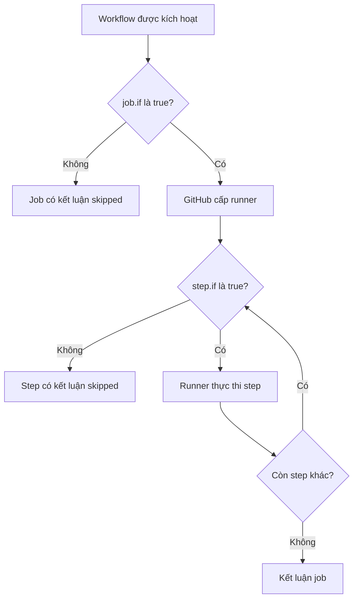

## Mục lục

- [Tổng quan](#tổng-quan)
- [Cơ chế đánh giá điều kiện](#cơ-chế-đánh-giá-điều-kiện)
  - [Job và step khác nhau thế nào](#job-và-step-khác-nhau-thế-nào)
  - [Status check mặc định](#status-check-mặc-định)
  - [Luồng quyết định](#luồng-quyết-định)
- [Cú pháp biểu thức](#cú-pháp-biểu-thức)
  - [Context phổ biến](#context-phổ-biến)
  - [Toán tử và hàm](#toán-tử-và-hàm)
  - [Bí mật không dùng trực tiếp trong if](#bí-mật-không-dùng-trực-tiếp-trong-if)
- [Ví dụ workflow chạy được](#ví-dụ-workflow-chạy-được)
  - [Điều kiện ở cấp step](#điều-kiện-ở-cấp-step)
  - [Điều kiện ở cấp job](#điều-kiện-ở-cấp-job)
- [Bài thực hành](#bài-thực-hành)
  - [Chuẩn bị](#chuẩn-bị)
  - [Tạo workflow](#tạo-workflow)
  - [Chạy và kiểm chứng](#chạy-và-kiểm-chứng)
- [Best practices](#best-practices)
- [Troubleshooting](#troubleshooting)
- [Tài liệu tham khảo](#tài-liệu-tham-khảo)
- [Tiếp tục series](#tiếp-tục-series)

## Tổng quan

Conditional là điều kiện quyết định một `job` hoặc `step` có được chạy hay không. Từ khóa dùng cho việc này là `if`.

Ví dụ, bạn có thể chỉ triển khai từ nhánh `main`. Bạn cũng có thể tải log chỉ khi bước kiểm thử thất bại. Workflow vẫn được kích hoạt, nhưng GitHub đánh giá từng điều kiện để bỏ qua phần việc không cần thiết.

Sau chương này, bạn có thể:

- viết biểu thức với context, toán tử và hàm;
- phân biệt điều kiện ở cấp job với cấp step;
- xử lý đúng các trạng thái `success`, `failure`, `cancelled` và `skipped`;
- kiểm tra nguyên nhân một job hoặc step bị bỏ qua.

<Callout type="info" title="Phạm vi của if">
  `if` điều khiển công việc bên trong một workflow run. Muốn ngăn cả workflow được tạo, hãy dùng branch, tag hoặc path filter tại khóa `on`.
</Callout>

## Cơ chế đánh giá điều kiện

GitHub Actions đánh giá biểu thức trong `${{ ... }}` trên dịch vụ điều phối. Kết quả được ép về Boolean, tức `true` hoặc `false`. Các giá trị `false`, `0`, `-0`, chuỗi rỗng và `null` được xem là `false`.

Nếu kết quả là `true`, GitHub cho phép job hoặc step chạy. Nếu kết quả là `false`, mục đó có kết luận `skipped`.

### Job và step khác nhau thế nào

`jobs.<job_id>.if` được đánh giá trước khi GitHub cấp runner cho job. Vì vậy, job bị bỏ qua không tiêu tốn thời gian thực thi trên runner.

`jobs.<job_id>.steps[*].if` được đánh giá trong một job đã bắt đầu. Nó có thể đọc kết quả và output của các step đứng trước qua context `steps`.

| Vị trí | Thời điểm đánh giá | Context thường dùng |
|---|---|---|
| `jobs.<job_id>.if` | Trước khi cấp runner | `github`, `needs`, `vars`, `inputs` |
| `jobs.<job_id>.steps[*].if` | Khi job đang chạy | Các context trên, cùng `env`, `job`, `steps`, `runner`, `strategy`, `matrix` |

Điều kiện cấp job được đánh giá trước khi `strategy.matrix` mở rộng các tổ hợp. Vì thế, không dùng `matrix.*` trong `jobs.<job_id>.if`. Muốn rẽ nhánh theo từng tổ hợp ma trận, hãy dùng `matrix.*` trong step hoặc trong các khóa hỗ trợ context này.

<Callout type="info" title="Job bị bỏ qua và required check">
  Theo tài liệu GitHub, một job bị bỏ qua báo trạng thái kiểm tra là `Success`. Job đó không chặn merge ngay cả khi được cấu hình là required check. Đây là hành vi khác với việc bỏ qua toàn bộ workflow bằng filter, vốn có thể khiến check giữ trạng thái `Pending`.
</Callout>

### Status check mặc định

Nếu `if` không chứa hàm kiểm tra trạng thái, GitHub ngầm áp dụng `success()`. Nói cách khác, điều kiện tùy chỉnh chỉ được xét khi các phần việc trước đó đã thành công.

Các hàm trạng thái chính là:

| Hàm | Trả về `true` khi |
|---|---|
| `success()` | Các step trước trong job đã thành công |
| `failure()` | Một step trước thất bại; ở chuỗi job, một job tổ tiên thất bại |
| `cancelled()` | Workflow đã bị hủy |
| `always()` | Luôn luôn, kể cả khi workflow bị hủy |

Ví dụ sau **không** chạy sau lỗi vì thiếu hàm trạng thái:

```yaml
- name: Thông báo lỗi chưa đúng
  if: ${{ steps.tests.outcome == 'failure' }}
  run: echo "Tests failed"
```

Hãy thêm `failure()` để thay thế status check mặc định:

```yaml
- name: Thông báo lỗi đúng
  if: ${{ failure() && steps.tests.outcome == 'failure' }}
  run: echo "Tests failed"
```

<Callout type="warn" title="Không lạm dụng always">
  `always()` vẫn đúng khi run đã bị hủy. GitHub khuyến nghị `if: ${{ !cancelled() }}` cho phần việc cần chạy sau thành công hoặc thất bại nhưng không nên chạy sau khi hủy. Tránh dùng `always()` cho thao tác có thể treo, chẳng hạn lấy mã nguồn khi hạ tầng đang lỗi.
</Callout>

### Luồng quyết định



Một job có `needs` còn phụ thuộc vào kết quả của job trước. Nếu dependency thất bại hoặc bị bỏ qua, job phía sau cũng thường bị bỏ qua. Hãy dùng một hàm trạng thái trong `if` nếu job phía sau vẫn phải chạy.

## Cú pháp biểu thức

Trong khóa `if`, cặp `${{ ... }}` thường có thể bỏ. Tuy nhiên, giữ cặp dấu này giúp ranh giới biểu thức rõ hơn.

```yaml
if: ${{ github.ref == 'refs/heads/main' }}
```

Nếu biểu thức bắt đầu bằng `!`, bạn phải bọc nó trong `${{ ... }}` hoặc quote cả biểu thức. YAML dùng `!` cho tag riêng nên dòng `if: !cancelled()` không hợp lệ.

```yaml
if: ${{ !cancelled() }}
```

Chuỗi bên trong biểu thức dùng dấu nháy đơn. Muốn viết một dấu nháy đơn trong chuỗi, hãy nhân đôi nó, ví dụ `${{ 'It''s ready' }}`.

### Context phổ biến

Context là đối tượng chứa dữ liệu của workflow run. Chọn context theo câu hỏi bạn cần trả lời:

| Câu hỏi | Biểu thức mẫu |
|---|---|
| Sự kiện có phải pull request không? | `github.event_name == 'pull_request'` |
| Nhánh hiện tại có phải `main` không? | `github.ref == 'refs/heads/main'` |
| Input Boolean có bật không? | `inputs.deploy` |
| Job phụ thuộc có thành công không? | `needs.build.result == 'success'` |
| Step có thất bại trước `continue-on-error` không? | `steps.tests.outcome == 'failure'` |
| Cấu hình ma trận hiện tại là Windows không? | `matrix.os == 'windows-latest'` |
| Biến cấu hình có giá trị `production` không? | `vars.ENVIRONMENT == 'production'` |

`needs.<job_id>.result` có thể là `success`, `failure`, `cancelled` hoặc `skipped`. Với step, `outcome` là kết quả trước khi áp dụng `continue-on-error`; `conclusion` là kết quả sau khi áp dụng.

### Toán tử và hàm

Các toán tử thường dùng gồm `!`, `==`, `!=`, `>`, `<`, `&&` và `||`. Dùng dấu ngoặc tròn để làm rõ thứ tự đánh giá.

```yaml
if: ${{ github.event_name == 'push' && (github.ref_name == 'main' || startsWith(github.ref_name, 'release/')) }}
```

Các hàm chuỗi và mảng hữu ích gồm:

- `contains(search, item)`: kiểm tra chuỗi con hoặc phần tử trong mảng;
- `startsWith(search, value)`: kiểm tra tiền tố;
- `endsWith(search, value)`: kiểm tra hậu tố;
- `fromJSON(value)`: chuyển chuỗi JSON thành Boolean, số, mảng hoặc object;
- `toJSON(value)`: chuyển dữ liệu thành JSON để quan sát khi debug.

Ví dụ sau gọn hơn một chuỗi phép `||`:

```yaml
if: ${{ contains(fromJSON('["push", "pull_request"]'), github.event_name) }}
```

Output của step là chuỗi. Hãy dùng `fromJSON()` trước khi so sánh như một số:

```yaml
if: ${{ fromJSON(steps.coverage.outputs.percent) >= 80 }}
```

GitHub dùng so sánh bằng lỏng và không phân biệt hoa thường khi so sánh chuỗi. Đừng dựa vào ép kiểu ngầm. Hãy chuyển kiểu rõ ràng bằng `fromJSON()`.

### Bí mật không dùng trực tiếp trong if

Context `secrets` không khả dụng trực tiếp tại `if`. Với điều kiện cấp step, hãy ánh xạ secret sang biến môi trường rồi kiểm tra biến đó.

```yaml
jobs:
  publish:
    runs-on: ubuntu-latest
    env:
      NPM_TOKEN: ${{ secrets.NPM_TOKEN }}
    steps:
      - name: Publish khi token tồn tại
        if: ${{ env.NPM_TOKEN != '' }}
        run: echo "Token is available; run the publish command here"
```

Secret chưa được cấu hình cho giá trị chuỗi rỗng. Không in biến này ra log.

## Ví dụ workflow chạy được

Các đoạn sau có thể đặt trong một file workflow hoàn chỉnh. Chúng không cần mã nguồn ứng dụng.

### Điều kiện ở cấp step

Workflow này chạy thủ công. Input `show_context` giữ đúng kiểu Boolean trong context `inputs`.

```yaml
name: Conditional step demo

on:
  workflow_dispatch:
    inputs:
      show_context:
        description: "In thông tin sự kiện"
        required: true
        type: boolean
        default: false

jobs:
  inspect:
    runs-on: ubuntu-latest
    steps:
      - name: Luôn chạy
        env:
          EVENT_NAME: ${{ github.event_name }}
          REF_NAME: ${{ github.ref_name }}
        run: printf 'event=%s ref=%s\n' "$EVENT_NAME" "$REF_NAME"

      - name: Chỉ chạy khi input được bật
        if: ${{ inputs.show_context }}
        env:
          EVENT_JSON: ${{ toJSON(github.event) }}
        run: printf '%s\n' "$EVENT_JSON"

      - name: Chỉ chạy trên main
        if: ${{ github.ref == 'refs/heads/main' }}
        run: echo "This is main"
```

Đặt object `github.event` vào biến môi trường trước khi in. Cách này tránh chèn trực tiếp dữ liệu không tin cậy vào shell.

### Điều kiện ở cấp job

Job `deploy` chỉ được cấp runner khi cả input và kết quả `build` đều phù hợp.

```yaml
name: Conditional job demo

on:
  workflow_dispatch:
    inputs:
      deploy:
        description: "Chạy deploy mô phỏng"
        required: true
        type: boolean
        default: false

jobs:
  build:
    runs-on: ubuntu-latest
    steps:
      - run: echo "Build passed"

  deploy:
    needs: build
    if: ${{ inputs.deploy && needs.build.result == 'success' }}
    runs-on: ubuntu-latest
    steps:
      - run: echo "Deploying commit ${{ github.sha }}"
```

## Bài thực hành

Bài này tạo đủ ba kết quả dễ quan sát: `failure`, `skipped` và một job tổng kết vẫn chạy sau lỗi.

### Chuẩn bị

Bạn cần:

- một repository GitHub có quyền tạo workflow;
- tab **Actions** được bật;
- quyền chạy workflow thủ công.

### Tạo workflow

Tạo file `.github/workflows/conditionals-lab.yml`:

```yaml
name: Conditionals lab

on:
  workflow_dispatch:
    inputs:
      simulate_failure:
        description: "Cố ý làm step demo thất bại"
        required: true
        type: boolean
        default: false
      run_optional_job:
        description: "Chạy job optional nếu exercise thành công"
        required: true
        type: boolean
        default: true

permissions:
  contents: read

jobs:
  exercise:
    runs-on: ubuntu-latest
    steps:
      - name: Bước chuẩn bị
        run: echo "Preparing the exercise"

      - name: Lỗi có chủ đích
        id: demo
        if: ${{ inputs.simulate_failure }}
        run: |
          echo "This failure is intentional"
          exit 1

      - name: Chẩn đoán đúng step bị lỗi
        if: ${{ failure() && steps.demo.outcome == 'failure' }}
        run: echo "The demo step failed as expected"

      - name: Dọn dẹp trừ khi run bị hủy
        if: ${{ !cancelled() }}
        run: echo "Cleanup completed"

  optional:
    needs: exercise
    if: ${{ !cancelled() && inputs.run_optional_job && needs.exercise.result == 'success' }}
    runs-on: ubuntu-latest
    steps:
      - run: echo "Optional job executed"

  summary:
    needs: [exercise, optional]
    if: ${{ !cancelled() }}
    runs-on: ubuntu-latest
    steps:
      - name: Ghi kết quả
        env:
          EXERCISE_RESULT: ${{ needs.exercise.result }}
          OPTIONAL_RESULT: ${{ needs.optional.result }}
        run: |
          {
            echo "## Conditionals lab"
            echo "- exercise: $EXERCISE_RESULT"
            echo "- optional: $OPTIONAL_RESULT"
          } >> "$GITHUB_STEP_SUMMARY"
```

### Chạy và kiểm chứng

Chạy workflow ba lần từ **Actions → Conditionals lab → Run workflow**.

| Lần chạy | `simulate_failure` | `run_optional_job` | Kết quả cần thấy |
|---|---:|---:|---|
| 1 | `false` | `true` | `exercise`, `optional`, `summary` thành công |
| 2 | `false` | `false` | `optional` là `skipped`; `summary` vẫn chạy |
| 3 | `true` | `true` | `exercise` thất bại; step chẩn đoán và dọn dẹp chạy; `optional` bị bỏ qua; `summary` vẫn chạy |

Tiêu chí hoàn thành:

- [ ] Bạn giải thích được vì sao step sau lỗi cần `failure()` hoặc một hàm trạng thái khác.
- [ ] Phần **Job summary** hiển thị đúng `success`, `failure` hoặc `skipped`.
- [ ] Khi bấm **Cancel workflow**, các mục dùng `!cancelled()` không khởi chạy thêm.
- [ ] Không có secret hoặc toàn bộ object context nhạy cảm bị chèn trực tiếp vào lệnh shell.

## Best practices

- **Đặt tên step và job theo ý định.** Tên “Deploy only from main” dễ chẩn đoán hơn “Run script”.
- **Giữ điều kiện ngắn.** Nếu biểu thức lặp lại hoặc quá dài, tính một output ở job trước rồi dùng `needs.<job>.outputs.<name>`.
- **Dùng input đúng kiểu.** Với `workflow_dispatch`, đọc Boolean từ `inputs.flag` thay vì so sánh chuỗi trong `github.event.inputs`.
- **Chuyển kiểu output rõ ràng.** Output là chuỗi. Dùng `fromJSON()` cho số và Boolean.
- **Kết hợp `needs` với hàm trạng thái có chủ đích.** Dùng `!cancelled()` cho báo cáo hoặc cleanup cần chạy sau cả thành công lẫn thất bại.
- **Không dùng dữ liệu sự kiện trực tiếp trong shell.** Dữ liệu như title hoặc branch có thể chứa nội dung không tin cậy. Truyền qua `env` và quote biến shell.
- **Không dùng điều kiện để che lỗi bắt buộc.** Nếu một kiểm tra là cổng chất lượng, hãy để nó thất bại thay vì `continue-on-error` hoặc bỏ qua âm thầm.
- **Kiểm tra context availability.** Không phải context nào cũng dùng được tại mọi khóa. Đặc biệt, `matrix` không có ở `jobs.<job_id>.if` và `secrets` không có trực tiếp ở `if`.

## Troubleshooting

| Triệu chứng | Nguyên nhân thường gặp | Cách xử lý |
|---|---|---|
| Workflow không xuất hiện | File không nằm trong `.github/workflows` hoặc YAML lỗi | Kiểm tra đường dẫn, phần **Actions** và lỗi parse trên commit |
| Job bị `skipped` dù điều kiện có vẻ đúng | Dependency thất bại/bị bỏ qua hoặc `success()` mặc định là `false` | Xem `needs.<job>.result`; thêm hàm trạng thái phù hợp nếu job vẫn phải chạy |
| Step báo lỗi sau failure không chạy | Biểu thức chỉ kiểm tra `steps.<id>.outcome` | Thêm `failure() && ...` để thay status check mặc định |
| `if: !cancelled()` gây lỗi YAML | `!` được YAML hiểu là tag | Viết `if: ${{ !cancelled() }}` |
| So sánh số cho kết quả lạ | Output của step là chuỗi và GitHub ép kiểu lỏng | Dùng `fromJSON(steps.<id>.outputs.<name>)` |
| Không đọc được `steps.foo.outcome` | Step trước không có `id: foo` hoặc chưa chạy | Thêm `id` duy nhất và chỉ đọc step đã đứng trước |
| Không đọc được `matrix.os` ở điều kiện job | Job-level `if` được đánh giá trước khi mở rộng matrix | Chuyển điều kiện xuống step hoặc thiết kế lại matrix bằng `include`/`exclude` |
| Secret trong `if` không hoạt động | `secrets` không khả dụng trực tiếp trong điều kiện | Ánh xạ secret sang `env` ở job, rồi kiểm tra chuỗi rỗng tại step |
| Điều kiện đúng sai khác dự kiến | Khác kiểu dữ liệu, chuỗi rỗng hoặc so sánh không phân biệt hoa thường | In giá trị không nhạy cảm bằng `toJSON()` và chuyển kiểu rõ ràng |

Với job-level condition, mở run, chọn menu dấu ba chấm, tải **Download log archive**, rồi mở `JOB-NAME/system.txt` để xem **condition expression logs**. File này ghi từng phần của biểu thức và kết quả đánh giá. Không bật debug log chứa toàn bộ context nếu context có token hoặc dữ liệu nhạy cảm.

## Tài liệu tham khảo

- [Using conditions to control job execution](https://docs.github.com/en/actions/how-tos/write-workflows/choose-when-workflows-run/control-jobs-with-conditions)
- [Evaluate expressions in workflows and actions](https://docs.github.com/en/actions/reference/workflows-and-actions/expressions)
- [Workflow syntax: `jobs.<job_id>.if`](https://docs.github.com/en/actions/reference/workflows-and-actions/workflow-syntax#jobsjob_idif)
- [Workflow syntax: `jobs.<job_id>.steps[*].if`](https://docs.github.com/en/actions/reference/workflows-and-actions/workflow-syntax#jobsjob_idstepsif)
- [Contexts reference và context availability](https://docs.github.com/en/actions/reference/workflows-and-actions/contexts#context-availability)
- [Viewing job condition expression logs](https://docs.github.com/en/actions/how-tos/monitor-workflows/view-job-condition-logs)
- [Secure use reference](https://docs.github.com/en/actions/reference/security/secure-use)

## Tiếp tục series

<Cards>
  <Card title="Job dependencies" href="/docs/dieu-khien-workflow/02-job-dependencies/" description="Điều phối thứ tự job bằng needs và dependency graph." />
  <Card title="Matrix strategy" href="/docs/dieu-khien-workflow/04-matrix-strategy/" description="Mở rộng một job thành nhiều tổ hợp kiểm thử hoặc build." />
</Cards>
