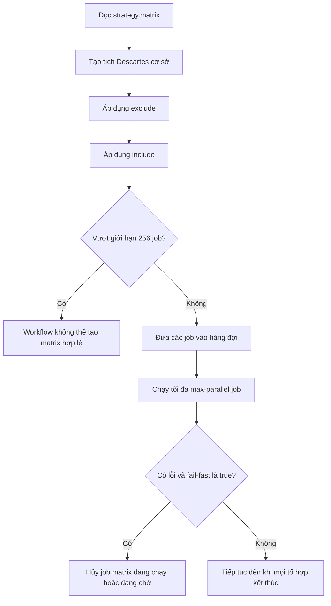

## Mục lục

- [Tổng quan](#tổng-quan)
- [Cơ chế mở rộng ma trận](#cơ-chế-mở-rộng-ma-trận)
  - [Tích Descartes và matrix context](#tích-descartes-và-matrix-context)
  - [Thứ tự tạo job và giới hạn](#thứ-tự-tạo-job-và-giới-hạn)
  - [Luồng thực thi](#luồng-thực-thi)
- [Cấu hình matrix](#cấu-hình-matrix)
  - [Ma trận một và nhiều chiều](#ma-trận-một-và-nhiều-chiều)
  - [Bổ sung tổ hợp bằng include](#bổ-sung-tổ-hợp-bằng-include)
  - [Loại tổ hợp bằng exclude](#loại-tổ-hợp-bằng-exclude)
  - [Tạo ma trận động từ JSON](#tạo-ma-trận-động-từ-json)
- [Điều khiển song song và lỗi](#điều-khiển-song-song-và-lỗi)
  - [fail-fast](#fail-fast)
  - [continue-on-error](#continue-on-error)
  - [max-parallel](#max-parallel)
- [Tình huống áp dụng](#tình-huống-áp-dụng)
- [Bài thực hành](#bài-thực-hành)
  - [Chuẩn bị](#chuẩn-bị)
  - [Tạo workflow](#tạo-workflow)
  - [Dự đoán các tổ hợp](#dự-đoán-các-tổ-hợp)
  - [Chạy và kiểm chứng](#chạy-và-kiểm-chứng)
- [Best practices](#best-practices)
- [Troubleshooting](#troubleshooting)
- [Tài liệu tham khảo](#tài-liệu-tham-khảo)
- [Tiếp tục series](#tiếp-tục-series)

## Tổng quan

Matrix strategy, hay chiến lược ma trận, biến một định nghĩa job thành nhiều job run. Mỗi job run nhận một tổ hợp biến riêng.

Ví dụ, hai hệ điều hành nhân với ba phiên bản Node.js tạo ra sáu tổ hợp. Bạn chỉ viết các step một lần. GitHub chịu trách nhiệm mở rộng và lập lịch các job.

Sau chương này, bạn có thể:

- tính chính xác số tổ hợp được tạo;
- dùng `matrix.*` trong `runs-on`, tên job, action input và step;
- thêm hoặc bỏ tổ hợp bằng `include` và `exclude`;
- tạo matrix động từ output JSON;
- kiểm soát tốc độ và hành vi lỗi bằng `fail-fast`, `continue-on-error` và `max-parallel`.

<Callout type="info" title="Matrix nhân bản job, không nhân bản step">
  Mỗi tổ hợp là một job độc lập và thường có runner riêng. Các step bên trong một tổ hợp vẫn chạy tuần tự như một job bình thường.
</Callout>

## Cơ chế mở rộng ma trận

Matrix nằm dưới `jobs.<job_id>.strategy.matrix`. Mỗi khóa do bạn đặt tên trở thành một thuộc tính trong context `matrix`.

```yaml
strategy:
  matrix:
    os: [ubuntu-latest, windows-latest]
    node: [20, 22]
```

Cấu hình này tạo bốn job:

1. `ubuntu-latest`, Node.js 20;
2. `ubuntu-latest`, Node.js 22;
3. `windows-latest`, Node.js 20;
4. `windows-latest`, Node.js 22.

### Tích Descartes và matrix context

Tích Descartes là tập mọi cách chọn một giá trị từ mỗi chiều. Nếu các chiều có lần lượt `2`, `3` và `2` giá trị, matrix cơ sở có `2 × 3 × 2 = 12` tổ hợp.

Mỗi job đọc tổ hợp hiện tại qua context `matrix`:

```yaml
jobs:
  test:
    name: Test Node ${{ matrix.node }} on ${{ matrix.os }}
    runs-on: ${{ matrix.os }}
    strategy:
      matrix:
        os: [ubuntu-latest, windows-latest]
        node: [20, 22]
    steps:
      - uses: actions/setup-node@v7
        with:
          node-version: ${{ matrix.node }}
      - run: node --version
```

Bạn cũng có thể dùng object làm giá trị của một chiều. Cách này nhóm các thuộc tính liên quan:

```yaml
strategy:
  matrix:
    node:
      - version: 20
      - version: 22
        env: --trace-warnings

steps:
  - uses: actions/setup-node@v7
    with:
      node-version: ${{ matrix.node.version }}
  - run: node --version
    env:
      NODE_OPTIONS: ${{ matrix.node.env }}
```

Thuộc tính không tồn tại được đánh giá thành chuỗi rỗng. Vì vậy, tổ hợp Node.js 20 nhận `NODE_OPTIONS` rỗng.

### Thứ tự tạo job và giới hạn

Thứ tự khai báo các biến quyết định thứ tự GitHub tạo job. Biến đầu tiên thay đổi chậm nhất. Trong ví dụ `os` rồi `node`, GitHub tạo hết các giá trị `node` của Ubuntu trước khi chuyển sang Windows.

Thứ tự tạo không bảo đảm thứ tự bắt đầu hoặc hoàn tất. Runner sẵn có, hàng đợi và `max-parallel` mới quyết định lịch chạy thực tế.

Một matrix tạo tối đa **256 job cho mỗi workflow run** trên cả GitHub-hosted runner lẫn self-hosted runner. `include` cũng góp vào tổng số này.

<Callout type="warn" title="Chi phí tăng theo phép nhân">
  Ba chiều nhỏ vẫn có thể tạo nhiều job. Ví dụ `3 hệ điều hành × 5 phiên bản × 4 chế độ = 60 job`. Hãy tính số tổ hợp trước khi push để tránh hàng đợi dài và chi phí không cần thiết.
</Callout>

### Luồng thực thi



`exclude` được xét trước `include`. Vì vậy, một mục `include` có thể thêm lại một tổ hợp đã bị loại.

## Cấu hình matrix

Bắt đầu bằng matrix tĩnh. Chỉ dùng matrix động khi danh sách tổ hợp thực sự phụ thuộc vào dữ liệu lúc chạy.

### Ma trận một và nhiều chiều

Matrix một chiều phù hợp để kiểm tra nhiều phiên bản của cùng runtime:

```yaml
jobs:
  test:
    runs-on: ubuntu-latest
    strategy:
      matrix:
        node: [20, 22, 24]
    steps:
      - uses: actions/setup-node@v7
        with:
          node-version: ${{ matrix.node }}
      - run: node -e "console.log(process.version)"
```

Matrix nhiều chiều kiểm tra khả năng tương thích chéo:

```yaml
jobs:
  test:
    name: Node ${{ matrix.node }} - ${{ matrix.os }}
    runs-on: ${{ matrix.os }}
    strategy:
      matrix:
        os: [ubuntu-latest, windows-latest]
        node: [20, 22]
    steps:
      - uses: actions/setup-node@v7
        with:
          node-version: ${{ matrix.node }}
      - run: node -e "console.log(process.platform, process.version)"
```

Hai ví dụ đều chạy được mà không cần checkout repository vì lệnh chỉ dùng Node.js đã được cài.

### Bổ sung tổ hợp bằng include

`include` là danh sách object. Mỗi object được GitHub xử lý theo thứ tự:

- nếu có thể thêm các cặp khóa–giá trị mà không ghi đè giá trị matrix cơ sở, GitHub bổ sung chúng vào các tổ hợp phù hợp;
- nếu object sẽ ghi đè giá trị cơ sở, GitHub tạo một tổ hợp mới;
- giá trị do mục `include` trước thêm vào có thể bị mục sau ghi đè;
- tổ hợp mới do `include` tạo không được các mục `include` sau dùng làm tổ hợp cơ sở.

Ví dụ sau gắn `experimental: false` vào mọi tổ hợp cơ sở rồi thêm riêng Node.js 24:

```yaml
strategy:
  matrix:
    os: [ubuntu-latest, windows-latest]
    node: [20, 22]
    include:
      - experimental: false
      - os: ubuntu-latest
        node: 24
        experimental: true
```

Kết quả có năm job. Bốn job cơ sở mang `experimental: false`. Job mới `ubuntu-latest` và Node.js 24 mang `experimental: true`.

`include` cũng hữu ích để gắn thuộc tính riêng cho một tổ hợp:

```yaml
include:
  - os: windows-latest
    node: 22
    npm-script: test:windows
```

Khi đó, chỉ tổ hợp khớp nhận `matrix.npm-script`.

### Loại tổ hợp bằng exclude

`exclude` xóa các tổ hợp không hỗ trợ hoặc không tạo thêm giá trị kiểm thử. Một object chỉ cần khớp một phần để loại mọi tổ hợp phù hợp.

```yaml
strategy:
  matrix:
    os: [ubuntu-latest, windows-latest]
    node: [20, 22]
    mode: [unit, integration]
    exclude:
      - os: windows-latest
        mode: integration
```

Matrix cơ sở có tám tổ hợp. Mục `exclude` khớp cả Node.js 20 và 22 trên Windows ở chế độ integration, nên kết quả còn sáu job.

<Callout type="info" title="exclude trước include">
  GitHub xử lý toàn bộ `exclude` trước rồi mới xử lý `include`. Nếu `include` thêm đúng tổ hợp vừa bị loại, tổ hợp đó xuất hiện trở lại.
</Callout>

### Tạo ma trận động từ JSON

Một job có thể phát JSON qua output. Job sau dùng `fromJSON()` để đổi chuỗi thành mảng hoặc object mà `matrix` hiểu được.

Workflow hoàn chỉnh sau tạo danh sách phiên bản trong job `define`:

```yaml
name: Dynamic matrix demo

on:
  workflow_dispatch:

permissions:
  contents: read

jobs:
  define:
    runs-on: ubuntu-latest
    outputs:
      versions: ${{ steps.versions.outputs.value }}
    steps:
      - name: Phát JSON array
        id: versions
        run: echo 'value=["20","22"]' >> "$GITHUB_OUTPUT"

  test:
    needs: define
    runs-on: ubuntu-latest
    strategy:
      matrix:
        node: ${{ fromJSON(needs.define.outputs.versions) }}
    steps:
      - uses: actions/setup-node@v7
        with:
          node-version: ${{ matrix.node }}
      - run: node --version
```

Nếu output chứa toàn bộ cấu trúc, gán trực tiếp kết quả vào `matrix`:

```yaml
strategy:
  matrix: ${{ fromJSON(needs.define.outputs.matrix) }}
```

JSON phải hợp lệ và không được là chuỗi rỗng. Hãy kiểm tra dữ liệu ở job `define` trước khi phát output.

## Điều khiển song song và lỗi

Ba khóa này giải quyết ba câu hỏi khác nhau:

| Khóa | Phạm vi | Câu hỏi |
|---|---|---|
| `strategy.fail-fast` | Toàn bộ matrix job | Có hủy các tổ hợp còn lại khi một tổ hợp bắt buộc thất bại không? |
| `jobs.<job_id>.continue-on-error` | Một job run cụ thể | Lỗi của tổ hợp này có làm workflow thất bại không? |
| `strategy.max-parallel` | Toàn bộ matrix job | Tối đa bao nhiêu tổ hợp được chạy đồng thời? |

### fail-fast

`fail-fast` mặc định là `true`. Khi một job không được phép lỗi thất bại, GitHub hủy các job cùng matrix đang chạy hoặc đang chờ.

```yaml
strategy:
  fail-fast: false
  matrix:
    node: [20, 22, 24]
```

Đặt `false` khi bạn cần báo cáo tương thích đầy đủ. Giữ `true` khi một lỗi sớm đã đủ để dừng kiểm thử tốn kém.

### continue-on-error

`continue-on-error` nằm ở cấp job, cùng cấp với `strategy`. Bạn có thể điều khiển nó bằng thuộc tính matrix:

```yaml
continue-on-error: ${{ matrix.experimental }}
strategy:
  fail-fast: true
  matrix:
    node: [20, 22]
    experimental: [false]
    include:
      - node: 24
        experimental: true
```

Nếu Node.js 24 thất bại, workflow vẫn tiếp tục vì tổ hợp đó được phép lỗi. Nếu Node.js 20 hoặc 22 thất bại, `fail-fast: true` hủy các tổ hợp còn lại.

### max-parallel

Mặc định, GitHub chạy nhiều job nhất có thể theo runner sẵn có. `max-parallel` đặt trần cho riêng matrix đó.

```yaml
strategy:
  max-parallel: 2
  matrix:
    os: [ubuntu-latest, windows-latest]
    node: [20, 22, 24]
```

Sáu job vẫn được tạo, nhưng tối đa hai job chạy cùng lúc. Khóa này hữu ích khi test cùng truy cập database, API có rate limit hoặc nhóm self-hosted runner nhỏ.

## Tình huống áp dụng

- **Kiểm thử đa nền tảng:** Linux, Windows và macOS.
- **Kiểm thử nhiều phiên bản runtime:** Node.js, Python, Java hoặc Go.
- **Build nhiều target:** kiến trúc CPU, feature flag hoặc định dạng gói.
- **Chia test suite:** mỗi giá trị `shard` chạy một phần bộ test.
- **Triển khai nhiều vùng:** chỉ nên dùng khi mỗi vùng độc lập và đã có `environment` cùng cơ chế phê duyệt phù hợp.

Không nên dùng matrix khi các công việc phải chạy theo thứ tự. Matrix tạo các job ngang hàng. Với pipeline tuần tự, hãy dùng nhiều job và `needs`.

Cũng không nên đưa mọi biến thể có thể nghĩ ra vào pull request. Một pattern thực tế là chạy tập nhỏ trên PR và chạy ma trận đầy đủ theo lịch hoặc trước release.

## Bài thực hành

Bài này tạo matrix có cả `include`, `exclude`, giới hạn song song và một tổ hợp experimental được phép lỗi.

### Chuẩn bị

Bạn cần một repository GitHub có tab **Actions**. Bài không cần `package.json` hay mã nguồn ứng dụng.

### Tạo workflow

Tạo file `.github/workflows/matrix-lab.yml`:

```yaml
name: Matrix lab

on:
  workflow_dispatch:
    inputs:
      fail_experimental:
        description: "Cố ý làm Node.js 24 thất bại"
        required: true
        type: boolean
        default: false

permissions:
  contents: read

jobs:
  test:
    name: Node ${{ matrix.node }} on ${{ matrix.os }}
    runs-on: ${{ matrix.os }}
    continue-on-error: ${{ matrix.experimental }}
    strategy:
      fail-fast: false
      max-parallel: 2
      matrix:
        os: [ubuntu-latest, windows-latest]
        node: [20, 22]
        include:
          - experimental: false
          - os: ubuntu-latest
            node: 24
            experimental: true
        exclude:
          - os: windows-latest
            node: 20

    steps:
      - name: Cài Node.js
        uses: actions/setup-node@v7
        with:
          node-version: ${{ matrix.node }}

      - name: In tổ hợp hiện tại
        shell: bash
        env:
          MATRIX_OS: ${{ matrix.os }}
          MATRIX_NODE: ${{ matrix.node }}
          EXPERIMENTAL: ${{ matrix.experimental }}
        run: |
          echo "os=$MATRIX_OS"
          echo "node=$MATRIX_NODE"
          echo "experimental=$EXPERIMENTAL"
          node --version

      - name: Mô phỏng lỗi experimental
        shell: bash
        env:
          SHOULD_FAIL: ${{ inputs.fail_experimental && matrix.experimental }}
        run: |
          if [[ "$SHOULD_FAIL" == "true" ]]; then
            echo "Intentional experimental failure"
            exit 1
          fi
          echo "No failure requested"
```

`bash` có sẵn trên các GitHub-hosted runner được dùng trong bài, gồm cả `windows-latest` qua Git for Windows. Khai báo shell rõ ràng giúp cùng một script chạy trên cả hai hệ điều hành.

### Dự đoán các tổ hợp

Matrix cơ sở có `2 × 2 = 4` tổ hợp. `exclude` bỏ Windows với Node.js 20. `include` thêm Ubuntu với Node.js 24. Tổng cộng vẫn là bốn job:

| `matrix.os` | `matrix.node` | `matrix.experimental` |
|---|---:|---:|
| `ubuntu-latest` | 20 | `false` |
| `ubuntu-latest` | 22 | `false` |
| `windows-latest` | 22 | `false` |
| `ubuntu-latest` | 24 | `true` |

### Chạy và kiểm chứng

1. Commit và push workflow lên GitHub.
2. Mở **Actions → Matrix lab → Run workflow**.
3. Chạy lần đầu với `fail_experimental: false`.
4. Chạy lần hai với `fail_experimental: true`.

Tiêu chí hoàn thành:

- [ ] Mỗi run hiển thị đúng bốn job, không có `Node 20 on windows-latest`.
- [ ] Không quá hai job ở trạng thái chạy cùng lúc do `max-parallel: 2`.
- [ ] Lần đầu có bốn job thành công.
- [ ] Lần hai chỉ tổ hợp Node.js 24 gặp lỗi được cho phép; các tổ hợp ổn định vẫn chạy hết vì `fail-fast: false`.
- [ ] Log của mỗi job in đúng hệ điều hành, phiên bản Node.js và cờ `experimental`.

Để quan sát `fail-fast`, đổi nó thành `true`, bỏ `continue-on-error`, rồi tạo lỗi ở một tổ hợp ổn định. Các job cùng matrix còn đang chạy hoặc chờ sẽ bị hủy. Hoàn tác thay đổi sau khi thử.

## Best practices

- **Tính số job trước khi chạy.** Nhân số phần tử của các chiều, trừ `exclude`, rồi cộng tổ hợp mới từ `include`.
- **Đặt tên job bằng giá trị matrix.** `name: Node ${{ matrix.node }} on ${{ matrix.os }}` giúp giao diện và log dễ đọc.
- **Chỉ giữ các chiều độc lập.** Nếu hai biến luôn đi theo cặp, hãy dùng object hoặc `include` thay vì tạo tích Descartes rồi loại gần hết.
- **Quote phiên bản khi cần giữ định dạng.** Giá trị như `3.10` hoặc `20.0` có thể bị YAML hiểu là số. Dùng `'3.10'` nếu chuỗi chính xác quan trọng.
- **Dùng `exclude` cho tổ hợp thật sự không hỗ trợ.** Đừng loại tổ hợp chỉ để che một lỗi chưa sửa.
- **Đánh dấu experimental rõ ràng.** Ghép `matrix.experimental` với `continue-on-error` để không làm mềm các kiểm tra ổn định.
- **Chọn `fail-fast` theo mục tiêu.** PR nhanh thường dùng `true`; báo cáo tương thích đầy đủ thường dùng `false`.
- **Giới hạn tài nguyên dùng chung.** Dùng `max-parallel` khi test chạm API, license server hoặc database chung.
- **Xác thực JSON động.** Job tạo matrix phải bảo đảm output không rỗng, là JSON hợp lệ và không vượt 256 tổ hợp.
- **Cố định action an toàn.** Trong production, pin action bên thứ ba vào full commit SHA. Với action chính thức, ít nhất dùng major tag đã kiểm thử và theo dõi cập nhật.

## Troubleshooting

| Triệu chứng | Nguyên nhân thường gặp | Cách xử lý |
|---|---|---|
| Số job nhiều hơn dự kiến | Các chiều tạo tích Descartes hoặc `include` tạo job mới | Tính lại phép nhân; kiểm tra mục `include` có ghi đè giá trị cơ sở không |
| `exclude` bỏ quá nhiều job | Object `exclude` chỉ cần khớp một phần | Thêm đủ khóa để mô tả đúng tổ hợp cần bỏ |
| Tổ hợp đã exclude xuất hiện lại | `include` được xử lý sau `exclude` | Xóa mục include tương ứng hoặc thay đổi điều kiện bổ sung |
| `matrix.foo` là chuỗi rỗng | Khóa `foo` không có trong tổ hợp hiện tại | Gán giá trị mặc định bằng `include` cho mọi tổ hợp cơ sở |
| Workflow báo matrix không hợp lệ | JSON động rỗng, sai cú pháp hoặc sai hình dạng | In output không nhạy cảm, kiểm tra bằng JSON parser và dùng `fromJSON()` |
| Workflow vượt giới hạn | Matrix sau include có hơn 256 job | Chia workflow, giảm chiều hoặc chuyển tập đầy đủ sang lịch chạy khác |
| Các job bị hủy sau lỗi đầu tiên | `fail-fast` mặc định là `true` | Đặt `strategy.fail-fast: false` nếu cần mọi kết quả |
| Workflow vẫn thành công dù một job đỏ | Tổ hợp có `continue-on-error: true` | Kiểm tra `matrix.experimental`; không bật cờ này cho tổ hợp bắt buộc |
| `max-parallel` không làm job chạy nhanh hơn | Đây là giới hạn trên, không phải số runner được bảo đảm | Kiểm tra runner availability và hàng đợi của organization |
| Phiên bản `3.10` bị hiểu sai | YAML phân tích giá trị như số | Quote phiên bản: `python: ['3.10', '3.11']` |
| Không dùng được `matrix.*` trong job-level `if` | `jobs.<job_id>.if` được đánh giá trước khi matrix mở rộng | Dùng điều kiện ở step, hoặc mô hình hóa tổ hợp bằng `include` và `exclude` |

Khi debug, đặt giá trị matrix vào `env` rồi in từng trường. Không chèn trực tiếp dữ liệu matrix động không tin cậy vào script shell.

```yaml
- name: Debug matrix an toàn hơn
  env:
    MATRIX_JSON: ${{ toJSON(matrix) }}
  run: printf '%s\n' "$MATRIX_JSON"
```

## Tài liệu tham khảo

- [Running variations of jobs in a workflow](https://docs.github.com/en/actions/how-tos/write-workflows/choose-what-workflows-do/run-job-variations)
- [Workflow syntax: `jobs.<job_id>.strategy.matrix`](https://docs.github.com/en/actions/reference/workflows-and-actions/workflow-syntax#jobsjob_idstrategymatrix)
- [Workflow syntax: `matrix.include`](https://docs.github.com/en/actions/reference/workflows-and-actions/workflow-syntax#jobsjob_idstrategymatrixinclude)
- [Workflow syntax: `matrix.exclude`](https://docs.github.com/en/actions/reference/workflows-and-actions/workflow-syntax#jobsjob_idstrategymatrixexclude)
- [Workflow syntax: `strategy.fail-fast`](https://docs.github.com/en/actions/reference/workflows-and-actions/workflow-syntax#jobsjob_idstrategyfail-fast)
- [Workflow syntax: `strategy.max-parallel`](https://docs.github.com/en/actions/reference/workflows-and-actions/workflow-syntax#jobsjob_idstrategymax-parallel)
- [Contexts reference: matrix](https://docs.github.com/en/actions/reference/workflows-and-actions/contexts#matrix-context)
- [Contexts reference: strategy](https://docs.github.com/en/actions/reference/workflows-and-actions/contexts#strategy-context)
- [Expressions reference: fromJSON](https://docs.github.com/en/actions/reference/workflows-and-actions/expressions#fromjson)

## Tiếp tục series

<Cards>
  <Card title="Conditionals" href="/docs/dieu-khien-workflow/03-conditionals/" description="Điều khiển job và step bằng if cùng các hàm trạng thái." />
  <Card title="Concurrency" href="/docs/dieu-khien-workflow/05-concurrency/" description="Kiểm soát workflow và job chạy đồng thời theo concurrency group." />
</Cards>
