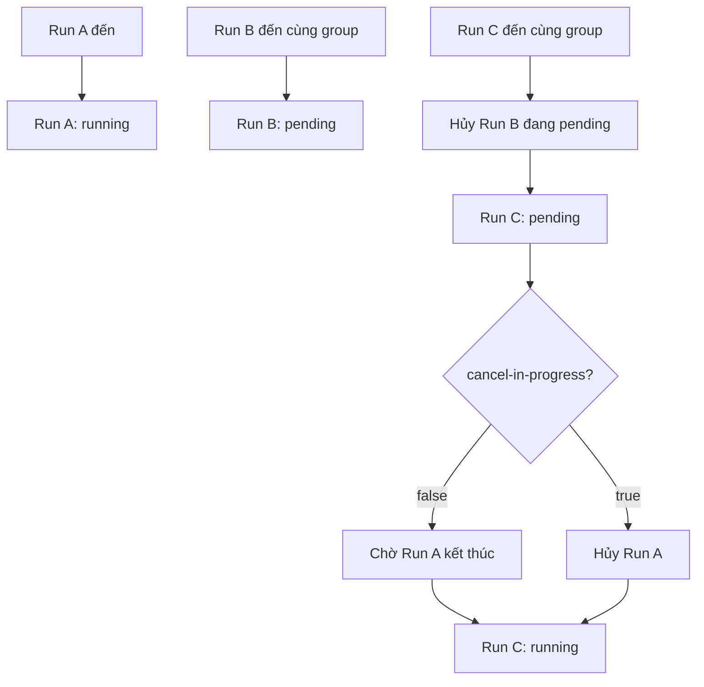

<Callout type="info" title="Bạn sẽ học được gì?">
  Chương này giải thích cách GitHub Actions khóa workflow hoặc job theo một khóa logic. Bạn sẽ biết khi nào nên hủy bản chạy cũ, khi nào nên xếp hàng, và cách tránh hai lượt triển khai ghi đè lẫn nhau.
</Callout>

## Mục lục

- [Tổng quan](#tổng-quan)
- [Mô hình hoạt động](#mô-hình-hoạt-động)
  - [Phạm vi của concurrency group](#phạm-vi-của-concurrency-group)
  - [Trạng thái running và pending](#trạng-thái-running-và-pending)
  - [Hai chế độ hàng đợi](#hai-chế-độ-hàng-đợi)
- [Cú pháp và context](#cú-pháp-và-context)
  - [Ở cấp workflow](#ở-cấp-workflow)
  - [Ở cấp job](#ở-cấp-job)
  - [Context được phép](#context-được-phép)
- [Các mẫu cấu hình thực tế](#các-mẫu-cấu-hình-thực-tế)
  - [Giữ bản CI mới nhất trên mỗi nhánh](#giữ-bản-ci-mới-nhất-trên-mỗi-nhánh)
  - [Xếp hàng triển khai production](#xếp-hàng-triển-khai-production)
  - [Khóa theo từng phần tử matrix](#khóa-theo-từng-phần-tử-matrix)
  - [Chọn chính sách phù hợp](#chọn-chính-sách-phù-hợp)
- [Bài thực hành](#bài-thực-hành)
  - [Chuẩn bị](#chuẩn-bị)
  - [Workflow hoàn chỉnh](#workflow-hoàn-chỉnh)
  - [Cách chạy](#cách-chạy)
  - [Tiêu chí kiểm chứng](#tiêu-chí-kiểm-chứng)
- [Best practices](#best-practices)
- [Troubleshooting](#troubleshooting)
- [Tài liệu tham khảo](#tài-liệu-tham-khảo)
- [Đi tiếp trong series](#đi-tiếp-trong-series)

## Tổng quan

Mặc định, GitHub Actions cố chạy các workflow và job song song khi có runner. Điều này tốt cho tốc độ. Nó lại nguy hiểm khi nhiều lượt chạy cùng sửa một tài nguyên, chẳng hạn môi trường `production`, một bucket hoặc cùng trạng thái Terraform.

`concurrency` giải quyết vấn đề bằng một **concurrency group**. Đây là chuỗi dùng làm khóa. Mọi workflow run hoặc job trong cùng repository và cùng khóa phải đi qua một hàng đợi chung.

Ví dụ, khóa `deploy-production` bảo đảm chỉ có một lượt triển khai production chạy tại một thời điểm. Khóa `ci-main` và `ci-feature/login` khác nhau, nên CI của hai nhánh vẫn chạy song song.

<Callout type="warn" title="Concurrency không phải giới hạn runner">
  `concurrency` khóa theo tài nguyên nghiệp vụ do bạn đặt tên. Giới hạn concurrent jobs của gói GitHub hoặc runner pool là một cơ chế khác.
</Callout>

## Mô hình hoạt động

Sơ đồ sau mô tả chế độ mặc định `queue: single`. Run mới nhất thay thế run đang `pending`. Nếu bật `cancel-in-progress`, run mới còn hủy run đang chạy.



### Phạm vi của concurrency group

Tên group được so sánh trong phạm vi **một repository**. Namespace này dùng chung cho các workflow và job trong repository đó. Vì vậy, hai file workflow khác nhau vẫn có thể chặn hoặc hủy nhau nếu chúng tạo ra cùng tên group.

Tên group không phân biệt chữ hoa và chữ thường. `Production` và `production` là cùng một group.

Hãy thêm danh tính workflow khi chỉ muốn các run của chính workflow đó cạnh tranh với nhau:

```yaml
concurrency:
  group: ${{ github.workflow }}-${{ github.ref }}
  cancel-in-progress: true
```

`github.workflow` là tên workflow. `github.ref` là ref đầy đủ, ví dụ `refs/heads/main`.

### Trạng thái running và pending

Với cùng một group, GitHub luôn chỉ cho phép tối đa một run hoặc job ở trạng thái `running`.

Ở chế độ mặc định, group còn giữ tối đa một phần tử `pending`, nghĩa là đang chờ khóa:

1. Run A giữ khóa và đang chạy.
2. Run B đến sau nên chuyển sang `pending`.
3. Run C đến tiếp sẽ hủy B rồi chiếm vị trí `pending`.
4. Nếu `cancel-in-progress: false`, C chờ A kết thúc.
5. Nếu `cancel-in-progress: true`, C hủy A rồi chạy khi khóa được giải phóng.

Điểm dễ nhầm là run `pending` cũ luôn bị thay ở chế độ mặc định. Đặt `cancel-in-progress: false` chỉ bảo vệ phần tử đang chạy. Nó không biến hàng đợi thành danh sách nhiều phần tử.

### Hai chế độ hàng đợi

GitHub Actions hiện hỗ trợ hai giá trị cho `queue`:

| Cấu hình | Số phần tử chờ | Khi có phần tử mới | Trường hợp phù hợp |
|---|---:|---|---|
| `queue: single` | Tối đa 1 | Hủy phần tử `pending` cũ | CI chỉ cần kết quả mới nhất |
| `queue: max` | Tối đa 100 | Giữ hàng đợi; phần tử vượt giới hạn bị hủy | Mọi lượt migration hoặc deploy đều phải chạy |

`single` là mặc định nên có thể bỏ qua thuộc tính `queue`.

Với `queue: max`, GitHub xử lý theo FIFO, tức phần tử bắt đầu chờ trước được ưu tiên trước. Mốc này là lúc phần tử thực sự bắt đầu chờ group, không phải lúc workflow được dispatch. Thời điểm job sẵn sàng có thể khác nhau do `needs`, runner hoặc matrix. Vì vậy, không nên dùng thứ tự hàng đợi như một cam kết phát hành tuyệt đối.

<Callout type="error" title="Tổ hợp không hợp lệ">
  Không thể dùng `queue: max` cùng `cancel-in-progress: true`. Một tùy chọn muốn giữ toàn bộ hàng đợi, còn tùy chọn kia muốn ưu tiên run mới bằng cách hủy run cũ. GitHub từ chối workflow ngay khi kiểm tra cú pháp.
</Callout>

## Cú pháp và context

`concurrency` có thể đặt ở cấp workflow hoặc cấp job. Hai vị trí khóa hai phạm vi thực thi khác nhau.

### Ở cấp workflow

Đặt `concurrency` cùng cấp với `on` và `jobs` để khóa toàn bộ workflow run:

```yaml
name: CI

on:
  push:
    branches: [main]

concurrency:
  group: ci-${{ github.workflow }}-${{ github.ref }}
  cancel-in-progress: true
  queue: single

jobs:
  test:
    runs-on: ubuntu-latest
    steps:
      - run: echo "Test $GITHUB_SHA"
```

Run mới phải giành được khóa trước khi bất kỳ job nào của workflow bắt đầu. Cách này phù hợp khi mọi job trong run cũ đều đã lỗi thời sau một commit mới.

### Ở cấp job

Đặt `concurrency` trong `jobs.<job_id>` để chỉ khóa job nhạy cảm. Các job độc lập khác vẫn có thể chạy:

```yaml
jobs:
  build:
    runs-on: ubuntu-latest
    steps:
      - run: echo "Build có thể chạy song song"

  deploy:
    needs: build
    runs-on: ubuntu-latest
    concurrency:
      group: deploy-production
      queue: max
    steps:
      - run: echo "Chỉ một deploy chạy tại một thời điểm"
```

Đây là lựa chọn tốt khi muốn build và test song song, nhưng phải tuần tự hóa riêng bước triển khai.

### Context được phép

**Context** là đối tượng dữ liệu mà expression `${{ ... }}` có thể đọc. Context khả dụng phụ thuộc vị trí của khóa.

| Vị trí | Context được phép trong expression |
|---|---|
| `concurrency` cấp workflow | `github`, `inputs`, `vars` |
| `jobs.<job_id>.concurrency` | `github`, `needs`, `strategy`, `matrix`, `inputs`, `vars` |

Không dùng `secrets`, `env`, `runner`, `job` hoặc `steps` để tạo group. Ở thời điểm GitHub xếp hàng, runner và các step chưa tồn tại.

Nếu thuộc tính chỉ có ở một số event, hãy thêm giá trị dự phòng. `github.head_ref` chỉ có ở pull request. Ví dụ sau dùng `github.run_id` cho event khác để tránh các run đó vô tình dùng chung một group rỗng:

```yaml
concurrency:
  group: pr-${{ github.head_ref || github.run_id }}
  cancel-in-progress: true
```

## Các mẫu cấu hình thực tế

### Giữ bản CI mới nhất trên mỗi nhánh

Mỗi nhánh có group riêng. Một commit mới hủy CI cũ trên cùng nhánh, nhưng không ảnh hưởng nhánh khác:

```yaml
concurrency:
  group: ci-${{ github.workflow }}-${{ github.ref }}
  cancel-in-progress: true
```

Mẫu này phù hợp với lint, unit test và preview build. Kết quả của commit cũ không còn giá trị sau khi nhánh đã có commit mới.

Với nhánh release, bạn có thể hủy có điều kiện:

```yaml
concurrency:
  group: ci-${{ github.workflow }}-${{ github.ref }}
  cancel-in-progress: ${{ !contains(github.ref, 'refs/heads/release/') }}
```

Run trên nhánh thường bị thay bằng bản mới. Run trên nhánh `release/*` đang chạy thì được hoàn tất.

### Xếp hàng triển khai production

Mọi commit vào `main` phải được triển khai tuần tự. Không run nào được phép thay thế run đang chờ:

```yaml
name: Deploy production

on:
  push:
    branches: [main]

concurrency:
  group: deploy-production
  queue: max

jobs:
  deploy:
    runs-on: ubuntu-latest
    environment: production
    steps:
      - run: |
          echo "Deploy $GITHUB_SHA"
          sleep 10
```

`environment: production` có thể thêm approval và secret theo môi trường. `concurrency` chịu trách nhiệm tuần tự hóa. Hai cơ chế bổ sung cho nhau chứ không thay thế nhau.

Nếu chỉ cần trạng thái production mới nhất, cân nhắc `queue: single` cùng `cancel-in-progress: true`. Chỉ làm vậy khi quy trình deploy có thể hủy an toàn và chạy lại từ đầu.

### Khóa theo từng phần tử matrix

Job-level concurrency đọc được `matrix`. Ví dụ này cho phép `staging` và `production` triển khai song song, nhưng tuần tự hóa từng môi trường qua nhiều workflow run:

```yaml
jobs:
  deploy:
    strategy:
      matrix:
        target: [staging, production]
    runs-on: ubuntu-latest
    concurrency:
      group: deploy-${{ matrix.target }}
      queue: max
    environment: ${{ matrix.target }}
    steps:
      - run: |
          echo "Deploy đến ${{ matrix.target }}"
          sleep 10
```

`deploy-staging` và `deploy-production` là hai khóa khác nhau. Mỗi khóa có hàng đợi độc lập.

### Chọn chính sách phù hợp

| Tình huống | Group nên chứa | Chính sách gợi ý |
|---|---|---|
| CI theo nhánh | `${{ github.workflow }}-${{ github.ref }}` | `cancel-in-progress: true` |
| Preview theo pull request | `preview-${{ github.event.pull_request.number }}` | `cancel-in-progress: true` |
| Deploy một môi trường | `deploy-${{ inputs.environment }}` | `queue: max` |
| Migration dùng chung database | Tên database hoặc cluster | `queue: max` |
| Job matrix ghi cache riêng | `${{ matrix.os }}-${{ matrix.version }}` | Khóa ở cấp job nếu thật sự có xung đột |

Đừng khóa rộng hơn tài nguyên cần bảo vệ. Một group cố định như `ci` sẽ tuần tự hóa toàn bộ nhánh và làm CI chậm không cần thiết.

## Bài thực hành

Bài lab này tạo hai workflow run cùng group. Run thứ hai sẽ hủy run thứ nhất.

### Chuẩn bị

Bạn cần:

- một repository có GitHub Actions;
- quyền thêm file trong `.github/workflows`;
- quyền chạy `workflow_dispatch`;
- workflow đã có trên default branch để nút **Run workflow** xuất hiện.

### Workflow hoàn chỉnh

Tạo `.github/workflows/concurrency-lab.yml`:

```yaml
name: Concurrency lab

on:
  workflow_dispatch:
    inputs:
      wait_seconds:
        description: "Số giây mô phỏng công việc"
        required: true
        default: 90
        type: number

concurrency:
  group: concurrency-lab-${{ github.workflow }}-${{ github.ref }}
  cancel-in-progress: true

jobs:
  simulate:
    runs-on: ubuntu-latest
    timeout-minutes: 5
    steps:
      - name: Hiển thị danh tính run
        run: |
          echo "run_id=$GITHUB_RUN_ID"
          echo "sha=$GITHUB_SHA"
          echo "ref=$GITHUB_REF"

      - name: Mô phỏng tác vụ dài
        env:
          WAIT_SECONDS: ${{ inputs.wait_seconds }}
        run: |
          case "$WAIT_SECONDS" in
            ''|*[!0-9]*)
              echo "wait_seconds phải là số nguyên dương" >&2
              exit 1
              ;;
          esac

          if [ "$WAIT_SECONDS" -lt 1 ] || [ "$WAIT_SECONDS" -gt 240 ]; then
            echo "Chỉ chấp nhận giá trị từ 1 đến 240" >&2
            exit 1
          fi

          echo "Bắt đầu chờ $WAIT_SECONDS giây"
          sleep "$WAIT_SECONDS"
          echo "Đã hoàn tất"
```

Giá trị input được chuyển qua biến môi trường rồi kiểm tra trước khi dùng. Cách này tránh chèn trực tiếp dữ liệu do người dùng nhập vào mã shell.

### Cách chạy

1. Mở **Actions → Concurrency lab → Run workflow**.
2. Chọn một nhánh và nhập `90` giây.
3. Chạy lần thứ nhất.
4. Khi job đầu đang chạy, chạy lần thứ hai trên đúng nhánh đó với cùng giá trị.
5. Mở cả hai run và quan sát trạng thái.
6. Tùy chọn: chạy lần thứ ba trên nhánh khác. Run này có group khác nên có thể chạy song song.

### Tiêu chí kiểm chứng

Bài lab đạt yêu cầu khi:

- [ ] run đầu chuyển sang trạng thái **Cancelled** sau khi run thứ hai vào cùng group;
- [ ] run thứ hai hoàn tất và log có dòng `Đã hoàn tất`;
- [ ] hai run trên hai nhánh khác nhau không hủy nhau;
- [ ] tên group có cả tên workflow và ref, nên không đụng workflow khác;
- [ ] không có quá một run cùng group ở trạng thái `running`.

Muốn kiểm tra hàng đợi đầy đủ, đổi cấu hình thành `queue: max`, xóa `cancel-in-progress`, rồi chạy ba lần liên tiếp. Một run sẽ chạy và hai run sẽ chờ thay vì bị thay thế.

## Best practices

- **Đặt tên theo tài nguyên bị khóa.** Dùng `deploy-production`, `terraform-network` hoặc `db-migration-orders`. Tên rõ giúp người bảo trì hiểu lý do phải tuần tự hóa.
- **Thêm `${{ github.workflow }}` khi khóa chỉ dành cho một workflow.** Namespace group dùng chung trong repository. Tiền tố này tránh hủy nhầm workflow khác.
- **Tách khóa theo nhánh, PR hoặc môi trường.** Khóa càng rộng thì thời gian chờ càng dài. Chỉ gom các run thật sự tranh chấp cùng tài nguyên.
- **Dùng `cancel-in-progress: true` cho công việc có thể thay thế.** Lint và CI theo commit thường thuộc nhóm này.
- **Dùng `queue: max` cho công việc không được mất.** Migration, phát hành theo thứ tự và tác vụ ghi dữ liệu thường cần giữ hàng đợi.
- **Thiết kế deploy có tính idempotent.** Idempotent nghĩa là chạy lại cùng đầu vào vẫn tạo ra trạng thái đúng. Thuộc tính này giảm rủi ro nếu run bị hủy giữa chừng.
- **Không dựa vào concurrency để cam kết thứ tự phiên bản.** Hàng đợi ưu tiên theo lúc bắt đầu chờ, nhưng thời điểm đó có thể lệch do dependency hoặc runner. Hãy kiểm tra version trước khi deploy nếu thứ tự là yêu cầu nghiệp vụ.
- **Dùng fallback cho context theo event.** Ví dụ `github.head_ref || github.run_id` tránh group rỗng hoặc trùng ngoài pull request.
- **Kết hợp timeout hợp lý.** Một run treo vẫn giữ khóa. `timeout-minutes` giúp giải phóng group sau giới hạn đã định.

## Troubleshooting

| Triệu chứng | Nguyên nhân cần kiểm tra | Hướng xử lý |
|---|---|---|
| Workflow khác bị hủy ngoài dự kiến | Hai workflow tạo cùng tên group | Thêm `${{ github.workflow }}` hoặc tiền tố riêng vào `group` |
| Run `pending` cũ biến mất dù `cancel-in-progress: false` | `queue: single` chỉ giữ một phần tử chờ | Dùng `queue: max` nếu cần giữ tối đa 100 phần tử chờ |
| Workflow báo lỗi validation với `queue` | Đang kết hợp `queue: max` và `cancel-in-progress: true` | Chọn giữ hàng đợi hoặc hủy run cũ, không dùng cả hai |
| CI của các nhánh chặn nhau | Group là chuỗi cố định hoặc thiếu ref | Thêm `${{ github.ref }}` hay mã PR vào group |
| `Unrecognized named-value: 'matrix'` ở cấp workflow | `matrix` chỉ có tại job-level concurrency | Chuyển khóa vào job dùng matrix hoặc dùng context cấp workflow hợp lệ |
| Deploy chạy sai thứ tự mong đợi | Thứ tự chờ phụ thuộc lúc job thực sự vào group | Dùng version check, `needs` hoặc pipeline phát hành chuyên biệt; không chỉ dựa vào queue |
| Group theo PR hoạt động lạ trên event `push` | `github.head_ref` hoặc payload PR không tồn tại | Dùng fallback, hoặc tạo group khác theo `github.event_name` |
| Run giữ khóa quá lâu | Step treo, chờ mạng hoặc thiếu timeout | Đặt timeout cho step và job; thêm retry hữu hạn cho thao tác mạng |
| `Production` vẫn chặn `production` | Tên group không phân biệt hoa thường | Chuẩn hóa tên chữ thường và coi hai tên là một khóa |

## Tài liệu tham khảo

- [Control the concurrency of workflows and jobs](https://docs.github.com/en/actions/how-tos/write-workflows/choose-when-workflows-run/control-workflow-concurrency) — hành vi group, `queue`, hủy và các mẫu chính thức.
- [Workflow syntax: concurrency](https://docs.github.com/en/actions/reference/workflows-and-actions/workflow-syntax#concurrency) — cú pháp cấp workflow.
- [Workflow syntax: jobs.&lt;job_id&gt;.concurrency](https://docs.github.com/en/actions/reference/workflows-and-actions/workflow-syntax#jobsjob_idconcurrency) — cú pháp cấp job.
- [Contexts reference: context availability](https://docs.github.com/en/actions/reference/workflows-and-actions/contexts#context-availability) — context hợp lệ tại từng khóa YAML.
- [Actions limits](https://docs.github.com/en/actions/reference/limits) — giới hạn 100 phần tử khi dùng concurrency queue tối đa.
- [Deployments and environments](https://docs.github.com/en/actions/reference/workflows-and-actions/deployments-and-environments) — approval, secret và protection rule theo môi trường.

## Đi tiếp trong series

<Cards>
  <Card title="Matrix strategy" href="/docs/dieu-khien-workflow/04-matrix-strategy/" description="Tạo nhiều biến thể job và kiểm soát mức song song." />
  <Card title="Defaults và timeouts" href="/docs/dieu-khien-workflow/06-defaults-timeouts/" description="Chuẩn hóa shell, thư mục chạy và giới hạn thời gian thực thi." />
</Cards>
