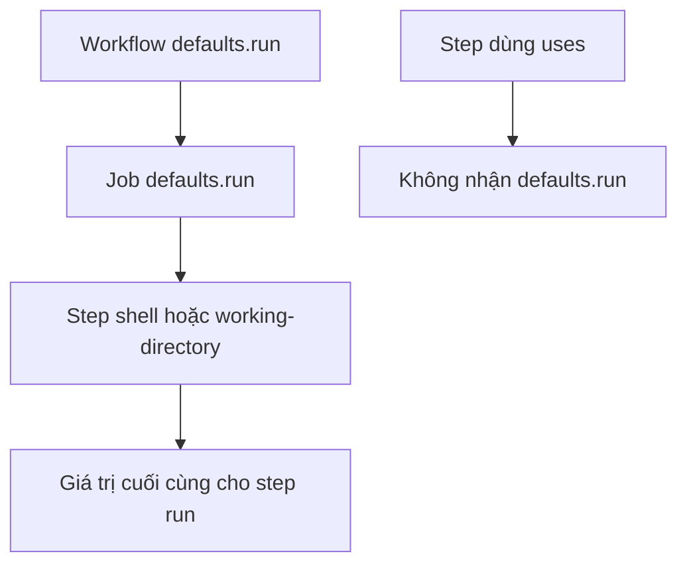

<Callout type="info" title="Bạn sẽ học được gì?">
  Chương này giúp giảm YAML lặp lại bằng `defaults.run`, đồng thời chặn job hoặc step treo bằng `timeout-minutes`. Ví dụ cuối chương chạy được trên `ubuntu-latest` mà không cần dự án mẫu có sẵn.
</Callout>

## Mục lục

- [Tổng quan](#tổng-quan)
- [Cơ chế của defaults run](#cơ-chế-của-defaults-run)
  - [Ba tầng ưu tiên](#ba-tầng-ưu-tiên)
  - [Shell mặc định](#shell-mặc-định)
  - [Working directory](#working-directory)
  - [Giới hạn của defaults run](#giới-hạn-của-defaults-run)
- [Cơ chế timeout](#cơ-chế-timeout)
  - [Timeout ở cấp step](#timeout-ở-cấp-step)
  - [Timeout ở cấp job](#timeout-ở-cấp-job)
  - [Giới hạn cứng của nền tảng](#giới-hạn-cứng-của-nền-tảng)
- [Cú pháp và ví dụ](#cú-pháp-và-ví-dụ)
  - [Đặt mặc định cho toàn workflow](#đặt-mặc-định-cho-toàn-workflow)
  - [Ghi đè theo job và step](#ghi-đè-theo-job-và-step)
  - [Đặt timeout bằng expression](#đặt-timeout-bằng-expression)
- [Bài thực hành](#bài-thực-hành)
  - [Chuẩn bị](#chuẩn-bị)
  - [Workflow hoàn chỉnh](#workflow-hoàn-chỉnh)
  - [Cách chạy](#cách-chạy)
  - [Tiêu chí kiểm chứng](#tiêu-chí-kiểm-chứng)
- [Best practices](#best-practices)
- [Troubleshooting](#troubleshooting)
- [Tài liệu tham khảo](#tài-liệu-tham-khảo)
- [Đi tiếp trong series](#đi-tiếp-trong-series)

## Tổng quan

Một workflow monorepo thường lặp lại hai dòng ở hàng chục step:

```yaml
shell: bash
working-directory: ./apps/api
```

`defaults.run` gom các giá trị này thành mặc định. Step vẫn có thể ghi đè khi cần.

Timeout giải quyết vấn đề khác. Một lệnh chờ mạng, test deadlock hoặc script không bao giờ thoát có thể giữ runner rất lâu. `timeout-minutes` đặt ngân sách thời gian cho từng step hoặc toàn job.

Hai cơ chế nên đi cùng nhau:

- `defaults.run` làm cách thực thi nhất quán;
- `timeout-minutes` giới hạn thời gian thất bại;
- `concurrency` ở chương trước giới hạn số run tranh chấp cùng tài nguyên.

## Cơ chế của defaults run

`defaults.run` chỉ có hai thuộc tính:

| Thuộc tính | Ý nghĩa |
|---|---|
| `shell` | Chương trình thông dịch dùng cho các step có `run` |
| `working-directory` | Thư mục hiện hành khi lệnh `run` bắt đầu |

Sơ đồ sau cho thấy GitHub chọn cấu hình cụ thể nhất cho từng thuộc tính:



### Ba tầng ưu tiên

Quy tắc là **cấu hình cụ thể hơn thắng**:

1. `defaults.run` ở cấp workflow áp dụng cho mọi job.
2. `jobs.<job_id>.defaults.run` ghi đè mặc định workflow trong một job.
3. `shell` hoặc `working-directory` của step ghi đè cả hai tầng trên.

Ví dụ:

```yaml
defaults:
  run:
    shell: bash
    working-directory: ./apps/web

jobs:
  test-api:
    runs-on: ubuntu-latest
    defaults:
      run:
        working-directory: ./apps/api
    steps:
      - run: npm test
      - run: npm run lint
        working-directory: ./tools/lint
```

Trong `test-api`, cả hai step dùng Bash. `npm test` chạy ở `apps/api`. `npm run lint` chạy ở `tools/lint` vì cấu hình tại step cụ thể hơn.

GitHub giải quyết từng thuộc tính riêng. Job có thể chỉ ghi đè `working-directory` và tiếp tục kế thừa `shell` từ workflow.

### Shell mặc định

Không chỉ tên shell, cách GitHub gọi shell cũng quan trọng:

| Cấu hình | Hành vi chính thức |
|---|---|
| Không khai báo trên Linux hoặc macOS | Chạy `bash -e {0}`; rơi về `sh` nếu không có Bash |
| `shell: bash` | Chạy `bash --noprofile --norc -eo pipefail {0}` |
| Không khai báo trên Windows | Dùng PowerShell Core `pwsh` |
| `shell: pwsh` | Chạy file PowerShell và bật cơ chế dừng khi lỗi khi có thể |
| Job chạy trong container | Shell mặc định của `run` là `sh`, không phải `bash` |

`pipefail` làm pipeline thất bại nếu bất kỳ lệnh thành phần nào thất bại. Ví dụ, với `shell: bash`, lỗi của `build` không bị che bởi lệnh `tee` thành công:

```bash
build | tee build.log
```

Vì vậy, `shell: bash` rõ ràng và an toàn hơn việc dựa vào shell ngầm định cho workflow Linux.

Bạn cũng có thể dùng custom shell. Chuỗi phải chứa `{0}` để GitHub chèn đường dẫn file script tạm:

```yaml
- run: print "hello\n";
  shell: perl {0}
```

Chương trình custom phải được cài trên runner.

### Working directory

Đường dẫn tương đối được tính từ workspace của repository. Sau `actions/checkout`, đây thường là thư mục chứa mã nguồn.

Thư mục phải tồn tại **trước khi step bắt đầu**. GitHub cần chuyển vào thư mục rồi mới gọi shell. Do đó, lệnh sau không thể tự tạo chính thư mục mặc định đang bị thiếu:

```yaml
defaults:
  run:
    working-directory: ./generated

steps:
  - run: mkdir -p generated # Thất bại trước khi lệnh được chạy
```

Hãy tạo thư mục từ workspace bằng một step ghi đè:

```yaml
steps:
  - name: Tạo thư mục
    working-directory: .
    run: mkdir -p generated

  - name: Dùng thư mục mặc định
    run: pwd
```

Step `uses: actions/checkout@v7` không bị ảnh hưởng bởi `defaults.run`, nên có thể checkout trước khi các `run` step dùng thư mục trong repository.

### Giới hạn của defaults run

`defaults.run` không phải nơi đặt mọi cấu hình mặc định:

- chỉ tác động đến step có `run`;
- không đổi thư mục nội bộ của action trong step có `uses`;
- không hỗ trợ `timeout-minutes`, `env` hoặc `continue-on-error`;
- không tạo thư mục tự động;
- ở **cấp workflow**, không được dùng context hoặc expression trong `defaults.run`.

Cấu hình cấp workflow sau không hợp lệ:

```yaml
defaults:
  run:
    working-directory: ${{ github.workspace }}/apps/api
```

Hãy dùng đường dẫn tương đối tĩnh ở cấp workflow. Theo bảng context chính thức, `jobs.<job_id>.defaults.run` có thể dùng `github`, `needs`, `strategy`, `matrix`, `env`, `vars` và `inputs`. Dù vậy, giá trị tĩnh thường dễ đọc hơn. Khi thư mục phụ thuộc matrix, hãy kiểm tra mọi nhánh matrix đều tạo ra đường dẫn tồn tại.

## Cơ chế timeout

GitHub Actions không có `timeout-minutes` ở cấp workflow. Bạn đặt nó cho job hoặc từng step.

Khi nhiều giới hạn cùng tồn tại, giới hạn đến trước sẽ thắng:

```text
step timeout ─┐
job timeout  ─┼─► giới hạn nhỏ nhất đạt trước sẽ dừng công việc
runner limit ─┤
workflow cap ─┘
```

### Timeout ở cấp step

`jobs.<job_id>.steps[*].timeout-minutes` giới hạn một step:

```yaml
- name: Gọi integration test
  run: npm run test:integration
  timeout-minutes: 15
```

Giá trị phải là số nguyên dương. Không hỗ trợ số thập phân. Mức tối đa là **360 phút** cho cả GitHub-hosted runner và self-hosted runner.

Step timeout hữu ích cho lệnh mạng, test hoặc migration có nguy cơ treo. Nếu step bị kill, step thất bại. `continue-on-error: true` có thể cho phép các step sau tiếp tục, nhưng không làm timeout dài hơn.

### Timeout ở cấp job

`jobs.<job_id>.timeout-minutes` giới hạn tổng thời gian thực thi của job:

```yaml
jobs:
  test:
    runs-on: ubuntu-latest
    timeout-minutes: 30
    steps:
      - run: npm ci
      - run: npm test
```

Mặc định job timeout là **360 phút**. Job timeout bao trùm mọi step trong job. Một step đặt `timeout-minutes: 60` vẫn bị dừng ở phút thứ 30 nếu ngân sách còn lại của job chỉ là 30 phút.

Khi job bị timeout, GitHub tự động hủy job. Đừng dựa vào các step sau trong cùng job để cleanup. Với tài nguyên bên ngoài, hãy dùng lease có hạn, TTL hoặc một quy trình dọn dẹp độc lập. TTL, viết tắt của time to live, là thời gian tài nguyên tự hết hạn.

### Giới hạn cứng của nền tảng

`timeout-minutes` không thể vượt qua giới hạn nền tảng:

| Phạm vi | Giới hạn hiện hành | Ghi chú |
|---|---:|---|
| Một step | 360 phút | Áp dụng cho GitHub-hosted và self-hosted |
| Một job trên GitHub-hosted runner | 6 giờ | Job bị kết thúc khi chạm giới hạn runner |
| Một job trên self-hosted runner | 5 ngày | `GITHUB_TOKEN` có thể hết hạn sớm hơn |
| `GITHUB_TOKEN` của job | Tối đa 24 giờ | Hết hạn khi job kết thúc hoặc sau 24 giờ |
| Một workflow run | 35 ngày | Bao gồm thời gian chạy, chờ và approval |
| Chờ environment approval | 30 ngày | Là một phần của giới hạn workflow run |

Ví dụ, đặt job GitHub-hosted thành `timeout-minutes: 600` không tạo ra job 10 giờ. Giới hạn 6 giờ của runner sẽ dừng job trước.

Trên self-hosted runner, job có thể dài hơn 24 giờ nhưng `GITHUB_TOKEN` không còn hợp lệ sau giới hạn token. Nếu tác vụ dài cần gọi GitHub API, hãy chia nhỏ job hoặc dùng cơ chế xác thực có vòng đời phù hợp và quyền tối thiểu.

<Callout type="warn" title="Giới hạn có thể thay đổi">
  GitHub ghi rõ các giới hạn nền tảng có thể thay đổi. Hãy kiểm tra trang Actions limits trước khi thiết kế job dài hoặc quy trình approval nhiều ngày.
</Callout>

## Cú pháp và ví dụ

### Đặt mặc định cho toàn workflow

Ví dụ monorepo sau chuẩn hóa mọi `run` step về Bash và thư mục `apps/api`:

```yaml
name: API CI

on:
  push:
    paths:
      - "apps/api/**"

permissions:
  contents: read

defaults:
  run:
    shell: bash
    working-directory: ./apps/api

jobs:
  test:
    runs-on: ubuntu-latest
    timeout-minutes: 20
    steps:
      - uses: actions/checkout@v7
      - run: npm ci
      - run: npm test
        timeout-minutes: 10
```

`checkout` vẫn chạy theo quy tắc của action. Hai step `run` kế thừa shell và thư mục.

### Ghi đè theo job và step

Workflow có thể dùng Bash chung, job tài liệu chuyển sang `docs`, còn một step dùng Python ngay tại workspace:

```yaml
defaults:
  run:
    shell: bash
    working-directory: ./apps/api

jobs:
  docs:
    runs-on: ubuntu-latest
    defaults:
      run:
        working-directory: ./docs
    steps:
      - uses: actions/checkout@v7

      - name: Build tài liệu
        run: npm run build

      - name: Kiểm tra script Python ở root
        shell: python
        working-directory: .
        run: |
          from pathlib import Path
          assert Path("README.md").exists()
```

Mỗi ngoại lệ nằm ngay cạnh step cần ngoại lệ. Người đọc không phải đoán giá trị cuối cùng.

### Đặt timeout bằng expression

Job timeout hỗ trợ `github`, `needs`, `strategy`, `matrix`, `vars` và `inputs`. Step timeout còn đọc được các context tại step như `env`, `steps` và `runner`.

Input kiểu `number` là cách rõ ràng để nhận timeout khi chạy thủ công:

```yaml
on:
  workflow_dispatch:
    inputs:
      job_timeout:
        description: "Timeout của job, tính bằng phút"
        required: true
        default: 20
        type: number

jobs:
  test:
    runs-on: ubuntu-latest
    timeout-minutes: ${{ inputs.job_timeout }}
    steps:
      - run: echo "Job có timeout ${{ inputs.job_timeout }} phút"
```

Configuration variable trong `vars` thường là chuỗi. Dùng `fromJSON` để chuyển chuỗi số thành số:

```yaml
jobs:
  test:
    runs-on: ubuntu-latest
    timeout-minutes: ${{ fromJSON(vars.CI_TIMEOUT_MINUTES || '20') }}
    steps:
      - run: echo "Timeout đã được cấu hình"
```

Chỉ cho quản trị viên đáng tin cậy sửa biến này. Giá trị rỗng, không phải số nguyên dương hoặc quá lớn sẽ làm workflow validation thất bại hoặc chạm giới hạn nền tảng.

## Bài thực hành

Bài lab chứng minh ba tầng ghi đè và một step timeout mà không cần repository có sẵn cấu trúc monorepo.

### Chuẩn bị

Bạn cần:

- một repository có GitHub Actions;
- quyền thêm workflow;
- workflow được merge vào default branch để dùng `workflow_dispatch`;
- khoảng một phút nếu bật phần kiểm chứng timeout.

### Workflow hoàn chỉnh

Tạo `.github/workflows/defaults-timeouts-lab.yml`:

```yaml
name: Defaults and timeouts lab

on:
  workflow_dispatch:
    inputs:
      prove_timeout:
        description: "Chạy step cố ý vượt timeout một phút"
        required: true
        default: false
        type: boolean

permissions:
  contents: read

defaults:
  run:
    shell: bash
    working-directory: ./apps/web

jobs:
  demonstrate:
    runs-on: ubuntu-latest
    timeout-minutes: 5

    steps:
      - uses: actions/checkout@v7

      - name: Chuẩn bị thư mục từ workspace
        working-directory: .
        run: |
          mkdir -p apps/web
          printf 'created by lab\n' > apps/web/marker.txt

      - name: Chứng minh workflow defaults
        run: |
          echo "pwd=$(pwd)"
          test -f marker.txt
          printf 'alpha\nbeta\n' | grep beta

      - name: Ghi đè shell và working directory tại step
        shell: python
        working-directory: .
        run: |
          import os
          print(f"python cwd={os.getcwd()}")

      - name: Cố ý vượt step timeout
        id: bounded
        if: ${{ inputs.prove_timeout }}
        continue-on-error: true
        timeout-minutes: 1
        run: |
          echo "Step này sẽ bị dừng trước sleep 90 hoàn tất"
          sleep 90

      - name: Xác nhận step đã timeout
        if: ${{ always() && inputs.prove_timeout }}
        env:
          BOUNDED_OUTCOME: ${{ steps.bounded.outcome }}
        run: |
          echo "bounded outcome=$BOUNDED_OUTCOME"
          test "$BOUNDED_OUTCOME" = "failure"
```

Step chuẩn bị đặt `working-directory: .` vì `apps/web` chưa tồn tại. Sau khi thư mục được tạo, các `run` step khác có thể kế thừa mặc định workflow.

Step timeout dùng `continue-on-error: true`, nên job còn đủ thời gian chạy bước kiểm chứng. Thuộc tính `steps.bounded.outcome` vẫn là `failure`, dù `continue-on-error` cho phép job tiếp tục.

### Cách chạy

1. Mở **Actions → Defaults and timeouts lab → Run workflow**.
2. Chạy một lần với `prove_timeout` bằng `false`.
3. Mở log của step **Chứng minh workflow defaults**. Kiểm tra `pwd` kết thúc bằng `/apps/web`.
4. Mở log của step Python. Kiểm tra thư mục hiện hành là workspace repository, không phải `apps/web`.
5. Chạy lại với `prove_timeout` bằng `true`.
6. Chờ khoảng một phút rồi mở log của hai step cuối.

### Tiêu chí kiểm chứng

Bài lab đạt yêu cầu khi:

- [ ] run bình thường hoàn tất trong vài giây;
- [ ] step Bash tìm thấy `marker.txt` trong thư mục mặc định `apps/web`;
- [ ] pipeline `printf | grep` chạy dưới `shell: bash`;
- [ ] step Python chạy tại workspace nhờ ghi đè ở cấp step;
- [ ] khi bật `prove_timeout`, step `bounded` dừng sau khoảng một phút thay vì đủ 90 giây;
- [ ] log cuối hiển thị `bounded outcome=failure`;
- [ ] toàn job vẫn thành công vì lỗi timeout đã được cô lập bằng `continue-on-error`.

<Callout type="info" title="Chi phí của bài lab">
  GitHub chỉ nhận số phút nguyên cho `timeout-minutes`. Vì vậy, phép thử timeout thật cần chờ tối thiểu khoảng một phút.
</Callout>

## Best practices

- **Khai báo shell rõ ràng.** `shell: bash` bật `pipefail` trên runner hỗ trợ Bash. Điều này tránh pipeline che mất lỗi ở lệnh đầu.
- **Đặt defaults gần phạm vi ổn định nhất.** Nếu mọi job dùng cùng thư mục, đặt ở workflow. Nếu chỉ một job khác biệt, ghi đè ở job. Ngoại lệ đơn lẻ nằm ở step.
- **Không dùng workflow default cho thư mục chưa chắc tồn tại.** Checkout hoặc tạo thư mục trước. Step tạo thư mục phải ghi đè về `working-directory: .`.
- **Đặt step timeout cho thao tác bên ngoài.** API call, integration test và deploy nên có deadline riêng để xác định chính xác điểm treo.
- **Đặt job timeout nhỏ hơn mặc định 360 phút.** Chọn mức dựa trên số liệu chạy thật rồi thêm biên hợp lý. Đừng dùng 6 giờ chỉ vì đó là mức mặc định.
- **Đảm bảo step timeout nhỏ hơn job timeout.** Dành ngân sách cho upload log, artifact và cleanup sau khi step thất bại.
- **Kết hợp retry hữu hạn với timeout.** Mỗi lần thử cần timeout riêng, và tổng số lần thử phải bị giới hạn. Retry vô hạn chỉ biến lỗi nhanh thành job treo.
- **Thiết kế cleanup ngoài job có thể bị hủy.** Dùng TTL, lease hoặc workflow dọn dẹp định kỳ cho tài nguyên cloud tạm thời.
- **Chia job dài thành nhiều job ngắn.** Artifact và cache có thể truyền kết quả trung gian. Cách này giảm rủi ro token hết hạn và giúp chạy lại phần thất bại.
- **Theo dõi thay đổi giới hạn chính thức.** Giới hạn runner và workflow là chính sách nền tảng, không phải hợp đồng cố định trong YAML.

## Troubleshooting

| Triệu chứng | Nguyên nhân cần kiểm tra | Hướng xử lý |
|---|---|---|
| `No such file or directory` trước khi lệnh chạy | `defaults.run.working-directory` chưa tồn tại | Checkout trước; hoặc tạo thư mục trong step có `working-directory: .` |
| Action trong step `uses` không chạy ở thư mục mặc định | `defaults.run` chỉ tác động step `run` | Dùng input `with` mà action hỗ trợ, hoặc cấu hình action theo tài liệu của nó |
| Workflow báo lỗi expression trong top-level defaults | Cấp workflow không cho context hoặc expression trong `defaults.run` | Dùng đường dẫn tĩnh, hoặc chuyển cấu hình động xuống job/step phù hợp |
| Lệnh Bash hoạt động cục bộ nhưng lỗi trên Windows | Job kế thừa `pwsh`, cú pháp biến và đường dẫn khác Bash | Đặt `shell: bash` nếu Bash có trên runner, hoặc viết lệnh PowerShell đúng chuẩn |
| Pipeline không báo lỗi dù lệnh đầu thất bại | Đang dùng shell ngầm định `bash -e` không có `pipefail` | Khai báo `shell: bash` hoặc tự bật `set -o pipefail` |
| Step đặt 60 phút nhưng dừng ở phút 20 | Job chỉ còn hoặc chỉ được cấp 20 phút | Tăng job timeout hoặc giảm step timeout; giới hạn đến trước luôn thắng |
| Step timeout dùng `0.5` bị từ chối | Chỉ chấp nhận số nguyên dương | Dùng ít nhất `1`; kiểm thử ngắn hơn bằng timeout của chính công cụ |
| Step timeout lớn hơn 360 bị từ chối | Step có mức tối đa 360 phút | Chia công việc thành nhiều step hoặc job có checkpoint |
| Job GitHub-hosted dừng ở 6 giờ dù đặt cao hơn | Đã chạm giới hạn execution của runner | Chia nhỏ công việc hoặc thiết kế kiến trúc xử lý ngoài runner |
| Self-hosted job dài gọi GitHub API bị 401 | `GITHUB_TOKEN` hết hạn sau tối đa 24 giờ | Chia job dưới 24 giờ hoặc dùng cơ chế xác thực phù hợp, quyền tối thiểu |
| Cleanup step không chạy sau job timeout | Toàn job đã bị hủy | Dùng TTL, cleanup job độc lập hoặc workflow dọn dẹp định kỳ |
| `timeout-minutes` dưới `defaults` không có tác dụng | `defaults.run` chỉ nhận `shell` và `working-directory` | Đặt timeout trực tiếp tại job hoặc từng step |

## Tài liệu tham khảo

- [Workflow syntax: defaults.run](https://docs.github.com/en/actions/reference/workflows-and-actions/workflow-syntax#defaultsrun) — mặc định `shell`, `working-directory` cấp workflow và quy tắc ghi đè.
- [Workflow syntax: jobs.&lt;job_id&gt;.defaults.run](https://docs.github.com/en/actions/reference/workflows-and-actions/workflow-syntax#jobsjob_iddefaultsrun) — mặc định riêng cho job.
- [Workflow syntax: step timeout-minutes](https://docs.github.com/en/actions/reference/workflows-and-actions/workflow-syntax#jobsjob_idstepstimeout-minutes) — kiểu giá trị và mức tối đa của step.
- [Workflow syntax: job timeout-minutes](https://docs.github.com/en/actions/reference/workflows-and-actions/workflow-syntax#jobsjob_idtimeout-minutes) — timeout mặc định của job và lưu ý `GITHUB_TOKEN`.
- [Contexts reference: context availability](https://docs.github.com/en/actions/reference/workflows-and-actions/contexts#context-availability) — context được phép tại defaults và timeout.
- [Actions limits](https://docs.github.com/en/actions/reference/limits) — giới hạn job, workflow run và environment approval hiện hành.
- [Adding scripts to your workflow](https://docs.github.com/en/actions/how-tos/write-workflows/choose-what-workflows-do/add-scripts) — cách chạy script và chọn shell trong workflow.

## Đi tiếp trong series

<Cards>
  <Card title="Concurrency" href="/docs/dieu-khien-workflow/05-concurrency/" description="Kiểm soát run đồng thời, hàng đợi và chính sách hủy." />
  <Card title="Outputs" href="/docs/dieu-khien-workflow/07-outputs/" description="Truyền dữ liệu giữa step, job và reusable workflow." />
</Cards>
