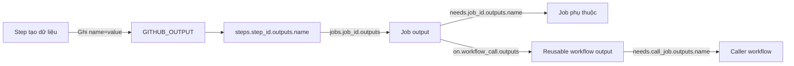
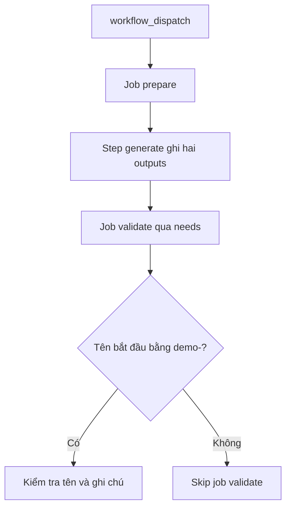

<Callout type="info" title="Bạn sẽ học được gì?">
  Chương này giải thích ba tầng output của GitHub Actions, cách nối chúng thành một luồng dữ liệu và cách kiểm chứng bằng một workflow chạy được.
</Callout>

## Mục lục

- [Tổng quan](#tổng-quan)
- [Cơ chế outputs](#cơ-chế-outputs)
  - [Từ step đến step](#từ-step-đến-step)
  - [Từ job đến job](#từ-job-đến-job)
  - [Từ reusable workflow đến caller](#từ-reusable-workflow-đến-caller)
- [Cú pháp cốt lõi](#cú-pháp-cốt-lõi)
  - [Ghi output một dòng và nhiều dòng](#ghi-output-một-dòng-và-nhiều-dòng)
  - [Ánh xạ job output](#ánh-xạ-job-output)
  - [Công bố output của reusable workflow](#công-bố-output-của-reusable-workflow)
- [Chọn outputs hay artifacts](#chọn-outputs-hay-artifacts)
- [Ví dụ runnable hoàn chỉnh](#ví-dụ-runnable-hoàn-chỉnh)
  - [Luồng thực thi](#luồng-thực-thi)
  - [Workflow](#workflow)
  - [Điều gì xảy ra khi chạy](#điều-gì-xảy-ra-khi-chạy)
- [Bài thực hành](#bài-thực-hành)
  - [Yêu cầu](#yêu-cầu)
  - [Tiêu chí kiểm chứng](#tiêu-chí-kiểm-chứng)
- [Best practices](#best-practices)
- [Troubleshooting](#troubleshooting)
- [Tài liệu tham khảo](#tài-liệu-tham-khảo)
- [Bài liên quan](#bài-liên-quan)

## Tổng quan

**Output** là một giá trị có tên do step, job hoặc reusable workflow công bố cho phần chạy phía sau. Output phù hợp với dữ liệu nhỏ như phiên bản, tên môi trường, cờ quyết định hoặc ID của artifact.

Ví dụ, job `prepare` tính tên bản phát hành `demo-0.1.42`. Job `publish` không cần tính lại. Nó đọc tên này qua `needs.prepare.outputs.release_name`.

Outputs giải quyết hai vấn đề:

- Tránh tính cùng một giá trị ở nhiều nơi.
- Tạo hợp đồng dữ liệu rõ ràng giữa các nút trong đồ thị phụ thuộc của workflow.

<Callout type="warn" title="Output không phải kho chứa file">
  Output dành cho metadata nhỏ. Hãy dùng artifact cho binary, thư mục build, báo cáo kiểm thử hoặc dữ liệu cần tải xuống sau khi workflow kết thúc.
</Callout>

## Cơ chế outputs

Một output thường đi qua ba lớp. Step ghi giá trị. Job ánh xạ giá trị đó thành job output. Job phụ thuộc đọc giá trị qua context `needs`.



### Từ step đến step

Mỗi step chạy trong một tiến trình riêng. Vì vậy, gán biến shell trong step trước không tự truyền sang step sau.

Để công bố một step output, step ghi dòng `name=value` vào file có đường dẫn nằm trong biến mặc định `GITHUB_OUTPUT`:

```yaml
steps:
  - name: Tạo phiên bản
    id: version
    shell: bash
    run: echo "value=1.4.0" >> "$GITHUB_OUTPUT"

  - name: Dùng phiên bản
    env:
      VERSION: ${{ steps.version.outputs.value }}
    run: echo "Version: $VERSION"
```

`id: version` là định danh máy đọc. `name: Tạo phiên bản` chỉ là nhãn hiển thị. Nếu không có `id`, expression phía sau không thể dùng `steps.version.outputs.value`.

Output chỉ có sẵn sau khi step tạo nó hoàn tất. Ngay trong step đó, hãy dùng biến shell gốc thay vì cố đọc lại qua expression.

### Từ job đến job

Các job có runner và filesystem tách biệt. Job nhận dữ liệu phải khai báo `needs` để GitHub tạo cạnh phụ thuộc trong đồ thị thực thi.

Job tạo dữ liệu ánh xạ step output tại `jobs.<job_id>.outputs`. Job nhận đọc dữ liệu tại `needs.<job_id>.outputs.<output_name>`:

```yaml
jobs:
  build:
    runs-on: ubuntu-latest
    outputs:
      image_tag: ${{ steps.meta.outputs.image_tag }}
    steps:
      - id: meta
        run: echo "image_tag=sha-${GITHUB_SHA::7}" >> "$GITHUB_OUTPUT"

  deploy:
    needs: build
    runs-on: ubuntu-latest
    steps:
      - env:
          IMAGE_TAG: ${{ needs.build.outputs.image_tag }}
        run: echo "Deploy $IMAGE_TAG"
```

GitHub đánh giá job outputs trên runner khi job kết thúc. Nếu job bị bỏ qua hoặc không tạo output, bên nhận thường thấy chuỗi rỗng. Hãy kiểm tra cả `needs.<job_id>.result` khi quyết định chạy sau lỗi hoặc sau một job bị skip.

### Từ reusable workflow đến caller

**Reusable workflow** là workflow có trigger `workflow_call` và được workflow khác gọi ở cấp job. Output của nó phải được ánh xạ qua đủ ba tầng:

1. Step output.
2. Job output trong reusable workflow.
3. `on.workflow_call.outputs` của reusable workflow.

Caller đọc kết quả từ job gọi workflow bằng `needs.<call_job>.outputs.<name>`.

<Callout type="info" title="Lưu ý với matrix">
  Nếu một reusable workflow được gọi bằng matrix, GitHub lấy giá trị do lần chạy thành công hoàn tất cuối cùng thực sự đặt output. Đừng dùng cơ chế này để gom mọi kết quả matrix. Hãy đặt tên output riêng hoặc lưu từng kết quả thành artifact.
</Callout>

## Cú pháp cốt lõi

### Ghi output một dòng và nhiều dòng

Với một dòng, dùng định dạng `name=value`:

```bash
echo "release_name=demo-1.0.0" >> "$GITHUB_OUTPUT"
```

Với PowerShell Core, dùng file tương ứng trong `$env:GITHUB_OUTPUT`:

```powershell
"release_name=demo-1.0.0" >> $env:GITHUB_OUTPUT
```

Với nhiều dòng, dùng delimiter. Delimiter là dòng đánh dấu điểm kết thúc:

```yaml
- name: Tạo ghi chú phát hành
  id: release
  shell: bash
  run: |
    {
      echo 'notes<<EOF'
      echo 'Thay đổi:'
      echo '- Sửa lỗi đăng nhập'
      echo '- Tăng tốc build'
      echo 'EOF'
    } >> "$GITHUB_OUTPUT"

- name: In ghi chú
  env:
    NOTES: ${{ steps.release.outputs.notes }}
  run: printf '%s\n' "$NOTES"
```

Delimiter không được xuất hiện một mình trong nội dung. Với dữ liệu hoàn toàn tùy ý, hãy tạo delimiter ngẫu nhiên hoặc ghi dữ liệu vào file rồi truyền bằng artifact.

Mọi step output được context `steps` trả về dưới dạng chuỗi. Khi cần boolean hoặc số đúng kiểu, hãy phát JSON hợp lệ rồi chuyển bằng `fromJSON`:

```yaml
if: ${{ fromJSON(needs.plan.outputs.should_deploy) }}
```

Giá trị tạo ra phải là `true` hoặc `false`, không phải `yes` hay `no`.

### Ánh xạ job output

Tên ở hai phía có thể khác nhau. Ví dụ này công bố `release_name` ở cấp job từ output `value` của step `version`:

```yaml
jobs:
  prepare:
    runs-on: ubuntu-latest
    outputs:
      release_name: ${{ steps.version.outputs.value }}
    steps:
      - id: version
        run: echo "value=demo-${GITHUB_RUN_NUMBER}" >> "$GITHUB_OUTPUT"
```

Job tiêu thụ phải khai báo đúng ID job trong `needs`:

```yaml
  consume:
    needs: prepare
    runs-on: ubuntu-latest
    steps:
      - env:
          RELEASE_NAME: ${{ needs.prepare.outputs.release_name }}
        run: test -n "$RELEASE_NAME"
```

Khi một matrix job tạo nhiều job outputs, tên output phải duy nhất cho từng tổ hợp matrix. Thứ tự hoàn tất không được bảo đảm. Nếu nhiều job ghi cùng một tên, giá trị hoàn tất sau có thể ghi đè giá trị trước.

### Công bố output của reusable workflow

File `.github/workflows/reusable-version.yml` có thể công bố `image_tag` như sau:

```yaml
name: Reusable version

on:
  workflow_call:
    outputs:
      image_tag:
        description: "Tag image do workflow tạo"
        value: ${{ jobs.generate.outputs.image_tag }}

jobs:
  generate:
    runs-on: ubuntu-latest
    outputs:
      image_tag: ${{ steps.tag.outputs.value }}
    steps:
      - id: tag
        run: echo "value=sha-${GITHUB_SHA::7}" >> "$GITHUB_OUTPUT"
```

Caller dùng workflow đó ở cấp job:

```yaml
jobs:
  version:
    uses: ./.github/workflows/reusable-version.yml

  print:
    needs: version
    runs-on: ubuntu-latest
    steps:
      - env:
          IMAGE_TAG: ${{ needs.version.outputs.image_tag }}
        run: echo "$IMAGE_TAG"
```

`on.workflow_call.outputs.<name>.value` chỉ nhận job output. Nó không tham chiếu trực tiếp step output.

## Chọn outputs hay artifacts

| Nhu cầu | Outputs | Artifacts |
|---|---|---|
| Truyền phiên bản, cờ hoặc ID | Phù hợp | Quá nặng |
| Truyền thư mục build hoặc báo cáo | Không phù hợp | Phù hợp |
| Dùng trong expression `if` | Phù hợp | Phải tải và đọc trước |
| Xem hoặc tải sau khi run kết thúc | Không phải mục đích chính | Phù hợp |
| Dữ liệu lớn | Không | Có, trong giới hạn lưu trữ |
| Dữ liệu nhạy cảm | Không nên | Không nên nếu chưa mã hóa và kiểm soát truy cập |

Một job output có giới hạn 1 MB. Tổng outputs của một workflow run có giới hạn 50 MB. GitHub ước lượng kích thước theo mã hóa UTF-16. Nói ngắn gọn: nếu giá trị bắt đầu giống một tài liệu hoặc một file, hãy dùng artifact.

## Ví dụ runnable hoàn chỉnh

### Luồng thực thi

Workflow sau tạo tên release và ghi chú nhiều dòng. Job thứ hai chỉ chạy khi tên có tiền tố `demo-`. Nó tự kiểm tra dữ liệu nhận được.



### Workflow

Tạo file `.github/workflows/outputs-lab.yml`:

```yaml
name: Outputs lab

on:
  workflow_dispatch:

permissions:
  contents: read

jobs:
  prepare:
    runs-on: ubuntu-latest
    outputs:
      release_name: ${{ steps.generate.outputs.release_name }}
      release_notes: ${{ steps.generate.outputs.release_notes }}
    steps:
      - name: Tạo metadata
        id: generate
        shell: bash
        run: |
          VERSION="0.1.${GITHUB_RUN_NUMBER}"
          {
            echo "release_name=demo-${VERSION}"
            echo 'release_notes<<EOF'
            printf 'commit=%s\n' "$GITHUB_SHA"
            printf 'runner=%s\n' "$RUNNER_OS"
            echo 'EOF'
          } >> "$GITHUB_OUTPUT"

      - name: Kiểm tra output trong cùng job
        env:
          RELEASE_NAME: ${{ steps.generate.outputs.release_name }}
        run: test "$RELEASE_NAME" = "demo-0.1.${GITHUB_RUN_NUMBER}"

  validate:
    needs: prepare
    if: ${{ startsWith(needs.prepare.outputs.release_name, 'demo-') }}
    runs-on: ubuntu-latest
    env:
      RELEASE_NAME: ${{ needs.prepare.outputs.release_name }}
      RELEASE_NOTES: ${{ needs.prepare.outputs.release_notes }}
    steps:
      - name: Kiểm tra job outputs
        shell: bash
        run: |
          test -n "$RELEASE_NAME"
          grep -Fq "commit=${GITHUB_SHA}" <<< "$RELEASE_NOTES"
          grep -Fq 'runner=Linux' <<< "$RELEASE_NOTES"
          printf 'Đã kiểm tra %s\n%s\n' "$RELEASE_NAME" "$RELEASE_NOTES"
```

Workflow không cần checkout mã nguồn. Nó chạy được trên mọi repository đã bật GitHub Actions.

### Điều gì xảy ra khi chạy

1. `generate` ghi hai giá trị vào file `GITHUB_OUTPUT` của step.
2. `prepare.outputs` ánh xạ hai step outputs thành job outputs.
3. `validate` chờ `prepare` vì có `needs: prepare`.
4. Điều kiện `startsWith` được đánh giá từ job output.
5. Script trả mã thoát khác `0` nếu tên hoặc nội dung không đúng.

Cách chạy: mở **Actions → Outputs lab → Run workflow**. Run thành công khi cả `prepare` và `validate` đều có dấu kiểm màu xanh.

## Bài thực hành

### Yêu cầu

Sao chép workflow ở trên và mở rộng nó:

- Thêm output `should_publish` trong step `generate` với giá trị JSON `true`.
- Ánh xạ `should_publish` thành job output.
- Thêm job `publish_preview` phụ thuộc `validate` và `prepare`.
- Dùng `if: ${{ fromJSON(needs.prepare.outputs.should_publish) }}` ở job mới.
- In `RELEASE_NAME` bằng cách đưa expression vào `env`, không nội suy trực tiếp trong lệnh shell.

### Tiêu chí kiểm chứng

Bài làm đạt khi:

- Tab **Actions** hiển thị đủ ba job theo thứ tự phụ thuộc.
- `publish_preview` chạy, không bị skip.
- Log chứa tên dạng `demo-0.1.<run_number>`.
- Đổi `should_publish=false` làm `publish_preview` bị skip nhưng hai job trước vẫn thành công.
- Không có cú pháp cũ `::set-output` trong workflow.

## Best practices

- **Đặt `id` ngắn và ổn định.** `name` có thể đổi để dễ đọc, còn `id` là một phần của hợp đồng expression.
- **Dùng tên output mô tả ý nghĩa.** Ưu tiên `image_tag` hoặc `artifact_id` thay cho `result`.
- **Ánh xạ tối thiểu.** Chỉ công bố dữ liệu job sau thực sự cần. Điều này giảm coupling, tức mức phụ thuộc chặt giữa các job.
- **Coi output là chuỗi.** Dùng `fromJSON` khi cần boolean, số, mảng hoặc object.
- **Đưa expression không tin cậy vào `env`.** Không ghép trực tiếp output từ PR, issue hoặc API vào `run`. Cách này giảm nguy cơ shell injection.
- **Không truyền secret bằng job output.** GitHub có thể phát hiện và bỏ qua output giống secret. Output bị mask cũng không phù hợp để chuyển giữa jobs. Hãy lưu secret trong secret store và chỉ truyền một handle không nhạy cảm.
- **Dùng tên output duy nhất trong matrix.** Có thể ghép `${{ matrix.os }}` hoặc `${{ matrix.version }}` vào khóa do script tạo.
- **Giữ output nhỏ.** Dùng artifact khi dữ liệu có kích thước đáng kể hoặc cần giữ sau run.
- **Ghim action bên thứ ba bằng commit SHA.** Outputs tự viết bằng shell không cần action. Nếu dùng action ngoài, SHA đầy đủ giảm rủi ro thay đổi tag.

<Callout type="warn" title="Không dùng cú pháp đã ngừng khuyến nghị">
  Đừng dùng `echo "::set-output name=x::y"`. Cú pháp hiện hành là ghi UTF-8 vào `GITHUB_OUTPUT`.
</Callout>

## Troubleshooting

| Triệu chứng | Nguyên nhân cần kiểm tra | Hướng xử lý |
|---|---|---|
| `steps.x.outputs.y` là rỗng | Step thiếu `id`, sai tên output hoặc không chạy | Thêm `id`, kiểm tra điều kiện `if` và kiểm tra đúng dòng `name=value` trong `GITHUB_OUTPUT` |
| `needs.build.outputs.tag` là rỗng | Job `build` chưa ánh xạ `jobs.build.outputs.tag` | Ánh xạ từ `${{ steps.<id>.outputs.<name> }}` ở cấp job |
| Báo `Unrecognized named-value: needs` | Context `needs` được dùng ở nơi không hỗ trợ hoặc job thiếu phụ thuộc | Thêm `needs: <job_id>` và kiểm tra bảng context được phép cho khóa đó |
| Output nhiều dòng bị cắt | Delimiter xuất hiện trong dữ liệu hoặc cấu trúc thiếu dòng kết thúc | Dùng delimiter duy nhất; với dữ liệu tùy ý, ghi ra file và upload artifact |
| Điều kiện `if` xử lý `"false"` như giá trị truthy | Output là chuỗi | Xuất JSON `true` hoặc `false`, rồi dùng `fromJSON(...)` |
| Có cảnh báo `Skip output ... since it may contain secret` | Giá trị khớp cơ chế phát hiện secret | Không truyền secret bằng output; truyền handle đến secret store hoặc thiết kế lại dữ liệu |
| Matrix chỉ còn một giá trị | Nhiều job ghi cùng tên output và thứ tự hoàn tất không xác định | Tạo tên duy nhất theo từng tổ hợp hoặc dùng artifacts để gom kết quả |
| Expression trong `run` làm hỏng dấu nháy hoặc chạy lệnh ngoài ý muốn | Dữ liệu không tin cậy được chèn thẳng vào shell | Ánh xạ expression sang `env`, rồi luôn đặt biến shell trong dấu nháy |
| PowerShell tạo output lỗi ký tự | File môi trường không được ghi UTF-8 | Dùng `pwsh`; với Windows PowerShell 5.1, dùng `Out-File -Encoding utf8 -Append` |

## Tài liệu tham khảo

- [Passing information between jobs](https://docs.github.com/en/actions/how-tos/write-workflows/choose-what-workflows-do/pass-job-outputs)
- [Workflow commands — Setting an output parameter](https://docs.github.com/en/actions/reference/workflows-and-actions/workflow-commands#setting-an-output-parameter)
- [Workflow syntax — `jobs.<job_id>.outputs`](https://docs.github.com/en/actions/reference/workflows-and-actions/workflow-syntax#jobsjob_idoutputs)
- [Workflow syntax — `on.workflow_call.outputs`](https://docs.github.com/en/actions/reference/workflows-and-actions/workflow-syntax#onworkflow_calloutputs)
- [Reuse workflows — Using outputs from a reusable workflow](https://docs.github.com/en/actions/how-tos/sharing-automations/reuse-workflows#using-outputs-from-a-reusable-workflow)
- [Contexts reference — `steps` và `needs`](https://docs.github.com/en/actions/reference/workflows-and-actions/contexts)

## Bài liên quan

<Cards>
  <Card title="Job dependencies" href="/docs/dieu-khien-workflow/02-job-dependencies/" description="Dùng needs để tạo DAG giữa các job." />
  <Card title="Artifacts" href="/docs/dieu-khien-workflow/08-artifacts/" description="Truyền file và lưu kết quả của workflow." />
  <Card title="Matrix strategy" href="/docs/dieu-khien-workflow/04-matrix-strategy/" description="Mở rộng job theo nhiều biến thể mà không ghi đè output." />
</Cards>
