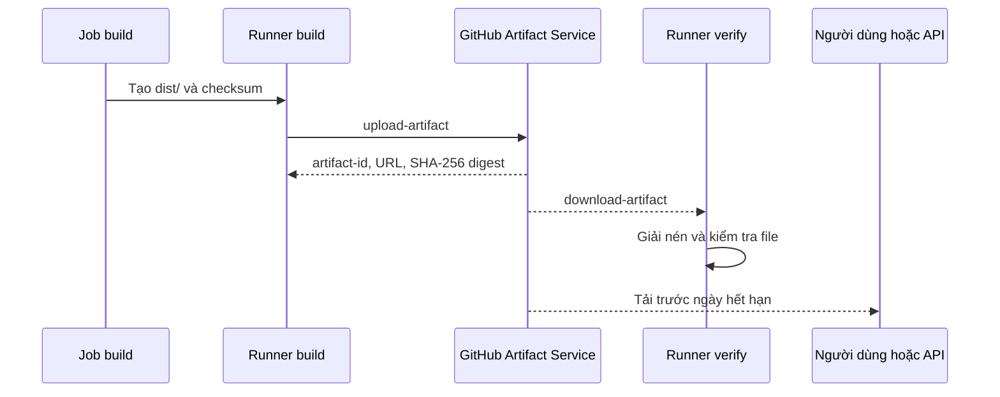
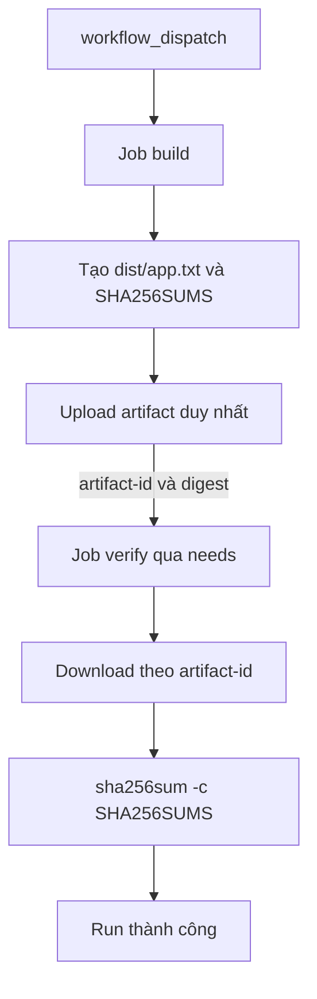

<Callout type="info" title="Phạm vi chương">
  Chương này dùng phiên bản action hiện hành năm 2026: `actions/upload-artifact@v7` và `actions/download-artifact@v8`. Các ví dụ nhắm tới GitHub.com.
</Callout>

## Mục lục

- [Tổng quan](#tổng-quan)
- [Cơ chế artifacts](#cơ-chế-artifacts)
  - [Vòng đời](#vòng-đời)
  - [Tính bất biến và định danh](#tính-bất-biến-và-định-danh)
  - [Kiểm tra toàn vẹn](#kiểm-tra-toàn-vẹn)
- [Cú pháp upload và download](#cú-pháp-upload-và-download)
  - [Upload artifact](#upload-artifact)
  - [Download artifact](#download-artifact)
  - [Tải artifact từ run khác](#tải-artifact-từ-run-khác)
- [Chọn artifact đúng mục đích](#chọn-artifact-đúng-mục-đích)
- [Ví dụ runnable hoàn chỉnh](#ví-dụ-runnable-hoàn-chỉnh)
  - [Luồng dữ liệu](#luồng-dữ-liệu)
  - [Workflow](#workflow)
  - [Điều gì xảy ra khi chạy](#điều-gì-xảy-ra-khi-chạy)
- [Bài thực hành](#bài-thực-hành)
  - [Yêu cầu](#yêu-cầu)
  - [Tiêu chí kiểm chứng](#tiêu-chí-kiểm-chứng)
- [Tình huống production](#tình-huống-production)
  - [Artifacts từ matrix](#artifacts-từ-matrix)
  - [Giữ quyền file và ký tự hoa thường](#giữ-quyền-file-và-ký-tự-hoa-thường)
- [Best practices](#best-practices)
- [Troubleshooting](#troubleshooting)
- [Tài liệu tham khảo](#tài-liệu-tham-khảo)
- [Bài liên quan](#bài-liên-quan)

## Tổng quan

**Workflow artifact** là một file hoặc tập hợp file do workflow tạo và lưu trên dịch vụ artifact của GitHub. Artifact tồn tại độc lập với filesystem tạm thời của runner.

Ví dụ quen thuộc gồm:

- Binary hoặc bundle trong thư mục `dist/`.
- Báo cáo coverage, test result và ảnh chụp khi kiểm thử thất bại.
- Log chẩn đoán, core dump hoặc dữ liệu benchmark.
- Gói trung gian cần chuyển từ job build sang job deploy.

Runner của job `build` có thể bị hủy ngay khi job kết thúc. Job `deploy` cũng có thể chạy trên máy khác. Vì vậy, `deploy` không nhìn thấy file của `build` nếu file chưa được upload thành artifact.

<Callout type="warn" title="Artifact không phải nơi lưu secret">
  Người có quyền đọc repository có thể tải artifact. Đừng upload `.env`, khóa riêng, token hoặc log chứa thông tin nhạy cảm. File ẩn bị loại mặc định, nhưng đó không thay thế bước rà soát dữ liệu.
</Callout>

## Cơ chế artifacts

### Vòng đời

Luồng cơ bản có bốn bước:

1. Một step tạo file trên runner.
2. `upload-artifact` tìm file theo `path`, đóng gói và gửi lên GitHub.
3. GitHub lưu metadata như tên, ID, digest và ngày hết hạn.
4. Job khác, người dùng, GitHub CLI hoặc REST API tải artifact trước khi nó hết hạn.



Artifact mặc định được giữ 90 ngày. Repository public có thể cấu hình từ 1 đến 90 ngày. Repository private có thể cấu hình từ 1 đến 400 ngày. Chính sách của organization hoặc enterprise có thể đặt trần thấp hơn. Thay đổi ở Settings chỉ áp dụng cho artifact mới.

### Tính bất biến và định danh

Từ `upload-artifact@v4`, artifact là **immutable**, nghĩa là không thể thêm file vào artifact đã tạo. Mỗi lần upload thành công tạo một artifact hoàn chỉnh với ID riêng.

Hai lần upload cùng tên trong một run sẽ xung đột theo mặc định. `overwrite: true` không sửa artifact cũ tại chỗ. Action xóa artifact cũ rồi tạo artifact mới với ID mới.

Cách an toàn là đặt tên duy nhất:

```yaml
name: app-${{ github.run_id }}-${{ github.run_attempt }}
```

`github.run_id` phân biệt workflow run. `github.run_attempt` phân biệt lần chạy lại của cùng một run.

Một job có thể tạo tối đa 500 artifacts. Nếu cần hàng nghìn file nhỏ, hãy gom chúng vào ít artifact có cấu trúc rõ ràng thay vì upload từng file.

### Kiểm tra toàn vẹn

`upload-artifact@v7` trả về ba outputs quan trọng:

| Output | Ý nghĩa |
|---|---|
| `artifact-id` | ID số duy nhất, dùng được với action download và REST API |
| `artifact-url` | URL tải artifact; người truy cập vẫn phải đăng nhập và có quyền |
| `artifact-digest` | SHA-256 digest của artifact đã upload |

`download-artifact@v8` đối chiếu digest khi tải. Mặc định, digest không khớp làm action lỗi. Việc này phát hiện dữ liệu tải về khác metadata phía server.

Digest của artifact không thay thế checksum cho từng file sau khi giải nén. Với gói phát hành, nên tạo thêm `SHA256SUMS` trong artifact và kiểm tra nó ở job nhận.

## Cú pháp upload và download

### Upload artifact

Ví dụ upload một thư mục:

```yaml
- name: Upload bundle
  id: upload
  uses: actions/upload-artifact@v7
  with:
    name: web-${{ github.run_id }}-${{ github.run_attempt }}
    path: dist/
    if-no-files-found: error
    retention-days: 14
    compression-level: 6
```

Các input thường dùng:

| Input | Giá trị và lưu ý |
|---|---|
| `name` | Tên hiển thị và tên dùng để download; mặc định là `artifact` |
| `path` | File, thư mục, glob hoặc nhiều dòng path; path tương đối bắt đầu từ workspace |
| `if-no-files-found` | `warn` mặc định, `error` để fail sớm, hoặc `ignore` |
| `retention-days` | `0` hoặc bỏ trống để dùng mặc định; giá trị tùy chỉnh từ 1 ngày đến giới hạn của repository |
| `compression-level` | `0` đến `9`; mặc định `6`; `0` nhanh hơn cho binary đã nén |
| `overwrite` | Xóa artifact cùng tên rồi tạo artifact mới; mặc định `false` |
| `include-hidden-files` | Bao gồm file bắt đầu bằng dấu chấm; mặc định `false` |
| `archive` | `true` mặc định; `false` ở v7 chỉ hỗ trợ một file upload trực tiếp |

Có thể kết hợp nhiều path và loại trừ bằng `!`:

```yaml
- uses: actions/upload-artifact@v7
  with:
    name: test-report-${{ github.run_id }}
    path: |
      reports/
      screenshots/
      !reports/**/*.tmp
    if-no-files-found: error
```

Nếu pattern bắt đầu bằng ký tự wildcard, hãy đặt nó trong dấu nháy để YAML không hiểu `*` là alias.

### Download artifact

Tải một artifact theo tên vào thư mục chỉ định:

```yaml
- name: Download bundle
  uses: actions/download-artifact@v8
  with:
    name: web-12345-1
    path: downloaded/
```

Tải theo ID ổn định hơn khi tên có thể bị dùng lại:

```yaml
- name: Download bundle by ID
  uses: actions/download-artifact@v8
  with:
    artifact-ids: ${{ needs.build.outputs.artifact_id }}
    path: downloaded/
```

Nếu không truyền `name`, `artifact-ids` hoặc `pattern`, action tải mọi artifact của run hiện tại. Mặc định, mỗi artifact được giải nén vào thư mục mang tên nó. Dùng `merge-multiple: true` để trộn nội dung vào cùng thư mục.

<Callout type="warn" title="Cẩn thận khi merge">
  Hai artifact có file cùng đường dẫn có thể ghi đè nhau khi `merge-multiple: true`. Chỉ merge khi quy ước tên file bảo đảm duy nhất.
</Callout>

### Tải artifact từ run khác

Mặc định, `download-artifact` lấy dữ liệu từ repository và workflow run hiện tại. Với run khác trong cùng repository, truyền `github-token` và `run-id`; input `repository` mặc định là repository hiện tại. Với repository khác, truyền đủ `github-token`, `repository` và `run-id`:

```yaml
- name: Download từ run khác
  uses: actions/download-artifact@v8
  with:
    name: production-bundle
    github-token: ${{ secrets.ARTIFACT_READ_TOKEN }}
    repository: octo-org/web-app
    run-id: 123456789
    path: downloaded/
```

Token cần quyền **Actions: read** trên repository đích. Áp dụng nguyên tắc least privilege, tức chỉ cấp đúng quyền đọc cần thiết.

Ngoài workflow, người có quyền đọc repository có thể dùng:

```bash
gh run download RUN_ID -n ARTIFACT_NAME
```

Artifact cũng có thể được liệt kê, tải hoặc xóa qua [REST API cho Actions artifacts](https://docs.github.com/en/rest/actions/artifacts?apiVersion=2022-11-28).

## Chọn artifact đúng mục đích

Artifacts, cache và release asset đều lưu file, nhưng mục tiêu khác nhau:

| Nhu cầu | Công cụ nên dùng | Lý do |
|---|---|---|
| Chuyển `dist/` từ build sang deploy trong cùng run | Artifact | Dữ liệu là đầu ra của job và cần chính xác theo run |
| Giữ test report để điều tra lỗi | Artifact | Người dùng có thể tải sau khi run kết thúc |
| Tái sử dụng dependency giữa nhiều runs | Cache | Cache tối ưu tốc độ và chấp nhận cache miss |
| Phát hành binary lâu dài cho người dùng | GitHub Release hoặc package registry | Artifact có retention hữu hạn và gắn với workflow run |
| Truyền version hoặc ID nhỏ trong expression | Output | Không cần upload và giải nén file |

Cache là tối ưu hóa. Job phải vẫn chạy đúng khi cache miss. Artifact là kết quả cụ thể của một run. Không nên thay hai khái niệm cho nhau.

## Ví dụ runnable hoàn chỉnh

### Luồng dữ liệu

Workflow sau tạo một bundle văn bản, upload nó và chuyển `artifact-id` sang job thứ hai bằng job output. Job thứ hai tải theo ID rồi kiểm tra checksum từng file.



### Workflow

Tạo file `.github/workflows/artifacts-lab.yml`:

```yaml
name: Artifacts lab

on:
  workflow_dispatch:

permissions:
  contents: read

jobs:
  build:
    runs-on: ubuntu-latest
    outputs:
      artifact_id: ${{ steps.upload.outputs.artifact-id }}
      artifact_digest: ${{ steps.upload.outputs.artifact-digest }}
    steps:
      - name: Tạo bundle và checksum
        shell: bash
        run: |
          mkdir -p dist
          printf 'run=%s\nsha=%s\n' "$GITHUB_RUN_ID" "$GITHUB_SHA" > dist/app.txt
          (cd dist && sha256sum app.txt > SHA256SUMS)

      - name: Upload bundle
        id: upload
        uses: actions/upload-artifact@v7
        with:
          name: app-${{ github.run_id }}-${{ github.run_attempt }}
          path: dist/
          if-no-files-found: error
          retention-days: 7
          compression-level: 9

      - name: In metadata artifact
        env:
          ARTIFACT_ID: ${{ steps.upload.outputs.artifact-id }}
          ARTIFACT_URL: ${{ steps.upload.outputs.artifact-url }}
          ARTIFACT_DIGEST: ${{ steps.upload.outputs.artifact-digest }}
        run: |
          printf 'id=%s\nurl=%s\ndigest=%s\n' \
            "$ARTIFACT_ID" "$ARTIFACT_URL" "$ARTIFACT_DIGEST"

  verify:
    needs: build
    runs-on: ubuntu-latest
    steps:
      - name: Download theo ID
        uses: actions/download-artifact@v8
        with:
          artifact-ids: ${{ needs.build.outputs.artifact_id }}
          path: downloaded/

      - name: Kiểm tra nội dung
        env:
          EXPECTED_ARTIFACT_DIGEST: ${{ needs.build.outputs.artifact_digest }}
        shell: bash
        run: |
          test -n "$EXPECTED_ARTIFACT_DIGEST"
          test -f downloaded/app.txt
          test -f downloaded/SHA256SUMS
          (cd downloaded && sha256sum -c SHA256SUMS)
          grep -Fq "run=${GITHUB_RUN_ID}" downloaded/app.txt
          printf 'Artifact digest từ server: %s\n' "$EXPECTED_ARTIFACT_DIGEST"
```

Workflow tự tạo dữ liệu nên không cần `actions/checkout`. `permissions: contents: read` giữ quyền `GITHUB_TOKEN` ở mức tối thiểu cho ví dụ này.

### Điều gì xảy ra khi chạy

1. Job `build` tạo `dist/app.txt` và checksum của file đó.
2. `upload-artifact@v7` upload cả thư mục và trả về ID cùng digest.
3. Job `verify` chờ `build` qua `needs`.
4. `download-artifact@v8` tải đúng artifact theo ID và tự xác thực digest phía server.
5. `sha256sum -c` xác thực file sau khi giải nén.

Cách chạy: mở **Actions → Artifacts lab → Run workflow**. Khi run kết thúc, artifact xuất hiện trong mục **Artifacts** ở trang summary của run.

## Bài thực hành

### Yêu cầu

Mở rộng workflow mẫu theo các bước sau:

- Tạo thêm `reports/test-result.txt` trong job `build`.
- Upload báo cáo thành artifact riêng có tên `report-${{ github.run_id }}-${{ github.run_attempt }}`.
- Đặt `retention-days: 3` và `if-no-files-found: error` cho báo cáo.
- Thêm output chứa ID của artifact báo cáo.
- Trong job `verify`, tải cả bundle và báo cáo theo hai ID vào hai thư mục khác nhau.
- Kiểm tra nội dung báo cáo bằng `grep -Fq`.

### Tiêu chí kiểm chứng

Bài làm đạt khi:

- Trang summary hiển thị đúng hai artifacts với tên khác nhau.
- Job `verify` thành công và log checksum có chữ `OK`.
- Hai thư mục download không ghi đè nội dung của nhau.
- Xóa bước tạo `reports/test-result.txt` làm job `build` thất bại ở bước upload báo cáo.
- Chạy lại cùng workflow run không gặp lỗi tên artifact vì tên có `github.run_attempt`.

## Tình huống production

### Artifacts từ matrix

Mỗi tổ hợp matrix phải dùng tên riêng. Ví dụ:

```yaml
jobs:
  build:
    strategy:
      matrix:
        os: [ubuntu-latest, windows-latest]
    runs-on: ${{ matrix.os }}
    steps:
      - shell: bash
        run: echo "built on $RUNNER_OS" > "result-${RUNNER_OS}.txt"
      - uses: actions/upload-artifact@v7
        with:
          name: result-${{ matrix.os }}
          path: result-*.txt
          if-no-files-found: error

  collect:
    needs: build
    runs-on: ubuntu-latest
    steps:
      - uses: actions/download-artifact@v8
        with:
          pattern: result-*
          path: collected/
          merge-multiple: true
      - run: find collected -type f -maxdepth 1 -print
```

Tên file cũng chứa hệ điều hành, nên `merge-multiple: true` không tạo xung đột.

### Giữ quyền file và ký tự hoa thường

Upload dạng archive không giữ nguyên quyền POSIX. Sau khi download, thư mục thường có mode `755` và file có mode `644`. Filesystem không phân biệt hoa thường cũng có thể làm hai tên file xung đột.

Nếu cần giữ quyền executable hoặc case sensitivity, hãy đóng gói trước:

```yaml
- name: Đóng gói giữ metadata
  run: tar -cvf bundle.tar bin/

- name: Upload tar trực tiếp
  uses: actions/upload-artifact@v7
  with:
    path: bundle.tar
    archive: false
```

Sau khi download bằng `download-artifact@v8`, giải nén thủ công bằng `tar -xvf bundle.tar`.

## Best practices

- **Dùng phiên bản action hiện hành.** Trên GitHub.com năm 2026, dùng `upload-artifact@v7` và `download-artifact@v8`. Theo dõi release notes khi nâng major version.
- **Đặt tên duy nhất và có ngữ cảnh.** Ghép loại dữ liệu, OS, kiến trúc, `run_id` hoặc `run_attempt`.
- **Dùng `if-no-files-found: error` cho đầu ra bắt buộc.** Mặc định chỉ cảnh báo, nên build có thể xanh dù không upload gì.
- **Đặt retention theo giá trị dữ liệu.** Báo cáo tạm có thể giữ vài ngày. Gói phục vụ audit cần theo chính sách tổ chức hoặc chuyển sang kho dài hạn.
- **Chọn mức nén theo dữ liệu.** Dùng `compression-level: 0` cho ZIP, video hoặc binary đã nén. Dùng mức cao hơn cho log và văn bản khi dung lượng quan trọng hơn CPU.
- **Giữ file ẩn ở trạng thái loại trừ.** Chỉ bật `include-hidden-files: true` sau khi loại rõ `.env`, key và cấu hình nhạy cảm bằng pattern phủ định.
- **Không thực thi artifact không tin cậy.** Artifact từ workflow PR có thể chứa mã độc. Xác minh nguồn run, checksum, attestation và quyền trước khi deploy hoặc chạy binary.
- **Dùng ID khi cần chính xác.** Tên có thể được tái sử dụng. ID xác định đúng artifact bất biến.
- **Tạo checksum hoặc artifact attestation cho bản phát hành.** Checksum kiểm tra bytes. Attestation còn chứng minh nguồn gốc build, tức workflow, repository và commit tạo ra gói.
- **Dùng least privilege.** Download từ repository khác chỉ cần token có `Actions: read`. Không dùng PAT quyền rộng nếu fine-grained token đủ dùng.
- **Theo dõi quota lưu trữ.** Artifact tính vào dung lượng Actions của tài khoản. Xóa dữ liệu không còn giá trị hoặc giảm retention.

<Callout type="warn" title="GitHub Enterprise Server">
  `upload-artifact@v4+` và `download-artifact@v4+` hiện không được hỗ trợ trên GitHub Enterprise Server theo README chính thức của actions. Trên GHES, hãy dùng phiên bản tương thích được README của action chỉ định thay vì sao chép nguyên phiên bản trong chương này.
</Callout>

## Troubleshooting

| Triệu chứng | Nguyên nhân cần kiểm tra | Hướng xử lý |
|---|---|---|
| `No files were found with the provided path` | Build tạo file ở thư mục khác, glob sai hoặc working directory khác | In `pwd` và danh sách file; sửa `path`; đặt `if-no-files-found: error` để fail rõ ràng |
| Lỗi `409 Conflict` hoặc artifact cùng tên đã tồn tại | Upload lần hai dùng lại tên trong cùng run hoặc matrix | Thêm OS, phiên bản, `run_id` và `run_attempt`; chỉ dùng `overwrite: true` khi chấp nhận ID mới |
| Download báo không tìm thấy artifact | Sai tên, sai ID, artifact hết hạn hoặc đang ở run khác | Kiểm tra summary; với run khác, truyền `github-token`, `repository` và `run-id` |
| Digest mismatch | Dữ liệu tải về không khớp digest server | Không bỏ qua trong pipeline phát hành; chạy lại download, kiểm tra sự cố mạng và mở issue nếu lặp lại |
| File ẩn không xuất hiện | `include-hidden-files` mặc định là `false` | Chỉ bật `true` sau khi rà soát và loại file nhạy cảm bằng `!path/to/secret` |
| Script mất quyền executable sau download | Archive ZIP không giữ permission | Tar trước khi upload, hoặc chạy `chmod` sau download nếu phù hợp |
| Download nhiều artifacts tạo nhiều thư mục con | `merge-multiple` mặc định là `false` | Đọc từ từng thư mục hoặc bật `merge-multiple: true` sau khi kiểm tra xung đột tên |
| Upload rất chậm với binary lớn | Mức nén mặc định tốn CPU nhưng dữ liệu khó nén | Đặt `compression-level: 0` |
| `retention-days` bị từ chối | Giá trị vượt trần repository, organization hoặc enterprise | Giảm số ngày hoặc nhờ quản trị viên cập nhật policy |
| Action v7 hoặc v8 không chạy trên GHES | Backend artifact mới chưa được GHES hỗ trợ | Chọn phiên bản GHES được README chính thức của action chỉ định |
| Storage quota vẫn báo đầy ngay sau khi xóa | Số liệu dung lượng cập nhật theo chu kỳ | Chờ hệ thống cập nhật; đồng thời giảm retention và số artifact tạo ra |

## Tài liệu tham khảo

- [Workflow artifacts — khái niệm và so sánh với cache](https://docs.github.com/en/actions/concepts/workflows-and-actions/workflow-artifacts)
- [Store and share data with workflow artifacts](https://docs.github.com/en/actions/tutorials/store-and-share-data)
- [README chính thức của `actions/upload-artifact`](https://github.com/actions/upload-artifact)
- [Release hiện hành của `actions/upload-artifact`](https://github.com/actions/upload-artifact/releases/latest)
- [README chính thức của `actions/download-artifact`](https://github.com/actions/download-artifact)
- [Release hiện hành của `actions/download-artifact`](https://github.com/actions/download-artifact/releases/latest)
- [Downloading workflow artifacts bằng UI và GitHub CLI](https://docs.github.com/en/actions/how-tos/manage-workflow-runs/download-workflow-artifacts)
- [Cấu hình retention cho artifacts và logs](https://docs.github.com/en/repositories/managing-your-repositorys-settings-and-features/enabling-features-for-your-repository/managing-github-actions-settings-for-a-repository#configuring-the-retention-period-for-github-actions-artifacts-and-logs-in-your-repository)
- [REST API endpoints for GitHub Actions artifacts](https://docs.github.com/en/rest/actions/artifacts?apiVersion=2022-11-28)
- [Using artifact attestations to establish provenance](https://docs.github.com/en/actions/how-tos/secure-your-work/use-artifact-attestations/use-artifact-attestations)

## Bài liên quan

<Cards>
  <Card title="Outputs" href="/docs/dieu-khien-workflow/07-outputs/" description="Truyền metadata nhỏ và artifact ID giữa các job." />
  <Card title="Dependency caching" href="/docs/dieu-khien-workflow/09-dependency-caching/" description="Tăng tốc workflow bằng dữ liệu có thể tái tạo." />
  <Card title="Job dependencies" href="/docs/dieu-khien-workflow/02-job-dependencies/" description="Điều khiển thứ tự build, verify và deploy bằng needs." />
</Cards>
