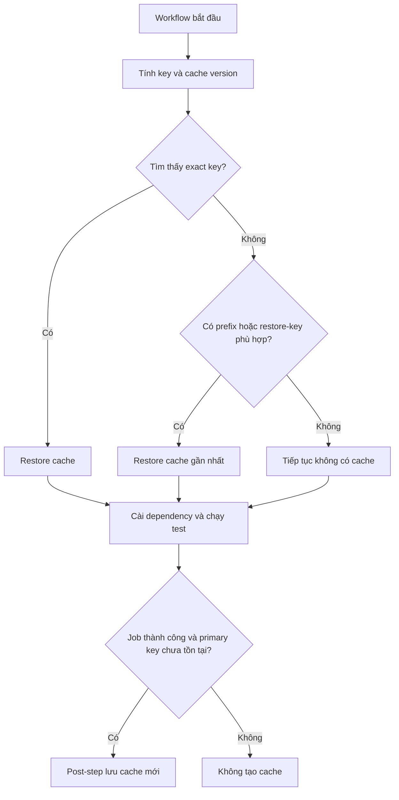

<Callout type="info" title="Phạm vi chương">
  Chương này dùng cú pháp hiện hành năm 2026: `actions/cache@v6`, `actions/checkout@v7` và `actions/setup-node@v7`. Ví dụ nhắm tới GitHub.com. Các major này dùng Node.js 24; self-hosted runner cần được cập nhật trước khi dùng.
</Callout>

## Mục lục

- [Tổng quan](#tổng-quan)
- [Cơ chế cache](#cơ-chế-cache)
  - [Vòng đời restore và save](#vòng-đời-restore-và-save)
  - [Thứ tự tìm cache](#thứ-tự-tìm-cache)
  - [Scope, version và tính bất biến](#scope-version-và-tính-bất-biến)
- [Thiết kế path và key](#thiết-kế-path-và-key)
  - [Chọn dữ liệu có thể tái tạo](#chọn-dữ-liệu-có-thể-tái-tạo)
  - [Tạo key từ lockfile](#tạo-key-từ-lockfile)
  - [Dùng restore-keys có chủ đích](#dùng-restore-keys-có-chủ-đích)
  - [Matrix và monorepo](#matrix-và-monorepo)
- [Các cách cấu hình](#các-cách-cấu-hình)
  - [Cache tích hợp trong setup action](#cache-tích-hợp-trong-setup-action)
  - [Điều khiển trực tiếp bằng actions/cache](#điều-khiển-trực-tiếp-bằng-actionscache)
  - [Hiểu đúng cache-hit](#hiểu-đúng-cache-hit)
- [Ví dụ runnable hoàn chỉnh](#ví-dụ-runnable-hoàn-chỉnh)
  - [Điều kiện chuẩn bị](#điều-kiện-chuẩn-bị)
  - [Workflow](#workflow)
  - [Cách kiểm chứng](#cách-kiểm-chứng)
- [Bài thực hành](#bài-thực-hành)
  - [Yêu cầu](#yêu-cầu)
  - [Tiêu chí kiểm chứng](#tiêu-chí-kiểm-chứng)
- [Tình huống production](#tình-huống-production)
  - [Bảo vệ cache khỏi dữ liệu không tin cậy](#bảo-vệ-cache-khỏi-dữ-liệu-không-tin-cậy)
  - [Kiểm soát dung lượng và eviction](#kiểm-soát-dung-lượng-và-eviction)
- [Best practices](#best-practices)
- [Troubleshooting](#troubleshooting)
- [Tài liệu tham khảo](#tài-liệu-tham-khảo)
- [Bài liên quan](#bài-liên-quan)

## Tổng quan

**Dependency cache** là bản sao tạm của dữ liệu mà package manager có thể tải hoặc tạo lại. Ví dụ, npm lưu các gói đã tải trong `~/.npm`. Một workflow sau có thể khôi phục thư mục này thay vì tải lại mọi gói từ registry.

Cache chỉ tối ưu hiệu năng. Nó không phải nguồn dữ liệu bắt buộc để build thành công. Khi cache miss, tức không tìm thấy bản phù hợp, workflow vẫn phải cài dependency và hoàn tất đúng kết quả.

Phân biệt ba loại dữ liệu thường bị nhầm:

| Nhu cầu | Công cụ phù hợp | Lý do |
|---|---|---|
| Tái sử dụng gói tải từ registry | Dependency cache | Dữ liệu có thể tạo lại và thường được dùng nhiều lần |
| Chuyển bundle từ job `build` sang `deploy` | Artifact | Artifact là đầu ra của run và có vòng đời rõ ràng |
| Giữ secret hoặc token | GitHub Actions secrets | Cache có thể được workflow ở branch hoặc pull request khác đọc |

<Callout type="warn" title="Cache không phải artifact">
  Đừng làm cho deploy phụ thuộc vào một cache còn tồn tại. Cache có thể bị thu hồi theo chính sách lưu trữ. Hãy dùng artifact cho đầu ra bắt buộc của workflow.
</Callout>

## Cơ chế cache

### Vòng đời restore và save

Một step `actions/cache` thực hiện hai pha. Pha đầu chạy tại vị trí của step và thử restore dữ liệu. Pha sau là post-step, chạy khi job kết thúc thành công, để lưu cache mới nếu chưa có exact hit.



Cache hiện có là **immutable**, nghĩa là không sửa nội dung tại chỗ. Muốn lưu nội dung mới, hãy tạo `key` mới. Thông thường, thay đổi lockfile sẽ tạo key mới tự động.

### Thứ tự tìm cache

`actions/cache` tìm theo thứ tự sau:

1. Exact match của `key` và cache version trong branch hiện tại.
2. Prefix match của `key` trong branch hiện tại.
3. Từng dòng `restore-keys`, từ cụ thể đến tổng quát. Nếu có nhiều prefix match, action lấy cache được tạo gần nhất.
4. Nếu vẫn miss, lặp lại quá trình trong default branch, trong phạm vi mà run được phép đọc.

Ví dụ:

```yaml
key: Linux-x64-node24-npm-a1b2c3
restore-keys: |
  Linux-x64-node24-npm-
  Linux-x64-node24-
```

Nếu exact key không tồn tại, `Linux-x64-node24-npm-` có thể khôi phục cache của lockfile cũ. Lần cài tiếp theo vẫn phải chạy để bổ sung hoặc loại bỏ dependency theo lockfile hiện tại.

### Scope, version và tính bất biến

Một cache được nhận diện bởi ba yếu tố: `key`, **cache version** và branch scope. Cache version là dấu nội bộ được tạo từ `path` cùng công cụ nén. Vì vậy, hai step có cùng `key` nhưng khác `path` vẫn có thể không dùng chung cache.

Quyền đọc tuân theo branch scope:

- Run có thể đọc cache của branch hiện tại và default branch.
- Run từ pull request còn có thể đọc cache của base branch.
- Branch cha không đọc cache của branch con. Hai branch ngang hàng cũng không đọc cache của nhau.
- Cache tạo bởi sự kiện `pull_request` thuộc merge ref dạng `refs/pull/.../merge`. Nó chủ yếu chỉ dùng lại cho các lần re-run của pull request đó.

GitHub giới hạn quyền ghi cache vào scope của default branch đối với các trigger có độ tin cậy thấp. Ví dụ, run `pull_request_target`, `issue_comment` hoặc `workflow_run` có thể chỉ restore. Nếu save bị từ chối, action ghi warning nhưng không làm job thất bại.

## Thiết kế path và key

### Chọn dữ liệu có thể tái tạo

Hãy cache dữ liệu vừa tốn thời gian tạo lại vừa không phải nguồn chân lý. Một số path điển hình:

| Hệ sinh thái | Path thường cache | File dùng để đổi key |
|---|---|---|
| npm | `~/.npm` | `package-lock.json` |
| pnpm | Store do `pnpm store path` trả về | `pnpm-lock.yaml` |
| pip | `~/.cache/pip` | `requirements*.txt` hoặc `poetry.lock` |
| Gradle | `~/.gradle/caches`, `~/.gradle/wrapper` | `gradle.lockfile`, wrapper properties hoặc build files |

Đừng mặc định cache `node_modules`. Thư mục này có thể chứa binary phụ thuộc hệ điều hành, kiến trúc và phiên bản Node.js. `setup-node` cũng chỉ cache dữ liệu package manager, không cache `node_modules`.

### Tạo key từ lockfile

Một key tốt chứa các yếu tố làm nội dung cache không còn tương thích:

```yaml
key: ${{ runner.os }}-${{ runner.arch }}-node24-npm-${{ hashFiles('**/package-lock.json') }}
```

- `runner.os` tách Linux, Windows và macOS.
- `runner.arch` tách `X64`, `ARM64` và các kiến trúc khác.
- `node24` là namespace dễ tăng thành `node26` khi thay runtime.
- `hashFiles(...)` đổi khi lockfile đổi.

Dùng lockfile thay vì `package.json`. Lockfile ghi chính xác phiên bản dependency bắc cầu. Dependency bắc cầu là gói được một dependency khác kéo vào.

<Callout type="warn" title="Kiểm tra glob của hashFiles">
  Nếu glob không khớp file nào, `hashFiles` trả chuỗi rỗng. Nhiều run khi đó dùng chung một key quá rộng. Hãy commit lockfile và kiểm tra đường dẫn, nhất là trong monorepo.
</Callout>

### Dùng restore-keys có chủ đích

`restore-keys` là fallback theo tiền tố. Sắp xếp từ hẹp đến rộng:

```yaml
restore-keys: |
  ${{ runner.os }}-${{ runner.arch }}-node24-npm-
  ${{ runner.os }}-${{ runner.arch }}-node24-
```

Không nên fallback tới cache của hệ điều hành khác cho dữ liệu có native binary. Tùy chọn `enableCrossOsArchive: true` chỉ làm archive có thể đi qua ranh giới hệ điều hành. Nó không biến dependency native thành tương thích đa nền tảng.

### Matrix và monorepo

Trong matrix, thêm mọi chiều ảnh hưởng đến dữ liệu cache. Ví dụ, cache compiler nên có phiên bản compiler trong key. Cache npm tarball thường không cần tách theo từng patch Node.js, nhưng tách theo major giúp thay đổi có chủ đích.

Với monorepo, có hai chiến lược:

- **Một cache chung:** hash tất cả lockfile. Cấu hình ngắn, nhưng một workspace đổi sẽ tạo cache mới cho toàn repo.
- **Một cache mỗi workspace:** key và path riêng. Hiệu quả hơn khi workspace độc lập, nhưng tạo nhiều entry hơn.

Ví dụ cache tích hợp cho một workspace:

```yaml
- uses: actions/setup-node@v7
  with:
    node-version: 24
    cache: npm
    cache-dependency-path: apps/web/package-lock.json
```

## Các cách cấu hình

### Cache tích hợp trong setup action

Các action chính thức như `setup-node`, `setup-python`, `setup-java`, `setup-go` và `setup-dotnet` hỗ trợ cache cho package manager tương ứng. Đây là lựa chọn ngắn gọn khi không cần điều khiển path thủ công.

```yaml
- uses: actions/checkout@v7
- uses: actions/setup-node@v7
  with:
    node-version: 24
    cache: npm
    cache-dependency-path: package-lock.json
- run: npm ci
```

`setup-node@v7` có thể tự bật npm cache khi trường `packageManager` hoặc `devEngines.packageManager` trong `package.json` chỉ định npm. Trong workflow có quyền cao nhưng không cần cache, hãy đặt `package-manager-cache: false` để hành vi rõ ràng.

### Điều khiển trực tiếp bằng actions/cache

Dùng `actions/cache` khi cần path tùy chỉnh, nhiều restore key hoặc output `cache-hit`:

```yaml
- name: Restore npm download cache
  id: npm-cache
  uses: actions/cache@v6
  with:
    path: ~/.npm
    key: ${{ runner.os }}-${{ runner.arch }}-node24-npm-${{ hashFiles('package-lock.json') }}
    restore-keys: |
      ${{ runner.os }}-${{ runner.arch }}-node24-npm-
```

`key` và `path` là bắt buộc. `key` dài tối đa 512 ký tự. `path` chấp nhận file, thư mục, path tuyệt đối, path tương đối và glob.

Khi cần tách thời điểm restore và save, dùng `actions/cache/restore@v6` rồi `actions/cache/save@v6`. Cách này phù hợp với workflow chỉ đọc cache hoặc cần lưu sau một step cụ thể.

### Hiểu đúng cache-hit

Output `cache-hit` là chuỗi, không phải Boolean YAML:

- `'true'`: exact match với primary `key`.
- `'false'`: đã restore bằng prefix hoặc `restore-keys`.
- Chuỗi rỗng: không restore được cache.

Với cache `~/.npm`, luôn chạy `npm ci`. Cache chỉ giúp npm lấy gói nhanh hơn. Nó không cài package vào `node_modules` thay bạn.

Chỉ bỏ qua bước tạo dữ liệu khi path cache chứa đầu ra hoàn chỉnh và exact hit thật sự:

```yaml
- name: Generate expensive data
  if: steps.generated-cache.outputs.cache-hit != 'true'
  run: ./scripts/generate.sh
```

## Ví dụ runnable hoàn chỉnh

### Điều kiện chuẩn bị

Repository cần có:

- `package.json`.
- `package-lock.json` đã commit.
- Script `test` là tùy chọn. Ví dụ dùng `npm test --if-present`, nên workflow vẫn chạy nếu chưa khai báo script này.

### Workflow

Tạo `.github/workflows/dependency-cache.yml`:

```yaml
name: Dependency cache lab

on:
  workflow_dispatch:
  push:
    paths:
      - package.json
      - package-lock.json
      - '.github/workflows/dependency-cache.yml'

permissions:
  contents: read

jobs:
  test:
    runs-on: ubuntu-latest
    timeout-minutes: 10

    steps:
      - name: Checkout
        uses: actions/checkout@v7

      - name: Set up Node.js
        uses: actions/setup-node@v7
        with:
          node-version: 24
          package-manager-cache: false

      - name: Restore npm download cache
        id: npm-cache
        uses: actions/cache@v6
        with:
          path: ~/.npm
          key: ${{ runner.os }}-${{ runner.arch }}-node24-npm-${{ hashFiles('package-lock.json') }}
          restore-keys: |
            ${{ runner.os }}-${{ runner.arch }}-node24-npm-

      - name: Report cache result
        env:
          CACHE_HIT: ${{ steps.npm-cache.outputs.cache-hit }}
        run: echo "cache-hit=${CACHE_HIT:-empty}"

      - name: Install exactly from lockfile
        run: npm ci --ignore-scripts

      - name: Run tests when present
        run: npm test --if-present
```

`package-manager-cache: false` ngăn `setup-node` tự tạo thêm cache npm. Nhờ đó, chỉ một cơ chế cache hoạt động và log dễ quan sát.

`--ignore-scripts` ngăn các install lifecycle script chạy trong bước `npm ci`. Step `npm test` tiếp theo vẫn có thể chạy `pretest`, `test` và `posttest` từ repository, nên mã nguồn của repository vẫn phải được tin cậy. Nếu dự án cần build native module hoặc chạy script cài đặt hợp lệ, hãy bỏ cờ này sau khi đánh giá rủi ro.

### Cách kiểm chứng

1. Chạy workflow lần đầu bằng **Actions → Dependency cache lab → Run workflow**.
2. Mở step **Report cache result**. Lần đầu thường in `cache-hit=empty`.
3. Kiểm tra cuối log của job. Post-step của `actions/cache` phải báo đã lưu cache.
4. Re-run cùng commit. Step báo `cache-hit=true`.
5. Thay đổi dependency bằng `npm install <package>` rồi commit cả `package.json` và `package-lock.json`.
6. Run mới phải có primary key khác. Nó có thể báo `false` vì restore được cache gần nhất qua `restore-keys`.

Đo thời gian của step `npm ci` giữa các run. Đó là số liệu cần tối ưu, không chỉ tỷ lệ hit.

## Bài thực hành

### Yêu cầu

Mở rộng workflow trên cho một monorepo có hai ứng dụng:

```text
apps/
├── api/package-lock.json
└── web/package-lock.json
```

Thực hiện các việc sau:

1. Tạo matrix gồm `api` và `web`.
2. Mỗi matrix job cache `~/.npm` với key chứa tên ứng dụng và hash lockfile tương ứng.
3. Chạy `npm ci --ignore-scripts` trong đúng `working-directory`.
4. Thêm `restore-keys` nhưng không cho hai ứng dụng dùng nhầm namespace.
5. In `cache-hit` và thời gian cài dependency vào log.

### Tiêu chí kiểm chứng

- [ ] Run đầu của cả hai ứng dụng thành công khi chưa có cache.
- [ ] Re-run cùng commit cho `cache-hit=true` ở cả hai matrix job.
- [ ] Chỉ sửa `apps/web/package-lock.json` làm key của `web` đổi; key của `api` giữ nguyên.
- [ ] `api` không restore cache có prefix của `web` và ngược lại.
- [ ] Xóa cache trong **Actions → Caches** không làm build sai; run kế tiếp chỉ chậm hơn.
- [ ] Log không chứa token, `.npmrc` có credential hoặc nội dung secret.

## Tình huống production

### Bảo vệ cache khỏi dữ liệu không tin cậy

Cache không được ký và không được xác minh như một package release. Workflow đọc cache có thể giải nén file rồi thực thi chúng. Đây là lý do **cache poisoning** — chèn nội dung độc vào cache để run có quyền cao dùng lại — cần được xem như rủi ro chuỗi cung ứng.

Áp dụng các rào chắn sau:

- Không cache `.env`, `.npmrc` có token, SSH key hoặc credential.
- Không dùng input chưa tin cậy trực tiếp làm `path` hoặc key của cache đặc quyền.
- Dùng `actions/cache/restore@v6` trong workflow có trigger độ tin cậy thấp nếu chủ đích chỉ là đọc.
- Chỉ để trigger đáng tin cậy làm ấm cache dùng cho default branch.
- Pin action bên thứ ba bằng full commit SHA trong production. Major tag dễ đọc hơn nhưng có thể dịch chuyển.

### Kiểm soát dung lượng và eviction

Mặc định, tổng cache miễn phí của một repository là 10 GB. GitHub xóa entry không được truy cập hơn 7 ngày. Khi đạt giới hạn cấu hình, GitHub thu hồi cache theo thời điểm truy cập, cũ nhất trước.

Quá nhiều key có thể gây **cache thrashing**. Đây là trạng thái cache mới liên tục đẩy cache hữu ích ra khỏi quota. Key chứa `github.sha` hoặc `github.run_id` thường gây vấn đề này vì gần như mỗi run tạo một entry mới.

Theo dõi tại **Actions → Caches**. Có thể dùng `gh cache list`, `gh cache delete` hoặc REST API để dọn cache của pull request đã đóng. Nếu tài khoản bật dung lượng vượt mức miễn phí, phần vượt 10 GB có thể phát sinh chi phí theo cấu hình hiện hành.

## Best practices

- **Luôn commit lockfile.** Lockfile làm `npm ci` tái lập được và cho `hashFiles` một đầu vào ổn định.
- **Cache store của package manager trước.** Chỉ cache `node_modules` khi đã chứng minh lợi ích và key bao phủ OS, kiến trúc cùng runtime.
- **Đặt key từ ổn định đến biến động.** Dùng OS, kiến trúc, toolchain rồi hash lockfile. Tránh timestamp hoặc commit SHA nếu muốn tái sử dụng.
- **Giữ restore key đủ hẹp.** Prefix quá rộng có thể restore dữ liệu không tương thích hoặc không đáng tin cậy.
- **Vẫn chạy lệnh cài đặt sau partial hit.** Cache cũ chỉ là điểm xuất phát, không phản ánh lockfile mới.
- **Đo thời gian end-to-end.** Nén và upload cache lớn có thể lâu hơn tải lại dependency.
- **Không cache secret.** Pull request từ fork có thể đọc cache của base branch theo scope cho phép.
- **Dọn cache ít giá trị.** Theo dõi dung lượng, tỷ lệ hit và thời gian tiết kiệm thay vì tạo cache cho mọi thư mục.
- **Cập nhật self-hosted runner.** `actions/cache@v6` dùng runtime Node.js 24; runner cũ có thể không chạy được action.

## Troubleshooting

| Triệu chứng | Nguyên nhân cần kiểm tra | Hướng xử lý |
|---|---|---|
| Run nào cũng `cache-hit=empty` | `hashFiles` không khớp; `path` hoặc cache version đổi; branch không có quyền đọc | In danh sách lockfile, kiểm tra glob, giữ `path` ổn định và xem **Actions → Caches** |
| `cache-hit=false` dù đã restore dữ liệu | Chỉ có prefix/`restore-keys` match | Đây là partial hit hợp lệ; vẫn chạy lệnh cài dependency |
| Cache hit nhưng `npm ci` vẫn chậm | Cache sai path; registry chậm; install script hoặc native build chiếm thời gian | Xác nhận npm cache bằng `npm config get cache`; đo từng pha thay vì chỉ xem hit |
| Cache lưu xong nhưng run khác không thấy | Khác branch scope, key, version, OS hoặc kiến trúc | So sánh key đã evaluate trong log và kiểm tra quy tắc branch scope |
| Warning `cache write denied` | Trigger chỉ có quyền đọc cache trong default-branch scope | Dùng restore-only hoặc để workflow `push` đáng tin cậy cập nhật cache |
| Cache liên tục bị xóa | Vượt quota, entry quá nhiều hoặc không được truy cập trong 7 ngày | Bỏ chiều key có cardinality cao, dọn cache PR cũ và kiểm tra cấu hình dung lượng |
| `Path Validation Error` hoặc không tạo cache | `path` không tồn tại khi post-step chạy | Tạo dữ liệu trước khi job kết thúc và xác nhận path trong đúng môi trường runner/container |
| Self-hosted runner lỗi khi khởi động action | Runner không hỗ trợ runtime Node.js 24 hoặc quá cũ cho cache service | Nâng runner lên bản hiện hành; với dòng action Node.js 24, tối thiểu cần runner `2.327.1` |
| Cache Windows không dùng được trên Linux | Archive khác OS; dependency chứa binary native | Tách key theo OS. Chỉ cân nhắc `enableCrossOsArchive` cho dữ liệu thật sự portable |

## Tài liệu tham khảo

- [Dependency caching reference](https://docs.github.com/en/actions/reference/workflows-and-actions/dependency-caching) — thuật toán match, scope, bảo mật, giới hạn và eviction.
- [Managing caches](https://docs.github.com/en/actions/how-tos/manage-workflow-runs/manage-caches) — xem và xóa cache bằng UI, CLI hoặc API.
- [Workflow syntax for GitHub Actions](https://docs.github.com/en/actions/reference/workflows-and-actions/workflow-syntax) — context, expression và cú pháp workflow.
- [actions/cache](https://github.com/actions/cache) — input, output, runtime và chiến lược của action chính thức.
- [actions/setup-node](https://github.com/actions/setup-node#caching-global-packages-data) — npm, Yarn, pnpm cache và `cache-dependency-path`.
- [Secure use reference](https://docs.github.com/en/actions/reference/security/secure-use) — hướng dẫn hardening workflow và pin dependency.
- [REST API endpoints for GitHub Actions cache](https://docs.github.com/en/rest/actions/cache) — liệt kê, xem usage và xóa cache tự động.

## Bài liên quan

<Cards>
  <Card title="Artifacts" href="/docs/dieu-khien-workflow/08-artifacts/" description="Lưu đầu ra bắt buộc và chuyển file giữa các job." />
  <Card title="Containers và service containers" href="/docs/dieu-khien-workflow/10-containers-service-containers/" description="Chạy môi trường test tái lập được cùng database hoặc cache service." />
</Cards>
