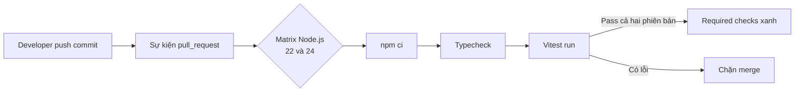

<Callout type="info" title="Kết quả sau bài học">
  Bạn sẽ xây dựng một dự án TypeScript tối thiểu có unit test theo Arrange-Act-Assert, chạy test trên Node.js 22 và 24 bằng GitHub Actions, rồi biến các job thành cổng bắt buộc trước khi merge.
</Callout>

## Mục lục

- [Unit testing trong chiến lược kiểm thử](#unit-testing-trong-chiến-lược-kiểm-thử)
  - [Test pyramid](#test-pyramid)
  - [Luồng phản hồi trên pull request](#luồng-phản-hồi-trên-pull-request)
- [Ba nguyên tắc thiết kế test](#ba-nguyên-tắc-thiết-kế-test)
  - [Test isolation](#test-isolation)
  - [Arrange, Act, Assert](#arrange-act-assert)
  - [Mocking đúng ranh giới](#mocking-đúng-ranh-giới)
- [Chuẩn bị bài thực hành](#chuẩn-bị-bài-thực-hành)
  - [Yêu cầu môi trường](#yêu-cầu-môi-trường)
  - [Cấu trúc dự án](#cấu-trúc-dự-án)
- [Thực hành với TypeScript và Vitest](#thực-hành-với-typescript-và-vitest)
  - [Bước 1: Khởi tạo package](#bước-1-khởi-tạo-package)
  - [Bước 2: Cấu hình TypeScript và Vitest](#bước-2-cấu-hình-typescript-và-vitest)
  - [Bước 3: Viết unit cần kiểm thử](#bước-3-viết-unit-cần-kiểm-thử)
  - [Bước 4: Viết test cô lập](#bước-4-viết-test-cô-lập)
  - [Bước 5: Chạy và đọc kết quả](#bước-5-chạy-và-đọc-kết-quả)
- [Chạy unit test bằng GitHub Actions](#chạy-unit-test-bằng-github-actions)
  - [Workflow hoàn chỉnh](#workflow-hoàn-chỉnh)
  - [Ma trận phiên bản Node.js](#ma-trận-phiên-bản-nodejs)
  - [Cache npm đúng cách](#cache-npm-đúng-cách)
  - [Chọn chiến lược fail-fast](#chọn-chiến-lược-fail-fast)
- [Biến test thành required check](#biến-test-thành-required-check)
  - [Cấu hình bảo vệ nhánh](#cấu-hình-bảo-vệ-nhánh)
  - [Xác minh từ đầu đến cuối](#xác-minh-từ-đầu-đến-cuối)
- [Best practices](#best-practices)
- [Troubleshooting](#troubleshooting)
- [Tài liệu tham khảo](#tài-liệu-tham-khảo)
- [Các bài tiếp theo](#các-bài-tiếp-theo)

## Unit testing trong chiến lược kiểm thử

**Unit test** kiểm tra một đơn vị hành vi nhỏ, chẳng hạn một hàm tính tổng đơn hàng. Test cung cấp đầu vào đã kiểm soát và xác minh đầu ra hoặc tương tác quan trọng. Nó không gọi mạng, database hay dịch vụ thật.

Ví dụ, `calculateTotal(100, "VN", taxRates)` phải trả về `110` khi nguồn thuế trả về `0.1`. Đây là một unit test nếu `taxRates` được thay bằng dependency giả trong bộ nhớ. Nếu test gọi API thuế thật, nó đã vượt khỏi ranh giới unit test.

Unit test không chứng minh toàn hệ thống hoạt động. Giá trị chính của nó là phản hồi nhanh, định vị lỗi gần mã nguồn và tạo mạng lưới an toàn khi refactor.

### Test pyramid

**Test pyramid** là mô hình phân bổ nhiều test nhanh ở đáy và ít test tốn kém hơn ở phía trên.

| Tầng | Phạm vi ví dụ | Đặc tính | Số lượng tương đối |
|---|---|---|---|
| Unit | Hàm tính giá, parser, validator | Rất nhanh, cô lập, định vị lỗi tốt | Nhiều nhất |
| Integration | Repository với database test, API với service phụ trợ | Kiểm tra điểm nối giữa thành phần | Ít hơn |
| End-to-end | Người dùng đặt hàng qua giao diện | Gần hành vi thật nhưng chậm và dễ biến động | Ít nhất |

Đây không phải công thức phần trăm cứng. Một thư viện thuật toán có thể cần chủ yếu unit test. Một adapter database cần nhiều integration test hơn. Nguyên tắc hành động là đặt kiểm tra ở tầng thấp nhất vẫn chứng minh đúng rủi ro cần kiểm soát.

<Callout type="idea" title="Đừng kiểm tra lại implementation">
  Test hành vi quan sát được. Nếu một refactor giữ nguyên kết quả nhưng làm test hỏng vì tên hàm nội bộ đổi, test đang bám quá chặt vào cách cài đặt.
</Callout>

### Luồng phản hồi trên pull request

Unit test chỉ trở thành cổng chất lượng khi kết quả của nó gắn với commit đang được review.



Mỗi ô trong matrix chạy trên một runner sạch. Vì vậy, kết quả trên Node.js 22 không thể che lỗi tương thích chỉ xuất hiện trên Node.js 24.

## Ba nguyên tắc thiết kế test

### Test isolation

**Test isolation**, hay tính cô lập của test, nghĩa là kết quả một test không phụ thuộc thứ tự chạy, trạng thái test trước hoặc dịch vụ bên ngoài. Ví dụ, mỗi test bên dưới tự tạo `taxRates`; không test nào dùng chung mock có lịch sử lời gọi từ test khác.

Vitest mặc định bật `isolate: true` để cô lập môi trường giữa các file test. Tuy vậy, các test trong cùng file vẫn có thể làm rò rỉ biến toàn cục, timer hoặc mock. Hãy tạo fixture mới cho từng test và khôi phục mọi trạng thái đã thay đổi.

Một test cô lập phải vượt qua phép thử đơn giản sau:

```bash
# Chạy riêng một file vẫn phải pass.
npx vitest run tests/order-total.test.ts

# Chạy lặp lại không được lúc xanh, lúc đỏ.
for i in 1 2 3 4 5; do npm test || break; done
```

Nếu test phụ thuộc thời gian hiện tại, hãy điều khiển clock bằng fake timer và trả lại real timer sau test. Nếu test sửa `process.env`, hãy phục hồi giá trị cũ hoặc bật `unstubEnvs` trong cấu hình Vitest.

### Arrange, Act, Assert

**Arrange-Act-Assert (AAA)** là cách chia một test thành ba pha:

1. **Arrange:** tạo dữ liệu và dependency cần thiết.
2. **Act:** gọi đúng hành vi cần kiểm thử.
3. **Assert:** xác minh kết quả và tương tác có ý nghĩa.

Ví dụ ngắn:

```ts
// Arrange
const getRate = vi.fn().mockResolvedValue(0.1)
const taxRates = { getRate }

// Act
const total = await calculateTotal(100, 'VN', taxRates)

// Assert
expect(total).toBe(110)
expect(getRate).toHaveBeenCalledOnce()
```

AAA làm ranh giới ý định rõ ràng. Một test nên có một pha Act chính. Nhiều assertion được chấp nhận nếu chúng cùng chứng minh một hành vi.

### Mocking đúng ranh giới

**Mock** là dependency giả có thể lập trình trước kết quả và ghi lại cách nó được gọi. Trong ví dụ, `vi.fn().mockResolvedValue(0.1)` thay cho client gọi dịch vụ thuế.

Mock hợp lý tại ranh giới chậm hoặc không ổn định:

- HTTP API, hàng đợi, email và dịch vụ thanh toán;
- filesystem, clock hoặc random khi hành vi cần tất định;
- dependency có lỗi hiếm cần mô phỏng, như timeout hay `503`.

Không mock một hàm thuần chỉ để xác nhận nó được gọi. Ví dụ, với `add(1, 2)`, hãy dùng giá trị thật và kiểm tra kết quả `3`. Mock quá nhiều khiến test xác nhận kịch bản do chính test dựng lên thay vì hành vi thật.

Ưu tiên truyền dependency qua tham số hoặc constructor. Cách này làm ranh giới rõ hơn `vi.mock()` ở cấp module và tránh phụ thuộc vào cơ chế hoisting của module mock.

<Callout type="warn" title="Dọn trạng thái mock">
  Mock, spy, fake timer, biến môi trường và global có thể rò rỉ sang test khác. Cấu hình tự động dọn trạng thái là lớp bảo vệ; thiết kế fixture mới cho từng test vẫn là lớp bảo vệ chính.
</Callout>

## Chuẩn bị bài thực hành

### Yêu cầu môi trường

Bạn cần:

- Git và một repository GitHub có nhánh mặc định `main`;
- Node.js 22 hoặc 24 cùng npm;
- quyền tạo workflow trong `.github/workflows/`;
- quyền chỉnh ruleset hoặc branch protection nếu muốn bật required checks.

Vitest hiện yêu cầu Node.js từ 20 trở lên. Bài này dùng Node.js 22 và 24 vì đây là hai dòng LTS phù hợp để kiểm tra dự án mới tại thời điểm tài liệu được rà soát.

Kiểm tra môi trường local:

```bash
node --version
npm --version
git --version
```

### Cấu trúc dự án

Sau khi hoàn thành, repository có các file tối thiểu sau:

```text
.
├── .github/
│   └── workflows/
│       └── unit-tests.yml
├── src/
│   └── order-total.ts
├── tests/
│   └── order-total.test.ts
├── package.json
├── package-lock.json
├── tsconfig.json
└── vitest.config.ts
```

## Thực hành với TypeScript và Vitest

### Bước 1: Khởi tạo package

Tại root của repository, tạo `package.json`:

```json
{
  "name": "vitest-unit-ci",
  "version": "1.0.0",
  "private": true,
  "type": "module",
  "scripts": {
    "test": "vitest run",
    "test:watch": "vitest",
    "typecheck": "tsc --noEmit"
  }
}
```

Cài các công cụ phát triển:

```bash
npm install --save-dev vitest typescript @types/node
```

Lệnh này cập nhật `package.json` và tạo `package-lock.json`. Hãy commit lockfile. CI sẽ dùng lockfile để cài đúng cây dependency đã được review.

Script `test` dùng `vitest run`, nên chạy một lần rồi thoát. Script `test:watch` dành cho local và không được dùng trong CI vì nó chờ thay đổi file.

### Bước 2: Cấu hình TypeScript và Vitest

Tạo `tsconfig.json`:

```json
{
  "compilerOptions": {
    "target": "ES2022",
    "module": "ESNext",
    "moduleResolution": "Bundler",
    "strict": true,
    "noEmit": true,
    "types": ["node"]
  },
  "include": ["src", "tests", "vitest.config.ts"]
}
```

Tạo `vitest.config.ts`:

```ts
import { defineConfig } from 'vitest/config'

export default defineConfig({
  test: {
    environment: 'node',
    isolate: true,
    clearMocks: true,
    restoreMocks: true,
    unstubEnvs: true,
    unstubGlobals: true,
  },
})
```

`environment: 'node'` phù hợp với logic backend không cần DOM. `clearMocks` xóa lịch sử lời gọi. `restoreMocks` khôi phục spy. Hai tùy chọn `unstub*` trả biến môi trường và global đã stub về trạng thái trước test.

### Bước 3: Viết unit cần kiểm thử

Tạo `src/order-total.ts`:

```ts
export interface TaxRateProvider {
  getRate(country: string): Promise<number>
}

export async function calculateTotal(
  subtotal: number,
  country: string,
  taxRates: TaxRateProvider,
): Promise<number> {
  if (subtotal < 0) {
    throw new RangeError('subtotal must be non-negative')
  }

  const taxRate = await taxRates.getRate(country)

  if (taxRate < 0) {
    throw new RangeError('tax rate must be non-negative')
  }

  return Math.round(subtotal * (1 + taxRate) * 100) / 100
}
```

`TaxRateProvider` là seam, tức điểm nối có thể thay thế khi test. Hàm sản xuất có thể nhận HTTP client thật. Unit test sẽ truyền một mock trong bộ nhớ.

### Bước 4: Viết test cô lập

Tạo `tests/order-total.test.ts`:

```ts
import { describe, expect, it, vi } from 'vitest'
import {
  calculateTotal,
  type TaxRateProvider,
} from '../src/order-total'

describe('calculateTotal', () => {
  it('cộng thuế và làm tròn đến hai chữ số thập phân', async () => {
    // Arrange
    const getRate = vi.fn().mockResolvedValue(0.075)
    const taxRates: TaxRateProvider = { getRate }

    // Act
    const total = await calculateTotal(19.99, 'VN', taxRates)

    // Assert
    expect(total).toBe(21.49)
    expect(getRate).toHaveBeenCalledOnce()
    expect(getRate).toHaveBeenCalledWith('VN')
  })

  it('từ chối subtotal âm trước khi gọi nguồn thuế', async () => {
    // Arrange
    const getRate = vi.fn()
    const taxRates: TaxRateProvider = { getRate }

    // Act và Assert
    await expect(calculateTotal(-1, 'VN', taxRates)).rejects.toThrow(
      'subtotal must be non-negative',
    )
    expect(getRate).not.toHaveBeenCalled()
  })
})
```

Test đầu chứng minh kết quả và ranh giới gọi dependency. Test thứ hai chứng minh fail sớm: đầu vào sai bị từ chối mà không gọi dịch vụ thuế.

Mỗi test tạo một `getRate` mới. Vì vậy, lịch sử lời gọi không phụ thuộc test trước.

### Bước 5: Chạy và đọc kết quả

Chạy đúng các lệnh CI sẽ dùng:

```bash
npm run typecheck
npm test
```

Kết quả mong đợi có một file test và hai test đều pass. Để chứng minh test bắt lỗi thật, tạm đổi `toBe(21.49)` thành `toBe(21.50)` rồi chạy lại. Vitest phải thoát với exit code khác `0`.

Khôi phục assertion đúng trước khi commit:

```bash
git add package.json package-lock.json tsconfig.json vitest.config.ts src tests
git commit -m "test: add isolated order total unit tests"
```

## Chạy unit test bằng GitHub Actions

### Workflow hoàn chỉnh

Tạo `.github/workflows/unit-tests.yml`:

```yaml
name: Unit tests

on:
  push:
    branches: [main]
  pull_request:
    branches: [main]

permissions:
  contents: read

concurrency:
  group: unit-tests-${{ github.workflow }}-${{ github.event.pull_request.number || github.ref }}
  cancel-in-progress: true

jobs:
  unit-test:
    name: Unit tests / Node.js ${{ matrix.node-version }}
    runs-on: ubuntu-latest
    timeout-minutes: 10

    strategy:
      fail-fast: false
      matrix:
        node-version: [22.x, 24.x]

    steps:
      - name: Checkout source
        uses: actions/checkout@v7
        with:
          persist-credentials: false

      - name: Set up Node.js ${{ matrix.node-version }}
        uses: actions/setup-node@v7
        with:
          node-version: ${{ matrix.node-version }}
          cache: npm
          cache-dependency-path: package-lock.json

      - name: Install dependencies
        run: npm ci

      - name: Typecheck
        run: npm run typecheck

      - name: Run unit tests
        run: npm test
```

Workflow dùng `actions/checkout@v7` và `actions/setup-node@v7`, là các major ổn định hiện hành trong README chính thức khi tài liệu được rà soát. Major tag nhận các bản vá tương thích trong cùng major. Tổ chức có yêu cầu chuỗi cung ứng nghiêm ngặt nên pin full commit SHA và để Dependabot mở pull request cập nhật SHA.

`permissions: contents: read` giới hạn `GITHUB_TOKEN` theo nguyên tắc quyền tối thiểu. `persist-credentials: false` xóa nhu cầu giữ credential Git sau checkout vì job chỉ đọc và test mã nguồn.

<Callout type="warn" title="Không chạy code fork trong ngữ cảnh đặc quyền">
  Dùng sự kiện `pull_request` cho CI không tin cậy. Không đổi sang `pull_request_target`, checkout code từ fork rồi chạy `npm ci` hoặc `npm test` với secrets hay token có quyền ghi.
</Callout>

### Ma trận phiên bản Node.js

**Matrix** nhân một định nghĩa job thành nhiều biến thể. Mảng `[22.x, 24.x]` tạo hai check độc lập:

- `Unit tests / Node.js 22.x`;
- `Unit tests / Node.js 24.x`.

Ký hiệu `22.x` chọn bản minor và patch mới nhất có sẵn trong major 22. Cách này giúp nhận bản vá mới mà không sửa YAML. Nếu sản phẩm chỉ hỗ trợ một major, test đúng major đó. Nếu là thư viện npm, matrix nên khớp phạm vi `engines.node` đã công bố.

Không thêm phiên bản chỉ để matrix trông đầy đủ. Mỗi ô làm tăng thời gian runner và là một cam kết hỗ trợ cần xử lý khi hỏng.

### Cache npm đúng cách

`actions/setup-node` với `cache: npm` cache kho tải xuống toàn cục của npm. Action **không cache `node_modules/`**. Mỗi job vẫn chạy `npm ci` để dựng `node_modules/` sạch theo `package-lock.json`.

Luồng đúng là:

1. hash của `package-lock.json` tham gia tạo cache key;
2. cache hit phục hồi package tarball đã tải trước đó;
3. `npm ci` cài đúng dependency trong lockfile;
4. cache miss chỉ làm job chậm hơn, không được làm kết quả sai.

Không thay `npm ci` bằng `npm install` để né lỗi lockfile. Nếu `package.json` và lockfile không đồng bộ, CI nên đỏ để buộc cập nhật có review.

### Chọn chiến lược fail-fast

`strategy.fail-fast` điều khiển các **job trong matrix**, không điều khiển assertion của Vitest.

- `fail-fast: true` là mặc định. Khi một job matrix thất bại, GitHub hủy các job matrix chưa hoàn tất. Cách này tiết kiệm runner.
- `fail-fast: false` cho phép mọi phiên bản hoàn tất. Cách này cho biết lỗi chỉ xảy ra trên Node.js 22 hay trên cả hai phiên bản.

Bài này chọn `false` vì tín hiệu tương thích đầy đủ hữu ích hơn vài phút tiết kiệm. Trong từng job, step sau vẫn dừng khi step trước trả exit code khác `0`. Không thêm `continue-on-error: true` cho check bắt buộc, vì nó có thể biến lỗi thật thành trạng thái không chặn merge.

`concurrency.cancel-in-progress: true` giải quyết vấn đề khác: khi cùng pull request có commit mới, run cũ bị hủy. Điều này tránh tốn runner để kiểm tra commit không còn là đầu pull request.

## Biến test thành required check

Workflow xanh chỉ mang tính thông tin nếu người có quyền vẫn có thể merge khi nó đỏ. **Required check** là status check mà rule của repository yêu cầu phải đạt trạng thái chấp nhận được trước khi merge.

### Cấu hình bảo vệ nhánh

Đầu tiên, push workflow và để nó chạy thành công ít nhất một lần. GitHub cần thấy tên check trước khi bạn chọn nó trong rule.

Sau đó cấu hình một trong hai cơ chế sau:

1. Mở **Settings → Rules → Rulesets** và tạo branch ruleset cho `main`; hoặc mở **Settings → Branches** để dùng branch protection rule cổ điển.
2. Bật yêu cầu pull request trước khi merge.
3. Bật **Require status checks to pass before merging**.
4. Chọn cả `Unit tests / Node.js 22.x` và `Unit tests / Node.js 24.x`.
5. Cân nhắc bật yêu cầu branch phải cập nhật với `main` trước khi merge nếu repository có nhiều thay đổi song song.
6. Cân nhắc chặn bypass để quy tắc cũng áp dụng cho quản trị viên và vai trò có quyền bỏ qua.

Giữ tên job duy nhất trong toàn repository. Hai workflow phát cùng một tên check có thể tạo kết quả mơ hồ và làm pull request bị chặn.

<Callout type="warn" title="Required check phải luôn được tạo">
  Không dùng path filter hoặc điều kiện job khiến một required check hoàn toàn không xuất hiện trên pull request liên quan. Check đang chờ vô hạn sẽ chặn merge. Nếu cần bỏ qua công việc, hãy giữ một check tổng hợp có tên ổn định và trả kết quả rõ ràng.
</Callout>

Khi đổi tên job hoặc xóa một phiên bản khỏi matrix, hãy cập nhật ruleset trong cùng kế hoạch thay đổi. Nếu không, rule vẫn chờ tên check cũ.

### Xác minh từ đầu đến cuối

Mở một pull request vào `main` và kiểm tra lần lượt:

- [ ] Workflow tạo đúng hai job cho Node.js 22 và 24.
- [ ] Mỗi job chạy `npm ci`, `npm run typecheck` và `npm test`.
- [ ] Lần chạy đầu có thể cache miss nhưng vẫn pass.
- [ ] Lần chạy sau hiển thị cache được tìm theo `package-lock.json`.
- [ ] Cả hai required checks xanh thì nút merge được mở theo policy của repository.
- [ ] Một assertion sai làm check tương ứng đỏ và chặn merge.
- [ ] Sau khi sửa test và push commit mới, run mới thay thế run cũ nếu hai run chồng lấp.
- [ ] Chạy `npm test` ở local cho cùng kết quả với CI.

Đừng chỉ kiểm tra đường đi thành công. Commit lỗi có chủ đích là bằng chứng rule thật sự chặn merge, không chỉ hiển thị biểu tượng CI.

## Best practices

- **Test hành vi, không test implementation:** kiểm tra giá trị trả về, lỗi và tương tác tại ranh giới có ý nghĩa.
- **Giữ test tất định:** kiểm soát clock, random, network và biến môi trường. Cùng commit phải cho cùng kết quả.
- **Mỗi test tự dựng dữ liệu:** tránh singleton mutable, fixture bị sửa dùng chung và phụ thuộc thứ tự.
- **Một lý do thất bại chính:** tên test mô tả điều kiện cùng kết quả, ví dụ “từ chối subtotal âm trước khi gọi nguồn thuế”.
- **Mock ít nhất có thể:** dùng giá trị thật cho hàm thuần. Mock ranh giới I/O hoặc lỗi khó tái tạo.
- **Không gọi dịch vụ thật trong unit test:** đó là trách nhiệm của integration test và cần chiến lược môi trường riêng.
- **Chạy cùng lệnh ở local và CI:** package script là giao diện chung; workflow không nên chứa logic test chỉ CI mới biết.
- **Dùng `vitest run` trong CI:** tránh watch mode làm job không kết thúc.
- **Commit `package-lock.json` và dùng `npm ci`:** dependency phải tái tạo được và thay đổi lockfile phải được review.
- **Cache để tăng tốc, không để đảm bảo tính đúng:** pipeline phải luôn đúng khi cache bị xóa.
- **Matrix theo chính sách hỗ trợ:** thêm LTS mới và bỏ phiên bản EOL bằng pull request có chủ đích.
- **Giữ tên required check ổn định:** đổi tên job là thay đổi policy, không chỉ là chỉnh nhãn hiển thị.
- **Giới hạn quyền và thời gian:** dùng `contents: read`, `timeout-minutes` và không truyền secrets không cần thiết.
- **Không dùng `continue-on-error` cho quality gate:** lỗi unit test phải làm check thất bại.
- **Pin action theo threat model:** major tag thuận tiện; full commit SHA mạnh hơn trước rủi ro tag bị thay đổi.

## Troubleshooting

| Triệu chứng | Nguyên nhân thường gặp | Cách xử lý |
|---|---|---|
| `npm ci` báo thiếu lockfile | `package-lock.json` chưa được tạo hoặc commit | Chạy `npm install` ở local, review rồi commit cả `package.json` và `package-lock.json` |
| `npm ci` báo package và lockfile không đồng bộ | Dependency được sửa nhưng lockfile chưa cập nhật | Chạy `npm install`, commit thay đổi; không đổi CI sang `npm install` để che lỗi |
| `Missing script: test` | `package.json` không có script đúng tên | Thêm `"test": "vitest run"`; không dùng `--if-present` cho gate bắt buộc |
| Job chạy mãi không kết thúc | CI đang gọi `vitest` watch mode hoặc code còn handle mở | Dùng `vitest run`, đóng server/timer và giữ `timeout-minutes` |
| Test pass riêng nhưng fail khi chạy cả suite | Có state, mock, env, global hoặc timer bị rò rỉ | Tạo fixture mới trong từng test; bật tùy chọn dọn trạng thái và khôi phục fake timer |
| Test lúc pass lúc fail | Phụ thuộc thời gian thật, random, network hoặc thứ tự | Fake clock/random, mock ranh giới I/O và chạy lặp để tìm flakiness |
| Chỉ một phiên bản Node.js đỏ | Code hoặc dependency không tương thích major đó | Tái hiện bằng đúng phiên bản local; sửa compatibility hoặc điều chỉnh chính sách `engines.node` |
| Cache luôn miss | Sai `cache-dependency-path` hoặc lockfile đổi | Xác minh đường dẫn từ root; cache miss không phải lỗi chức năng |
| Cache hit nhưng vẫn chạy `npm ci` | Đây là hành vi đúng; `setup-node` không cache `node_modules/` | Giữ `npm ci`; cache chỉ giảm dữ liệu phải tải |
| Pull request bị chặn ở check `Expected` | Workflow chưa tạo check, job đổi tên hoặc trigger/filter bỏ qua PR | So khớp tên trong ruleset, `on.pull_request.branches` và điều kiện job; cập nhật required checks |
| Check xanh dù test lỗi | Có `continue-on-error`, shell nuốt exit code hoặc script không chạy `vitest run` | Bỏ cơ chế che lỗi và xác nhận `npm test` trả exit code khác `0` khi assertion sai |
| Hai workflow tạo cùng tên check | Tên job không duy nhất | Thêm ngữ cảnh vào `jobs.<id>.name` và chọn lại đúng check trong branch protection |
| Action v7 lỗi trên self-hosted runner | GitHub Actions Runner quá cũ so với runtime Node.js của action | Nâng runner theo release notes của action hoặc pin major đã được tổ chức hỗ trợ trong lúc nâng cấp |

## Tài liệu tham khảo

- [GitHub Docs — Building and testing Node.js](https://docs.github.com/en/actions/use-cases-and-examples/building-and-testing/building-and-testing-nodejs)
- [GitHub Docs — Running variations of jobs in a workflow](https://docs.github.com/en/actions/how-tos/write-workflows/choose-what-workflows-do/run-job-variations)
- [GitHub Docs — Dependency caching reference](https://docs.github.com/en/actions/reference/workflows-and-actions/dependency-caching)
- [GitHub Docs — About protected branches](https://docs.github.com/en/repositories/configuring-branches-and-merges-in-your-repository/managing-protected-branches/about-protected-branches)
- [GitHub Docs — Troubleshooting required status checks](https://docs.github.com/en/pull-requests/collaborating-with-pull-requests/collaborating-on-repositories-with-code-quality-features/troubleshooting-required-status-checks)
- [GitHub Docs — Secure use reference](https://docs.github.com/en/actions/reference/security/secure-use)
- [actions/checkout — repository chính thức](https://github.com/actions/checkout)
- [actions/setup-node — repository chính thức](https://github.com/actions/setup-node)
- [Vitest — Getting Started](https://vitest.dev/guide/)
- [Vitest — Test API reference](https://vitest.dev/api/)
- [Vitest — Mocking guide](https://vitest.dev/guide/mocking.html)
- [Vitest — Cấu hình isolate](https://vitest.dev/config/isolate)
- [npm Docs — npm ci](https://docs.npmjs.com/cli/commands/npm-ci)
- [Node.js — Lịch phát hành và trạng thái LTS](https://nodejs.org/en/about/previous-releases)

## Các bài tiếp theo

<Cards>
  <Card title="Integration testing" href="/docs/kiem-thu-chat-luong/02-integration-testing/" description="Kiểm tra điểm nối giữa ứng dụng và dịch vụ phụ trợ." />
  <Card title="Code coverage" href="/docs/kiem-thu-chat-luong/05-code-coverage/" description="Thu thập và đánh giá độ bao phủ của bộ test." />
  <Card title="Test reports và annotations" href="/docs/kiem-thu-chat-luong/07-test-reports-annotations/" description="Hiển thị kết quả kiểm thử rõ ràng trên pull request." />
</Cards>
