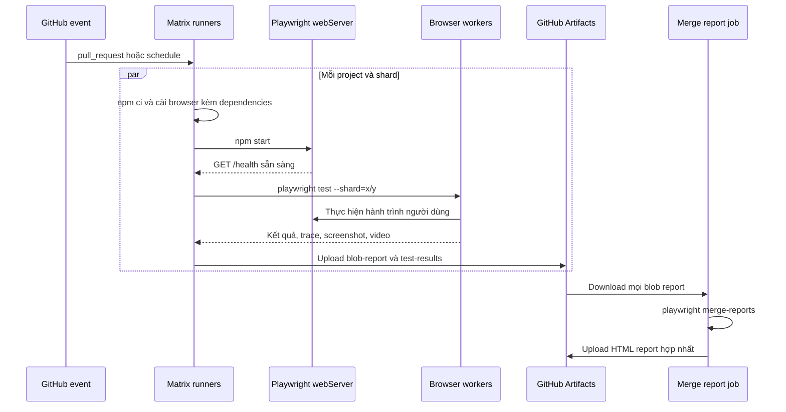

<Callout type="info" title="Mục tiêu thực hành">
  Bạn sẽ xây dựng một luồng E2E bằng Playwright cho web Node.js, chạy Chromium trên pull request, chạy đủ ba browser vào ban đêm và giữ lại report, trace, screenshot cùng video để điều tra lỗi.
</Callout>

## Mục lục

- [Phạm vi của E2E testing](#phạm-vi-của-e2e-testing)
  - [E2E kiểm tra điều gì](#e2e-kiểm-tra-điều-gì)
  - [Vị trí trong test pyramid](#vị-trí-trong-test-pyramid)
- [Luồng thực thi trong CI](#luồng-thực-thi-trong-ci)
- [Bài thực hành Playwright cho web Node.js](#bài-thực-hành-playwright-cho-web-nodejs)
  - [Cấu trúc tối thiểu](#cấu-trúc-tối-thiểu)
  - [Cài Playwright và thêm package scripts](#cài-playwright-và-thêm-package-scripts)
  - [Tạo ứng dụng web mẫu](#tạo-ứng-dụng-web-mẫu)
  - [Cấu hình Playwright](#cấu-hình-playwright)
  - [Viết E2E test đầu tiên](#viết-e2e-test-đầu-tiên)
  - [Chạy tại máy local](#chạy-tại-máy-local)
- [Browser và system dependencies](#browser-và-system-dependencies)
- [Web server và base URL](#web-server-và-base-url)
- [Dữ liệu test có tính xác định](#dữ-liệu-test-có-tính-xác-định)
- [Workers sharding và đánh đổi hiệu năng](#workers-sharding-và-đánh-đổi-hiệu-năng)
  - [Phân biệt worker và shard](#phân-biệt-worker-và-shard)
  - [Chọn mức song song](#chọn-mức-song-song)
- [Workflow GitHub Actions hoàn chỉnh](#workflow-github-actions-hoàn-chỉnh)
  - [Chiến lược pull request và nightly](#chiến-lược-pull-request-và-nightly)
  - [Workflow chạy test và hợp nhất report](#workflow-chạy-test-và-hợp-nhất-report)
  - [Artifact phục vụ điều tra lỗi](#artifact-phục-vụ-điều-tra-lỗi)
- [Timeout retry và flakiness](#timeout-retry-và-flakiness)
  - [Thiết kế timeout theo từng lớp](#thiết-kế-timeout-theo-từng-lớp)
  - [Chỉ retry trên CI](#chỉ-retry-trên-ci)
  - [Xử lý flaky test](#xử-lý-flaky-test)
- [Quality gate và cách xác minh](#quality-gate-và-cách-xác-minh)
  - [Đặt quality gate ổn định](#đặt-quality-gate-ổn-định)
  - [Xác minh từ local đến GitHub](#xác-minh-từ-local-đến-github)
- [Best practices](#best-practices)
- [Troubleshooting](#troubleshooting)
- [Tài liệu chính thức](#tài-liệu-chính-thức)
- [Tiếp tục series](#tiếp-tục-series)

## Phạm vi của E2E testing

**End-to-end testing**, viết tắt là E2E, kiểm tra một hành trình hoàn chỉnh từ giao diện người dùng đến các thành phần phía sau. Một test “thêm công việc” có thể đi qua browser, JavaScript phía client, HTTP server và nơi lưu dữ liệu trước khi xác nhận kết quả trên màn hình.

### E2E kiểm tra điều gì

E2E phù hợp với các hành trình có giá trị kinh doanh cao, chẳng hạn:

- đăng nhập và đăng xuất;
- tìm kiếm rồi thêm sản phẩm vào giỏ hàng;
- tạo đơn hàng hoặc gửi biểu mẫu;
- kiểm tra quyền truy cập của một vai trò;
- xác nhận frontend tích hợp đúng với API thật trong môi trường test.

E2E không nên kiểm tra mọi nhánh logic nhỏ. Ví dụ, hàm tính giảm giá với 20 trường hợp biên nên được kiểm tra bằng unit test. E2E chỉ cần một vài hành trình chứng minh người dùng nhận đúng giá cuối cùng.

### Vị trí trong test pyramid

Test pyramid là mô hình phân bổ số lượng test theo chi phí và phạm vi. Đáy tháp có nhiều unit test nhanh. Lớp giữa có integration test cho ranh giới giữa các module hoặc dịch vụ. Đỉnh tháp có ít E2E test vì mỗi test phải khởi động nhiều thành phần và khó chẩn đoán hơn.

```text
                 /\
                /  \        Ít E2E test
               / E2E\       Chậm hơn, phạm vi rộng
              /------\
             /Integration\   Kiểm tra ranh giới hệ thống
            /------------\
           /  Unit tests  \  Nhiều test, phản hồi nhanh
          /________________\
```

Một E2E test thất bại chỉ cho biết hành trình đã hỏng. Nó không luôn chỉ ra lỗi nằm ở frontend, API hay dữ liệu. Vì vậy, hãy giữ phần lớn logic ở unit và integration test, rồi dùng E2E làm lớp xác nhận cuối cùng cho các luồng quan trọng.

## Luồng thực thi trong CI

Workflow dưới đây tạo nhiều shard. Mỗi shard cài đúng browser cần dùng, để Playwright khởi động web server, chạy test rồi tải blob report và dữ liệu debug lên GitHub. Job cuối hợp nhất các blob thành một HTML report.



## Bài thực hành Playwright cho web Node.js

Ví dụ dùng một ứng dụng quản lý công việc tối thiểu. Server chỉ dùng module `node:http`, vì vậy dependency duy nhất cần thêm cho bài thực hành là `@playwright/test`.

### Cấu trúc tối thiểu

```text
node-e2e-demo/
├── .github/
│   └── workflows/
│       └── e2e.yml
├── tests/
│   └── e2e/
│       └── tasks.spec.ts
├── package-lock.json
├── package.json
├── playwright.config.ts
└── server.mjs
```

Commit `package-lock.json` vào repository. `npm ci` dựa vào lockfile để cài cùng một dependency graph trên local và runner.

### Cài Playwright và thêm package scripts

Chạy lệnh sau tại thư mục dự án:

```bash
npm install --save-dev @playwright/test
```

Thêm các scripts vào `package.json`. Nếu file đã có khóa `scripts`, hãy hợp nhất các khóa bên trong thay vì tạo khóa `scripts` thứ hai.

```json
{
  "type": "module",
  "scripts": {
    "start": "node server.mjs",
    "test:e2e": "playwright test",
    "test:e2e:ui": "playwright test --ui",
    "test:e2e:report": "playwright show-report"
  }
}
```

`npm install` đã ghi phiên bản Playwright vào `package.json` và `package-lock.json`. Không dùng `npx @playwright/test@latest` trong CI vì cách đó bỏ qua phiên bản đã khóa của dự án.

### Tạo ứng dụng web mẫu

Tạo `server.mjs` với health check, giao diện danh sách công việc và endpoint reset dữ liệu dành cho môi trường test:

```js
import { createServer } from 'node:http';

const port = Number(process.env.PORT ?? 3000);
const tasksByNamespace = new Map();

async function readJson(request) {
  const chunks = [];
  for await (const chunk of request) chunks.push(chunk);
  return JSON.parse(Buffer.concat(chunks).toString() || '{}');
}

function sendJson(response, status, body) {
  response.writeHead(status, { 'content-type': 'application/json; charset=utf-8' });
  response.end(JSON.stringify(body));
}

function escapeHtml(value) {
  return String(value)
    .replaceAll('&', '&amp;')
    .replaceAll('<', '&lt;')
    .replaceAll('>', '&gt;')
    .replaceAll('"', '&quot;')
    .replaceAll("'", '&#039;');
}

const server = createServer(async (request, response) => {
  try {
    const url = new URL(request.url, `http://${request.headers.host}`);

    if (request.method === 'GET' && url.pathname === '/health') {
      response.writeHead(200, { 'content-type': 'text/plain' });
      return response.end('ok');
    }

    if (request.method === 'POST' && url.pathname === '/test/reset') {
      if (process.env.NODE_ENV === 'production') {
        return sendJson(response, 404, { error: 'Not found' });
      }

      const { namespace, tasks = [] } = await readJson(request);
      if (!namespace) return sendJson(response, 400, { error: 'namespace is required' });

      tasksByNamespace.set(namespace, tasks.map(({ title }) => ({ title })));
      return sendJson(response, 200, { ok: true });
    }

    if (request.method === 'POST' && url.pathname === '/api/tasks') {
      const { namespace, title } = await readJson(request);
      if (!namespace || !title) {
        return sendJson(response, 400, { error: 'namespace and title are required' });
      }

      const tasks = tasksByNamespace.get(namespace) ?? [];
      const task = { title };
      tasks.push(task);
      tasksByNamespace.set(namespace, tasks);
      return sendJson(response, 201, task);
    }

    if (request.method === 'GET' && url.pathname === '/tasks') {
      const namespace = url.searchParams.get('ns') ?? 'default';
      const items = (tasksByNamespace.get(namespace) ?? [])
        .map((task) => `<li>${escapeHtml(task.title)}</li>`)
        .join('');

      response.writeHead(200, { 'content-type': 'text/html; charset=utf-8' });
      return response.end(`<!doctype html>
<html lang="vi">
  <head><meta charset="utf-8"><title>Công việc</title></head>
  <body>
    <h1>Công việc</h1>
    <ul>${items}</ul>
    <form>
      <label>Tên công việc <input name="title" required></label>
      <button type="submit">Thêm</button>
    </form>
    <script>
      const namespace = ${JSON.stringify(namespace)};
      const form = document.querySelector('form');
      const input = document.querySelector('input');
      const list = document.querySelector('ul');

      form.addEventListener('submit', async (event) => {
        event.preventDefault();
        const result = await fetch('/api/tasks', {
          method: 'POST',
          headers: { 'content-type': 'application/json' },
          body: JSON.stringify({ namespace, title: input.value })
        });
        const task = await result.json();
        const item = document.createElement('li');
        item.textContent = task.title;
        list.append(item);
        input.value = '';
      });
    </script>
  </body>
</html>`);
    }

    sendJson(response, 404, { error: 'Not found' });
  } catch (error) {
    console.error(error);
    sendJson(response, 500, { error: 'Internal server error' });
  }
});

server.listen(port, '127.0.0.1', () => {
  console.log(`Server listening on http://127.0.0.1:${port}`);
});
```

Endpoint `/test/reset` bị vô hiệu khi `NODE_ENV=production`. Trong hệ thống thật, endpoint seed hoặc reset còn phải được bảo vệ bằng network policy hay test credential. Không triển khai một endpoint xóa dữ liệu không xác thực ra production.

### Cấu hình Playwright

Tạo `playwright.config.ts`:

```ts
import { defineConfig, devices } from '@playwright/test';

const isCI = Boolean(process.env.CI);
const baseURL = process.env.PLAYWRIGHT_BASE_URL ?? 'http://127.0.0.1:3000';

export default defineConfig({
  testDir: './tests/e2e',
  fullyParallel: true,
  forbidOnly: isCI,
  failOnFlakyTests: isCI,
  retries: isCI ? 2 : 0,
  workers: isCI ? 2 : undefined,
  timeout: 30_000,
  globalTimeout: isCI ? 25 * 60_000 : undefined,
  expect: {
    timeout: 5_000,
  },
  outputDir: 'test-results',
  reporter: isCI
    ? [['line'], ['blob']]
    : [['list'], ['html', { open: 'never' }]],
  use: {
    baseURL,
    actionTimeout: 10_000,
    navigationTimeout: 15_000,
    trace: 'on-first-retry',
    screenshot: 'only-on-failure',
    video: 'retain-on-failure',
  },
  projects: [
    {
      name: 'chromium',
      use: { ...devices['Desktop Chrome'] },
    },
    {
      name: 'firefox',
      use: { ...devices['Desktop Firefox'] },
    },
    {
      name: 'webkit',
      use: { ...devices['Desktop Safari'] },
    },
  ],
  webServer: process.env.PLAYWRIGHT_BASE_URL
    ? undefined
    : {
        command: 'npm start',
        url: `${baseURL}/health`,
        reuseExistingServer: !isCI,
        timeout: 120_000,
        stdout: 'pipe',
        stderr: 'pipe',
      },
});
```

Các lựa chọn quan trọng:

- `webServer.url` dùng `/health` làm điều kiện sẵn sàng. Playwright chỉ bắt đầu test sau khi server phản hồi.
- `baseURL` cho phép test gọi `page.goto('/tasks')` và `request.post('/test/reset')` bằng URL tương đối.
- `PLAYWRIGHT_BASE_URL` chuyển test sang một môi trường đã chạy sẵn, đồng thời tắt local `webServer`.
- `forbidOnly` làm CI thất bại nếu ai đó commit `test.only`.
- `failOnFlakyTests` biến test chỉ qua sau retry thành lỗi trên CI. Retry vẫn thu thêm bằng chứng, nhưng không che quality gate.
- reporter `blob` giữ kết quả và attachment của từng shard để hợp nhất sau đó.
- trace chỉ được thu ở lần retry đầu tiên. Screenshot và video chỉ được giữ khi test thất bại để giảm dung lượng artifact.

### Viết E2E test đầu tiên

Tạo `tests/e2e/tasks.spec.ts`:

```ts
import { expect, test } from '@playwright/test';

test('người dùng thêm một công việc', async ({ page, request }, testInfo) => {
  const namespace = `${testInfo.testId}-retry-${testInfo.retry}`;
  const seedResponse = await request.post('/test/reset', {
    data: {
      namespace,
      tasks: [{ title: 'Đọc tài liệu' }],
    },
  });

  expect(seedResponse.ok()).toBeTruthy();

  await page.goto(`/tasks?ns=${encodeURIComponent(namespace)}`);
  await expect(page.getByRole('heading', { name: 'Công việc' })).toBeVisible();
  await expect(page.getByRole('listitem')).toHaveText(['Đọc tài liệu']);

  await page.getByLabel('Tên công việc').fill('Chạy E2E');
  await page.getByRole('button', { name: 'Thêm' }).click();

  await expect(page.getByRole('listitem')).toHaveText([
    'Đọc tài liệu',
    'Chạy E2E',
  ]);
});
```

Test dùng locator theo role và label thay vì selector CSS phụ thuộc cấu trúc DOM. Các assertion như `toBeVisible` và `toHaveText` là **web-first assertions**: Playwright tự chờ điều kiện đạt được trong `expect.timeout`, thay vì kiểm tra tức thời.

### Chạy tại máy local

Cài browser một lần, sau đó chạy project Chromium:

```bash
npx playwright install chromium
npm run test:e2e -- --project=chromium
```

Các lệnh hữu ích khác:

```bash
# Quan sát test trong Playwright UI
npm run test:e2e:ui

# Debug một test với browser có giao diện
npx playwright test tests/e2e/tasks.spec.ts --project=chromium --debug

# Mở HTML report của lần chạy local
npm run test:e2e:report
```

## Browser và system dependencies

Package `@playwright/test` chứa test runner và client API. Browser binary là tải xuống riêng. Trên Linux, browser còn cần thư viện hệ điều hành như font, thư viện đồ họa và media codec.

Dùng lệnh sau trên GitHub-hosted Ubuntu runner:

```bash
npx playwright install --with-deps chromium
```

`--with-deps` cài cả browser Chromium tương thích với phiên bản Playwright trong lockfile và các system dependencies cần thiết. Workflow nightly truyền `firefox` hoặc `webkit` để mỗi matrix job chỉ tải browser mà job đó sử dụng.

<Callout type="idea" title="Không cài nhiều hơn nhu cầu">
  PR chỉ chạy Chromium thì chỉ cài Chromium. Cài cả ba browser trong mọi shard làm tăng thời gian tải và dung lượng mà không tăng coverage của job đó.
</Callout>

Không mặc định cache browser binary. Khi phiên bản Playwright đổi, cache browser cũ không còn khớp. System dependencies vẫn phải được cài trên runner mới. Hãy đo thời gian thực tế trước khi thêm cache và luôn đưa phiên bản Playwright vào cache key nếu tổ chức quyết định cache.

## Web server và base URL

`webServer` quản lý vòng đời server cho test. Playwright chạy `npm start`, chờ URL health check, thực thi test rồi dừng process khi kết thúc. Cách này tránh shell command kiểu `npm start & sleep 10`, vốn có hai lỗi: thời gian chờ có thể quá ngắn trên CI hoặc lãng phí khi server khởi động nhanh.

`reuseExistingServer: !process.env.CI` mang hai ý nghĩa:

- local: tái sử dụng server đang nghe ở cổng 3000 để vòng lặp phát triển nhanh hơn;
- CI: không tái sử dụng process lạ. Nếu cổng đã bị chiếm, job thất bại sớm và lộ ra vấn đề cô lập.

Khi kiểm tra staging, đặt `PLAYWRIGHT_BASE_URL=https://staging.example.com`. Cấu hình sẽ không khởi động local server. Dù vậy, staging dùng chung dễ bị test khác hoặc người dùng thay đổi dữ liệu. Với quality gate trên PR, một môi trường tạm thời theo từng PR hoặc server chạy ngay trong job thường có tính xác định cao hơn.

## Dữ liệu test có tính xác định

Dữ liệu có tính xác định, hay **deterministic test data**, nghĩa là cùng input và cùng phiên bản code phải tạo cùng trạng thái ban đầu. Test không nên phụ thuộc dữ liệu còn lại từ run trước, thứ tự test hoặc thời gian hiện tại.

Ví dụ thực hành tạo namespace từ `testInfo.testId` và số lần retry. `testId` là định danh ổn định, duy nhất cho test trong project. Mỗi test reset đúng namespace của mình trước khi mở trang. Vì vậy, hai worker chạy đồng thời không ghi vào cùng danh sách.

Trong dự án thật, chọn một trong các mẫu sau:

- tạo database hoặc schema riêng cho mỗi shard;
- gắn mọi record với `run_id`, `test_id` hoặc tenant test riêng;
- seed bằng API nội bộ rồi xóa bằng fixture hoặc global teardown;
- tạo user test riêng cho từng worker;
- đóng băng thời gian ở lớp service nếu nghiệp vụ phụ thuộc ngày giờ.

Tránh các anti-pattern sau:

- dùng tài khoản test chung cho mọi worker;
- lấy “record mới nhất” từ staging;
- dùng `Math.random()` để hy vọng tránh trùng nhưng không log seed;
- để test B phụ thuộc dữ liệu test A tạo ra;
- retry mà không reset trạng thái do lần chạy trước để lại.

Nếu cần dữ liệu ngẫu nhiên để mở rộng coverage, dùng pseudo-random generator có seed cố định và ghi seed vào report. Khi test thất bại, cùng seed phải tái hiện được lỗi.

## Workers sharding và đánh đổi hiệu năng

### Phân biệt worker và shard

**Worker** là process Playwright trên cùng một runner. Mỗi worker khởi động browser riêng và chạy test độc lập. `workers: 2` cho phép tối đa hai process test hoạt động đồng thời trên một máy.

**Shard** là một phần của test suite được giao cho runner khác. `--shard=1/2` và `--shard=2/2` chia suite thành hai phần. Trong workflow mẫu, mỗi shard là một matrix job riêng.

Tổng mức đồng thời xấp xỉ:

```text
số project × số shard × số worker mỗi runner
```

PR dùng `1 × 2 × 2`, tối đa bốn worker. Nightly dùng `3 × 2 × 2`, tối đa mười hai worker trên sáu runner. Con số thực tế còn phụ thuộc số test và quota job đồng thời của repository.

### Chọn mức song song

`fullyParallel: true` cho phép Playwright phân phối ở mức từng test, nhờ đó shard cân bằng hơn. Đổi lại, mọi test phải thật sự độc lập. Suite dùng chung account, database hoặc rate limit thường lộ race condition khi bật chế độ này.

| Lựa chọn | Lợi ích | Chi phí và rủi ro |
|---|---|---|
| Tăng workers | Nhanh hơn mà không thêm runner | Tranh CPU, RAM và database trên cùng máy |
| Tăng shards | Scale ngang trên nhiều runner | Tăng phút CI, thời gian cài dependency và số artifact |
| `fullyParallel: true` | Cân bằng shard ở mức test | Bắt buộc cô lập dữ liệu và bỏ phụ thuộc thứ tự |
| `fail-fast: false` | Thu đủ lỗi và artifact của các shard | Run tiếp tục tốn chi phí sau lỗi đầu tiên |
| Chạy ba browser | Phát hiện lỗi tương thích engine | Nhân thời gian và tài nguyên kiểm thử |

Bắt đầu với một worker nếu suite chưa ổn định. Sau đó tăng lên hai worker và đo thời gian, CPU, RAM, tải database cùng tỷ lệ flaky. Chỉ thêm shard khi phần thời gian chạy test đủ lớn để bù chi phí khởi tạo runner.

## Workflow GitHub Actions hoàn chỉnh

### Chiến lược pull request và nightly

Không phải mọi thay đổi đều cần ma trận browser đầy đủ:

| Luồng | Phạm vi đề xuất | Mục tiêu |
|---|---|---|
| Pull request | Chromium, 2 shards | Phản hồi nhanh cho đường đi chính và chặn regression |
| Nightly schedule | Chromium, Firefox, WebKit, mỗi project 2 shards | Tìm lỗi tương thích browser và lỗi ít xảy ra |
| Manual dispatch | Cùng chính sách với PR hoặc chỉnh matrix khi điều tra | Reproduce và xác minh bản sửa |

Schedule dùng múi giờ UTC. Cron `17 1 * * *` chạy khoảng 01:17 UTC mỗi ngày. Chọn phút không tròn để giảm khả năng xếp hàng vào thời điểm nhiều workflow cùng khởi động.

### Workflow chạy test và hợp nhất report

Tạo `.github/workflows/e2e.yml`:

```yaml
name: E2E

on:
  pull_request:
    branches: [main]
  schedule:
    - cron: '17 1 * * *'
  workflow_dispatch:

permissions:
  contents: read

concurrency:
  group: e2e-${{ github.workflow }}-${{ github.event.pull_request.number || github.ref }}
  cancel-in-progress: ${{ github.event_name == 'pull_request' }}

jobs:
  playwright-tests:
    name: E2E ${{ matrix.project }} shard ${{ matrix.shardIndex }}/2
    runs-on: ubuntu-latest
    timeout-minutes: 30
    strategy:
      fail-fast: false
      matrix:
        project: ${{ fromJSON(github.event_name == 'schedule' && '["chromium","firefox","webkit"]' || '["chromium"]') }}
        shardIndex: [1, 2]

    steps:
      - name: Checkout source
        uses: actions/checkout@v7

      - name: Set up Node.js
        uses: actions/setup-node@v7
        with:
          node-version: 24
          cache: npm

      - name: Install Node.js dependencies
        run: npm ci

      - name: Install Playwright browser and system dependencies
        run: npx playwright install --with-deps "${{ matrix.project }}"

      - name: Run E2E tests
        run: >-
          npm run test:e2e --
          --project="${{ matrix.project }}"
          --shard="${{ matrix.shardIndex }}/2"

      - name: Upload blob report
        if: ${{ !cancelled() }}
        uses: actions/upload-artifact@v7
        with:
          name: blob-${{ matrix.project }}-${{ matrix.shardIndex }}-attempt-${{ github.run_attempt }}
          path: blob-report/
          if-no-files-found: error
          retention-days: 1

      - name: Upload trace screenshot and video
        if: ${{ !cancelled() }}
        uses: actions/upload-artifact@v7
        with:
          name: debug-${{ matrix.project }}-${{ matrix.shardIndex }}-attempt-${{ github.run_attempt }}
          path: test-results/
          if-no-files-found: ignore
          retention-days: 14

  merge-reports:
    name: Merge E2E report
    if: ${{ !cancelled() }}
    needs: [playwright-tests]
    runs-on: ubuntu-latest
    timeout-minutes: 10

    steps:
      - name: Checkout source
        uses: actions/checkout@v7

      - name: Set up Node.js
        uses: actions/setup-node@v7
        with:
          node-version: 24
          cache: npm

      - name: Install Node.js dependencies
        run: npm ci

      - name: Download blob reports
        uses: actions/download-artifact@v8
        with:
          path: all-blob-reports
          pattern: blob-*-attempt-${{ github.run_attempt }}
          merge-multiple: true

      - name: Merge blob reports into HTML
        run: npx playwright merge-reports --reporter=html ./all-blob-reports

      - name: Upload merged HTML report
        uses: actions/upload-artifact@v7
        with:
          name: playwright-html-attempt-${{ github.run_attempt }}
          path: playwright-report/
          if-no-files-found: error
          retention-days: 14

  e2e-gate:
    name: E2E quality gate
    if: ${{ always() }}
    needs: [playwright-tests, merge-reports]
    runs-on: ubuntu-latest
    timeout-minutes: 2

    steps:
      - name: Require tests and report merge to succeed
        shell: bash
        run: |
          test "${{ needs.playwright-tests.result }}" = "success"
          test "${{ needs.merge-reports.result }}" = "success"
```

Các major version trong workflow được đối chiếu với README và release chính thức của từng action: `actions/checkout@v7`, `actions/setup-node@v7`, `actions/upload-artifact@v7` và `actions/download-artifact@v8`. Khi nâng major, đọc breaking changes và kiểm tra phiên bản Actions Runner tối thiểu nếu dùng self-hosted runner.

Workflow dùng event `pull_request`, không dùng `pull_request_target`. E2E phải chạy code từ PR, vì vậy `pull_request_target` có thể cho code không tin cậy tiếp cận token hoặc secret của base repository. Quyền `contents: read` là đủ cho ví dụ này.

### Artifact phục vụ điều tra lỗi

Playwright tạo hai nhóm đầu ra:

- `blob-report/`: kết quả có thể hợp nhất từ nhiều shard; blob còn mang các attachment của test;
- `test-results/`: file thô như `trace.zip`, screenshot PNG và video WebM theo chính sách trong config.

Step upload dùng `if: !cancelled()` nên vẫn chạy khi test thất bại. Nếu workflow bị hủy, bỏ upload giúp runner kết thúc nhanh. `github.run_attempt` trong tên artifact tránh xung đột khi re-run.

Tải artifact `playwright-html-attempt-*`, giải nén rồi mở bằng web server của Playwright:

```bash
npx playwright show-report ./playwright-report
```

Không mở `index.html` trực tiếp bằng `file://`, vì một số tài nguyên trong report cần được phục vụ qua HTTP.

<Callout type="warn" title="Artifact có thể chứa dữ liệu nhạy cảm">
  Trace, video, screenshot và HTML report có thể ghi lại token, dữ liệu người dùng, source code hoặc request body. Chỉ dùng tài khoản test, giảm retention, giới hạn quyền đọc repository và không đưa production secret vào E2E của pull request.
</Callout>

## Timeout retry và flakiness

### Thiết kế timeout theo từng lớp

Workflow mẫu có nhiều lớp timeout với mục đích khác nhau:

| Lớp | Giá trị mẫu | Bảo vệ điều gì |
|---|---:|---|
| Web server startup | 120 giây | Server không bao giờ sẵn sàng |
| Assertion | 5 giây | UI không đạt trạng thái mong đợi |
| Action | 10 giây | Click, fill hoặc thao tác browser bị treo |
| Navigation | 15 giây | Điều hướng không hoàn thành |
| Một test | 30 giây | Toàn bộ test hoặc fixture chạy quá lâu |
| Toàn Playwright run | 25 phút | Suite hoặc shard bị treo |
| GitHub Actions job | 30 phút | Bao gồm cài đặt, test và upload artifact |

Timeout ngoài phải lớn hơn timeout trong và chừa thời gian upload artifact. Nếu job timeout đúng lúc test kết thúc, step upload không còn cơ hội chạy.

Không chữa test chậm bằng cách tăng mọi timeout. Trước tiên xem trace để xác định server chậm, locator sai hay request không trả về. Dùng web-first assertion và chờ một trạng thái quan sát được. Tránh `page.waitForTimeout(5000)`, vì sleep vừa chậm vừa không đảm bảo ứng dụng đã sẵn sàng.

### Chỉ retry trên CI

`retries: isCI ? 2 : 0` giữ vòng lặp local trung thực: lỗi xuất hiện ngay và developer sửa nguyên nhân. Trên CI, tối đa hai lần retry giúp thu trace ở lần retry đầu và phân loại lỗi không ổn định.

Retry không phải cách biến test đỏ thành xanh. Mỗi retry chạy trong worker process mới. Vì vậy, test phải tự seed hoặc dọn dữ liệu thay vì trông chờ trạng thái browser cũ.

Playwright phân loại kết quả:

- **passed**: qua ngay lần đầu;
- **flaky**: thất bại lần đầu nhưng qua khi retry;
- **failed**: vẫn thất bại sau mọi retry.

Mặc định, một test flaky đã qua retry không làm lệnh Playwright thất bại. Cấu hình thực hành bật `failOnFlakyTests` trên CI, vì vậy shard và quality gate vẫn đỏ nếu test chỉ qua sau retry. Nếu team chọn chính sách ít nghiêm hơn, vẫn phải theo dõi mục flaky trong HTML report và đặt SLA xử lý.

### Xử lý flaky test

Khi gặp flaky test:

1. Mở trace của lần thất bại, không chỉ đọc screenshot cuối.
2. Kiểm tra network request, console error, locator và dữ liệu seed.
3. Chạy lặp lại test trong cùng điều kiện: `npx playwright test tasks.spec.ts --repeat-each=20 --workers=1`.
4. Sau đó tăng workers để tìm race condition: `--repeat-each=20 --workers=4`.
5. Sửa nguyên nhân rồi xác nhận test không còn cần timeout đặc biệt.

Nếu phải quarantine, gắn issue có owner và hạn xử lý. Không để `test.skip` vô thời hạn. Một hành trình quan trọng bị skip không còn là quality gate.

## Quality gate và cách xác minh

### Đặt quality gate ổn định

Matrix tạo tên check thay đổi theo project và shard. Job `E2E quality gate` gom trạng thái về một check cố định. Cấu hình branch protection hoặc repository ruleset yêu cầu check này trước khi merge vào `main`.

Gate chỉ thành công khi:

- mọi project và shard được yêu cầu đều chạy thành công;
- không có test flaky vì `failOnFlakyTests` đang bật trên CI;
- không có job test bị hủy hoặc bỏ qua;
- blob report được tải xuống, hợp nhất và upload thành công;
- không có `test.only` bị commit.

`fail-fast: false` cho phép các shard còn lại hoàn thành để thu đủ bằng chứng debug. Job gate vẫn thất bại nếu chỉ một shard đỏ.

PR từ fork không nhận repository secrets. Workflow mẫu không cần secret nên vẫn chạy an toàn hơn. Nếu E2E bắt buộc dùng môi trường có credential, không cấp production secret cho code PR không tin cậy. Hãy dùng approval, environment tách biệt hoặc workflow đáng tin chạy sau khi code đã được xem xét.

### Xác minh từ local đến GitHub

Thực hiện theo thứ tự sau:

1. Cài dependency và browser từ trạng thái sạch:

   ```bash
   npm ci
   npx playwright install --with-deps chromium
   ```

2. Liệt kê test để phát hiện sai `testDir` hoặc filter:

   ```bash
   npx playwright test --list --project=chromium
   ```

3. Chạy giống một shard CI với một worker để tạo baseline:

   ```bash
   CI=true npm run test:e2e -- --project=chromium --shard=1/2 --workers=1
   ```

4. Chạy shard còn lại rồi bỏ `--workers=1`. Hai shard phải thu thập đủ toàn bộ test và không phụ thuộc thứ tự.
5. Push branch và mở pull request. Trong tab **Actions**, xác nhận có hai job Chromium, job merge report và check `E2E quality gate`.
6. Tạm đổi một expectation để test thất bại. Xác nhận quality gate đỏ nhưng các step upload vẫn tạo blob, HTML report và debug artifact.
7. Khôi phục expectation, push commit mới và xác nhận gate xanh. Không chỉ re-run bản lỗi cũ, vì re-run vẫn dùng commit cũ.
8. Chạy `workflow_dispatch` nếu cần kiểm tra thủ công. Schedule chỉ chạy file workflow trên default branch, vì vậy nightly đầu tiên chỉ xuất hiện sau khi workflow đã được merge.

## Best practices

- Chọn một tập hành trình quan trọng và ngắn cho PR. Đưa coverage browser rộng hoặc test dài sang nightly.
- Dùng locator theo role, label hoặc test id ổn định. Không ghép selector CSS dài theo cấu trúc DOM.
- Dùng web-first assertion. Chờ điều kiện người dùng quan sát được thay vì sleep cố định.
- Để mỗi test tự seed dữ liệu và có namespace riêng. Không dựa vào thứ tự file hay `test.describe.serial` nếu không thật sự cần một flow tuần tự.
- Khóa dependency bằng lockfile và chạy `npm ci`. Browser binary phải khớp package Playwright đã khóa.
- Cài đúng browser cho từng job. Theo dõi thời gian setup trước khi tăng số shard.
- Bắt đầu với ít worker, đo tài nguyên rồi mới tăng. Tốc độ không đáng đổi lấy flaky test.
- Thu trace có chọn lọc bằng `on-first-retry`. Video và screenshot chỉ giữ khi lỗi để kiểm soát artifact size.
- Upload artifact bằng `if: !cancelled()` và đặt retention ngắn theo nhu cầu điều tra.
- Không truyền production secret vào test chạy code pull request. Tránh `pull_request_target` cho workflow checkout rồi thực thi code PR.
- Theo dõi flaky test như defect. Retry là công cụ chẩn đoán và hấp thụ nhiễu tạm thời, không phải tiêu chí chất lượng.
- Dùng một job gate có tên ổn định cho branch protection thay vì yêu cầu trực tiếp từng check của matrix.

## Troubleshooting

| Triệu chứng | Nguyên nhân thường gặp | Cách xử lý |
|---|---|---|
| `Executable doesn't exist` | Browser binary chưa được cài hoặc không khớp phiên bản package | Chạy `npx playwright install <browser>`; trên Ubuntu CI dùng thêm `--with-deps`; commit lockfile và dùng `npm ci` |
| Browser không khởi động vì thiếu shared library | Runner Linux thiếu system dependencies | Chạy `npx playwright install --with-deps "${{ matrix.project }}"` hoặc dùng image Playwright tương thích |
| `webServer` timeout | `npm start` lỗi, bind sai host/cổng hoặc health endpoint không trả mã chấp nhận được | Xem stdout/stderr đã pipe, chạy `npm start` local và gọi `curl http://127.0.0.1:3000/health` |
| `http://localhost:3000` hoạt động local nhưng CI lỗi | App bind địa chỉ khác, cổng khác hoặc biến môi trường không đồng nhất | Dùng cùng `127.0.0.1:3000` trong server, `baseURL` và `webServer.url`; log URL khi server khởi động |
| Test qua riêng lẻ nhưng lỗi khi chạy song song | Dùng chung account, record hoặc database state | Tạo namespace theo `testId`, database theo shard hoặc tạm giảm workers để xác nhận race condition |
| Shard chạy lệch thời gian | File test có kích thước rất khác hoặc chưa bật `fullyParallel` | Bật `fullyParallel` nếu test độc lập; nếu không, chia file lớn thành các file cân bằng hơn |
| Retry qua nhưng lần đầu thường lỗi | Locator, dữ liệu hoặc thời điểm chưa ổn định | Mở trace lần retry đầu, thay sleep bằng web-first assertion và sửa seed dữ liệu; không chỉ tăng retries |
| Không có screenshot hoặc video | Test không thật sự failed ở lần cuối, artifact path sai hoặc policy chỉ giữ khi lỗi | Kiểm tra `test-results/`, `screenshot: 'only-on-failure'`, `video: 'retain-on-failure'` và `if-no-files-found` |
| HTML report của nhiều shard thiếu test | Mỗi shard upload HTML riêng thay vì blob hoặc job merge không tải đủ artifact | Dùng blob reporter, tên artifact duy nhất, `pattern` đúng và `merge-multiple: true` |
| Mở `index.html` nhưng trang trống | Report được mở bằng `file://` | Giải nén artifact rồi chạy `npx playwright show-report ./playwright-report` |
| Artifact upload báo trùng tên | Nhiều matrix job dùng cùng artifact name hoặc re-run dùng lại tên | Thêm project, shard và `github.run_attempt` vào tên artifact |
| Nightly không xuất hiện trên branch tính năng | Scheduled workflow chỉ chạy từ default branch và dùng UTC | Merge workflow vào default branch; kiểm tra cron theo UTC và trạng thái Actions của repository |
| Job bị timeout trước khi upload artifact | `timeout-minutes` quá sát `globalTimeout` | Đặt job timeout lớn hơn Playwright global timeout và chừa thời gian cho report cùng upload |
| PR từ fork không truy cập được staging | Secret không được cấp cho event `pull_request` từ fork | Giữ smoke test self-contained; dùng environment có approval hoặc quy trình đáng tin sau review, không đổi sang `pull_request_target` một cách máy móc |

## Tài liệu chính thức

- [Playwright — Setting up CI](https://playwright.dev/docs/ci-intro)
- [Playwright — Continuous Integration](https://playwright.dev/docs/ci)
- [Playwright — Web server](https://playwright.dev/docs/test-webserver)
- [Playwright — Configuration](https://playwright.dev/docs/test-configuration)
- [Playwright — Retries](https://playwright.dev/docs/test-retries)
- [Playwright — Parallelism](https://playwright.dev/docs/test-parallel)
- [Playwright — Sharding và merge report](https://playwright.dev/docs/test-sharding)
- [Playwright — Reporters](https://playwright.dev/docs/test-reporters)
- [Playwright — Trace Viewer](https://playwright.dev/docs/trace-viewer-intro)
- [GitHub Docs — Store and share data with workflow artifacts](https://docs.github.com/en/actions/tutorials/store-and-share-data)
- [GitHub Docs — Using a matrix for jobs](https://docs.github.com/en/actions/how-tos/write-workflows/choose-what-workflows-do/run-job-variations)
- [GitHub Docs — Events that trigger workflows](https://docs.github.com/en/actions/reference/workflows-and-actions/events-that-trigger-workflows)
- [GitHub Docs — Secure use reference](https://docs.github.com/en/actions/reference/security/secure-use)
- [actions/checkout — README và releases](https://github.com/actions/checkout)
- [actions/setup-node — README và releases](https://github.com/actions/setup-node)
- [actions/upload-artifact — README và releases](https://github.com/actions/upload-artifact)
- [actions/download-artifact — README và releases](https://github.com/actions/download-artifact)

## Tiếp tục series

<Cards>
  <Card title="Integration testing" href="/docs/kiem-thu-chat-luong/02-integration-testing/" description="Kiểm tra ranh giới giữa ứng dụng, database và dịch vụ phụ trợ trước lớp E2E." />
  <Card title="Lint, format và type check" href="/docs/kiem-thu-chat-luong/04-lint-format-typecheck/" description="Thêm các quality gate tĩnh có phản hồi nhanh trên pull request." />
  <Card title="Code coverage" href="/docs/kiem-thu-chat-luong/05-code-coverage/" description="Đo và quản trị coverage cho các lớp test nhanh hơn." />
</Cards>
