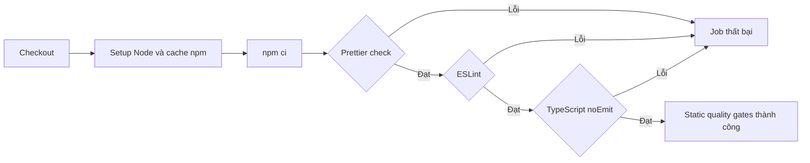

<Callout type="info" title="Mục tiêu của bài">
  Bạn sẽ cấu hình một dự án Node.js/TypeScript để chạy **ESLint flat config**, **Prettier
  `--check`** và **`tsc --noEmit`** theo cùng một cách ở máy local và GitHub Actions. Kết quả
  cuối cùng là một required status check chặn merge khi mã nguồn vi phạm quy tắc, sai định dạng
  hoặc không an toàn về kiểu.
</Callout>

## Mục lục

- [Tổng quan](#tổng-quan)
  - [Ba công cụ và ba trách nhiệm](#ba-công-cụ-và-ba-trách-nhiệm)
  - [Vì sao phải chạy cả ba](#vì-sao-phải-chạy-cả-ba)
- [Thiết kế static quality gates](#thiết-kế-static-quality-gates)
  - [Thứ tự fail nhanh](#thứ-tự-fail-nhanh)
  - [Chính sách pass và fail](#chính-sách-pass-và-fail)
  - [Annotations trên pull request](#annotations-trên-pull-request)
- [Bài thực hành Node.js và TypeScript](#bài-thực-hành-nodejs-và-typescript)
  - [Chuẩn bị dự án](#chuẩn-bị-dự-án)
  - [Khai báo npm scripts](#khai-báo-npm-scripts)
  - [Cấu hình ESLint flat config](#cấu-hình-eslint-flat-config)
  - [Cấu hình Prettier](#cấu-hình-prettier)
  - [Cấu hình TypeScript](#cấu-hình-typescript)
  - [Tạo mã nguồn mẫu](#tạo-mã-nguồn-mẫu)
  - [Tạo workflow GitHub Actions](#tạo-workflow-github-actions)
- [Giải thích workflow](#giải-thích-workflow)
  - [Trigger và concurrency](#trigger-và-concurrency)
  - [Permissions tối thiểu](#permissions-tối-thiểu)
  - [Cache npm và cài đặt tái lập](#cache-npm-và-cài-đặt-tái-lập)
  - [Từ output đến annotations](#từ-output-đến-annotations)
  - [Tích hợp required status checks](#tích-hợp-required-status-checks)
- [Xác minh local và CI](#xác-minh-local-và-ci)
  - [Kiểm tra đường thành công](#kiểm-tra-đường-thành-công)
  - [Cố ý làm từng gate thất bại](#cố-ý-làm-từng-gate-thất-bại)
  - [Tiêu chí hoàn thành](#tiêu-chí-hoàn-thành)
- [Best practices](#best-practices)
- [Anti-patterns](#anti-patterns)
- [Troubleshooting](#troubleshooting)
- [Tài liệu chính thức](#tài-liệu-chính-thức)
- [Cùng series](#cùng-series)

## Tổng quan

**Static analysis** là việc phân tích mã nguồn mà không cần chạy ứng dụng. Trong bài này, mỗi
phép kiểm tra tĩnh là một **quality gate**: điều kiện bắt buộc phải đạt trước khi pull request được
merge.

Ví dụ, một thay đổi có thể chạy đúng ở máy của tác giả nhưng vẫn chứa biến không dùng, định dạng
khác chuẩn hoặc phép gán sai kiểu. Ba gate độc lập giúp phát hiện ba nhóm vấn đề đó sớm, trước khi
đến unit test hoặc deploy.

### Ba công cụ và ba trách nhiệm

| Gate | Câu hỏi công cụ trả lời | Ví dụ lỗi | Có tự sửa được không? |
| --- | --- | --- | --- |
| **ESLint** | Mã có vi phạm quy tắc về tính đúng đắn và khả năng bảo trì không? | Biến không dùng, `Promise` bị bỏ quên khi bật typed lint | Một số lỗi sửa được bằng `--fix` |
| **Prettier** | Văn bản mã nguồn có đúng một định dạng thống nhất không? | Thụt lề, dấu nháy, xuống dòng khác cấu hình | Có, bằng `--write` |
| **TypeScript compiler** | Chương trình có nhất quán về kiểu trên toàn project không? | Gán `string` vào `number`, gọi hàm với sai kiểu | Thường phải sửa thiết kế hoặc mã nguồn |

**Lint** là kiểm tra mã theo tập quy tắc. ESLint có thể phát hiện pattern đáng ngờ mà compiler không
coi là lỗi. Ví dụ, `const result = calculate()` nhưng `result` không bao giờ được dùng là vấn đề bảo
trì, không nhất thiết là lỗi kiểu.

**Format check** chỉ so sánh mã hiện tại với kết quả mà Prettier sẽ tạo ra. Lệnh `prettier . --check`
không ghi đè file. Nó trả exit code `1` nếu có khác biệt, nên phù hợp với CI. Ngược lại,
`prettier . --write` thay đổi file và chỉ nên dùng ở local hoặc trong một workflow chủ động tạo
commit.

**Type check** dùng compiler TypeScript để kiểm tra quan hệ kiểu. Cờ `--noEmit` yêu cầu `tsc` không
sinh JavaScript, source map hay declaration file. Gate này chỉ trả lời “type có hợp lệ không”, còn
build production có thể do `tsc`, esbuild, SWC hoặc công cụ khác đảm nhiệm.

### Vì sao phải chạy cả ba

Các vùng trách nhiệm có giao nhau nhưng không thay thế nhau:

- Prettier có thể xuống dòng một biểu thức nhưng không biết biểu thức đó có dùng sai kiểu.
- `tsc` có thể chấp nhận một biến không dùng nếu project không cấm trường hợp đó.
- ESLint không bảo đảm toàn bộ chương trình type-safe khi chỉ dùng các rule không cần type
  information.
- ESLint rule về style dễ xung đột với Prettier. Vì vậy cấu hình thực hành dùng
  `eslint-config-prettier` để tắt các rule định dạng không cần thiết và để Prettier sở hữu hoàn toàn
  phần format.

<Callout type="warn" title="Không gộp trách nhiệm bằng eslint-plugin-prettier">
  Chạy Prettier như một ESLint rule làm mọi lỗi định dạng xuất hiện dưới tên ESLint, nhưng cũng làm
  lint chậm hơn và khó phân biệt nguyên nhân. Với quality gate, nên chạy `eslint` và
  `prettier --check` thành hai lệnh riêng.
</Callout>

## Thiết kế static quality gates

Một gate tốt phải **deterministic** — cùng commit, lockfile, phiên bản Node và cấu hình thì cho cùng
kết quả. Nó cũng phải trả exit code khác `0` khi vi phạm. GitHub Actions dùng exit code đó để đánh
dấu step và job là failed.

### Thứ tự fail nhanh

**Fail fast** nghĩa là chạy kiểm tra rẻ và có phản hồi rõ trước, rồi mới chạy kiểm tra tốn tài nguyên
hơn. Sau bước cài dependency, workflow trong bài chạy theo thứ tự sau:

1. `prettier . --check`: chủ yếu đọc và parse file, thường nhanh nhất.
2. `eslint . --max-warnings=0`: phân tích cú pháp và rule nhưng không khởi tạo TypeScript Program.
3. `tsc --noEmit`: dựng type graph của toàn project, thường tốn CPU và bộ nhớ nhất.



GitHub Actions mặc định không chạy step tiếp theo khi một step thất bại. Vì vậy lỗi format dừng job
trước lint và type check. Đây là fail-fast **trong một job**.

Thứ tự tối ưu có thể khác ở monorepo lớn. Hãy đo thời gian thực tế của từng step thay vì giả định.
Nếu ESLint dùng `recommendedTypeChecked` và `projectService`, lint cũng phải dựng type information.
Khi đó chi phí lint có thể gần với `tsc`.

### Chính sách pass và fail

Bài thực hành áp dụng chính sách rõ ràng:

| Gate | Điều kiện pass | Điều kiện fail |
| --- | --- | --- |
| Dependency install | `npm ci` khớp `package.json` với `package-lock.json` | Lockfile thiếu, lệch hoặc package không cài được |
| Format | Prettier không tìm thấy file cần format lại | Có ít nhất một file khác output chuẩn |
| Lint | Không có ESLint error hoặc warning | `--max-warnings=0` biến cả warning thành failure |
| Type check | Compiler không có diagnostic lỗi | Có TypeScript error hoặc không đọc được cấu hình |
| Job tổng | Tất cả step trên có exit code `0` | Bất kỳ step nào trả exit code khác `0` |

`--max-warnings=0` tránh tình trạng warning tăng dần nhưng CI vẫn xanh. Nếu một codebase cũ có hàng
trăm warning, hãy giảm baseline theo kế hoạch riêng. Không nên bỏ cờ này rồi coi warning là “sẽ sửa
sau”.

### Annotations trên pull request

**Annotation** là thông báo gắn với file, dòng và cột trong giao diện GitHub. Nó giúp reviewer nhảy
thẳng từ tab **Files changed** đến vị trí lỗi.

Có hai cách tạo annotation:

1. **Output chuẩn của công cụ.** `actions/setup-node` đăng ký problem matcher cho output mặc định của
   `tsc` và các formatter `stylish`/`compact` của ESLint. Problem matcher là biểu thức nhận dạng
   đường dẫn, dòng, cột và message trong log. Vì vậy output như sau có thể trở thành annotation mà
   không cần token ghi pull request:

   ```text
   src/order.ts(8,3): error TS2322: Type 'string' is not assignable to type 'number'.
   ```

2. **Workflow command cho kiểm tra tùy chỉnh.** Một script policy tự viết có thể in lệnh sau ra
   standard output rồi thoát với code `1`:

   ```bash
   echo "::error file=src/config.ts,line=12,col=5,title=Policy violation::Không được commit khóa mặc định"
   exit 1
   ```

Workflow command tạo annotation nhưng bản thân `::error` không phải là cơ chế quality gate đáng tin
cậy nếu process vẫn thoát `0`. Luôn trả exit code khác `0` khi policy phải chặn merge.

<Callout type="info" title="Prettier thường chỉ chỉ ra file">
  Output của `prettier --check` liệt kê file chưa đúng format nhưng không nhất thiết có dòng và cột.
  Đây vẫn là lỗi CI hợp lệ. Chạy `npm run format` ở local để sửa toàn bộ khác biệt rồi review diff.
</Callout>

## Bài thực hành Node.js và TypeScript

Bài thực hành giả định repository mới hoặc một package Node.js độc lập. Nếu đang dùng monorepo, hãy
đặt `working-directory` và `cache-dependency-path` đúng package hoặc dùng npm workspaces.

### Chuẩn bị dự án

Yêu cầu:

- Git repository đã được đẩy lên GitHub.
- Node.js 24 ở local để khớp CI.
- npm và quyền tạo file trong `.github/workflows/`.
- Nhánh mặc định là `main`; đổi filter nếu repository dùng tên khác.

Tạo cấu trúc sau:

```text
static-quality-demo/
├── .github/
│   └── workflows/
│       └── static-quality.yml
├── src/
│   └── index.ts
├── .prettierignore
├── .prettierrc.json
├── eslint.config.mjs
├── package-lock.json
├── package.json
└── tsconfig.json
```

### Khai báo npm scripts

Tạo `package.json` với nội dung tối thiểu sau. Các version được chọn thành một tập tương thích: đặc
biệt `typescript-eslint` 8 hỗ trợ TypeScript nhỏ hơn `6.1`, nên TypeScript được giữ ở dòng `6.0`.
Commit cả `package.json` và lockfile sinh ra từ nó.

```json
{
  "name": "static-quality-demo",
  "version": "1.0.0",
  "private": true,
  "type": "module",
  "engines": {
    "node": ">=24 <25"
  },
  "scripts": {
    "lint": "eslint . --max-warnings=0",
    "lint:fix": "eslint . --fix",
    "format": "prettier . --write",
    "format:check": "prettier . --check",
    "typecheck": "tsc --noEmit",
    "quality": "npm run format:check && npm run lint && npm run typecheck"
  },
  "devDependencies": {
    "@eslint/js": "^10.0.1",
    "@types/node": "^24.13.3",
    "eslint": "^10.8.0",
    "eslint-config-prettier": "^10.1.8",
    "globals": "^17.8.0",
    "prettier": "^3.9.6",
    "typescript": "^6.0.3",
    "typescript-eslint": "^8.65.0"
  }
}
```

Cài dependency và tạo `package-lock.json`:

```bash
npm install
```

`quality` là entry point chung cho developer. Toán tử `&&` bảo đảm thứ tự fail nhanh giống CI.
Các script sửa file (`lint:fix`, `format`) tách khỏi script chỉ kiểm tra (`lint`, `format:check`).

### Cấu hình ESLint flat config

Tạo `eslint.config.mjs`:

```js
// @ts-check

import js from '@eslint/js';
import { defineConfig, globalIgnores } from 'eslint/config';
import eslintConfigPrettier from 'eslint-config-prettier/flat';
import globals from 'globals';
import tseslint from 'typescript-eslint';

export default defineConfig(
  globalIgnores(['dist/', 'coverage/']),
  {
    files: ['**/*.{js,mjs,cjs,ts,mts,cts}'],
    extends: [js.configs.recommended, tseslint.configs.recommended],
    languageOptions: {
      globals: globals.node,
    },
  },
  eslintConfigPrettier,
);
```

Đây là **flat config**, định dạng cấu hình hiện hành của ESLint. Nó xuất một mảng config thay vì dùng
cơ chế `.eslintrc` kế thừa ngầm.

Các điểm quan trọng:

- `files` nói rõ extension nào được lint. Nếu có React, thêm `jsx` và `tsx` cùng plugin phù hợp.
- `globals.node` khai báo các global của Node.js như `process` và `Buffer` là hợp lệ.
- `globalIgnores` loại output sinh tự động khỏi mọi config object.
- `tseslint.configs.recommended` ở đây không cần type information. `tsc --noEmit` vẫn là gate chịu
  trách nhiệm kiểm tra type toàn project.
- `eslintConfigPrettier` phải nằm cuối để tắt rule style xung đột với Prettier.

Nếu cần rule hiểu type, thêm `tseslint.configs.recommendedTypeChecked` và
`languageOptions.parserOptions.projectService: true`. Typed lint mạnh hơn nhưng chậm hơn. Dù bật
nó, vẫn giữ `tsc --noEmit`, vì ESLint không thay thế compiler diagnostics.

### Cấu hình Prettier

Tạo `.prettierrc.json`:

```json
{
  "semi": true,
  "singleQuote": true,
  "trailingComma": "all",
  "printWidth": 100
}
```

Tạo `.prettierignore`:

```text
node_modules/
dist/
coverage/
package-lock.json
```

Config file giúp CLI, editor và CI dùng cùng lựa chọn. `.prettierignore` loại dependency, artifact
và lockfile sinh tự động. Không dùng một glob chỉ khớp `src/**/*.ts` nếu mục tiêu là kiểm tra cả
JSON, YAML và Markdown trong repository.

### Cấu hình TypeScript

Tạo `tsconfig.json`:

```json
{
  "compilerOptions": {
    "target": "ES2023",
    "module": "NodeNext",
    "moduleResolution": "NodeNext",
    "strict": true,
    "noEmit": true,
    "noUncheckedIndexedAccess": true,
    "exactOptionalPropertyTypes": true,
    "forceConsistentCasingInFileNames": true,
    "types": ["node"]
  },
  "include": ["src/**/*.ts"]
}
```

`strict` bật nhóm kiểm tra kiểu nghiêm ngặt. `noUncheckedIndexedAccess` buộc code xử lý khả năng một
phần tử theo index không tồn tại. `exactOptionalPropertyTypes` phân biệt thuộc tính vắng mặt với
thuộc tính có giá trị `undefined`.

`noEmit` xuất hiện cả trong config và npm script. Config bảo vệ lệnh `npx tsc`; cờ trong script làm
ý định của quality gate rõ ràng ngay tại điểm chạy.

### Tạo mã nguồn mẫu

Tạo `src/index.ts`:

```ts
export function sum(values: readonly number[]): number {
  return values.reduce((total, value) => total + value, 0);
}

console.log(sum([10, 20, 30]));
```

File này đúng format, không vi phạm recommended rules và type-safe. Nó là baseline để xác minh cả
local lẫn CI trước khi cố ý tạo lỗi.

### Tạo workflow GitHub Actions

Tạo `.github/workflows/static-quality.yml`:

```yaml
name: Static Quality

on:
  push:
    branches: [main]
  pull_request:
    branches: [main]
  merge_group:

permissions:
  contents: read

concurrency:
  group: ${{ github.workflow }}-${{ github.ref }}
  cancel-in-progress: true

jobs:
  quality:
    name: Static quality gates
    runs-on: ubuntu-latest
    timeout-minutes: 10

    steps:
      - name: Checkout repository
        uses: actions/checkout@v7
        with:
          persist-credentials: false

      - name: Setup Node.js
        uses: actions/setup-node@v7
        with:
          node-version: 24
          cache: npm
          cache-dependency-path: package-lock.json

      - name: Install dependencies
        run: npm ci

      - name: Check formatting
        run: npm run format:check

      - name: Lint source code
        run: npm run lint

      - name: Type-check TypeScript
        run: npm run typecheck
```

Mẫu dùng `actions/checkout@v7` và `actions/setup-node@v7`, là major hiện hành trong tài liệu chính
thức tại thời điểm biên soạn. Hai action dùng runtime Node.js 24. Nếu dùng self-hosted runner, hãy
cập nhật runner đến phiên bản mà major action yêu cầu trước khi nâng version.

## Giải thích workflow

### Trigger và concurrency

Workflow chạy trong ba trường hợp:

- `pull_request` vào `main` để cung cấp phản hồi trước merge.
- `push` vào `main` để xác nhận trạng thái nhánh mặc định sau merge hoặc direct push.
- `merge_group` để required check chạy trên commit tạm do merge queue tạo ra. Nếu repository không
  dùng merge queue, trigger này không phát sinh run.

**Concurrency group** là khóa nhóm các run không nên chạy đồng thời. Biểu thức
`${{ github.workflow }}-${{ github.ref }}` tạo một nhóm riêng cho workflow và ref hiện tại. Khi tác
giả push commit mới lên cùng pull request, `cancel-in-progress: true` hủy run cũ. CI không tốn thời
gian báo kết quả cho commit đã lỗi thời.

Không nên dùng một chuỗi cố định như `group: ci` cho toàn repository. Cách đó khiến run của pull
request A hủy run không liên quan của pull request B.

### Permissions tối thiểu

`permissions: contents: read` áp dụng **least privilege**, tức chỉ cấp quyền nhỏ nhất cần cho công
việc. Checkout cần đọc repository. Các lệnh lint, format check và type check không cần ghi content,
comment pull request hay tạo check bằng API.

Khi khai báo một permission cụ thể, các permission không khai báo được đặt thành `none`. Annotation
từ problem matcher hoặc workflow command do runner xử lý, nên không cần `pull-requests: write`.
`persist-credentials: false` còn ngăn token checkout được giữ lại cho các lệnh Git sau đó, vì job
này không push gì.

<Callout type="warn" title="Không dùng pull_request_target để chạy code của PR">
  `pull_request_target` chạy trong context tin cậy của nhánh đích. Checkout rồi thực thi npm script
  từ một fork không tin cậy có thể làm lộ secret hoặc token. Static check thông thường nên dùng
  `pull_request` như workflow mẫu.
</Callout>

### Cache npm và cài đặt tái lập

`actions/setup-node` với `cache: npm` cache **global package data** của npm, thường nằm trong
`~/.npm`. Action không cache `node_modules`. Sau cache hit, `npm ci` vẫn dựng lại cây dependency
đúng theo lockfile nhưng có thể lấy tarball từ cache thay vì tải qua mạng.

`cache-dependency-path: package-lock.json` đưa hash lockfile vào cache key. Khi dependency thay đổi,
khóa cache cũng thay đổi. Trong monorepo, đặt đường dẫn chính xác, ví dụ:

```yaml
cache-dependency-path: apps/api/package-lock.json
```

`npm ci` phù hợp với CI hơn `npm install` vì nó yêu cầu lockfile tồn tại, thất bại khi lockfile lệch
`package.json`, xóa `node_modules` cũ và không tự sửa manifest. Cache làm nhanh hơn; lockfile và
`npm ci` mới tạo tính tái lập.

Không đưa token, `.npmrc` chứa credential hoặc secret vào cache. Cache có mô hình truy cập khác
secret và có thể được PR từ fork đọc trong những phạm vi GitHub cho phép.

### Từ output đến annotations

`actions/setup-node@v7` đăng ký problem matcher cho `tsc`, ESLint `stylish` và ESLint `compact`.
Workflow giữ formatter mặc định của ESLint, nên các dòng lỗi có file và vị trí được GitHub chuyển
thành annotation.

Để cơ chế này hoạt động ổn định:

- Không pipe output qua lệnh làm mất exit code hoặc thay đổi format.
- Không thêm `continue-on-error: true` cho gate bắt buộc.
- Giữ đường dẫn trong output tương đối với workspace khi có thể.
- Với tool tùy chỉnh, dùng cú pháp `::error file=...,line=...,col=...::message` và thoát khác `0`.
- Không nội suy trực tiếp nội dung không tin cậy vào workflow command. Hãy escape hoặc dùng một
  reporter đã xử lý ký tự xuống dòng và ký tự điều khiển.

Nếu cần log dễ đọc hơn mà không tạo annotation giả, có thể nhóm output:

```bash
echo "::group::TypeScript diagnostics"
npm run typecheck
status=$?
echo "::endgroup::"
exit "$status"
```

Biến `status` giữ nguyên exit code của compiler. Nếu chỉ viết `npm run typecheck || true`, job sẽ
xanh dù có lỗi và quality gate mất tác dụng.

### Tích hợp required status checks

**Required status check** là check mà ruleset hoặc branch protection bắt buộc phải thành công trước
khi merge. Sau khi workflow chạy ít nhất một lần trên pull request:

1. Mở **Settings → Rules → Rulesets** và tạo hoặc sửa branch ruleset cho `main`. Với giao diện branch
   protection cũ, vào **Settings → Branches**.
2. Bật yêu cầu pull request trước merge nếu chính sách repository cần.
3. Bật **Require status checks to pass**.
4. Chọn check **Static quality gates**.
5. Không cho bypass nếu tổ chức muốn gate áp dụng cả administrator và automation.
6. Nếu dùng merge queue, giữ trigger `merge_group` trong workflow.

Giữ `jobs.quality.name: Static quality gates` ổn định và duy nhất giữa các workflow. Đổi job name có
thể làm required check cũ chờ mãi. Dùng cùng một job name ở nhiều workflow cũng tạo kết quả mơ hồ.

<Callout type="warn" title="Cẩn thận với path filter">
  Nếu một required workflow bị bỏ qua bởi `paths` hoặc `paths-ignore`, check liên quan có thể ở trạng
  thái Pending và chặn merge. Workflow mẫu không dùng path filter. Với monorepo, hãy thiết kế một
  gate tổng luôn chạy và trả kết quả rõ ràng thay vì bỏ qua toàn workflow bắt buộc.
</Callout>

## Xác minh local và CI

Đừng chỉ kiểm tra “happy path”. Một gate chỉ đáng tin khi bạn đã chứng minh nó xanh với mã hợp lệ và
đỏ với từng loại vi phạm.

### Kiểm tra đường thành công

Ở local, bắt đầu từ checkout sạch:

```bash
npm ci
npm run quality
git status --short
```

Kết quả mong đợi:

- `npm ci` hoàn tất mà không sửa manifest hoặc lockfile.
- `format:check`, `lint` và `typecheck` đều trả exit code `0`.
- `git status --short` không có output.

Sau đó push branch và mở pull request. Trong tab **Checks**, job **Static quality gates** phải thành
công. Thời gian cài dependency ở run thứ hai thường giảm khi npm cache đã có dữ liệu.

### Cố ý làm từng gate thất bại

Thực hiện từng thử nghiệm riêng, quan sát CI rồi hoàn tác thay đổi.

**Lỗi format:** đổi source thành một dòng không đúng cấu hình:

```ts
console.log(sum([10,20,30]))
```

Xác minh:

```bash
npm run format:check
npm run format
git diff -- src/index.ts
```

Lệnh đầu phải trả code `1`. Lệnh thứ hai sửa file. Diff cho thấy chính xác thay đổi định dạng.

**Lỗi lint:** thêm biến không dùng:

```ts
const unusedTotal = 60;
```

Xác minh `npm run lint` báo `@typescript-eslint/no-unused-vars` và trả code khác `0`.

**Lỗi type:** thay lời gọi hàm bằng kiểu sai:

```ts
console.log(sum([10, '20', 30]));
```

Xác minh `npm run typecheck` báo diagnostic TypeScript tại phần tử `'20'`. Trên GitHub, lỗi nên xuất
hiện trong log và dưới dạng annotation tại file tương ứng.

Cuối cùng, hoàn tác mọi lỗi và chạy lại:

```bash
git restore src/index.ts
npm run quality
```

### Tiêu chí hoàn thành

- [ ] `package-lock.json` đã được commit và `npm ci` chạy được từ checkout sạch.
- [ ] `npm run quality` pass ở local mà không thay đổi working tree.
- [ ] Mỗi vi phạm format, lint và type đều làm đúng command trả exit code khác `0`.
- [ ] Workflow chạy trên pull request, push vào `main` và `merge_group` khi có merge queue.
- [ ] Run mới trên cùng ref hủy run cũ nhờ `cancel-in-progress`.
- [ ] ESLint và TypeScript diagnostics xuất hiện đúng file, dòng hoặc cột trên GitHub.
- [ ] `GITHUB_TOKEN` chỉ có `contents: read`.
- [ ] Check **Static quality gates** đã được chọn trong ruleset hoặc branch protection.
- [ ] Pull request không thể merge khi bất kỳ gate nào thất bại.

## Best practices

- **Một command local tương đương CI.** Duy trì `npm run quality` để developer tái hiện lỗi mà không
  cần đọc workflow.
- **Khóa dependency bằng lockfile.** Review thay đổi `package-lock.json` và dùng `npm ci` trong CI.
  Không tạo lockfile riêng trên runner.
- **Giữ format và lint độc lập.** Prettier sở hữu layout; ESLint sở hữu rule về bug và maintainability.
  Đặt `eslint-config-prettier` cuối flat config.
- **Biến warning thành policy rõ ràng.** Dùng `--max-warnings=0`, hoặc quản lý baseline có thời hạn.
- **Chỉ lint source cần thiết.** Ignore `dist`, coverage và generated code. Đừng ignore source khó sửa
  chỉ để làm CI xanh.
- **Dùng cùng Node major ở local và CI.** Có thể lưu version trong `.nvmrc` rồi dùng
  `node-version-file`, hoặc khai báo `engines` và kiểm tra nó khi nâng cấp.
- **Cập nhật action có kiểm soát.** Dùng major chính thức hiện hành như `@v7` để nhận patch. Môi
  trường cần kiểm soát supply chain chặt hơn nên pin action bằng full commit SHA và dùng Dependabot
  để tạo pull request cập nhật.
- **Đặt timeout.** `timeout-minutes` ngăn parser hoặc dependency install treo vô hạn và tiêu tốn
  runner minutes.
- **Giữ tên required job ổn định, duy nhất.** Tên job là hợp đồng giữa workflow và ruleset.
- **Đo trước khi tách job.** Ba job song song cho phản hồi đồng thời nhưng phải checkout và cài
  dependency ba lần. Một job tuần tự rẻ hơn và fail nhanh hơn cho project nhỏ.
- **Tăng nghiêm ngặt theo rủi ro.** `recommendedTypeChecked` hữu ích cho ứng dụng quan trọng, nhưng
  hãy đo thời gian và cấu hình `projectService` đúng từng package.

## Anti-patterns

| Anti-pattern | Vì sao nguy hiểm | Cách thay thế |
| --- | --- | --- |
| Chạy `prettier --write` trong required CI | Runner âm thầm sửa working tree nhưng commit của PR vẫn sai | Dùng `--check`; sửa và commit ở local |
| Dùng `eslint --fix` làm gate | Một số lỗi bị che bởi auto-fix và diff không được review | CI chỉ lint; cung cấp `lint:fix` cho local |
| Thêm `continue-on-error: true` | Step đỏ nhưng job có thể vẫn được coi là đạt | Để exit code truyền thẳng đến job |
| Chạy `command \| tee log` mà không có `pipefail` | Shell có thể lấy exit code của `tee`, làm mất failure của tool | Không pipe, hoặc bật `set -o pipefail` |
| Dùng `npm install` trong CI | Có thể cập nhật lockfile và giải dependency khác local | Commit lockfile và dùng `npm ci` |
| Cache `node_modules` thủ công | Dễ giữ native binary hoặc cây package không tương thích | Cache npm package data bằng `setup-node` |
| Cho `contents: write` hoặc `pull-requests: write` | Tăng blast radius nếu dependency hoặc script bị compromise | Chỉ cấp `contents: read` |
| Dùng `pull_request_target` rồi chạy code fork | Code không tin cậy chạy với context đặc quyền | Dùng `pull_request` cho static checks |
| Bỏ qua lỗi bằng `|| true` | Required check xanh giả | Sửa lỗi hoặc quản lý ngoại lệ có lý do và thời hạn |
| Đặt cùng job name ở nhiều workflow | Required check có thể mơ hồ và chặn merge | Dùng tên duy nhất, ổn định |
| Áp path filter cho required workflow | Check có thể không được tạo và ở Pending | Luôn chạy gate tổng hoặc thiết kế check fallback |

## Troubleshooting

| Triệu chứng | Nguyên nhân thường gặp | Cách xử lý |
| --- | --- | --- |
| `npm ci` báo lockfile không đồng bộ | `package.json` đổi nhưng chưa chạy `npm install` | Chạy `npm install` ở local, review và commit lockfile |
| `npm ci` pass local nhưng fail CI | Node/npm major hoặc cờ npm khác nhau | Khớp Node 24; commit `.npmrc` nếu lockfile được tạo với cờ như `legacy-peer-deps` |
| `File ignored because no matching configuration was supplied` | Flat config `files` không chứa extension đó | Thêm extension cần lint hoặc giới hạn đối số ESLint có chủ đích |
| ESLint báo `process` hoặc `Buffer` là undefined | Thiếu Node globals | Giữ `globals.node` trong `languageOptions.globals` |
| ESLint và Prettier tranh nhau về style | `eslint-config-prettier` thiếu hoặc không nằm cuối | Import `eslint-config-prettier/flat` và đặt sau các config khác |
| Typed lint báo file không thuộc project | `projectService` không tìm thấy TSConfig chứa file | Sửa `include`, tách config cho file tooling hoặc cấu hình project service phù hợp |
| `tsc` không kiểm tra file mong đợi | `include`/`exclude` hoặc project reference sai | Chạy `npx tsc --showConfig`; kiểm tra danh sách file và TSConfig được dùng |
| `tsc` sinh file trong CI | `noEmit` bị bỏ khỏi config hoặc script | Giữ `"noEmit": true` và script `tsc --noEmit` |
| Prettier pass dù file cần kiểm tra bị sai | File nằm trong `.gitignore`/`.prettierignore` hoặc glob quá hẹp | Chạy `npx prettier file --check --debug-check`; review ignore patterns |
| Không có annotation dù command fail | Formatter output không khớp problem matcher hoặc output đã bị biến đổi | Dùng output mặc định của `tsc`/ESLint; bỏ pipe và custom formatter |
| Annotation có nhưng job vẫn xanh | Script in `::error` nhưng thoát `0`, hoặc có `|| true` | `exit 1` cho vi phạm và bỏ cơ chế nuốt exit code |
| Cache luôn miss | Sai `cache-dependency-path` hoặc lockfile đổi mỗi run | Trỏ đúng lockfile đã commit; không sinh lại lockfile trong CI |
| Action v7 không chạy trên self-hosted runner | Runner quá cũ cho runtime Node.js của action | Nâng GitHub Actions Runner theo release requirement hoặc tạm dùng major tương thích |
| Required check ở trạng thái Pending mãi | Workflow bị path filter bỏ qua, job đổi tên hoặc trigger thiếu | Bỏ filter gây skip, khôi phục tên check và thêm trigger cần thiết |
| PR trong merge queue không chạy check | Workflow thiếu sự kiện `merge_group` | Thêm `merge_group:` và giữ cùng required job |
| Run của PR khác bị hủy | Concurrency group quá rộng, ví dụ chuỗi `ci` cố định | Dùng `${{ github.workflow }}-${{ github.ref }}` |

## Tài liệu chính thức

- [ESLint — Configuration Files](https://eslint.org/docs/latest/use/configure/configuration-files)
- [typescript-eslint — Getting Started với flat config](https://typescript-eslint.io/getting-started/)
- [typescript-eslint — Linting with Type Information](https://typescript-eslint.io/getting-started/typed-linting/)
- [eslint-config-prettier — Flat config](https://github.com/prettier/eslint-config-prettier#eslintconfigjs-flat-config)
- [Prettier CLI — `--check` và exit codes](https://prettier.io/docs/cli)
- [TypeScript TSConfig — `noEmit`](https://www.typescriptlang.org/tsconfig/noEmit.html)
- [npm CLI — `npm ci`](https://docs.npmjs.com/cli/commands/npm-ci)
- [GitHub — Workflow syntax](https://docs.github.com/en/actions/reference/workflows-and-actions/workflow-syntax)
- [GitHub — Control workflow concurrency](https://docs.github.com/en/actions/how-tos/write-workflows/choose-when-workflows-run/control-workflow-concurrency)
- [GitHub — Dependency caching reference](https://docs.github.com/en/actions/reference/workflows-and-actions/dependency-caching)
- [GitHub — Workflow commands và annotations](https://docs.github.com/en/actions/reference/workflows-and-actions/workflow-commands)
- [GitHub — `GITHUB_TOKEN` và permissions](https://docs.github.com/en/actions/how-tos/security-for-github-actions/security-guides/automatic-token-authentication)
- [GitHub — Protected branches và required status checks](https://docs.github.com/en/repositories/configuring-branches-and-merges-in-your-repository/managing-protected-branches/about-protected-branches)
- [actions/checkout — README và version hiện hành](https://github.com/actions/checkout)
- [actions/setup-node — README, cache và problem matchers](https://github.com/actions/setup-node)

## Cùng series

<Cards>
  <Card title="End-to-end testing" href="/docs/kiem-thu-chat-luong/03-end-to-end-testing/" description="Chạy E2E test với trình duyệt và môi trường phụ trợ." />
  <Card title="Code coverage" href="/docs/kiem-thu-chat-luong/05-code-coverage/" description="Thu thập, lưu trữ và đánh giá code coverage." />
  <Card title="CodeQL và dependency review" href="/docs/kiem-thu-chat-luong/06-codeql-dependency-review/" description="Bổ sung các gate bảo mật cho source code và dependency." />
  <Card title="Test reports và annotations" href="/docs/kiem-thu-chat-luong/07-test-reports-annotations/" description="Hiển thị report và annotation chi tiết trên GitHub." />
</Cards>
