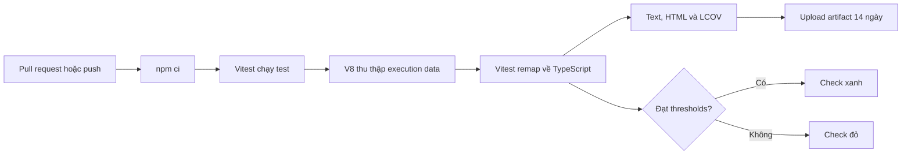

<Callout type="info" title="Kết quả sau bài học">
  Bạn sẽ cấu hình Vitest dùng coverage provider v8, đặt ngưỡng chất lượng có chủ đích, chạy gate trên pull request và lưu cả báo cáo HTML lẫn LCOV dưới dạng GitHub Actions artifact để kiểm chứng sau mỗi lần chạy.
</Callout>

## Mục lục

- [Code coverage đo điều gì](#code-coverage-đo-điều-gì)
  - [Bốn chỉ số cốt lõi](#bốn-chỉ-số-cốt-lõi)
  - [Cách đọc báo cáo](#cách-đọc-báo-cáo)
  - [Những điều coverage không chứng minh](#những-điều-coverage-không-chứng-minh)
- [Chọn chiến lược quality gate](#chọn-chiến-lược-quality-gate)
  - [Ngưỡng toàn cục](#ngưỡng-toàn-cục)
  - [Ngưỡng theo từng file và theo nhóm file](#ngưỡng-theo-từng-file-và-theo-nhóm-file)
  - [Coverage trên mã thay đổi](#coverage-trên-mã-thay-đổi)
  - [Không chạy đua đến mức tuyệt đối](#không-chạy-đua-đến-mức-tuyệt-đối)
- [Thực hành Node.js TypeScript với Vitest](#thực-hành-nodejs-typescript-với-vitest)
  - [Chuẩn bị môi trường](#chuẩn-bị-môi-trường)
  - [Tạo package và scripts](#tạo-package-và-scripts)
  - [Cấu hình TypeScript](#cấu-hình-typescript)
  - [Viết mã nguồn có nhiều nhánh](#viết-mã-nguồn-có-nhiều-nhánh)
  - [Viết test theo hành vi](#viết-test-theo-hành-vi)
  - [Cấu hình Vitest coverage v8](#cấu-hình-vitest-coverage-v8)
  - [Chạy và đọc report ở local](#chạy-và-đọc-report-ở-local)
- [Chạy coverage trong GitHub Actions](#chạy-coverage-trong-github-actions)
  - [Workflow hoàn chỉnh](#workflow-hoàn-chỉnh)
  - [Vì sao workflow có thể dùng làm gate](#vì-sao-workflow-có-thể-dùng-làm-gate)
  - [Lưu HTML và LCOV dưới dạng artifact](#lưu-html-và-lcov-dưới-dạng-artifact)
  - [Phiên bản action và an toàn chuỗi cung ứng](#phiên-bản-action-và-an-toàn-chuỗi-cung-ứng)
- [Áp dụng quality gate và kiểm chứng](#áp-dụng-quality-gate-và-kiểm-chứng)
  - [Bật required check](#bật-required-check)
  - [Kịch bản kiểm chứng](#kịch-bản-kiểm-chứng)
  - [Cách nâng threshold có kiểm soát](#cách-nâng-threshold-có-kiểm-soát)
- [Exclusions có trách nhiệm](#exclusions-có-trách-nhiệm)
  - [Những trường hợp có thể loại trừ](#những-trường-hợp-có-thể-loại-trừ)
  - [Quy tắc review exclusion](#quy-tắc-review-exclusion)
- [Tích hợp dịch vụ coverage bên ngoài](#tích-hợp-dịch-vụ-coverage-bên-ngoài)
- [Best practices](#best-practices)
- [Troubleshooting](#troubleshooting)
- [Tài liệu tham khảo](#tài-liệu-tham-khảo)
- [Các bài trong series](#các-bài-trong-series)

## Code coverage đo điều gì

**Code coverage** là phép đo phần mã nguồn đã được thực thi trong lúc bộ test chạy. Ví dụ, nếu test chỉ đi qua nhánh giao hàng nội địa, báo cáo có thể cho thấy nhánh quốc tế chưa từng được chạy.

Coverage giúp tìm vùng thiếu kiểm thử. Nó không tự đánh giá assertion có đúng hay test case có ý nghĩa hay không. Vì vậy, hãy dùng coverage như bản đồ rủi ro, không dùng nó như bằng chứng duy nhất rằng phần mềm đúng.

### Bốn chỉ số cốt lõi

| Chỉ số | Câu hỏi được trả lời | Ví dụ chưa được cover |
|---|---|---|
| **Line coverage** | Bao nhiêu dòng mã có thể thực thi đã được chạy? | Dòng `throw new RangeError(...)` chưa từng chạy |
| **Statement coverage** | Bao nhiêu câu lệnh thực thi đã được chạy? | Câu lệnh gán hoặc `return` chưa được thực thi |
| **Function coverage** | Bao nhiêu hàm hoặc method đã được gọi ít nhất một lần? | Hàm `calculateShipping` được khai báo nhưng chưa có test gọi |
| **Branch coverage** | Bao nhiêu hướng đi của điều kiện đã được chạy? | Test đã đi qua `if` nhưng chưa đi qua trường hợp `else` |

**Line** và **statement** thường gần nhau nhưng không đồng nghĩa. Một dòng có thể chứa nhiều statement, chẳng hạn `validate(input); save(input)`. Dòng đó được đánh dấu đã chạy dù statement thứ hai có thể chưa chạy do statement đầu ném lỗi.

**Branch** thường phát hiện khoảng trống mà line coverage bỏ sót. Các cấu trúc `if/else`, toán tử ba ngôi, `switch` và biểu thức logic như `vip || subtotal >= limit` đều có thể tạo nhiều nhánh. Nếu chỉ kiểm tra trường hợp điều kiện đúng, dòng `if` đã được chạy nhưng hành vi khi điều kiện sai vẫn chưa được chứng minh.

Công thức chung là:

```text
coverage (%) = số mục đã thực thi / tổng số mục được đo × 100
```

“Mục” trong công thức là dòng, statement, function hoặc branch tùy cột đang đọc.

### Cách đọc báo cáo

Reporter `text` của Vitest in bảng ngay trong log CI. Một kết quả minh họa có thể như sau:

```text
------------------|---------|----------|---------|---------|-------------------
File              | % Stmts | % Branch | % Funcs | % Lines | Uncovered Line #s
------------------|---------|----------|---------|---------|-------------------
All files         |   92.30 |    83.33 |     100 |   92.30 |
 shipping.ts      |   92.30 |    83.33 |     100 |   92.30 | 18
------------------|---------|----------|---------|---------|-------------------
```

Đọc bảng theo thứ tự sau:

1. Xem hàng `All files` để biết gate toàn cục có nguy cơ thất bại ở chỉ số nào.
2. Tìm file có tỷ lệ thấp hoặc có nhiều dòng chưa chạy.
3. Mở báo cáo HTML và đi đến `Uncovered Line #s`, ví dụ dòng `18`.
4. Xác định rủi ro chưa được kiểm thử. Nếu đó là nhánh lỗi thanh toán, hãy bổ sung test hành vi. Nếu đó là code được sinh tự động, hãy xem lại chính sách exclusion.

Báo cáo HTML tô màu theo từng file và phù hợp cho điều tra thủ công. `lcov.info` là báo cáo máy đọc được. Các dịch vụ như Codecov có thể nhận LCOV để tính xu hướng hoặc coverage trên phần diff.

### Những điều coverage không chứng minh

Một dòng “đã chạy” không có nghĩa kết quả đã được xác minh. Test sau làm tăng coverage nhưng không kiểm tra điều gì:

```ts
it('gọi hàm tính phí', () => {
  calculateShipping(200_000, 'domestic', false)
})
```

Test cần assertion về hành vi quan sát được:

```ts
it('thu phí nội địa khi chưa đạt mức miễn phí', () => {
  expect(calculateShipping(200_000, 'domestic', false)).toBe(30_000)
})
```

Coverage cũng không chứng minh các thuộc tính sau:

- yêu cầu nghiệp vụ đã được hiểu đúng;
- test có assertion đủ mạnh;
- dữ liệu biên, concurrency hoặc lỗi tích hợp đã được mô phỏng;
- hệ thống đáp ứng yêu cầu bảo mật và hiệu năng;
- bộ test không flaky.

Nói ngắn gọn: coverage chỉ cho biết mã nào đã chạy. Review test vẫn phải trả lời test đó chứng minh rủi ro nào.

## Chọn chiến lược quality gate

**Quality gate** là điều kiện tự động quyết định một commit đạt hay không đạt tiêu chuẩn tối thiểu. Với coverage, Vitest so sánh báo cáo với `coverage.thresholds` và trả exit code khác `0` khi một ngưỡng bị vi phạm.

Một chiến lược thực tế thường có hai lớp:

1. ngưỡng toàn cục để ngăn chất lượng chung tụt dưới mức sàn;
2. gate trên mã thay đổi hoặc một số module quan trọng để mã mới không tiếp tục tạo nợ kiểm thử.

### Ngưỡng toàn cục

Ngưỡng toàn cục cộng kết quả của mọi file được đo rồi so với một mức chung:

```ts
thresholds: {
  statements: 90,
  branches: 85,
  functions: 90,
  lines: 90,
}
```

Ưu điểm của cách này là đơn giản và ổn định. Một module lớn có coverage tốt có thể bù cho file nhỏ có coverage thấp, nên gate ít bị nhiễu bởi file glue code.

Nhược điểm cũng nằm ở chính phép cộng đó. Một file xử lý quyền truy cập có thể thiếu test nhưng toàn repository vẫn vượt ngưỡng nhờ các utility đơn giản. Vì vậy, global threshold là mức sàn chứ không phải công cụ phát hiện mọi điểm nóng.

<Callout type="idea" title="Luôn khai báo coverage.include">
  Nếu không có `coverage.include`, Vitest mặc định chỉ hiển thị file đã được import trong lúc test. Một file hoàn toàn chưa có test có thể biến mất khỏi mẫu số. Mẫu `src/**/*.{ts,tsx}` trong bài thực hành buộc các file nguồn chưa được chạy xuất hiện với coverage bằng 0.
</Callout>

### Ngưỡng theo từng file và theo nhóm file

`perFile: true` áp cùng bộ ngưỡng cho từng file:

```ts
thresholds: {
  perFile: true,
  statements: 85,
  branches: 80,
  functions: 85,
  lines: 85,
}
```

Cách này ngăn một file tốt che file xấu. Đổi lại, nó dễ gây nhiễu với file rất nhỏ. Ví dụ, một adapter có hai nhánh và thiếu một nhánh sẽ chỉ đạt 50% branch coverage dù rủi ro thực tế có thể thấp.

Vitest cũng cho phép đặt threshold theo glob cho khu vực quan trọng:

```ts
thresholds: {
  statements: 85,
  branches: 80,
  functions: 85,
  lines: 85,
  'src/domain/payment/**': {
    statements: 95,
    branches: 90,
    functions: 95,
    lines: 95,
  },
}
```

Các file khớp glob vẫn được tính vào global threshold. Tuy nhiên, threshold trong glob không tự kế thừa các chỉ số bị bỏ trống từ global threshold. Hãy khai báo rõ mọi chỉ số muốn áp dụng cho nhóm file đó.

Khuyến nghị thực tế là bắt đầu với global threshold. Chỉ dùng `perFile` hoặc glob nghiêm ngặt cho module có rủi ro cao và có owner chịu trách nhiệm xử lý vi phạm.

### Coverage trên mã thay đổi

**Changed-file coverage** chỉ thu thập coverage cho các file thay đổi so với một commit hoặc branch. Vitest hỗ trợ chế độ này:

```bash
npx vitest run --coverage --coverage.changed=origin/main
```

Lệnh trên đo toàn bộ các file đã thay đổi. Nó **không** chỉ đo chính các dòng được thêm hoặc sửa trong diff. Coverage trên đúng các dòng diff, thường gọi là **patch coverage** hoặc **diff coverage**, cần một công cụ phân tích diff riêng hay dịch vụ như Codecov.

Changed-file gate có ưu điểm là tập trung trách nhiệm vào pull request hiện tại. Nó hữu ích khi một repository cũ chưa thể nâng global coverage nhanh. Tuy vậy, nó có các trade-off sau:

- file lớn chỉ đổi một dòng vẫn bị đánh giá trên toàn file;
- shallow checkout có thể không chứa base commit để so sánh;
- rename, generated code và pull request xếp chồng có thể làm phạm vi thay đổi khó hiểu;
- chỉ chạy changed coverage có thể bỏ qua regression do mã thay đổi gián tiếp gây ra ở file khác.

Nếu dùng `origin/main` trong CI, checkout lịch sử Git đủ sâu, ví dụ `actions/checkout` với `fetch-depth: 0`. Giữ global gate làm lớp bảo vệ nền. Dùng patch coverage như lớp bổ sung, không dùng nó để thay toàn bộ test suite.

### Không chạy đua đến mức tuyệt đối

Mức 100% có thể phù hợp với một parser nhỏ, thư viện an toàn quan trọng hoặc module tính tiền. Nó không nên là mục tiêu mặc định cho mọi repository.

Chạy đua con số tuyệt đối thường tạo ba anti-pattern:

- test gọi mã chỉ để đổi màu report nhưng không có assertion có ý nghĩa;
- code bị viết méo để dễ cover thay vì dễ hiểu;
- developer thêm exclusion cho đường đi khó test nhằm giữ dashboard xanh.

Một nhánh error-handling hiếm nhưng có thể làm mất dữ liệu đáng giá hơn mười getter đơn giản. Hãy ưu tiên theo tác động và xác suất lỗi. Mức threshold đúng là mức đủ cao để phát hiện suy giảm, nhưng vẫn buộc nhóm thảo luận về rủi ro thay vì tối ưu chỉ số.

## Thực hành Node.js TypeScript với Vitest

Luồng của bài thực hành như sau:



Vitest dùng V8 để thu thập dữ liệu lúc chạy và remap kết quả về source TypeScript. Từ Vitest 3.2, V8 provider dùng AST-based remapping, cho độ chính xác báo cáo tương đương Istanbul trong các trường hợp được hỗ trợ.

### Chuẩn bị môi trường

Bạn cần:

- Git và một repository GitHub có nhánh mặc định `main`;
- Node.js 22 hoặc 24 cùng npm;
- quyền thêm workflow và cấu hình repository ruleset nếu muốn chặn merge.

Kiểm tra local:

```bash
node --version
npm --version
git --version
```

Cấu trúc tối thiểu sau khi hoàn thành:

```text
.
├── .github/
│   └── workflows/
│       └── coverage.yml
├── src/
│   └── shipping.ts
├── tests/
│   └── shipping.test.ts
├── package.json
├── package-lock.json
├── tsconfig.json
└── vitest.config.ts
```

Thư mục `coverage/` được tạo khi chạy test và không nên commit. Thêm nó vào `.gitignore` của dự án thực tế.

### Tạo package và scripts

Tạo `package.json`:

```json
{
  "name": "vitest-coverage-ci",
  "version": "1.0.0",
  "private": true,
  "type": "module",
  "scripts": {
    "test": "vitest run",
    "test:watch": "vitest",
    "coverage": "vitest run --coverage",
    "typecheck": "tsc --noEmit"
  }
}
```

Cài dependency phát triển:

```bash
npm install --save-dev typescript vitest @vitest/coverage-v8 @types/node
```

`@vitest/coverage-v8` là provider tùy chọn nên phải được cài cùng Vitest. Nâng hai package này trong cùng pull request để tránh lệch phiên bản. Commit `package-lock.json`; workflow sẽ dùng `npm ci` để tái tạo đúng cây dependency đã review.

Script `coverage` dùng `vitest run`, nên chạy một lần rồi thoát. Không dùng `vitest --coverage` không kèm `run` trong CI vì Vitest có thể vào watch mode.

### Cấu hình TypeScript

Tạo `tsconfig.json`:

```json
{
  "compilerOptions": {
    "target": "ES2022",
    "module": "ESNext",
    "moduleResolution": "Bundler",
    "strict": true,
    "noEmit": true,
    "types": ["node", "vitest/globals"]
  },
  "include": ["src", "tests", "vitest.config.ts"]
}
```

Bài này import API test trực tiếp từ `vitest`, nên `vitest/globals` không bắt buộc. Việc khai báo type vẫn hữu ích nếu dự án sau đó bật global test API.

### Viết mã nguồn có nhiều nhánh

Tạo `src/shipping.ts`:

```ts
export type Destination = 'domestic' | 'international'

const shippingRules: Record<
  Destination,
  { freeFrom: number; fee: number }
> = {
  domestic: { freeFrom: 1_000_000, fee: 30_000 },
  international: { freeFrom: 5_000_000, fee: 250_000 },
}

export function calculateShipping(
  subtotal: number,
  destination: Destination,
  vip: boolean,
): number {
  if (subtotal < 0) {
    throw new RangeError('subtotal must be non-negative')
  }

  if (vip) {
    return 0
  }

  const rule = shippingRules[destination]

  if (subtotal >= rule.freeFrom) {
    return 0
  }

  return rule.fee
}
```

Hàm có ba quyết định cần kiểm tra: đầu vào âm, khách VIP và mức miễn phí theo nơi nhận. Branch coverage sẽ giảm nếu test chỉ đi qua một phía của bất kỳ `if` nào.

### Viết test theo hành vi

Tạo `tests/shipping.test.ts`:

```ts
import { describe, expect, it } from 'vitest'
import { calculateShipping } from '../src/shipping'

describe('calculateShipping', () => {
  it('từ chối subtotal âm', () => {
    expect(() => calculateShipping(-1, 'domestic', false)).toThrow(
      'subtotal must be non-negative',
    )
  })

  it('miễn phí cho khách VIP', () => {
    expect(calculateShipping(100_000, 'domestic', true)).toBe(0)
  })

  it('miễn phí khi đơn nội địa đạt ngưỡng', () => {
    expect(calculateShipping(1_000_000, 'domestic', false)).toBe(0)
  })

  it('thu phí nội địa khi chưa đạt ngưỡng', () => {
    expect(calculateShipping(200_000, 'domestic', false)).toBe(30_000)
  })

  it('áp dụng mức phí riêng cho đơn quốc tế', () => {
    expect(calculateShipping(2_000_000, 'international', false)).toBe(
      250_000,
    )
  })
})
```

Mỗi test có một kết quả nghiệp vụ rõ ràng. Test không tồn tại chỉ để chạm vào dòng code. Khi một rule thay đổi, tên test và assertion cho biết hành vi nào cần được review.

### Cấu hình Vitest coverage v8

Tạo `vitest.config.ts`:

```ts
import { defineConfig } from 'vitest/config'

export default defineConfig({
  test: {
    environment: 'node',
    coverage: {
      provider: 'v8',
      reportsDirectory: 'coverage',
      reporter: ['text', 'text-summary', 'html', 'lcov'],
      reportOnFailure: true,
      include: ['src/**/*.{ts,tsx}'],
      exclude: ['src/**/*.d.ts'],
      thresholds: {
        statements: 90,
        branches: 85,
        functions: 90,
        lines: 90,
      },
    },
  },
})
```

Các lựa chọn quan trọng:

- `provider: 'v8'` dùng bộ thu thập coverage có sẵn trong V8 của Node.js.
- `include` đưa cả file nguồn chưa được import vào báo cáo.
- `reporter: 'text'` cho chi tiết theo file trong log; `text-summary` cho tổng quan ngắn.
- `html` tạo báo cáo để con người điều tra; `lcov` tạo `coverage/lcov.info` cho công cụ khác.
- `reportOnFailure: true` cố gắng tạo report ngay cả khi test thất bại, giúp điều tra run đỏ.
- `thresholds` biến coverage thành exit code và do đó thành quality gate.

Provider v8 phù hợp với Node.js và Chromium. Nếu test chạy trên runtime không dựa trên V8, chẳng hạn Firefox, hãy đánh giá provider Istanbul thay vì sao chép cấu hình này.

### Chạy và đọc report ở local

Chạy đúng lệnh CI sẽ dùng:

```bash
npm run typecheck
npm run coverage
```

Kiểm tra hai đầu ra bắt buộc:

```bash
test -s coverage/index.html
test -s coverage/lcov.info
```

Mở HTML report bằng một web server tĩnh để các asset và link hoạt động đúng:

```bash
python3 -m http.server 8000 --directory coverage
```

Sau đó mở `http://localhost:8000`. Chọn `shipping.ts` để xem dòng và nhánh được tô màu.

Bộ test nhỏ trong bài có thể đạt 100% một cách tự nhiên. Threshold vẫn đặt thấp hơn 100 vì mục tiêu của cấu hình là minh họa một policy có khoảng đệm, không tuyên bố mọi dự án phải đạt tuyệt đối.

## Chạy coverage trong GitHub Actions

### Workflow hoàn chỉnh

Tạo `.github/workflows/coverage.yml`:

```yaml
name: Code coverage

on:
  push:
    branches: [main]
  pull_request:
    branches: [main]

permissions:
  contents: read

concurrency:
  group: coverage-${{ github.workflow }}-${{ github.event.pull_request.number || github.ref }}
  cancel-in-progress: true

jobs:
  coverage:
    name: Code coverage / Node.js 24
    runs-on: ubuntu-latest
    timeout-minutes: 15

    steps:
      - name: Checkout source
        uses: actions/checkout@v7
        with:
          persist-credentials: false

      - name: Set up Node.js
        uses: actions/setup-node@v7
        with:
          node-version: 24.x
          cache: npm
          cache-dependency-path: package-lock.json

      - name: Install dependencies
        run: npm ci

      - name: Typecheck
        run: npm run typecheck

      - name: Run tests with coverage
        run: npm run coverage

      - name: Upload HTML and LCOV reports
        if: ${{ !cancelled() }}
        uses: actions/upload-artifact@v7
        with:
          name: coverage-report-${{ github.run_id }}-${{ github.run_attempt }}
          path: coverage/
          if-no-files-found: error
          retention-days: 14
```

Workflow chính không cần secret và không gửi dữ liệu sang bên thứ ba. Nó chạy trên `pull_request`, vì vậy code từ fork không nhận token ghi hay repository secrets.

<Callout type="warn" title="Không dùng pull_request_target để chạy test không tin cậy">
  `pull_request_target` chạy trong ngữ cảnh của base repository. Không checkout rồi thực thi code từ fork bằng sự kiện này khi job có secrets, token ghi hoặc quyền truy cập runner nội bộ.
</Callout>

### Vì sao workflow có thể dùng làm gate

Lệnh `npm run coverage` có hai trách nhiệm nối tiếp nhau:

1. test phải pass;
2. bốn coverage threshold phải pass.

Nếu một assertion sai hoặc threshold không đạt, Vitest trả exit code khác `0`. Job `Code coverage / Node.js 24` chuyển sang trạng thái failure. Khi tên job này được đặt làm required check, GitHub chặn merge.

Step upload có điều kiện `!cancelled()`, nên nó vẫn chạy sau một coverage failure nhưng không chạy khi workflow bị hủy. Việc upload thành công không biến job đỏ thành xanh. Ngược lại, `if-no-files-found: error` làm job thất bại nếu lệnh coverage báo thành công mà không tạo report như kỳ vọng.

`concurrency.cancel-in-progress: true` hủy run cũ khi pull request có commit mới. Nhờ đó, runner không tốn thời gian đo coverage cho commit không còn là đầu pull request.

### Lưu HTML và LCOV dưới dạng artifact

**Artifact** là file đầu ra được GitHub lưu cùng workflow run. Cấu hình upload cả thư mục `coverage/`, vì báo cáo HTML gồm `index.html`, các trang theo file và asset tĩnh. Chỉ upload riêng `index.html` sẽ tạo report hỏng link.

Hai định dạng phục vụ hai đối tượng:

| Định dạng | Đường dẫn | Mục đích |
|---|---|---|
| HTML | `coverage/index.html` và các asset liên quan | Developer tải xuống, giải nén và điều tra theo file/dòng |
| LCOV | `coverage/lcov.info` | Công cụ máy đọc, dashboard hoặc dịch vụ coverage bên ngoài |

`retention-days: 14` cân bằng nhu cầu điều tra pull request gần đây với chi phí lưu trữ. GitHub giới hạn retention theo loại tài khoản và policy repository; giá trị workflow không thể vượt mức tối đa mà repository cho phép. Dự án regulated có thể cần giữ lâu hơn. Repository có nhiều pull request và report lớn có thể giảm xuống 5–7 ngày.

Tên artifact chứa `run_id` và `run_attempt`, nên mỗi lần re-run có danh tính rõ ràng. Không đưa secret, file `.env`, dump dữ liệu sản xuất hoặc source map nhạy cảm vào đường dẫn upload.

Để kiểm chứng thủ công:

1. Mở pull request và chọn check **Code coverage / Node.js 24**.
2. Mở trang **Summary** của workflow run.
3. Trong phần **Artifacts**, tải `coverage-report-<run_id>-<run_attempt>`.
4. Giải nén và xác minh có `index.html` cùng `lcov.info`.
5. Chạy một static server trong thư mục giải nén và mở report HTML.

### Phiên bản action và an toàn chuỗi cung ứng

Workflow dùng `actions/checkout@v7`, `actions/setup-node@v7` và `actions/upload-artifact@v7`. Đây là các major ổn định được hướng dẫn trong README chính thức của từng action tại thời điểm tài liệu được rà soát. Các link nguồn chính thức nằm ở cuối bài.

Major tag như `@v7` nhận bản vá tương thích mà không cần sửa workflow. Đổi lại, tag là tham chiếu có thể di chuyển. Repository có threat model nghiêm ngặt nên pin action bằng full commit SHA và để Dependabot mở pull request cập nhật SHA. Khi pin SHA, thêm comment chứa phiên bản release để reviewer biết đang dùng bản nào.

`persist-credentials: false` tránh giữ credential Git sau checkout vì job chỉ đọc source. `permissions: contents: read` giới hạn `GITHUB_TOKEN` theo nguyên tắc quyền tối thiểu.

Self-hosted runner phải đủ mới để chạy runtime Node.js mà action hiện hành sử dụng. Với GitHub Enterprise Server, kiểm tra bảng tương thích riêng trước khi dùng `upload-artifact@v7`; action artifact mới trên GitHub.com không mặc nhiên có sẵn trên mọi phiên bản GHES.

## Áp dụng quality gate và kiểm chứng

### Bật required check

Trước tiên, merge hoặc push workflow để nó chạy thành công ít nhất một lần. GitHub cần nhìn thấy tên check trước khi ruleset có thể chọn nó.

Sau đó:

1. Mở **Settings → Rules → Rulesets** và tạo hoặc sửa ruleset áp dụng cho `main`.
2. Bật yêu cầu pull request trước khi merge.
3. Bật **Require status checks to pass**.
4. Chọn `Code coverage / Node.js 24`.
5. Cân nhắc yêu cầu branch phải cập nhật với `main` trước khi merge.
6. Hạn chế quyền bypass theo policy của tổ chức.

Giữ tên job ổn định. Đổi `name: Code coverage / Node.js 24` là thay đổi policy vì ruleset có thể tiếp tục chờ tên cũ.

### Kịch bản kiểm chứng

Kiểm tra cả đường đi xanh lẫn đường đi đỏ:

- [ ] `npm run coverage` pass ở local và tạo `coverage/index.html` cùng `coverage/lcov.info`.
- [ ] Pull request tạo đúng check `Code coverage / Node.js 24`.
- [ ] Log có bảng statement, branch, function và line coverage.
- [ ] Workflow Summary có artifact và artifact tải xuống mở được.
- [ ] Artifact hiển thị thời hạn 14 ngày hoặc thời hạn đã bị repository policy giới hạn.
- [ ] Một test cố ý sai làm job đỏ.
- [ ] Một threshold cố ý quá cao làm job đỏ dù mọi test pass.
- [ ] Job đỏ chặn merge khi required check đã bật.
- [ ] Khôi phục test và threshold đúng làm commit mới xanh.

Để thử riêng threshold, tạm đổi `branches` thành `100` và đánh dấu test “từ chối subtotal âm” bằng `it.skip`. Coverage branch phải giảm và lệnh phải thất bại. Khôi phục cả test lẫn threshold trước khi merge.

Kiểm tra exit code ở local:

```bash
npm run coverage
echo $?
```

Giá trị `0` nghĩa cả test và threshold đều đạt. Giá trị khác `0` nghĩa gate đã chặn đúng; đọc log ngay phía trên để phân biệt test failure với threshold failure.

### Cách nâng threshold có kiểm soát

Không hạ threshold trong cùng pull request chỉ để hợp thức hóa một lần giảm coverage. Nếu cần ngoại lệ, yêu cầu reviewer ghi rõ rủi ro, phạm vi và kế hoạch hoàn trả.

Quy trình nâng ngưỡng an toàn:

1. Ghi nhận baseline từ nhánh `main` trong vài run ổn định.
2. Chọn mức sàn thấp hơn baseline một khoảng nhỏ để tránh dao động do generated mapping hoặc thay đổi không đáng kể.
3. Bổ sung test cho vùng rủi ro cao trước, không tối ưu file dễ đạt điểm.
4. Nâng từng chỉ số theo pull request riêng để tác động dễ review.
5. Theo dõi thời gian chạy test và số lần gate thất bại giả.

Vitest có `thresholds.autoUpdate`, nhưng không nên bật tự động trong CI bắt buộc. Một công cụ tự sửa config trong runner không tạo thay đổi được review. Nâng threshold bằng pull request có chủ đích sẽ minh bạch hơn.

## Exclusions có trách nhiệm

**Exclusion** là quy tắc loại file hoặc đoạn code khỏi mẫu số coverage. Exclusion hợp lệ làm báo cáo phản ánh đúng mã nhóm sở hữu. Exclusion không hợp lệ che vùng khó test và làm chỉ số đẹp giả tạo.

### Những trường hợp có thể loại trừ

Các trường hợp thường có lý do chính đáng:

- file khai báo type như `*.d.ts`, vì không có hành vi runtime;
- code sinh từ schema hoặc compiler mà nhóm không chỉnh trực tiếp;
- file vendor được sao chép nguyên trạng và có checksum hoặc quy trình cập nhật riêng;
- nhánh phòng thủ thực sự không thể kích hoạt trong runtime đang test, sau khi đã xác minh bằng review.

Ngay cả với generated code, hãy kiểm tra generator, schema hoặc output contract ở một pipeline khác. “Được loại khỏi coverage” không có nghĩa “không cần kiểm tra”.

Không loại trừ vì các lý do sau:

- file hiện có coverage thấp;
- test khó viết do thiết kế phụ thuộc global hoặc network;
- deadline gần;
- nhánh lỗi hiếm nhưng có tác động lớn.

Trong các trường hợp đó, hãy tạo seam để inject dependency, bổ sung integration test hoặc chấp nhận gate đỏ cho đến khi rủi ro được xử lý.

### Quy tắc review exclusion

Áp dụng checklist sau cho mọi thay đổi `coverage.exclude` hoặc ignore comment:

- [ ] Glob đủ hẹp và không vô tình loại cả thư mục source.
- [ ] Không thêm glob “phòng xa” cho đường dẫn chưa tồn tại.
- [ ] Comment trong config nêu rõ file được sinh từ đâu hoặc kiểm tra thay thế nằm ở đâu.
- [ ] Pull request cho thấy coverage trước và sau exclusion.
- [ ] Code owner của khu vực bị loại trừ đã review.
- [ ] Có issue hoặc ngày xem lại nếu exclusion chỉ mang tính tạm thời.
- [ ] Không dùng exclusion để đưa một pull request đang đỏ thành xanh mà không thảo luận rủi ro.

Ignore comment ở cấp dòng là lựa chọn cuối cùng. Với TypeScript được transpile qua esbuild, comment có thể bị loại bỏ. Vitest hướng dẫn thêm `@preserve` để giữ hint, ví dụ:

```ts
/* v8 ignore next -- @preserve */
const platformSpecificValue = readUnavailablePlatformApi()
```

Comment này có thể đi vào production build. Vì vậy, ưu tiên exclusion ở config cho generated file và ưu tiên test hành vi cho source do nhóm sở hữu.

## Tích hợp dịch vụ coverage bên ngoài

Artifact nội bộ đủ để chạy quality gate và điều tra từng run. Dịch vụ như Codecov hữu ích khi cần:

- comment tóm tắt coverage trên pull request;
- patch coverage trên đúng dòng được thêm hoặc sửa;
- biểu đồ xu hướng qua nhiều commit;
- hợp nhất report từ nhiều job, package hoặc ngôn ngữ.

Luồng tích hợp là tạo `coverage/lcov.info` như bài này rồi upload file đó ở một step riêng. Giữ threshold Vitest làm gate cục bộ để CI không phụ thuộc mạng hay trạng thái của dịch vụ bên ngoài.

Một số cấu hình Codecov cho public repository có thể dùng cơ chế tokenless hoặc GitHub App. Private repository thường cần token. Không hard-code token trong YAML; lưu nó trong GitHub Actions secrets và không cấp cho workflow chạy code fork không tin cậy. Bài thực hành chính không dùng Codecov nên chạy được mà không cần token.

Trước khi biến dịch vụ ngoài thành required check, quyết định rõ hành vi khi dịch vụ timeout. Nếu availability của nhà cung cấp không được phép chặn merge, giữ check đó ở chế độ thông tin và để threshold Vitest là gate bắt buộc.

## Best practices

- **Đo toàn bộ source có chủ đích:** khai báo `coverage.include` để file chưa được import không biến mất khỏi mẫu số.
- **Giữ bốn chỉ số:** branch và function coverage cung cấp tín hiệu mà chỉ nhìn line coverage sẽ bỏ sót.
- **Đặt baseline trước khi đặt mục tiêu:** chọn threshold từ dữ liệu của `main`, sau đó nâng dần bằng pull request.
- **Ưu tiên rủi ro:** test authorization, tiền, dữ liệu và error-handling trước utility ít tác động.
- **Review assertion cùng coverage:** dòng xanh nhưng assertion yếu vẫn là khoảng trống chất lượng.
- **Không trộn lẫn test mode:** dùng `vitest run --coverage` trong CI; dành watch mode cho local.
- **Commit lockfile:** dùng `npm ci` để provider coverage và test runner có phiên bản tái tạo được.
- **Tách report khỏi gate:** Vitest quyết định pass/fail; artifact chỉ lưu bằng chứng để điều tra.
- **Upload report kể cả khi gate đỏ:** điều kiện `!cancelled()` giúp giữ dữ liệu của threshold failure.
- **Đặt retention theo nhu cầu:** report pull request ngắn hạn không cần được giữ vô thời hạn.
- **Giữ artifact sạch:** không upload secret, fixture chứa dữ liệu thật hoặc output ngoài phạm vi coverage.
- **Giới hạn quyền workflow:** coverage chỉ cần `contents: read`; không cấp quyền ghi mặc định.
- **Pin action theo threat model:** major tag thuận tiện, full commit SHA chặt chẽ hơn cho chuỗi cung ứng.
- **Không dùng changed coverage làm lớp duy nhất:** luôn chạy test suite phù hợp và giữ một global floor.
- **Ghi lý do exclusion:** mọi vùng bị loại khỏi phép đo phải có kiểm tra thay thế hoặc lý do được review.

## Troubleshooting

| Triệu chứng | Nguyên nhân thường gặp | Cách xử lý |
|---|---|---|
| Vitest hỏi cài coverage provider trong CI | Chưa có `@vitest/coverage-v8` trong devDependencies hoặc lockfile | Chạy `npm install -D @vitest/coverage-v8`, commit `package.json` và `package-lock.json` |
| Lỗi không tương thích giữa Vitest và provider | Hai package được nâng riêng hoặc lockfile cũ | Nâng `vitest` và `@vitest/coverage-v8` cùng pull request rồi chạy `npm ci` sạch |
| File chưa có test không xuất hiện trong report | Không cấu hình `coverage.include` | Thêm `include: ['src/**/*.{ts,tsx}']` và exclusion tối thiểu |
| Line coverage cao nhưng branch coverage thấp | Test chỉ đi qua một phía của điều kiện | Mở HTML report, tìm nhánh màu vàng/đỏ và thêm test cho hành vi còn thiếu |
| Local pass nhưng CI fail threshold | Node.js, dependency hoặc lệnh chạy khác nhau | Dùng cùng Node major, `npm ci` và `npm run coverage`; commit lockfile |
| Test pass nhưng lệnh coverage trả exit code khác 0 | Một trong bốn threshold không đạt | Đọc thông báo threshold ở cuối log; thêm test hoặc review policy, không nuốt exit code |
| Không có `coverage/lcov.info` | Reporter không chứa `lcov` hoặc reports directory khác | Thêm `'lcov'` vào `coverage.reporter` và so khớp `reportsDirectory` |
| HTML tải về nhưng link hoặc CSS hỏng | Chỉ upload `index.html` | Upload toàn bộ `coverage/`, giải nén và mở qua static server |
| Step upload bị skip khi coverage fail | Step không có điều kiện ghi đè trạng thái mặc định | Dùng `if: ${{ !cancelled() }}` và bật `reportOnFailure: true` |
| Upload báo `No files were found` | Test dừng trước khi tạo report hoặc sai đường dẫn | Kiểm tra log Vitest, `reportsDirectory` và `path`; giữ `if-no-files-found: error` để lỗi lộ rõ |
| Artifact hết hạn sớm hơn mong đợi | Repository hoặc organization giới hạn retention | Kiểm tra **Settings → Actions → General → Artifact and log retention** |
| Changed coverage không tìm thấy `origin/main` | Checkout nông hoặc base ref không được fetch | Dùng `fetch-depth: 0` cho workflow changed coverage và xác minh tên base branch |
| Source map làm file exclusion xuất hiện lại | File được remap về đường dẫn khớp khác | Kiểm tra glob sau remap và cân nhắc `coverage.excludeAfterRemap` theo tài liệu Vitest |
| Coverage rất chậm | Suite nạp nhiều module hoặc report quá rộng | Profile test, giữ `include` đúng source sở hữu và đánh giá Istanbul nếu workload cụ thể phù hợp hơn |
| Action v7 lỗi trên self-hosted runner | Actions Runner quá cũ cho runtime của action | Nâng runner theo release notes chính thức hoặc pin major được hạ tầng hỗ trợ trong lúc nâng cấp |
| `upload-artifact@v7` không chạy trên GHES | Phiên bản GHES chưa hỗ trợ generation artifact action đó | Dùng phiên bản được tài liệu GHES hỗ trợ; không sao chép workflow GitHub.com nguyên trạng |
| Check ở trạng thái `Expected` mãi | Job đổi tên, workflow không trigger hoặc path filter bỏ qua required check | So khớp tên `Code coverage / Node.js 24`, trigger và ruleset; giữ required check luôn được tạo |

## Tài liệu tham khảo

- [Vitest — Coverage guide](https://vitest.dev/guide/coverage.html)
- [Vitest — Coverage configuration](https://vitest.dev/config/coverage.html)
- [Vitest — Command line interface](https://vitest.dev/guide/cli.html)
- [V8 — JavaScript code coverage](https://v8.dev/blog/javascript-code-coverage)
- [GitHub Docs — Building and testing Node.js](https://docs.github.com/en/actions/use-cases-and-examples/building-and-testing/building-and-testing-nodejs)
- [GitHub Docs — Store and share data with workflow artifacts](https://docs.github.com/en/actions/tutorials/store-and-share-data)
- [GitHub Docs — Set artifact and log retention](https://docs.github.com/en/actions/administration-and-support/managing-workflow-runs-and-deployments/managing-workflow-runs/setting-the-retention-period-for-github-actions-artifacts-and-logs-in-your-repository)
- [GitHub Docs — About protected branches](https://docs.github.com/en/repositories/configuring-branches-and-merges-in-your-repository/managing-protected-branches/about-protected-branches)
- [GitHub Docs — Secure use reference](https://docs.github.com/en/actions/reference/security/secure-use)
- [actions/checkout — repository chính thức](https://github.com/actions/checkout)
- [actions/setup-node — repository chính thức](https://github.com/actions/setup-node)
- [actions/upload-artifact — repository chính thức](https://github.com/actions/upload-artifact)
- [Codecov Docs — GitHub integration](https://docs.codecov.com/docs/github)
- [Codecov Docs — Coverage reports and LCOV](https://docs.codecov.com/docs/supported-report-formats)

## Các bài trong series

<Cards>
  <Card title="Lint, format và type check" href="/docs/kiem-thu-chat-luong/04-lint-format-typecheck/" description="Thiết lập các quality gate tĩnh trước khi chạy test." />
  <Card title="CodeQL và dependency review" href="/docs/kiem-thu-chat-luong/06-codeql-dependency-review/" description="Bổ sung kiểm tra source code và dependency về mặt bảo mật." />
  <Card title="Test reports và annotations" href="/docs/kiem-thu-chat-luong/07-test-reports-annotations/" description="Hiển thị kết quả kiểm thử rõ ràng trên pull request." />
</Cards>
