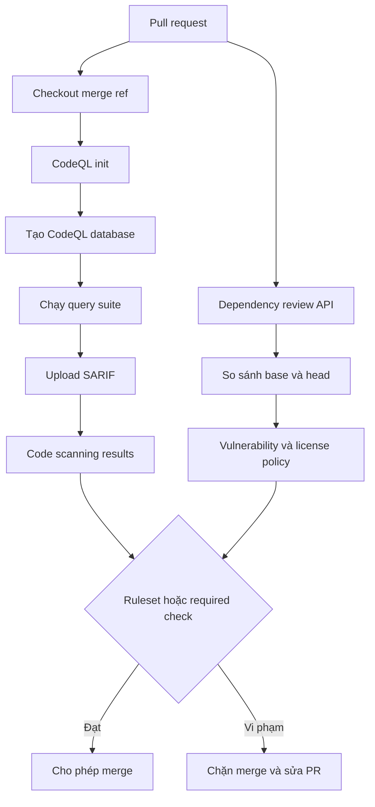

<Callout type="info" title="Kết quả sau bài học">
  Bạn sẽ hiểu CodeQL tạo database và chạy query như thế nào, chọn đúng setup và build mode, triển khai hai workflow có quyền tối thiểu, rồi chặn merge khi mã nguồn hoặc dependency mới vi phạm chính sách bảo mật.
</Callout>

## Mục lục

- [Bức tranh tổng thể](#bức-tranh-tổng-thể)
  - [Hai lớp rủi ro khác nhau](#hai-lớp-rủi-ro-khác-nhau)
  - [Luồng từ commit đến quality gate](#luồng-từ-commit-đến-quality-gate)
- [CodeQL và SAST](#codeql-và-sast)
  - [SAST là gì](#sast-là-gì)
  - [Database CodeQL và query suite](#database-codeql-và-query-suite)
  - [Default setup và advanced setup](#default-setup-và-advanced-setup)
  - [Build mode cho interpreted và compiled languages](#build-mode-cho-interpreted-và-compiled-languages)
  - [SARIF và nơi xem kết quả](#sarif-và-nơi-xem-kết-quả)
- [Dependency graph và dependency review](#dependency-graph-và-dependency-review)
  - [Dependency graph là nền dữ liệu](#dependency-graph-là-nền-dữ-liệu)
  - [Dependency review trên pull request](#dependency-review-trên-pull-request)
  - [Severity và chính sách license](#severity-và-chính-sách-license)
- [Điều kiện sử dụng quyền và mô hình fork](#điều-kiện-sử-dụng-quyền-và-mô-hình-fork)
  - [Availability plan và visibility](#availability-plan-và-visibility)
  - [Permissions theo least privilege](#permissions-theo-least-privilege)
  - [Event và pull request từ fork](#event-và-pull-request-từ-fork)
  - [Phiên bản action được kiểm chứng](#phiên-bản-action-được-kiểm-chứng)
- [Workflow CodeQL advanced setup](#workflow-codeql-advanced-setup)
  - [Workflow hoàn chỉnh với matrix](#workflow-hoàn-chỉnh-với-matrix)
  - [Điều chỉnh matrix và build mode](#điều-chỉnh-matrix-và-build-mode)
  - [Chọn query suite và lịch quét](#chọn-query-suite-và-lịch-quét)
- [Workflow dependency review cho pull request](#workflow-dependency-review-cho-pull-request)
  - [Workflow hoàn chỉnh](#workflow-hoàn-chỉnh)
  - [Tùy biến severity và license](#tùy-biến-severity-và-license)
- [Thiết kế quality gate](#thiết-kế-quality-gate)
  - [Required checks và code scanning merge protection](#required-checks-và-code-scanning-merge-protection)
  - [Baseline false positive và ngoại lệ](#baseline-false-positive-và-ngoại-lệ)
  - [Chính sách vận hành đề xuất](#chính-sách-vận-hành-đề-xuất)
- [Xác minh triển khai](#xác-minh-triển-khai)
  - [Xác minh CodeQL](#xác-minh-codeql)
  - [Xác minh dependency review](#xác-minh-dependency-review)
  - [Kiểm thử negative path](#kiểm-thử-negative-path)
- [Troubleshooting](#troubleshooting)
- [Best practices](#best-practices)
- [Tài liệu tham khảo](#tài-liệu-tham-khảo)
- [Các bài liên quan](#các-bài-liên-quan)

## Bức tranh tổng thể

CodeQL và dependency review cùng bảo vệ pull request, nhưng chúng trả lời hai câu hỏi khác nhau. CodeQL tìm mẫu lỗi trong mã nguồn của ứng dụng. Dependency review kiểm tra thay đổi trong tập dependency mà ứng dụng sử dụng.

### Hai lớp rủi ro khác nhau

| Lớp kiểm tra | Câu hỏi chính | Ví dụ tín hiệu | Nguồn dữ liệu |
|---|---|---|---|
| CodeQL | Mã của chúng ta có đường đi dữ liệu hoặc hành vi nguy hiểm không? | Dữ liệu không tin cậy đi tới câu SQL mà không được xử lý | Source code và quá trình build |
| Dependency review | Pull request có đưa dependency dễ bị tấn công hoặc license không phù hợp vào không? | Lockfile thêm package có GHSA mức `high` | Dependency graph, manifest, lockfile và snapshot đã submit |

**GHSA** là mã định danh của một advisory trong GitHub Advisory Database, ví dụ dạng `GHSA-xxxx-xxxx-xxxx`. Một GHSA mô tả lỗ hổng đã biết trong một package hoặc hệ sinh thái cụ thể.

CodeQL không thay thế dependency review. Một thư viện có lỗ hổng đã biết có thể không tạo ra mẫu mã mà query CodeQL nhận diện. Chiều ngược lại, dependency review không tìm được lỗi tự viết như SQL injection trong controller.

### Luồng từ commit đến quality gate



Workflow chỉ tạo tín hiệu. Ruleset hoặc branch protection mới biến tín hiệu đó thành cổng bắt buộc trước khi merge.

## CodeQL và SAST

### SAST là gì

**Static Application Security Testing**, viết tắt là **SAST**, phân tích mã mà không cần chạy ứng dụng như một người dùng thật. Công cụ đọc cấu trúc chương trình, quan hệ gọi hàm và đường đi dữ liệu để tìm mẫu có thể dẫn đến lỗ hổng.

Ví dụ, một query có thể theo dõi giá trị từ `req.query.id` đến hàm thực thi SQL. Nếu giá trị đi tới câu truy vấn bằng phép nối chuỗi mà không qua parameter binding, query có thể tạo alert.

SAST có ba giới hạn quan trọng:

- nó không chứng minh ứng dụng an toàn tuyệt đối;
- nó có thể bỏ sót framework hoặc dependency chưa được mô hình hóa;
- nó có thể tạo **false positive**, tức cảnh báo trông nguy hiểm theo mô hình nhưng không thể khai thác trong ngữ cảnh thật.

Vì vậy, dùng CodeQL như lớp phát hiện sớm. Vẫn cần unit test, integration test, review kiến trúc, kiểm thử động và quản lý dependency.

### Database CodeQL và query suite

CodeQL coi code là dữ liệu có thể truy vấn. Step `init` chuẩn bị extractor và bắt đầu quá trình tạo **CodeQL database**. Database này biểu diễn các thực thể như biểu thức, hàm, kiểu, luồng điều khiển và luồng dữ liệu của codebase.

Ví dụ với Java/Kotlin ở build mode `autobuild`, CodeQL theo dõi quá trình compiler xử lý source. Thông tin thu được được ghi vào database. Step `analyze` hoàn tất database, chạy query và gửi kết quả lên code scanning.

**Query** là luật phân tích viết bằng ngôn ngữ CodeQL. **Query suite** là tập query được chọn theo mục tiêu chung, nhờ đó không phải liệt kê từng file `.ql`.

Hai suite cần phân biệt:

| Query suite | Đặc tính | Khi nên bắt đầu |
|---|---|---|
| `default` | Độ chính xác cao, ít kết quả độ tin cậy thấp hơn | Repository mới bật CodeQL hoặc đội chưa có quy trình triage |
| `security-extended` | Bao gồm query mặc định và thêm query có severity hoặc precision thấp hơn | Repository rủi ro cao và đội có năng lực xử lý thêm cảnh báo |

Trong advanced setup, `queries: security-extended` yêu cầu chạy thêm suite này cùng các query mặc định. Suite mở rộng thường tìm được nhiều vấn đề hơn, nhưng cũng có thể tăng false positive.

<Callout type="idea" title="Mở rộng theo năng lực triage">
  Bật `default` trước nếu backlog chưa được phân loại. Chỉ mở rộng sang `security-extended` khi đã có người chịu trách nhiệm, SLA và quy trình ghi nhận ngoại lệ.
</Callout>

Custom query, custom query suite `.qls` và query pack phù hợp khi tổ chức cần phát hiện quy tắc riêng. Ví dụ, một công ty có wrapper nội bộ quanh API mã hóa có thể viết model hoặc query để CodeQL hiểu wrapper đó. Custom suite yêu cầu advanced setup.

### Default setup và advanced setup

**Default setup** là cấu hình do GitHub quản lý. GitHub tự phát hiện language, chọn build mode đơn giản, chọn trigger và duy trì workflow phía nền. Đây là lựa chọn nên thử trước cho repository thông thường.

Ví dụ, một repository JavaScript/TypeScript thuần có thể bật default setup trong **Settings → Advanced Security → CodeQL analysis** mà không cần commit workflow YAML.

**Advanced setup** lưu workflow trong `.github/workflows/` và cho phép kiểm soát:

- language matrix và runner;
- build mode hoặc lệnh build thủ công;
- query suite, query pack và config file;
- branch, schedule, timeout và category của kết quả;
- bước cài compiler, private registry hoặc dependency trước khi build.

Ví dụ, monorepo Java/Kotlin cần JDK riêng, Gradle task riêng và query pack nội bộ nên dùng advanced setup.

Không vận hành default setup và một advanced workflow CodeQL trùng mục đích mà không có thiết kế category rõ ràng. Kết quả có thể bị quét lặp, tốn runner và gây khó hiểu khi triage. Khi chuyển từ default sang advanced, thực hiện luồng chuyển đổi trong phần cài đặt CodeQL của repository theo tài liệu GitHub hiện hành.

### Build mode cho interpreted và compiled languages

**Interpreted language** là language thường được phân tích trực tiếp từ source, chẳng hạn JavaScript/TypeScript, Python và Ruby. Các language này dùng `build-mode: none`.

**Compiled language** cần compiler hoặc build system để CodeQL nhìn thấy đúng source, generated code và dependency. CodeQL hỗ trợ ba build mode tùy language:

| Build mode | Cách hoạt động | Ưu điểm | Rủi ro và giới hạn |
|---|---|---|---|
| `none` | Tạo database mà không chạy build | Dễ cấu hình và nhanh hơn | Có thể bỏ lỡ generated code hoặc dependency không suy ra được |
| `autobuild` | CodeQL đoán lệnh build thông dụng | Ít YAML, kết quả tốt nếu dự án theo convention | Có thể chọn sai module, toolchain hoặc task |
| `manual` | Workflow chạy chính lệnh build production hoặc CI | Kiểm soát tốt nhất và thường chính xác nhất | Cần bảo trì toolchain và lệnh build |

Theo tài liệu CodeQL hiện hành, `none` dùng được cho mọi interpreted language và một số compiled language. Với C/C++, C#, Java và Rust, default setup có thể tạo database không build; hỗ trợ cụ thể còn phụ thuộc language và trạng thái phát hành. Kotlin không được phân tích khi `java-kotlin` dùng `none`; Go, Kotlin và Swift cần build mode có build theo tài liệu hiện hành.

Ví dụ, Java/Kotlin dùng Gradle nên bắt đầu với:

```yaml
- name: Initialize CodeQL
  uses: github/codeql-action/init@v4
  with:
    languages: java-kotlin
    build-mode: autobuild
```

Nếu autobuild chọn sai task, đổi sang `manual`. Lệnh build phải nằm **sau** `init` và **trước** `analyze` để extractor quan sát quá trình compile:

```yaml
- name: Initialize CodeQL
  uses: github/codeql-action/init@v4
  with:
    languages: java-kotlin
    build-mode: manual

- name: Build application for CodeQL
  run: ./gradlew --no-daemon clean assemble

- name: Analyze with CodeQL
  uses: github/codeql-action/analyze@v4
```

Không chạy build chính trước `init` rồi chỉ gọi `analyze`. Với manual build, CodeQL cần quan sát chính quá trình build diễn ra giữa hai step.

### SARIF và nơi xem kết quả

**SARIF**, viết tắt của **Static Analysis Results Interchange Format**, là định dạng JSON chuẩn để trao đổi kết quả phân tích tĩnh. Một kết quả SARIF thường chứa rule, severity, vị trí source và dấu vết liên quan.

Với CodeQL Action, `github/codeql-action/analyze@v4` hoàn tất database, chạy query, tạo kết quả SARIF và upload lên GitHub. Không thêm `upload-sarif` lần nữa cho cùng kết quả CodeQL.

Sau khi GitHub xử lý kết quả, xem ở các vị trí sau:

- pull request **Checks**, trong check **Code scanning results**;
- annotation ở **Conversation** hoặc **Files changed** nếu alert nằm trong diff;
- repository **Security and quality → Code scanning**; một số giao diện hoặc tài liệu cũ gọi ngắn là **Security tab**;
- tool status page để xem lần quét, cấu hình và độ bao phủ file.

Matrix tự tạo category riêng theo language và biến matrix. Workflow mẫu vẫn đặt `category` rõ ràng để kết quả nhiều language không ghi đè nhau. Với công cụ SAST bên thứ ba, dùng `github/codeql-action/upload-sarif@v4` và gán category duy nhất nếu upload nhiều tập kết quả cho cùng commit.

## Dependency graph và dependency review

### Dependency graph là nền dữ liệu

**Dependency graph** là bản tổng hợp dependency từ manifest, lockfile và các snapshot gửi qua Dependency Submission API. GitHub parse các hệ sinh thái được hỗ trợ và cập nhật graph khi repository thay đổi.

Ví dụ, `package.json` mô tả dependency trực tiếp còn `package-lock.json` chốt cả dependency bắc cầu. Dependency graph dùng hai nguồn này để hiển thị quan hệ package chính xác hơn chỉ đọc manifest.

Dependency graph là điều kiện nền cho dependency review. Bật nó tại **Settings → Advanced Security → Dependency Graph**. Sau khi bật, chờ GitHub parse manifest và lockfile trước khi kết luận workflow bị lỗi.

Nếu build sinh ra dependency mà GitHub không thể suy ra từ file tĩnh, hãy cân nhắc Dependency Submission API. Khi dùng cả dependency submission và dependency review, tránh race condition bằng cách chạy submission trước review trong cùng workflow, hoặc dùng cơ chế retry snapshot theo hướng dẫn chính thức.

### Dependency review trên pull request

Dependency review so sánh dependency ở **base commit** với **head commit** của pull request. Nó cho biết package được thêm, xóa hoặc cập nhật; dependency trực tiếp hoặc bắc cầu; vulnerability đã biết; cùng thông tin license khi dữ liệu có sẵn.

Ví dụ, một pull request chỉ đổi phiên bản package trực tiếp trong `package.json`, nhưng lockfile thêm ba package bắc cầu. Dependency review hiển thị cả bốn thay đổi nếu hệ sinh thái và lockfile được hỗ trợ.

Có hai trải nghiệm bổ sung nhau:

1. **Dependency review trên giao diện PR:** xem rich diff trong **Files changed** khi manifest hoặc lockfile đổi.
2. **Dependency Review Action:** gọi Dependency Review REST API, áp severity hoặc license policy, rồi trả trạng thái pass hoặc fail cho workflow.

Dependency review không thay Dependabot alerts. Dependency review cố chặn dependency rủi ro **trước khi merge**. Dependabot alerts phát hiện vulnerability trong dependency **đã tồn tại** trên nhánh được theo dõi.

### Severity và chính sách license

`fail-on-severity` đặt ngưỡng thấp nhất làm action thất bại. Với `high`, cả `high` và `critical` đều chặn pull request; `moderate` và `low` chỉ được báo cáo.

```yaml
with:
  fail-on-severity: high
  fail-on-scopes: runtime
```

`fail-on-scopes: runtime` tập trung gate vào dependency chạy trong production. Nếu tổ chức coi toolchain và test dependency cũng thuộc attack surface, thêm `development`. Scope `unknown` cần được xem xét riêng vì metadata có thể không đủ để phân loại.

License policy có hai kiểu:

- `allow-licenses`: chỉ chấp nhận SPDX identifier hoặc expression đã liệt kê;
- `deny-licenses`: chặn identifier đã liệt kê.

Không cấu hình cả hai cùng lúc. Dependency Review Action v5 đánh dấu `deny-licenses` là deprecated và có thể bỏ ở major kế tiếp. Với cấu hình mới, ưu tiên allow-list đã được pháp lý phê duyệt. Tuy nhiên, allow-list nghiêm ngặt làm tăng công việc khi gặp expression mới.

<Callout type="warn" title="License policy không phải tư vấn pháp lý">
  SPDX identifier chỉ là dữ liệu đầu vào. Việc một license có phù hợp với sản phẩm, mô hình phân phối và nghĩa vụ công bố source hay không phải do bộ phận pháp lý hoặc chủ sở hữu policy quyết định.
</Callout>

Action hiện thông báo khi không xác định được license nhưng không tự động fail chỉ vì license là unknown. Vì vậy, đừng hiểu check xanh là mọi dependency đều có license đã xác minh.

## Điều kiện sử dụng quyền và mô hình fork

### Availability plan và visibility

Tại thời điểm tài liệu này được rà soát, GitHub công bố:

- code scanning bằng CodeQL khả dụng cho public repository trên GitHub.com;
- với repository thuộc organization trên GitHub Team, Enterprise Cloud hoặc Enterprise Server, CodeQL yêu cầu GitHub Code Security được bật theo điều kiện của plan;
- dependency review khả dụng cho public repository;
- Dependency Review Action trong private repository yêu cầu GitHub Code Security hoặc GitHub Advanced Security phù hợp được bật;
- GitHub Actions và dependency graph phải được bật cho workflow tương ứng.

Tên gói, entitlement, phạm vi private hoặc internal repository và giao diện cài đặt có thể thay đổi. Trước khi rollout, kiểm tra mục **Who can use this feature?** trong tài liệu chính thức hiện hành và trang billing của chính organization. Đừng suy luận entitlement chỉ từ việc workflow YAML hợp lệ.

### Permissions theo least privilege

**Least privilege** là chỉ cấp đúng quyền cần thiết trong thời gian cần thiết. Khi khai báo bất kỳ `permissions` nào, các quyền không được liệt kê được đặt thành `none`.

Workflow CodeQL advanced setup trong bài dùng:

```yaml
permissions:
  actions: read
  contents: read
  security-events: write
```

Ý nghĩa:

- `contents: read` cho phép checkout source;
- `actions: read` cần cho workflow code scanning trong private repository theo template chính thức;
- `security-events: write` cho phép upload kết quả code scanning;
- không cấp `contents: write`, `pull-requests: write`, `id-token: write` hoặc secrets vì job không cần chúng.

Nếu tải private CodeQL pack từ GitHub Packages, có thể cần `packages: read`. Chỉ thêm quyền này sau khi xác nhận pack thực sự cần nó.

Workflow dependency review chỉ cần:

```yaml
permissions:
  contents: read
```

Chỉ khi bật `comment-summary-in-pr: always` hoặc `on-failure` mới cần `pull-requests: write`. Bài này giữ summary trong job summary và không cấp quyền ghi PR.

### Event và pull request từ fork

Dùng `pull_request` để phân tích code không tin cậy. Event này checkout merge ref của PR theo mặc định, nhờ đó CodeQL phân tích kết quả dự kiến sau khi ghép với base branch.

Với pull request từ fork, GitHub ghi rõ:

- secrets, ngoại trừ `GITHUB_TOKEN`, không được truyền vào runner;
- `GITHUB_TOKEN` bị giới hạn ở quyền đọc;
- contributor lần đầu trên public repository có thể cần maintainer phê duyệt run;
- private repository chỉ chạy workflow fork nếu cài đặt repository cho phép;
- pull request của Dependabot chịu hạn chế tương tự fork.

Khai báo `security-events: write` không tự nâng token của fork vượt policy nền tảng. Workflow CodeQL chuẩn vẫn dùng `pull_request` để tạo kết quả PR, nhưng một số API hoặc tính năng thử nghiệm có thể không khả dụng trong run từ fork. Hãy kiểm chứng bằng một fork PR thật trên chính repository và xem log upload, thay vì giả định hành vi của repository public và private giống nhau.

Dependency review trong cấu hình này chỉ yêu cầu `contents: read`, nên phù hợp với mô hình token chỉ đọc. Không bật comment PR nếu muốn giữ quyền tối thiểu và khả năng chạy nhất quán trên fork.

<Callout type="error" title="Không đổi sang pull_request_target để lấy quyền ghi">
  `pull_request_target` chạy trong ngữ cảnh đặc quyền của base repository. Checkout rồi build code từ fork trong ngữ cảnh đó có thể làm lộ secrets, đầu độc cache hoặc chiếm quyền ghi repository. Giữ `pull_request` cho CodeQL và dependency review.
</Callout>

Không chạy code fork trên self-hosted runner dùng chung với tài nguyên nội bộ. Token read-only không ngăn code độc hại đọc file còn sót, tiến trình khác hoặc dịch vụ mạng mà runner truy cập được.

### Phiên bản action được kiểm chứng

Các major trong ví dụ đã được đối chiếu với repository và tài liệu chính thức hiện hành:

| Action | Major dùng trong bài | Ghi chú vận hành |
|---|---|---|
| `github/codeql-action/init` và `analyze` | `v4` | `v4` là major CodeQL Action mới nhất được hỗ trợ trong README chính thức |
| `actions/dependency-review-action` | `v5` | `v5` dùng runtime Node.js 24; README yêu cầu Actions Runner tối thiểu `v2.327.1` |
| `actions/checkout` | `v7` | Major mới nhất trong README chính thức; có bảo vệ bổ sung cho checkout fork trong event đặc quyền |
| `actions/setup-java` | `v5` | Major production được README khuyến nghị; `v6` còn đang phát triển tại thời điểm rà soát |

GitHub-hosted runner được cập nhật bởi GitHub. Với self-hosted runner, nâng runner trước khi nâng action dùng Node.js 24. Luôn đọc release notes vì yêu cầu tối thiểu có thể tăng ở major mới.

Major tag như `@v4` hoặc `@v5` tự nhận bugfix trong cùng major. Với threat model nghiêm ngặt, pin action vào full commit SHA đã xác minh. Full SHA là tham chiếu bất biến mạnh hơn tag, nhưng phải có Dependabot hoặc quy trình định kỳ để cập nhật bản vá.

## Workflow CodeQL advanced setup

### Workflow hoàn chỉnh với matrix

Ví dụ dưới đây dành cho monorepo có JavaScript/TypeScript, Python và Java/Kotlin. Xóa language không tồn tại trong repository; đừng giữ một ô matrix chỉ để minh họa.

Tạo `.github/workflows/codeql.yml` với nội dung:

```yaml
name: CodeQL

on:
  push:
    branches: [main]
  pull_request:
    branches: [main]
  merge_group:
    types: [checks_requested]
  schedule:
    - cron: '23 3 * * 2'

permissions:
  actions: read
  contents: read
  security-events: write

concurrency:
  group: codeql-${{ github.workflow }}-${{ github.event.pull_request.number || github.ref }}
  cancel-in-progress: true

jobs:
  analyze:
    name: CodeQL / ${{ matrix.language }}
    runs-on: ubuntu-latest
    timeout-minutes: 45

    strategy:
      fail-fast: false
      matrix:
        include:
          - language: javascript-typescript
            build-mode: none
          - language: python
            build-mode: none
          - language: java-kotlin
            build-mode: autobuild

    steps:
      - name: Checkout source
        uses: actions/checkout@v7
        with:
          persist-credentials: false

      - name: Initialize CodeQL
        uses: github/codeql-action/init@v4
        with:
          languages: ${{ matrix.language }}
          build-mode: ${{ matrix.build-mode }}
          queries: security-extended

      - name: Analyze and upload results
        uses: github/codeql-action/analyze@v4
        with:
          category: /language:${{ matrix.language }}
```

`fail-fast: false` cho phép các language còn lại hoàn tất nếu một language lỗi. Điều này hữu ích khi phân biệt lỗi build Java với alert JavaScript. `persist-credentials: false` tránh giữ credential Git sau checkout vì job không push.

`merge_group` tạo check cho merge queue. Nếu repository không dùng merge queue, event này không tạo run thừa. Nếu dùng runner hoặc matrix khác cho Swift, đặt Swift trên `macos-latest` theo yêu cầu platform thay vì ép mọi language lên Linux.

### Điều chỉnh matrix và build mode

Language identifier phải là identifier CodeQL, không phải tên tùy ý:

- `javascript-typescript` cho cả JavaScript và TypeScript;
- `java-kotlin` cho Java, Kotlin hoặc cả hai;
- `c-cpp`, `csharp`, `go`, `python`, `ruby`, `rust`, `swift` và `actions` cho các language tương ứng.

Ví dụ, thêm GitHub Actions workflow scanning bằng một ô riêng:

```yaml
- language: actions
  build-mode: none
```

Nếu Java/Kotlin autobuild không đúng, đổi đúng ô matrix thành `manual` và thêm setup cùng build step có điều kiện:

```yaml
      - name: Set up Java 21
        if: matrix.language == 'java-kotlin' && matrix.build-mode == 'manual'
        uses: actions/setup-java@v5
        with:
          distribution: temurin
          java-version: '21'
          cache: gradle

      - name: Build Java and Kotlin
        if: matrix.language == 'java-kotlin' && matrix.build-mode == 'manual'
        run: ./gradlew --no-daemon clean assemble
```

Hai step này phải đặt giữa `init` và `analyze`. Dùng đúng JDK và task mà CI production đã kiểm chứng. Nếu build cần private registry, cấp credential chỉ cho job hoặc step Java/Kotlin; không cấp cho toàn workflow hay các ô matrix khác.

Với monorepo rất lớn, có thể tách workflow hoặc matrix theo component. Khi đó mỗi phân tích cần category ổn định và duy nhất để tránh SARIF của component này thay thế component khác.

### Chọn query suite và lịch quét

Workflow mẫu dùng `security-extended`. Nếu đội chưa sẵn sàng xử lý thêm tín hiệu, bỏ dòng `queries` để dùng tập mặc định có precision cao hơn:

```yaml
      - name: Initialize CodeQL
        uses: github/codeql-action/init@v4
        with:
          languages: ${{ matrix.language }}
          build-mode: ${{ matrix.build-mode }}
```

Schedule hàng tuần có giá trị ngay cả khi source không đổi. Query và model CodeQL được cập nhật có thể phát hiện vấn đề mới trên commit cũ.

Cron `23 3 * * 2` chạy lúc 03:23 UTC mỗi thứ Ba trên commit mới nhất của default branch. Chọn phút không tròn và giờ thấp tải để giảm khả năng bị chậm. Workflow schedule chỉ chạy từ file trên default branch.

Đừng dùng schedule thay cho pull request. PR scan chặn lỗi trước merge; schedule tìm hiểu biết mới xuất hiện sau đó. Hai trigger giải quyết hai thời điểm rủi ro khác nhau.

## Workflow dependency review cho pull request

### Workflow hoàn chỉnh

Tạo `.github/workflows/dependency-review.yml` với nội dung sau. Workflow này cố ý chỉ chạy trên `pull_request` nhắm vào `main`.

```yaml
name: Dependency Review

on:
  pull_request:
    branches: [main]

permissions:
  contents: read

concurrency:
  group: dependency-review-${{ github.event.pull_request.number }}
  cancel-in-progress: true

jobs:
  dependency-review:
    name: Dependency review
    runs-on: ubuntu-latest
    timeout-minutes: 10

    steps:
      - name: Checkout pull request
        uses: actions/checkout@v7
        with:
          persist-credentials: false

      - name: Review dependency changes
        uses: actions/dependency-review-action@v5
        with:
          fail-on-severity: high
          fail-on-scopes: runtime
          allow-licenses: >-
            Apache-2.0,
            BSD-2-Clause,
            BSD-3-Clause,
            ISC,
            MIT
          show-patched-versions: true
```

Danh sách license chỉ là ví dụ về cơ chế cấu hình. Trước khi áp dụng, thay nó bằng policy đã được organization và pháp lý phê duyệt. Một sản phẩm có thể cần danh sách khác hoàn toàn.

Action đọc diff dependency qua API. Checkout vẫn được giữ theo mẫu chính thức và để workflow có working tree nhất quán, nhưng không cần `fetch-depth: 0` chỉ để action tự tính diff.

### Tùy biến severity và license

Chọn ngưỡng theo threat model:

| Policy | Cấu hình gợi ý | Trade-off |
|---|---|---|
| Chỉ chặn rủi ro nghiêm trọng nhất | `fail-on-severity: critical` | Ít nhiễu nhưng cho phép package mức `high` vào nhánh |
| Cân bằng cho ứng dụng production | `fail-on-severity: high` | Chặn `high` và `critical`, vẫn cần theo dõi `moderate` |
| Gate nghiêm ngặt | `fail-on-severity: moderate` hoặc `low` | Phát hiện sớm hơn nhưng tăng số ngoại lệ và thời gian triage |

Nếu policy hiện tại là deny-list, cú pháp vẫn có dạng:

```yaml
with:
  fail-on-severity: high
  deny-licenses: GPL-3.0-only, AGPL-3.0-only
```

Các identifier trên chỉ minh họa cú pháp SPDX, không phải kết luận pháp lý. Không dùng đồng thời `allow-licenses` và `deny-licenses`. Do `deny-licenses` đã deprecated trong v5, hãy lập kế hoạch chuyển policy trước major kế tiếp.

`allow-ghsas` bỏ qua advisory cụ thể:

```yaml
with:
  allow-ghsas: GHSA-xxxx-xxxx-xxxx
```

Không copy giá trị minh họa này vào workflow. Chỉ thêm GHSA có thật sau khi đánh giá exploitability, ghi owner, lý do, biện pháp bù trừ và ngày hết hạn. Xóa ngoại lệ ngay khi có bản vá phù hợp.

Không bật `warn-only: true` cho gate bắt buộc. Tùy chọn đó làm action thành công dù phát hiện vulnerability và ghi đè ý nghĩa của `fail-on-severity`.

## Thiết kế quality gate

### Required checks và code scanning merge protection

Có hai loại tín hiệu CodeQL cần phân biệt:

1. **CodeQL workflow job** cho biết quá trình checkout, build, tạo database và upload có thành công không.
2. **Code scanning results** cho biết có alert đạt ngưỡng làm check thất bại không.

Theo hành vi mặc định được GitHub mô tả, code scanning results check thất bại khi có kết quả mới mức `error`, hoặc security severity `critical` hay `high`. Kết quả thấp hơn thường được báo như warning hoặc note. Repository có thể thay đổi ngưỡng bằng cấu hình code scanning hoặc ruleset.

Thiết lập gate theo thứ tự:

1. Push hai workflow và để chúng chạy thành công ít nhất một lần.
2. Vào **Settings → Rules → Rulesets** và tạo branch ruleset nhắm `main`.
3. Yêu cầu pull request trước khi merge.
4. Thêm **Dependency review** vào required status checks.
5. Bật **Require code scanning results**, chọn tool **CodeQL**, rồi chọn security alert threshold phù hợp, ví dụ **High or higher**.
6. Cân nhắc yêu cầu branch cập nhật trước khi merge và chặn bypass cho vai trò không được miễn trừ.
7. Nếu dùng merge queue, giữ `merge_group` cho CodeQL và kiểm tra end-to-end rằng mọi check bắt buộc xuất hiện trên merge group.

Ruleset cho code scanning tốt hơn việc chỉ yêu cầu job `CodeQL / language`. Job có thể upload thành công dù kết quả chứa alert. Code scanning merge protection gắn trực tiếp với tool và ngưỡng alert.

<Callout type="warn" title="Required check phải luôn xuất hiện">
  Path filter hoặc điều kiện job có thể làm check bắt buộc bị treo ở trạng thái Expected hoặc Pending. Hai workflow mẫu không dùng path filter. Nếu thêm filter, hãy thiết kế một check tổng hợp có tên ổn định hoặc cập nhật ruleset cùng lúc.
</Callout>

Dependency Review Action trong bài chỉ chạy trên `pull_request`. Nếu organization dùng merge queue và yêu cầu chạy lại mọi gate trên `merge_group`, kiểm tra hành vi ruleset trước khi rollout. Đừng thêm `merge_group` một cách máy móc: dependency review cần base và head hợp lệ, còn action yêu cầu cung cấp `base-ref` và `head-ref` cho event không phải PR.

### Baseline false positive và ngoại lệ

**Baseline** là tập vấn đề đã tồn tại trước khi bật gate. Nếu chặn toàn bộ baseline ngay lập tức, đội có thể tắt công cụ thay vì sửa dần.

Chiến lược thực tế:

- triage alert hiện có trên default branch;
- gate pull request theo alert mới hoặc ngưỡng nghiêm trọng;
- tạo backlog có owner và SLA cho baseline;
- tăng dần ngưỡng khi backlog giảm;
- không dùng `continue-on-error` để che cả lỗi cấu hình lẫn alert.

Khi CodeQL báo false positive, kiểm tra source, sink và sanitizer trên data-flow path. Nếu alert thật sự không thể khai thác, dismiss bằng đúng reason và ghi comment giải thích. Dismissal có lịch sử phục vụ audit.

Không loại cả query chỉ vì một alert nhiễu. Query filter ảnh hưởng mọi lần phân tích sau. Chỉ exclude rule khi đã chứng minh rule không phù hợp ở quy mô repository và có review của security owner.

Với dependency review, ngoại lệ nên hẹp:

- dùng đúng một GHSA thay vì `warn-only` toàn workflow;
- dùng package URL cụ thể khi cần ngoại lệ license cho một package;
- ghi ticket, owner, ngày hết hạn và bản vá dự kiến;
- review lại khi advisory hoặc package metadata đổi.

### Chính sách vận hành đề xuất

| Rủi ro | Gate trên PR | Quét định kỳ | SLA gợi ý |
|---|---|---|---|
| CodeQL `critical` hoặc `high` mới | Chặn merge | Hàng tuần | Sửa trước merge |
| CodeQL `medium` mới | Cảnh báo hoặc chặn tùy threat model | Hàng tuần | Triage trong sprint hiện tại |
| Dependency runtime `critical` hoặc `high` mới | Chặn merge | Dependabot theo dõi nhánh mặc định | Sửa trước merge |
| License ngoài allow-list | Chặn merge | Review inventory định kỳ | Pháp lý hoặc owner quyết định trước merge |
| False positive đã xác minh | Ngoại lệ có lý do | Review lại định kỳ | Có ngày hết hạn |

SLA trong bảng là điểm khởi đầu, không phải chuẩn bắt buộc của GitHub. Điều chỉnh theo dữ liệu, mức phơi nhiễm và quy định của tổ chức.

Tách trách nhiệm rõ ràng:

- developer sửa source hoặc nâng package;
- security owner quyết định exploitability và ngoại lệ GHSA;
- legal hoặc compliance owner quyết định license;
- platform owner duy trì workflow, runner, ruleset và action version.

## Xác minh triển khai

### Xác minh CodeQL

Sau run đầu tiên, kiểm tra:

- [ ] Mỗi language thật trong repository có đúng một job matrix.
- [ ] Interpreted language dùng `none`; compiled language dùng mode đã chủ đích chọn.
- [ ] Với manual build, lệnh build nằm giữa `init` và `analyze`.
- [ ] `analyze` upload thành công và category khác nhau theo language.
- [ ] **Security and quality → Code scanning** hiển thị tool CodeQL và lần quét gần nhất.
- [ ] Pull request tạo **Code scanning results** cùng annotation khi có alert trong diff.
- [ ] Schedule tồn tại trên default branch và cron được hiểu theo UTC.
- [ ] Fork PR thật không nhận secrets và hành vi upload được ghi nhận đúng theo policy repository.
- [ ] Merge queue, nếu có, tạo CodeQL checks cho `merge_group`.

Tool status page cần cho thấy language mong đợi và tỷ lệ file được phân tích hợp lý. “Workflow xanh” chưa đủ nếu matrix thiếu language chính.

### Xác minh dependency review

Mở một pull request có thay đổi manifest và lockfile rồi kiểm tra:

- [ ] Dependency graph đã bật và có inventory.
- [ ] **Files changed** hiển thị dependency diff cho hệ sinh thái được hỗ trợ.
- [ ] Job summary liệt kê package thêm, xóa hoặc cập nhật.
- [ ] Dependency bắc cầu trong lockfile xuất hiện khi dữ liệu hỗ trợ.
- [ ] `high` hoặc `critical` runtime dependency mới làm job fail theo policy mẫu.
- [ ] License ngoài allow-list làm job fail khi license được nhận diện.
- [ ] License unknown được báo nhưng không bị hiểu nhầm là đã được cho phép về mặt pháp lý.
- [ ] Pull request không đổi dependency vẫn cho kết quả hợp lệ, không tạo lỗi giả.
- [ ] Fork PR và Dependabot PR chạy theo cài đặt phê duyệt workflow của repository.

### Kiểm thử negative path

**Negative path** là tình huống cố ý vi phạm policy để chứng minh gate thực sự chặn merge.

Thực hiện trên repository thử nghiệm hoặc pull request dùng một lần:

1. Chọn một CodeQL query chính thức cho language của dự án và tạo mẫu code tối thiểu khớp query đó.
2. Push PR, xác nhận Code scanning results thất bại ở đúng rule và ruleset chặn merge.
3. Sửa mẫu code an toàn, push lại và xác nhận alert biến mất.
4. Tạo PR khác thêm một package test có advisory hiện hành đạt ngưỡng. Chọn advisory trực tiếp từ GitHub Advisory Database tại thời điểm test.
5. Xác nhận Dependency review fail, hiển thị GHSA và bản patched nếu dữ liệu có sẵn.
6. Thay bằng phiên bản đã vá hoặc bỏ package, rồi xác nhận check xanh.
7. Thử một license có SPDX identifier nằm ngoài allow-list trong môi trường thử nghiệm và xác nhận gate license hoạt động.
8. Đóng PR thử nghiệm; không merge code cố ý dễ bị tấn công.

Không hard-code một package “dễ bị tấn công” lâu dài trong tài liệu hoặc test production. Advisory và phiên bản vá thay đổi theo thời gian.

## Troubleshooting

| Triệu chứng | Nguyên nhân cần kiểm tra | Hướng xử lý |
|---|---|---|
| `Resource not accessible by integration` ở CodeQL | Thiếu `security-events: write`, tính năng chưa bật hoặc token fork bị giới hạn | So khớp permissions với workflow mẫu; kiểm tra Code Security, event, fork approval và log upload |
| CodeQL báo advanced setup không khả dụng | Default setup đang hoạt động hoặc repository không đủ điều kiện | Chuyển setup trong **Settings → Advanced Security** theo hướng dẫn chính thức; kiểm tra plan và visibility |
| Job xanh nhưng không có language chính | Matrix dùng sai identifier hoặc quên thêm language mới | So khớp matrix với danh sách CodeQL hỗ trợ và tool status page |
| `autobuild` không tìm được build | Monorepo, toolchain riêng hoặc task không theo convention | Đổi language đó sang `manual`, setup toolchain và chạy đúng lệnh build giữa `init` và `analyze` |
| `No source code was seen during the build` | Build chạy trước `init`, build cache bỏ qua compile hoặc task không build source cần quét | Chạy clean build sau `init`; tắt cache build gây no-op cho lần chẩn đoán |
| Java được quét nhưng Kotlin bị bỏ qua | `java-kotlin` đang dùng `build-mode: none` | Dùng `autobuild` hoặc `manual` để compiler xử lý Kotlin |
| SARIF upload ghi đè kết quả khác | Hai phân tích có cùng tool và category | Đặt category ổn định, duy nhất theo language hoặc component |
| Alert có ở Security and quality nhưng không hiện trên PR | Alert không mới, không nằm trong diff hoặc phân tích thuộc ref khác | Mở **View all branch alerts**, kiểm tra base, head, category và lần phân tích |
| Code scanning results xanh dù có cảnh báo thấp | Ngưỡng mặc định chỉ fail severity cao hơn | Cấu hình code scanning merge protection và threshold trong ruleset |
| Dependency review trả `403` hoặc không có dữ liệu | Dependency graph tắt, entitlement thiếu, event hoặc token không hợp lệ | Bật dependency graph; kiểm tra Code Security, `contents: read` và `pull_request` event |
| Dependency review không thấy package vừa đổi | Hệ sinh thái hoặc manifest không được hỗ trợ, lockfile chưa cập nhật, graph chưa parse | Kiểm tra danh sách ecosystem hỗ trợ, commit lockfile và chờ graph cập nhật |
| License unknown không làm job fail | Đây là hành vi được action công bố | Triage thủ công hoặc bổ sung policy ngoài action; không coi check xanh là license đã xác minh |
| Action báo không được dùng cả allow và deny license | `allow-licenses` và `deny-licenses` cùng tồn tại | Chọn đúng một mô hình policy; ưu tiên kế hoạch chuyển sang allow-list với v5 |
| Self-hosted runner lỗi runtime Node.js | Runner cũ hơn yêu cầu của action major | Nâng Actions Runner; Dependency Review Action v5 yêu cầu tối thiểu `v2.327.1` |
| Required check ở trạng thái Expected | Workflow bị skip bởi branch hoặc path filter, tên job đổi, hay event merge queue thiếu | So khớp trigger và tên check với ruleset; kiểm tra `merge_group` nếu dùng merge queue |
| Schedule không tạo run | Workflow không nằm trên default branch hoặc cron chưa đến thời điểm UTC | Merge workflow vào default branch và kiểm tra biểu thức cron theo UTC |
| CodeQL hết bộ nhớ hoặc timeout | Codebase lớn, suite mở rộng hoặc runner quá nhỏ | Tăng runner, timeout hoặc chia component; đo trước khi loại query bảo mật |
| Fork PR không chạy | Chưa có maintainer approval hoặc private-fork workflow bị tắt | Kiểm tra Actions settings và quy trình phê duyệt; không chuyển sang event đặc quyền để né policy |

Khi chẩn đoán, giữ nguyên log của `init`, build và `analyze`. Thông báo đầu tiên thường chỉ ra language, extractor hoặc bước upload thật sự thất bại; lỗi cuối job có thể chỉ là hậu quả.

## Best practices

- **Bắt đầu bằng default setup:** chuyển sang advanced khi có nhu cầu cụ thể về matrix, build, query hoặc runner.
- **Giữ một language mỗi job:** matrix giúp chạy song song, cô lập lỗi và tạo category rõ ràng.
- **Dùng đúng build mode:** `none` cho interpreted language; với compiled language, dùng `manual` khi autobuild không phản ánh build thật.
- **Đặt `init` trước manual build:** nếu không, CodeQL không quan sát được compile.
- **Quét PR và theo lịch:** PR ngăn lỗi mới; schedule áp tri thức query mới lên default branch.
- **Không cấp secrets cho scan không cần secrets:** private registry credential chỉ cấp cho step hoặc job cần nó.
- **Giới hạn `GITHUB_TOKEN`:** CodeQL chỉ có read source và write security events; dependency review chỉ đọc contents.
- **Không dùng `pull_request_target` với code không tin cậy:** quyền ghi không đáng để đổi lấy nguy cơ pwn request.
- **Ưu tiên GitHub-hosted hoặc runner tạm thời cho fork:** self-hosted runner lâu dài có thể bị persistence.
- **Review action major định kỳ:** ví dụ hiện hành dùng CodeQL v4, dependency review v5 và checkout v7.
- **Pin full commit SHA khi policy yêu cầu:** kết hợp Dependabot để không bỏ lỡ bản vá action.
- **Không bật `continue-on-error` hoặc `warn-only` cho gate:** lỗi phải có khả năng chặn merge.
- **Dùng ruleset theo severity:** đừng nhầm job upload thành công với code không có alert.
- **Giữ tên check ổn định:** đổi `jobs.<id>.name` là thay đổi policy nếu check đang required.
- **Không dùng path filter tùy tiện cho required check:** check bị skip có thể làm PR chờ vô hạn.
- **Triage false positive có bằng chứng:** ghi reason, source, sink, sanitizer, owner và ngày review lại.
- **Ngoại lệ phải hẹp:** allow một GHSA hoặc package cụ thể, không vô hiệu hóa toàn bộ kiểm tra.
- **Để legal sở hữu license policy:** security engineer cung cấp cơ chế, không tự quyết nghĩa vụ pháp lý.
- **Commit lockfile:** dependency review cần diff tái tạo được, kể cả dependency bắc cầu.
- **Kiểm thử đường lỗi:** một gate chưa từng bị thử fail chưa phải bằng chứng bảo vệ nhánh.
- **Theo dõi tool status và backlog:** workflow xanh nhưng coverage thấp hoặc alert không có owner vẫn là kiểm soát yếu.

## Tài liệu tham khảo

- [GitHub Docs — Code scanning with CodeQL](https://docs.github.com/en/code-security/code-scanning/introduction-to-code-scanning/about-code-scanning-with-codeql)
- [GitHub Docs — Configuring advanced setup for code scanning](https://docs.github.com/en/code-security/how-tos/find-and-fix-code-vulnerabilities/configure-code-scanning/configuring-advanced-setup-for-code-scanning)
- [GitHub Docs — Workflow configuration options for code scanning](https://docs.github.com/en/code-security/reference/code-scanning/workflow-configuration-options)
- [GitHub Docs — CodeQL query suites](https://docs.github.com/en/code-security/code-scanning/managing-your-code-scanning-configuration/codeql-query-suites)
- [GitHub Docs — CodeQL for compiled languages](https://docs.github.com/en/code-security/how-tos/find-and-fix-code-vulnerabilities/manage-your-configuration/codeql-for-compiled-languages)
- [GitHub Docs — Uploading SARIF files](https://docs.github.com/en/code-security/code-scanning/integrating-with-code-scanning/uploading-a-sarif-file-to-github)
- [GitHub Docs — Assessing code scanning alerts](https://docs.github.com/en/code-security/how-tos/manage-security-alerts/manage-code-scanning-alerts/assess-alerts)
- [GitHub Docs — Triaging code scanning alerts in pull requests](https://docs.github.com/en/code-security/how-tos/manage-security-alerts/manage-code-scanning-alerts/triage-alerts-in-pull-requests)
- [GitHub Docs — Set code scanning merge protection](https://docs.github.com/en/code-security/how-tos/find-and-fix-code-vulnerabilities/manage-your-configuration/set-merge-protection)
- [GitHub Docs — Dependency review](https://docs.github.com/en/code-security/supply-chain-security/understanding-your-software-supply-chain/about-dependency-review)
- [GitHub Docs — Configuring the dependency review action](https://docs.github.com/en/code-security/supply-chain-security/understanding-your-software-supply-chain/configuring-dependency-review)
- [GitHub Docs — Enabling the dependency graph](https://docs.github.com/en/code-security/how-tos/secure-your-supply-chain/secure-your-dependencies/enable-dependency-graph)
- [GitHub Docs — Events that trigger workflows](https://docs.github.com/en/actions/reference/workflows-and-actions/events-that-trigger-workflows#pull_request)
- [GitHub Docs — Use GITHUB_TOKEN for authentication](https://docs.github.com/en/actions/security-guides/automatic-token-authentication)
- [GitHub Docs — Secure use reference](https://docs.github.com/en/actions/reference/security/secure-use)
- [github/codeql-action — repository chính thức](https://github.com/github/codeql-action)
- [actions/dependency-review-action — repository chính thức](https://github.com/actions/dependency-review-action)
- [actions/checkout — repository chính thức](https://github.com/actions/checkout)
- [GitHub Advisory Database](https://github.com/advisories)
- [SPDX License List](https://spdx.org/licenses/)

## Các bài liên quan

<Cards>
  <Card title="Code coverage" href="/docs/kiem-thu-chat-luong/05-code-coverage/" description="Đo mức độ thực thi của bộ test và thiết kế coverage gate hợp lý." />
  <Card title="Test reports và annotations" href="/docs/kiem-thu-chat-luong/07-test-reports-annotations/" description="Đưa kết quả kiểm thử và annotation lên giao diện pull request." />
  <Card title="Supply chain security" href="/docs/bao-mat/08-supply-chain-security/" description="Mở rộng kiểm soát dependency, artifact và chuỗi cung ứng phần mềm." />
</Cards>
