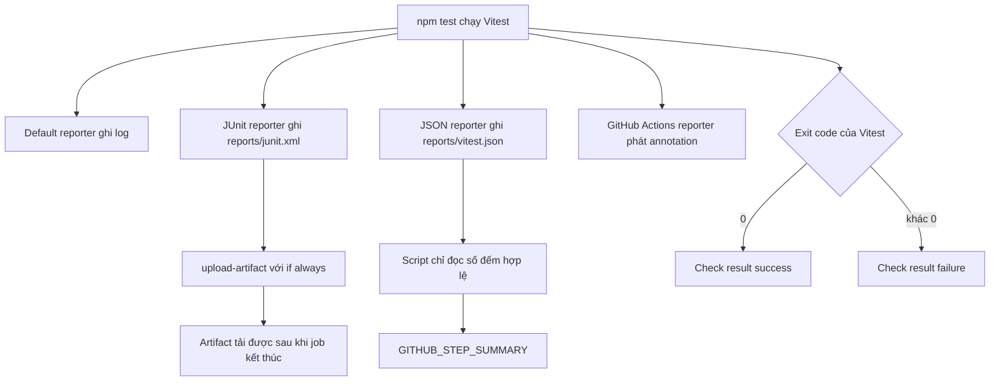

<Callout type="info" title="Mục tiêu của bài">
  Bạn sẽ xây dựng một pipeline Node.js/Vitest có bốn lớp quan sát: log để điều tra nhanh, JUnit XML
  để máy xử lý, artifact để tải report sau khi job kết thúc, và annotation/job summary để reviewer
  thấy lỗi ngay trên GitHub. Workflow mẫu luôn thu thập report bằng `if: always()` nhưng không dùng
  `continue-on-error`, `|| true` hay cách nào khác làm mất exit code của test.
</Callout>

## Mục lục

- [Tổng quan](#tổng-quan)
  - [Mục tiêu và phạm vi](#mục-tiêu-và-phạm-vi)
  - [Luồng dữ liệu từ test đến giao diện GitHub](#luồng-dữ-liệu-từ-test-đến-giao-diện-github)
- [Phân biệt logs, artifacts, annotations, summaries và check results](#phân-biệt-logs-artifacts-annotations-summaries-và-check-results)
  - [Logs](#logs)
  - [Artifacts](#artifacts)
  - [Annotations](#annotations)
  - [Job summaries](#job-summaries)
  - [Check results và required checks](#check-results-và-required-checks)
- [JUnit XML và Vitest reporters](#junit-xml-và-vitest-reporters)
  - [JUnit XML chứa gì](#junit-xml-chứa-gì)
  - [Cấu hình Vitest nhiều reporter](#cấu-hình-vitest-nhiều-reporter)
  - [Annotation từ Vitest](#annotation-từ-vitest)
- [Workflow commands và xử lý output an toàn](#workflow-commands-và-xử-lý-output-an-toàn)
  - [Tạo annotation bằng error command](#tạo-annotation-bằng-error-command)
  - [Escape multiline và thuộc tính](#escape-multiline-và-thuộc-tính)
  - [Ngăn command injection và Markdown injection](#ngăn-command-injection-và-markdown-injection)
- [Bài thực hành Node.js và Vitest](#bài-thực-hành-nodejs-và-vitest)
  - [Cấu trúc dự án](#cấu-trúc-dự-án)
  - [Khai báo package và test mẫu](#khai-báo-package-và-test-mẫu)
  - [Tạo script job summary an toàn](#tạo-script-job-summary-an-toàn)
  - [Tạo workflow CI hoàn chỉnh](#tạo-workflow-ci-hoàn-chỉnh)
  - [Vì sao workflow không che lỗi test](#vì-sao-workflow-không-che-lỗi-test)
- [Permissions và pull request từ fork](#permissions-và-pull-request-từ-fork)
  - [Trường hợp không cần quyền ghi](#trường-hợp-không-cần-quyền-ghi)
  - [Khi third-party reporter cần quyền ghi](#khi-third-party-reporter-cần-quyền-ghi)
  - [Rủi ro với fork và pull_request_target](#rủi-ro-với-fork-và-pull_request_target)
- [Thiết kế quality gate](#thiết-kế-quality-gate)
  - [Điều kiện pass và fail](#điều-kiện-pass-và-fail)
  - [Bắt buộc check trước khi merge](#bắt-buộc-check-trước-khi-merge)
- [Xác minh](#xác-minh)
  - [Happy path](#happy-path)
  - [Failure path](#failure-path)
  - [Kiểm tra bảo mật và retention](#kiểm-tra-bảo-mật-và-retention)
  - [Tiêu chí hoàn thành](#tiêu-chí-hoàn-thành)
- [Best practices](#best-practices)
- [Anti-patterns](#anti-patterns)
- [Troubleshooting](#troubleshooting)
- [Tài liệu chính thức](#tài-liệu-chính-thức)
- [Cùng series](#cùng-series)

## Tổng quan

Một dòng `Tests 42 passed` trong log đủ cho người vừa chạy workflow, nhưng chưa đủ cho một hệ thống
CI có thể vận hành lâu dài. Khi test thất bại, reviewer cần biết file nào lỗi. Người điều tra cần
stack trace đầy đủ. Công cụ phân tích cần một định dạng có cấu trúc. Nhóm phát triển còn cần giữ
report đủ lâu để so sánh hoặc tải về.

**Test report** là kết quả kiểm thử có cấu trúc để công cụ khác đọc. Bài này dùng **JUnit XML** — một
họ định dạng XML phổ biến gồm test suite, test case, thời gian và failure. JUnit XML không chỉ dành
cho Java; Vitest, Jest, pytest và nhiều framework khác đều có thể xuất định dạng này.

**Reporter** là thành phần chuyển sự kiện trong quá trình test thành một kiểu output. Ví dụ,
reporter `default` của Vitest ghi log cho con người, reporter `junit` ghi XML, còn reporter
`github-actions` phát workflow command để GitHub tạo annotation.

### Mục tiêu và phạm vi

Sau bài này, bạn có thể:

- chọn đúng nơi hiển thị giữa log, artifact, annotation, job summary và check result;
- cấu hình Vitest vừa giữ output terminal vừa sinh JUnit XML;
- tạo annotation có file, dòng và cột bằng `::error` khi viết công cụ riêng;
- xử lý newline, `%`, `:`, `,` đúng cách trong workflow command;
- không đưa output không tin cậy trực tiếp vào shell, workflow command hoặc Markdown summary;
- luôn upload report kể cả khi test fail mà vẫn giữ job ở trạng thái failed;
- áp dụng `retention-days` và permission tối thiểu;
- biến job test thành required status check chặn merge.

Phạm vi là unit test Node.js chạy bằng Vitest trên `ubuntu-latest`. Với integration hoặc E2E test,
nguyên tắc giữ exit code và hậu xử lý bằng `if: always()` vẫn giống nhau. Chỉ đường dẫn report và
artifact bổ sung như screenshot, trace hoặc container log thay đổi.

### Luồng dữ liệu từ test đến giao diện GitHub



Mỗi nhánh giải quyết một nhu cầu khác nhau. Artifact và summary là dữ liệu quan sát; chúng không
được phép quyết định thay exit code của test. Nhánh quality gate luôn đi trực tiếp từ process
Vitest đến kết luận của step và job.

## Phân biệt logs, artifacts, annotations, summaries và check results

Các khái niệm này thường bị gọi chung là “test report”, nhưng vòng đời và tác dụng khác nhau.

| Kênh | Dạng dữ liệu | Người dùng chính | Vị trí trên GitHub | Có tự làm job fail không? |
| --- | --- | --- | --- | --- |
| **Log** | Dòng `stdout`/`stderr` theo thời gian | Người điều tra | Chi tiết từng step | Có, chỉ khi command trả exit code khác `0`; nội dung chữ đỏ không đủ |
| **Artifact** | File hoặc thư mục được lưu sau run | Người và job khác | Mục **Artifacts** của workflow run | Không; action upload chỉ fail vì lỗi upload/cấu hình |
| **Annotation** | Notice, warning hoặc error có vị trí source | Tác giả PR và reviewer | Check, tab Files changed, log | Không; `::error` đơn lẻ không thay exit code |
| **Job summary** | GitHub-Flavored Markdown | Reviewer, maintainer | Trang tổng quan workflow run | Không |
| **Check result** | Trạng thái/conclusion của job hoặc check run | Ruleset, merge queue | Checks trên commit/PR | Có ý nghĩa gate; `success` mới thỏa required check |

### Logs

**Workflow log** là luồng output của từng step. Đây là nơi giữ stack trace, thời gian, output debug
và thông tin cài dependency. Log phù hợp để điều tra chi tiết vì giữ thứ tự sự kiện. Nó không phù
hợp làm dashboard vì người đọc phải mở job, mở step rồi tìm dòng liên quan.

Một process fail khi trả exit code khác `0`. Màu chữ hoặc từ “ERROR” trong log không có ý nghĩa với
shell. Ví dụ sau tạo dòng có vẻ nghiêm trọng nhưng step vẫn thành công:

```bash
echo "ERROR: 3 tests failed"
```

Ngược lại, lệnh sau làm step fail dù không in message:

```bash
exit 1
```

Nói ngắn gọn: log giải thích kết quả; exit code quyết định kết quả.

### Artifacts

**Workflow artifact** là file do job sinh ra và được GitHub lưu độc lập với filesystem tạm của
runner. JUnit XML, JSON report, screenshot, browser trace và core dump là artifact điển hình.
Artifact phù hợp khi dữ liệu:

- cần tải về sau khi runner đã bị hủy;
- quá dài hoặc không phù hợp để nhúng vào summary;
- cần truyền sang job khác;
- cần parser, IDE hoặc hệ thống bên ngoài xử lý.

Artifact không phải cache. Cache tối ưu việc tái sử dụng dependency hoặc output đắt tiền giữa các
run. Artifact lưu đầu ra cần xem hoặc tiêu thụ của một run cụ thể.

`retention-days` là số ngày GitHub giữ artifact trước khi tự xóa. Workflow mẫu dùng 14 ngày: đủ cho
một chu kỳ review thông thường nhưng ngắn hơn mặc định 90 ngày. Giá trị hợp lệ của
`actions/upload-artifact` là 1–90 ngày, trừ khi chính sách repository đặt giới hạn khác. Chọn thời
gian theo yêu cầu điều tra và chi phí lưu trữ, không đặt 90 ngày theo thói quen.

<Callout type="warn" title="Report có thể chứa dữ liệu nhạy cảm">
  JUnit XML có thể chứa assertion message, stack trace, đường dẫn máy và `system-out`/`system-err`.
  Không ghi token hoặc dữ liệu production vào test output. Người có quyền đọc repository có thể tải
  workflow artifact; xóa cả workflow run nếu cần xóa ngay artifact và summary liên quan.
</Callout>

### Annotations

**Annotation** là notice, warning hoặc error gắn với một file và tùy chọn dòng/cột. Thay vì tìm stack
trace trong log, reviewer có thể nhảy thẳng đến `src/cart.js:18`.

Annotation có thể đến từ:

- problem matcher do action đăng ký;
- workflow command như `::error file=...,line=...::...`;
- reporter tích hợp sẵn của test framework;
- Checks API do một GitHub App hoặc third-party reporter gọi.

Annotation nên ngắn và có tính hành động. Stack trace đầy đủ vẫn ở log hoặc JUnit artifact. Việc
đẩy hàng nghìn test pass thành annotation chỉ tạo nhiễu và có thể chạm giới hạn hiển thị/API.

### Job summaries

**Job summary** là Markdown được append vào file mà biến môi trường `GITHUB_STEP_SUMMARY` trỏ tới.
GitHub gom summary của các step khi job hoàn tất và hiển thị chúng trên trang workflow run. Summary
phù hợp cho số test pass/fail/skipped, thời gian, quality gate và liên kết đến run/artifact.

```bash
{
  printf '## Unit test\n\n'
  printf '| Metric | Value |\n'
  printf '| --- | ---: |\n'
  printf '| Passed | %s |\n' "42"
} >> "$GITHUB_STEP_SUMMARY"
```

Mỗi step có file summary riêng. Theo tài liệu GitHub, mỗi summary step bị giới hạn 1 MiB và tối đa
20 job summaries từ các step được hiển thị cho một job. Summary quá lớn còn khó đọc; chỉ đưa số
liệu tổng hợp vào đây và để chi tiết trong artifact.

### Check results và required checks

Một job GitHub Actions tạo ra một check result cho commit. **Conclusion** là kết luận cuối như
`success`, `failure`, `cancelled` hoặc `skipped`. Ruleset/branch protection có thể yêu cầu check đó
phải success trước khi merge; khi ấy nó là **required status check**.

Ba điều dễ nhầm:

1. `::error` tạo error annotation nhưng process vẫn có thể thoát `0`.
2. Ghi chữ “FAIL” vào `GITHUB_STEP_SUMMARY` không làm job fail.
3. Upload JUnit XML thành công chỉ chứng minh report đã được lưu, không chứng minh test pass.

Quality gate phải dựa trên exit code của test step. Annotation và summary chỉ diễn giải gate đó.

## JUnit XML và Vitest reporters

### JUnit XML chứa gì

Một report tối giản từ Vitest có dạng:

```xml
<?xml version="1.0" encoding="UTF-8" ?>
<testsuites name="vitest tests" tests="2" failures="1" errors="0" time="0.503">
  <testsuite name="test/math.test.js" tests="2" failures="1" errors="0" skipped="0" time="0.013">
    <testcase classname="test/math.test.js" name="math > cộng hai số" time="0.001" />
    <testcase classname="test/math.test.js" name="math > phát hiện kết quả sai" time="0.002">
      <failure message="expected 5 to be 4" type="AssertionError">
        AssertionError: expected 5 to be 4
      </failure>
    </testcase>
  </testsuite>
</testsuites>
```

Các trường phổ biến:

- `tests`: tổng số test case;
- `failures`: assertion thất bại;
- `errors`: lỗi hạ tầng hoặc lỗi ngoài assertion, tùy producer;
- `skipped`: test bị bỏ qua;
- `time`: thời gian tính bằng giây;
- `testcase`: một test cụ thể;
- `failure`: message và chi tiết lỗi.

JUnit XML là một họ định dạng chứ không phải schema được mọi producer triển khai hoàn toàn giống
nhau. Một consumer có thể mong `<testsuites>`, consumer khác chỉ đọc `<testsuite>`. Trước khi chọn
third-party publisher, hãy kiểm tra nó hỗ trợ dialect mà Vitest sinh ra bằng một report thật.

### Cấu hình Vitest nhiều reporter

Không thay reporter terminal bằng JUnit. Hãy chạy nhiều reporter đồng thời:

- `default` giữ log dễ đọc;
- `github-actions` tạo annotation trên runner GitHub;
- `junit` tạo XML để lưu thành artifact;
- `json` tạo dữ liệu có schema thuận tiện cho script summary.

`vitest.config.mjs`:

```js
import { defineConfig } from 'vitest/config';

const isGitHubActions = process.env.GITHUB_ACTIONS === 'true';

export default defineConfig({
  test: {
    include: ['test/**/*.test.js'],
    reporters: isGitHubActions
      ? [
          'default',
          ['github-actions', { jobSummary: { enabled: false } }],
          ['junit', { suiteName: 'unit tests', classnameTemplate: '{filepath}' }],
          'json',
        ]
      : [
          'default',
          ['junit', { suiteName: 'unit tests', classnameTemplate: '{filepath}' }],
          'json',
        ],
    outputFile: {
      junit: 'reports/junit.xml',
      json: 'reports/vitest.json',
    },
  },
});
```

Vitest hỗ trợ `outputFile` dạng object khi dùng nhiều reporter. Mỗi key chỉ định file cho reporter
cùng tên. Workflow sẽ tạo thư mục `reports/` trước khi chạy để không phụ thuộc hành vi tạo thư mục
của từng phiên bản.

Tùy chọn `jobSummary.enabled: false` chỉ tắt summary tự động của reporter `github-actions`. Bài này
tự tạo summary từ các số đếm đã kiểm tra kiểu để minh họa cách xử lý output không tin cậy. Nếu
không cần format riêng, có thể bỏ tùy chọn đó và dùng summary tích hợp của Vitest.

### Annotation từ Vitest

Khi không cấu hình `reporters`, Vitest tự bật reporter `github-actions` trong môi trường GitHub
Actions. Khi đã khai báo reporter tùy chỉnh như ví dụ trên, phải thêm `github-actions` rõ ràng.
Reporter này chuyển test failure thành workflow command và xử lý escape thay bạn.

Cơ chế này không cần `checks: write` hay `pull-requests: write`. Runner đọc workflow command từ
`stdout` và gắn annotation vào check của job hiện tại. Workflow mẫu vì thế chỉ cấp
`contents: read`.

Nếu chạy test trong container, đường dẫn failure có thể là `/app/test/math.test.js`, không trùng
`GITHUB_WORKSPACE` trên host. Dùng tùy chọn `onWritePath` của Vitest để đổi đường dẫn container thành
đường dẫn workspace. Không dùng phép thay chuỗi mơ hồ nếu nhiều prefix có thể trùng.

## Workflow commands và xử lý output an toàn

### Tạo annotation bằng error command

Với policy script tự viết, cú pháp đầy đủ thường dùng là:

```text
::error file={path},line={startLine},endLine={endLine},col={startColumn},endColumn={endColumn},title={title}::{message}
```

Ví dụ Bash với dữ liệu cố định:

```bash
printf '%s\n' \
  '::error file=src/config.js,line=12,col=5,title=Policy violation::Không được commit API key mặc định'
exit 1
```

`file` nên là đường dẫn tuyệt đối hoặc tương đối từ `GITHUB_WORKSPACE`. `line` và `col` bắt đầu từ
1. `endLine`/`endColumn` là tùy chọn. Các command `::notice` và `::warning` có cùng nhóm thuộc tính.

Dòng `exit 1` là phần quality gate. Nếu bỏ dòng đó, GitHub có thể hiển thị error annotation nhưng
step vẫn success.

### Escape multiline và thuộc tính

Workflow command phải nằm trên **một dòng vật lý** của `stdout`. Nếu message có newline, ký tự `%`
hoặc dữ liệu dùng trong thuộc tính có `:`/`,`, cần percent-encode theo quy tắc của Actions toolkit:

| Vị trí | Ký tự cần encode |
| --- | --- |
| Message sau `::` | `%` → `%25`, CR → `%0D`, LF → `%0A` |
| Giá trị thuộc tính như `file`, `title` | Các ký tự trên, thêm `:` → `%3A`, `,` → `%2C` |

Một helper Bash tối giản:

```bash
escape_command_data() {
  local value=$1
  value=${value//'%'/'%25'}
  value=${value//$'\r'/'%0D'}
  value=${value//$'\n'/'%0A'}
  printf '%s' "$value"
}

escape_command_property() {
  local value
  value=$(escape_command_data "$1")
  value=${value//':'/'%3A'}
  value=${value//','/'%2C'}
  printf '%s' "$value"
}

file=$(escape_command_property 'test/math.test.js')
title=$(escape_command_property 'Assertion failed')
message=$(escape_command_data $'Expected 4\nReceived 5')
printf '::error file=%s,line=8,col=12,title=%s::%s\n' "$file" "$title" "$message"
exit 1
```

Thứ tự encode `%` trước rất quan trọng. Nếu encode newline thành `%0A` rồi mới encode `%`, kết quả
thành `%250A` và runner không giải mã như mong đợi.

Cú pháp multiline dạng `NAME<<DELIMITER` dành cho environment files như `GITHUB_ENV` và
`GITHUB_OUTPUT`, không phải cách tạo multiline annotation. Delimiter phải là giá trị ngẫu nhiên
không xuất hiện trên một dòng riêng trong payload. Nếu payload hoàn toàn tùy ý, tài liệu GitHub
khuyên ghi nó vào một file thay vì dựa vào delimiter.

### Ngăn command injection và Markdown injection

**Untrusted output** là dữ liệu mà contributor hoặc chương trình không đáng tin có thể kiểm soát.
Tên test, assertion message, tên branch, tiêu đề PR, nội dung file và output dependency đều thuộc
nhóm này.

Có ba bề mặt tấn công khác nhau:

1. **Shell injection.** Không đặt expression không tin cậy trực tiếp vào nội dung `run:`. Truyền nó
   qua biến môi trường rồi luôn quote biến.
2. **Workflow command injection.** Một dòng untrusted bắt đầu bằng `::error::`, `::add-mask::` hoặc
   command khác có thể bị runner diễn giải. Dùng reporter đã audit, escape đúng, hoặc tạm dừng xử lý
   command bằng `::stop-commands::{random-token}` khi bắt buộc in payload thô.
3. **Markdown/HTML injection.** Không `cat` JUnit XML, log hoặc tên test trực tiếp vào
   `GITHUB_STEP_SUMMARY`. Dữ liệu có thể tạo heading, link, image từ xa, table giả hoặc HTML khó
   review. Chỉ lấy trường cần thiết, kiểm tra kiểu/range, rồi render bằng template cố định.

Ví dụ không an toàn:

```yaml
- name: Unsafe PR title handling
  run: echo "## ${{ github.event.pull_request.title }}" >> "$GITHUB_STEP_SUMMARY"
```

Expression được chèn vào script trước khi Bash parse. Một tiêu đề chứa dấu nháy và shell syntax có
thể thay đổi command. Mẫu an toàn hơn về shell là:

```yaml
- name: Read PR title without shell interpolation
  env:
    PR_TITLE: ${{ github.event.pull_request.title }}
  run: printf '%s\n' "$PR_TITLE"
```

Mẫu thứ hai chỉ giải quyết shell injection. Nếu đưa `PR_TITLE` vào summary, vẫn phải escape Markdown
hoặc tốt hơn là không đưa dữ liệu đó vào. Workflow thực hành chỉ render trạng thái trong allowlist,
các số nguyên không âm và URL do GitHub tạo.

<Callout type="warn" title="Không dùng stop-commands như sanitizer">
  `stop-commands` chỉ tạm ngăn runner diễn giải workflow command. Nó không escape shell, không lọc
  secret và không làm Markdown an toàn. Token kết thúc phải ngẫu nhiên, duy nhất cho mỗi lần dùng;
  tuyệt đối không dùng một token cố định có thể xuất hiện trong payload.
</Callout>

## Bài thực hành Node.js và Vitest

Bài thực hành tạo một project JavaScript nhỏ. Nếu repository đã có Node.js project, chỉ cần điều
chỉnh scripts và đường dẫn cho phù hợp; không cần thay toàn bộ `package.json`.

### Cấu trúc dự án

```text
test-report-demo/
├── .github/
│   └── workflows/
│       └── unit-test-report.yml
├── scripts/
│   └── write-test-summary.mjs
├── src/
│   └── math.js
├── test/
│   └── math.test.js
├── package-lock.json
├── package.json
└── vitest.config.mjs
```

### Khai báo package và test mẫu

`package.json` tối thiểu:

```json
{
  "name": "test-report-demo",
  "version": "1.0.0",
  "private": true,
  "type": "module",
  "engines": {
    "node": ">=24 <25"
  },
  "scripts": {
    "test": "vitest run --config vitest.config.mjs"
  },
  "devDependencies": {
    "vitest": "^4.1.10"
  }
}
```

Phiên bản trên là phiên bản Vitest hiện hành khi biên soạn. Chạy `npm install` một lần và commit
`package-lock.json`; CI dùng `npm ci` để cài đúng dependency trong lockfile.

`src/math.js`:

```js
export function add(left, right) {
  return left + right;
}
```

`test/math.test.js`:

```js
import { describe, expect, it } from 'vitest';

import { add } from '../src/math.js';

describe('add', () => {
  it('cộng hai số dương', () => {
    expect(add(2, 3)).toBe(5);
  });

  it('cộng số âm', () => {
    expect(add(-2, 1)).toBe(-1);
  });
});
```

Dùng `vitest.config.mjs` ở phần trước. Kiểm tra local:

```bash
npm install
mkdir -p reports
npm test
```

Kết quả mong đợi là exit code `0` cùng hai file `reports/junit.xml` và
`reports/vitest.json`.

### Tạo script job summary an toàn

Script dưới đây đọc JSON reporter vì JSON có parser chuẩn trong Node.js. Nó chỉ chấp nhận số nguyên
không âm và không copy tên test, failure message hay stack trace vào Markdown.

`scripts/write-test-summary.mjs`:

```js
import { appendFile, readFile } from 'node:fs/promises';

const summaryPath = process.env.GITHUB_STEP_SUMMARY;
if (!summaryPath) {
  throw new Error('GITHUB_STEP_SUMMARY is not available');
}

const outcomeLabels = new Map([
  ['success', 'PASS'],
  ['failure', 'FAIL'],
  ['cancelled', 'CANCELLED'],
  ['skipped', 'SKIPPED'],
]);

const rawOutcome = process.env.TEST_OUTCOME ?? 'unknown';
const outcome = outcomeLabels.get(rawOutcome) ?? 'UNKNOWN';

function safeCount(value) {
  return Number.isSafeInteger(value) && value >= 0 ? value : null;
}

let counts = null;
try {
  const report = JSON.parse(await readFile('reports/vitest.json', 'utf8'));
  const candidate = {
    total: safeCount(report.numTotalTests),
    passed: safeCount(report.numPassedTests),
    failed: safeCount(report.numFailedTests),
    skipped: safeCount(report.numPendingTests),
    todo: safeCount(report.numTodoTests),
  };

  if (Object.values(candidate).every((value) => value !== null)) {
    counts = candidate;
  }
} catch {
  // Test runner có thể dừng trước khi ghi JSON. Summary vẫn phải được tạo.
}

const lines = [
  '## Unit test report',
  '',
  `**Quality gate:** ${outcome}`,
  '',
];

if (counts) {
  lines.push(
    '| Metric | Count |',
    '| --- | ---: |',
    `| Total | ${counts.total} |`,
    `| Passed | ${counts.passed} |`,
    `| Failed | ${counts.failed} |`,
    `| Skipped | ${counts.skipped} |`,
    `| Todo | ${counts.todo} |`,
    '',
  );
} else {
  lines.push('Không đọc được số liệu tổng hợp; xem log và JUnit artifact.', '');
}

const repository = process.env.GITHUB_REPOSITORY ?? '';
const runId = process.env.GITHUB_RUN_ID ?? '';
if (/^[A-Za-z0-9_.-]+\/[A-Za-z0-9_.-]+$/.test(repository) && /^\d+$/.test(runId)) {
  lines.push(`[Mở workflow run](https://github.com/${repository}/actions/runs/${runId})`, '');
}

await appendFile(summaryPath, `${lines.join('\n')}\n`, 'utf8');
```

Script cố ý không fail khi JSON thiếu hoặc hỏng. Việc thiếu JUnit report được
`upload-artifact` kiểm tra riêng bằng `if-no-files-found: error`. Quan trọng hơn, trạng thái test đã
được runner giữ từ step `npm test`; summary không có quyền đổi failure thành success.

### Tạo workflow CI hoàn chỉnh

`.github/workflows/unit-test-report.yml`:

```yaml
name: Unit Test Report

on:
  push:
    branches: [main]
  pull_request:
    branches: [main]
  merge_group:
    types: [checks_requested]

permissions:
  contents: read

concurrency:
  group: ${{ github.workflow }}-${{ github.ref }}
  cancel-in-progress: true

jobs:
  test:
    name: Unit tests and reports
    runs-on: ubuntu-latest
    timeout-minutes: 15

    steps:
      - name: Checkout repository
        uses: actions/checkout@v7
        with:
          persist-credentials: false

      - name: Setup Node.js
        uses: actions/setup-node@v7
        with:
          node-version: 24
          cache: npm
          cache-dependency-path: package-lock.json

      - name: Install dependencies
        run: npm ci

      - name: Run Vitest
        id: tests
        shell: bash
        run: |
          mkdir -p reports
          npm test

      - name: Upload JUnit report
        id: junit
        if: ${{ always() }}
        uses: actions/upload-artifact@v7
        with:
          name: junit-${{ github.run_id }}-${{ github.run_attempt }}
          path: reports/junit.xml
          if-no-files-found: error
          retention-days: 14

      - name: Write safe job summary
        if: ${{ always() }}
        env:
          TEST_OUTCOME: ${{ steps.tests.outcome }}
        run: node scripts/write-test-summary.mjs
```

Các major version `actions/checkout@v7`, `actions/setup-node@v7` và
`actions/upload-artifact@v7` đã được đối chiếu với README chính thức của từng action khi biên soạn.
Các action v7 dùng runtime Node.js mới; self-hosted runner phải được cập nhật theo yêu cầu trong
release notes. Với môi trường supply-chain nghiêm ngặt, pin action bằng full commit SHA đã xác minh
và dùng Dependabot để cập nhật SHA.

`name` của artifact gồm `run_id` và `run_attempt`, nên duy nhất giữa lần chạy lại. Điều này phù hợp
với artifact bất biến của các phiên bản `upload-artifact` hiện hành. Trong matrix, thêm các chiều
như `${{ matrix.os }}` và `${{ matrix.node }}` vào tên để tránh xung đột.

### Vì sao workflow không che lỗi test

Step **Run Vitest** gọi `npm test` trực tiếp. Nếu Vitest trả code `1`, step `tests` có `outcome` là
`failure` và job cuối cùng vẫn failure. Không có wrapper nào đổi code thành `0`.

Hai step sau dùng `if: ${{ always() }}` nên vẫn chạy sau failure:

- upload lưu JUnit XML để điều tra;
- summary đọc `${{ steps.tests.outcome }}` và hiển thị `FAIL`.

`always()` chỉ thay điều kiện chạy step hậu xử lý. Nó không sửa conclusion của step trước. Đây là
khác biệt quan trọng với các anti-pattern sau:

```yaml
# Sai: biến test failure thành success.
- run: npm test || true

# Sai: conclusion của step có thể được dung thứ và gate trở nên khó hiểu.
- continue-on-error: true
  run: npm test
```

Nếu cần vừa xem log trực tiếp vừa lưu console log bằng `tee`, phải bật `pipefail`:

```yaml
- name: Run test and retain console log
  shell: bash
  run: |
    set -o pipefail
    mkdir -p reports
    npm test 2>&1 | tee reports/console.log
```

Không có `pipefail`, pipeline thường lấy exit code của `tee`, khiến test fail nhưng step xanh. Với
workflow mẫu, reporter đã ghi file riêng nên không cần pipe; cách đơn giản này ít lỗi hơn.

<Callout type="idea" title="Ưu tiên đường đi ngắn nhất">
  Vitest có reporter GitHub Actions tích hợp, còn GitHub cung cấp `upload-artifact` chính thức. Vì
  vậy ví dụ không thêm một action “JUnit publisher” bên thứ ba. Ít action hơn nghĩa là ít token cần
  cấp, ít rủi ro supply chain và ít khác biệt giữa CI với local.
</Callout>

## Permissions và pull request từ fork

### Trường hợp không cần quyền ghi

Workflow mẫu chỉ cần:

```yaml
permissions:
  contents: read
```

Quyền này cho phép checkout repository. Các thao tác sau không cần quyền ghi API:

- runner ghi workflow log;
- Vitest phát workflow command tạo annotation trong check hiện tại;
- step append vào `GITHUB_STEP_SUMMARY`;
- official `upload-artifact` upload artifact của workflow run.

Khi khai báo `permissions`, các permission không được liệt kê được đặt thành `none`. Đây là nguyên
tắc **least privilege** — chỉ cấp quyền nhỏ nhất cần thiết.

### Khi third-party reporter cần quyền ghi

Một third-party action có thể parse JUnit rồi tạo **check run riêng** qua Checks API, hoặc comment
bảng kết quả vào pull request. Khi đó nó thường yêu cầu một hoặc cả hai permission sau:

```yaml
permissions:
  contents: read
  checks: write
  pull-requests: write
```

- `checks: write`: tạo/cập nhật check run và gửi annotations qua Checks API;
- `pull-requests: write`: tạo hoặc cập nhật comment/review trên pull request.

Không cấp cả hai theo suy đoán. Đọc `action.yml`, README, source code và network behavior của action.
Nếu chỉ tạo check run thì bỏ `pull-requests: write`. Nếu chỉ comment PR thì không tự động suy ra nó
cần `checks: write`.

Action bên thứ ba chạy trong cùng job có thể đọc `github.token` ngay cả khi không truyền token qua
`with`. Nếu action bị compromise, quyền ghi làm tăng phạm vi thiệt hại. Pin full commit SHA, kiểm
tra publisher, audit source và tách reporter đặc quyền khỏi job chạy code không tin cậy khi cần.

### Rủi ro với fork và pull_request_target

Trên `pull_request` đến từ fork, `GITHUB_TOKEN` là read-only và secrets không được chuyển cho runner.
Vì vậy third-party publisher cần `checks: write` hoặc `pull-requests: write` có thể chạy test thành
công nhưng fail ở bước publish với lỗi `Resource not accessible by integration`.

Không “sửa” lỗi đó bằng cách đổi sang `pull_request_target`, checkout code của fork rồi chạy
`npm ci`/`npm test`. `pull_request_target` chạy trong context của nhánh đích và có thể có token ghi,
secret, cache hoặc runner tin cậy. Dependency hay test script do contributor sửa có thể đánh cắp
credential hoặc ghi vào repository.

Thứ tự ưu tiên an toàn:

1. Dùng `pull_request` với `contents: read` và reporter tích hợp như workflow mẫu.
2. Chấp nhận rằng bước publish đặc quyền bị bỏ qua cho fork, nhưng test gate vẫn chạy.
3. Nếu bắt buộc publish qua API, thiết kế hai workflow tách biệt. Workflow không đặc quyền chạy test
   và upload artifact; workflow đặc quyền chỉ đọc artifact sau khi xác thực run, actor, repository,
   SHA, tên/path file và kích thước. Workflow đặc quyền tuyệt đối không thực thi code hoặc script từ
   artifact/fork.

Ngay cả phương án thứ ba cũng cần threat model và review bảo mật riêng. Artifact từ workflow không
đặc quyền vẫn là input không tin cậy; parser XML/JSON và Markdown renderer phải được harden.

<Callout type="error" title="Không chạy code fork bằng token ghi">
  Không checkout PR head, không chạy lifecycle script và không import JavaScript do PR cung cấp
  trong một job có `checks: write`, `pull-requests: write`, secrets hoặc quyền cloud. Approval của
  workflow không biến source của fork thành dữ liệu tin cậy.
</Callout>

## Thiết kế quality gate

### Điều kiện pass và fail

Workflow mẫu có chính sách sau:

| Thành phần | Pass | Fail |
| --- | --- | --- |
| Cài dependency | `npm ci` khớp lockfile | Lockfile thiếu/lệch hoặc dependency không cài được |
| Unit test | Vitest trả exit code `0` | Assertion fail, unhandled error hoặc Vitest trả code khác `0` |
| JUnit report | `reports/junit.xml` tồn tại và upload được | Không có file vì runner chết sớm, sai path hoặc upload lỗi |
| Summary | Script ghi được Markdown an toàn | Script/cấu hình repository hỏng; failure này không được che |
| Job tổng | Tất cả step bắt buộc thành công | Bất kỳ step nào ở trên failure |

Việc coi “không có JUnit report” là failure là lựa chọn chủ đích qua `if-no-files-found: error`. Nó
phát hiện cấu hình reporter bị xóa hoặc đường dẫn bị đổi mà workflow chưa cập nhật. Nếu một nhóm chỉ
coi report là best-effort, có thể dùng `warn`; tuy nhiên khi ấy phải có monitoring riêng để report
không âm thầm biến mất nhiều tuần.

Đừng đọc `failures="0"` trong XML rồi tự kết luận test pass nếu process trả code khác `0`. Runner có
thể crash sau khi ghi report chưa hoàn chỉnh, hoặc test framework gặp lỗi ngoài test cases. Exit
code của process là nguồn sự thật cho gate; report là nguồn chi tiết.

### Bắt buộc check trước khi merge

Sau khi workflow chạy ít nhất một lần:

1. Mở **Settings → Rules → Rulesets** và tạo hoặc sửa branch ruleset áp dụng cho `main`.
2. Bật **Require status checks to pass**.
3. Chọn check **Unit tests and reports**.
4. Yêu cầu branch cập nhật trước merge nếu chính sách repository cần kiểm tra merge commit mới nhất.
5. Không cho bypass nếu gate phải áp dụng cho cả maintainer và automation.
6. Nếu dùng merge queue, giữ trigger `merge_group: types: [checks_requested]`.

Giữ `jobs.test.name: Unit tests and reports` ổn định và duy nhất. Đổi tên job làm ruleset tiếp tục
chờ tên cũ. Đặt cùng một tên cho nhiều workflow khiến nguồn check khó phân biệt.

Không dùng path filter để bỏ qua cả required workflow mà không có check thay thế. Một required check
không được tạo có thể ở trạng thái Pending và chặn merge. Với monorepo, nên có một gate tổng luôn
chạy, rồi quyết định package nào cần test bên trong workflow.

## Xác minh

Một pipeline chỉ đáng tin sau khi đã kiểm tra cả đường thành công, đường thất bại và dữ liệu độc
hại. Thực hiện từng thử nghiệm trên branch riêng rồi hoàn tác lỗi.

### Happy path

Chạy local từ checkout sạch:

```bash
rm -rf node_modules reports
npm ci
mkdir -p reports
npm test
test -s reports/junit.xml
test -s reports/vitest.json
```

Kết quả mong đợi:

- `npm test` trả code `0`;
- terminal vẫn có output của reporter `default`;
- JUnit XML có `tests="2"` và `failures="0"`;
- JSON có `numTotalTests: 2` và `numFailedTests: 0`.

Push branch và mở pull request. Trong GitHub:

- check **Unit tests and reports** success;
- job summary hiển thị `PASS` và số đếm;
- artifact có tên bắt đầu bằng `junit-`, tải xuống được và chứa `junit.xml`;
- artifact hiển thị retention 14 ngày theo cấu hình.

### Failure path

Cố ý sửa assertion:

```js
expect(add(2, 3)).toBe(6);
```

Chạy lại `npm test` và xác nhận exit code:

```bash
set +e
npm test
status=$?
set -e
printf 'exit=%s\n' "$status"
test "$status" -ne 0
```

Trên GitHub, xác minh đồng thời bốn điều:

1. step **Run Vitest** failure;
2. annotation trỏ đến dòng assertion trong `test/math.test.js`;
3. hai step có `always()` vẫn chạy;
4. job cuối cùng vẫn failure dù artifact upload và summary thành công.

Tải JUnit artifact và kiểm tra `<failure>` tồn tại. Summary phải hiển thị `FAIL` cùng số failed,
nhưng không nhúng assertion message hoặc stack trace.

Tiếp theo, tạm đổi `outputFile.junit` sang một path khác mà không sửa workflow. Step upload phải báo
không tìm thấy `reports/junit.xml` do `if-no-files-found: error`. Thử nghiệm này chứng minh report
là một output được kiểm soát, không phải file tùy chọn vô tình tồn tại.

### Kiểm tra bảo mật và retention

Tạo tên test có nội dung Markdown và chuỗi giống workflow command, ví dụ:

```js
it('::error file=README.md,line=1::fake [link](https://example.invalid)', () => {
  expect(add(1, 1)).toBe(2);
});
```

Với test pass, script summary không được copy tên này. Summary chỉ chứa số đếm. Không được xuất hiện
annotation giả ở `README.md` từ script summary.

Review workflow bằng các câu hỏi:

- `permissions` có đúng chỉ `contents: read` không?
- Có expression từ PR title, branch hoặc test output được chèn trực tiếp vào `run:` không?
- Có `cat reports/junit.xml >> "$GITHUB_STEP_SUMMARY"` không?
- Artifact có chứa JSON, `.env`, log hay file ẩn ngoài ý định không?
- 14 ngày có đáp ứng thời gian điều tra và chính sách dữ liệu không?
- Action có được cập nhật từ source chính thức hoặc pin SHA đã xác minh không?

### Tiêu chí hoàn thành

- [ ] `package-lock.json` được commit và `npm ci` chạy từ checkout sạch.
- [ ] Vitest tạo đồng thời terminal log, JUnit XML, JSON report và annotation khi có failure.
- [ ] Test pass trả code `0`; test fail trả code khác `0`.
- [ ] Không có `continue-on-error`, `|| true` hoặc pipeline làm mất exit code ở test gate.
- [ ] JUnit artifact được upload bằng `if: always()` cả khi test fail.
- [ ] Thiếu JUnit file làm upload step fail nhờ `if-no-files-found: error`.
- [ ] Artifact có tên duy nhất và `retention-days: 14`.
- [ ] Job summary chỉ dùng allowlist trạng thái và số nguyên đã kiểm tra.
- [ ] Error annotation trỏ đúng file/dòng, còn stack trace đầy đủ vẫn ở log/report.
- [ ] `GITHUB_TOKEN` chỉ có `contents: read` trong workflow không dùng publisher bên thứ ba.
- [ ] PR từ fork không chạy code trong context có token ghi hoặc secrets.
- [ ] Check **Unit tests and reports** được cấu hình làm required status check.
- [ ] Workflow có trigger `merge_group` nếu repository dùng merge queue.

## Best practices

- **Giữ exit code làm nguồn sự thật.** Chạy test trực tiếp. Dùng `if: always()` cho bước thu thập sau
  failure, không dùng `|| true` để “đi tiếp”.
- **Xuất cả human-readable và machine-readable output.** Reporter terminal phục vụ điều tra nhanh;
  JUnit/JSON phục vụ automation.
- **Tách summary khỏi report chi tiết.** Summary chỉ chứa số liệu và link. Stack trace, console output
  và danh sách test để trong log/artifact.
- **Dùng built-in reporter trước third-party action.** Vitest đã hỗ trợ GitHub annotations và job
  summary. Chỉ thêm publisher khi có nhu cầu rõ như lịch sử test, flaky analytics hoặc check run
  riêng.
- **Đặt `if-no-files-found` rõ ràng.** Dùng `error` khi report là hợp đồng bắt buộc; dùng `warn` chỉ
  khi đã chấp nhận report best-effort.
- **Chọn retention theo dữ liệu.** Report unit test thường 7–30 ngày là đủ. Audit hoặc compliance có
  thể cần lâu hơn, nhưng nên dùng kho lưu trữ được quản trị thay vì kéo dài artifact vô điều kiện.
- **Đặt tên artifact duy nhất.** Thêm run ID, attempt và các chiều matrix. Không để nhiều job upload
  vào cùng một artifact bất biến.
- **Không upload quá rộng.** Chỉ định `reports/junit.xml` thay vì `reports/**` nếu các file khác có
  thể chứa log nhạy cảm.
- **Validate trước khi render.** Parse JSON/XML bằng parser phù hợp, kiểm tra kiểu/range, giới hạn
  kích thước và chỉ render trường cần thiết.
- **Giới hạn annotation.** Ưu tiên test failure và lỗi có vị trí. Không annotation mọi test pass.
- **Dùng permission tối thiểu.** Workflow command và summary không cần `checks: write` hoặc
  `pull-requests: write`.
- **Harden action dependencies.** Ưu tiên action chính thức. Với yêu cầu nghiêm ngặt, pin full commit
  SHA và để Dependabot cập nhật.
- **Giữ tên required job ổn định.** Xem tên check là API giữa workflow và ruleset.
- **Đặt timeout.** Test bị treo không nên tiêu tốn runner vô hạn; artifact hậu xử lý vẫn chỉ có thể
  upload những file đã được ghi trước khi timeout/cancel có hiệu lực.

## Anti-patterns

| Anti-pattern | Vì sao nguy hiểm | Cách thay thế |
| --- | --- | --- |
| `npm test || true` | Xóa failure khỏi quality gate | Chạy `npm test` trực tiếp; hậu xử lý dùng `if: always()` |
| `continue-on-error: true` cho test bắt buộc | Làm conclusion và outcome khó hiểu, dễ cấu hình required check xanh giả | Không dung thứ test gate; đọc `steps.tests.outcome` ở step `always()` |
| `npm test \| tee log` không có `pipefail` | Step có thể lấy code `0` của `tee` | Bật `set -o pipefail` hoặc không pipe |
| Chỉ cấu hình reporter `junit` | Mất terminal output dễ đọc, log toàn XML | Dùng nhiều reporter và `outputFile` riêng |
| Chỉ upload khi `success()` | Mất report đúng lúc cần điều tra failure | `if: ${{ always() }}` |
| `if-no-files-found: ignore` cho report bắt buộc | Reporter hỏng nhưng CI không cảnh báo | Dùng `error` |
| `cat junit.xml >> "$GITHUB_STEP_SUMMARY"` | XML dài, có thể chứa secret và Markdown/HTML không tin cậy | Parse, validate và render số liệu bằng template cố định |
| In raw tool output khi workflow commands đang bật | Payload có thể tạo command giả | Dùng reporter đã escape hoặc `stop-commands` với token ngẫu nhiên |
| `echo "${{ github.event.pull_request.title }}"` trong `run:` | Expression không tin cậy được chèn vào shell source | Truyền qua `env`, quote biến và escape tiếp cho output context |
| Cấp `checks: write` mặc định | Tăng blast radius của dependency/action bị compromise | Chỉ `contents: read`; cấp quyền ghi ở job riêng khi thật sự cần |
| Dùng `pull_request_target` rồi chạy test code fork | Code không tin cậy chạy với context đặc quyền | Dùng `pull_request` read-only hoặc kiến trúc hai workflow đã harden |
| Upload cả workspace | Có thể lưu `.env`, credential, source không cần thiết | Chỉ upload path report cụ thể |
| Retention 90 ngày cho mọi report | Tốn storage và kéo dài thời gian phơi bày dữ liệu | Chọn retention theo SLA điều tra/chính sách |
| Cùng tên artifact trong matrix | Artifact upload xung đột hoặc khó truy nguồn | Thêm OS, Node version, shard, run ID/attempt vào tên |
| Dùng nội dung annotation làm gate | `::error` không đảm bảo process fail | Annotation kèm exit code khác `0` |

## Troubleshooting

| Triệu chứng | Nguyên nhân thường gặp | Cách xử lý |
| --- | --- | --- |
| Test fail nhưng job xanh | Có `|| true`, `continue-on-error`, wrapper `exit 0` hoặc pipe mất code | Bỏ cơ chế nuốt lỗi; nếu dùng pipe, bật `set -o pipefail` |
| Test fail và upload bị skipped | Step upload dùng điều kiện mặc định `success()` | Thêm `if: ${{ always() }}` |
| `No files were found` | `outputFile.junit` và `path` upload không trùng, hoặc Vitest chết trước khi ghi report | Tạo `reports/`, đối chiếu path, xem log test; giữ `if-no-files-found: error` |
| Summary không xuất hiện sau test fail | Summary thiếu `if: always()` hoặc script dừng vì JSON không tồn tại | Thêm điều kiện; catch lỗi đọc report và render fallback |
| Summary step success nhưng không có nội dung | `GITHUB_STEP_SUMMARY` bị ghi sai, dùng `>` ở step khác hoặc script chạy ngoài Actions | Append đúng path bằng `>>`/`appendFile`; kiểm tra biến tồn tại |
| Summary upload báo quá 1 MiB | Đã copy log/XML hoặc danh sách test quá lớn | Chỉ render số tổng hợp; đưa chi tiết vào artifact |
| Không có annotation | Thiếu reporter `github-actions`, custom reporter list đã tắt auto-enable, hoặc path container sai | Thêm reporter rõ ràng; sửa `onWritePath`; giữ failure có location |
| Annotation xuất hiện nhưng job xanh | Reporter phát `::error` nhưng test process trả `0` | Kiểm tra test script/reporter; gate phải dựa trên exit code |
| Annotation trỏ sai file | Path tuyệt đối trong container không khớp workspace host | Map prefix bằng `onWritePath`; dùng path tương đối với workspace |
| Message annotation bị cắt thành nhiều dòng | Newline chưa encode | Encode LF `%0A`, CR `%0D`; ưu tiên Actions toolkit/reporter tích hợp |
| `title` hoặc `file` làm command lỗi | Thuộc tính chứa `%`, `:`, `,` chưa encode | Dùng `escape_command_property` hoặc reporter đã audit |
| Annotation giả xuất hiện từ output tool | Raw output chứa chuỗi `::...::` | Không in raw input, hoặc bọc đoạn log bằng `stop-commands` với token ngẫu nhiên |
| `Resource not accessible by integration` | Publisher yêu cầu quyền ghi nhưng token của fork là read-only | Dùng reporter tích hợp; skip publisher đặc quyền cho fork; không chuyển sang chạy code bằng `pull_request_target` |
| Third-party check không xuất hiện | Thiếu `checks: write`, action không hỗ trợ fork, sai SHA hoặc API rate/error | Đọc tài liệu action, cấp đúng quyền ở job phù hợp, kiểm tra event/SHA và log API |
| PR comment không tạo được | Thiếu `pull-requests: write` hoặc PR đến từ fork | Chỉ cấp quyền khi an toàn; dùng job summary thay comment cho workflow read-only |
| Artifact name conflict trong matrix/rerun | Nhiều job dùng cùng tên artifact bất biến | Thêm matrix values, `run_id` và `run_attempt` |
| Artifact hết hạn quá sớm | `retention-days` ngắn hơn thời gian điều tra | Điều chỉnh theo SLA trong giới hạn repository |
| Artifact chứa file ngoài ý định | Glob quá rộng hoặc bật hidden files | Dùng path chính xác; review danh sách file và không bật hidden files nếu không cần |
| Action v7 không chạy trên self-hosted runner | Runner cũ không hỗ trợ runtime Node.js của action | Nâng runner theo release notes chính thức hoặc pin major tương thích có kế hoạch nâng cấp |
| Required check Pending mãi | Đổi job name, workflow bị path filter skip hoặc thiếu trigger | Khôi phục tên, bỏ filter gây skip, thêm `pull_request`/`merge_group` cần thiết |
| Merge queue không nhận kết quả | Workflow thiếu `merge_group` | Thêm `merge_group: types: [checks_requested]` và giữ cùng job name |

## Tài liệu chính thức

- [GitHub Actions — Workflow commands, annotations và `GITHUB_STEP_SUMMARY`](https://docs.github.com/en/actions/reference/workflows-and-actions/workflow-commands)
- [GitHub Actions — Workflow syntax và permissions](https://docs.github.com/en/actions/reference/workflows-and-actions/workflow-syntax)
- [GitHub Actions — Events, fork PR và `merge_group`](https://docs.github.com/en/actions/reference/workflows-and-actions/events-that-trigger-workflows)
- [GitHub Actions — Workflow artifacts](https://docs.github.com/en/actions/concepts/workflows-and-actions/workflow-artifacts)
- [GitHub Actions — Downloading workflow artifacts](https://docs.github.com/en/actions/how-tos/manage-workflow-runs/download-workflow-artifacts)
- [GitHub Actions — Use `GITHUB_TOKEN` for authentication](https://docs.github.com/en/actions/security-for-github-actions/security-guides/automatic-token-authentication)
- [GitHub Actions — Secure use reference](https://docs.github.com/en/actions/reference/security/secure-use)
- [GitHub REST API — Check runs và annotations](https://docs.github.com/en/rest/checks/runs)
- [GitHub — Required status checks và protected branches](https://docs.github.com/en/repositories/configuring-branches-and-merges-in-your-repository/managing-protected-branches/about-protected-branches)
- [Vitest — Reporters, JUnit XML và GitHub Actions reporter](https://vitest.dev/guide/reporters.html)
- [actions/checkout — README và version hiện hành](https://github.com/actions/checkout)
- [actions/setup-node — README, cache và problem matchers](https://github.com/actions/setup-node)
- [actions/upload-artifact — README, retention và artifact naming](https://github.com/actions/upload-artifact)
- [Actions toolkit — Quy tắc escape workflow command](https://github.com/actions/toolkit/blob/main/packages/core/src/command.ts)

## Cùng series

<Cards>
  <Card title="Unit testing" href="/docs/kiem-thu-chat-luong/01-unit-testing/" description="Thiết kế và chạy unit test trong GitHub Actions." />
  <Card title="Lint, format và type check" href="/docs/kiem-thu-chat-luong/04-lint-format-typecheck/" description="Tạo static quality gates và annotations từ compiler/linter." />
  <Card title="Code coverage" href="/docs/kiem-thu-chat-luong/05-code-coverage/" description="Thu thập và đánh giá coverage của test suite." />
  <Card title="CodeQL và dependency review" href="/docs/kiem-thu-chat-luong/06-codeql-dependency-review/" description="Bổ sung quality gate bảo mật cho source và dependency." />
</Cards>
