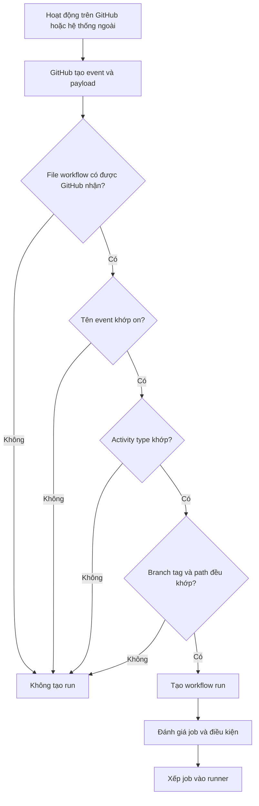

<Callout type="info" title="Mục tiêu của bài">
  Sau bài này, bạn có thể chọn đúng event, viết khối `on` hợp lệ, kết hợp bộ lọc mà không tạo run thừa và đọc payload của lần chạy. Phần bảo mật giải thích rõ khi nào không được dùng `pull_request_target` để chạy mã từ pull request.
</Callout>

## Mục lục

- [Mô hình event đến workflow run](#mô-hình-event-đến-workflow-run)
  - [Sự kiện, trigger và activity type](#sự-kiện-trigger-và-activity-type)
  - [Cú pháp on](#cú-pháp-on)
  - [Sơ đồ luồng kích hoạt](#sơ-đồ-luồng-kích-hoạt)
- [Quy tắc lọc sự kiện](#quy-tắc-lọc-sự-kiện)
  - [Bộ lọc branch và tag](#bộ-lọc-branch-và-tag)
  - [Bộ lọc path](#bộ-lọc-path)
  - [Kết hợp và loại trừ](#kết-hợp-và-loại-trừ)
- [Các event nền tảng](#các-event-nền-tảng)
  - [Push](#push)
  - [Pull request](#pull-request)
  - [Chạy thủ công với workflow dispatch](#chạy-thủ-công-với-workflow-dispatch)
  - [Chạy theo lịch với schedule](#chạy-theo-lịch-với-schedule)
  - [Nối workflow với workflow run](#nối-workflow-với-workflow-run)
  - [Nhận sự kiện ngoài GitHub với repository dispatch](#nhận-sự-kiện-ngoài-github-với-repository-dispatch)
- [So sánh pull request và pull request target](#so-sánh-pull-request-và-pull-request-target)
  - [Khác biệt về ref và quyền](#khác-biệt-về-ref-và-quyền)
  - [Cảnh báo bảo mật với pull request target](#cảnh-báo-bảo-mật-với-pull-request-target)
- [Các caveat về nhánh mặc định](#các-caveat-về-nhánh-mặc-định)
- [Bỏ qua CI bằng commit message](#bỏ-qua-ci-bằng-commit-message)
- [Payload và context của event](#payload-và-context-của-event)
- [Workflow mẫu hoàn chỉnh](#workflow-mẫu-hoàn-chỉnh)
- [Bài thực hành](#bài-thực-hành)
  - [Chuẩn bị](#chuẩn-bị)
  - [Tạo workflow quan sát trigger](#tạo-workflow-quan-sát-trigger)
  - [Tạo các tình huống kích hoạt](#tạo-các-tình-huống-kích-hoạt)
- [Kiểm chứng kết quả](#kiểm-chứng-kết-quả)
- [Best practices](#best-practices)
- [Troubleshooting](#troubleshooting)
- [Các trang liên quan](#các-trang-liên-quan)
- [Nguồn chính thức](#nguồn-chính-thức)

## Mô hình event đến workflow run

Một **event** là hoạt động mà GitHub quan sát được, chẳng hạn một commit được push, một pull request được mở hoặc một yêu cầu chạy thủ công được gửi. Khối `on` trong file workflow biến event thành **trigger**, tức điều kiện bắt đầu một workflow run.

Một event không đồng nghĩa với một run trong mọi trường hợp. GitHub còn kiểm tra activity type, branch, tag, path và vị trí của file workflow. Chỉ khi tất cả điều kiện của event đó khớp, GitHub mới tạo run và xếp các job vào hàng đợi runner.

### Sự kiện, trigger và activity type

Nhiều event có các **activity type**, tức loại hoạt động cụ thể bên trong event. Ví dụ, `pull_request` có các type như `opened`, `synchronize`, `reopened`, `closed` và `ready_for_review`.

```yaml
on:
  pull_request:
    types: [opened, synchronize, reopened, ready_for_review]
```

Các phần tử trong `types` có quan hệ **HOẶC**. Ví dụ trên chạy khi pull request được mở, có commit mới, được mở lại hoặc chuyển sang trạng thái sẵn sàng review.

Nếu không khai báo `types`, hành vi mặc định phụ thuộc vào từng event. Đáng chú ý, `pull_request` và `pull_request_target` mặc định chỉ nhận `opened`, `synchronize` và `reopened`; chúng không tự chạy cho mọi activity type được tài liệu liệt kê. Hãy kiểm tra trang chính thức của event trước khi dựa vào giá trị mặc định.

<Callout type="info" title="Webhook và Actions event không hoàn toàn giống nhau">
  Phần lớn event của Actions dựa trên webhook payload, nhưng không phải webhook nào cũng kích hoạt được workflow. Danh sách event và activity type được hỗ trợ trong tài liệu **Events that trigger workflows** mới là nguồn quyết định.
</Callout>

### Cú pháp on

Một event không có cấu hình con có thể viết ngắn:

```yaml
on: push
```

Nhiều event đơn giản có thể viết dưới dạng mảng:

```yaml
on: [push, pull_request]
```

Các event trong mảng có quan hệ **HOẶC**. Một `push` hoặc một hoạt động `pull_request` phù hợp đều có thể tạo run. Nếu hai event xảy ra gần như cùng lúc, GitHub có thể tạo hai run riêng, không gộp chúng thành một.

Khi ít nhất một event cần `types`, filter hoặc input, nên dùng dạng mapping. Mọi event trong mapping đều phải có dấu hai chấm, kể cả event không có cấu hình con:

```yaml
on:
  push:
    branches: [main]
  pull_request:
    types: [opened, synchronize]
  workflow_dispatch:
```

Đây là lỗi cú pháp thường gặp:

```yaml
# Sai: workflow_dispatch thiếu dấu hai chấm.
on:
  push:
    branches: [main]
  workflow_dispatch
```

### Sơ đồ luồng kích hoạt



Điểm quan trọng là filter trong `on` được đánh giá **trước khi** workflow run được tạo. Điều kiện `if` ở job hoặc step được đánh giá sau khi đã có run. Vì vậy, dùng filter đúng chỗ giúp giảm run không cần thiết.

## Quy tắc lọc sự kiện

GitHub hỗ trợ bộ lọc branch, tag và path cho một số event, nổi bật là `push`, `pull_request` và `pull_request_target`. Không phải event nào cũng nhận mọi loại filter.

### Bộ lọc branch và tag

Với `push`, `branches` so khớp tên branch được push. `tags` so khớp tên tag được push:

```yaml
on:
  push:
    branches:
      - main
      - 'releases/**'
    tags:
      - 'v*'
```

Workflow trên nhận push đến `main`, branch bên dưới `releases/`, hoặc tag bắt đầu bằng `v`. Các mẫu là glob, không phải regular expression. Dùng dấu nháy cho mẫu chứa `*`, `!` hoặc ký tự YAML đặc biệt để tránh trình phân tích YAML hiểu sai.

Với `pull_request` và `pull_request_target`, `branches` luôn lọc **base branch**, tức branch đích của pull request:

```yaml
on:
  pull_request:
    branches: [main]
```

Ví dụ này nhận pull request có đích là `main`, không quan tâm source branch tên gì. Nếu cần quyết định theo source branch, dùng `github.head_ref` trong điều kiện job; đó không phải chức năng của `branches` ở trigger.

Các quy tắc quan trọng cho `push`:

- Nếu chỉ khai báo `branches` hoặc `branches-ignore`, push tag không chạy workflow.
- Nếu chỉ khai báo `tags` hoặc `tags-ignore`, push branch không chạy workflow.
- Nếu không khai báo cả hai nhóm, push branch và push tag đều có thể kích hoạt workflow.
- Không dùng đồng thời `branches` và `branches-ignore` cho cùng một event. Quy tắc tương tự áp dụng cho `tags` và `tags-ignore`.

### Bộ lọc path

`paths` chạy workflow khi có ít nhất một file thay đổi khớp mẫu:

```yaml
on:
  pull_request:
    paths:
      - 'src/**'
      - 'package.json'
```

`paths-ignore` bỏ qua workflow chỉ khi **mọi** file thay đổi đều thuộc vùng bị bỏ qua:

```yaml
on:
  push:
    paths-ignore:
      - 'docs/**'
      - '**/*.md'
```

Nếu một push vừa đổi `docs/guide.md` vừa đổi `src/app.js`, ví dụ `paths-ignore` trên vẫn chạy vì có file nằm ngoài vùng bị bỏ qua.

Path được so khớp từ gốc repository. Bộ lọc path không được đánh giá cho push tag. GitHub xây dựng danh sách file thay đổi bằng diff hai chấm cho push và diff ba chấm cho pull request. Với push lớn hơn 1.000 commit hoặc khi tạo diff bị timeout, workflow luôn chạy. GitHub cũng giới hạn danh sách diff; vì vậy filter quá rộng có thể cho kết quả bất ngờ trên thay đổi cực lớn. Nói ngắn gọn: chia thay đổi lớn thành push hoặc pull request nhỏ hơn và viết mẫu path cụ thể.

### Kết hợp và loại trừ

Các nhóm filter khác nhau trong cùng một event có quan hệ **VÀ**. Ví dụ sau chỉ chạy khi pull request nhắm vào `main` **và** có thay đổi bên trong `src/`:

```yaml
on:
  pull_request:
    branches: [main]
    paths:
      - 'src/**'
```

Các mẫu dương trong cùng danh sách có quan hệ **HOẶC**. Chỉ cần một branch hoặc path phù hợp là đủ cho nhóm đó.

Để vừa bao gồm vừa loại trừ, dùng mẫu âm bắt đầu bằng `!` trong `branches`, `tags` hoặc `paths`. Danh sách phải có ít nhất một mẫu dương:

```yaml
on:
  push:
    branches:
      - 'releases/**'
      - '!releases/**-alpha'
    paths:
      - 'src/**'
      - '!src/generated/**'
```

Thứ tự mẫu có ý nghĩa:

1. Mẫu âm đứng sau một mẫu dương có thể loại kết quả đã khớp.
2. Mẫu dương đứng sau mẫu âm có thể đưa kết quả vào lại.
3. Nếu chỉ cần loại trừ, dùng `branches-ignore`, `tags-ignore` hoặc `paths-ignore` thay vì tạo danh sách âm.

Không được dùng `paths` và `paths-ignore` cùng nhau cho một event. Khi cần cả hai hướng, dùng mẫu `!` trong `paths` như ví dụ trên.

<Callout type="warn" title="Filter có thể làm required check chờ mãi">
  Khi workflow bị bỏ qua do branch filter, path filter hoặc commit message, check tương ứng có thể giữ trạng thái **Pending**. Nếu branch protection yêu cầu check đó, pull request sẽ bị chặn merge. Hãy thiết kế required workflow để nó luôn báo kết quả hoặc điều chỉnh ruleset cho phù hợp.
</Callout>

## Các event nền tảng

### Push

`push` xảy ra khi commit hoặc tag được push đến repository. `GITHUB_REF` là ref vừa cập nhật, còn `GITHUB_SHA` thường là commit đầu ref sau push.

```yaml
on:
  push:
    branches: [main, 'feature/**']
    tags: ['v*']
```

Các tình huống phổ biến:

- chạy test khi push branch;
- build release khi push tag;
- kiểm tra nhanh trước khi mở pull request;
- triển khai sau push vào branch đã được bảo vệ.

File workflow không nhất thiết phải được merge vào default branch để `push` chạy. Nó có thể chạy từ branch được push nếu commit trên branch đó chứa file workflow và trigger phù hợp.

GitHub tránh vòng lặp do automation tạo ra: khi một workflow dùng `GITHUB_TOKEN` để tạo thêm hoạt động, phần lớn event phát sinh sẽ không tạo workflow run mới. Hai ngoại lệ đáng chú ý là `workflow_dispatch` và `repository_dispatch`. Đừng thiết kế chuỗi workflow dựa vào một `git push` bằng `GITHUB_TOKEN` mà chưa kiểm chứng quy tắc này.

### Pull request

`pull_request` phù hợp cho CI trên mã được đề xuất. Mặc định, GitHub chạy trên merge ref dạng `refs/pull/<số-pr>/merge`, tức kết quả mô phỏng khi ghép head branch vào base branch. Vì vậy, `GITHUB_SHA` thường là SHA của merge commit thử nghiệm, không phải commit cuối của source branch.

```yaml
on:
  pull_request:
    types: [opened, synchronize, reopened, ready_for_review]
    branches: [main]
    paths:
      - 'src/**'
      - 'package*.json'
```

Muốn lấy SHA của commit cuối source branch, đọc `github.event.pull_request.head.sha`. Muốn biết branch nguồn và branch đích, đọc `github.head_ref` và `github.base_ref`.

Một số caveat cần nhớ:

- Workflow `pull_request` không chạy khi pull request có merge conflict cho đến khi conflict được giải quyết.
- Pull request từ fork thường nhận `GITHUB_TOKEN` chỉ đọc và không nhận repository secrets, ngoại trừ `GITHUB_TOKEN` bị giới hạn đó.
- Run của người đóng góp lần đầu vào public repository có thể cần maintainer phê duyệt.
- Pull request do Dependabot tạo được xử lý với giới hạn tương tự pull request từ fork.
- `branches` lọc branch đích, còn `paths` xét danh sách file thay đổi trong pull request.

Các giới hạn này làm `pull_request` trở thành lựa chọn mặc định an toàn hơn cho test mã không tin cậy.

### Chạy thủ công với workflow dispatch

`workflow_dispatch` thêm khả năng chạy từ GitHub UI, GitHub CLI hoặc API. File workflow phải tồn tại trên default branch thì GitHub mới nhận trigger này.

```yaml
on:
  workflow_dispatch:
    inputs:
      environment:
        description: "Môi trường cần kiểm tra"
        required: true
        type: choice
        options:
          - staging
          - production
      dry_run:
        description: "Chỉ mô phỏng"
        required: true
        default: true
        type: boolean
      retries:
        description: "Số lần thử lại"
        required: false
        default: 1
        type: number
```

Các type được hỗ trợ là `boolean`, `choice`, `number`, `environment` và `string`. Đọc giá trị qua context `inputs`:

```yaml
jobs:
  show-inputs:
    runs-on: ubuntu-latest
    steps:
      - name: Hiển thị lựa chọn
        env:
          TARGET: ${{ inputs.environment }}
          DRY_RUN: ${{ inputs.dry_run }}
          RETRIES: ${{ inputs.retries }}
        run: |
          printf 'environment=%s\n' "$TARGET"
          printf 'dry_run=%s\n' "$DRY_RUN"
          printf 'retries=%s\n' "$RETRIES"
```

Nên dùng `inputs` thay cho `github.event.inputs` vì `inputs` giữ boolean dưới dạng boolean. `choice` vẫn trả về string. Theo giới hạn hiện hành, một workflow có tối đa 25 input cấp cao nhất và tổng payload input tối đa 65.535 ký tự.

Có thể chạy bằng CLI:

```bash
gh workflow run observe-triggers.yml \
  -f environment=staging \
  -f dry_run=true \
  -f retries=1
```

### Chạy theo lịch với schedule

`schedule` dùng cron POSIX năm trường. Mặc định lịch được diễn giải theo UTC, chạy commit mới nhất trên default branch và chỉ chạy trên default branch.

```yaml
on:
  schedule:
    - cron: '17 2 * * 1-5'
```

Lịch trên chạy lúc 02:17 UTC từ thứ Hai đến thứ Sáu, tương đương 09:17 tại Việt Nam khi dùng UTC+7. Năm trường cron lần lượt là:

```text
┌──────── phút 0-59
│ ┌────── giờ 0-23
│ │ ┌──── ngày trong tháng 1-31
│ │ │ ┌── tháng 1-12
│ │ │ │ ┌ thứ trong tuần 0-6, Chủ nhật là 0
│ │ │ │ │
17 2 * * 1-5
```

GitHub hiện cũng cho phép khai báo timezone IANA cho lịch theo múi giờ. Tuy nhiên, dùng UTC thường dễ đối chiếu log và tránh bất ngờ do daylight saving time. Dù chọn cách nào, hãy ghi múi giờ vào comment hoặc tài liệu vận hành.

Các giới hạn vận hành quan trọng:

- Khoảng ngắn nhất giữa hai lần chạy lịch là 5 phút.
- Lịch không cam kết chạy chính xác đến từng phút.
- Tải cao, đặc biệt gần phút `0` đầu giờ, có thể làm run trễ; khi tải đủ cao, job trong hàng đợi thậm chí có thể bị bỏ.
- Chọn phút lệch như `17` hoặc `43` để giảm khả năng trễ.
- Public repository không có hoạt động trong 60 ngày sẽ tự tắt scheduled workflow.
- File workflow phải ở default branch và run luôn dùng phiên bản mới nhất trên branch đó.

Vì có thể trễ hoặc bỏ lượt, tác vụ theo lịch nên có tính **idempotent**: chạy lại không làm sai dữ liệu và có thể tự phát hiện phần việc còn thiếu.

### Nối workflow với workflow run

`workflow_run` tạo workflow sau khi workflow khác được yêu cầu, bắt đầu hoặc hoàn tất. Cách dùng phổ biến là tách CI không đặc quyền khỏi bước phát hành có quyền cao hơn.

```yaml
on:
  workflow_run:
    workflows: [CI]
    types: [completed]
    branches: [main]
```

`completed` kích hoạt bất kể workflow trước thành công hay thất bại. Kiểm tra `conclusion` nếu chỉ muốn chạy bước sau khi CI thành công:

```yaml
jobs:
  publish:
    if: ${{ github.event.workflow_run.conclusion == 'success' }}
    runs-on: ubuntu-latest
    steps:
      - run: echo "CI thành công; có thể bắt đầu publish"
```

Caveat nền tảng:

- File workflow nhận `workflow_run` phải tồn tại trên default branch.
- GitHub chỉ cho nối tối đa ba cấp bằng `workflow_run`.
- Type `requested` không phát sinh khi re-run workflow nguồn.
- Workflow sau có thể nhận secrets và write token dù workflow trước không có. Đây là ranh giới đặc quyền cần bảo vệ.
- Artifact, cache và dữ liệu từ workflow không tin cậy phải được xem là input không tin cậy.

<Callout type="warn" title="workflow_run có thể nâng đặc quyền">
  Không tải rồi thực thi artifact hoặc mã do pull request không tin cậy tạo ra trong workflow có secrets hay quyền ghi. Kẻ tấn công có thể lợi dụng artifact hoặc cache để chiếm token. Chỉ truyền dữ liệu tối thiểu, kiểm tra định dạng chặt chẽ và giữ `permissions` ở mức thấp nhất.
</Callout>

### Nhận sự kiện ngoài GitHub với repository dispatch

`repository_dispatch` cho phép hệ thống ngoài GitHub gọi REST API để kích hoạt workflow. File workflow phải tồn tại trên default branch.

Workflow nhận một loại sự kiện tùy chỉnh:

```yaml
on:
  repository_dispatch:
    types: [smoke_test]
```

Hệ thống ngoài gửi `event_type` và payload tùy chọn:

```json
{
  "event_type": "smoke_test",
  "client_payload": {
    "environment": "staging",
    "requested_by": "monitoring-service"
  }
}
```

Trong workflow, đọc dữ liệu tại `github.event.client_payload`:

```yaml
jobs:
  smoke-test:
    runs-on: ubuntu-latest
    steps:
      - name: Đọc payload
        env:
          TARGET: ${{ github.event.client_payload.environment }}
          REQUESTER: ${{ github.event.client_payload.requested_by }}
        run: printf 'target=%s requester=%s\n' "$TARGET" "$REQUESTER"
```

Có thể gửi thử bằng GitHub CLI sau khi đăng nhập và có quyền phù hợp:

```bash
gh api --method POST repos/OWNER/REPO/dispatches \
  -f event_type=smoke_test \
  -F 'client_payload[environment]=staging' \
  -F 'client_payload[requested_by]=manual-test'
```

`event_type` tối đa 100 ký tự. `client_payload` có tối đa 10 thuộc tính cấp cao nhất và tổng payload tối đa 65.535 ký tự. Hãy xác thực payload như dữ liệu từ bên ngoài; không nối trực tiếp giá trị của nó vào lệnh shell.

## So sánh pull request và pull request target

Hai event cùng phản ứng với hoạt động pull request nhưng chạy trong context khác nhau. Chọn sai event có thể biến một workflow tiện lợi thành lỗ hổng chiếm repository.

### Khác biệt về ref và quyền

| Đặc điểm | `pull_request` | `pull_request_target` |
|---|---|---|
| Context Git | Merge ref của pull request | Default branch của base repository |
| `GITHUB_REF` điển hình | `refs/pull/<số-pr>/merge` | Ref của base branch |
| `GITHUB_SHA` điển hình | Merge commit thử nghiệm | Commit cuối trên default branch |
| Mã phù hợp để chạy | Mã pull request với quyền hạn chế | Chỉ mã tin cậy từ base branch |
| Pull request có conflict | Không chạy đến khi giải quyết conflict | Vẫn có thể chạy |
| Fork public | Token thường chỉ đọc, không có repository secrets | Có thể có token ghi và secrets theo cấu hình |
| Trường hợp dùng chính | Build, lint, test mã đề xuất | Label, comment, phân loại PR bằng metadata |

`pull_request_target` không tự checkout mã pull request. Việc nó chạy phiên bản workflow từ base repository chính là lớp bảo vệ. Nếu workflow chủ động checkout head SHA rồi chạy mã đó, lớp bảo vệ bị loại bỏ.

### Cảnh báo bảo mật với pull request target

<Callout type="error" title="Không chạy mã PR không tin cậy bằng pull_request_target">
  Không checkout `github.event.pull_request.head.sha`, không chạy script từ branch nguồn, không cài dependency lấy từ pull request và không nạp artifact hoặc cache không tin cậy trong workflow `pull_request_target` có secrets hay quyền ghi. Mẫu này có thể dẫn đến đánh cắp secret, cache poisoning và chiếm quyền ghi repository.
</Callout>

Dùng `pull_request` cho CI thông thường:

```yaml
on:
  pull_request:
    branches: [main]

permissions:
  contents: read
```

Chỉ cân nhắc `pull_request_target` cho thao tác dựa trên metadata, ví dụ gắn nhãn. Workflow phải giới hạn quyền rõ ràng và không thực thi nội dung từ PR:

```yaml
on:
  pull_request_target:
    types: [opened]

permissions:
  contents: read
  pull-requests: write

jobs:
  metadata-only:
    runs-on: ubuntu-latest
    steps:
      - name: Chỉ đọc metadata
        env:
          PR_NUMBER: ${{ github.event.pull_request.number }}
        run: printf 'Đang xử lý metadata của PR %s\n' "$PR_NUMBER"
```

Ví dụ trên chỉ minh họa ranh giới an toàn; nó chưa gắn nhãn thật. Nếu không cần quyền đặc biệt, hãy dùng `pull_request` thay vì `pull_request_target`.

## Các caveat về nhánh mặc định

Không phải trigger nào cũng đọc file workflow từ branch đang tạo event. Đây là nguồn phổ biến của tình trạng “YAML đúng nhưng không có run”.

| Event | Yêu cầu hoặc hành vi liên quan default branch |
|---|---|
| `push` | Có thể chạy workflow có trong commit của branch được push, kể cả chưa merge vào default branch. |
| `pull_request` | Chạy theo merge ref của PR và phù hợp để kiểm tra thay đổi được đề xuất. |
| `pull_request_target` | Chạy trong context base repository, với `GITHUB_SHA` là commit cuối trên default branch. |
| `workflow_dispatch` | File workflow phải tồn tại trên default branch; sau đó người chạy có thể chọn ref được hỗ trợ. |
| `schedule` | File phải ở default branch; chỉ chạy commit mới nhất trên default branch. |
| `repository_dispatch` | File workflow phải tồn tại trên default branch; `GITHUB_REF` và `GITHUB_SHA` trỏ vào default branch. |
| `workflow_run` | File workflow nhận sự kiện phải tồn tại trên default branch; context run mới dùng ref và SHA của default branch. |

Nhiều event quản trị repository khác như `issues`, `label`, `fork` hoặc `branch_protection_rule` cũng yêu cầu file workflow tồn tại trên default branch. Hãy đọc phần ghi chú của từng event trong tài liệu chính thức thay vì suy luận từ `push`.

Khi mới thêm `workflow_dispatch`, `schedule`, `repository_dispatch` hoặc `workflow_run` trên feature branch, đừng mong trigger đó hoạt động ngay. Merge file vào default branch trước, sau đó tạo lại event để kiểm tra.

## Bỏ qua CI bằng commit message

GitHub cho phép bỏ qua workflow được kích hoạt bởi `push` và `pull_request` khi commit message chứa một trong các chuỗi:

```text
[skip ci]
[ci skip]
[no ci]
[skip actions]
[actions skip]
```

Hoặc đặt trailer ở cuối commit message, sau hai dòng trống:

```text
docs: sửa lỗi chính tả


skip-checks: true
```

Trailer phải nằm ở cuối phần trailers. Git có thể tự rút gọn các dòng trống; khi cần giữ nguyên định dạng, dùng `git commit --cleanup=verbatim`.

Skip instruction chỉ áp dụng cho `push` và `pull_request`. Nó không dừng `pull_request_target`, `schedule`, `workflow_dispatch` hay `repository_dispatch`.

<Callout type="warn" title="Dùng skip CI có chủ đích">
  Check bị skip có thể ở trạng thái **Pending** và chặn merge nếu ruleset yêu cầu check đó. Không dùng `[skip ci]` để né required checks. Với thay đổi tài liệu lặp lại, path filter thường rõ ràng và dễ kiểm soát hơn.
</Callout>

## Payload và context của event

Mỗi run có payload mô tả event đã kích hoạt nó. GitHub đặt toàn bộ payload tại `github.event` và ghi bản JSON vào file có đường dẫn trong biến `GITHUB_EVENT_PATH`.

Các giá trị cơ bản nên biết:

| Giá trị | Ý nghĩa |
|---|---|
| `github.event_name` | Tên event, ví dụ `push` hoặc `workflow_dispatch`. |
| `github.event.action` | Activity type nếu event có trường `action`, ví dụ `opened`. |
| `github.ref` | Ref đầy đủ liên quan đến run. Ý nghĩa thay đổi theo event. |
| `github.sha` | SHA liên quan đến run. Không phải lúc nào cũng là head SHA của PR. |
| `github.head_ref` | Source branch của PR; chỉ có trên event pull request phù hợp. |
| `github.base_ref` | Target branch của PR; chỉ có trên event pull request phù hợp. |
| `github.event.pull_request.head.sha` | Commit cuối source branch của pull request. |
| `inputs.<tên>` | Input của `workflow_dispatch` hoặc reusable workflow. |
| `github.event.client_payload` | Dữ liệu tùy chỉnh của `repository_dispatch`. |
| `github.event.workflow_run.conclusion` | Kết quả workflow nguồn đối với `workflow_run`. |

Ví dụ quan sát metadata mà không in toàn bộ context:

```yaml
- name: In metadata an toàn
  env:
    EVENT_NAME: ${{ github.event_name }}
    EVENT_ACTION: ${{ github.event.action }}
    REF: ${{ github.ref }}
    SHA: ${{ github.sha }}
  run: |
    printf 'event=%s action=%s\n' "$EVENT_NAME" "$EVENT_ACTION"
    printf 'ref=%s sha=%s\n' "$REF" "$SHA"
```

Khi cần xem payload đầy đủ trong lúc debug, có thể đọc file bằng `jq` trên Ubuntu runner:

```yaml
- name: Xem payload tạm thời
  run: jq . "$GITHUB_EVENT_PATH"
```

<Callout type="warn" title="Payload là dữ liệu không tin cậy">
  Tiêu đề PR, tên branch, nội dung issue và `client_payload` có thể do người khác kiểm soát. Đưa context vào biến `env`, đặt biến shell trong dấu nháy và kiểm tra định dạng trước khi dùng. Không chèn trực tiếp `${{ github.event.pull_request.title }}` vào script shell. Không in toàn bộ `github` context trong workflow production vì context này có thể chứa `github.token` và metadata nhạy cảm.
</Callout>

Bài này chỉ dùng một số thuộc tính để giải thích trigger. Context và expression được trình bày riêng ở các trang liên quan cuối bài.

## Workflow mẫu hoàn chỉnh

Workflow sau kết hợp `push`, `pull_request`, `workflow_dispatch` và `schedule`. Mỗi event là một lối vào độc lập. Filter chỉ áp dụng cho event chứa nó.

Tạo `.github/workflows/observe-triggers.yml`:

```yaml
name: Observe triggers
run-name: Observe ${{ github.event_name }} on ${{ github.ref_name }}

on:
  push:
    branches:
      - main
      - 'releases/**'
    tags:
      - 'v*'
    paths:
      - 'src/**'
      - '.github/workflows/observe-triggers.yml'
      - '!src/generated/**'
  pull_request:
    types: [opened, synchronize, reopened, ready_for_review]
    branches: [main]
    paths:
      - 'src/**'
      - '.github/workflows/observe-triggers.yml'
      - '!src/generated/**'
  workflow_dispatch:
    inputs:
      target:
        description: "Mục tiêu kiểm tra"
        required: true
        default: staging
        type: choice
        options:
          - staging
          - production
      verbose:
        description: "In thêm thông tin"
        required: true
        default: false
        type: boolean
  schedule:
    - cron: '17 2 * * 1-5'

permissions:
  contents: read

jobs:
  observe:
    runs-on: ubuntu-latest
    timeout-minutes: 5
    steps:
      - name: Hiển thị nguồn kích hoạt
        env:
          EVENT_NAME: ${{ github.event_name }}
          EVENT_ACTION: ${{ github.event.action }}
          REF: ${{ github.ref }}
          SHA: ${{ github.sha }}
          HEAD_REF: ${{ github.head_ref }}
          BASE_REF: ${{ github.base_ref }}
          TARGET: ${{ inputs.target }}
          VERBOSE: ${{ inputs.verbose }}
        run: |
          printf 'event=%s action=%s\n' "$EVENT_NAME" "$EVENT_ACTION"
          printf 'ref=%s sha=%s\n' "$REF" "$SHA"
          printf 'head=%s base=%s\n' "$HEAD_REF" "$BASE_REF"
          printf 'target=%s verbose=%s\n' "$TARGET" "$VERBOSE"

      - name: Xác nhận payload tồn tại
        run: test -s "$GITHUB_EVENT_PATH"
```

Workflow hợp lệ mà không cần checkout vì nó chỉ đọc metadata. Trên run tự động, `TARGET` và `VERBOSE` có thể rỗng vì event đó không cung cấp input thủ công. Push tag khớp `v*` vẫn có thể chạy vì path filter không được đánh giá cho tag push.

<Callout type="info" title="Đổi main nếu repository dùng tên khác">
  Thay mọi `main` trong ví dụ bằng default branch thực tế. Bạn có thể xem tên này tại **Settings → Branches**, trên trang chính repository hoặc bằng `gh repo view --json defaultBranchRef`.
</Callout>

## Bài thực hành

Mục tiêu là quan sát một file workflow phản ứng khác nhau với push, pull request và yêu cầu thủ công. Phần schedule được cấu hình nhưng không cần chờ đến giờ cron để hoàn thành bài.

### Chuẩn bị

Bạn cần:

- quyền ghi vào một repository thử nghiệm;
- GitHub Actions đang được bật;
- Git trên máy;
- GitHub CLI nếu muốn chạy bằng terminal;
- biết tên default branch của repository.

Nếu repository chưa có thư mục `src`, tạo một file nhỏ để filter có dữ liệu kiểm tra:

```bash
mkdir -p src
printf 'trigger practice\n' > src/trigger-practice.txt
```

### Tạo workflow quan sát trigger

<Steps>
<Step>

Tạo `.github/workflows/observe-triggers.yml` bằng nội dung ở phần [Workflow mẫu hoàn chỉnh](#workflow-mẫu-hoàn-chỉnh). Đổi `main` nếu default branch có tên khác.

</Step>
<Step>

Commit workflow và file thực hành trên một branch mới:

```bash
git switch -c practice/events-triggers
mkdir -p .github/workflows
git add .github/workflows/observe-triggers.yml src/trigger-practice.txt
git commit -m "ci: add trigger observation workflow"
git push -u origin practice/events-triggers
```

Push này không tạo run vì `branches` chỉ nhận `main` và `releases/**`. Đây là kết quả đúng, không phải lỗi.

</Step>
<Step>

Mở pull request từ `practice/events-triggers` vào default branch. Event `pull_request` khớp branch đích và thay đổi path `src/**`, nên GitHub phải tạo một run.

</Step>
<Step>

Merge pull request theo quy trình của repository. Push tạo bởi merge vào default branch khớp cả `branches` và `paths`, nên một run `push` mới phải xuất hiện.

</Step>
</Steps>

### Tạo các tình huống kích hoạt

Sau khi workflow đã ở default branch, thực hiện lần lượt:

1. **Chạy thủ công:** vào **Actions → Observe triggers → Run workflow**, chọn `staging`, bật hoặc tắt `verbose`, rồi chạy.
2. **Cập nhật pull request:** tạo branch khác, sửa `src/trigger-practice.txt`, mở PR vào default branch rồi push thêm một commit. Run đầu dùng action `opened`; run sau dùng `synchronize`.
3. **Thử path bị loại:** trên một branch, chỉ sửa file trong `src/generated/` và mở PR. Workflow không nên tạo run vì mẫu âm loại path này.
4. **Thử branch filter:** push cùng thay đổi `src/**` lên branch `experiment/demo`. Event `push` không tạo run vì branch không khớp.
5. **Tùy chọn thử tag:** từ commit an toàn, tạo tag thử nghiệm rồi push. Tag `v0.0.0-trigger-test` khớp `v*`:

```bash
git tag v0.0.0-trigger-test
git push origin v0.0.0-trigger-test
```

Xóa tag thử nghiệm sau khi quan sát xong:

```bash
git push origin :refs/tags/v0.0.0-trigger-test
git tag -d v0.0.0-trigger-test
```

6. **Tùy chọn dùng CLI:** chạy thủ công và theo dõi run:

```bash
gh workflow run observe-triggers.yml \
  -f target=staging \
  -f verbose=true
gh run watch
```

## Kiểm chứng kết quả

Bạn hoàn thành bài khi thu được các bằng chứng sau:

| Tình huống | Kết quả mong đợi |
|---|---|
| PR vào default branch đổi `src/**` | Có run với `event=pull_request`, `action=opened`, `head` và `base` có giá trị. |
| Push commit mới vào PR | Có run mới với `action=synchronize`. |
| Merge vào default branch | Có run riêng với `event=push` và ref dạng `refs/heads/<default-branch>`. |
| Chạy bằng nút hoặc CLI | Có run với `event=workflow_dispatch`; log hiển thị `target` và `verbose`. |
| Chỉ đổi `src/generated/**` | Không có run do mẫu path âm. |
| Push `src/**` lên branch không khớp | Không có run do branch filter. |
| Push tag bắt đầu bằng `v` | Có run `push`; ref dạng `refs/tags/<tên-tag>`. |
| Mọi run được tạo | Job `observe` thành công và step kiểm tra payload trả về mã thoát `0`. |

Mở từng run trong tab **Actions**, chọn job **observe**, rồi so sánh log step **Hiển thị nguồn kích hoạt**. Sự khác nhau của `event`, `action`, `ref`, `head` và `base` là bằng chứng trực tiếp cho mô hình trong bài.

## Best practices

- **Bắt đầu từ event hẹp nhất:** CI mã nguồn thường dùng `pull_request` và `push` vào default branch. Chỉ thêm event khi có use case rõ.
- **Khai báo `types` rõ ràng:** tránh run khi activity không liên quan và giảm bất ngờ nếu GitHub bổ sung activity type mới.
- **Lọc ở `on` trước khi dùng `if`:** branch và path filter ngăn tạo run; `if` chỉ bỏ qua job hoặc step sau khi run đã tồn tại.
- **Kiểm tra quan hệ VÀ và HOẶC:** event khác nhau là HOẶC; `types` trong cùng event là HOẶC; branch và path trong cùng event là VÀ.
- **Dùng tên workflow ổn định:** `workflow_run.workflows` tham chiếu giá trị `name` của workflow nguồn. Đổi tên có thể làm chuỗi ngừng kích hoạt.
- **Giữ quyền tối thiểu:** khai báo `permissions` rõ ràng. Workflow chỉ quan sát event thường chỉ cần `contents: read` hoặc thậm chí `permissions: {}` nếu không dùng API hay checkout.
- **Coi payload là input không tin cậy:** chuyển giá trị sang biến môi trường, quote biến shell và validate kiểu dữ liệu.
- **Không chạy mã PR bằng `pull_request_target`:** dùng `pull_request` cho build và test. Chỉ dùng target event cho metadata khi thật sự cần quyền ở base repository.
- **Bảo vệ chuỗi `workflow_run`:** không tin artifact hay cache từ workflow ít đặc quyền; kiểm tra `conclusion` và dữ liệu đầu vào trước bước có quyền ghi.
- **Viết scheduled task idempotent:** cron có thể trễ, bỏ lượt hoặc được chạy lại thủ công. Tác vụ phải chịu được cả ba tình huống.
- **Tránh đầu giờ cho cron:** chọn phút lệch để giảm cạnh tranh hàng đợi.
- **Ghi rõ ý nghĩa filter bằng comment:** đặc biệt khi dùng mẫu âm và nhiều glob có thứ tự.
- **Thiết kế required checks cùng filter:** tránh check `Pending` vĩnh viễn làm PR không merge được.
- **Không tạo vòng lặp event:** hiểu quy tắc chống đệ quy của `GITHUB_TOKEN`; dùng cơ chế nối workflow có chủ đích thay vì push qua lại.

## Troubleshooting

| Triệu chứng | Nguyên nhân thường gặp | Cách xử lý |
|---|---|---|
| GitHub không nhận workflow | File không ở `.github/workflows/`, sai phần mở rộng hoặc YAML lỗi. | Dùng `.yml` hoặc `.yaml`, kiểm tra thụt lề bằng khoảng trắng và xem lỗi trong tab **Actions**. |
| Dùng nhiều event nhưng workflow không hợp lệ | Event không cấu hình bị thiếu dấu `:`. | Viết `workflow_dispatch:` hoặc `page_build:` khi dùng dạng mapping. |
| Push branch không tạo run | Chỉ khai báo `tags`, branch không khớp glob hoặc path không khớp. | Đối chiếu riêng từng nhóm `branches`, `tags`, `paths`; nhớ các nhóm khác nhau có quan hệ VÀ. |
| Push tag không tạo run | Chỉ khai báo `branches` hoặc tag không khớp `tags`. | Thêm `tags` phù hợp. Path filter không phải nguyên nhân vì GitHub không đánh giá path cho tag push. |
| PR vào main không tạo run | `branches` đang lọc branch đích khác, path không khớp, PR có conflict hoặc run từ fork cần phê duyệt. | Kiểm tra base branch, file changed, conflict và thông báo approval trên trang PR. |
| Sửa source branch nhưng không có run mới | `types` thiếu `synchronize`. | Thêm `synchronize` vào danh sách activity types. |
| Nút Run workflow không xuất hiện | Thiếu `workflow_dispatch`, file chưa ở default branch hoặc người dùng thiếu quyền ghi. | Merge workflow vào default branch, kiểm tra trigger và quyền repository. |
| `repository_dispatch` trả về thành công nhưng không có run | File chưa ở default branch hoặc `event_type` không khớp `types`. | Kiểm tra default branch và so sánh chính xác chuỗi `event_type`. |
| `workflow_run` không chạy | Workflow nhận chưa ở default branch, tên trong `workflows` sai hoặc chuỗi đã quá ba cấp. | So sánh với `name` của workflow nguồn, merge file và rút ngắn chuỗi. |
| Workflow sau chạy dù CI thất bại | `completed` không lọc theo conclusion. | Thêm `if: github.event.workflow_run.conclusion == 'success'` ở job cần bảo vệ. |
| Schedule chạy muộn | Tải cao, nhất là đầu giờ; cron không có SLA chính xác. | Chọn phút lệch, làm tác vụ idempotent và thêm giám sát phát hiện lượt bị thiếu. |
| Schedule ngừng ở public repository | Repository không có hoạt động trong 60 ngày. | Bật lại workflow và tạo hoạt động hợp lệ; kiểm tra người dùng gắn với schedule còn active. |
| Required check ở trạng thái Pending | Workflow bị skip bởi path, branch filter hoặc commit message. | Điều chỉnh ruleset, filter hoặc thiết kế một check luôn báo kết quả. |
| `GITHUB_SHA` không phải head SHA của PR | `pull_request` dùng merge commit thử nghiệm. | Dùng `github.event.pull_request.head.sha` khi thực sự cần SHA của source branch. |
| Biến payload làm hỏng lệnh shell | Dữ liệu không tin cậy được chèn trực tiếp vào `run`. | Truyền qua `env`, quote biến và validate định dạng trước khi sử dụng. |
| Có hai run cho một thay đổi | Hai event như `push` và `pull_request` cùng khớp. | Chấp nhận nếu hai run có mục đích khác nhau, hoặc thu hẹp branch và event để loại trùng. |

## Các trang liên quan

<Cards>
  <Card title="Cấu trúc workflow" href="/docs/nen-tang/01-cau-truc-workflow/" description="Hiểu các khóa cấp cao nhất và cách tổ chức file workflow." />
  <Card title="YAML cho GitHub Actions" href="/docs/nen-tang/02-yaml-cho-github-actions/" description="Nắm cú pháp mapping, sequence, scalar và các lỗi thụt lề phổ biến." />
  <Card title="Jobs và steps" href="/docs/nen-tang/04-jobs-va-steps/" description="Theo dõi điều gì xảy ra sau khi trigger đã tạo workflow run." />
  <Card title="Contexts" href="/docs/nen-tang/07-contexts/" description="Đi sâu vào github, inputs và các context có sẵn trong workflow." />
  <Card title="Expressions" href="/docs/nen-tang/08-expressions/" description="Viết điều kiện dựa trên event payload mà không trộn lẫn logic trigger." />
</Cards>

## Nguồn chính thức

- [Events that trigger workflows](https://docs.github.com/en/actions/reference/workflows-and-actions/events-that-trigger-workflows)
- [Workflow syntax for GitHub Actions](https://docs.github.com/en/actions/reference/workflows-and-actions/workflow-syntax)
- [Triggering a workflow](https://docs.github.com/en/actions/how-tos/write-workflows/choose-when-workflows-run/trigger-a-workflow)
- [Contexts reference](https://docs.github.com/en/actions/reference/workflows-and-actions/contexts)
- [Webhook events and payloads](https://docs.github.com/en/webhooks/webhook-events-and-payloads)
- [Skipping workflow runs](https://docs.github.com/en/actions/how-tos/manage-workflow-runs/skip-workflow-runs)
- [Manually running a workflow](https://docs.github.com/en/actions/how-tos/manage-workflow-runs/manually-run-a-workflow)
- [REST API endpoint to create a repository dispatch event](https://docs.github.com/en/rest/repos/repos#create-a-repository-dispatch-event)
- [Secure use reference](https://docs.github.com/en/actions/reference/security/secure-use)
- [Securely using pull_request_target](https://docs.github.com/en/actions/reference/security/securely-using-pull_request_target)
