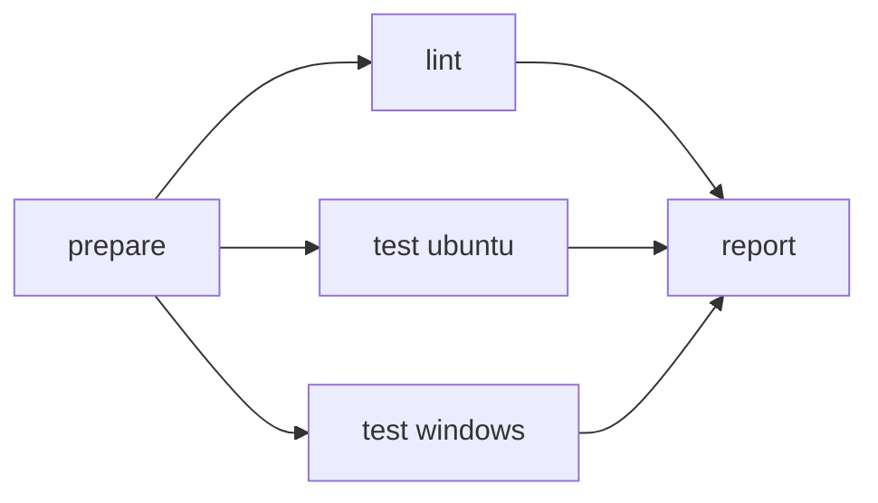

<Callout type="info" title="Kết quả học tập">
  Sau bài này, bạn có thể chia một workflow thành các job có ranh giới rõ ràng, mô hình hóa thứ tự bằng `needs`, chọn runner, kiểm soát lỗi và truyền dữ liệu bằng output hoặc artifact. Bạn cũng sẽ tạo một workflow hoàn chỉnh để quan sát chạy song song, isolation giữa jobs và bước tổng hợp kết quả.
</Callout>

## Mục lục

- [Mô hình tư duy về job và step](#mô-hình-tư-duy-về-job-và-step)
  - [Job là đơn vị lập lịch](#job-là-đơn-vị-lập-lịch)
  - [Step là đơn vị thực thi tuần tự](#step-là-đơn-vị-thực-thi-tuần-tự)
  - [Ranh giới chia job](#ranh-giới-chia-job)
- [Vòng đời và phạm vi cô lập](#vòng-đời-và-phạm-vi-cô-lập)
  - [Vòng đời của một job](#vòng-đời-của-một-job)
  - [Những gì được chia sẻ giữa các step](#những-gì-được-chia-sẻ-giữa-các-step)
  - [Những gì không tự đi qua ranh giới job](#những-gì-không-tự-đi-qua-ranh-giới-job)
- [Chạy song song và đồ thị phụ thuộc](#chạy-song-song-và-đồ-thị-phụ-thuộc)
  - [Các job độc lập chạy song song mặc định](#các-job-độc-lập-chạy-song-song-mặc-định)
  - [Tạo DAG bằng needs](#tạo-dag-bằng-needs)
  - [Điều kiện if và status check](#điều-kiện-if-và-status-check)
- [Cấu hình job thiết yếu](#cấu-hình-job-thiết-yếu)
  - [Chọn môi trường bằng runs-on](#chọn-môi-trường-bằng-runs-on)
  - [Giới hạn thời gian bằng timeout-minutes](#giới-hạn-thời-gian-bằng-timeout-minutes)
  - [Nới lỗi có chủ đích bằng continue-on-error](#nới-lỗi-có-chủ-đích-bằng-continue-on-error)
- [Viết step rõ ràng và dự đoán được](#viết-step-rõ-ràng-và-dự-đoán-được)
  - [Phân biệt uses và run](#phân-biệt-uses-và-run)
  - [Chọn shell và working-directory](#chọn-shell-và-working-directory)
  - [Đặt ID step và tạo output](#đặt-id-step-và-tạo-output)
- [Truyền dữ liệu giữa jobs](#truyền-dữ-liệu-giữa-jobs)
  - [Job outputs cho giá trị nhỏ](#job-outputs-cho-giá-trị-nhỏ)
  - [Artifacts và caches cho dữ liệu dạng file](#artifacts-và-caches-cho-dữ-liệu-dạng-file)
- [Mở rộng job đúng hướng](#mở-rộng-job-đúng-hướng)
  - [Matrix tạo nhiều biến thể job](#matrix-tạo-nhiều-biến-thể-job)
  - [Job containers và service containers](#job-containers-và-service-containers)
- [Workflow hoàn chỉnh](#workflow-hoàn-chỉnh)
  - [Đồ thị thực thi](#đồ-thị-thực-thi)
  - [Cấu hình có thể chạy ngay](#cấu-hình-có-thể-chạy-ngay)
  - [Cách đọc workflow](#cách-đọc-workflow)
- [Bài thực hành và kiểm chứng](#bài-thực-hành-và-kiểm-chứng)
  - [Tạo và chạy workflow](#tạo-và-chạy-workflow)
  - [Quan sát song song và isolation](#quan-sát-song-song-và-isolation)
  - [Kiểm tra output và artifact](#kiểm-tra-output-và-artifact)
  - [Gây lỗi để kiểm tra DAG](#gây-lỗi-để-kiểm-tra-dag)
- [Best practices](#best-practices)
  - [Thiết kế cấu trúc](#thiết-kế-cấu-trúc)
  - [An toàn và khả năng bảo trì](#an-toàn-và-khả-năng-bảo-trì)
- [Troubleshooting](#troubleshooting)
- [Đi tiếp](#đi-tiếp)
- [Nguồn chính thức](#nguồn-chính-thức)

## Mô hình tư duy về job và step

Một workflow là một đồ thị các **job**. Mỗi job là một danh sách **step** chạy trên cùng môi trường thực thi.

```text
Workflow run
├── Job prepare ──► step 1 ──► step 2
├── Job lint    ──► step 1 ──► step 2
└── Job test    ──► step 1 ──► step 2 ──► step 3
```

Hai quy tắc giúp đọc hầu hết workflow:

1. **Giữa các job:** không có quan hệ `needs` thì GitHub có thể chạy song song.
2. **Trong một job:** các step chạy tuần tự theo thứ tự khai báo.

### Job là đơn vị lập lịch

Mỗi khóa trực tiếp dưới `jobs` là một **job ID**. ID dùng trong `needs`, expressions và API; `name` là nhãn thân thiện hiển thị trên giao diện.

```yaml
jobs:
  unit_tests:                 # Job ID
    name: Unit tests          # Tên hiển thị
    runs-on: ubuntu-latest
    steps:
      - run: echo "test"
```

GitHub lập lịch runner cho từng job. Vì vậy, tách một quy trình thành `lint`, `unit_tests` và `build` có thể giảm tổng thời gian nếu ba việc không phụ thuộc nhau. Đổi lại, mỗi job phải tự chuẩn bị môi trường và dữ liệu cần thiết.

### Step là đơn vị thực thi tuần tự

Một step gọi action bằng `uses` hoặc chạy script bằng `run`. Khi một step thất bại, các step sau có điều kiện mặc định sẽ bị bỏ qua.

Đây là mô hình mặc định nên dùng để suy luận. GitHub Actions hiện cũng hỗ trợ `background` cho trường hợp đặc biệt cần giữ một step chạy nền trong khi step sau tiếp tục. Chỉ dùng cơ chế đó khi bạn quản lý được readiness, log và cleanup; với database hoặc Redis, service container thường rõ ràng hơn.

```yaml
steps:
  - name: Lấy mã nguồn
    uses: actions/checkout@v7

  - name: Kiểm tra định dạng
    run: ./scripts/lint.sh
```

Step thứ hai thấy được file mà step checkout đặt vào workspace vì cả hai thuộc cùng một job. Tuy nhiên, một `run` step là một tiến trình shell mới. Lệnh `cd` hoặc `export` trong step trước không tự thay đổi shell của step sau.

### Ranh giới chia job

Tạo job riêng khi một nhóm công việc có ít nhất một đặc điểm sau:

- có thể chạy song song với nhóm khác;
- cần hệ điều hành, runner, container, quyền hoặc secret khác;
- cần timeout hoặc chính sách lỗi khác;
- là một status check độc lập cần hiển thị trên pull request;
- tạo ra sản phẩm có thể bàn giao rõ ràng, chẳng hạn binary hoặc báo cáo kiểm thử.

Giữ các lệnh trong cùng một job khi chúng cần chia sẻ filesystem chặt chẽ và việc lặp lại bước cài đặt ở nhiều runner không đem lại lợi ích. Không nên biến mỗi lệnh shell thành một job riêng.

## Vòng đời và phạm vi cô lập

### Vòng đời của một job

Một job thường đi qua các giai đoạn sau:

1. GitHub đánh giá `if`, `needs`, `strategy` và `runs-on` để quyết định có lập lịch job hay không.
2. Một runner phù hợp nhận job. Với GitHub-hosted runner, đây thường là máy ảo sạch được tạo cho job.
3. GitHub chuẩn bị workspace, token tạm thời, biến mặc định, container và services nếu có.
4. Các step chạy tuần tự. Action có thể đăng ký bước hậu xử lý để dọn cache, credential hoặc tiến trình.
5. GitHub thực hiện cleanup, thu kết quả và giải phóng runner. Service containers cũng dừng cùng job.

Trong log, **Set up job** và **Complete job** là các bước hệ thống. Chúng không xuất hiện trong `steps` của YAML nhưng vẫn có thể là nơi lỗi xảy ra, ví dụ runner không kéo được container image.

<Callout type="warn" title="Self-hosted runner không đồng nghĩa với máy sạch">
  GitHub-hosted runner được cấp mới theo job. Self-hosted runner có thể giữ file, tool hoặc tiến trình từ lần chạy trước nếu bạn không dọn dẹp đúng cách. Workflow vẫn nên tự khai báo đầy đủ dependency và không dựa vào trạng thái còn sót lại.
</Callout>

### Những gì được chia sẻ giữa các step

Các step trong cùng job dùng chung:

- runner, hệ điều hành và các tool đã cài trong job;
- workspace và các file được tạo ra;
- job container và service containers;
- biến được khai báo ở cấp job;
- giá trị được ghi có chủ đích vào các environment file như `GITHUB_ENV`, `GITHUB_PATH` và `GITHUB_OUTPUT`.

Các tiến trình shell lại tách biệt. Ví dụ sau không hoạt động như nhiều người mong đợi:

```yaml
steps:
  - run: cd scripts
  - run: ./test.sh # Vẫn chạy từ working directory mặc định
```

Hãy đặt `working-directory: scripts` cho step thứ hai, hoặc gộp hai lệnh vào cùng một `run` block.

### Những gì không tự đi qua ranh giới job

Mỗi job có runner và filesystem riêng. Job sau **không tự nhận**:

- file đã checkout hoặc tạo trong job trước;
- package đã cài toàn cục;
- biến tạo bằng `export` hoặc `GITHUB_ENV` ở job khác;
- tiến trình nền và service đang chạy;
- thư mục hiện hành của job trước.

Dùng **job output** cho chuỗi dữ liệu nhỏ. Dùng **artifact** để chuyển file bắt buộc. Dùng **cache** để tăng tốc dữ liệu có thể tái tạo. Nếu job cần mã nguồn, job đó thường phải checkout lại.

## Chạy song song và đồ thị phụ thuộc

### Các job độc lập chạy song song mặc định

Trong cấu hình sau, `lint` và `test` không có `needs`, nên GitHub có thể lập lịch chúng cùng lúc:

```yaml
jobs:
  lint:
    runs-on: ubuntu-latest
    steps:
      - run: echo "lint"

  test:
    runs-on: ubuntu-latest
    steps:
      - run: echo "test"
```

“Có thể” quan trọng hơn “sẽ ngay lập tức”. Job còn phụ thuộc vào runner sẵn có, giới hạn concurrency của tài khoản và hàng đợi. Thứ tự khai báo trong YAML không tạo thứ tự thực thi.

### Tạo DAG bằng needs

`needs` tạo cạnh trong **DAG** — đồ thị có hướng không chu trình. Một job có thể phụ thuộc vào một hoặc nhiều job:

```yaml
jobs:
  build:
    runs-on: ubuntu-latest
    steps:
      - run: echo "build"

  unit_tests:
    runs-on: ubuntu-latest
    steps:
      - run: echo "unit"

  deploy:
    needs: [build, unit_tests]
    runs-on: ubuntu-latest
    steps:
      - run: echo "deploy"
```

`build` và `unit_tests` chạy độc lập. `deploy` chỉ được xét sau khi cả hai hoàn tất. Mặc định, nếu một dependency thất bại hoặc bị skip thì job phụ thuộc cũng bị skip.

`needs` chỉ cho phép truy cập trực tiếp các job được liệt kê. Nếu `deploy` cần output từ `prepare`, hãy thêm `prepare` vào `needs` của `deploy`, kể cả khi đã có một đường phụ thuộc bắc cầu qua `build`.

<Callout type="idea" title="Thiết kế từ cạnh phụ thuộc">
  Hãy hỏi “job này thực sự cần kết quả của job nào?” rồi khai báo đúng các cạnh đó. Không nối mọi job thành một chuỗi chỉ để ép thứ tự; cách đó làm mất khả năng chạy song song.
</Callout>

### Điều kiện if và status check

`if` quyết định job hoặc step có được chạy hay không. Nếu biểu thức không chứa status check function, GitHub ngầm áp dụng `success()`.

```yaml
steps:
  - name: Chỉ chạy trên nhánh chính
    if: github.ref == 'refs/heads/main'
    run: echo "main"

  - name: Thu log khi có lỗi
    if: failure()
    run: ./scripts/collect-logs.sh

  - name: Dọn dẹp trừ khi run đã bị hủy
    if: ${{ !cancelled() }}
    run: ./scripts/cleanup.sh
```

Các status check thường dùng:

| Hàm | Ý nghĩa thực hành |
|---|---|
| `success()` | Các step hoặc job trước liên quan đều thành công. Đây là mặc định. |
| `failure()` | Có lỗi trong chuỗi thực thi liên quan. Hữu ích cho thu log hoặc chẩn đoán. |
| `cancelled()` | Workflow run đã bị hủy. |
| `always()` | Luôn trả về `true`, kể cả khi bị hủy. Phù hợp với job tổng hợp ngắn. |

Ở cấp job, một job có `needs` thường bị skip khi dependency lỗi. Muốn job tổng hợp vẫn chạy, phải ghi điều kiện status rõ ràng:

```yaml
report:
  if: ${{ always() }}
  needs: [lint, test]
  runs-on: ubuntu-latest
  steps:
    - run: echo "lint=${{ needs.lint.result }}, test=${{ needs.test.result }}"
```

Không dùng `always()` một cách máy móc cho bước lấy mã nguồn hoặc tác vụ có thể treo. Với cleanup chỉ cần tránh chạy sau khi hủy, `if: ${{ !cancelled() }}` thường thể hiện ý định tốt hơn.

Tên job thường trở thành check trên commit hoặc pull request. Hãy giữ tên ổn định nếu branch protection yêu cầu check đó. Một job bị skip do `if` được GitHub báo là thành công và không chặn merge; điều này khác với cả workflow không chạy do bộ lọc event, có thể để required check ở trạng thái chờ.

## Cấu hình job thiết yếu

### Chọn môi trường bằng runs-on

Mọi job thông thường cần `runs-on`. Giá trị này chọn runner theo label, nhóm runner hoặc expression:

```yaml
jobs:
  linux:
    runs-on: ubuntu-latest
    steps:
      - run: uname -a

  internal:
    runs-on: [self-hosted, linux, x64]
    steps:
      - run: ./scripts/check-internal.sh
```

Danh sách `[self-hosted, linux, x64]` nghĩa là runner phải có **tất cả** label. Với GitHub-hosted runner, bạn thường dùng `ubuntu-latest`, `windows-latest` hoặc `macos-latest`.

Chọn image cụ thể khi cần tính tái lập cao hơn. `*-latest` trỏ đến image ổn định mới nhất mà GitHub cung cấp, không nhất thiết là bản hệ điều hành vừa được nhà sản xuất phát hành. Chi tiết image, phần mềm cài sẵn, quyền và năng lực runner được trình bày ở trang [Runners](/docs/nen-tang/06-runners/).

### Giới hạn thời gian bằng timeout-minutes

Đặt timeout theo thời gian chạy bình thường cộng một khoảng đệm:

```yaml
jobs:
  test:
    runs-on: ubuntu-latest
    timeout-minutes: 20
    steps:
      - name: Integration tests
        timeout-minutes: 15
        run: ./scripts/integration-test.sh
```

Timeout cấp step chặn một lệnh riêng bị treo. Timeout cấp job bao phủ toàn bộ job, kể cả tổng thời gian các step. Nếu không đặt, timeout job mặc định là 360 phút. Trong thực tế, nên đặt giá trị thấp hơn nhiều để lỗi treo được phát hiện sớm và không chiếm runner vô ích.

### Nới lỗi có chủ đích bằng continue-on-error

`continue-on-error` có hai phạm vi:

```yaml
jobs:
  compatibility:
    continue-on-error: true
    runs-on: ubuntu-latest
    steps:
      - name: Thử nghiệm không bắt buộc
        id: experiment
        continue-on-error: true
        run: exit 1

      - name: Ghi nhận outcome gốc
        run: echo "${{ steps.experiment.outcome }}"
```

- **Ở step:** job tiếp tục sau khi step lỗi. `steps.experiment.outcome` vẫn là `failure`, dù conclusion đã được điều chỉnh để luồng có thể tiếp tục.
- **Ở job:** lỗi của job không làm toàn workflow run thất bại. Cách này thường dùng cho một biến thể matrix thử nghiệm.

<Callout type="warn" title="Không che lỗi bắt buộc">
  Không đặt `continue-on-error: true` cho test bảo vệ chất lượng, quét bảo mật bắt buộc hoặc deploy production. Nếu lỗi phải được sửa trước khi merge, nó phải làm check thất bại.
</Callout>

## Viết step rõ ràng và dự đoán được

### Phân biệt uses và run

Một step chọn một trong hai cách thực thi chính:

| Khóa | Dùng khi | Cấu hình đi kèm |
|---|---|---|
| `uses` | Gọi một action đóng gói sẵn | Thường dùng `with` để truyền input |
| `run` | Chạy lệnh hoặc script shell | Có thể dùng `shell`, `working-directory`, `env` |

```yaml
steps:
  - name: Checkout repository
    uses: actions/checkout@v7
    with:
      fetch-depth: 0

  - name: Chạy script của repository
    run: ./scripts/verify.sh
```

Một step không thể vừa có `uses` vừa có `run`. `uses` ở **cấp step** gọi action; `uses` trực tiếp ở **cấp job** có ý nghĩa khác là gọi reusable workflow. Trang [Actions](/docs/nen-tang/05-actions/) trình bày sâu hơn về loại action, input và cách pin phiên bản.

### Chọn shell và working-directory

`shell` chọn trình thông dịch. `working-directory` chọn thư mục bắt đầu của một `run` step:

```yaml
defaults:
  run:
    shell: bash

jobs:
  test_web:
    runs-on: ubuntu-latest
    defaults:
      run:
        working-directory: apps/web
    steps:
      - name: Unit tests
        run: npm test

      - name: Script PowerShell riêng
        shell: pwsh
        working-directory: scripts
        run: ./inspect.ps1
```

Các điểm cần nhớ:

- `defaults.run` chỉ áp dụng cho step dùng `run`, không áp dụng cho action dùng `uses`.
- Cấu hình ở cấp job ghi đè cấu hình cùng tên ở cấp workflow; cấu hình trực tiếp tại step cụ thể hơn cả.
- Thư mục trong `working-directory` phải tồn tại trước khi step bắt đầu.
- Shell mặc định khác nhau theo hệ điều hành. Khai báo `bash` hoặc `pwsh` rõ ràng khi script cần hành vi nhất quán.
- Trên Linux và macOS, `shell: bash` bật `-eo pipefail`; pipeline sẽ báo lỗi nếu một lệnh thành phần thất bại.

### Đặt ID step và tạo output

`name` phục vụ người đọc log. `id` phục vụ tham chiếu trong expression. ID phải duy nhất trong job.

Để tạo output, ghi cặp `ten=gia_tri` vào file được trỏ bởi `GITHUB_OUTPUT`:

```yaml
steps:
  - name: Tạo phiên bản
    id: version
    run: echo "value=1.4.${GITHUB_RUN_NUMBER}" >> "$GITHUB_OUTPUT"

  - name: Dùng phiên bản trong cùng job
    env:
      RELEASE_VERSION: ${{ steps.version.outputs.value }}
    run: echo "Release: $RELEASE_VERSION"
```

Output chỉ có sẵn cho các step tiếp theo. Không đưa trực tiếp dữ liệu không tin cậy vào giữa script; ánh xạ expression sang `env` như ví dụ giúp tách dữ liệu khỏi cú pháp shell.

## Truyền dữ liệu giữa jobs

### Job outputs cho giá trị nhỏ

Step output chỉ thuộc job hiện tại. Muốn job khác đọc được, ánh xạ nó thành job output rồi khai báo `needs`:

```yaml
jobs:
  prepare:
    runs-on: ubuntu-latest
    outputs:
      version: ${{ steps.meta.outputs.version }}
    steps:
      - id: meta
        run: echo "version=1.4.${GITHUB_RUN_NUMBER}" >> "$GITHUB_OUTPUT"

  publish:
    needs: prepare
    runs-on: ubuntu-latest
    steps:
      - env:
          VERSION: ${{ needs.prepare.outputs.version }}
        run: echo "Publishing $VERSION"
```

Luồng dữ liệu là:

```text
GITHUB_OUTPUT
      ↓
steps.meta.outputs.version
      ↓
jobs.prepare.outputs.version
      ↓
needs.prepare.outputs.version
```

Job output phù hợp với version, URL, tên artifact, cờ hoặc JSON nhỏ. Output được đánh giá như chuỗi; khi cần kiểu dữ liệu có cấu trúc, dùng các hàm expression phù hợp và kiểm tra input cẩn thận.

### Artifacts và caches cho dữ liệu dạng file

| Cơ chế | Mục đích | Ví dụ |
|---|---|---|
| Job output | Truyền metadata nhỏ trong DAG | version, tên image, cờ quyết định |
| Artifact | Lưu hoặc chuyển file là kết quả của run | binary, coverage, test report |
| Cache | Tái sử dụng dữ liệu có thể tạo lại giữa các run để tăng tốc | dependency, compiler cache |

Artifact là dữ liệu có chủ đích và có thể tải xuống sau run. Cache là tối ưu “có thì nhanh hơn”; workflow phải vẫn đúng khi cache miss. Không dùng cache làm kênh bàn giao duy nhất cho binary bắt buộc của job sau.

## Mở rộng job đúng hướng

### Matrix tạo nhiều biến thể job

Matrix nhân một định nghĩa job thành nhiều job run:

```yaml
jobs:
  test:
    name: Test Node ${{ matrix.node }} on ${{ matrix.os }}
    strategy:
      fail-fast: false
      matrix:
        os: [ubuntu-latest, windows-latest]
        node: [22, 24]
    runs-on: ${{ matrix.os }}
    steps:
      - uses: actions/checkout@v7
      - uses: actions/setup-node@v7
        with:
          node-version: ${{ matrix.node }}
      - run: npm test
```

Ví dụ tạo bốn job từ tích Descartes của hai hệ điều hành và hai phiên bản Node.js. `fail-fast: false` cho phép các biến thể còn lại tiếp tục để thu đủ kết quả tương thích. Dùng `include` và `exclude` khi cần thêm hoặc bỏ tổ hợp đặc biệt; dùng `max-parallel` khi phải giới hạn số job đồng thời.

Matrix không thay thế việc chia trách nhiệm. Trước tiên thiết kế một job đúng, sau đó dùng matrix để chạy cùng trách nhiệm trên nhiều cấu hình. Xem chuyên đề [Matrix strategy](/docs/dieu-khien-workflow/04-matrix-strategy/) để xử lý matrix động và các trường hợp nâng cao.

### Job containers và service containers

Hai tính năng container phục vụ hai mục tiêu khác nhau:

- `container` chạy các step của job trong một container, giúp khóa môi trường runtime và toolchain.
- `services` khởi động container phụ trợ như PostgreSQL hoặc Redis trong vòng đời job.

```yaml
jobs:
  integration:
    runs-on: ubuntu-latest
    container: node:24
    services:
      postgres:
        image: postgres:18
        env:
          POSTGRES_PASSWORD: postgres
    steps:
      - run: node --version
```

Đây chỉ là bản đồ định hướng. Container jobs và service containers cần runner Linux có Docker. Cách phân giải hostname, ánh xạ port, health check, credential registry và shell mặc định trong container cần được thiết kế riêng. Xem [Containers và service containers](/docs/dieu-khien-workflow/10-containers-service-containers/) trước khi dùng cho integration test.

## Workflow hoàn chỉnh

Workflow dưới đây không phụ thuộc dự án Node.js hay package nào. Nó minh họa output, artifact, matrix, chạy song song, `needs` và job tổng hợp.

### Đồ thị thực thi



`lint` và hai biến thể `test` có thể chạy song song sau `prepare`. `report` đợi toàn bộ nhánh trước nó.

### Cấu hình có thể chạy ngay

Tạo file `.github/workflows/jobs-steps-lab.yml` với nội dung sau:

```yaml
name: Jobs and Steps Lab

on:
  push:
  workflow_dispatch:

permissions:
  contents: read

defaults:
  run:
    shell: bash

jobs:
  prepare:
    name: Prepare metadata
    runs-on: ubuntu-latest
    timeout-minutes: 5
    outputs:
      build-label: ${{ steps.meta.outputs.build-label }}
    steps:
      - name: Checkout repository
        uses: actions/checkout@v7

      - name: Create metadata
        id: meta
        run: |
          label="run-${GITHUB_RUN_NUMBER}-${GITHUB_SHA::7}"
          echo "build-label=$label" >> "$GITHUB_OUTPUT"
          printf 'label=%s\nrepository=%s\n' "$label" "$GITHUB_REPOSITORY" > build-info.txt

      - name: Show step output
        env:
          BUILD_LABEL: ${{ steps.meta.outputs.build-label }}
        run: echo "Prepared $BUILD_LABEL"

      - name: Upload build information
        uses: actions/upload-artifact@v4
        with:
          name: build-info
          path: build-info.txt
          retention-days: 1

  lint:
    name: Validate workflow
    needs: prepare
    runs-on: ubuntu-latest
    timeout-minutes: 5
    steps:
      - name: Checkout repository again
        uses: actions/checkout@v7

      - name: Validate workflow file and output
        env:
          BUILD_LABEL: ${{ needs.prepare.outputs.build-label }}
        run: |
          test -f .github/workflows/jobs-steps-lab.yml
          test -n "$BUILD_LABEL"
          echo "Validated $BUILD_LABEL"

  test:
    name: Test artifact on ${{ matrix.os }}
    needs: prepare
    runs-on: ${{ matrix.os }}
    timeout-minutes: 5
    strategy:
      fail-fast: false
      matrix:
        os: [ubuntu-latest, windows-latest]
    steps:
      - name: Download build information
        uses: actions/download-artifact@v5
        with:
          name: build-info

      - name: Verify artifact
        env:
          EXPECTED_LABEL: ${{ needs.prepare.outputs.build-label }}
        run: |
          test -s build-info.txt
          grep -F "label=$EXPECTED_LABEL" build-info.txt
          echo "Artifact verified on $RUNNER_OS"

  report:
    name: Final report
    if: ${{ always() }}
    needs: [lint, test]
    runs-on: ubuntu-latest
    timeout-minutes: 5
    steps:
      - name: Summarize required jobs
        env:
          LINT_RESULT: ${{ needs.lint.result }}
          TEST_RESULT: ${{ needs.test.result }}
        run: |
          echo "lint=$LINT_RESULT"
          echo "test=$TEST_RESULT"
          if [[ "$LINT_RESULT" != "success" || "$TEST_RESULT" != "success" ]]; then
            echo "At least one required job did not succeed" >&2
            exit 1
          fi
```

<Callout type="info" title="Pin phiên bản action">
  Ví dụ dùng major tag hiện hành trong tài liệu chính thức. Với workflow production có yêu cầu chuỗi cung ứng chặt chẽ, hãy pin third-party action bằng full-length commit SHA và dùng Dependabot để nhận cập nhật.
</Callout>

### Cách đọc workflow

- `prepare` chạy đầu tiên, checkout repository, tạo step output và upload `build-info.txt`.
- `lint` và `test` cùng `needs: prepare`, nên bắt đầu sau `prepare` nhưng không đợi nhau.
- Matrix mở rộng `test` thành một job Ubuntu và một job Windows.
- Mỗi biến thể `test` tải artifact về filesystem riêng rồi so sánh với job output.
- `report` dùng `always()` để vẫn chạy khi một nhánh lỗi hoặc bị skip. Sau đó script tự biến kết quả không thành công thành exit code `1`, nên check cuối phản ánh đúng trạng thái bắt buộc.
- `report` chỉ đọc `needs.lint` và `needs.test`. Nó không đọc output của `prepare` vì `prepare` không phải dependency trực tiếp trong danh sách `needs` của job này.

## Bài thực hành và kiểm chứng

### Tạo và chạy workflow

<Steps>
<Step>

1. Tạo `.github/workflows/jobs-steps-lab.yml` và dán workflow hoàn chỉnh ở trên.
2. Commit rồi push:

```bash
git add .github/workflows/jobs-steps-lab.yml
git commit -m "ci: practice jobs and steps"
git push
```

</Step>
<Step>

Mở **Actions → Jobs and Steps Lab**. Chọn run mới nhất và mở biểu đồ job.

Nếu muốn chạy thủ công sau khi file đã ở nhánh mặc định, dùng nút **Run workflow** hoặc GitHub CLI:

```bash
gh workflow run jobs-steps-lab.yml
gh run watch
```

</Step>
</Steps>

### Quan sát song song và isolation

Kiểm tra các bằng chứng sau:

- `prepare` hoàn tất trước khi `lint` và `test` bắt đầu.
- `lint`, `Test artifact on ubuntu-latest` và `Test artifact on windows-latest` không có cạnh phụ thuộc lẫn nhau.
- `lint` phải checkout lại. File từ workspace của `prepare` không tự xuất hiện trong job này.
- Hai job `test` không checkout repository nhưng vẫn có `build-info.txt` vì mỗi job tải artifact về.
- `Final report` chỉ bắt đầu sau `lint` và toàn bộ matrix `test`.

Thời gian bắt đầu có thể lệch nhau do hàng đợi runner. Để chứng minh quan hệ, dựa vào các cạnh trong graph và trường `needs`, không dựa vào việc timestamp phải trùng tuyệt đối.

### Kiểm tra output và artifact

1. Mở job **Prepare metadata** và tìm dòng `Prepared run-...`.
2. Mở từng job **Test artifact** và xác nhận có dòng `Artifact verified on Linux` hoặc `Artifact verified on Windows`.
3. Ở cuối trang run, tải artifact **build-info** và mở `build-info.txt`.
4. So sánh dòng `label=` trong file với nhãn ở log `prepare`.
5. Mở **Final report** và xác nhận `lint=success`, `test=success`.

Khi đủ năm bằng chứng, bạn đã kiểm chứng cả kênh metadata bằng job output và kênh file bằng artifact.

### Gây lỗi để kiểm tra DAG

Trong job `lint`, đổi lệnh:

```bash
test -f .github/workflows/jobs-steps-lab.yml
```

thành:

```bash
test -f .github/workflows/file-khong-ton-tai.yml
```

Commit và push. Kết quả mong đợi:

- `prepare` thành công;
- `lint` thất bại;
- các biến thể `test` vẫn chạy vì chúng không phụ thuộc `lint`;
- `report` vẫn chạy do `always()`, in `lint=failure`, rồi tự thất bại;
- toàn workflow có kết luận **Failure**.

Khôi phục đúng tên file, commit và push lần nữa. Run mới phải thành công. **Re-run jobs** trên run lỗi vẫn dùng commit và phiên bản workflow cũ, nên không thay thế run từ commit sửa lỗi.

## Best practices

### Thiết kế cấu trúc

- Đặt một trách nhiệm rõ ràng cho mỗi job: validate, test, build, package hoặc deploy.
- Chỉ thêm `needs` khi có phụ thuộc dữ liệu hoặc thứ tự thật sự. Giữ các nhánh độc lập để tận dụng chạy song song.
- Dùng `name` mô tả kết quả mong đợi; dùng job ID ngắn, ổn định và dễ tham chiếu.
- Giữ các step chia sẻ filesystem trong cùng job. Dùng artifact khi file phải qua ranh giới job.
- Đặt `timeout-minutes` ở job dài hoặc gọi hệ thống bên ngoài. Thêm timeout cấp step cho lệnh có nguy cơ treo.
- Với matrix, dùng tên hiển thị chứa giá trị matrix để người đọc biết chính xác biến thể nào lỗi.
- Tạo một job tổng hợp ổn định nếu branch protection cần một required check duy nhất cho matrix động.

### An toàn và khả năng bảo trì

- Khai báo `permissions` tối thiểu ở workflow hoặc từng job. Chỉ job thực sự cần ghi mới được cấp quyền ghi.
- Pin action theo chính sách của tổ chức. Full commit SHA là tham chiếu bất biến an toàn nhất cho action bên thứ ba.
- Không nội suy input không tin cậy trực tiếp vào script shell. Ánh xạ qua `env`, quote biến và validate định dạng.
- Không dùng `continue-on-error` để làm dashboard xanh giả tạo. Chỉ dùng cho kiểm tra thử nghiệm hoặc không bắt buộc đã được ghi rõ.
- Không phụ thuộc file còn sót trên self-hosted runner. Dọn workspace và cô lập credential sau mỗi job.
- Artifact và cache có retention, quota và phạm vi truy cập. Không đưa secret, token hoặc credential vào chúng.
- Đặt script phức tạp trong repository thay vì nhúng hàng chục dòng vào YAML; script cục bộ dễ test và review hơn.

## Troubleshooting

| Triệu chứng | Nguyên nhân thường gặp | Cách xử lý |
|---|---|---|
| Job chạy trước job mà bạn nghĩ phải đợi | Thứ tự YAML không tạo dependency. | Thêm `needs: job_id` vào job phụ thuộc. |
| Job downstream bị skip | Một job trong `needs` thất bại hoặc bị skip; điều kiện mặc định là `success()`. | Sửa lỗi upstream. Chỉ dùng `always()` hoặc `!cancelled()` cho report hay cleanup có chủ đích. |
| `needs.prepare.outputs.version` rỗng | Step không có `id`, ghi sai tên vào `GITHUB_OUTPUT`, chưa ánh xạ `jobs.<id>.outputs`, hoặc job tiêu thụ thiếu `needs: prepare`. | Kiểm tra đủ bốn mắt xích từ `GITHUB_OUTPUT` đến `needs`. |
| `steps.some_id.outputs.value` không tồn tại | Đang tham chiếu output trước step tạo nó, hoặc `some_id` là `name` chứ không phải `id`. | Đặt `id` duy nhất và chỉ đọc output ở step phía sau. |
| `working-directory` không tồn tại | Repository chưa checkout hoặc đường dẫn sai so với workspace. | Checkout trước, kiểm tra đường dẫn và tạo thư mục nếu workflow thực sự cần. |
| Lệnh chạy trên Ubuntu nhưng lỗi trên Windows | Shell hoặc cú pháp đường dẫn khác hệ điều hành. | Khai báo `shell` rõ ràng, dùng script đa nền tảng hoặc tách step theo `runner.os`. |
| File có ở job trước nhưng mất ở job sau | Filesystem không được chia sẻ giữa jobs. | Upload artifact ở job tạo file rồi download trong job dùng file. |
| Cache miss làm job lỗi | Cache bị dùng như nguồn dữ liệu bắt buộc. | Cho phép cài lại hoặc tạo lại dữ liệu; dùng artifact cho output bắt buộc trong run. |
| Workflow xanh dù một kiểm tra lỗi | `continue-on-error` đặt sai phạm vi hoặc job tổng hợp không kiểm tra `needs.<job>.result`. | Bỏ nới lỗi khỏi kiểm tra bắt buộc và xác minh logic của job tổng hợp. |
| Job ở trạng thái queued lâu | Không có runner khớp mọi label, runner offline hoặc hết concurrency. | Kiểm tra `runs-on`, trạng thái runner và giới hạn chạy đồng thời. |
| `report` không đọc được output của job bắc cầu | `needs` context chỉ chứa dependency trực tiếp. | Thêm job nguồn vào `needs` hoặc chuyển tiếp output qua job trung gian. |
| YAML hợp lệ nhưng workflow báo lỗi tại `uses` | Tham chiếu action sai phiên bản, action bị chính sách tổ chức chặn hoặc dùng `uses` sai cấp. | Kiểm tra Marketplace, policy Actions và phân biệt action step với reusable workflow job. |

## Đi tiếp

<Cards>
  <Card title="Events và triggers" href="/docs/nen-tang/03-events-va-triggers/" description="Xác định khi nào workflow được tạo và cách lọc sự kiện đầu vào." />
  <Card title="Actions" href="/docs/nen-tang/05-actions/" description="Đi sâu vào action dùng với uses, input, output và chiến lược pin phiên bản." />
  <Card title="Runners" href="/docs/nen-tang/06-runners/" description="Chọn GitHub-hosted hoặc self-hosted runner và hiểu môi trường thực thi." />
  <Card title="Job dependencies" href="/docs/dieu-khien-workflow/02-job-dependencies/" description="Mở rộng needs, fan-out, fan-in và các mẫu DAG phức tạp hơn." />
</Cards>

## Nguồn chính thức

- [Workflow syntax for GitHub Actions](https://docs.github.com/en/actions/reference/workflows-and-actions/workflow-syntax)
- [Understanding GitHub Actions](https://docs.github.com/en/actions/about-github-actions/understanding-github-actions)
- [Passing information between jobs](https://docs.github.com/en/actions/how-tos/write-workflows/choose-what-workflows-do/pass-job-outputs)
- [Running variations of jobs in a workflow](https://docs.github.com/en/actions/how-tos/write-workflows/choose-what-workflows-do/run-job-variations)
- [Evaluate expressions in workflows and actions](https://docs.github.com/en/actions/reference/workflows-and-actions/expressions)
- [Contexts reference](https://docs.github.com/en/actions/reference/workflows-and-actions/contexts)
- [Workflow artifacts](https://docs.github.com/en/actions/concepts/workflows-and-actions/workflow-artifacts)
- [Dependency caching](https://docs.github.com/en/actions/concepts/workflows-and-actions/dependency-caching)
- [Secure use reference](https://docs.github.com/en/actions/reference/security/secure-use)
- [GitHub-hosted runners reference](https://docs.github.com/en/actions/reference/runners/github-hosted-runners)
- [Using containerized services](https://docs.github.com/en/actions/tutorials/use-containerized-services)
