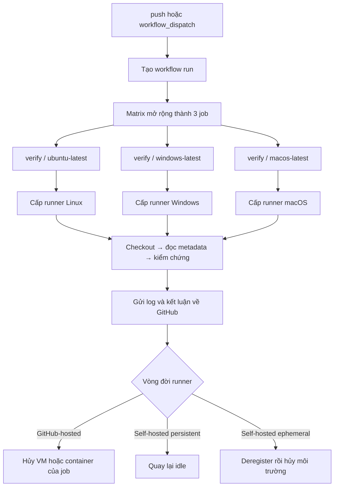

<Callout type="info" title="Mục tiêu của bài">
  Sau bài này, bạn có thể chọn đúng runner bằng `runs-on`, giải thích vòng đời của một job, phân biệt GitHub-hosted với self-hosted runner, và kiểm chứng một workflow chạy trên Linux, Windows lẫn macOS. Phần larger runners và Actions Runner Controller chỉ đóng vai trò định hướng; các bài trong nhóm **Runners** sẽ đi sâu vào triển khai và vận hành.
</Callout>

## Mục lục

- [Runner nằm ở đâu trong GitHub Actions](#runner-nằm-ở-đâu-trong-github-actions)
- [Vòng đời runner và job](#vòng-đời-runner-và-job)
  - [Từ hàng đợi đến khi hoàn tất](#từ-hàng-đợi-đến-khi-hoàn-tất)
  - [Phạm vi chia sẻ trạng thái](#phạm-vi-chia-sẻ-trạng-thái)
- [Chọn mô hình runner](#chọn-mô-hình-runner)
  - [GitHub-hosted runner](#github-hosted-runner)
  - [Self-hosted runner persistent và ephemeral](#self-hosted-runner-persistent-và-ephemeral)
  - [Bảng so sánh nhanh](#bảng-so-sánh-nhanh)
- [Định tuyến job với runs-on](#định-tuyến-job-với-runs-on)
  - [Các dạng runs-on hợp lệ](#các-dạng-runs-on-hợp-lệ)
  - [Labels](#labels)
  - [Runner groups](#runner-groups)
- [Hệ điều hành, kiến trúc và runner image](#hệ-điều-hành-kiến-trúc-và-runner-image)
  - [Chọn OS và kiến trúc](#chọn-os-và-kiến-trúc)
  - [Quản lý thay đổi của image](#quản-lý-thay-đổi-của-image)
- [Workspace, thư mục tạm và tool cache](#workspace-thư-mục-tạm-và-tool-cache)
  - [Workspace của một job](#workspace-của-một-job)
  - [Tool cache không phải dependency cache](#tool-cache-không-phải-dependency-cache)
  - [Hiểu đúng về clean VM](#hiểu-đúng-về-clean-vm)
- [Billing và concurrency](#billing-và-concurrency)
- [Mạng, quyền và bảo mật](#mạng-quyền-và-bảo-mật)
  - [Kết nối mạng](#kết-nối-mạng)
  - [Quyền của tiến trình trên runner](#quyền-của-tiến-trình-trên-runner)
  - [Rủi ro từ pull request không tin cậy](#rủi-ro-từ-pull-request-không-tin-cậy)
- [Larger runners và Actions Runner Controller](#larger-runners-và-actions-runner-controller)
- [Workflow đa nền tảng hoàn chỉnh](#workflow-đa-nền-tảng-hoàn-chỉnh)
  - [Luồng thực thi](#luồng-thực-thi)
  - [Cấu hình workflow](#cấu-hình-workflow)
  - [Điểm cần đọc trong ví dụ](#điểm-cần-đọc-trong-ví-dụ)
- [Thực hành và kiểm chứng](#thực-hành-và-kiểm-chứng)
  - [Chuẩn bị và chạy workflow](#chuẩn-bị-và-chạy-workflow)
  - [Kiểm chứng trên GitHub](#kiểm-chứng-trên-github)
  - [Kiểm chứng bằng GitHub CLI](#kiểm-chứng-bằng-github-cli)
- [Best practices](#best-practices)
- [Troubleshooting](#troubleshooting)
- [Học tiếp về runners](#học-tiếp-về-runners)
- [Nguồn chính thức](#nguồn-chính-thức)

## Runner nằm ở đâu trong GitHub Actions

Runner là máy nhận và thực thi **một job** của GitHub Actions. Máy đó chạy runner application để giao tiếp với dịch vụ GitHub Actions, nhận nội dung job, tải action, khởi chạy shell hoặc container, rồi gửi log và kết quả về GitHub.

Đơn vị cấp phát là job, không phải toàn bộ workflow. Một workflow có ba job độc lập có thể dùng ba runner khác nhau và chạy đồng thời. Các step trong cùng một job chạy tuần tự trên cùng runner nên nhìn thấy cùng hệ thống file; các job khác nhau không tự chia sẻ file.

```text
Workflow run
├── job lint  ──► runner A ──► step 1 → step 2
├── job test  ──► runner B ──► step 1 → step 2
└── job build ──► runner C ──► step 1 → step 2
```

`runs-on` mô tả loại runner mà job cần. GitHub đối chiếu yêu cầu đó với runner đang sẵn sàng, nhưng workflow không điều khiển trực tiếp một máy cụ thể trừ khi cách đặt label của bạn vô tình chỉ khớp đúng một máy.

## Vòng đời runner và job

### Từ hàng đợi đến khi hoàn tất

Một job đi qua các giai đoạn chính sau:

1. Một event tạo workflow run. GitHub đánh giá điều kiện, quan hệ `needs` và strategy matrix để tạo các job cụ thể.
2. Job chuyển sang trạng thái **queued**. Dịch vụ Actions tìm runner online, idle và khớp toàn bộ yêu cầu `runs-on`, gồm group nếu có.
3. Runner nhận job. Với self-hosted runner, nếu runner được chỉ định không nhận job trong 60 giây, GitHub đưa job trở lại hàng đợi để runner phù hợp khác có thể nhận.
4. Runner chuẩn bị job, cấp các biến môi trường và token cần thiết, rồi tải những action được tham chiếu.
5. Các step chạy theo thứ tự trên cùng runner. Một step thất bại thường làm các step sau bị bỏ qua, trừ khi workflow dùng điều kiện khác.
6. Các post-step được chạy, log và kết luận được gửi về GitHub. Runner sau đó bị hủy, giải phóng hoặc quay lại trạng thái idle tùy mô hình.

Một runner thông thường chỉ xử lý một job tại một thời điểm. Nếu không có self-hosted runner nào khớp và online, job có thể chờ tối đa 24 giờ trước khi thất bại. Với GitHub-hosted runner, thời gian chờ còn phụ thuộc hạn mức concurrency và tình trạng dịch vụ.

### Phạm vi chia sẻ trạng thái

Ranh giới job quyết định dữ liệu nào còn tồn tại:

- **Giữa các step của cùng job:** file trong workspace vẫn tồn tại. Tiến trình của step trước thường đã kết thúc; muốn giữ biến môi trường cho step sau, hãy ghi vào `GITHUB_ENV` thay vì chỉ dùng `export`.
- **Giữa các job:** không giả định cùng máy hoặc cùng ổ đĩa. Dùng job outputs cho dữ liệu nhỏ, artifact cho file kết quả và dependency cache cho dependency có thể tái tạo.
- **Giữa các workflow run:** chỉ dữ liệu đã được đẩy ra khỏi runner, chẳng hạn artifact, cache, package hoặc object trong cloud storage, mới có vòng đời độc lập với máy chạy.
- **Trên persistent self-hosted runner:** dữ liệu ngoài quy trình dọn dẹp có thể còn lại. Đây là trạng thái cần kiểm soát, không phải cơ chế truyền dữ liệu được khuyến nghị.

<Callout type="warn" title="Không dùng ổ đĩa runner như kho lưu trữ">
  Việc job sau tình cờ đọc được file của job trước trên self-hosted runner là một lỗi cô lập. Hãy truyền dữ liệu bằng artifact, cache hoặc storage được quản lý, ngay cả khi runner hiện tại là persistent.
</Callout>

## Chọn mô hình runner

### GitHub-hosted runner

GitHub tạo và quản lý môi trường thực thi. Với hầu hết standard GitHub-hosted runner, mỗi job nhận một máy ảo mới. Ngoại lệ đáng chú ý là `ubuntu-slim`: job chạy trong container mới trên máy ảo dùng chung và phù hợp tác vụ nhẹ, không phải build nặng hay thao tác kernel đặc quyền.

Ưu điểm chính:

- không phải cài runner application, vá hệ điều hành hoặc thay máy lỗi;
- có image Ubuntu, Windows và macOS với nhiều công cụ cài sẵn;
- tự mở rộng trong giới hạn concurrency của gói GitHub;
- môi trường mới cho từng job giúp giảm nhiễu trạng thái giữa các lần chạy.

Đổi lại, phần cứng và image chuẩn hóa, phần mềm cài sẵn được cập nhật định kỳ, và dải IP outbound của standard runner rất rộng. Nếu job cần mạng riêng, IP tĩnh, GPU hoặc tài nguyên lớn hơn, hãy đánh giá larger runner hoặc self-hosted runner.

### Self-hosted runner persistent và ephemeral

Self-hosted runner là máy do bạn cấp phát và vận hành. Máy có thể là vật lý, VM, container, máy trong datacenter hoặc cloud instance. Bạn chịu trách nhiệm cho hệ điều hành, công cụ, năng lực, kết nối mạng, logging và hardening.

Có hai kiểu vòng đời cần phân biệt:

- **Persistent:** runner giữ đăng ký sau khi job kết thúc và tiếp tục nhận job khác. Cách này đơn giản, phù hợp tải nội bộ được tin cậy, nhưng file, tiến trình nền hoặc cấu hình bị sửa có thể ảnh hưởng job sau.
- **Ephemeral:** đăng ký runner với `--ephemeral`, hoặc tạo just-in-time runner qua REST API. GitHub chỉ giao tối đa một job rồi tự hủy đăng ký. Hệ thống của bạn vẫn phải hủy hoặc làm sạch VM/container sau đó; “đã deregister” không đồng nghĩa ổ đĩa và host đã sạch.

GitHub khuyến nghị ephemeral runner cho autoscaling self-hosted và không khuyến nghị autoscaling bằng persistent runner. Với production, log của ephemeral runner phải được chuyển ra hệ thống lưu trữ bên ngoài trước khi instance bị hủy.

<Callout type="error" title="Ephemeral không tự động đồng nghĩa an toàn">
  Nếu nhiều runner dùng lại cùng host, volume, Docker daemon hoặc snapshot đã bị sửa, mã độc vẫn có thể tồn tại sau khi runner deregister. Mẫu an toàn hơn là **một job trên một môi trường mới**, khởi tạo từ image bất biến rồi hủy toàn bộ môi trường sau job.
</Callout>

### Bảng so sánh nhanh

| Tiêu chí | GitHub-hosted chuẩn | Self-hosted persistent | Self-hosted ephemeral |
|---|---|---|---|
| Cấp phát | GitHub quản lý | Bạn duy trì máy lâu dài | Bạn tạo theo nhu cầu |
| Trạng thái sau job | VM/container của job bị hủy | Có thể còn trên máy | Runner deregister; bạn phải hủy/làm sạch hạ tầng |
| Tùy biến phần cứng và OS | Theo danh mục của GitHub | Toàn quyền | Toàn quyền qua image/provisioning |
| Truy cập mạng nội bộ | Cần thiết kế kết nối phù hợp | Trực tiếp theo mạng của máy | Trực tiếp nhưng nên cô lập theo workload |
| Autoscaling | Có sẵn trong hạn mức | Khó và không được khuyến nghị | Mẫu được khuyến nghị; có thể dùng ARC |
| Bảo trì | GitHub bảo trì image và máy | Bạn vá OS, tool và runner | Bạn vá image, controller và pipeline cấp phát |
| Chi phí | Theo phút/quota của GitHub | GitHub không tính phút runner; bạn trả hạ tầng | Tương tự self-hosted cộng chi phí autoscaling |
| Mức cô lập mặc định | Môi trường mới theo job | Thấp hơn | Tốt hơn nếu hạ tầng thực sự được tái tạo |

## Định tuyến job với runs-on

### Các dạng runs-on hợp lệ

**Một chuỗi** chọn label GitHub-hosted hoặc một label/scale set phù hợp:

```yaml
jobs:
  test:
    runs-on: ubuntu-24.04
```

**Một expression trả về chuỗi** thường dùng với matrix:

```yaml
strategy:
  matrix:
    os: [ubuntu-latest, windows-latest, macos-latest]
runs-on: ${{ matrix.os }}
```

**Một mảng labels** yêu cầu runner khớp **tất cả** phần tử, không phải một trong số đó:

```yaml
runs-on: [self-hosted, linux, x64, gpu]
```

Nếu trộn expression vào flow-style array, đặt expression trong dấu nháy:

```yaml
runs-on: [self-hosted, "${{ inputs.chosen-os }}"]
```

**Một mapping có `group` và tùy chọn `labels`** giới hạn cả miền truy cập lẫn đặc tính máy:

```yaml
runs-on:
  group: production-builders
  labels: linux-x64-hardened
```

Không có cơ chế fallback trong mảng labels. `[linux, windows]` đòi một runner đồng thời có cả hai label và thường sẽ chờ mãi. Nếu cần chạy trên nhiều nền tảng, dùng matrix; nếu cần chọn một trong nhiều pool, tạo các job có điều kiện hoặc để expression trả về đúng một label.

### Labels

Label là thuộc tính dùng để định tuyến. Self-hosted runner thông thường nhận các label mặc định như `self-hosted`, hệ điều hành (`linux`, `windows`, `macos`) và kiến trúc (`x64`, `ARM`, `ARM64`). Bạn có thể thêm label mô tả năng lực, chẳng hạn `gpu`, `android-sdk` hoặc `network-prod`.

Các điểm cần nhớ:

- label không phân biệt chữ hoa/thường;
- GitHub chỉ so khớp chuỗi, không xác minh máy gắn label `linux` thực sự chạy Linux;
- label nên mô tả **năng lực ổn định**, không dùng tên máy tạm thời nếu muốn pool có thể mở rộng;
- dùng càng nhiều label, tập runner đủ điều kiện càng nhỏ và nguy cơ job bị queued càng cao;
- runner scale set của ARC có cách định tuyến riêng theo tên scale set; không áp dụng máy móc mẫu `[self-hosted, ...]` cho ARC.

Ví dụ `runs-on: [self-hosted, linux, x64, gpu]` chỉ được giao cho runner có đủ bốn label. Nếu hai runner cùng khớp, GitHub chọn một runner online và idle; thứ tự phần tử không tạo mức ưu tiên.

### Runner groups

Runner group là ranh giới quản trị cho self-hosted runner và larger runner. Organization có thể quy định repository nào, và trong một số cấu hình workflow nào, được dùng group. Label trả lời “máy có năng lực gì”, còn group trả lời “miền workload nào được phép dùng pool này”.

Khi kết hợp group và label, runner phải thỏa cả hai điều kiện. Mẫu tổ chức dễ kiểm soát là:

- group `pull-request-isolated` chỉ cho repository CI được phép truy cập;
- group `production-deploy` chỉ cho workflow triển khai đã chọn;
- labels bên trong group mô tả OS, architecture hoặc công cụ đặc biệt.

Runner ở cấp repository chỉ phục vụ repository đó. Runner ở cấp organization có thể phục vụ nhiều repository được policy cho phép. Runner ở cấp enterprise có thể được chia sẻ đến nhiều organization. Phạm vi càng rộng thì ảnh hưởng của một runner bị xâm nhập càng lớn, vì vậy hãy dùng group để chia nhỏ trust boundary.

## Hệ điều hành, kiến trúc và runner image

### Chọn OS và kiến trúc

Tên trong `runs-on` là workflow label, không phải câu lệnh cài hệ điều hành. Các ví dụ phổ biến trong danh mục hiện hành gồm:

| Mục tiêu | Label minh họa | Lưu ý |
|---|---|---|
| Ubuntu x64 | `ubuntu-24.04` | Phù hợp phần lớn CI Linux; có thể pin phiên bản OS. |
| Ubuntu ARM64 | `ubuntu-24.04-arm` | Kiểm tra action và binary bên thứ ba có hỗ trợ ARM64. |
| Windows x64 | `windows-2025` hoặc `windows-2022` | Shell mặc định khác Linux; tránh lệnh Bash nếu chưa đặt `shell`. |
| Windows ARM64 | `windows-11-arm` | Khả dụng và giới hạn có thể khác theo repository hoặc giai đoạn preview. |
| macOS ARM64 | `macos-15` | Hữu ích để build/test hệ sinh thái Apple Silicon. |
| macOS Intel | `macos-15-intel` | Dùng khi toolchain hoặc binary vẫn yêu cầu Intel. |

Danh mục label, tài nguyên và trạng thái preview thay đổi theo thời gian. Trước khi chọn architecture mới, kiểm tra bảng [Choosing the runner for a job](https://docs.github.com/en/actions/how-tos/write-workflows/choose-where-workflows-run/choose-the-runner-for-a-job) và inventory phần mềm trong [`actions/runner-images`](https://github.com/actions/runner-images).

Trong workflow, context `runner` cho biết máy thực tế:

- `${{ runner.os }}` trả về `Linux`, `Windows` hoặc `macOS`;
- `${{ runner.arch }}` trả về một giá trị như `X64` hoặc `ARM64`;
- `${{ runner.name }}`, `${{ runner.temp }}` và `${{ runner.tool_cache }}` giúp chẩn đoán môi trường.

Không đưa toàn bộ context vào log nếu trong đó có dữ liệu bạn không muốn công khai. Chỉ in các trường cần kiểm chứng.

### Quản lý thay đổi của image

`ubuntu-latest`, `windows-latest` và `macos-latest` trỏ đến image stable mới nhất mà **GitHub cung cấp**, không nhất thiết là bản OS mới nhất của nhà phát hành. Mapping có thể đổi khi GitHub chuyển image mặc định.

Phần mềm cài sẵn trên GitHub-hosted image được cập nhật thường xuyên. Để build có thể lặp lại:

1. pin phiên bản OS như `ubuntu-24.04` khi việc chuyển OS có thể gây lỗi;
2. dùng action `setup-*` và khai báo rõ phiên bản runtime thay vì phụ thuộc runtime tình cờ có sẵn;
3. pin dependency bằng lockfile;
4. mở **Set up job → Runner Image** trong log để xem image version và liên kết **Included Software** của chính máy đã chạy;
5. theo dõi announcement trong repository `actions/runner-images` trước các đợt migration.

Pin label OS làm giảm biến động lớn, nhưng không đóng băng toàn bộ image. Các bản vá và phiên bản tool cài sẵn vẫn có thể thay đổi. Nếu cần image được kiểm soát chặt, đánh giá custom image trên larger runner hoặc image bất biến cho self-hosted runner.

## Workspace, thư mục tạm và tool cache

### Workspace của một job

`GITHUB_WORKSPACE` là thư mục làm việc mặc định của action và lệnh shell. Repository **không tự xuất hiện** ở đó; `actions/checkout` là step lấy source về workspace.

```yaml
steps:
  - uses: actions/checkout@v7
  - run: git status --short
```

Các đường dẫn trên runner không nên được hard-code. Dùng biến và context do GitHub cung cấp:

| Dữ liệu | Biến/context nên dùng | Ý nghĩa |
|---|---|---|
| Home của user | `HOME` | Có thể chứa cấu hình và credential tạo trong job. |
| Source/workspace | `GITHUB_WORKSPACE` | Thư mục mặc định cho step trong job. |
| Event payload | `GITHUB_EVENT_PATH` | File JSON của webhook đã kích hoạt run. |
| Thư mục tạm | `${{ runner.temp }}` | Dùng cho file tạm của job. |
| Tool cache | `${{ runner.tool_cache }}` | Nơi setup action tìm hoặc cài runtime theo cơ chế tool cache. |

Hai job không được giả định có cùng `GITHUB_WORKSPACE`. Ngay cả khi cùng dùng `ubuntu-latest`, mỗi job GitHub-hosted thông thường nhận VM riêng.

### Tool cache không phải dependency cache

Ba khái niệm dễ bị nhầm:

- **Preinstalled software:** nằm sẵn trong runner image, ví dụ Git hoặc một số runtime.
- **Tool cache:** layout cục bộ mà các action như `setup-node` dùng để tìm/cài phiên bản runtime. Trên GitHub-hosted runner, phần tải thêm trong job không tồn tại sang VM của job sau.
- **Dependency cache:** dữ liệu lưu bên ngoài runner qua cache service, thường do `actions/cache` hoặc tùy chọn cache của setup action quản lý. Cache có thể được khôi phục ở job/run khác nếu key và scope phù hợp.

Artifact cũng không phải cache. Artifact là đầu ra cần giữ hoặc chuyển giữa job; cache là dữ liệu có thể tái tạo nhằm tăng tốc. Không đặt secret hoặc file nhạy cảm vào cache vì cache có mô hình truy cập và phạm vi riêng.

### Hiểu đúng về clean VM

“Fresh VM” của GitHub-hosted runner nghĩa là job không tiếp tục trên VM của job trước. Nó không có nghĩa là môi trường trống hoàn toàn:

- image đã có sẵn hệ điều hành, tool, cấu hình và tool cache do GitHub xây dựng;
- mọi step và action trong **cùng job** vẫn chia sẻ workspace và có thể ảnh hưởng lẫn nhau;
- Linux/macOS hosted VM cho phép `sudo` không cần mật khẩu, còn Windows runner chạy với quyền quản trị phù hợp môi trường CI;
- cache, artifact, package và hệ thống bên ngoài vẫn tồn tại ngoài VM;
- `ubuntu-slim` dùng container mới trên shared VM, không phải full VM riêng;
- action độc hại vẫn có thể đọc dữ liệu mà job đã cấp trước khi máy bị hủy.

Với self-hosted runner, GitHub không bảo đảm môi trường sạch cho mỗi job. `actions/checkout` có thể làm sạch working tree của repository, nhưng không xóa process nền, credential ngoài workspace, Docker image/volume, cron job hoặc thay đổi hệ thống. Script cleanup là lớp phòng vệ bổ sung, không phải security boundary tương đương tái tạo máy.

## Billing và concurrency

Billing và concurrency là hai giới hạn khác nhau:

- **Billing** trả lời job chạy tốn bao nhiêu. Standard GitHub-hosted runner miễn phí cho public repository. Private repository dùng quota phút/storage theo gói rồi phát sinh phí khi vượt quota. Mỗi job được đo riêng và thời lượng một phần phút được làm tròn lên theo quy tắc billing hiện hành.
- **Concurrency** trả lời có bao nhiêu job được chạy đồng thời. Hạn mức standard GitHub-hosted runner phụ thuộc gói, đồng thời có giới hạn riêng cho một số loại như macOS hoặc GPU.
- **Self-hosted runner** không bị GitHub tính phí sử dụng runner, nhưng bạn trả compute, storage, mạng, nhân sự vận hành và công cụ quan sát. Năng lực thực tế còn bị giới hạn bởi số runner online/idle và giới hạn nền tảng.
- **Larger runner** luôn được tính theo phút sử dụng, kể cả với public repository, và không dùng included minutes. Khi không chạy job thì larger runner không phát sinh phí compute theo phút.

Matrix nhân số tổ hợp thành số job. Matrix ba OS tạo ba job, có thể chiếm ba slot và tính thời gian riêng. Dùng `strategy.max-parallel` để giới hạn số job matrix chạy cùng lúc; dùng `concurrency` ở job hoặc workflow để hủy hay xếp hàng các run trùng mục đích.

```yaml
strategy:
  max-parallel: 2
  matrix:
    os: [ubuntu-latest, windows-latest, macos-latest]
```

Giá, included minutes và hạn mức có thể thay đổi. Không chép con số billing vào runbook dài hạn; liên kết tới [Actions runner pricing](https://docs.github.com/en/billing/reference/actions-runner-pricing) và [Actions limits](https://docs.github.com/en/actions/reference/limits), rồi đặt budget alert theo tài khoản thực tế.

## Mạng, quyền và bảo mật

### Kết nối mạng

Runner cần kết nối ra GitHub để nhận job và gửi log. Self-hosted runner phải chạy runner application và cho phép outbound HTTPS qua cổng 443 đến các domain GitHub yêu cầu. Workflow còn có thể cần registry, package manager, cloud API hoặc endpoint nội bộ khác.

Standard GitHub-hosted runner dùng nhiều dải IP thay đổi. GitHub không khuyến nghị lấy toàn bộ dải này làm allowlist cho tài nguyên nội bộ. Nếu cần nguồn IP ổn định hoặc private networking, hãy xem larger runner với static IP/Azure private networking hoặc self-hosted runner trong network segment phù hợp.

Mẫu mạng an toàn cho self-hosted runner:

- chặn inbound không cần thiết; runner chủ động kết nối outbound đến GitHub;
- chỉ cho egress tới domain và dịch vụ job thực sự cần;
- đặt runner ở subnet riêng, không chung vùng quản trị production;
- chặn cloud instance metadata nếu job không cần;
- dùng DNS/proxy/firewall có logging và xử lý đầy đủ chuỗi `CNAME` theo tài liệu GitHub;
- không gắn credential dài hạn vào image hoặc host.

### Quyền của tiến trình trên runner

Action và lệnh `run` là code thực thi trên máy. Chúng có thể đọc workspace, biến môi trường, token và secret được cấp cho job. Vì vậy, chọn runner không thay thế việc giới hạn quyền workflow.

Bắt đầu bằng quyền đọc tối thiểu:

```yaml
permissions:
  contents: read
```

Chỉ tăng quyền ở job cần thiết. Với cloud provider, ưu tiên OpenID Connect (OIDC) để nhận credential ngắn hạn và có scope hẹp thay vì lưu access key dài hạn. Pin third-party action theo full-length commit SHA trong môi trường yêu cầu chuỗi cung ứng chặt; major tag tiện hơn nhưng có thể di chuyển.

Đối với self-hosted runner, dùng user hệ điều hành riêng, xóa quyền truy cập host không cần thiết, cô lập network, rootless container khi phù hợp và image tối giản. Runner group phải giới hạn repository/workflow được phép sử dụng pool nhạy cảm.

### Rủi ro từ pull request không tin cậy

<Callout type="error" title="Không chạy PR công khai trên self-hosted runner nhạy cảm">
  GitHub khuyến nghị gần như không bao giờ dùng self-hosted runner cho public repository. Người lạ có thể mở pull request chứa code chạy trên máy của bạn. Việc fork PR không nhận repository secrets theo mặc định không bảo vệ filesystem, credential của host, network nội bộ hoặc cơ chế persistence trên runner.
</Callout>

Rủi ro cũng tồn tại trong private/internal repository. Người có quyền đọc thường có thể fork và mở pull request. Nếu job checkout rồi chạy test từ nhánh PR, tác giả PR kiểm soát code được thực thi.

Các biện pháp thực tế:

1. Chạy validation của code không tin cậy trên GitHub-hosted runner hoặc pool ephemeral hoàn toàn cô lập, không có đường vào mạng nhạy cảm.
2. Tách runner group cho PR khỏi runner build release và deploy production.
3. Giữ `GITHUB_TOKEN` ở `contents: read` hoặc thấp hơn nếu có thể; không cấp secret và environment đặc quyền cho giai đoạn test PR.
4. Không dùng `pull_request_target` để checkout và chạy head commit không tin cậy. Trigger này chạy trong ngữ cảnh đặc quyền của base repository.
5. Hủy môi trường ephemeral sau một job và tạo lại từ image đã kiểm chứng. Không chỉ xóa workspace.
6. Bảo vệ `.github/workflows/` bằng review và `CODEOWNERS`; pin action bên thứ ba và audit source.

Phê duyệt workflow cho contributor mới giúp giảm chạy tự động, nhưng không biến persistent self-hosted runner thành sandbox. Sau khi code độc hại được chấp thuận chạy một lần, nó có thể cố bám trụ để đọc dữ liệu của job tương lai.

## Larger runners và Actions Runner Controller

**Larger runners** là VM do GitHub quản lý dành cho organization trên GitHub Team hoặc GitHub Enterprise Cloud. Chúng bổ sung tài nguyên CPU/RAM/disk, GPU, runner groups, autoscaling và concurrency controls. Linux/Windows larger runner còn có các khả năng như static IP, Azure private networking và custom image. Đây là lựa chọn phù hợp khi bạn muốn năng lực cao hoặc kết nối mạng doanh nghiệp nhưng không muốn tự vận hành runner application.

Đọc tiếp tại [Larger runners](/docs/runners/04-larger-runners/) trước khi chọn size, concurrency và network. Luôn kiểm tra billing vì larger runner tính phí theo phút và không dùng included minutes.

**Actions Runner Controller (ARC)** là giải pháp GitHub khuyến nghị để autoscale self-hosted runner trên Kubernetes. ARC quản lý runner scale set và tạo runner pod theo nhu cầu. Tên cài đặt scale set được dùng làm giá trị `runs-on`, ví dụ:

```yaml
runs-on: arc-runner-set
```

ARC phù hợp khi đội ngũ đã vận hành Kubernetes và có năng lực quản lý Helm, controller, secret, network policy, image, capacity và log tập trung. ARC không làm workload không tin cậy trở nên an toàn theo mặc định; pod vẫn cần isolation phù hợp và không nên chia sẻ credential, volume hoặc daemon nhạy cảm. Bắt đầu từ [Get started with Actions Runner Controller](https://docs.github.com/en/actions/tutorials/use-actions-runner-controller) và đọc sâu phần [Self-hosted runners](/docs/runners/02-self-hosted-runners/).

## Workflow đa nền tảng hoàn chỉnh

### Luồng thực thi

Workflow dưới đây tạo ba matrix job. Mỗi job được định tuyến độc lập tới image tương ứng, checkout source, in metadata và xác nhận OS thực tế.



### Cấu hình workflow

Tạo file `.github/workflows/runner-matrix.yml`:

```yaml
name: Runner matrix

on:
  push:
    branches: [main]
  workflow_dispatch:

permissions:
  contents: read

jobs:
  verify:
    name: Verify ${{ matrix.label }}
    strategy:
      fail-fast: false
      max-parallel: 3
      matrix:
        include:
          - label: Linux
            os: ubuntu-latest
            expected_os: Linux
          - label: Windows
            os: windows-latest
            expected_os: Windows
          - label: macOS
            os: macos-latest
            expected_os: macOS

    runs-on: ${{ matrix.os }}
    timeout-minutes: 10

    steps:
      - name: Checkout source
        uses: actions/checkout@v7

      - name: Show runner metadata
        shell: bash
        env:
          REQUESTED_LABEL: ${{ matrix.os }}
          EXPECTED_OS: ${{ matrix.expected_os }}
          ACTUAL_OS: ${{ runner.os }}
          ACTUAL_ARCH: ${{ runner.arch }}
          RUNNER_NAME: ${{ runner.name }}
        run: |
          printf 'requested=%s\n' "$REQUESTED_LABEL"
          printf 'runner_name=%s\n' "$RUNNER_NAME"
          printf 'os=%s\n' "$ACTUAL_OS"
          printf 'arch=%s\n' "$ACTUAL_ARCH"
          printf 'workspace=%s\n' "$GITHUB_WORKSPACE"
          git --version

      - name: Verify operating system and workspace
        shell: bash
        env:
          EXPECTED_OS: ${{ matrix.expected_os }}
          ACTUAL_OS: ${{ runner.os }}
        run: |
          if [[ "$ACTUAL_OS" != "$EXPECTED_OS" ]]; then
            printf 'Expected %s but received %s\n' "$EXPECTED_OS" "$ACTUAL_OS"
            exit 1
          fi
          test -f .github/workflows/runner-matrix.yml
```

Workflow dùng `bash` rõ ràng để cùng một script chạy trên cả ba image. GitHub-hosted Windows image có Git Bash. Nếu chuyển workflow sang self-hosted Windows, bạn phải bảo đảm Bash đã được cài hoặc viết step riêng bằng PowerShell.

`actions/checkout@v7` theo major tag giúp ví dụ dễ đọc. Trong repository production có yêu cầu bảo mật cao, thay tag bằng full-length commit SHA đã xác minh và dùng Dependabot để cập nhật có kiểm soát.

### Điểm cần đọc trong ví dụ

- `matrix.include` gắn label runner với giá trị OS mong đợi. Cách này dễ mở rộng thêm architecture hoặc cờ cấu hình.
- `runs-on: ${{ matrix.os }}` được đánh giá riêng cho từng matrix job.
- `fail-fast: false` cho phép hai OS còn lại tiếp tục nếu một OS lỗi, nhờ đó log chẩn đoán đầy đủ hơn.
- `max-parallel: 3` cho phép ba job chạy đồng thời nếu tài khoản còn đủ concurrency.
- `runner.os` và `runner.arch` phản ánh runner thực tế, còn `matrix.os` là yêu cầu định tuyến.
- Step cuối chứng minh source đã được checkout vào working directory của job. Không có `actions/checkout`, phép kiểm tra file sẽ thất bại.

## Thực hành và kiểm chứng

### Chuẩn bị và chạy workflow

Bạn cần repository có GitHub Actions được bật và quyền ghi workflow.

1. Tạo `.github/workflows/runner-matrix.yml` với nội dung ở trên.
2. Commit và push lên một nhánh. Nếu muốn trigger `push` chạy ngay, merge hoặc push file lên `main`; nếu không, dùng trigger thủ công sau khi workflow có trên nhánh mặc định.
3. Mở **Actions → Runner matrix**.
4. Chọn **Run workflow**, chọn nhánh chứa file và xác nhận.
5. Mở run vừa tạo. Đồ thị phải có ba job mang tên **Verify Linux**, **Verify Windows** và **Verify macOS**.

Nếu organization không cho dùng macOS hoặc một image cụ thể, giữ workflow để quan sát trạng thái queued/failure rồi đối chiếu policy. Không chuyển sang self-hosted runner chỉ để vượt chính sách.

### Kiểm chứng trên GitHub

Mở từng job và kiểm tra:

| Job | Dòng `requested` | Dòng `os` mong đợi | Bằng chứng khác |
|---|---|---|---|
| Verify Linux | `ubuntu-latest` | `Linux` | `arch` khớp image được cấp. |
| Verify Windows | `windows-latest` | `Windows` | Script chạy bằng Git Bash. |
| Verify macOS | `macos-latest` | `macOS` | Job có runner riêng với workspace riêng. |

Sau đó mở **Set up job → Runner Image** của mỗi job. Ghi lại image version và liên kết **Included Software**. Điều này quan trọng hơn việc đoán mapping hiện tại của `-latest`.

Bài thực hành hoàn tất khi:

- cả ba matrix job có kết luận **Success**;
- mỗi job in đúng OS và architecture thực tế;
- step kiểm chứng tìm thấy file workflow sau checkout;
- bạn xác định được image version trong log;
- bạn giải thích được vì sao file trong một job không tự xuất hiện ở job khác.

Để quan sát concurrency, tạm đổi `max-parallel: 1`, chạy lại workflow và xác nhận ba job lần lượt chạy thay vì chạy cùng lúc. Thay đổi này không giảm tổng số job; nó chỉ giới hạn số job đồng thời.

### Kiểm chứng bằng GitHub CLI

Nếu đã cài và đăng nhập `gh`, liệt kê run gần nhất:

```bash
gh run list --workflow runner-matrix.yml --limit 3
```

Xem job và step:

```bash
gh run view --verbose
```

Xem toàn bộ log của run được chọn:

```bash
gh run view --log
```

Lệnh CLI giúp tự động hóa kiểm chứng, nhưng phần **Runner Image** trong giao diện web vẫn là cách thuận tiện để mở đúng inventory phần mềm của image đã chạy.

## Best practices

- **Mặc định dùng GitHub-hosted runner:** chỉ nhận thêm trách nhiệm self-hosted khi có yêu cầu rõ về phần cứng, mạng, compliance hoặc phần mềm.
- **Pin OS khi cần ổn định:** dùng `ubuntu-24.04` thay `ubuntu-latest` nếu migration OS là rủi ro. Vẫn pin runtime và dependency vì image tiếp tục được vá.
- **Thiết kế job không trạng thái:** checkout, setup và khôi phục cache một cách rõ ràng. Không phụ thuộc file còn từ job trước.
- **Mô tả năng lực bằng label:** dùng `linux-x64-gpu` hoặc các label nhỏ có ý nghĩa; tránh định tuyến theo hostname.
- **Dùng group làm trust boundary:** tách PR, build release và production deployment. Chỉ cấp quyền repository/workflow cần thiết cho từng group.
- **Ưu tiên ephemeral self-hosted runner:** một job, một môi trường mới, không volume ghi chung và không credential nằm sẵn trong image.
- **Giới hạn token và secret:** khai báo `permissions`, dùng environment protection cho deploy và ưu tiên OIDC cho cloud.
- **Tách code không tin cậy:** public/fork PR chạy trên GitHub-hosted hoặc pool cô lập không có mạng nhạy cảm; không checkout PR head trong workflow `pull_request_target` đặc quyền.
- **Đặt timeout và kiểm soát concurrency:** ngăn job treo, giới hạn `max-parallel`, và dùng `concurrency` để tránh nhiều deployment cũ chạy đồng thời.
- **Quan sát cả hàng đợi lẫn máy:** theo dõi queue time, job duration, disk, CPU, runner offline, phiên bản runner application và thất bại do network.
- **Quản lý image như dependency:** version, scan, vá, thử nghiệm trước khi rollout và có khả năng rollback.
- **Chuyển log ra ngoài trước khi hủy ephemeral runner:** giữ runner application log đủ lâu để điều tra sự cố.

## Troubleshooting

| Triệu chứng | Nguyên nhân thường gặp | Cách xử lý |
|---|---|---|
| Job đứng ở **Waiting for a runner** | Không có runner online/idle khớp tất cả label và group; repository không được phép dùng group. | Đọc `runs-on`, kiểm tra phép AND giữa labels, trạng thái runner và access policy. Với self-hosted, nhớ giới hạn hàng đợi 24 giờ. |
| `[linux, windows]` không chạy | Mảng `runs-on` là AND, không phải OR. | Dùng matrix tạo job Linux và Windows riêng. |
| Runner online nhưng không nhận job | Label sai, runner thuộc group khác, runner đang busy hoặc phiên bản runner quá cũ. | So sánh label không phân biệt hoa/thường, kiểm tra group, diagnostic log và cập nhật runner application. |
| OS hoặc tool khác lần chạy trước | Label `-latest` đã chuyển image hoặc image tuần này được cập nhật. | Xem **Set up job → Runner Image**, pin OS/runtime và đọc announcement `actions/runner-images`. |
| Binary chạy trên x64 nhưng lỗi trên ARM64 | Action, native dependency hoặc container image không có bản ARM64. | Kiểm tra manifest/architecture, dùng build đa kiến trúc hoặc tạm định tuyến về x64. |
| `bash` không tồn tại trên self-hosted Windows | Workflow giả định tool có sẵn như GitHub-hosted image. | Cài và quản lý Git Bash, hoặc tách step theo OS và dùng `pwsh`. |
| Job sau không thấy file của job trước | Mỗi job có workspace riêng. | Upload/download artifact, dùng cache cho dependency hoặc khai báo job output. |
| Self-hosted job bị lỗi ngẫu nhiên do file/quyền/disk | Trạng thái của persistent runner bị tích lũy hoặc job trước để lại process/file. | Re-provision từ image sạch, chuyển sang ephemeral và giám sát dung lượng; không chỉ thêm `rm -rf` thiếu kiểm soát. |
| Download action, cache hoặc artifact thất bại | Proxy/firewall/DNS chặn domain, `CNAME` hoặc TLS; egress thiếu. | Đối chiếu danh sách domain chính thức, kiểm tra outbound HTTPS 443 và log proxy/DNS. |
| Không truy cập được tài nguyên dùng IP allowlist | Standard hosted runner dùng dải IP rộng và thay đổi. | Dùng larger runner có static IP/private networking hoặc self-hosted runner trong mạng phù hợp. |
| PR không tin cậy đã chạy trên self-hosted runner | Group/policy hoặc trigger cho phép workload fork vào pool nhạy cảm. | Ngừng runner, coi máy và credential là đã bị xâm nhập, rotate secret/token, điều tra log, rồi tách PR sang pool ephemeral cô lập. |
| Ephemeral runner mất log sau lỗi | Instance bị hủy trước khi log runner application được thu thập. | Forward log tập trung trước khi bật autoscaling production và giữ correlation theo job/run ID. |
| Matrix chạy tuần tự ngoài dự kiến | Hết concurrency, `max-parallel` thấp hoặc larger runner scale set đặt maximum concurrency thấp. | Kiểm tra plan limits, policy, queue time và cấu hình scale set; tăng có kiểm soát sau khi ước tính chi phí. |
| Workflow không checkout được source | Thiếu `actions/checkout` hoặc `contents: read`. | Thêm checkout và cấp `permissions: contents: read`. |

## Học tiếp về runners

<Cards>
  <Card title="GitHub-hosted runners" href="/docs/runners/01-github-hosted-runners/" description="Đi sâu vào image, tài nguyên và lựa chọn GitHub-hosted runner." />
  <Card title="Self-hosted runners" href="/docs/runners/02-self-hosted-runners/" description="Cài đặt và quản lý runner trên hạ tầng của bạn." />
  <Card title="Labels và runner groups" href="/docs/runners/03-labels-va-runner-groups/" description="Thiết kế định tuyến và ranh giới truy cập cho runner pool." />
  <Card title="Larger runners" href="/docs/runners/04-larger-runners/" description="Đánh giá tài nguyên lớn, static IP, private networking và chi phí." />
  <Card title="Bảo mật runner" href="/docs/runners/06-runner-hardening/" description="Hardening runner và cô lập workload không tin cậy." />
  <Card title="Giám sát và bảo trì runner" href="/docs/runners/07-runner-monitoring-maintenance/" description="Theo dõi sức khỏe, cập nhật và xử lý sự cố runner." />
</Cards>

## Nguồn chính thức

- [Choosing the runner for a job](https://docs.github.com/en/actions/how-tos/write-workflows/choose-where-workflows-run/choose-the-runner-for-a-job)
- [Workflow syntax — `jobs.<job_id>.runs-on`](https://docs.github.com/en/actions/reference/workflows-and-actions/workflow-syntax#jobsjob_idruns-on)
- [GitHub-hosted runners](https://docs.github.com/en/actions/concepts/runners/github-hosted-runners)
- [GitHub-hosted runners reference](https://docs.github.com/en/actions/reference/runners/github-hosted-runners)
- [Self-hosted runners](https://docs.github.com/en/actions/concepts/runners/self-hosted-runners)
- [Self-hosted runners reference](https://docs.github.com/en/actions/reference/runners/self-hosted-runners)
- [Using labels with self-hosted runners](https://docs.github.com/en/actions/how-tos/manage-runners/self-hosted-runners/apply-labels)
- [Managing access to self-hosted runners using groups](https://docs.github.com/en/actions/how-tos/manage-runners/self-hosted-runners/manage-access)
- [Larger runners](https://docs.github.com/en/actions/concepts/runners/larger-runners)
- [Actions Runner Controller](https://docs.github.com/en/actions/tutorials/use-actions-runner-controller)
- [Secure use reference](https://docs.github.com/en/actions/reference/security/secure-use)
- [Billing and usage](https://docs.github.com/en/actions/concepts/billing-and-usage)
- [Actions runner pricing](https://docs.github.com/en/billing/reference/actions-runner-pricing)
- [Actions limits](https://docs.github.com/en/actions/reference/limits)
- [Runner images và danh sách phần mềm](https://github.com/actions/runner-images)
