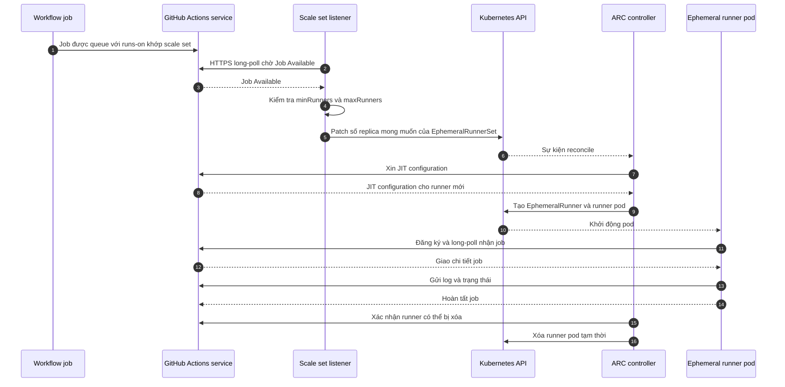

Actions Runner Controller (ARC) là Kubernetes operator do GitHub hỗ trợ để tạo và tự động mở rộng self-hosted runner. Trang này dùng kiến trúc **Autoscaling Runner Scale Sets** hiện hành, không dùng các tài nguyên `RunnerDeployment` và `HorizontalRunnerAutoscaler` của ARC legacy.

<Callout type="info" title="Kết quả sau bài này">
  Bạn sẽ cài controller và một runner scale set bằng Helm chart OCI chính thức, xác thực bằng GitHub App, chạy một workflow trên runner tạm thời, rồi biết cách giám sát, nâng cấp và xử lý sự cố cơ bản.
</Callout>

## Mục lục

- [Tổng quan](#tổng-quan)
  - [Khi nào nên dùng ARC](#khi-nào-nên-dùng-arc)
  - [Thuật ngữ cốt lõi](#thuật-ngữ-cốt-lõi)
- [Kiến trúc và luồng mở rộng](#kiến-trúc-và-luồng-mở-rộng)
  - [Các thành phần](#các-thành-phần)
  - [Luồng controller listener và runner tạm thời](#luồng-controller-listener-và-runner-tạm-thời)
- [Điều kiện tiên quyết](#điều-kiện-tiên-quyết)
  - [Kubernetes Helm và quyền quản trị](#kubernetes-helm-và-quyền-quản-trị)
  - [Kết nối mạng và phạm vi đăng ký](#kết-nối-mạng-và-phạm-vi-đăng-ký)
- [Xác thực với GitHub](#xác-thực-với-github)
  - [GitHub App là lựa chọn ưu tiên](#github-app-là-lựa-chọn-ưu-tiên)
  - [PAT và các giới hạn](#pat-và-các-giới-hạn)
- [Cài controller và runner scale set](#cài-controller-và-runner-scale-set)
  - [Chuẩn bị namespace](#chuẩn-bị-namespace)
  - [Cài controller từ OCI](#cài-controller-từ-oci)
  - [Tạo secret GitHub App](#tạo-secret-github-app)
  - [Cấu hình scale set](#cấu-hình-scale-set)
  - [Cài và kiểm tra scale set](#cài-và-kiểm-tra-scale-set)
- [Định tuyến workflow với runs-on](#định-tuyến-workflow-với-runs-on)
  - [Dùng tên scale set](#dùng-tên-scale-set)
  - [Giữ định tuyến dễ kiểm soát](#giữ-định-tuyến-dễ-kiểm-soát)
- [Chọn chế độ chạy container](#chọn-chế-độ-chạy-container)
  - [Chế độ mặc định](#chế-độ-mặc-định)
  - [Docker-in-Docker](#docker-in-docker)
  - [Kubernetes mode](#kubernetes-mode)
  - [Image runner tùy biến](#image-runner-tùy-biến)
- [Bài thực hành end-to-end](#bài-thực-hành-end-to-end)
  - [Mục tiêu và tệp cần tạo](#mục-tiêu-và-tệp-cần-tạo)
  - [Triển khai ARC](#triển-khai-arc)
  - [Chạy workflow kiểm thử](#chạy-workflow-kiểm-thử)
  - [Tiêu chí hoàn thành](#tiêu-chí-hoàn-thành)
- [Vận hành production](#vận-hành-production)
  - [Capacity và giới hạn mở rộng](#capacity-và-giới-hạn-mở-rộng)
  - [Observability](#observability)
  - [Bảo mật](#bảo-mật)
  - [Nâng cấp ARC](#nâng-cấp-arc)
  - [Gỡ cài đặt](#gỡ-cài-đặt)
- [Troubleshooting](#troubleshooting)
  - [Quy trình chẩn đoán](#quy-trình-chẩn-đoán)
  - [Lỗi thường gặp](#lỗi-thường-gặp)
- [Best practices](#best-practices)
- [Tài liệu tham khảo](#tài-liệu-tham-khảo)
- [Đọc tiếp](#đọc-tiếp)

## Tổng quan

Một self-hosted runner thông thường tồn tại lâu dài và có thể nhận nhiều job. Cách này dễ bắt đầu nhưng khó mở rộng theo hàng đợi, đồng thời tăng nguy cơ dữ liệu của job trước còn sót lại. ARC giải quyết hai phần:

1. Theo dõi nhu cầu job từ GitHub Actions.
2. Tạo một runner pod tạm thời cho mỗi job rồi xóa pod sau khi job kết thúc.

Runner tạm thời, hay **ephemeral runner**, chỉ xử lý một job. Mô hình này tạo môi trường sạch hơn giữa các job và phù hợp với autoscaling. Nó không tự biến workflow không an toàn thành an toàn; mã workflow vẫn là mã tùy ý chạy trong hạ tầng của bạn.

### Khi nào nên dùng ARC

ARC phù hợp khi đội ngũ đã có Kubernetes và cần ít nhất một trong các khả năng sau:

- Truy cập mạng nội bộ, registry riêng hoặc phần cứng riêng từ workflow.
- Tự động tăng giảm số runner theo hàng đợi GitHub Actions.
- Chuẩn hóa image, CPU, bộ nhớ, node pool và chính sách mạng cho runner.
- Cô lập runner theo organization, repository, runner group hoặc mức độ tin cậy.

Không nên chọn ARC chỉ để tránh học Kubernetes. GitHub-hosted runners thường ít công vận hành hơn nếu workflow không cần mạng hoặc phần cứng riêng. GitHub cũng khuyến nghị đơn vị vận hành ARC có chuyên môn Kubernetes, vì storage, networking, policy và cluster autoscaling nằm ngoài phần lớn phạm vi hỗ trợ của GitHub.

### Thuật ngữ cốt lõi

| Thuật ngữ | Ý nghĩa trong trang này |
|---|---|
| **Kubernetes operator** | Controller mở rộng Kubernetes bằng Custom Resource Definitions (CRDs) và liên tục đưa trạng thái thực tế về trạng thái mong muốn. |
| **Runner scale set** | Nhóm runner logic được đăng ký với GitHub Actions. Workflow định tuyến job tới nhóm này bằng `runs-on`. |
| **Controller manager** | Pod chạy vòng lặp reconcile của ARC, tạo và quản lý các tài nguyên listener, runner set và runner. |
| **Listener** | Pod giữ kết nối HTTPS long-poll với GitHub Actions để nhận thông báo có job và yêu cầu thay đổi số runner mong muốn. |
| **Ephemeral runner pod** | Pod runner tạm thời, đăng ký bằng cấu hình just-in-time, chạy một job rồi bị xóa. |
| **JIT configuration** | Cấu hình đăng ký just-in-time do GitHub cấp cho đúng runner sắp được tạo; không phải PAT hoặc private key được gắn vào workflow. |
| **Helm chart OCI** | Gói Helm được phân phối qua OCI registry. Hai chart chính thức nằm dưới `ghcr.io/actions/actions-runner-controller-charts`. |
| **Container job** | Job khai báo `jobs.<id>.container`; các step chạy trong container thay vì trực tiếp trong runner container. |

<Callout type="warn" title="Không trộn ARC legacy với runner scale sets">
  Tài liệu cũ có thể dùng API group `actions.summerwind.net`, `RunnerDeployment` hoặc `HorizontalRunnerAutoscaler`. Trang này chỉ dùng hai chart `gha-runner-scale-set-controller` và `gha-runner-scale-set` thuộc kiến trúc GitHub-supported hiện hành.
</Callout>

## Kiến trúc và luồng mở rộng

### Các thành phần

ARC được cài thành hai lớp tách biệt:

- Chart **`gha-runner-scale-set-controller`** cài controller manager và CRDs. Thông thường một controller có thể quản lý nhiều scale set.
- Mỗi lần cài chart **`gha-runner-scale-set`** tạo một `AutoscalingRunnerSet`, listener và các tài nguyên cần để sinh runner pod.

Nên đặt controller ở namespace quản trị, ví dụ `arc-systems`, và runner ở namespace khác, ví dụ `arc-runners`. Tách namespace giảm khả năng workflow tác động trực tiếp tới operator. Trong production, nên tách thêm theo organization, runner group hoặc mức độ tin cậy.

### Luồng controller listener và runner tạm thời



Điểm quan trọng của luồng này:

- Listener không chạy job. Nó nhận tín hiệu nhu cầu và cập nhật số runner mong muốn.
- Controller không đưa GitHub App private key vào job. Nó dùng thông tin xác thực để gọi API và lấy cấu hình JIT cho runner.
- Runner chủ động kết nối outbound tới GitHub qua HTTPS. Không cần mở cổng inbound từ Internet vào pod runner.
- Nếu không có runner nhận job, job có thể tiếp tục ở trạng thái queued. GitHub thất bại job sau thời hạn chờ của dịch vụ, hiện được tài liệu hóa là 24 giờ.

## Điều kiện tiên quyết

### Kubernetes Helm và quyền quản trị

Chuẩn bị các thành phần sau trước khi cài:

- Một Kubernetes cluster hoạt động. `kind` hoặc `minikube` đủ cho lab; production nên dùng cluster và node pool dành riêng cho CI khi có thể.
- `kubectl` đang trỏ đúng context và có quyền tạo namespace, CRD, ClusterRole, RoleBinding, Deployment và Secret.
- Helm 3 có hỗ trợ OCI.
- Dynamic storage provisioner nếu chọn `kubernetes` mode với PersistentVolumeClaim (PVC). PVC là yêu cầu cấp volume bền vững từ Kubernetes.
- Đủ quota pod, CPU, memory và khả năng tăng node. ARC chỉ tăng pod; cluster autoscaler hoặc cơ chế tương đương mới tăng node.
- Một hệ thống thu thập log ngoài cluster trước khi chạy production. Runner pod biến mất sau job nên log cục bộ cũng biến mất.

Kiểm tra nhanh môi trường:

```bash
kubectl config current-context
kubectl auth can-i create customresourcedefinitions.apiextensions.k8s.io
kubectl auth can-i create clusterroles.rbac.authorization.k8s.io
helm version
kubectl get nodes
kubectl get storageclass
```

<Callout type="warn" title="Kiểm tra đúng cluster trước khi chạy Helm">
  Lệnh cài controller tạo tài nguyên cấp cluster. Hãy kiểm tra `kubectl config current-context`, đặc biệt khi máy quản trị nhiều cluster.
</Callout>

### Kết nối mạng và phạm vi đăng ký

Controller, listener và runner cần DNS cùng outbound HTTPS cổng `443`. Tối thiểu, runner cần truy cập các miền vận hành GitHub Actions như:

```text
github.com
api.github.com
*.actions.githubusercontent.com
```

Workflow thực tế thường cần thêm `codeload.github.com`, `ghcr.io`, các endpoint artifact/cache và registry của tổ chức. Danh sách có thể thay đổi, vì vậy hãy dùng danh sách miền chính thức trong tài liệu self-hosted runners thay vì sao chép một allowlist tĩnh rồi bỏ quên.

`githubConfigUrl` quyết định runner thuộc phạm vi nào:

| Phạm vi | Ví dụ `githubConfigUrl` | Tác động |
|---|---|---|
| Repository | `https://github.com/acme/payments` | Chỉ repository đó nhìn thấy scale set. |
| Organization | `https://github.com/acme` | Có thể dùng runner groups để giới hạn repository được phép dùng. |
| Enterprise | `https://github.com/enterprises/acme-enterprise` | Quản lý ở cấp enterprise; không hỗ trợ xác thực GitHub App cho ARC. |

Với GitHub Enterprise Server, URL phải là URL của máy chủ và phiên bản phải nằm trong phạm vi ARC hỗ trợ. Tài liệu GitHub hiện nêu ARC chỉ được hỗ trợ từ GitHub Enterprise Server 3.9 trở lên.

## Xác thực với GitHub

### GitHub App là lựa chọn ưu tiên

Với runner ở cấp repository hoặc organization, ưu tiên GitHub App vì có vòng đời độc lập với tài khoản cá nhân và quyền có thể giới hạn rõ ràng.

Tạo GitHub App do organization sở hữu, sau đó cấu hình:

- **Repository permissions → Metadata: Read-only**.
- **Organization permissions → Self-hosted runners: Read and write**.
- Thêm **Repository permissions → Administration: Read and write** chỉ khi đăng ký runner ở phạm vi repository.
- Không cần webhook cho luồng ARC này.

Sau khi tạo App:

1. Ghi lại **App ID**.
2. Sinh private key `.pem`.
3. Cài App vào organization đích.
4. Lấy **installation ID** từ URL dạng `.../settings/installations/INSTALLATION_ID`.
5. Chỉ cấp App quyền với repository cần thiết nếu chọn cài đặt theo repository.

Ba key Kubernetes Secret mà chart hiện hành đọc là:

```text
github_app_id
github_app_installation_id
github_app_private_key
```

ID phải được biểu diễn như chuỗi khi viết trực tiếp trong YAML. Cách an toàn hơn là tạo Secret trước rồi để `values.yaml` chỉ tham chiếu tên Secret.

### PAT và các giới hạn

Personal access token (PAT) vẫn dùng được nhưng không phải lựa chọn mặc định cho repository hoặc organization:

- PAT classic cho repository runner cần scope `repo`.
- PAT classic cho organization runner cần scope `admin:org`.
- Fine-grained PAT được ARC hỗ trợ với quyền tương ứng: repository cần **Administration: Read and write**; organization cần **Administration: Read** và **Self-hosted runners: Read and write**.
- Enterprise-level runner không hỗ trợ GitHub App. Tài liệu triển khai ARC yêu cầu PAT classic; API enterprise runner cần scope `manage_runners:enterprise`.

Secret dùng PAT phải có đúng key `github_token`:

```bash
kubectl create secret generic arc-github-token \
  --namespace arc-runners \
  --from-literal=github_token='YOUR_PAT'
```

<Callout type="warn" title="PAT gắn với danh tính con người">
  PAT có thể ngừng hoạt động khi tài khoản bị vô hiệu hóa, token hết hạn hoặc quyền chủ sở hữu thay đổi. Không truyền token bằng `--set ...=<token>` trong terminal production vì token có thể lọt vào shell history, log CI hoặc metadata của công cụ triển khai.
</Callout>

## Cài controller và runner scale set

Các lệnh bên dưới cố ý không ghim version. Theo quickstart chính thức, cách này cài release mới nhất từ OCI. Trong production, hãy kiểm thử trước và thêm `--version <CHART_VERSION_DA_KIEM_THU>` cho từng chart; không điền một version ví dụ đã cũ.

### Chuẩn bị namespace

```bash
kubectl create namespace arc-systems
kubectl create namespace arc-runners
```

Namespace `arc-systems` chứa operator. Namespace `arc-runners` chứa cấu hình scale set, Secret và runner pod. Không dùng namespace chứa workload production để chạy mã workflow tùy ý.

### Cài controller từ OCI

```bash
helm install arc \
  --namespace arc-systems \
  oci://ghcr.io/actions/actions-runner-controller-charts/gha-runner-scale-set-controller
```

Kiểm tra Helm release, Deployment và CRDs:

```bash
helm list -n arc-systems
kubectl get deployments,pods -n arc-systems
kubectl get crd | grep actions.github.com
```

Controller pod phải ở trạng thái `Running` và sẵn sàng trước khi cài scale set.

<Callout type="info" title="Chart chính thức chỉ phát hành qua OCI">
  ARC Autoscaling Runner Sets không cung cấp Helm repository kiểu GitHub Pages. Hãy dùng đúng đường dẫn `oci://ghcr.io/actions/actions-runner-controller-charts/...`.
</Callout>

### Tạo secret GitHub App

Đặt biến môi trường theo GitHub App của bạn. Private key phải là đường dẫn tới tệp `.pem`, không phải nội dung giả trong ví dụ.

```bash
export GITHUB_APP_ID='123456'
export GITHUB_APP_INSTALLATION_ID='654321'
export GITHUB_APP_PRIVATE_KEY_FILE="$HOME/Downloads/arc-app.private-key.pem"

test -f "$GITHUB_APP_PRIVATE_KEY_FILE"

kubectl create secret generic arc-github-app \
  --namespace arc-runners \
  --from-literal=github_app_id="$GITHUB_APP_ID" \
  --from-literal=github_app_installation_id="$GITHUB_APP_INSTALLATION_ID" \
  --from-file=github_app_private_key="$GITHUB_APP_PRIVATE_KEY_FILE"
```

Xác nhận key tồn tại mà không in giá trị nhạy cảm:

```bash
kubectl get secret arc-github-app \
  --namespace arc-runners \
  -o jsonpath='{range $k,$v := .data}{$k}{"\n"}{end}'
```

Secret phải ở **cùng namespace với chart `gha-runner-scale-set`**. Nếu dùng GitOps, ưu tiên External Secrets, Secrets Store CSI hoặc cơ chế mã hóa secret của nền tảng thay vì commit Secret dạng base64.

### Cấu hình scale set

Tạo `arc-scale-set-values.yaml`:

```yaml
githubConfigUrl: "https://github.com/acme/payments"
githubConfigSecret: "arc-github-app"

runnerScaleSetName: "arc-linux"
minRunners: 0
maxRunners: 5

template:
  spec:
    containers:
      - name: runner
        image: ghcr.io/actions/actions-runner:latest
        command: ["/home/runner/run.sh"]
        resources:
          requests:
            cpu: "500m"
            memory: "1Gi"
          limits:
            cpu: "2"
            memory: "4Gi"
```

Thay `https://github.com/acme/payments` bằng repository hoặc organization thực tế. Các điểm không được đổi tùy ý:

- Container runner phải có tên **`runner`**.
- Image chính thức khởi động qua **`/home/runner/run.sh`**.
- `githubConfigSecret` là tên Secret có sẵn, không phải token.
- `runnerScaleSetName` là tên logic dùng trong `runs-on`. Nếu bỏ trường này, Helm release name trở thành tên scale set.

`minRunners: 0` cho phép scale về 0. `maxRunners: 5` giới hạn tối đa năm runner đồng thời, giúp chặn một đợt queue làm cạn tài nguyên cluster.

### Cài và kiểm tra scale set

```bash
helm install arc-linux \
  --namespace arc-runners \
  --values arc-scale-set-values.yaml \
  oci://ghcr.io/actions/actions-runner-controller-charts/gha-runner-scale-set
```

Kiểm tra release và tài nguyên ARC:

```bash
helm list -A
kubectl get autoscalingrunnersets.actions.github.com -A
kubectl get pods -A \
  -l app.kubernetes.io/part-of=gha-runner-scale-set
```

Listener có thể được controller tạo ở namespace quản trị. Dùng `-A` để tìm trước thay vì giả định namespace. Khi chưa có job và `minRunners: 0`, không thấy runner pod là hành vi đúng.

## Định tuyến workflow với runs-on

### Dùng tên scale set

Cách định tuyến rõ ràng nhất là đặt `runs-on` bằng `runnerScaleSetName`:

```yaml
name: ARC smoke test

on:
  workflow_dispatch:

permissions:
  contents: read

jobs:
  smoke:
    runs-on: arc-linux
    steps:
      - name: Show runner identity
        run: |
          echo "runner=${{ runner.name }}"
          echo "os=${{ runner.os }}"
          echo "arch=${{ runner.arch }}"
          sleep 30
```

`arc-linux` phải khớp chính xác `runnerScaleSetName`. Nếu không đặt trường này, dùng Helm installation name, ví dụ `helm install arc-linux ...` thì `runs-on: arc-linux`.

Tên scale set phải duy nhất trong runner group. Hai cluster có thể dùng cùng tên cho mô hình failover nếu mỗi scale set thuộc runner group khác nhau, nhưng khi cả hai online, GitHub phân phối job theo cuộc đua nhận job; bạn không điều khiển được thuật toán phân phối.

### Giữ định tuyến dễ kiểm soát

Với nhiều loại workload, cách dễ vận hành là dùng scale set riêng theo trust boundary và tài nguyên:

```yaml
jobs:
  unit-test:
    runs-on: arc-linux

  gpu-test:
    runs-on: arc-gpu

  internal-deploy:
    runs-on: arc-private-deploy
```

Tên nói rõ mục đích và tránh để workflow không tin cậy chạy trên node có mạng production.

Khi một scale set cần nhiều thuộc tính định tuyến, chart OCI hiện hành dùng key values **`scaleSetLabels`**. Chart render key này thành `spec.runnerScaleSetLabels` trên tài nguyên `AutoscalingRunnerSet`:

```yaml
runnerScaleSetName: "arc-gpu"
scaleSetLabels:
  - linux
  - gpu
  - private-network
```

Workflow yêu cầu đồng thời các nhãn:

```yaml
jobs:
  gpu-test:
    runs-on:
      - linux
      - gpu
      - private-network
```

Mọi nhãn trong `runs-on` phải khớp. Vì tài liệu hoặc chart cũ có thể hiển thị key khác, luôn đối chiếu `helm show values` của **đúng chart version sẽ triển khai**; không sao chép key từ blog hoặc nhánh `master` vào production.

## Chọn chế độ chạy container

### Chế độ mặc định

Nếu workflow chỉ chạy shell step và setup action thông thường, không khai báo `containerMode`. Step chạy trực tiếp trong container `runner`:

```yaml
# Không có containerMode
template:
  spec:
    containers:
      - name: runner
        image: ghcr.io/actions/actions-runner:latest
        command: ["/home/runner/run.sh"]
```

Chế độ này đơn giản nhất và không cần Docker daemon đặc quyền. Tuy nhiên, workflow dùng container action, service container hoặc `jobs.<id>.container` cần `dind` hoặc Kubernetes mode.

### Docker-in-Docker

Docker-in-Docker (DinD) chạy Docker daemon trong sidecar của mỗi runner pod. Chọn DinD khi workflow phụ thuộc Docker CLI, Docker build, service container hoặc container action và bạn chấp nhận privileged container.

```yaml
containerMode:
  type: "dind"
```

Chart sẽ chèn init container, container `runner`, container `dind` và các volume socket/work cần thiết. Trên Kubernetes 1.29 trở lên, chart có thể dùng cơ chế native sidecar cho daemon.

<Callout type="error" title="DinD cần privileged mode">
  Container `dind` chạy với `securityContext.privileged: true`. Đây là ranh giới bảo mật yếu hơn đáng kể. Chỉ chạy DinD trên node pool dành riêng, giới hạn repository được dùng runner group, và không đặt secret cluster hoặc workload production trên cùng node nếu có thể.
</Callout>

Không vừa đặt `containerMode.type: dind` vừa cố ghi đè một phần cấu hình được chart chèn trong `template`. Nếu cần đổi image daemon, rootless DinD hoặc security context, hãy bỏ `containerMode`, sao chép đầy đủ mẫu DinD từ `values.yaml` của đúng chart version rồi tùy biến và kiểm thử.

### Kubernetes mode

Kubernetes mode dùng **runner container hooks** để tạo pod riêng cho container job, service hoặc container action. Chọn chế độ này khi muốn Kubernetes quản lý pod của job thay vì chạy Docker daemon đặc quyền trong runner pod.

Cấu hình với PVC được cấp động:

```yaml
containerMode:
  type: "kubernetes"
  kubernetesModeWorkVolumeClaim:
    accessModes:
      - ReadWriteOnce
    storageClassName: "YOUR_STORAGE_CLASS"
    resources:
      requests:
        storage: 5Gi
```

Thay `YOUR_STORAGE_CLASS` bằng StorageClass có thật từ `kubectl get storageclass`. Dữ liệu work cần được chia sẻ giữa runner pod và pod container job, vì vậy storage provisioner phải đáp ứng hành vi mount của cluster.

Chart hiện hành còn có chế độ không dùng volume chia sẻ:

```yaml
containerMode:
  type: "kubernetes-novolume"
```

`kubernetes-novolume` dùng lifecycle hooks để phục hồi và xuất filesystem job giữa các pod. Nó hữu ích với cluster không có shared storage, nhưng cần kiểm thử kỹ với cache, artifact và khối lượng file lớn.

Mặc định, Kubernetes mode yêu cầu workflow khai báo job container:

```yaml
jobs:
  test:
    runs-on: arc-kubernetes
    container:
      image: node:22
    steps:
      - run: node --version
```

Có thể đặt `ACTIONS_RUNNER_REQUIRE_JOB_CONTAINER=false` để cho phép job không có `container`, nhưng runner service account khi đó có thể tạo pod và truy cập Kubernetes API ngay từ runner pod. Không tắt rào chắn này nếu chưa threat-model quyền RBAC và nguy cơ truy cập Secret.

### Image runner tùy biến

Image chính thức `ghcr.io/actions/actions-runner:latest` là image tối thiểu. Dùng setup actions như `actions/setup-node` trước khi tự nhồi nhiều tool vào image. Khi cần CA nội bộ, binary lớn hoặc tool luôn dùng, có thể kế thừa image chính thức:

```dockerfile
FROM ghcr.io/actions/actions-runner:latest

USER root

RUN apt-get update \
    && apt-get install --no-install-recommends -y jq make \
    && rm -rf /var/lib/apt/lists/*

USER runner
```

Build và đẩy image bằng pipeline riêng, quét lỗ hổng, rồi cấu hình:

```yaml
template:
  spec:
    imagePullSecrets:
      - name: private-registry
    containers:
      - name: runner
        image: registry.example.com/ci/arc-runner:2026-03-immutable
        imagePullPolicy: IfNotPresent
        command: ["/home/runner/run.sh"]
```

Tag ví dụ trên biểu diễn một tag bất biến do tổ chức quản lý, không phải version ARC. Image tùy biến phải giữ runner binary dưới `/home/runner`, chạy `/home/runner/run.sh`, và phải chứa runner container hooks dưới `/home/runner/k8s` nếu dùng Kubernetes mode. Kế thừa image chính thức giúp giữ các yêu cầu này.

Nếu bật `containerMode`, chart chèn PodSpec theo mode. Muốn dùng custom image cùng cấu hình mode tùy biến, hãy lấy **toàn bộ** PodSpec được tài liệu hóa trong `values.yaml` của chart version đang dùng, bỏ `containerMode`, rồi thay image ở đúng mọi vị trí cần thiết.

<Callout type="warn" title="Runner image phải được cập nhật thường xuyên">
  GitHub yêu cầu self-hosted runner được cập nhật trong vòng 30 ngày kể từ khi có runner release mới; bản vá bảo mật nghiêm trọng có thể bị bắt buộc sớm hơn. Nếu image quá cũ, GitHub Actions sẽ ngừng queue job tới runner.
</Callout>

## Bài thực hành end-to-end

### Mục tiêu và tệp cần tạo

Bài lab triển khai một scale set repository-level hoặc organization-level, scale từ 0 đến 3, chạy smoke test, quan sát runner pod xuất hiện rồi biến mất.

Chuẩn bị hai tệp ngoài repository tài liệu này:

```text
arc-lab/
├── controller-values.yaml
└── scale-set-values.yaml
```

`controller-values.yaml` bật metrics Prometheus và log JSON ngay từ lúc cài:

```yaml
metrics:
  controllerManagerAddr: ":8080"
  listenerAddr: ":8080"
  listenerEndpoint: "/metrics"

flags:
  logLevel: "info"
  logFormat: "json"

resources:
  requests:
    cpu: "100m"
    memory: "128Mi"
  limits:
    cpu: "500m"
    memory: "512Mi"
```

`scale-set-values.yaml`:

```yaml
githubConfigUrl: "https://github.com/YOUR_ORG/YOUR_REPO"
githubConfigSecret: "arc-github-app"
runnerScaleSetName: "arc-lab"
minRunners: 0
maxRunners: 3

template:
  spec:
    containers:
      - name: runner
        image: ghcr.io/actions/actions-runner:latest
        command: ["/home/runner/run.sh"]
        resources:
          requests:
            cpu: "250m"
            memory: "512Mi"
          limits:
            cpu: "1"
            memory: "2Gi"
```

### Triển khai ARC

<Steps>
<Step>

**Tạo namespace và Secret.** Dùng ba biến GitHub App đã mô tả ở phần xác thực.

```bash
kubectl create namespace arc-systems
kubectl create namespace arc-runners

kubectl create secret generic arc-github-app \
  --namespace arc-runners \
  --from-literal=github_app_id="$GITHUB_APP_ID" \
  --from-literal=github_app_installation_id="$GITHUB_APP_INSTALLATION_ID" \
  --from-file=github_app_private_key="$GITHUB_APP_PRIVATE_KEY_FILE"
```

</Step>
<Step>

**Cài controller.** Chờ Deployment sẵn sàng trước khi tiếp tục.

```bash
helm install arc \
  --namespace arc-systems \
  --values controller-values.yaml \
  oci://ghcr.io/actions/actions-runner-controller-charts/gha-runner-scale-set-controller

kubectl rollout status deployment \
  --namespace arc-systems \
  --selector app.kubernetes.io/name=gha-runner-scale-set-controller \
  --timeout=180s
```

</Step>
<Step>

**Cài scale set.** Thay URL mẫu trong `scale-set-values.yaml` trước khi chạy.

```bash
helm install arc-lab \
  --namespace arc-runners \
  --values scale-set-values.yaml \
  oci://ghcr.io/actions/actions-runner-controller-charts/gha-runner-scale-set

kubectl get autoscalingrunnersets.actions.github.com -A
kubectl get pods -A -l app.kubernetes.io/part-of=gha-runner-scale-set
```

</Step>
</Steps>

Nếu chạy lại lab, `kubectl create namespace` hoặc `helm install` có thể báo đã tồn tại. Hãy kiểm tra trạng thái hiện có; không đổi sang `helm upgrade --install` một cách vô thức khi mục tiêu là kiểm thử quy trình cài mới.

### Chạy workflow kiểm thử

Tạo `.github/workflows/arc-smoke.yml` trong repository đích:

```yaml
name: ARC smoke test

on:
  workflow_dispatch:

permissions:
  contents: read

jobs:
  smoke:
    runs-on: arc-lab
    timeout-minutes: 10
    steps:
      - name: Inspect runner
        run: |
          set -euxo pipefail
          echo "name=${{ runner.name }}"
          echo "os=${{ runner.os }}"
          echo "arch=${{ runner.arch }}"
          id
          sleep 30
```

Mở hai terminal trước khi bấm **Run workflow**:

```bash
# Terminal 1: theo dõi listener và runner ở mọi namespace
kubectl get pods -A \
  -l app.kubernetes.io/part-of=gha-runner-scale-set \
  --watch
```

```bash
# Terminal 2: theo dõi tài nguyên runner do ARC quản lý
kubectl get ephemeralrunners,ephemeralrunnersets \
  --namespace arc-runners \
  --watch
```

Luồng mong đợi là `Pending → Running → Completed/Terminating`. Sau khi job hoàn tất, runner pod biến mất và số runner trở về 0.

### Tiêu chí hoàn thành

- [ ] Controller Deployment sẵn sàng trong `arc-systems`.
- [ ] Listener tồn tại và không lặp lỗi xác thực.
- [ ] Workflow với `runs-on: arc-lab` thoát thành công.
- [ ] Chỉ một ephemeral runner nhận job.
- [ ] Runner pod bị xóa sau khi job hoàn tất.
- [ ] Không có token hoặc private key trong Git, workflow log hay Helm values.
- [ ] Có thể truy vấn endpoint metrics sau khi cấu hình hệ thống scrape của cluster.

## Vận hành production

### Capacity và giới hạn mở rộng

Hai giá trị quan trọng nhất là:

- `minRunners`: số runner rảnh tối thiểu được giữ sẵn để giảm cold-start.
- `maxRunners`: tổng trần runner mà scale set được phép tạo.

Ví dụ giữ hai runner nóng và chặn ở 20:

```yaml
minRunners: 2
maxRunners: 20
```

Listener tính số mong muốn từ số runner tối thiểu và job đã gán, rồi áp trần `maxRunners`. `minRunners` không được lớn hơn `maxRunners`.

Các trạng thái đặc biệt:

| Cấu hình | Hành vi |
|---|---|
| Bỏ cả hai trường | Tăng theo số job được gán và giảm về 0; không có trần do chart đặt. |
| Chỉ đặt `minRunners` | Luôn giữ ít nhất số runner rảnh này; không có trần do chart đặt. |
| Đặt `minRunners` và `maxRunners` | Giữ warm capacity nhưng không vượt trần. |
| Đặt cả hai bằng `0` | Drain: không tạo runner mới cho job vừa đến. |

<Callout type="warn" title="Không để production không có trần ngoài ý muốn">
  Bỏ `maxRunners` không có nghĩa là “tối đa bằng 0”; nó có nghĩa scale set không bị giới hạn bởi giá trị này. Quota namespace, quota cloud và node autoscaler vẫn có thể chặn pod, nhưng đó là sự cố capacity chứ không phải cơ chế kiểm soát chi phí.
</Callout>

Định cỡ theo chuỗi nút thắt:

1. **GitHub queue:** bao nhiêu job có thể đến đồng thời?
2. **ARC:** `maxRunners` có đủ nhưng vẫn giữ biên chi phí không?
3. **Kubernetes scheduler:** requests của mỗi pod có vừa node không?
4. **Cluster autoscaler:** mất bao lâu để thêm node?
5. **Dependency:** registry, package mirror và dịch vụ nội bộ chịu được bao nhiêu job song song?

Ví dụ, nếu mỗi runner request `2 CPU`, node có 8 CPU khả dụng và dành 1 CPU cho hệ thống, thực tế thường chỉ xếp được ba runner mỗi node. Đừng lấy `8 / 2 = 4` mà bỏ qua DaemonSet và tài nguyên hệ thống.

ARC không có lịch `minRunners`/`maxRunners` tích hợp. Nếu cần warm pool giờ hành chính, dùng automation có kiểm soát để cập nhật cấu hình, lưu audit trail và tránh kéo chart version mới ngoài ý muốn.

### Observability

Controller, listener và runner ghi log ra `stdout`. Hãy thu thập log trước khi pod tạm thời bị xóa.

Các lệnh chẩn đoán cơ bản:

```bash
kubectl logs -n arc-systems \
  -l app.kubernetes.io/name=gha-runner-scale-set-controller \
  --all-containers=true \
  --since=30m

kubectl get pods -A \
  -l app.kubernetes.io/component=runner-scale-set-listener

kubectl get pods -n arc-runners \
  -l app.kubernetes.io/component=runner

kubectl get events -n arc-runners \
  --sort-by=.lastTimestamp
```

Khi bật `metrics` trong chart controller, controller manager và listener phát Prometheus metrics. Những metric hữu ích gồm:

| Metric | Cách dùng |
|---|---|
| `gha_controller_pending_ephemeral_runners` | Phát hiện runner kẹt Pending do thiếu node, quota hoặc image pull. |
| `gha_controller_failed_ephemeral_runners` | Cảnh báo lỗi tạo hoặc khởi động runner. |
| `gha_controller_running_listeners` | Phát hiện listener biến mất. |
| `gha_assigned_jobs` | Nhu cầu job đã được gán cho scale set. |
| `gha_desired_runners` | Số runner ARC đang cố đạt tới. |
| `gha_busy_runners` và `gha_idle_runners` | Đánh giá mức sử dụng và warm capacity. |
| `gha_job_startup_duration_seconds` | Đo thời gian từ lúc job chờ đến khi bắt đầu. |
| `gha_job_execution_duration_seconds` | Theo dõi thời lượng thực thi workflow. |

Counter của listener có thể reset khi listener pod restart. Dashboard phải xử lý counter reset thay vì coi đây là giảm số job.

Nên cảnh báo khi:

- `desired_runners` sát `max_runners` trong thời gian dài.
- Runner Pending tăng nhưng node không tăng.
- `failed_ephemeral_runners` lớn hơn 0.
- Không còn listener đang chạy.
- P95 startup duration vượt SLO của đội.
- GitHub queue tăng trong khi ARC không nhận assigned job, dấu hiệu thường gặp của sai `runs-on`, runner group hoặc xác thực.

Việc bật endpoint không tự cấu hình Prometheus của cluster. Bạn vẫn cần Service, PodMonitor/ServiceMonitor hoặc scrape configuration phù hợp với monitoring stack đang dùng.

### Bảo mật

Runner chạy mã từ workflow. Với pull request từ fork hoặc contributor không tin cậy, mã đó có thể cố đọc network, metadata service, file mount hoặc credential của runner.

Áp dụng các lớp phòng vệ sau:

- **Tách namespace:** operator và runner ở namespace khác nhau; tách thêm scale set theo organization hoặc trust boundary.
- **Tách node pool:** dùng taint/toleration, node selector và autoscaler riêng cho runner. DinD privileged nên có node pool riêng.
- **Runner groups:** chỉ cho repository cần thiết truy cập scale set, đặc biệt scale set có mạng private hoặc quyền deploy.
- **Quyền GitHub tối thiểu:** GitHub App chỉ có các quyền ARC cần; workflow khai báo `permissions` tối thiểu.
- **RBAC tối thiểu:** không mount service account có quyền rộng. Kubernetes mode cần quyền tạo pod nên phải được đánh giá riêng.
- **NetworkPolicy:** giới hạn east-west và egress theo nhu cầu. Đừng chặn DNS hoặc endpoint GitHub bắt buộc.
- **Secret hygiene:** bật encryption at rest cho Kubernetes Secret, xoay private key/PAT, không log Secret, ưu tiên secret manager bên ngoài.
- **Không dùng chung cluster nhạy cảm:** GitHub khuyến nghị cô lập production workload khỏi cluster chạy workflow tùy ý.
- **Image supply chain:** dùng tag hoặc digest bất biến, quét CVE, tạo SBOM và rebuild khi runner release mới.
- **Resource limits:** đặt requests để scheduler tính đúng và limits để một job không làm cạn node.
- **Log ngoài pod:** giữ controller, listener và runner log theo retention policy; lọc credential trước khi xuất log.

<Callout type="error" title="Ephemeral không đồng nghĩa vô hại">
  Runner tạm thời ngăn trạng thái của job trước tồn tại sang job sau, nhưng trong lúc chạy nó vẫn có toàn bộ network, volume và service-account permissions được cấp cho pod. Ranh giới bảo mật phải đến từ namespace, node, RBAC, network policy và quyền GitHub.
</Callout>

### Nâng cấp ARC

Không coi `helm upgrade` là quy trình nâng version ARC giữa các release. Helm không tự nâng cấp hoặc xóa CRD, và tài liệu GitHub hiện yêu cầu quy trình gỡ rồi cài lại.

Quy trình an toàn:

1. Đọc release notes của cả controller chart, scale set chart và runner image.
2. Sao lưu values, tên release, Secret reference, runner groups và dashboard.
3. Dựng staging giống production và chạy smoke test, container job cùng workload đặc thù.
4. Lên maintenance window hoặc dựng scale set ở cluster/runner group dự phòng.
5. Gỡ **tất cả** release `gha-runner-scale-set` và chờ tài nguyên runner được dọn sạch.
6. Gỡ controller.
7. Chỉ khi release notes cho biết CRD thay đổi, xóa CRD thuộc API group `actions.github.com` sau khi đã xác nhận không còn ARC resource cần giữ.
8. Cài controller mới, rồi cài lại từng scale set và chạy smoke test.

Để ghim version đã kiểm thử, dùng biến riêng thay vì chép một số version từ tài liệu:

```bash
helm install arc \
  --namespace arc-systems \
  --version "$CONTROLLER_CHART_VERSION" \
  --values controller-values.yaml \
  oci://ghcr.io/actions/actions-runner-controller-charts/gha-runner-scale-set-controller

helm install arc-linux \
  --namespace arc-runners \
  --version "$SCALE_SET_CHART_VERSION" \
  --values arc-scale-set-values.yaml \
  oci://ghcr.io/actions/actions-runner-controller-charts/gha-runner-scale-set
```

Hai biến phải lấy từ release đã được bạn kiểm thử trong GitHub Container Registry. Không giả định controller chart và scale set chart luôn có version giống nhau nếu release notes không xác nhận.

Muốn giảm downtime, GitHub mô tả mô hình active-active trên hai cluster: dùng cùng `runnerScaleSetName` nhưng runner group khác nhau. Hãy kiểm thử routing vì khi cả hai online, việc nhận job là không xác định.

### Gỡ cài đặt

Trước khi gỡ, dừng workflow mới hoặc đặt cả `minRunners` và `maxRunners` về 0 bằng quy trình quản lý cấu hình hiện có. Chờ `busy_runners` về 0; đừng xóa pod đang chạy và kỳ vọng job tiếp tục.

Gỡ scale set trước, controller sau:

```bash
helm uninstall arc-linux --namespace arc-runners

kubectl get pods -A \
  -l app.kubernetes.io/part-of=gha-runner-scale-set

helm uninstall arc --namespace arc-systems
```

Sau đó kiểm tra tài nguyên còn lại:

```bash
helm list -A
kubectl get autoscalingrunnersets.actions.github.com -A
kubectl get crd | grep actions.github.com
kubectl get secrets -n arc-runners
```

Helm không tự xóa CRD và Secret tạo thủ công. Chỉ xóa Secret, namespace hoặc CRD sau khi xác nhận không còn scale set khác dùng chúng. Việc xóa CRD sẽ xóa toàn bộ custom resources thuộc loại đó trên cluster.

## Troubleshooting

### Quy trình chẩn đoán

Đi theo luồng thay vì xóa pod ngẫu nhiên:

1. **Workflow routing:** `runs-on` có đúng tên scale set và repository có quyền dùng runner group không?
2. **GitHub scope:** `githubConfigUrl` có đúng repository, organization hoặc enterprise không?
3. **Listener:** listener có tồn tại và giữ kết nối với GitHub không?
4. **Desired capacity:** `AutoscalingRunnerSet` và `EphemeralRunnerSet` có tăng desired count không?
5. **Scheduling:** runner pod có Pending vì CPU, memory, taint, quota, PVC hoặc image pull không?
6. **Registration:** runner có lấy được JIT configuration và kết nối outbound 443 không?
7. **Execution:** container mode, filesystem và tool trong image có đáp ứng workflow không?
8. **Cleanup:** runner pod có bị xóa sau job không?

Thu thập bằng chứng:

```bash
helm list -A
kubectl get autoscalingrunnersets,ephemeralrunnersets,ephemeralrunners -A
kubectl get pods -A -o wide \
  -l app.kubernetes.io/part-of=gha-runner-scale-set
kubectl get events -n arc-runners --sort-by=.lastTimestamp
```

Tìm listener rồi xem log đúng namespace:

```bash
kubectl get pods -A \
  -l app.kubernetes.io/component=runner-scale-set-listener

kubectl logs -n <LISTENER_NAMESPACE> <LISTENER_POD> \
  -c listener \
  --since=30m
```

Xem controller log:

```bash
kubectl logs -n arc-systems \
  -l app.kubernetes.io/name=gha-runner-scale-set-controller \
  --all-containers=true \
  --since=30m
```

Với runner đã restart hoặc sắp bị xóa, dùng hệ thống log tập trung. `kubectl logs` không thay thế được log retention cho ephemeral pod.

### Lỗi thường gặp

| Triệu chứng | Nguyên nhân cần kiểm tra | Hướng xử lý |
|---|---|---|
| Workflow queued mãi, không có runner pod | `runs-on` sai; `githubConfigUrl` sai scope; runner group không cho repository truy cập; cả `minRunners` và `maxRunners` bằng 0 | So khớp tên scale set, kiểm tra quyền runner group, xem listener log và values đang áp dụng. |
| Controller chạy nhưng không có listener | Secret sai tên/sai namespace; thiếu key GitHub App; App chưa được cài; URL sai; controller không gọi được Kubernetes API | Kiểm tra ba key của Secret, namespace chart, GitHub App installation và controller log. |
| `401 Unauthorized` khi lấy GitHub App token | App ID/installation ID/private key không khớp; đồng hồ node lệch | Tạo lại Secret từ đúng `.pem`; kiểm tra NTP. GitHub cảnh báo clock đi trước vài giây có thể làm JWT bị từ chối. |
| `403 Forbidden` từ GitHub API | GitHub App hoặc PAT thiếu quyền; repository ngoài phạm vi App installation | Cấp đúng `Self-hosted runners`, `Metadata` và `Administration` theo phạm vi; cài lại App nếu permission vừa thay đổi. |
| Runner pod `Pending` | Thiếu CPU/memory, taint không có toleration, quota, node selector không khớp, PVC chưa bind | `kubectl describe pod`, xem Events, ResourceQuota, node pool và StorageClass; điều chỉnh requests hoặc capacity. |
| `ImagePullBackOff` | Sai image/tag, registry secret thiếu hoặc node không tới registry | Kiểm tra `imagePullSecrets`, quyền registry, DNS/egress và tính tồn tại của tag/digest. |
| Job báo không truy cập được Docker | Workflow cần container action/service nhưng scale set đang ở mode mặc định | Chọn `containerMode.type: dind` hoặc Kubernetes mode; đánh giá rủi ro trước khi dùng DinD privileged. |
| Kubernetes mode báo job không có container bị cấm | `ACTIONS_RUNNER_REQUIRE_JOB_CONTAINER` mặc định là `true` | Thêm `jobs.<id>.container`; chỉ tắt kiểm tra sau khi đánh giá RBAC và nguy cơ API access. |
| `/home/runner/_work/_tool` bị denied | PVC ownership không khớp UID/GID của runner | Dùng volume hỗ trợ `fsGroup`, đặt `fsGroup` phù hợp hoặc init container đổi ownership; tránh `hostPath` nếu cần `fsGroup`. |
| Installation name quá dài | Tên tài nguyên Kubernetes và label bị giới hạn 63 ký tự; scale set name do chart giới hạn ngắn hơn | Rút ngắn Helm release/namespace. Lỗi chart thường nêu giới hạn cụ thể, ví dụ installation name tối đa 45 ký tự. |
| Runner pod xuất hiện thêm sau khi hủy workflow | Listener nhận tín hiệu hủy chậm hơn runner | Theo dõi vài vòng reconcile; ARC sẽ quay về desired count. Chỉ điều tra nếu số dư không giảm. |
| Runner không còn nhận job sau khi image cũ | Runner binary quá thời hạn cập nhật | Rebuild custom image từ runner release mới, thử ở staging rồi rollout trong giới hạn 30 ngày. |
| Pod chạy nhưng GitHub không nhận registration | Egress 443, DNS, proxy, TLS CA hoặc IP allowlist chặn | Kiểm tra kết nối tới các domain GitHub bắt buộc, proxy/CA và allowlist organization/enterprise. |

<Callout type="idea" title="Ưu tiên bằng chứng có thời gian">
  Khi mở ticket, giữ controller log, listener log, runner log, Events, chart version và `values.yaml` đã loại bỏ secret trong cùng khoảng thời gian xảy ra lỗi. Trạng thái hiện tại sau nhiều vòng reconcile thường không đủ để tìm nguyên nhân gốc.
</Callout>

## Best practices

- Dùng GitHub-supported Autoscaling Runner Sets, không bắt đầu triển khai mới bằng ARC legacy.
- Tách namespace controller và runner; tách tiếp node pool hoặc cluster khỏi workload production.
- Ưu tiên GitHub App cho repository và organization. Dùng Secret reference thay vì secret inline trong Helm values.
- Ghim chart version và image digest/tag bất biến trong production, nhưng chỉ sau khi kiểm thử release đó.
- Đặt `maxRunners` rõ ràng, ResourceQuota và cloud budget alert để có nhiều lớp bảo vệ chi phí.
- Chọn `minRunners` theo startup SLO. Bắt đầu từ 0, đo P95 rồi chỉ giữ warm runner khi có bằng chứng cần thiết.
- Đặt CPU/memory requests thực tế; nếu requests quá thấp, scheduler sẽ nhồi quá nhiều runner lên node.
- Chỉ bật DinD khi workflow thật sự cần Docker và dành node pool riêng cho privileged workload.
- Ưu tiên Kubernetes mode khi muốn pod-level isolation cho container job, nhưng phải quản lý RBAC, hooks và storage.
- Thu log của controller, listener và runner ra hệ thống bền vững. Bật metrics và cảnh báo trước khi mở rộng production.
- Cập nhật custom runner image trong cửa sổ 30 ngày, sớm hơn khi có bản vá bảo mật bắt buộc.
- Thử quy trình gỡ/cài lại ở staging; ARC upgrade có CRD nên không phải một `helm upgrade` thông thường.
- Không chạy workflow từ fork không tin cậy trên runner có quyền deploy, mạng private hoặc cloud credential mạnh.

## Tài liệu tham khảo

- [GitHub Docs — Actions Runner Controller](https://docs.github.com/en/actions/concepts/runners/actions-runner-controller)
- [GitHub Docs — Get started with Actions Runner Controller](https://docs.github.com/en/actions/tutorials/use-actions-runner-controller/get-started)
- [GitHub Docs — Deploying runner scale sets](https://docs.github.com/en/actions/how-tos/manage-runners/use-actions-runner-controller/deploy-runner-scale-sets)
- [GitHub Docs — Authenticating ARC to the GitHub API](https://docs.github.com/en/actions/how-tos/manage-runners/use-actions-runner-controller/authenticate-to-the-api)
- [GitHub Docs — Using ARC runners in a workflow](https://docs.github.com/en/actions/how-tos/manage-runners/use-actions-runner-controller/use-arc-in-a-workflow)
- [GitHub Docs — Troubleshooting ARC](https://docs.github.com/en/actions/tutorials/use-actions-runner-controller/troubleshoot)
- [GitHub Docs — Support for ARC](https://docs.github.com/en/actions/concepts/runners/support-for-arc)
- [Official `gha-runner-scale-set` values](https://github.com/actions/actions-runner-controller/blob/master/charts/gha-runner-scale-set/values.yaml)
- [Official controller chart values](https://github.com/actions/actions-runner-controller/blob/master/charts/gha-runner-scale-set-controller/values.yaml)
- [Official Helm chart releases on GHCR](https://github.com/actions/actions-runner-controller/pkgs/container/actions-runner-controller-charts%2Fgha-runner-scale-set)

## Đọc tiếp

<Cards>
  <Card title="Larger runners" href="/docs/runners/04-larger-runners/" description="So sánh lựa chọn runner có tài nguyên lớn do GitHub quản lý." />
  <Card title="Bảo mật runner" href="/docs/runners/06-runner-hardening/" description="Hardening runner, quyền truy cập và ranh giới tin cậy." />
  <Card title="Giám sát và bảo trì runner" href="/docs/runners/07-runner-monitoring-maintenance/" description="Xây dựng logging, metrics, cảnh báo và quy trình bảo trì runner." />
</Cards>
