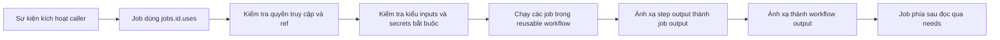
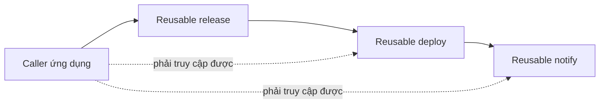

<Callout type="info" title="Mục tiêu của chương">
  Bạn sẽ biến một pipeline lặp lại thành **reusable workflow** có hợp đồng rõ ràng, gọi nó ở cấp job, truyền dữ liệu và secret an toàn, rồi kiểm chứng kết quả bằng ví dụ chạy được trên GitHub Actions.
</Callout>

## Mục lục

- [Tổng quan](#tổng-quan)
- [Mô hình reusable workflow](#mô-hình-reusable-workflow)
  - [Workflow được gọi khai báo workflow_call](#workflow-được-gọi-khai-báo-workflow_call)
  - [Caller gọi ở cấp job](#caller-gọi-ở-cấp-job)
  - [Luồng thực thi](#luồng-thực-thi)
- [Thiết kế hợp đồng dữ liệu](#thiết-kế-hợp-đồng-dữ-liệu)
  - [Inputs có kiểu dữ liệu](#inputs-có-kiểu-dữ-liệu)
  - [Secrets](#secrets)
  - [Outputs](#outputs)
- [Gọi reusable workflow](#gọi-reusable-workflow)
  - [Gọi trong cùng repository](#gọi-trong-cùng-repository)
  - [Gọi từ repository khác](#gọi-từ-repository-khác)
  - [Các khóa được phép ở job gọi](#các-khóa-được-phép-ở-job-gọi)
- [Kết hợp với matrix](#kết-hợp-với-matrix)
- [Lồng nhiều reusable workflows](#lồng-nhiều-reusable-workflows)
  - [Chuỗi gọi và quyền truy cập](#chuỗi-gọi-và-quyền-truy-cập)
  - [Truyền secret qua từng tầng](#truyền-secret-qua-từng-tầng)
- [Quyền và bảo mật](#quyền-và-bảo-mật)
  - [Giới hạn quyền của GITHUB_TOKEN](#giới-hạn-quyền-của-github_token)
  - [Dùng secrets inheritance có chủ đích](#dùng-secrets-inheritance-có-chủ-đích)
  - [Versioning và pin phiên bản](#versioning-và-pin-phiên-bản)
- [Giới hạn và lựa chọn công cụ](#giới-hạn-và-lựa-chọn-công-cụ)
  - [Giới hạn hiện hành](#giới-hạn-hiện-hành)
  - [Khác biệt với composite action](#khác-biệt-với-composite-action)
- [Ví dụ end-to-end chạy được](#ví-dụ-end-to-end-chạy-được)
  - [Chuẩn bị](#chuẩn-bị)
  - [Tạo reusable workflow](#tạo-reusable-workflow)
  - [Tạo caller workflow](#tạo-caller-workflow)
  - [Chạy và kiểm chứng](#chạy-và-kiểm-chứng)
- [Bài thực hành](#bài-thực-hành)
  - [Yêu cầu](#yêu-cầu)
  - [Tiêu chí kiểm chứng](#tiêu-chí-kiểm-chứng)
- [Best practices](#best-practices)
- [Troubleshooting](#troubleshooting)
- [Tài liệu tham khảo](#tài-liệu-tham-khảo)
- [Tiếp tục series](#tiếp-tục-series)

## Tổng quan

**Reusable workflow** là một workflow GitHub Actions được thiết kế để workflow khác gọi lại. Thay vì sao chép cùng chuỗi build, kiểm thử hoặc triển khai vào nhiều repository, bạn đặt logic đó ở một nơi và công bố một hợp đồng gồm input, secret và output.

Ví dụ, nhóm nền tảng có thể duy trì một workflow triển khai dùng chung. Mỗi ứng dụng chỉ truyền tên dịch vụ và môi trường đích. Khi quy trình triển khai thay đổi, nhóm cập nhật workflow trung tâm thay vì sửa hàng chục bản sao.

Reusable workflow phù hợp khi phần cần tái sử dụng có một hoặc nhiều **job**, cần runner riêng, cần `permissions`, `environment`, matrix hoặc quan hệ `needs`. Nếu chỉ cần đóng gói vài step chạy bên trong một job hiện có, composite action thường gọn hơn.

Sau chương này, bạn có thể:

- khai báo `on.workflow_call` với input kiểu `boolean`, `number` và `string`;
- truyền secret theo tên hoặc bằng `secrets: inherit`;
- ánh xạ output từ step lên job rồi lên workflow;
- gọi workflow trong cùng repository hoặc repository khác;
- kết hợp reusable workflow với matrix và workflow lồng nhau;
- kiểm soát `GITHUB_TOKEN` theo nguyên tắc quyền tối thiểu;
- chọn đúng giữa reusable workflow và composite action.

## Mô hình reusable workflow

Reusable workflow vẫn là file YAML trong `.github/workflows`. Điểm phân biệt là trigger `workflow_call`, tức sự kiện nội bộ cho phép một workflow khác gọi file đó.

### Workflow được gọi khai báo workflow_call

File được gọi phải nằm trực tiếp trong `.github/workflows`; GitHub không hỗ trợ đặt reusable workflow trong thư mục con như `.github/workflows/reusable/`.

Cấu trúc tối thiểu:

```yaml
name: Reusable check

on:
  workflow_call:

permissions: {}

jobs:
  check:
    runs-on: ubuntu-latest
    steps:
      - run: echo "Reusable workflow is running"
```

`workflow_call` có thể đứng cùng các trigger khác nếu file cũng cần chạy độc lập. Tuy nhiên, hãy giữ một đường chạy rõ ràng và bảo đảm các trigger có dữ liệu đầu vào tương thích.

### Caller gọi ở cấp job

**Caller** là workflow thực hiện lời gọi. Caller dùng `jobs.<job_id>.uses`, không đặt reusable workflow trong `steps`:

```yaml
name: Caller

on:
  workflow_dispatch:

permissions: {}

jobs:
  call-check:
    uses: ./.github/workflows/reusable-check.yml
```

Job `call-check` đại diện cho toàn bộ workflow được gọi. Vì vậy, job này không có `runs-on` hoặc `steps`; runner và các step được định nghĩa bên trong `reusable-check.yml`.

<Callout type="warn" title="Không gọi reusable workflow trong steps">
  `uses` dưới `steps` chỉ dành cho action. Reusable workflow phải được gọi trực tiếp dưới `jobs.<job_id>.uses`.
</Callout>

### Luồng thực thi



Các job bên trong reusable workflow xuất hiện trong cùng workflow run của caller. GitHub-hosted runner được tính phí theo ngữ cảnh của caller. `github` context và `GITHUB_TOKEN` cũng gắn với repository gọi, không phải repository lưu workflow dùng chung.

## Thiết kế hợp đồng dữ liệu

Hãy coi `on.workflow_call` như API nội bộ. Input là tham số công khai, secret là thông tin xác thực và output là kết quả caller có thể tiêu thụ. Tên ổn định và mô tả rõ giúp nhiều repository nâng cấp an toàn hơn.

### Inputs có kiểu dữ liệu

Mỗi input của `workflow_call` bắt buộc có `type`. Ba kiểu hợp lệ là `boolean`, `number` và `string`.

```yaml
on:
  workflow_call:
    inputs:
      service:
        description: "Tên dịch vụ dạng slug"
        required: true
        type: string
      dry_run:
        description: "Chỉ mô phỏng, không thay đổi hệ thống"
        required: false
        type: boolean
        default: true
      retry_count:
        description: "Số lần thử lại"
        required: false
        type: number
        default: 2
```

Workflow được gọi đọc chúng qua `inputs.<name>`:

```yaml
if: ${{ inputs.dry_run }}
```

Nếu không khai báo `default`, GitHub dùng `false` cho boolean, `0` cho number và chuỗi rỗng cho string. Caller truyền một input chưa được công bố hoặc truyền sai kiểu sẽ làm workflow không hợp lệ trước khi job chạy.

`workflow_call` không hỗ trợ kiểu `choice` hoặc `environment`. Caller dùng `workflow_dispatch` có thể cho người dùng chọn một giá trị, nhưng giá trị đó vẫn được truyền sang input kiểu `string` của reusable workflow.

<Callout type="idea" title="Đừng chỉ dựa vào type">
  Kiểu `string` không kiểm tra miền giá trị. Nếu chỉ chấp nhận `dev`, `staging` và `prod`, reusable workflow vẫn nên validate input trước khi triển khai.
</Callout>

### Secrets

Secret không có `type`; nó có `description` và cờ `required`:

```yaml
on:
  workflow_call:
    secrets:
      deploy_token:
        description: "Token dùng để gọi deployment API"
        required: true
```

Bên trong reusable workflow, đọc secret bằng `secrets.deploy_token`. Caller ánh xạ một secret của mình sang tên mà hợp đồng yêu cầu:

```yaml
jobs:
  deploy:
    uses: octo-org/automation/.github/workflows/deploy.yml@v1
    secrets:
      deploy_token: ${{ secrets.PRODUCTION_DEPLOY_TOKEN }}
```

Tên ở hai phía không cần giống nhau. Cách ánh xạ tường minh cho thấy workflow dùng đúng credential nào và thuận tiện khi review bảo mật.

Không in secret, không đưa secret vào output và không ghép secret vào URL. GitHub che một số giá trị trong log, nhưng cơ chế che log không thay thế việc xử lý secret đúng cách.

### Outputs

Output của reusable workflow đi qua ba tầng:

1. Step ghi `name=value` vào `GITHUB_OUTPUT`.
2. Job ánh xạ `steps.<step_id>.outputs.<name>` thành job output.
3. `on.workflow_call.outputs` ánh xạ job output thành workflow output.

```yaml
name: Reusable metadata

on:
  workflow_call:
    outputs:
      image_tag:
        description: "Tag image đã tạo"
        value: ${{ jobs.prepare.outputs.image_tag }}

permissions: {}

jobs:
  prepare:
    runs-on: ubuntu-latest
    outputs:
      image_tag: ${{ steps.meta.outputs.value }}
    steps:
      - name: Tạo image tag
        id: meta
        run: echo "value=sha-${GITHUB_SHA::7}" >> "$GITHUB_OUTPUT"
```

Caller đọc workflow output giống job output thông thường:

```yaml
jobs:
  metadata:
    uses: ./.github/workflows/reusable-metadata.yml

  consume:
    needs: metadata
    runs-on: ubuntu-latest
    steps:
      - env:
          IMAGE_TAG: ${{ needs.metadata.outputs.image_tag }}
        run: |
          printf 'Image tag: %s\n' "$IMAGE_TAG"
```

`on.workflow_call.outputs.<name>.value` phải trỏ đến **job output**, không trỏ trực tiếp đến step output. Dùng artifact thay vì output nếu cần truyền file, thư mục build hoặc báo cáo lớn.

## Gọi reusable workflow

Cú pháp tham chiếu phụ thuộc vào nơi lưu workflow. Dù dùng cách nào, đường dẫn luôn trỏ đến một file trong `.github/workflows`.

### Gọi trong cùng repository

Cách tương thích rộng là đường dẫn tương đối:

```yaml
jobs:
  ci:
    uses: ./.github/workflows/reusable-ci.yml
```

Không thêm `@main`, `@v1` hoặc SHA vào cú pháp `./`. GitHub lấy reusable workflow từ cùng commit với caller. Điều này giữ caller và workflow dùng chung nhất quán trong pull request.

GitHub.com cũng hỗ trợ cú pháp bắt đầu bằng `$/`, nhưng cú pháp đó không có trên GitHub Enterprise Server. Vì vậy, `./.github/workflows/...` thường là lựa chọn dễ di chuyển hơn.

### Gọi từ repository khác

Dùng dạng đầy đủ:

```yaml
jobs:
  ci:
    uses: octo-org/automation/.github/workflows/reusable-ci.yml@172239021f7ba04fe7327647b213799853a9eb89
```

Phần sau `@` có thể là full commit SHA, tag hoặc branch. Full SHA là lựa chọn ổn định và an toàn nhất vì nội dung đã tham chiếu không thể bị thay đổi bằng cách di chuyển tag hoặc cập nhật branch.

Caller chỉ gọi được workflow khi chính sách truy cập cho phép:

- workflow public được phép theo Actions policy của caller;
- workflow private phải bật quyền truy cập cho repository hoặc organization phù hợp;
- repository public không thể gọi reusable workflow private;
- Actions policy của caller phải cho phép owner và repository được tham chiếu.

Không dùng expression như `${{ vars.WORKFLOW_REF }}` trong `jobs.<job_id>.uses`. GitHub yêu cầu đường dẫn và ref xuất hiện trực tiếp trong YAML.

### Các khóa được phép ở job gọi

Job gọi reusable workflow chỉ hỗ trợ nhóm khóa sau:

- `name`, `uses`, `with`;
- `secrets` hoặc `secrets: inherit`;
- `strategy`, gồm matrix;
- `needs`, `if`, `concurrency`;
- `permissions`.

Ví dụ hợp lệ:

```yaml
jobs:
  call-ci:
    name: Shared CI
    needs: prepare
    if: ${{ needs.prepare.result == 'success' }}
    permissions:
      contents: read
    uses: octo-org/automation/.github/workflows/ci.yml@172239021f7ba04fe7327647b213799853a9eb89
    with:
      node_version: "22"
    secrets: inherit
```

Các khóa như `runs-on`, `steps`, `env`, `container`, `services` và `timeout-minutes` không thuộc job gọi. Đặt chúng trong reusable workflow. Workflow-level `env` của caller cũng không tự truyền sang workflow được gọi; hãy dùng inputs, outputs hoặc configuration variables trong context `vars`.

## Kết hợp với matrix

Caller có thể dùng matrix để gọi cùng một reusable workflow nhiều lần. Mỗi tổ hợp matrix tạo một lần gọi riêng:

```yaml
jobs:
  validate:
    name: Validate ${{ matrix.target }}
    strategy:
      fail-fast: false
      matrix:
        target: [dev, staging, prod]
    permissions:
      contents: read
    uses: ./.github/workflows/reusable-validate.yml
    with:
      target_environment: ${{ matrix.target }}
    secrets:
      repo_token: ${{ secrets.GITHUB_TOKEN }}
```

Reusable workflow phải khai báo `target_environment` là input kiểu `string` và `repo_token` là secret. Ba giá trị tạo ba lần chạy job của workflow được gọi.

<Callout type="warn" title="Output của matrix không phải danh sách">
  Khi một reusable workflow có output được gọi bằng matrix, output chung lấy từ lần chạy thành công hoàn tất cuối cùng có đặt giá trị. Nếu lần cuối đặt chuỗi rỗng, GitHub dùng giá trị thực sự được đặt bởi lần thành công trước đó. Không dựa vào cơ chế này để gom kết quả của mọi tổ hợp; hãy dùng artifact có tên riêng hoặc một job tổng hợp.
</Callout>

Matrix phù hợp cho cùng một hợp đồng trên nhiều runtime, khu vực hoặc môi trường. Với triển khai production, kết hợp matrix với `environment`, approval và `max-parallel` trong thiết kế phù hợp để tránh triển khai đồng thời ngoài ý muốn.

## Lồng nhiều reusable workflows

Một reusable workflow có thể gọi reusable workflow khác. Mô hình này giúp tách pipeline thành các lớp, chẳng hạn workflow ứng dụng gọi workflow release, rồi workflow release gọi workflow triển khai cloud.

### Chuỗi gọi và quyền truy cập



GitHub cho phép tối đa **10 tầng**, gồm caller cấp cao nhất và tối đa 9 reusable workflows. Chuỗi không được tạo vòng lặp. Từ một file caller cấp cao nhất, toàn bộ cây gọi được tham chiếu tối đa **50 reusable workflows duy nhất**.

Mọi workflow trong chuỗi phải truy cập được từ caller ban đầu. Quyền `GITHUB_TOKEN` chỉ được giữ nguyên hoặc giảm qua từng tầng, không thể tăng lại ở workflow sâu hơn.

Ví dụ, nếu caller chỉ cấp `packages: read`, workflow tầng sau không thể tự nâng thành `packages: write`. Muốn publish package, caller phải chủ động cấp quyền đó cho job gọi ngay từ đầu.

### Truyền secret qua từng tầng

Secret chỉ đi đến workflow được gọi **trực tiếp**. Với chuỗi A → B → C, A truyền secret cho B không có nghĩa C tự nhận secret đó.

Workflow B phải công bố secret nhận vào và chuyển tiếp rõ ràng:

```yaml
name: Reusable B

on:
  workflow_call:
    secrets:
      cloud_token:
        required: true

jobs:
  call-c:
    uses: octo-org/automation/.github/workflows/c.yml@172239021f7ba04fe7327647b213799853a9eb89
    secrets:
      cloud_token: ${{ secrets.cloud_token }}
```

Cách truyền từng tầng tạo ranh giới rõ ràng. Workflow B có thể nhận nhiều secret nhưng chỉ chuyển credential cloud cho C.

## Quyền và bảo mật

Reusable workflow là mã thực thi có thể tiếp cận source code, token và secret của caller. Hãy review nó như dependency của chuỗi cung ứng phần mềm, không xem nó như một đoạn YAML vô hại.

### Giới hạn quyền của GITHUB_TOKEN

Đặt `permissions` ở job gọi để caller quyết định trần quyền:

```yaml
jobs:
  shared-ci:
    permissions:
      contents: read
    uses: octo-org/automation/.github/workflows/ci.yml@172239021f7ba04fe7327647b213799853a9eb89
```

Workflow được gọi có thể giữ `contents: read` hoặc hạ xuống `none`. Nó không thể nâng thành `contents: write`. Quy tắc này tiếp tục áp dụng cho mọi workflow lồng nhau.

Nếu job không cần token, dùng:

```yaml
permissions: {}
```

Nếu cần OIDC để lấy credential ngắn hạn từ cloud, caller phải chủ động cấp `id-token: write`; reusable workflow không thể tự nâng quyền đó. Chỉ cấp thêm scope thật sự cần, chẳng hạn `contents: read` hoặc `packages: write`.

`github` context trong reusable workflow mô tả caller. `secrets.GITHUB_TOKEN` và `github.token` cũng thuộc repository caller. Đây là lý do workflow dùng chung có thể thao tác đúng repository ứng dụng, nhưng cũng là lý do phải kiểm soát quyền chặt chẽ.

### Dùng secrets inheritance có chủ đích

Khi caller và workflow được gọi thuộc cùng organization hoặc enterprise, caller có thể dùng:

```yaml
jobs:
  shared-deploy:
    uses: octo-org/automation/.github/workflows/deploy.yml@v1
    secrets: inherit
```

`inherit` chuyển toàn bộ secret caller có thể truy cập đến workflow được gọi trực tiếp. Workflow nhận có thể tham chiếu secret được kế thừa ngay cả khi secret đó không được liệt kê trong `on.workflow_call.secrets`.

Cách này ngắn nhưng làm hợp đồng khó audit. Với workflow nhạy cảm, ưu tiên ánh xạ từng secret:

```yaml
secrets:
  deploy_token: ${{ secrets.PRODUCTION_DEPLOY_TOKEN }}
```

<Callout type="warn" title="Environment secrets là trường hợp riêng">
  `on.workflow_call` không hỗ trợ khóa `environment`, nên caller không thể truyền environment secret theo cơ chế đó. Nếu một job trong reusable workflow khai báo `environment`, secret của environment ấy được dùng và có thể ghi đè secret cùng tên được caller truyền. Hãy đặt tên rõ ràng và review vị trí khai báo `environment`.
</Callout>

`secrets: inherit` cũng không truyền xuyên toàn bộ chuỗi nested workflows. Mỗi tầng phải dùng `inherit` lại hoặc ánh xạ secret cần thiết cho tầng kế tiếp.

### Versioning và pin phiên bản

Với workflow trong cùng repository, dùng `./.github/workflows/file.yml`. GitHub lấy file từ cùng commit, vì vậy không có ref cần pin.

Với workflow ở repository khác, cân nhắc ba lựa chọn:

| Ref | Ưu điểm | Rủi ro | Phù hợp |
|---|---|---|---|
| Full commit SHA | Bất biến, dễ audit | Cần quy trình cập nhật | Production và workflow có secret/quyền ghi |
| Tag như `v1.2.3` hoặc `v1` | Dễ đọc, thuận tiện nâng cấp | Tag có thể bị di chuyển | Chỉ khi tin tưởng maintainer và có kiểm soát |
| Branch như `main` | Luôn nhận bản mới | Thay đổi không báo trước | Thử nghiệm, không nên dùng cho production |

Nếu tag và branch trùng tên, GitHub ưu tiên tag. Để phát hành workflow dùng chung:

1. thay đổi hợp đồng tương thích trong cùng major version;
2. tạo release và tag có ý nghĩa;
3. thông báo breaking change trước khi phát hành major mới;
4. cung cấp migration guide cho input, output hoặc permission thay đổi;
5. để consumer pin full SHA và dùng Dependabot cập nhật dependency `github-actions`.

Pin full SHA là cách duy nhất để tham chiếu một bản phát hành bất biến. Hãy xác minh SHA thuộc repository chính thức, không phải một fork giả mạo.

## Giới hạn và lựa chọn công cụ

Reusable workflow giải quyết tái sử dụng ở cấp pipeline. Nó không thay thế mọi cơ chế chia sẻ cấu hình.

### Giới hạn hiện hành

Các giới hạn và hành vi quan trọng:

- file phải nằm trực tiếp trong `.github/workflows`; không hỗ trợ thư mục con;
- chỉ gọi ở cấp job, không gọi trong step;
- tối đa 10 tầng trong một chuỗi, gồm caller ban đầu;
- tối đa 50 reusable workflows duy nhất trong toàn bộ cây gọi của một file caller;
- không cho phép vòng lặp;
- đường dẫn trong `jobs.<job_id>.uses` không nhận context hoặc expression;
- `env` ở cấp workflow không truyền giữa caller và called workflow;
- secret chỉ truyền đến tầng được gọi trực tiếp;
- quyền token chỉ giữ nguyên hoặc giảm khi đi sâu hơn;
- mọi workflow lồng nhau phải truy cập được từ caller ban đầu;
- caller không thể dùng runner GitHub-hosted của repository lưu workflow dùng chung; runner và billing theo ngữ cảnh caller.

Cần đặc biệt cẩn thận với `concurrency`. Trong called workflow, `${{ github.workflow }}` là tên workflow caller. Nếu caller và called workflow cùng dùng giá trị đó làm concurrency group với `cancel-in-progress: true`, called workflow có thể hủy chính caller. Hãy thêm hậu tố riêng cho từng tầng.

### Khác biệt với composite action

**Composite action** là action định nghĩa bằng `action.yml` với `runs.using: composite`. Nó đóng gói nhiều step và được gọi bên trong `steps` của một job.

| Tiêu chí | Reusable workflow | Composite action |
|---|---|---|
| Điểm gọi | Cấp job: `jobs.<id>.uses` | Cấp step: `steps[*].uses` |
| Đơn vị tái sử dụng | Một hoặc nhiều job | Một chuỗi step |
| Runner | Mỗi job tự khai báo `runs-on` | Dùng runner của job caller |
| `permissions` | Có thể thiết kế ở workflow và job | Không tự đặt quyền job; dùng quyền caller cấp |
| Secrets | Có hợp đồng `on.workflow_call.secrets` | Không có secret contract riêng; caller truyền qua `with` hoặc `env` |
| Matrix | Caller có thể matrix hóa lần gọi | Matrix thuộc job chứa action |
| `environment`, services, container | Có thể dùng trong các job được gọi | Phụ thuộc job caller |
| Outputs | Workflow output qua step → job → workflow | Action output từ step nội bộ |
| Phù hợp | Chuẩn hóa pipeline hoặc deployment nhiều job | Chuẩn hóa lệnh setup, build hoặc lint lặp lại |

Quy tắc chọn nhanh:

- cần nhiều job, `needs`, runner khác nhau, deployment environment hoặc quyền riêng: dùng reusable workflow;
- cần chèn một nhóm step vào giữa job hiện tại: dùng composite action;
- cần cả hai: reusable workflow có thể gọi composite action trong các step của nó.

## Ví dụ end-to-end chạy được

Ví dụ này dùng hai file trong cùng repository. Caller nhận input thủ công, gọi reusable workflow, truyền `GITHUB_TOKEN` dưới một tên secret riêng và kiểm tra output ở job tiếp theo. Không cần mã nguồn ứng dụng hay action bên thứ ba.

### Chuẩn bị

Bạn cần:

- một repository GitHub đã bật Actions;
- quyền tạo file trong `.github/workflows`;
- nhánh chứa cả hai workflow dưới đây.

Ví dụ dùng `secrets.GITHUB_TOKEN`, nên không cần tạo secret thủ công. Caller chỉ cấp `contents: read`, vừa đủ để reusable workflow gọi GitHub REST API và xác minh repository caller.

### Tạo reusable workflow

Tạo `.github/workflows/reusable-release-label.yml`:

```yaml
name: Reusable release label

on:
  workflow_call:
    inputs:
      service:
        description: "Tên dịch vụ dạng slug"
        required: true
        type: string
      target_environment:
        description: "Môi trường đích"
        required: true
        type: string
      dry_run:
        description: "Chỉ mô phỏng"
        required: false
        type: boolean
        default: true
      retry_count:
        description: "Số lần thử lại cho thao tác bên ngoài"
        required: false
        type: number
        default: 2
    secrets:
      repo_token:
        description: "Token chỉ đọc repository caller"
        required: true
    outputs:
      release_label:
        description: "Nhãn release đã chuẩn hóa"
        value: ${{ jobs.prepare.outputs.release_label }}

permissions:
  contents: read

jobs:
  prepare:
    runs-on: ubuntu-latest
    outputs:
      release_label: ${{ steps.label.outputs.value }}
    steps:
      - name: Kiểm tra inputs
        shell: bash
        env:
          SERVICE: ${{ inputs.service }}
          TARGET_ENVIRONMENT: ${{ inputs.target_environment }}
          RETRY_COUNT: ${{ inputs.retry_count }}
        run: |
          [[ "$SERVICE" =~ ^[a-z0-9-]+$ ]] || {
            echo "service phải là slug chữ thường"
            exit 1
          }

          case "$TARGET_ENVIRONMENT" in
            dev|staging|prod) ;;
            *)
              echo "target_environment không hợp lệ"
              exit 1
              ;;
          esac

          if (( RETRY_COUNT < 1 || RETRY_COUNT > 5 )); then
            echo "retry_count phải nằm trong khoảng 1..5"
            exit 1
          fi

      - name: Xác minh token và repository caller
        shell: bash
        env:
          GH_TOKEN: ${{ secrets.repo_token }}
        run: |
          status="$(curl --silent --show-error \
            --output /dev/null \
            --write-out '%{http_code}' \
            --header "Authorization: Bearer $GH_TOKEN" \
            --header "Accept: application/vnd.github+json" \
            --header "X-GitHub-Api-Version: 2022-11-28" \
            "https://api.github.com/repos/$GITHUB_REPOSITORY")"
          test "$status" = "200"
          echo "Đã xác minh quyền đọc $GITHUB_REPOSITORY"

      - name: Tạo release label
        id: label
        shell: bash
        env:
          SERVICE: ${{ inputs.service }}
          TARGET_ENVIRONMENT: ${{ inputs.target_environment }}
          DRY_RUN: ${{ inputs.dry_run }}
        run: |
          mode="live"
          if [[ "$DRY_RUN" == "true" ]]; then
            mode="dry"
          fi

          value="${SERVICE}-${TARGET_ENVIRONMENT}-${mode}-run-${GITHUB_RUN_NUMBER}"
          echo "value=$value" >> "$GITHUB_OUTPUT"
          echo "Đã tạo release label: $value"
```

Điểm cần chú ý:

- cả ba kiểu input đều xuất hiện trong hợp đồng;
- string được validate thay vì tin tưởng dữ liệu từ caller;
- secret đi qua `env`, không được in ra log;
- `GITHUB_TOKEN` chỉ có `contents: read`;
- output được ánh xạ đủ ba tầng từ step lên job rồi lên workflow.

### Tạo caller workflow

Tạo `.github/workflows/reusable-workflow-lab.yml`:

```yaml
name: Reusable workflow lab

on:
  workflow_dispatch:
    inputs:
      service:
        description: "Tên dịch vụ dạng slug"
        required: true
        type: string
        default: "catalog"
      target_environment:
        description: "Môi trường đích"
        required: true
        type: choice
        options:
          - dev
          - staging
          - prod
        default: staging
      dry_run:
        description: "Chỉ mô phỏng"
        required: true
        type: boolean
        default: true
      retry_count:
        description: "Số lần thử lại từ 1 đến 5"
        required: true
        type: number
        default: 2

permissions: {}

jobs:
  prepare-release:
    name: Tạo release label
    permissions:
      contents: read
    uses: ./.github/workflows/reusable-release-label.yml
    with:
      service: ${{ inputs.service }}
      target_environment: ${{ inputs.target_environment }}
      dry_run: ${{ inputs.dry_run }}
      retry_count: ${{ inputs.retry_count }}
    secrets:
      repo_token: ${{ secrets.GITHUB_TOKEN }}

  verify:
    name: Kiểm tra workflow output
    needs: prepare-release
    runs-on: ubuntu-latest
    permissions: {}
    steps:
      - name: So sánh release label
        shell: bash
        env:
          RELEASE_LABEL: ${{ needs.prepare-release.outputs.release_label }}
          SERVICE: ${{ inputs.service }}
          TARGET_ENVIRONMENT: ${{ inputs.target_environment }}
          DRY_RUN: ${{ inputs.dry_run }}
        run: |
          mode="live"
          if [[ "$DRY_RUN" == "true" ]]; then
            mode="dry"
          fi

          expected="${SERVICE}-${TARGET_ENVIRONMENT}-${mode}-run-${GITHUB_RUN_NUMBER}"
          test "$RELEASE_LABEL" = "$expected"
          echo "Output hợp lệ: $RELEASE_LABEL"
```

`workflow_dispatch` hỗ trợ `choice`, nhưng reusable workflow nhận `target_environment` dưới dạng `string`. Job `verify` dùng `needs.prepare-release.outputs.release_label`, đúng tên output đã công bố trong `workflow_call`.

### Chạy và kiểm chứng

1. Commit và push cả hai file lên nhánh mặc định.
2. Mở **Actions → Reusable workflow lab → Run workflow**.
3. Giữ `service=catalog`, chọn `staging`, bật `dry_run` và đặt `retry_count=2`.
4. Chạy workflow và mở job `Tạo release label`.
5. Mở job `Kiểm tra workflow output`.

Run đạt yêu cầu khi:

- [ ] `prepare-release` gọi đúng `reusable-release-label.yml`.
- [ ] Bước kiểm tra API nhận HTTP `200` nhưng log không chứa token.
- [ ] Output có dạng `catalog-staging-dry-run-<run_number>`.
- [ ] Job `verify` thành công và in `Output hợp lệ`.
- [ ] Đổi `service` thành `Catalog App` làm bước validate thất bại rõ ràng.
- [ ] Đổi `retry_count` thành `6` làm workflow dừng trước khi gọi API.

<Callout type="info" title="Hai file phải cùng tồn tại trong commit">
  Tham chiếu `./.github/workflows/reusable-release-label.yml` lấy file từ cùng commit với caller. Nếu chỉ push caller mà chưa push file reusable, GitHub không thể phân giải lời gọi.
</Callout>

## Bài thực hành

Mở rộng ví dụ thành một workflow kiểm tra nhiều môi trường bằng matrix, nhưng không triển khai thật.

### Yêu cầu

1. Trong caller, thay input `target_environment` bằng matrix gồm `dev` và `staging`.
2. Giữ `fail-fast: false` để quan sát đủ hai lần gọi.
3. Truyền `matrix.target_environment` vào reusable workflow.
4. Thêm input boolean `include_run_number` vào reusable workflow, mặc định `true`.
5. Khi input này là `false`, output không chứa hậu tố `-run-<number>`.
6. Không dùng `secrets: inherit`; tiếp tục ánh xạ riêng `repo_token`.
7. Không tăng quyền cao hơn `contents: read`.

Gợi ý phần matrix của caller:

```yaml
strategy:
  fail-fast: false
  matrix:
    target_environment: [dev, staging]
with:
  service: catalog
  target_environment: ${{ matrix.target_environment }}
  dry_run: true
  retry_count: 2
```

Không thêm một job tổng hợp dựa vào output chung của matrix. Mỗi lần gọi hãy tự kiểm tra output bên trong reusable workflow, hoặc upload artifact mang tên môi trường nếu cần gom kết quả.

### Tiêu chí kiểm chứng

- [ ] Giao diện Actions hiển thị hai lần gọi, một cho `dev` và một cho `staging`.
- [ ] Cả hai lần gọi xác minh token thành công với quyền chỉ đọc.
- [ ] Mỗi lần gọi tạo release label đúng môi trường của mình.
- [ ] `include_run_number: false` bỏ hậu tố nhưng không làm thay đổi phần còn lại.
- [ ] Giá trị môi trường ngoài danh sách vẫn bị bước validate từ chối.
- [ ] Không có secret, token hoặc Authorization header đã mở rộng trong log.

## Best practices

- **Thiết kế `workflow_call` như API.** Dùng tên input, secret và output ổn định; thêm `description` giải thích đơn vị, định dạng và miền giá trị.
- **Khai báo đúng kiểu và validate miền giá trị.** `number` ngăn chuỗi sai kiểu, nhưng workflow vẫn phải kiểm tra khoảng hợp lệ. `string` vẫn cần regex hoặc allowlist.
- **Đặt default an toàn.** `dry_run: true` an toàn hơn tự động triển khai thật khi caller quên truyền input.
- **Ánh xạ secret tường minh.** Chỉ dùng `secrets: inherit` khi workflow được tin cậy và thực sự cần phần lớn secrets.
- **Không chuyển secret thành output.** Output được thiết kế cho metadata không nhạy cảm. Truyền credential qua secret store hoặc dùng OIDC cho token ngắn hạn.
- **Giới hạn quyền tại caller.** Caller biết workflow chạy trong repository nào và nên đặt trần bằng `jobs.<id>.permissions`.
- **Pin workflow ngoài repository bằng full SHA.** Tag và branch có thể thay đổi. Dùng Dependabot để giảm công sức cập nhật SHA.
- **Dùng đường dẫn local cho cùng repository.** `./.github/workflows/file.yml` bảo đảm caller và reusable workflow đến từ cùng commit.
- **Không dùng matrix output để tổng hợp.** Mỗi tổ hợp nên ghi artifact riêng hoặc được một job fan-in xử lý bằng cơ chế rõ ràng.
- **Giữ chuỗi nested ngắn.** Mỗi tầng làm tăng độ khó debug, quyền truy cập và quản trị secret. Chỉ tách tầng khi có ranh giới trách nhiệm thật sự.
- **Dùng `vars` cho cấu hình dùng chung.** Workflow-level `env` không truyền qua ranh giới reusable workflow.
- **Bảo vệ workflow bằng CODEOWNERS.** Thay đổi trong `.github/workflows` có thể ảnh hưởng nhiều repository và cần review từ maintainer phù hợp.
- **Tránh nội suy dữ liệu không tin cậy vào shell.** Đưa expression vào `env`, đặt biến shell trong dấu nháy và validate trước khi sử dụng.
- **Theo dõi consumer trước breaking change.** Với GitHub Enterprise Cloud, audit log và REST API có thể hỗ trợ quan sát workflow nào đang được dùng.

## Troubleshooting

| Triệu chứng | Nguyên nhân thường gặp | Hướng xử lý |
|---|---|---|
| `workflow is not reusable` | File thiếu `on.workflow_call` | Thêm `workflow_call` và kiểm tra YAML indentation |
| Không tìm thấy workflow local | Sai tên file, file không ở `.github/workflows` hoặc chưa có trong cùng commit | Đặt file trực tiếp trong `.github/workflows` và push cả caller lẫn called workflow |
| Báo lỗi tại `uses` trong step | Reusable workflow bị gọi ở cấp step | Chuyển lời gọi thành `jobs.<job_id>.uses` |
| Báo `Unexpected value 'runs-on'` hoặc `steps` | Job gọi workflow chứa khóa không được hỗ trợ | Bỏ `runs-on` và `steps` khỏi caller; khai báo chúng trong called workflow |
| Input không được nhận hoặc báo sai kiểu | Tên input chưa công bố, sai chính tả hoặc giá trị không khớp `boolean`, `number`, `string` | So sánh `with` với `on.workflow_call.inputs`; không dùng `choice` trong `workflow_call` |
| Secret bắt buộc là rỗng | Secret repository chưa tồn tại, không khả dụng cho sự kiện hoặc ánh xạ sai tên | Kiểm tra secret settings và `jobs.<id>.secrets`; lưu ý Dependabot và PR từ fork không nhận secrets thông thường |
| Workflow C không thấy secret từ A | Secret chỉ truyền đến workflow được gọi trực tiếp | B phải chuyển tiếp bằng mapping hoặc `secrets: inherit` |
| Secret truyền vào có giá trị khác dự kiến | Job trong reusable workflow dùng `environment` và environment có secret cùng tên | Kiểm tra environment secrets; đổi tên để tránh va chạm và xác định nguồn credential rõ ràng |
| API trả `403 Resource not accessible by integration` | Caller cấp thiếu scope cho `GITHUB_TOKEN` | Thêm đúng scope tối thiểu tại job gọi; called workflow không thể tự nâng quyền |
| Workflow private ở repository khác bị từ chối | Access policy của repository lưu workflow hoặc Actions policy của caller chưa cho phép | Bật chia sẻ workflow private và allow owner/repository trong Actions settings |
| `Unrecognized named-value: env` trong `uses` | `jobs.<id>.uses` không hỗ trợ context hoặc expression | Ghi trực tiếp owner, repository, path và ref trong YAML |
| `needs.call.outputs.x` rỗng | Thiếu một tầng ánh xạ step → job → workflow, hoặc step bị skip | Kiểm tra `id`, `GITHUB_OUTPUT`, `jobs.<id>.outputs` và `on.workflow_call.outputs` |
| Output matrix chỉ có một giá trị | Nhiều lần gọi matrix cùng công bố một output chung | Dùng artifact có tên theo matrix hoặc job tổng hợp; không coi output chung là mảng |
| Workflow lồng nhau báo không truy cập được | Một workflow sâu hơn không khả dụng cho caller ban đầu | Kiểm tra visibility và Actions access của mọi repository trong chuỗi |
| Caller tự bị hủy khi called workflow bắt đầu | Hai tầng dùng cùng concurrency group với `cancel-in-progress: true` | Dùng hậu tố riêng, ví dụ `${{ github.workflow }}-caller` và `${{ github.workflow }}-deploy` |
| Thay workflow theo tag nhưng rerun cho kết quả khó hiểu | Tag hoặc branch là ref có thể di chuyển; cách rerun toàn bộ và rerun job có hành vi phân giải ref khác nhau | Pin full SHA và ghi nhận SHA đang dùng trong quy trình nâng cấp |

Khi debug, bắt đầu từ hợp đồng `workflow_call`, rồi kiểm tra lời gọi ở caller. Không bật shell tracing bằng `set -x` trong step dùng secret vì lệnh đã mở rộng có thể làm lộ dữ liệu nhạy cảm.

## Tài liệu tham khảo

- [Reuse workflows](https://docs.github.com/en/actions/how-tos/sharing-automations/reuse-workflows)
- [Workflow syntax — `on.workflow_call`](https://docs.github.com/en/actions/reference/workflows-and-actions/workflow-syntax#onworkflow_call)
- [Workflow syntax — `on.workflow_call.inputs`](https://docs.github.com/en/actions/reference/workflows-and-actions/workflow-syntax#onworkflow_callinputs)
- [Workflow syntax — `on.workflow_call.outputs`](https://docs.github.com/en/actions/reference/workflows-and-actions/workflow-syntax#onworkflow_calloutputs)
- [Workflow syntax — `on.workflow_call.secrets`](https://docs.github.com/en/actions/reference/workflows-and-actions/workflow-syntax#onworkflow_callsecrets)
- [Workflow syntax — `jobs.<job_id>.uses`](https://docs.github.com/en/actions/reference/workflows-and-actions/workflow-syntax#jobsjob_iduses)
- [Reusing workflow configurations](https://docs.github.com/en/actions/reference/workflows-and-actions/reusing-workflow-configurations)
- [Secure use reference](https://docs.github.com/en/actions/reference/security/secure-use)
- [Passing information between jobs](https://docs.github.com/en/actions/how-tos/write-workflows/choose-what-workflows-do/pass-job-outputs)
- [Running variations of jobs in a workflow](https://docs.github.com/en/actions/how-tos/write-workflows/choose-what-workflows-do/run-job-variations)
- [Sharing actions and workflows from a private repository](https://docs.github.com/en/actions/how-tos/reuse-automations/share-across-private-repositories)

## Tiếp tục series

<Cards>
  <Card title="Workflow templates" href="/docs/tai-su-dung-actions/02-workflow-templates/" description="Chuẩn hóa workflow khởi đầu cho nhiều repository trong organization." />
  <Card title="Composite actions" href="/docs/tai-su-dung-actions/03-composite-actions/" description="Đóng gói nhiều shell step thành một action dùng trong job hiện tại." />
  <Card title="Publish và version actions" href="/docs/tai-su-dung-actions/07-publish-version-actions/" description="Phát hành, gắn version và quản trị consumer của automation dùng chung." />
</Cards>
