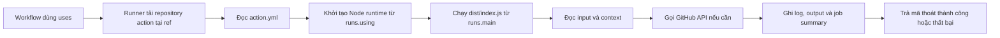

<Callout type="info" title="Kết quả sau bài này">
  Bạn sẽ xây dựng một action đọc thông tin pull request bằng GitHub API, xuất dữ liệu cho step sau và tạo job summary. Ví dụ bao gồm `action.yml`, mã nguồn, unit test, bản bundle `dist/`, workflow kiểm thử và workflow gọi action sau khi phát hành.
</Callout>

## Mục lục

- [JavaScript action là gì](#javascript-action-là-gì)
  - [Luồng thực thi](#luồng-thực-thi)
  - [Khi nào nên dùng](#khi-nào-nên-dùng)
- [Thiết kế ví dụ end-to-end](#thiết-kế-ví-dụ-end-to-end)
  - [Hợp đồng của action](#hợp-đồng-của-action)
  - [Cấu trúc repository](#cấu-trúc-repository)
- [Khởi tạo dự án Node.js](#khởi-tạo-dự-án-nodejs)
  - [Chuẩn bị và cài dependency](#chuẩn-bị-và-cài-dependency)
  - [Khai báo package.json](#khai-báo-packagejson)
  - [Bỏ qua file không cần commit](#bỏ-qua-file-không-cần-commit)
- [Khai báo action.yml](#khai-báo-actionyml)
  - [Hiểu runs.using và runs.main](#hiểu-runsusing-và-runsmain)
  - [Khi nào cần pre và post](#khi-nào-cần-pre-và-post)
- [Viết mã action](#viết-mã-action)
  - [Tách logic khỏi entrypoint](#tách-logic-khỏi-entrypoint)
  - [Đọc input và ghi output](#đọc-input-và-ghi-output)
  - [Logging, failure và job summary](#logging-failure-và-job-summary)
  - [Dùng @actions/github và token](#dùng-actionsgithub-và-token)
  - [Xử lý bất đồng bộ và lỗi](#xử-lý-bất-đồng-bộ-và-lỗi)
- [Viết unit test](#viết-unit-test)
  - [Nguyên tắc kiểm thử](#nguyên-tắc-kiểm-thử)
  - [Test luồng thành công và thất bại](#test-luồng-thành-công-và-thất-bại)
- [Build dist bằng ncc](#build-dist-bằng-ncc)
  - [Tạo và kiểm tra bundle](#tạo-và-kiểm-tra-bundle)
  - [Vì sao phải commit dist](#vì-sao-phải-commit-dist)
- [Kiểm thử action trên GitHub](#kiểm-thử-action-trên-github)
  - [Workflow kiểm thử trong repository action](#workflow-kiểm-thử-trong-repository-action)
  - [Workflow gọi action đã phát hành](#workflow-gọi-action-đã-phát-hành)
  - [Tiêu chí kiểm chứng](#tiêu-chí-kiểm-chứng)
- [Phát hành và quản lý phiên bản](#phát-hành-và-quản-lý-phiên-bản)
  - [Tạo bản phát hành](#tạo-bản-phát-hành)
  - [Tag major và commit SHA](#tag-major-và-commit-sha)
- [Cập nhật Node runtime](#cập-nhật-node-runtime)
- [Bảo mật và chuỗi cung ứng](#bảo-mật-và-chuỗi-cung-ứng)
  - [Input không tin cậy và token](#input-không-tin-cậy-và-token)
  - [Dependency, bundle và quy trình phát hành](#dependency-bundle-và-quy-trình-phát-hành)
- [Bài thực hành](#bài-thực-hành)
  - [Các bước thực hiện](#các-bước-thực-hiện)
    - [Tạo repository và metadata](#tạo-repository-và-metadata)
    - [Thêm source và unit test](#thêm-source-và-unit-test)
    - [Build sản phẩm phân phối](#build-sản-phẩm-phân-phối)
    - [Kiểm thử trên GitHub](#kiểm-thử-trên-github)
    - [Phát hành và gọi từ repository khác](#phát-hành-và-gọi-từ-repository-khác)
  - [Checklist hoàn thành](#checklist-hoàn-thành)
- [Best practices](#best-practices)
- [Troubleshooting](#troubleshooting)
- [Nguồn chính thức](#nguồn-chính-thức)
- [Tiếp tục trong series](#tiếp-tục-trong-series)

## JavaScript action là gì

JavaScript action là một chương trình Node.js được GitHub Actions tải xuống và chạy trực tiếp trên runner. Repository của action chứa ba lớp chính:

1. `action.yml` công bố giao diện gồm input, output và điểm vào chương trình.
2. `src/` chứa mã nguồn mà người duy trì đọc, sửa và kiểm thử.
3. `dist/` chứa mã đã bundle cùng dependency để runner thực thi ngay.

Khác với một step `run`, action tạo ra giao diện tái sử dụng bằng `uses`. Khác với Docker container action, JavaScript action không cần build image và khởi động nhanh trên Ubuntu, Windows lẫn macOS. Đổi lại, mã phải tương thích với Node runtime mà metadata khai báo và không nên phụ thuộc vào binary chỉ có trên một hệ điều hành.

### Luồng thực thi



Runner không tự chạy `npm install`, `npm test` hay `npm run build` khi gặp `uses`. Vì vậy, file mà `runs.main` trỏ đến và mọi dependency cần lúc chạy phải có sẵn tại ref được gọi.

### Khi nào nên dùng

JavaScript action phù hợp khi bạn cần:

- gọi REST hoặc GraphQL API và xử lý JSON;
- cung cấp input/output rõ ràng cho nhiều repository;
- chạy đa nền tảng mà không muốn duy trì image;
- viết unit test cho logic phức tạp;
- dùng Actions Toolkit để tạo annotation, log group, output hoặc job summary.

Composite action thường đơn giản hơn nếu công việc chủ yếu là ghép vài lệnh shell hay action có sẵn. Docker container action phù hợp hơn khi cần hệ điều hành, binary hoặc toolchain được đóng gói cố định.

<Callout type="warn" title="JavaScript action chạy với quyền của job">
  Action có thể đọc workspace, biến môi trường và token mà job cấp. Hãy xem action như một dependency có khả năng thực thi mã, không phải một đoạn cấu hình vô hại.
</Callout>

## Thiết kế ví dụ end-to-end

Action trong bài có tên **PR Digest**. Nó nhận token, xác định pull request từ event hoặc input, gọi REST API, rồi tạo một bản tóm tắt.

### Hợp đồng của action

| Thành phần | ID | Ý nghĩa |
|---|---|---|
| Input bắt buộc | `github-token` | Token dùng để đọc pull request. Caller truyền `${{ github.token }}`. |
| Input tùy chọn | `pull-number` | Số PR cần đọc. Nếu bỏ trống, action lấy từ payload của event `pull_request`. |
| Input tùy chọn | `add-summary` | Có ghi bảng vào job summary hay không; mặc định là `true`. |
| Output | `title` | Tiêu đề hiện tại của PR. |
| Output | `url` | URL của PR. |
| Output | `changed-files` | Số file thay đổi, ở dạng chuỗi khi đi qua workflow output. |

`pull-number` làm ví dụ dùng được trong hai tình huống. Workflow thật chạy bằng `pull_request` không cần truyền số PR. Người duy trì có thể chạy `workflow_dispatch` và nhập một số PR cụ thể để kiểm thử action trên GitHub.

### Cấu trúc repository

<Files>
  <Folder name=".github" defaultOpen>
    <Folder name="workflows" defaultOpen>
      <File name="test-action.yml" />
    </Folder>
  </Folder>
  <Folder name="dist" defaultOpen>
    <File name="index.js" />
    <File name="index.js.map" />
    <File name="licenses.txt" />
    <File name="package.json" />
    <File name="sourcemap-register.cjs" />
  </Folder>
  <Folder name="src" defaultOpen>
    <File name="action.js" />
    <File name="index.js" />
  </Folder>
  <Folder name="test" defaultOpen>
    <File name="action.test.js" />
  </Folder>
  <File name=".gitignore" />
  <File name="action.yml" />
  <File name="package-lock.json" />
  <File name="package.json" />
  <File name="README.md" />
</Files>

`src/action.js` xuất hàm `run()` để test có thể gọi trực tiếp. `src/index.js` chỉ là entrypoint thật. Cách tách này ngăn unit test vô tình chạy toàn bộ action ngay khi import module.

## Khởi tạo dự án Node.js

### Chuẩn bị và cài dependency

Ví dụ dùng Node.js 24 và npm. Kiểm tra môi trường trước khi bắt đầu:

```bash
node --version
npm --version
```

Tạo repository mới, khởi tạo package và cài dependency:

```bash
mkdir pr-digest-action
cd pr-digest-action
git init
npm init -y
npm install @actions/core@^3.0.1 @actions/github@^9.1.1
npm install --save-dev @vercel/ncc@^0.44.1
mkdir -p src test .github/workflows
```

- `@actions/core` cung cấp API cho input, output, log, secret masking, trạng thái thất bại và job summary.
- `@actions/github` cung cấp context của lần chạy và Octokit client đã cấu hình cho GitHub.com hoặc GitHub Enterprise Server.
- `@vercel/ncc` bundle mã Node.js cùng dependency thành file phân phối.

Sau khi cài, commit cả `package.json` và `package-lock.json`. Không commit `node_modules/`.

### Khai báo package.json

Thay nội dung `package.json` bằng cấu hình sau, rồi chạy `npm install` một lần để đồng bộ lockfile:

```json
{
  "name": "pr-digest-action",
  "version": "1.0.0",
  "private": true,
  "type": "module",
  "engines": {
    "node": ">=24"
  },
  "scripts": {
    "test": "node --test",
    "build": "ncc build src/index.js -o dist --minify --source-map --license licenses.txt",
    "check:dist": "npm run build && git diff --exit-code -- dist"
  },
  "dependencies": {
    "@actions/core": "^3.0.1",
    "@actions/github": "^9.1.1"
  },
  "devDependencies": {
    "@vercel/ncc": "^0.44.1"
  }
}
```

`"type": "module"` cho phép dùng cú pháp `import`. Phiên bản hiện hành của `@actions/github` là ESM-only, nên lựa chọn ESM giúp mã nguồn nhất quán. ncc nhận biết package boundary này và tạo output ESM tương ứng.

`private: true` ngăn thao tác `npm publish` ngoài ý muốn. Action được phân phối qua Git ref trong repository, không cần xuất bản package lên npm.

<Callout type="info" title="Lockfile mới là nguồn phiên bản chính xác">
  Dấu `^` cho phép npm chọn bản tương thích khi tạo lockfile. `package-lock.json` ghi lại cây dependency thực tế; CI và người phát hành phải dùng `npm ci` để cài đúng cây đó.
</Callout>

### Bỏ qua file không cần commit

Tạo `.gitignore`:

```text
node_modules/
coverage/
.env
*.log
```

Không thêm `dist/` vào `.gitignore`. Với JavaScript action, `dist/` là sản phẩm phân phối phải nằm trong release.

## Khai báo action.yml

Tạo `action.yml` ở root repository:

```yaml
name: PR Digest
description: Đọc thông tin pull request và ghi bản tóm tắt cho job
author: Your organization

inputs:
  github-token:
    description: Token có quyền đọc pull request
    required: true
  pull-number:
    description: Số PR; để trống để lấy từ event pull_request
    required: false
  add-summary:
    description: Ghi thông tin PR vào job summary
    required: false
    default: 'true'

outputs:
  title:
    description: Tiêu đề pull request
  url:
    description: URL pull request
  changed-files:
    description: Số file thay đổi trong pull request

runs:
  using: node24
  main: dist/index.js

branding:
  icon: file-text
  color: blue
```

Metadata chỉ khai báo giao diện. `required: true` trong metadata giúp người dùng hiểu hợp đồng nhưng không tự bảo đảm action sẽ dừng nếu thiếu input. Mã nguồn vẫn gọi `core.getInput('github-token', { required: true })` để xác thực lúc chạy.

### Hiểu runs.using và runs.main

`runs.using: node24` yêu cầu runner dùng Node.js 24 để chạy JavaScript action. Đây là runtime do runner cung cấp, không phải phiên bản Node của dự án ứng dụng đang được build trong workflow.

`runs.main: dist/index.js` là đường dẫn tương đối từ thư mục chứa `action.yml`. Không trỏ `main` đến `src/index.js`, vì source còn import package trong `node_modules` mà runner không cài cho action.

Hai giá trị phải khớp với quy trình build:

```text
src/index.js ── ncc build ──► dist/index.js
     source                       runs.main
```

### Khi nào cần pre và post

JavaScript action có thể khai báo thêm script vòng đời:

```yaml
runs:
  using: node24
  pre: dist/pre.js
  pre-if: runner.os == 'linux'
  main: dist/index.js
  post: dist/post.js
  post-if: always()
```

- `pre` chạy ở đầu job trước `main`, phù hợp để chuẩn bị daemon hoặc tài nguyên dùng chung.
- `post` được đăng ký để chạy khi job kết thúc, phù hợp để dừng tiến trình hoặc xóa tài nguyên.
- `pre-if` và `post-if` giới hạn điều kiện chạy. Nếu bỏ qua, mặc định là `always()`.
- `core.saveState()` trong `main` và `core.getState()` trong `post` có thể truyền trạng thái cho cùng một lần dùng action.

Mỗi entrypoint phải được build và commit. Ví dụ PR Digest không tạo tài nguyên cần dọn, nên chỉ có `main`. Đừng thêm `pre` hoặc `post` chỉ để “đủ cấu trúc”; lifecycle dư thừa làm log và xử lý lỗi phức tạp hơn.

<Callout type="warn" title="Giới hạn của local action">
  Theo metadata reference của GitHub, `runs.pre` không được hỗ trợ cho local action dạng `uses: ./path`. Nếu action phụ thuộc vào `pre`, hãy kiểm thử lifecycle bằng một ref repository thay vì kết luận từ local action.
</Callout>

## Viết mã action

### Tách logic khỏi entrypoint

Tạo `src/action.js`:

```js
import * as core from '@actions/core'
import * as github from '@actions/github'

function escapeHtml(value) {
  const replacements = {
    '&': '&amp;',
    '<': '&lt;',
    '>': '&gt;',
    '"': '&quot;',
    "'": '&#39;'
  }

  return String(value).replace(
    /[&<>"']/g,
    character => replacements[character]
  )
}

function resolvePullNumber(input, payload) {
  const raw = input.trim() || String(payload.pull_request?.number ?? '')
  const pullNumber = Number(raw)

  if (!Number.isInteger(pullNumber) || pullNumber <= 0) {
    throw new Error(
      'Không tìm thấy pull request. Hãy chạy từ event pull_request hoặc truyền input pull-number.'
    )
  }

  return pullNumber
}

export async function run({ coreApi = core, githubApi = github } = {}) {
  try {
    const token = coreApi.getInput('github-token', { required: true })
    const inputPullNumber = coreApi.getInput('pull-number')
    const addSummary = coreApi.getBooleanInput('add-summary')
    const pullNumber = resolvePullNumber(
      inputPullNumber,
      githubApi.context.payload
    )
    const { owner, repo } = githubApi.context.repo

    coreApi.debug(`Đang đọc ${owner}/${repo}#${pullNumber}`)

    const octokit = githubApi.getOctokit(token)
    const { data: pull } = await octokit.rest.pulls.get({
      owner,
      repo,
      pull_number: pullNumber
    })

    coreApi.setOutput('title', pull.title)
    coreApi.setOutput('url', pull.html_url)
    coreApi.setOutput('changed-files', pull.changed_files)
    coreApi.info(
      `PR #${pull.number}: ${pull.changed_files} file thay đổi — ${pull.html_url}`
    )

    if (addSummary) {
      coreApi.summary
        .addHeading('PR Digest', 2)
        .addTable([
          [
            { data: 'Thuộc tính', header: true },
            { data: 'Giá trị', header: true }
          ],
          ['Pull request', `#${pull.number}`],
          ['Tiêu đề', escapeHtml(pull.title)],
          ['File thay đổi', String(pull.changed_files)]
        ])
        .addLink('Mở pull request', pull.html_url)

      await coreApi.summary.write()
    }
  } catch (error) {
    const message = error instanceof Error ? error.message : String(error)
    coreApi.setFailed(message)
  }
}
```

Tham số có giá trị mặc định `{ coreApi = core, githubApi = github }` là một điểm tiêm dependency nhỏ. Khi chạy thật, hàm dùng Actions Toolkit. Khi unit test, ta truyền object giả và không cần token hay kết nối mạng.

Tạo entrypoint `src/index.js`:

```js
import { run } from './action.js'

await run()
```

Top-level `await` bảo đảm process không kết thúc trước khi lời gọi API và ghi summary hoàn tất.

### Đọc input và ghi output

Các API chính của `@actions/core` gồm:

| API | Công dụng |
|---|---|
| `core.getInput(name, options)` | Đọc input dạng chuỗi; `{ required: true }` làm action thất bại nếu giá trị trống. |
| `core.getBooleanInput(name)` | Parse boolean theo quy tắc YAML 1.2 thay vì tự so sánh chuỗi tùy tiện. |
| `core.getMultilineInput(name)` | Đọc input nhiều dòng thành mảng chuỗi. |
| `core.setOutput(name, value)` | Công bố giá trị cho `${{ steps.<id>.outputs.<name> }}`. |
| `core.exportVariable(name, value)` | Tạo biến môi trường cho các step còn lại trong job. |
| `core.setSecret(value)` | Đăng ký một giá trị nhạy cảm để runner che trong log. |

Input của action luôn đi vào mã dưới dạng dữ liệu. Hãy parse và validate trước khi dùng. Ví dụ dùng `Number()` rồi kiểm tra số nguyên dương, thay vì chuyển thẳng `pull-number` sang REST API.

Output nên nhỏ và ổn định. GitHub giới hạn tổng output, và output lớn làm workflow khó quan sát. Với dữ liệu báo cáo dài, hãy dùng artifact hoặc job summary thay vì nhồi JSON lớn vào `setOutput()`.

### Logging, failure và job summary

`@actions/core` cung cấp nhiều mức log:

- `core.debug()` chỉ hiện khi bật step debug logging;
- `core.info()` ghi thông tin vận hành bình thường;
- `core.notice()`, `core.warning()` và `core.error()` có thể tạo annotation trên giao diện;
- `core.startGroup()`/`core.endGroup()` hoặc `core.group()` gom log dài thành nhóm có thể thu gọn;
- `core.setFailed()` ghi lỗi và đặt exit code thất bại.

`core.error()` chỉ ghi annotation; nó không tự làm action thất bại. Nếu lỗi khiến kết quả không còn đáng tin cậy, dùng `core.setFailed()` hoặc đặt `process.exitCode` khác `0`.

Job summary là nội dung Markdown/HTML hiển thị ở trang tổng kết run. Builder `core.summary` giữ nội dung trong buffer. Phải gọi và `await core.summary.write()` thì nội dung mới được ghi ra file summary của runner.

<Callout type="idea" title="Log cho người debug, summary cho người đọc kết quả">
  Log nên ghi ID, bước xử lý và lỗi kỹ thuật. Summary nên ngắn, có bảng hoặc liên kết giúp reviewer ra quyết định mà không cần mở hàng trăm dòng log.
</Callout>

### Dùng @actions/github và token

`github.context` chứa thông tin của event hiện tại. Hai phần được ví dụ sử dụng là:

- `github.context.repo`, trả về `{ owner, repo }` của repository đang chạy;
- `github.context.payload`, chứa webhook payload, chẳng hạn `payload.pull_request.number`.

Không giả định field luôn tồn tại. Payload thay đổi theo event, nên action có fallback `pull-number` và báo lỗi rõ ràng nếu cả hai nguồn đều thiếu.

`github.getOctokit(token)` tạo Octokit client đã xác thực, tôn trọng proxy của self-hosted runner và base URL của GitHub Enterprise Server. Ví dụ gọi REST endpoint bằng:

```js
const octokit = github.getOctokit(token)
const response = await octokit.rest.pulls.get({
  owner,
  repo,
  pull_number: pullNumber
})
```

Caller nên truyền `github-token: ${{ github.token }}` và khai báo `permissions` tối thiểu. PR Digest chỉ đọc pull request, vì vậy `pull-requests: read` là quyền chính. Nếu workflow còn checkout local action thì job cũng cần `contents: read`.

Không in token, request header hoặc toàn bộ object lỗi có thể chứa credential. `GITHUB_TOKEN` hết hạn theo job và bị giới hạn bởi `permissions`; đây là lựa chọn tốt hơn personal access token cho API repository thông thường. Nếu API cần quyền mà `GITHUB_TOKEN` không cung cấp, ưu tiên GitHub App installation token có phạm vi hẹp và thời hạn ngắn.

### Xử lý bất đồng bộ và lỗi

Mọi Promise quan trọng phải được `await`: lời gọi Octokit, ghi summary, tải file hoặc chạy process con. Nếu quên `await`, action có thể báo thành công trước khi thao tác hoàn tất hoặc bỏ sót Promise rejection.

Bao toàn bộ entrypoint trong `try/catch`. JavaScript cho phép `throw` mọi giá trị, không chỉ `Error`, nên nhánh `String(error)` giữ thông báo hợp lệ cho cả trường hợp bất thường.

Không gọi `process.exit(1)` ngay giữa hàm. Lệnh này có thể cắt ngang log hoặc tác vụ ghi file đang chờ. `core.setFailed(message)` đặt `process.exitCode = 1`, cho phép event loop hoàn thành công việc dọn dẹp còn lại.

Nếu lỗi là tùy chọn và action vẫn tạo được kết quả đúng, dùng `core.warning()` rồi tiếp tục. Nếu output thiếu hoặc sai, hãy fail sớm; “run xanh nhưng dữ liệu sai” khó chẩn đoán hơn một lỗi rõ ràng.

## Viết unit test

### Nguyên tắc kiểm thử

Unit test không nên phụ thuộc vào runner, secret hoặc GitHub API thật. Hãy thay `coreApi` và `githubApi` bằng fake object, rồi kiểm tra hành vi quan sát được:

- endpoint được gọi với đúng owner, repo và số PR;
- output được đặt đúng;
- summary được ghi khi `add-summary` là `true`;
- input/event không hợp lệ gọi `setFailed()`;
- token không xuất hiện trong log.

Ví dụ dùng test runner tích hợp sẵn của Node.js, nên không cần thêm framework test.

### Test luồng thành công và thất bại

Tạo `test/action.test.js`:

```js
import assert from 'node:assert/strict'
import test from 'node:test'

import { run } from '../src/action.js'

function createCore(inputs) {
  const calls = {
    outputs: [],
    failed: [],
    info: [],
    summaryTables: [],
    summaryWrites: 0
  }

  const summary = {
    addHeading() {
      return summary
    },
    addTable(rows) {
      calls.summaryTables.push(rows)
      return summary
    },
    addLink() {
      return summary
    },
    async write() {
      calls.summaryWrites += 1
    }
  }

  return {
    calls,
    summary,
    getInput(name, options = {}) {
      const value = inputs[name] ?? ''
      if (options.required && value === '') {
        throw new Error(`Input required and not supplied: ${name}`)
      }
      return value
    },
    getBooleanInput(name) {
      return inputs[name] === 'true'
    },
    debug() {},
    info(message) {
      calls.info.push(message)
    },
    setOutput(name, value) {
      calls.outputs.push([name, value])
    },
    setFailed(message) {
      calls.failed.push(message)
    }
  }
}

test('đọc PR, đặt output và ghi summary', async () => {
  const coreApi = createCore({
    'github-token': 'test-token',
    'pull-number': '',
    'add-summary': 'true'
  })
  const apiCalls = []
  const githubApi = {
    context: {
      repo: { owner: 'octo-org', repo: 'demo' },
      payload: { pull_request: { number: 42 } }
    },
    getOctokit(token) {
      assert.equal(token, 'test-token')
      return {
        rest: {
          pulls: {
            async get(parameters) {
              apiCalls.push(parameters)
              return {
                data: {
                  number: 42,
                  title: 'Add <script>alert(1)</script>',
                  html_url: 'https://github.com/octo-org/demo/pull/42',
                  changed_files: 3
                }
              }
            }
          }
        }
      }
    }
  }

  await run({ coreApi, githubApi })

  assert.deepEqual(apiCalls, [
    { owner: 'octo-org', repo: 'demo', pull_number: 42 }
  ])
  assert.deepEqual(coreApi.calls.outputs, [
    ['title', 'Add <script>alert(1)</script>'],
    ['url', 'https://github.com/octo-org/demo/pull/42'],
    ['changed-files', 3]
  ])
  assert.equal(
    coreApi.calls.summaryTables[0][2][1],
    'Add &lt;script&gt;alert(1)&lt;/script&gt;'
  )
  assert.equal(coreApi.calls.summaryWrites, 1)
  assert.deepEqual(coreApi.calls.failed, [])
})

test('đánh dấu thất bại khi không xác định được PR', async () => {
  const coreApi = createCore({
    'github-token': 'test-token',
    'pull-number': '',
    'add-summary': 'false'
  })
  const githubApi = {
    context: {
      repo: { owner: 'octo-org', repo: 'demo' },
      payload: {}
    },
    getOctokit() {
      throw new Error('Không được gọi API trong test này')
    }
  }

  await run({ coreApi, githubApi })

  assert.equal(coreApi.calls.failed.length, 1)
  assert.match(coreApi.calls.failed[0], /Không tìm thấy pull request/)
  assert.deepEqual(coreApi.calls.outputs, [])
  assert.equal(coreApi.calls.summaryWrites, 0)
})
```

Chạy test:

```bash
npm test
```

Test thành công chứng minh logic chính mà không cần tạo repository giả, event file hay token thật. Nó chưa thay thế integration test trên runner, vì unit test không kiểm tra workflow command protocol và quyền API thực tế.

## Build dist bằng ncc

### Tạo và kiểm tra bundle

Chạy:

```bash
npm ci
npm test
npm run build
node --check dist/index.js
git status --short
```

Lệnh `ncc build` bắt đầu từ `src/index.js`, phân tích các import và đưa code cần thiết từ `@actions/core`, `@actions/github` cùng dependency bắc cầu vào `dist/index.js`.

Các option trong script có mục đích cụ thể:

- `-o dist` đặt thư mục output đúng với `runs.main`;
- `--minify` giảm kích thước file phân phối;
- `--source-map` tạo source map để stack trace dễ đối chiếu với source;
- `--license licenses.txt` giữ thông tin giấy phép dependency trong bundle.

Sau lần build đầu, thêm source và dist vào Git:

```bash
git add action.yml package.json package-lock.json src test dist .gitignore
git commit -m "feat: add PR digest action"
```

Mỗi khi source hoặc dependency đổi, chạy lại `npm run build` và commit phần thay đổi trong `dist/` cùng commit đó.

### Vì sao phải commit dist

Khi workflow dùng `OWNER/pr-digest-action@v1`, runner tải repository tại ref `v1`, đọc `action.yml` và chạy ngay `dist/index.js`. Runner không dùng devDependencies để build source trước.

Vì vậy, nếu thiếu `dist/index.js`, action lỗi “file not found”. Nếu `dist/` cũ hơn source, người dùng chạy code cũ dù review đang nhìn vào source mới. Đây là lý do CI nên xác minh bundle:

```bash
npm ci
npm test
npm run build
git diff --exit-code -- dist
```

`git diff --exit-code -- dist` trả lỗi nếu build tái tạo nội dung khác với dist đã commit. Check này ngăn merge PR quên bundle lại.

<Callout type="warn" title="Không sửa dist bằng tay">
  `dist/index.js` là output sinh tự động và thường khó review. Mọi thay đổi phải bắt đầu từ `src/` hoặc dependency lockfile, sau đó được tái tạo bằng lệnh build đã commit.
</Callout>

## Kiểm thử action trên GitHub

Unit test kiểm tra logic cục bộ. Integration test trên GitHub kiểm tra metadata, runtime, workflow command, token permission và API thật.

### Workflow kiểm thử trong repository action

Tạo `.github/workflows/test-action.yml`. Workflow chạy bằng tay và yêu cầu số của một PR đang tồn tại trong chính repository action:

```yaml
name: Test local JavaScript action

on:
  workflow_dispatch:
    inputs:
      pull-number:
        description: Số pull request cần đọc
        required: true
        type: number

permissions:
  contents: read
  pull-requests: read

jobs:
  test-action:
    runs-on: ubuntu-latest
    timeout-minutes: 10
    steps:
      - name: Checkout action source
        uses: actions/checkout@v7

      - name: Chạy action từ workspace
        id: digest
        uses: ./
        with:
          github-token: ${{ github.token }}
          pull-number: ${{ inputs.pull-number }}
          add-summary: 'true'

      - name: Kiểm tra output
        env:
          PR_TITLE: ${{ steps.digest.outputs.title }}
          PR_URL: ${{ steps.digest.outputs.url }}
          CHANGED_FILES: ${{ steps.digest.outputs.changed-files }}
        run: |
          test -n "$PR_TITLE"
          test -n "$PR_URL"
          test "$CHANGED_FILES" -ge 0
          printf 'title=%s\nurl=%s\nchanged_files=%s\n' \
            "$PR_TITLE" "$PR_URL" "$CHANGED_FILES"
```

`uses: ./` yêu cầu checkout repository trước. Vì checkout cần đọc nội dung, workflow cấp `contents: read` ngoài `pull-requests: read`. Giá trị output được chuyển qua `env` và đặt trong dấu nháy khi dùng trong shell; không chèn trực tiếp tiêu đề PR vào script được sinh ra.

Workflow trên kiểm thử `dist/` đã commit, đúng như consumer sẽ chạy. Nó không tự build source. Hãy chạy CI build-check riêng trước để biết `dist/` đồng bộ.

<Callout type="info" title="Cách chạy integration test">
  Tạo một PR thử nghiệm trong repository action, vào **Actions → Test local JavaScript action → Run workflow**, chọn branch chứa action và nhập số PR. `workflow_dispatch` phải tồn tại trên default branch thì nút chạy thủ công mới xuất hiện.
</Callout>

### Workflow gọi action đã phát hành

Sau khi publish repository và tạo tag `v1`, consumer có thể tạo `.github/workflows/pr-digest.yml`:

```yaml
name: PR digest

on:
  pull_request:
    types: [opened, synchronize, reopened]

permissions:
  pull-requests: read

jobs:
  summarize:
    runs-on: ubuntu-latest
    timeout-minutes: 5
    steps:
      - name: Tóm tắt pull request
        id: digest
        uses: YOUR_ORG/pr-digest-action@v1
        with:
          github-token: ${{ github.token }}
          add-summary: 'true'

      - name: Dùng output của action
        env:
          PR_URL: ${{ steps.digest.outputs.url }}
          CHANGED_FILES: ${{ steps.digest.outputs.changed-files }}
        run: |
          printf 'PR: %s\n' "$PR_URL"
          printf 'Changed files: %s\n' "$CHANGED_FILES"
```

Thay `YOUR_ORG/pr-digest-action` bằng owner và repository thực tế. Workflow không checkout source vì action đã phát hành được runner tải riêng. Job chỉ đọc PR, nên không cần `contents: write`, `issues: write` hay secret dài hạn.

Ví dụ dùng `@v1` để dễ đọc. Với môi trường yêu cầu tính bất biến, thay `v1` bằng full-length commit SHA của release đã xác minh.

### Tiêu chí kiểm chứng

Một lần chạy đúng phải có đủ bằng chứng sau:

| Kiểm tra | Kết quả mong đợi |
|---|---|
| Metadata | Step action khởi động bằng Node.js 24, không báo thiếu `dist/index.js`. |
| API | Log có `PR #<số>` và URL đúng; không lộ token. |
| Output | Step sau nhận URL và số file thay đổi. |
| Summary | Trang summary của run có bảng **PR Digest** và liên kết mở PR. |
| Permission | Workflow chạy với `pull-requests: read`; local workflow thêm đúng `contents: read` cho checkout. |
| Failure | Nhập số PR không tồn tại làm step đỏ với thông báo API có ích. |

## Phát hành và quản lý phiên bản

### Tạo bản phát hành

Trước khi tag, chạy lại toàn bộ cổng chất lượng từ bản clone sạch hoặc CI:

```bash
npm ci
npm test
npm run build
git diff --exit-code -- dist
git status --short
```

`git status --short` phải rỗng. Sau đó tạo version cụ thể:

```bash
git tag -a v1.0.0 -m "PR Digest v1.0.0"
git push origin v1.0.0
```

Tạo GitHub Release từ tag `v1.0.0`, ghi rõ input/output, thay đổi hành vi, Node runtime và hướng dẫn nâng cấp. Semantic Versioning là quy ước hữu ích:

- patch `v1.0.1`: sửa lỗi tương thích ngược;
- minor `v1.1.0`: thêm tính năng tương thích ngược;
- major `v2.0.0`: thay đổi interface hoặc hành vi gây breaking change.

### Tag major và commit SHA

Nhiều action duy trì thêm tag major di động như `v1`. Consumer dùng `@v1` nhận bản vá và minor mới mà không sửa workflow. Sau khi phát hành `v1.0.0`, tạo tag major:

```bash
git tag -f v1 v1.0.0
git push origin v1 --force
```

Khi có `v1.1.0`, người duy trì di chuyển `v1` đến commit đã release và đã kiểm thử. Không di chuyển `v1` đến commit chưa phát hành.

Tag di động thuận tiện nhưng không bất biến. Full-length commit SHA là lựa chọn an toàn nhất cho consumer vì ref không thể bị di chuyển. Một chiến lược cân bằng là:

- README hiển thị ví dụ `@v1` cho người dùng phổ thông;
- tài liệu bảo mật hướng dẫn pin SHA;
- Dependabot cập nhật SHA khi release mới xuất hiện;
- release notes công bố commit SHA và checksum nếu quy trình yêu cầu.

<Callout type="warn" title="Bảo vệ tag phát hành">
  Hạn chế người được tạo hoặc di chuyển tag `v*`. Tài khoản bị chiếm quyền có thể thay tag major và phân phối mã độc đến mọi consumer dùng tag đó.
</Callout>

## Cập nhật Node runtime

Node runtime của JavaScript action có vòng đời riêng. Khi GitHub hỗ trợ runtime mới, việc đổi `runs.using` không chỉ là sửa một dòng YAML.

Thực hiện theo thứ tự:

1. Đọc thông báo deprecation và metadata reference hiện hành của GitHub.
2. Đổi `engines.node` và môi trường phát triển/CI sang phiên bản mới.
3. Nâng `@actions/core`, `@actions/github`, ncc và dependency liên quan.
4. Chạy `npm ci`, unit test và integration test trên các runner được hỗ trợ.
5. Build lại toàn bộ entrypoint trong `dist/`.
6. Kiểm tra self-hosted runner đã đủ mới để cung cấp runtime đó.
7. Phát hành release mới và ghi Node runtime trong release notes.

Ví dụ trong bài dùng `node24`, giá trị được metadata reference hiện hành hỗ trợ. Nếu action cần tương thích GitHub Enterprise Server phiên bản cũ, hãy kiểm tra tài liệu GHES tương ứng trước khi bỏ `node20`.

Không dùng `actions/setup-node` để thay đổi runtime của chính action. `setup-node` cấu hình Node cho các step sau trong job; runner đã chọn runtime cho action từ `runs.using` trước khi mã action bắt đầu.

## Bảo mật và chuỗi cung ứng

### Input không tin cậy và token

Mọi input, tên branch, tiêu đề PR, nội dung issue và webhook payload đều có thể do người không tin cậy kiểm soát. Áp dụng các nguyên tắc sau:

- Parse và validate kiểu dữ liệu trước khi dùng. `pull-number` phải là số nguyên dương.
- Không ghép input vào lệnh shell. Nếu bắt buộc chạy process, dùng API truyền mảng argument thay vì tạo một chuỗi lệnh.
- Không ghi toàn bộ `github.context.payload` vào log. Payload có thể lớn, chứa dữ liệu nhạy cảm hoặc nội dung do attacker tạo.
- Không log token. Với secret phát sinh trong action, gọi `core.setSecret()` ngay sau khi tạo để runner che giá trị.
- Escape nội dung không tin cậy trước khi đưa vào HTML của job summary. Ví dụ dùng `escapeHtml()` cho tiêu đề PR vì `core.summary.addTable()` không tự escape cell data.
- Cấp quyền token ở caller, không tự giả định token có quyền ghi. PR Digest chỉ cần `pull-requests: read`.
- Tránh `pull_request_target` nếu không thật sự cần. Tuyệt đối không checkout và chạy code PR không tin cậy trong job đặc quyền.
- Với self-hosted runner, coi code PR là có khả năng chiếm quyền máy lâu dài. Ưu tiên runner tạm thời và tách runner group theo ranh giới tin cậy.

JavaScript action giúp giảm script injection so với chèn trực tiếp `${{ github.event.pull_request.title }}` vào step shell. Tuy nhiên, action vẫn phải xem tiêu đề đó là dữ liệu, không biến nó thành code hoặc command.

### Dependency, bundle và quy trình phát hành

Bundle làm việc triển khai đơn giản hơn nhưng không xóa rủi ro dependency. Mã bắc cầu đã trở thành một phần của `dist/index.js`.

Checklist chuỗi cung ứng cho maintainer:

- Commit lockfile và dùng `npm ci` trong CI.
- Bật Dependabot cho npm và GitHub Actions; xem release notes trước khi merge major update.
- Chạy `npm audit` như tín hiệu hỗ trợ, không xem nó là thay thế cho review.
- Kiểm tra provenance/attestation của package khi registry cung cấp và chính sách tổ chức yêu cầu.
- Giữ file giấy phép do ncc tạo; kiểm tra license của dependency mới.
- Dùng CodeQL hoặc code scanning cho source action và workflow.
- Yêu cầu review bằng `CODEOWNERS` cho `action.yml`, `src/`, `package-lock.json`, `dist/` và workflow release.
- CI phải chạy test, build lại dist và `git diff --exit-code -- dist`.
- Chỉ tạo tag từ commit đã qua review và required checks.
- Consumer nên pin action bên thứ ba bằng full-length SHA và xác minh SHA thuộc repository gốc.
- Không gọi action bằng `@main`; nhánh có thể thay đổi mà không có release boundary.

Một thay đổi chỉ chạm `dist/` nhưng không có thay đổi tương ứng trong source hoặc lockfile là dấu hiệu cần dừng review. Ngược lại, thay đổi source/dependency mà không đổi dist thường cho thấy maintainer quên build.

## Bài thực hành

### Các bước thực hiện

<Steps>
<Step>

### Tạo repository và metadata

Khởi tạo dự án Node.js, cài ba package trong bài, tạo `.gitignore`, `package.json` và `action.yml`. Chạy `npm install` để bảo đảm `package-lock.json` khớp manifest.

</Step>
<Step>

### Thêm source và unit test

Tạo `src/action.js`, `src/index.js` và `test/action.test.js` đúng như ví dụ. Chạy:

```bash
npm test
```

Cả hai test phải pass.

</Step>
<Step>

### Build sản phẩm phân phối

Chạy:

```bash
npm run build
node --check dist/index.js
```

Xác nhận `dist/index.js`, source map, file license và các file hỗ trợ mà ncc sinh ra đều xuất hiện. Kiểm tra `action.yml` trỏ đúng `dist/index.js`, và commit toàn bộ nội dung cần thiết trong `dist/`.

</Step>
<Step>

### Kiểm thử trên GitHub

Commit source cùng dist, push repository và thêm workflow `test-action.yml`. Tạo một PR thử nghiệm, chạy workflow thủ công với số PR đó, rồi kiểm tra log, output và job summary.

</Step>
<Step>

### Phát hành và gọi từ repository khác

Tạo `v1.0.0`, trỏ `v1` đến release, rồi dùng workflow consumer trong một repository thử nghiệm. Thay owner/repository cho đúng và xác nhận job chỉ cần quyền đọc PR.

</Step>
</Steps>

### Checklist hoàn thành

- [ ] Frontend contract trong `action.yml` khớp mọi `getInput()` và `setOutput()` trong source.
- [ ] `npm ci` và `npm test` thành công từ clone sạch.
- [ ] `npm run build` tạo đúng `dist/index.js`.
- [ ] `git diff --exit-code -- dist` thành công sau build lại.
- [ ] Integration workflow đọc được PR thật bằng quyền tối thiểu.
- [ ] Job summary và ba output có giá trị đúng.
- [ ] Trường hợp thiếu/sai số PR làm action thất bại rõ ràng.
- [ ] Release chứa source, lockfile và dist đồng bộ.
- [ ] Consumer dùng tag release hoặc full-length commit SHA, không dùng `main`.

## Best practices

- **Giữ interface nhỏ và có tài liệu:** mỗi input/output cần description, kiểu dữ liệu kỳ vọng, default và ví dụ sử dụng trong README.
- **Validate trong code:** `required: true` của metadata không thay thế `getInput(..., { required: true })` và kiểm tra miền giá trị.
- **Tách `run()` khỏi entrypoint:** logic dễ unit test, còn entrypoint chỉ chịu trách nhiệm khởi động.
- **Luôn `await` I/O:** API, summary và process con phải hoàn tất trước khi action kết thúc.
- **Fail rõ ràng:** dùng `core.setFailed()` cho lỗi làm kết quả không đáng tin cậy; không nuốt exception rồi trả run xanh.
- **Không log quá mức:** log ID và trạng thái cần debug, không dump token hoặc toàn bộ event payload.
- **Dùng summary có chọn lọc:** hiển thị kết quả cần đọc, không sao chép cả log vào summary.
- **Bundle xác định được:** build từ lockfile bằng lệnh duy nhất và chặn dist lệch trong CI.
- **Commit dist, không commit node_modules:** dist là artifact thực thi; `node_modules` lớn, phụ thuộc nền tảng và không phải giao diện phát hành phù hợp.
- **Phân quyền tại caller:** tài liệu action phải ghi chính xác permission cần thiết; đừng yêu cầu `write-all` cho action chỉ đọc dữ liệu.
- **Kiểm thử đa nền tảng nếu đã cam kết:** thêm matrix Ubuntu, Windows và macOS khi action thao tác path, process hoặc filesystem.
- **Phát hành có biên giới:** semantic tag, release notes, protected tag và SHA bất biến giúp consumer đánh giá nâng cấp.

## Troubleshooting

| Triệu chứng | Nguyên nhân thường gặp | Cách xử lý |
|---|---|---|
| `Cannot find ... dist/index.js` | Chưa build/commit dist hoặc `runs.main` sai đường dẫn. | Chạy `npm run build`, xác nhận file tồn tại tại đúng ref và sửa `action.yml`. |
| `Cannot find package '@actions/core'` | `runs.main` trỏ vào source hoặc ncc để dependency ở dạng external. | Trỏ đến bundle `dist/index.js`; không externalize Actions Toolkit khi runner không cài package đó. |
| `require is not defined` hoặc lỗi ESM/CommonJS | `type`, cú pháp import và output bundle không thống nhất. | Giữ `"type": "module"`, dùng `import`, build lại bằng ncc và test chính file dist. |
| Input bắt buộc trống nhưng action không dừng | Chỉ khai báo `required: true` trong metadata. | Đọc bằng `core.getInput(name, { required: true })` và validate trong source. |
| `Resource not accessible by integration` | `GITHUB_TOKEN` thiếu permission hoặc event fork bị giới hạn. | Khai báo `pull-requests: read`; nếu endpoint khác cần quyền khác, cấp đúng quyền đó ở job. Không đổi sang `write-all`. |
| API trả `404 Not Found` cho PR tồn tại | Sai owner/repo/số PR, token không thấy repository hoặc GitHub App chưa được cài. | Log owner/repo/số PR không nhạy cảm, kiểm tra `github.context.repo` và phạm vi token. |
| Action báo không tìm thấy pull request | Workflow không chạy từ `pull_request` và không truyền `pull-number`. | Truyền số PR khi dùng `workflow_dispatch`, hoặc chạy action từ event PR. |
| Output rỗng ở step sau | Step action thiếu `id`, tên output sai hoặc action fail trước `setOutput()`. | Thêm `id: digest`, dùng đúng `steps.digest.outputs.changed-files` và xem step lỗi đầu tiên. |
| Không thấy job summary | `add-summary` là `false`, quên `write()` hoặc không `await` Promise. | Truyền `'true'` và gọi `await core.summary.write()`. |
| `npm test` pass nhưng action trên GitHub fail | Unit test không kiểm tra metadata, dist, quyền hoặc API thật. | Chạy integration workflow bằng `uses: ./` trên GitHub-hosted runner. |
| `check:dist` fail | Source/lockfile đã đổi nhưng dist chưa được commit, hoặc môi trường build tạo output khác. | Dùng đúng Node/npm từ CI, chạy `npm ci && npm run build`, review rồi commit dist. |
| Local action có `pre` không chạy | GitHub không hỗ trợ `runs.pre` cho local action. | Kiểm thử qua ref repository đã push; không dựa vào `uses: ./` cho lifecycle `pre`. |
| Self-hosted runner không nhận `node24` | Runner quá cũ hoặc GHES chưa hỗ trợ runtime. | Nâng runner/GHES theo tài liệu tương ứng, hoặc duy trì runtime còn được nền tảng đó hỗ trợ. |
| Workflow consumer chạy code ngoài dự kiến | Dùng tag/branch di động đã bị thay đổi. | Pin full-length commit SHA, xác minh SHA từ repository gốc và bật Dependabot. |

## Nguồn chính thức

- [Creating a JavaScript action](https://docs.github.com/en/actions/sharing-automations/creating-actions/creating-a-javascript-action)
- [Metadata syntax for GitHub Actions](https://docs.github.com/en/actions/reference/workflows-and-actions/metadata-syntax)
- [Actions Toolkit repository](https://github.com/actions/toolkit)
- [`@actions/core` README](https://github.com/actions/toolkit/tree/main/packages/core)
- [`@actions/github` README](https://github.com/actions/toolkit/tree/main/packages/github)
- [`@vercel/ncc` README](https://github.com/vercel/ncc)
- [Official JavaScript action template](https://github.com/actions/javascript-action)
- [Use GITHUB_TOKEN for authentication](https://docs.github.com/en/actions/security-for-github-actions/security-guides/automatic-token-authentication)
- [Secure use reference](https://docs.github.com/en/actions/reference/security/secure-use)
- [Releasing and maintaining actions](https://docs.github.com/en/actions/sharing-automations/creating-actions/releasing-and-maintaining-actions)

## Tiếp tục trong series

<Cards>
  <Card title="Composite actions" href="/docs/tai-su-dung-actions/03-composite-actions/" description="So sánh với cách ghép nhiều step shell và action có sẵn." />
  <Card title="Docker container actions" href="/docs/tai-su-dung-actions/05-docker-container-actions/" description="Đóng gói runtime và binary bằng container." />
  <Card title="Action metadata" href="/docs/tai-su-dung-actions/06-action-metadata/" description="Đi sâu vào input, output, runs và branding." />
  <Card title="Phát hành và version actions" href="/docs/tai-su-dung-actions/07-publish-version-actions/" description="Thiết kế tag, release và chiến lược nâng cấp an toàn." />
</Cards>
