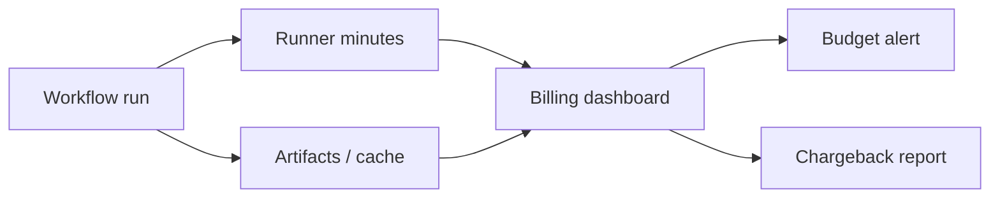

<Callout type="info" title="Phạm vi và caveat">
  Các quota và giá của GitHub Actions thay đổi theo plan, loại runner và chính sách billing hiện hành. Các con số trong trang này bám theo tài liệu chính thức tại thời điểm viết, nhưng trước khi đặt budget hoặc cam kết SLO, hãy kiểm tra lại plan hiện hành trong tài liệu billing/limits của GitHub.
</Callout>

## Mục lục

- [Tổng quan](#tổng-quan)
- [Hiểu đúng thứ được tính](#hiểu-đúng-thứ-được-tính)
  - [Phút runner](#phút-runner)
  - [Concurrent jobs](#concurrent-jobs)
  - [Storage artifacts và cache](#storage-artifacts-và-cache)
  - [Quota theo plan](#quota-theo-plan)
  - [Public, private và self-hosted](#public-private-và-self-hosted)
- [Cách theo dõi trong thực tế](#cách-theo-dõi-trong-thực-tế)
  - [Qua giao diện GitHub](#qua-giao-diện-github)
  - [Qua REST API](#qua-rest-api)
  - [Qua GitHub CLI](#qua-github-cli)
- [Budget, attribution và cảnh báo](#budget-attribution-và-cảnh-báo)
- [Tối ưu chi phí](#tối-ưu-chi-phí)
- [Ví dụ thực hành](#ví-dụ-thực-hành)
  - [Báo cáo usage bằng API](#báo-cáo-usage-bằng-api)
  - [Workflow giảm phút và storage](#workflow-giảm-phút-và-storage)
- [Troubleshooting](#troubleshooting)
- [Tài liệu tham khảo](#tài-liệu-tham-khảo)

## Tổng quan

GitHub Actions không chỉ có một loại “usage”. Khi vận hành thật, bạn cần nhìn ít nhất bốn thứ cùng lúc:

1. **Phút runner**: thời gian job thực sự chạy trên GitHub-hosted runner.
2. **Concurrent jobs**: số job có thể chạy đồng thời.
3. **Storage**: artifact, cache và với larger runner là custom image storage.
4. **Billing / spend**: số tiền hoặc quota còn lại của tài khoản hoặc organization.

Điểm dễ nhầm nhất là: **job đang chờ queue hoặc approval không phải lúc nào cũng làm tăng phút billed**, nhưng nó vẫn có thể làm bạn chạm limit vận hành của workflow run. Nói cách khác, “thời gian workflow” và “thời gian bị tính tiền” là hai khái niệm khác nhau.

<Callout type="idea" title="Nhớ một câu này">
  GitHub tính tiền theo cách bạn dùng runner, còn GitHub giới hạn hệ thống theo cách nó bảo vệ nền tảng. Vì vậy, một workflow có thể chưa tốn nhiều phút nhưng vẫn bị chặn vì concurrent jobs, queue limit hoặc storage limit.
</Callout>

## Hiểu đúng thứ được tính

### Phút runner

Phút runner là đơn vị billing cho **GitHub-hosted runners**. Mỗi job được làm tròn lên đến phút nguyên gần nhất theo chính sách billing hiện hành. Một job chạy 5 phút 1 giây thường được tính là 6 phút.

Những điểm cần nhớ:

- **Public repository + standard GitHub-hosted runner**: usage theo tài liệu hiện hành là miễn phí.
- **Private repository + standard GitHub-hosted runner**: phút được trừ vào quota của plan, vượt quota thì phát sinh phí hoặc bị chặn nếu tài khoản không có phương thức thanh toán hợp lệ.
- **Self-hosted runner**: GitHub không tính phí phút runner, nhưng bạn tự trả hạ tầng, điện toán, lưu trữ, băng thông và công vận hành.
- **Larger runner**: luôn bị tính phí theo phút, kể cả khi repo là public.
- **Windows và macOS** thường đắt hơn Linux; arm64 và larger runner có bảng giá riêng.

<Callout type="warn" title="Đừng nhầm giữa queue time và runner time">
  Phút billing chủ yếu tính lúc job đang chạy trên runner. Tuy nhiên giới hạn vòng đời workflow run vẫn có thể bao gồm thời gian chờ và approval. Vì vậy, một run có thể tốn ít phút nhưng vẫn bị cancel nếu chờ quá lâu.
</Callout>

### Concurrent jobs

Concurrent jobs là số job đang chạy đồng thời trên tài khoản hoặc organization của bạn. Đây **không** phải là số lượng workflow file, cũng không phải là số lần trigger trong ngày.

Con số này quan trọng vì nó quyết định mức song song tối đa của CI/CD. Nếu build matrix quá rộng, bạn có thể hết slot concurrent trước khi hết minute quota.

Đừng nhầm với `concurrency:` trong YAML. `concurrency:` là cơ chế của workflow để serial hóa hoặc hủy run cũ, còn concurrent jobs là giới hạn năng lực chạy song song của nền tảng.

| Plan / loại runner | Tổng concurrent jobs | Tối đa concurrent macOS jobs | Tối đa concurrent GPU jobs |
|---|---:|---:|---:|
| GitHub Free | 20 | 5 | Không áp dụng |
| GitHub Pro | 40 | 5 | Không áp dụng |
| GitHub Free for organizations | 20 | 5 | Không áp dụng |
| GitHub Team | 60 | 5 | Không áp dụng |
| GitHub Enterprise Cloud | 500 | 50 | Không áp dụng |
| Larger runner, Team | 1000 | 5 | 100 |
| Larger runner, Enterprise | 1000 | 50 | 100 |

GitHub Support có thể tăng một số giới hạn concurrency cho GitHub-hosted runners. Nếu bạn đã chạm trần, đừng đoán; hãy kiểm tra limit hiện hành và mở ticket support nếu tài liệu của plan cho phép.

<Callout type="idea" title="Khi concurrency trở thành chi phí">
  Giới hạn concurrency không chỉ là limit kỹ thuật. Nếu bạn đẩy quá nhiều job song song, bạn có thể phải dùng larger runners hoặc tăng số runner self-hosted để giữ thời gian chờ thấp, và cả hai đều có chi phí.
</Callout>

### Storage artifacts và cache

GitHub Actions có nhiều loại storage khác nhau, và chúng không được tính giống nhau.

| Loại storage | Cách tính | Điểm cần nhớ |
|---|---|---|
| Artifacts | GB-Hours | Artifact dùng để lưu đầu ra cần tải hoặc kiểm tra lại. Artifact storage và GitHub Packages storage dùng chung một allowance. |
| Cache | Peak usage theo giờ | Cache là dữ liệu có thể tái tạo để tăng tốc chạy sau. Cache storage là allowance riêng, không dùng chung với artifact. |
| Custom image storage | GB-Hours | Chỉ áp dụng cho GitHub-hosted larger runners. |

Một vài quy tắc thực tế:

- **Artifact và package storage** dùng chung quota ở mức plan.
- **Cache storage** là allowance riêng theo repository.
- **Cache không phải kho lưu trữ bền vững**. Dùng cache để tăng tốc, không dùng để giữ dữ liệu đầu ra lâu dài.
- **Xóa artifact** làm giảm storage hiện tại ngay lập tức, nhưng phần storage đã “accumulate” trong billing cycle hiện tại không tự biến mất khỏi hóa đơn đã ghi nhận.
- **Logs và job summaries** không phải artifact storage.

<Callout type="idea" title="Phân biệt nhanh cache và artifact">
  Artifact là thứ bạn muốn xem lại, tải về hoặc chuyển sang bước sau. Cache là thứ bạn muốn tái sử dụng để lần chạy sau nhanh hơn. Nếu dữ liệu là đầu ra quan trọng, hãy dùng artifact; nếu dữ liệu có thể tạo lại, hãy cân nhắc cache.
</Callout>

### Quota theo plan

Các quota dưới đây là mức trong tài liệu GitHub hiện hành. Hãy đối chiếu lại plan thật của bạn trước khi dùng cho budget hoặc forecast.

| Plan | Artifact storage | Minutes / month | Cache storage / repository | Custom image storage |
|---|---:|---:|---:|---:|
| GitHub Free | 500 MB | 2,000 | 10 GB | Không áp dụng |
| GitHub Pro | 1 GB | 3,000 | 10 GB | Không áp dụng |
| GitHub Free for organizations | 500 MB | 2,000 | 10 GB | Không áp dụng |
| GitHub Team | 2 GB | 3,000 | 10 GB | 75 GB |
| GitHub Enterprise Cloud | 50 GB | 50,000 | 10 GB | 150 GB |

Những lưu ý quan trọng:

- Quota minutes của GitHub-hosted runner thường reset về mức đầy đủ vào đầu billing cycle.
- Artifact storage được đo theo **GB-Hours**.
- Cache storage được tính theo mức dùng đỉnh theo giờ.
- Custom image storage chỉ xuất hiện nếu bạn dùng GitHub-hosted larger runners và image tùy biến.

### Public, private và self-hosted

Đây là phần dễ gây hiểu nhầm nhất khi làm việc với cost.

| Mô hình | Phút runner | Storage | Chi phí hạ tầng |
|---|---|---|---|
| Public repo + standard GitHub-hosted runner | Miễn phí theo chính sách hiện hành | Theo tài liệu billing hiện hành của Actions | GitHub chi trả phần runner standard |
| Private repo + standard GitHub-hosted runner | Dùng quota của plan | Dùng quota của plan | GitHub chi trả phần runner standard, vượt quota thì tính phí |
| Larger runner | Bị tính phí theo phút | Custom image storage tính riêng | GitHub chi trả phần runner, không dùng included minutes |
| Self-hosted runner | GitHub không tính phí phút Actions | Storage do bạn tự quản | Bạn tự trả VM, host, network, disk, license và vận hành |

Một câu cần nhớ:

- **Bất kỳ ai có write access tới repository đều có thể chạy Actions**, và chi phí được tính cho **repository owner**, không phải cho người bấm trigger.
- **Larger runner luôn bị tính phí**, kể cả khi repo public.
- **Self-hosted runner không miễn phí hoàn toàn**; bạn chỉ không trả cho GitHub phần compute runner.

<Callout type="warn" title="Chi phí không nằm ở một chỗ">
  Nếu bạn chuyển sang self-hosted runner để tiết kiệm minutes, đừng quên cộng cả chi phí VM, storage, patching, network egress, backup và thời gian vận hành. Đôi khi hóa đơn GitHub giảm nhưng tổng cost of ownership lại tăng.
</Callout>

## Cách theo dõi trong thực tế

### Qua giao diện GitHub

Bạn thường cần ba màn hình khác nhau:

| Mục tiêu | Nơi xem |
|---|---|
| Xem minutes, storage và spend tổng | Billing & licensing / Billing của user hoặc organization |
| Xem job nào đang tốn phút | Repository → Actions → workflow run → job details |
| Xem runner nào đang nhận job | Repository hoặc Organization → Settings → Actions → Runners |
| Kiểm tra quyền truy cập và runner scope | Repository hoặc Organization → Settings → Actions → General / Runners |

Quy trình thực hành gọn nhất:

1. Mở **Billing & licensing** của user hoặc organization.
2. Chọn phần **Actions usage** hoặc usage tương ứng để xem minutes và storage.
3. Quay lại repository, mở **Actions**.
4. Chọn workflow run cần điều tra.
5. Đọc job details để biết runner type, duration, conclusion và log.

Nếu bạn đang điều tra chi phí tăng đột biến, hãy ưu tiên xem:

- repo nào có nhiều run nhất,
- workflow nào fan-out matrix nhiều nhất,
- job nào chạy trên macOS / Windows / larger runner,
- artifact nào có retention quá dài,
- cache nào phình ra nhanh bất thường.

### Qua REST API

REST API là cách tốt nhất khi bạn cần dashboard, chargeback hoặc cảnh báo tự động.

| Câu hỏi | Endpoint chính thức | Khi nào dùng |
|---|---|---|
| Usage billing của organization | `GET /orgs/{org}/settings/billing/actions` | Lấy spend hoặc quota usage ở cấp org |
| Usage billing của user | `GET /users/{username}/settings/billing/actions` | Lấy usage ở cấp tài khoản cá nhân |
| Inventory runner cấp org | `GET /orgs/{org}/actions/runners` | Kiểm tra runner online/offline/busy |
| Job-level attribution | `GET /repos/{owner}/{repo}/actions/runs/{run_id}/jobs` | Ghép thời lượng, runner và labels cho từng job |
| Usage billing của enterprise | `GET /enterprises/{enterprise}/settings/billing/actions` | Khi tổ chức dùng Enterprise Cloud |

Ví dụ lấy billing usage ở cấp organization:

```bash
ORG="octo-org"

gh api -H "Accept: application/vnd.github+json" \
  "/orgs/${ORG}/settings/billing/actions" | jq .
```

Ví dụ kiểm kê self-hosted runner theo organization:

```bash
ORG="octo-org"

gh api --paginate \
  -H "Accept: application/vnd.github+json" \
  "/orgs/${ORG}/actions/runners?per_page=100" \
  --jq '.runners[] | [
    .name,
    .os,
    .status,
    (.busy | tostring),
    ([.labels[].name] | join(","))
  ] | @tsv'
```

Ví dụ ghép chi phí với job thực tế để biết workflow nào tiêu tốn nhiều nhất:

```bash
OWNER="octo-org"
REPO="octo-repo"
RUN_ID="123456789"

gh api --paginate \
  -H "Accept: application/vnd.github+json" \
  "/repos/${OWNER}/${REPO}/actions/runs/${RUN_ID}/jobs?filter=all&per_page=100" \
  --jq '.jobs[] | {
    name,
    status,
    conclusion,
    started_at,
    completed_at,
    runner_name,
    runner_group_name,
    labels
  }'
```

<Callout type="warn" title="Token và quyền truy cập">
  Dùng token chỉ có quyền đọc cần thiết. Không hard-code token trong script, command line được commit hoặc log workflow. Với collector chạy lâu dài, ưu tiên GitHub App hoặc secret manager.
</Callout>

### Qua GitHub CLI

GitHub CLI là cách nhanh nhất để điều tra ad-hoc trên terminal.

```bash
# Xem run gần nhất
gh run list --repo OWNER/REPO --limit 10

# Xem log của một run
gh run view RUN_ID --repo OWNER/REPO --log

# Lấy thông tin job để tính duration, conclusion và runner
gh api --paginate \
  "/repos/OWNER/REPO/actions/runs/RUN_ID/jobs?filter=all&per_page=100" \
  --jq '.jobs[] | [.name, .status, .conclusion, .started_at, .completed_at, .runner_name] | @tsv'
```

Nếu bạn cần billing data bằng CLI, dùng `gh api` với đúng endpoint billing ở scope user, org hoặc enterprise. Payload có thể khác nhau theo loại tài khoản, nên cách an toàn là in JSON thô trước rồi map field sau.

## Budget, attribution và cảnh báo

Billing của GitHub Actions cần được nhìn theo hai lớp:

- **Usage thật**: minutes, storage, runner type, workflow/job nào tạo ra usage đó.
- **Budget / spend**: số tiền hoặc quota đã tiêu của tổ chức.

GitHub Billing dashboard có thể hiển thị spend dưới dạng tiền thay vì raw minutes. Điều đó bình thường, vì đó là kết quả sau khi đã áp đơn giá theo runner type và storage model.

Điểm quan trọng để làm chargeback nội bộ:

1. **Gán owner nội bộ cho repository hoặc workflow**.
2. **Ghi nhận runner type**: Linux, Windows, macOS, arm64, larger runner, self-hosted.
3. **Tách storage thành artifact, cache và custom image**.
4. **Không dùng branch hoặc commit SHA làm khóa chính cho báo cáo chi phí** vì cardinality rất cao.
5. **Join billing usage với job-level data** để biết workflow nào gây ra phần spend nào.



Cảnh báo nên đặt ở hai nơi:

- **Trong GitHub Billing**: để bắt kịp khi account gần chạm quota hoặc spend vượt mức dự kiến.
- **Trong hệ thống observability riêng**: để theo dõi xu hướng minutes, storage và burst theo repo, workflow, runner type.

Một cấu hình cảnh báo tốt thường có:

- ngưỡng 50%, 80% và 100% ngân sách tháng,
- cảnh báo khi artifact storage tăng đều nhưng workflow volume không tăng tương ứng,
- cảnh báo khi macOS hoặc larger runner có tỷ lệ dùng cao hơn dự kiến,
- cảnh báo khi self-hosted runner rẻ hơn trên giấy nhưng chi phí hạ tầng tăng lên.

## Tối ưu chi phí

Chi phí GitHub Actions thường tăng vì một trong năm nguyên nhân sau: job quá dài, matrix quá rộng, runner chọn quá đắt, storage giữ quá lâu, hoặc rerun quá nhiều.

Các chiến thuật tối ưu hữu ích nhất:

- **Chọn runner đúng việc**: dùng Linux standard runner khi job không cần macOS, Windows hoặc larger runner.
- **Đặt `timeout-minutes`** để job treo không đốt minutes vô ích.
- **Dùng `concurrency` để hủy run cũ** khi chỉ commit mới nhất mới đáng chạy.
- **Thu nhỏ matrix**: chỉ fan-out những platform hoặc version thật sự cần.
- **Cache dependency, không cache output**: cache để tăng tốc, artifact để lưu đầu ra.
- **Giảm retention của artifact** nếu file chỉ cần vài ngày để kiểm tra.
- **Tách job nặng sang self-hosted runner** khi bạn đã có hạ tầng và workload đó chạy lặp lại đủ nhiều để đáng đầu tư.
- **Không dùng larger runner để “chữa cháy” mặc định**. Chỉ dùng khi workload thật sự cần thêm CPU, RAM, disk, GPU hoặc networking ổn định hơn.

<Callout type="idea" title="Mẹo tiết kiệm phút">
  Rất nhiều workflow nhỏ chạy nhanh nhưng cộng lại vẫn tốn tiền vì GitHub làm tròn lên theo từng job. Nếu một pipeline có thể gom hợp lý thay vì chia quá vụn, bạn sẽ tiết kiệm được cả phút và overhead khởi động job.
</Callout>

## Ví dụ thực hành

### Báo cáo usage bằng API

Script dưới đây in ra billing usage và inventory runner của một organization. Bạn có thể chạy nó trong shell local hoặc một job quản trị riêng.

```bash
#!/usr/bin/env bash
set -euo pipefail

ORG="${1:-octo-org}"

echo "== Billing usage =="
gh api -H "Accept: application/vnd.github+json" \
  "/orgs/${ORG}/settings/billing/actions" | jq .

echo "== Runner inventory =="
gh api --paginate \
  -H "Accept: application/vnd.github+json" \
  "/orgs/${ORG}/actions/runners?per_page=100" \
  --jq '.runners[] | [
    .name,
    .status,
    (.busy | tostring),
    ([.labels[].name] | join(","))
  ] | @tsv'
```

Dùng script này khi bạn muốn trả lời nhanh ba câu hỏi:

- chúng ta đã tiêu bao nhiêu phút và storage,
- runner nào đang idle, busy hoặc offline,
- có runner label / scope nào bị lệch so với workflow hay không.

### Workflow giảm phút và storage

Ví dụ dưới đây giảm chi phí bằng ba cách: hủy run cũ, giới hạn thời gian chạy và giảm retention của artifact.

```yaml
name: ci

on:
  pull_request:

concurrency:
  group: ci-${{ github.ref }}
  cancel-in-progress: true

jobs:
  test:
    runs-on: ubuntu-latest
    timeout-minutes: 15
    permissions:
      contents: read

    steps:
      - uses: actions/checkout@v4

      - uses: actions/setup-node@v4
        with:
          node-version: 22
          cache: npm
          cache-dependency-path: package-lock.json

      - run: npm ci
      - run: npm test -- --runInBand

      - uses: actions/upload-artifact@v4
        if: always()
        with:
          name: test-report
          path: coverage/
          retention-days: 7
```

Vì sao example này tiết kiệm chi phí:

- `concurrency.cancel-in-progress: true` tránh đốt minutes cho run cũ đã lỗi thời.
- `timeout-minutes` làm job treo dừng sớm hơn.
- `cache: npm` giảm thời gian tải dependency.
- `retention-days: 7` giảm storage artifact.

Nếu job này chạy trên một kho public nhưng bạn đổi sang larger runner, nó vẫn có thể phát sinh chi phí. Vì vậy, tiết kiệm chi phí không chỉ là chọn public/private repo; nó còn là chọn runner type và storage policy đúng.

## Troubleshooting

| Triệu chứng | Nguyên nhân hay gặp | Cách xử lý |
|---|---|---|
| Minutes hết sớm hơn dự kiến | Matrix quá rộng, rerun nhiều, job chạy trên Windows/macOS, hoặc workflow bị làm tròn phút theo từng job | Rà lại billing usage theo repo/workflow, thu nhỏ matrix, hủy run cũ bằng `concurrency`, tối ưu duration |
| Public repo vẫn thấy spend | Dùng larger runner, custom image storage, hoặc một phần usage thực tế nằm ở tài khoản/org khác | Kiểm tra runner type trong job details và đối chiếu billing scope đúng org/user/enterprise |
| Artifact storage tăng dù đã xóa artifact | Phần storage đã được accrual trong billing cycle hiện tại | Giảm retention sớm hơn, xóa artifact cũ trước trong cycle, tách artifact và package storage ra để theo dõi |
| Cache phình ra nhanh | Cache key quá rộng, nhiều branch sinh cache khác nhau, hoặc cache retention không hợp lý | Rà lại cache key, tránh dùng key theo commit SHA, đo peak usage theo repo |
| Job bị chặn vì concurrency | Đã chạm concurrent jobs limit hoặc queue của `concurrency` group | Giảm fan-out, xin tăng limit nếu plan hỗ trợ, hoặc dùng self-hosted / larger runner phù hợp |
| `gh api` trả 403 hoặc thiếu field | Token không có quyền đọc billing hoặc đang gọi sai scope user/org/enterprise | Dùng token đúng scope, xác nhận account scope, và in JSON thô trước khi parse |
| Self-hosted runner không tốn phút nhưng tổng chi phí tăng | Chi phí VM, disk, network, patching và vận hành tăng | So sánh total cost of ownership thay vì chỉ nhìn GitHub bill |
| Bật budget alert nhưng không thấy cảnh báo | Alert ở sai scope hoặc kênh nhận thông báo chưa cấu hình | Kiểm tra lại billing scope, notification channel và ngưỡng budget |

Một vài nguyên tắc xử lý nhanh:

- Nếu **hết quota**: kiểm tra plan hiện hành, phương thức thanh toán và mức usage theo repo.
- Nếu **queue dài**: kiểm tra concurrent jobs, matrix, labels, runner group và capacity.
- Nếu **storage tăng**: kiểm tra artifact retention, cache key và GitHub Packages.
- Nếu **bill không khớp**: kiểm tra runner type, rounding theo job và re-run.

## Tài liệu tham khảo

- [GitHub Actions billing](https://docs.github.com/en/billing/concepts/product-billing/github-actions)
- [Actions limits](https://docs.github.com/en/actions/reference/limits)
- [Actions runner pricing](https://docs.github.com/en/billing/reference/actions-runner-pricing)
- [Viewing your usage of metered products and licenses](https://docs.github.com/en/billing/how-tos/products/view-productlicense-use)
- [GitHub-hosted runners](https://docs.github.com/en/actions/reference/runners/github-hosted-runners)
- [Choosing the runner for a job](https://docs.github.com/en/actions/how-tos/write-workflows/choose-where-workflows-run/choose-the-runner-for-a-job)
