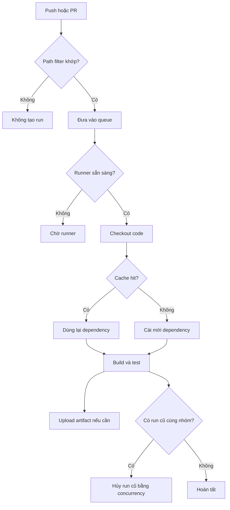

<Callout type="info">
  Tài liệu này nhắm tới workflow đã chạy được nhưng còn chậm, tốn runner hoặc hay bị nghẽn queue. Mục tiêu không phải là làm mọi thứ ngắn nhất có thể, mà là rút đúng chỗ đang lãng phí thời gian và giữ độ tin cậy đủ cao cho production.
</Callout>

## Mục lục

- [Tổng quan](#tổng-quan)
- [Đo baseline trước khi tối ưu](#đo-baseline-trước-khi-tối-ưu)
  - [Chỉ số cần ghi lại](#chỉ-số-cần-ghi-lại)
  - [Cách đọc số liệu](#cách-đọc-số-liệu)
- [Mô hình chi phí của workflow](#mô-hình-chi-phí-của-workflow)
  - [Queue time và execution time](#queue-time-và-execution-time)
  - [Đường đi của một run](#đường-đi-của-một-run)
- [Các đòn bẩy tối ưu chính](#các-đòn-bẩy-tối-ưu-chính)
  - [Cache](#cache)
  - [Artifact](#artifact)
  - [Matrix](#matrix)
  - [Concurrency](#concurrency)
  - [Path filters](#path-filters)
  - [Runner](#runner)
  - [Checkout](#checkout)
  - [Reusable workflows](#reusable-workflows)
  - [Outputs của job](#outputs-của-job)
  - [Timeout](#timeout)
- [Mẫu trước và sau](#mẫu-trước-và-sau)
- [Benchmark thực dụng](#benchmark-thực-dụng)
  - [Quy trình benchmark](#quy-trình-benchmark)
  - [Mẫu báo cáo kết quả](#mẫu-báo-cáo-kết-quả)
- [Trade-offs cần chấp nhận](#trade-offs-cần-chấp-nhận)
- [Troubleshooting](#troubleshooting)
- [Tài liệu tham khảo](#tài-liệu-tham-khảo)

## Tổng quan

Tối ưu hiệu năng GitHub Actions thường rơi vào ba nhóm:

1. Giảm số lần workflow được kích hoạt không cần thiết.
2. Giảm thời gian chờ trong hàng đợi và thời gian chuẩn bị môi trường.
3. Giảm khối lượng việc phải làm trên runner.

Nếu bạn chỉ nhìn vào `run` chậm, rất dễ tối ưu nhầm chỗ. Một workflow 12 phút có thể chỉ có 4 phút là build thật, còn 8 phút là chờ runner, checkout repo quá sâu, cài dependency lại từ đầu, hoặc chạy các job dư thừa. Nói ngắn gọn: phải đo trước, rồi mới cắt.

<Callout type="idea" title="Jargon cần nhớ">
  - **Queue time**: thời gian run chờ có runner trống.
  - **Execution time**: thời gian job thực sự chạy trên runner.
  - **Cache hit**: lần chạy tìm thấy dữ liệu đã lưu và dùng lại được.
  - **Artifact**: file đầu ra được upload để tải về hoặc chuyển sang job khác.
  - **Matrix**: nhiều biến thể job chạy song song từ một khai báo YAML.
  - **Concurrency**: nhóm các run có cùng khóa để cho phép hủy run cũ.
</Callout>

## Đo baseline trước khi tối ưu

Trước khi đổi YAML, hãy chụp baseline. Baseline là số đo gốc để so sánh trước và sau khi tối ưu. Không có baseline thì bạn chỉ đang cảm giác.

### Chỉ số cần ghi lại

| Chỉ số | Ý nghĩa | Ghi chú thực dụng |
|---|---|---|
| Queue time | Thời gian run chờ runner | Nếu số này cao, vấn đề thường nằm ở quota, concurrency, hoặc loại runner |
| Execution time | Thời gian chạy thật trên runner | Đây là nơi cache, checkout, matrix và step nội bộ tác động mạnh nhất |
| Tổng thời gian wall-clock | Từ lúc trigger đến lúc xong | Đây là cảm nhận của người dùng cuối |
| Số job / số step | Mức độ phân mảnh của workflow | Quá nhiều job nhỏ có thể làm tăng overhead |
| Cache hit rate | Tỷ lệ cache dùng lại được | Hit thấp thì cache chưa đúng key hoặc chưa đúng path |
| Số run bị hủy | Mức độ lãng phí do chạy chồng | Thường liên quan đến thiếu `concurrency` |

Nếu repo có nhiều loại trigger, hãy ghi riêng cho `push`, `pull_request` và `workflow_dispatch`. Một số workflow nhìn nhanh khi merge nhưng lại chậm khi chạy trên PR lớn vì path khác nhau hoặc matrix khác nhau.

### Cách đọc số liệu

Đừng dựa vào một lần chạy. Runner GitHub có độ nhiễu tự nhiên: lúc nhanh lúc chậm, nhất là với repo lớn, mạng cài dependency nhiều, hoặc runner đang bận.

Cách đọc đúng là:

- So sánh cùng một commit hoặc cùng một nhánh chức năng.
- Chạy tối thiểu 5 đến 10 lần.
- Bỏ lần đầu nếu lần đầu luôn cold start và cache còn rỗng.
- Ghi cả trung vị và p95 nếu nhóm của bạn quan tâm đến độ ổn định, không chỉ tốc độ trung bình.

<Callout type="warn" title="Đừng benchmark bằng cảm giác">
  Một workflow nhanh hơn 30 giây nhưng làm mất cache của các job khác có thể khiến tổng hệ thống chậm hơn. Tối ưu đúng nghĩa phải nhìn cả thời gian và chi phí chạy.
</Callout>

## Mô hình chi phí của workflow

Muốn tối ưu đúng, hãy xem một run như một chuỗi trạng thái: được kích hoạt, lọc điều kiện, vào hàng đợi, nhận runner, checkout code, cài dependency, build/test, rồi upload kết quả.

### Queue time và execution time

**Queue time** là khoảng chờ trước khi job bắt đầu. Nó tăng khi:

- Tài khoản hoặc tổ chức hết quota runner.
- Có quá nhiều job chạy cùng lúc.
- Bạn dùng loại runner khó kiếm hơn mức cần thiết.
- Bạn không hủy các run cũ khi liên tục push lên cùng nhánh.

**Execution time** là phần thời gian runner thực sự bận làm việc. Nó tăng khi:

- Checkout quá sâu.
- Cài dependency từ đầu ở mọi run.
- Matrix quá rộng.
- Artifact hoặc log quá nặng.
- Workflow gọi lại cùng một setup ở nhiều job mà không tái sử dụng.

Tối ưu queue time thường cho cảm giác tốt hơn ngay lập tức, vì người dùng đỡ phải chờ. Tối ưu execution time thường giúp tiết kiệm tiền và tăng throughput, tức là cùng một khoảng thời gian bạn chạy được nhiều việc hơn.

### Đường đi của một run



Mermaid ở đây không chỉ để minh họa. Nó buộc bạn nhìn workflow như một chuỗi cổng chặn. Mỗi cổng chặn là một cơ hội để cắt bớt thời gian hoặc bớt job.

## Các đòn bẩy tối ưu chính

### Cache

Cache dùng để tái sử dụng dữ liệu giữa các run. Đây là lựa chọn đúng cho dependency đã tải về, build intermediates và tool cache dùng lại được. Nó **không** phải là nơi lưu file đầu ra cuối cùng của pipeline.

Dùng cache khi:

- Dependency thay đổi chậm hơn code.
- Việc tải dependency tốn nhiều thời gian.
- Cùng một nhánh hoặc nhiều nhánh thường xuyên chạy lại.

Không nên cache khi:

- Dữ liệu chỉ dùng một lần trong job hiện tại.
- Dữ liệu rất lớn nhưng ít khi trúng.
- Bạn không có key ổn định để phân biệt các biến thể.

Ví dụ với Node.js:

```yaml
- uses: actions/setup-node@v4
  with:
    node-version: 20
    cache: npm
    cache-dependency-path: package-lock.json

- run: npm ci --prefer-offline --no-audit
```

Ví dụ generic khi bạn cần cache một thư mục thủ công:

```yaml
- uses: actions/cache@v4
  with:
    path: ~/.cache/pip
    key: ${{ runner.os }}-pip-${{ hashFiles('**/requirements.txt') }}
    restore-keys: |
      ${{ runner.os }}-pip-
```

Kinh nghiệm thực dụng:

- Key càng cụ thể thì cache càng an toàn, nhưng hit rate có thể thấp.
- Key càng rộng thì hit rate càng cao, nhưng nguy cơ dùng nhầm dữ liệu cũ tăng lên.
- Nếu có thể, hãy cache theo lockfile, không cache theo thư mục code chung chung.

<Callout type="warn" title="Cache không thay artifact">
  Cache phục vụ tái sử dụng giữa các run. Artifact phục vụ mang file đầu ra đi qua job khác hoặc cho người dùng tải về. Hai thứ này giống nhau ở chỗ đều lưu file, nhưng mục đích hoàn toàn khác nhau.
</Callout>

### Artifact

Artifact là file đầu ra được upload lên GitHub Actions sau khi job xong. Nó hữu ích cho báo cáo test, bundle build, log nén, hoặc file chuyển tiếp giữa các job.

Dùng artifact khi:

- Job A tạo ra kết quả để Job B dùng.
- Bạn cần tải file sau run.
- Bạn muốn giữ bằng chứng build/test trong một khoảng thời gian ngắn.

Không nên dùng artifact để:

- Thay cache cho dependency.
- Lưu file quá lớn nếu không thật sự cần.
- Giữ dữ liệu dài ngày nếu không có lý do.

Ví dụ:

```yaml
- name: Upload test report
  if: always()
  uses: actions/upload-artifact@v4
  with:
    name: junit-report
    path: test-results/
    if-no-files-found: error
    retention-days: 5
```

Mẹo thực dụng:

- Nén và chọn đúng thư mục cần upload.
- Đặt `retention-days` thấp nếu artifact chỉ phục vụ debug ngắn hạn.
- Nếu job sau chỉ cần vài số liệu nhỏ, dùng `outputs` thay vì artifact.

### Matrix

Matrix giúp chạy nhiều biến thể từ một job định nghĩa duy nhất. Đây là cách tốt để test nhiều phiên bản Node, Python, OS hoặc trình duyệt mà không copy-paste YAML.

Dùng matrix khi:

- Bạn cần kiểm tra nhiều môi trường thật sự khác nhau.
- Sự khác biệt giữa các biến thể có giá trị cho chất lượng.
- Bạn muốn parallel hóa test để giảm thời gian tổng.

Không nên mở matrix quá rộng khi:

- Một axis không mang giá trị thực tế.
- Số biến thể tăng nhanh theo cấp số nhân.
- Runner minutes hoặc quota đang chạm trần.

Ví dụ tối ưu vừa đủ:

```yaml
strategy:
  fail-fast: true
  max-parallel: 2
  matrix:
    os: [ubuntu-22.04, ubuntu-24.04]
    node: [20, 22]

runs-on: ${{ matrix.os }}
```

Giải thích nhanh:

- `fail-fast: true` dừng các biến thể còn lại khi một biến thể fail sớm. Điều này tiết kiệm thời gian khi lỗi là lỗi hệ thống, không phải lỗi môi trường.
- `max-parallel` giới hạn số job chạy cùng lúc. Nó hữu ích khi bạn muốn tránh gây nghẽn runner hoặc đốt quota quá nhanh.
- Matrix chạy song song có thể rút time-to-feedback, nhưng tổng runner minutes thường tăng.

### Concurrency

`concurrency` nhóm các run có cùng khóa. Mục đích phổ biến nhất là hủy các run cũ khi cùng một nhánh bị push liên tục.

Ví dụ:

```yaml
concurrency:
  group: ci-${{ github.workflow }}-${{ github.head_ref || github.ref }}
  cancel-in-progress: true
```

Cách này đặc biệt hữu ích cho PR đang được tác giả sửa liên tục. Khi commit mới đến, run cũ thường đã lỗi thời. Hủy nó sớm sẽ tiết kiệm queue time và execution time.

Lưu ý:

- Concurrency không làm một run đơn lẻ chạy nhanh hơn.
- Nó chỉ giảm lãng phí do chạy chồng.
- Khóa quá rộng có thể hủy nhầm các run không liên quan.

Nếu workflow có cả nhánh release và PR, hãy tách khóa rõ ràng. Đừng gom mọi thứ vào một nhóm chung chỉ vì ngắn.

### Path filters

Path filters giúp workflow không được kích hoạt khi thay đổi không liên quan. Đây là cách rẻ nhất để tiết kiệm thời gian, vì run bị bỏ qua từ đầu.

Ví dụ với `paths`:

```yaml
on:
  push:
    branches: [main]
    paths:
      - 'src/**'
      - 'package.json'
      - 'package-lock.json'
  pull_request:
    paths:
      - 'src/**'
      - 'package.json'
      - 'package-lock.json'
```

Khi dùng path filters, hãy nhớ:

- Dùng ở mức workflow, không phải chỉ ở step.
- Bao gồm cả file cấu hình lẫn source code thật sự ảnh hưởng đến job.
- Với monorepo lớn, có thể cần lọc sâu hơn theo từng package.

Nếu bạn cần bỏ qua từng job bên trong một workflow lớn, built-in path filter có thể chưa đủ. Khi đó hãy dùng logic lọc theo file thay đổi để quyết định job nào nên chạy.

### Runner

Runner là máy thực thi job. Chọn runner đúng loại có thể ảnh hưởng rất mạnh đến queue time và execution time.

| Loại runner | Khi nên dùng | Điểm mạnh | Đổi lại |
|---|---|---|---|
| GitHub-hosted | Phần lớn workflow chuẩn | Dễ dùng, không phải quản trị | Tài nguyên cố định, có cold start |
| Larger runner | Job nặng, cần CPU/RAM/SSD lớn hơn | Ít nghẽn hơn, nhanh hơn cho job lớn | Chi phí cao hơn |
| Self-hosted | Cần môi trường đặc thù hoặc dữ liệu nội bộ | Tùy biến cao, có thể rất nhanh nếu setup tốt | Bạn phải tự vận hành và bảo mật |

Chọn runner theo workload, không chọn theo thói quen.

- Build nặng và test song song nhiều luồng thì cần CPU/RAM tốt hơn.
- Job phụ thuộc nhiều I/O hoặc filesystem lớn thì disk nhanh quan trọng.
- Nếu build container hoặc cross-compile, hãy kiểm tra kiến trúc CPU có khớp không.

Một tối ưu nhỏ nhưng hay bị bỏ qua: đừng dùng `ubuntu-latest` nếu bạn cần tính ổn định lâu dài mà release của bạn phụ thuộc môi trường cụ thể. Pin version rõ ràng giúp giảm rủi ro đổi image bất ngờ.

### Checkout

`actions/checkout` thường là bước đầu tiên, nhưng cũng là bước dễ bị phình thời gian nếu clone quá sâu hoặc kéo quá nhiều thứ không cần.

Các tối ưu phổ biến:

```yaml
- uses: actions/checkout@v4
  with:
    fetch-depth: 1
    lfs: false
    submodules: false
    persist-credentials: false
```

Giải thích:

- `fetch-depth: 1` chỉ lấy commit hiện tại. Nó giảm thời gian clone rất rõ cho repo lớn.
- `lfs: false` tránh kéo Git LFS nếu bạn không dùng.
- `submodules: false` tránh checkout submodule nếu workflow không cần.
- `persist-credentials: false` an toàn hơn khi job không cần push ngược về repo.

Với monorepo rất lớn, hãy cân nhắc sparse checkout nếu job chỉ cần một phần cây thư mục. Đừng clone cả repo nếu chỉ build một package con.

### Reusable workflows

Reusable workflow là workflow có thể được gọi lại từ workflow khác bằng `workflow_call`. Đây là cách tốt để gom các phần lặp như setup môi trường, cache key, checkout chuẩn, test command và upload artifact.

Dùng reusable workflow khi:

- Nhiều repo có cùng pipeline gần giống nhau.
- Bạn muốn sửa cache hoặc timeout ở một chỗ.
- Bạn muốn chuẩn hóa cách chạy CI và giảm copy-paste YAML.

Ví dụ reusable workflow:

```yaml
name: reusable-ci

on:
  workflow_call:
    inputs:
      node-version:
        required: true
        type: string

jobs:
  test:
    runs-on: ubuntu-latest
    timeout-minutes: 20
    steps:
      - uses: actions/checkout@v4
        with:
          fetch-depth: 1

      - uses: actions/setup-node@v4
        with:
          node-version: ${{ inputs.node-version }}
          cache: npm
          cache-dependency-path: package-lock.json

      - run: npm ci --prefer-offline --no-audit
      - run: npm test
```

Workflow gọi lại:

```yaml
jobs:
  ci:
    uses: ./.github/workflows/reusable-ci.yml
    with:
      node-version: '20'
```

Trade-off của reusable workflow là thêm một tầng gián tiếp. Debug sẽ khó hơn một chút, nhưng đổi lại bạn có cấu hình chuẩn và ít drift giữa các repo.

### Outputs của job

Outputs là cách truyền giá trị nhỏ từ step sang step hoặc từ job sang job. Nó phù hợp cho version, flag, tên file, URL ngắn, hoặc số đếm nhỏ.

Ví dụ:

```yaml
jobs:
  build:
    runs-on: ubuntu-latest
    outputs:
      artifact_name: ${{ steps.meta.outputs.artifact_name }}
    steps:
      - id: meta
        run: echo "artifact_name=web-dist" >> "$GITHUB_OUTPUT"
```

Nguyên tắc thực dụng:

- Dùng outputs cho dữ liệu nhỏ và có cấu trúc đơn giản.
- Đừng nhét JSON lớn hoặc blob dài vào outputs.
- Nếu dữ liệu cần lưu lâu hơn hoặc chuyển qua nhiều job, artifact sẽ phù hợp hơn.

### Timeout

`timeout-minutes` là ranh giới an toàn. Nó giúp workflow fail sớm khi bị treo vì mạng, deadlock, test vô hạn hoặc chờ tài nguyên quá lâu.

Ví dụ:

```yaml
jobs:
  test:
    runs-on: ubuntu-latest
    timeout-minutes: 20
```

Tại sao timeout là tối ưu hiệu năng?

- Job treo không còn chiếm runner vô ích.
- Bạn phát hiện lỗi sớm hơn thay vì để pipeline ngốn thời gian cả buổi.
- Khi kết hợp với `concurrency`, run cũ bị hủy và run treo bị cắt ngắn sẽ giảm mạnh thời gian lãng phí.

Đừng đặt timeout quá thấp chỉ để nhìn cho gọn. Timeout nên phản ánh thời gian bình thường cộng một biên an toàn nhỏ.

## Mẫu trước và sau

Phần này cho thấy một workflow phổ biến trước khi tối ưu và sau khi áp dụng các đòn bẩy cơ bản.

**Trước**

```yaml
name: ci

on:
  push:
  pull_request:

jobs:
  test:
    runs-on: ubuntu-latest
    steps:
      - uses: actions/checkout@v4
      - uses: actions/setup-node@v4
        with:
          node-version: '20'
      - run: npm install
      - run: npm test
      - run: npm run build
```

Vấn đề của mẫu này:

- Chạy mọi lúc, kể cả khi thay đổi không ảnh hưởng.
- Clone mặc định có thể quá sâu.
- Không có cache dependency.
- Dùng `npm install` thay vì `npm ci` làm thời gian và tính lặp lại kém hơn.
- Không có concurrency để hủy run cũ.

**Sau**

```yaml
name: ci

on:
  push:
    branches: [main]
    paths:
      - 'src/**'
      - 'package.json'
      - 'package-lock.json'
  pull_request:
    paths:
      - 'src/**'
      - 'package.json'
      - 'package-lock.json'

concurrency:
  group: ci-${{ github.workflow }}-${{ github.head_ref || github.ref }}
  cancel-in-progress: true

jobs:
  test:
    runs-on: ubuntu-22.04
    timeout-minutes: 20
    strategy:
      fail-fast: true
      matrix:
        node: [20, 22]

    steps:
      - uses: actions/checkout@v4
        with:
          fetch-depth: 1
          lfs: false
          submodules: false

      - uses: actions/setup-node@v4
        with:
          node-version: ${{ matrix.node }}
          cache: npm
          cache-dependency-path: package-lock.json

      - name: Install dependencies
        run: npm ci --prefer-offline --no-audit

      - name: Test
        run: npm test

      - name: Build
        run: npm run build

      - name: Upload build output
        if: matrix.node == 20
        uses: actions/upload-artifact@v4
        with:
          name: web-dist
          path: dist/
          retention-days: 3
```

Điều gì đã tốt hơn:

- Chỉ chạy khi file liên quan thay đổi.
- Hủy run cũ trên cùng nhánh hoặc PR.
- Checkout nông hơn.
- Dùng cache cho dependency.
- Giới hạn matrix ở mức đủ dùng.
- Chỉ upload artifact khi thật sự cần.

## Benchmark thực dụng

Benchmark hiệu năng workflow phải đo theo thay đổi, không đo theo cảm hứng. Một thay đổi đúng có thể giảm 2 phút trong một job, nhưng lại làm một job khác tăng 30 giây. Chỉ nhìn một chỗ là không đủ.

### Quy trình benchmark

1. Chọn một workflow đại diện, tốt nhất là workflow hay chạy nhất.
2. Ghi baseline của ít nhất 5 lần chạy cùng loại.
3. Đổi đúng một nhóm tối ưu, ví dụ cache hoặc checkout, không đổi tất cả cùng lúc.
4. Chạy lại cùng điều kiện càng gần baseline càng tốt.
5. So sánh trung vị, p95 và số run bị bỏ qua hoặc bị hủy.
6. Ghi nhận kết quả bằng ghi chú ngắn trong PR hoặc tài liệu vận hành.

Bạn có thể tự đo thời gian từng step bằng shell đơn giản:

```yaml
- name: Start timer
  run: echo "START=$(date +%s)" >> "$GITHUB_ENV"

- name: Do work
  run: npm run build

- name: Report duration
  if: always()
  run: |
    END=$(date +%s)
    echo "Build took $((END - START)) seconds" >> "$GITHUB_STEP_SUMMARY"
```

Cách này không thay thế số liệu từ GitHub UI, nhưng nó giúp bạn nhìn riêng từng bước nóng.

### Mẫu báo cáo kết quả

| Thay đổi | Baseline | Sau tối ưu | Chênh lệch | Ghi chú |
|---|---:|---:|---:|---|
| Checkout sâu | 90s | 18s | -72s | `fetch-depth: 1` |
| Cài dependency | 240s | 70s | -170s | cache theo lockfile |
| Chờ queue | 180s | 40s | -140s | thêm concurrency |
| Run không cần thiết | 12 run/ngày | 4 run/ngày | -8 run/ngày | path filters |

Mẫu báo cáo này hữu ích vì nó cho thấy tối ưu nào thực sự đáng tiền. Nếu tiết kiệm 10 giây nhưng thêm độ phức tạp lớn, có thể chưa đáng. Nếu giảm vài phút ở một workflow chạy hàng chục lần mỗi ngày, đó là một khoản tiết kiệm rất lớn.

## Trade-offs cần chấp nhận

Mọi tối ưu đều có giá. Không có tối ưu nào miễn phí hoàn toàn.

| Tối ưu | Lợi ích | Đổi lại |
|---|---|---|
| Cache | Giảm thời gian cài dependency | Tăng độ phức tạp của key và nguy cơ cache cũ |
| Artifact | Chuyển dữ liệu giữa job, giữ bằng chứng | Tốn thời gian upload và dung lượng lưu trữ |
| Matrix rộng | Test nhiều môi trường, feedback song song | Tăng total minutes và có thể tăng queue |
| Concurrency | Hủy run lỗi thời | Có thể hủy nhầm nếu khóa quá rộng |
| Path filters | Giảm số workflow được kích hoạt | Dễ bỏ sót nếu rule không đầy đủ |
| Reusable workflows | Chuẩn hóa và giảm trùng lặp | Thêm tầng gián tiếp, debug khó hơn |
| Timeout ngắn | Cắt job treo sớm | Có thể fail nhầm nếu đặt quá thấp |

Nguyên tắc chọn ưu tiên:

1. Bỏ run không cần thiết trước.
2. Cắt queue time bằng concurrency hoặc runner phù hợp.
3. Cắt dependency và checkout.
4. Mới đến matrix và tái cấu trúc workflow lớn.

## Troubleshooting

| Triệu chứng | Nguyên nhân thường gặp | Hướng xử lý |
|---|---|---|
| Workflow vẫn chậm dù đã cache | Key cache sai hoặc path cache không đúng | Xem lại lockfile, thư mục cache và `cache-dependency-path` |
| Cache hit nhưng build vẫn lâu | Phần chậm nằm ở build/test, không phải dependency | Đo từng step để xác định điểm nóng thật |
| Queue time tăng mạnh | Thiếu runner, concurrency chưa có, hoặc matrix quá rộng | Giảm số job song song hoặc dùng runner mạnh hơn |
| Path filter không hoạt động như mong đợi | Pattern thiếu file cấu hình hoặc event khác với giả định | Kiểm tra cả `push` lẫn `pull_request`, thêm file config liên quan |
| Concurrency hủy nhầm run | Khóa nhóm quá rộng | Tách khóa theo workflow, nhánh hoặc PR number |
| Artifact upload quá lâu | Upload nhiều file nhỏ hoặc thư mục quá lớn | Nén trước, giảm phạm vi path, chỉ giữ thứ thật sự cần |
| Checkout quá lâu | Clone lịch sử quá sâu hoặc repo quá lớn | Dùng `fetch-depth: 1`, xem sparse checkout nếu cần |
| Job treo mãi | Test không có giới hạn thời gian | Thêm `timeout-minutes` và kiểm tra step chờ vô hạn |

<Callout type="idea" title="Cách khoanh vùng nhanh">
  Nếu chưa biết chậm ở đâu, hãy xem theo thứ tự: queue time, checkout, cài dependency, build/test, upload artifact. Thứ tự này thường chỉ ra 80% vấn đề trong thực tế.
</Callout>

## Tài liệu tham khảo

- [Workflow syntax for GitHub Actions](https://docs.github.com/en/actions/writing-workflows/workflow-syntax-for-github-actions)
- [Caching dependencies to speed up workflows](https://docs.github.com/en/actions/using-workflows/caching-dependencies-to-speed-up-workflows)
- [Storing workflow data as artifacts](https://docs.github.com/en/actions/using-workflows/storing-workflow-data-as-artifacts)
- [Using a matrix for your jobs](https://docs.github.com/en/actions/using-jobs/using-a-matrix-for-your-jobs)
- [Managing workflow runs with concurrency](https://docs.github.com/en/actions/using-jobs/using-concurrency)
- [Reusing workflows](https://docs.github.com/en/actions/sharing-automations/reusing-workflows)
- [Choosing a runner for a job](https://docs.github.com/en/actions/using-github-hosted-runners)
- [actions/checkout](https://github.com/actions/checkout)
- [actions/cache](https://github.com/actions/cache)
- [actions/setup-node](https://github.com/actions/setup-node)
