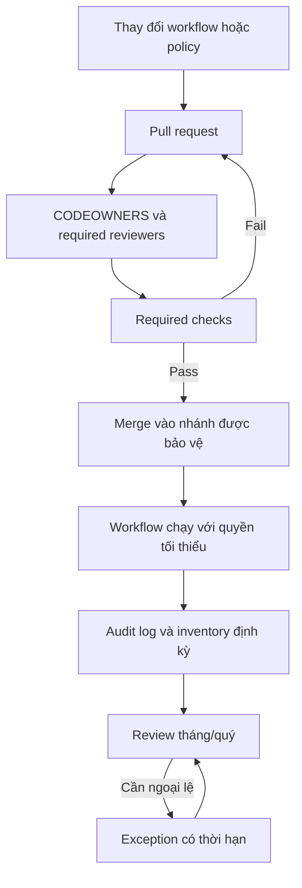

<Callout type="info" title="Phạm vi và thuật ngữ nhanh">
  Trang này tập trung vào governance/audit cho GitHub Actions ở cấp repository và organization. Trong tài liệu này: `ownership` là ai chịu trách nhiệm cuối cùng; `policy` là luật được kiểm tra hoặc cưỡng bức tự động; `evidence` là bằng chứng kiểm soát đã chạy; `provenance` là nguồn gốc của artifact; `attestation` là bản ghi ký số mô tả artifact được tạo như thế nào. Nếu site của bạn chưa bật Mermaid, biểu đồ bên dưới vẫn đọc được như một code block.
</Callout>

## Mục lục

- [Mục tiêu và phạm vi](#mục-tiêu-và-phạm-vi)
- [Thuật ngữ nhanh](#thuật-ngữ-nhanh)
- [Mô hình governance cho GitHub Actions](#mô-hình-governance-cho-github-actions)
  - [Vai trò và trách nhiệm](#vai-trò-và-trách-nhiệm)
  - [Luồng ra quyết định](#luồng-ra-quyết-định)
- [Chuẩn chính sách cốt lõi](#chuẩn-chính-sách-cốt-lõi)
  - [Ownership và chuẩn mã nguồn](#ownership-và-chuẩn-mã-nguồn)
  - [CODEOWNERS, required reviews và required checks](#codeowners-required-reviews-và-required-checks)
  - [Least privilege cho workflow và job](#least-privilege-cho-workflow-và-job)
  - [Pin action và reusable workflows](#pin-action-và-reusable-workflows)
  - [Allowed actions và policy ở cấp org](#allowed-actions-và-policy-ở-cấp-org)
- [Kiểm soát audit và provenance](#kiểm-soát-audit-và-provenance)
  - [Audit log và API](#audit-log-và-api)
  - [Inventory workflow, action và runner](#inventory-workflow-action-và-runner)
  - [Provenance và attestation](#provenance-và-attestation)
- [Quy trình exception](#quy-trình-exception)
  - [Khi nào cần exception](#khi-nào-cần-exception)
  - [Mẫu ghi nhận exception](#mẫu-ghi-nhận-exception)
  - [Kết thúc và thu hồi exception](#kết-thúc-và-thu-hồi-exception)
- [Chu kỳ review định kỳ](#chu-kỳ-review-định-kỳ)
  - [Review theo tháng và quý](#review-theo-tháng-và-quý)
  - [Lưu giữ bằng chứng](#lưu-giữ-bằng-chứng)
- [Ví dụ cấu hình](#ví-dụ-cấu-hình)
  - [Workflow chuẩn tối thiểu](#workflow-chuẩn-tối-thiểu)
  - [Reusable workflow chuẩn hóa](#reusable-workflow-chuẩn-hóa)
  - [CODEOWNERS và ruleset gợi ý](#codeowners-và-ruleset-gợi-ý)
  - [Lệnh audit và inventory](#lệnh-audit-và-inventory)
- [Checklist triển khai](#checklist-triển-khai)
- [Troubleshooting](#troubleshooting)
  - [Câu hỏi vận hành thường gặp](#câu-hỏi-vận-hành-thường-gặp)
- [Tài liệu tham khảo](#tài-liệu-tham-khảo)

## Mục tiêu và phạm vi

Governance tốt không chỉ là “workflow chạy được”. Mục tiêu là biết **ai được phép thay đổi**, **thay đổi nào được phép chạy**, **chạy với quyền gì**, và **làm sao chứng minh mọi thứ đã được kiểm soát**.

Bài này phù hợp khi bạn đang vận hành một hoặc nhiều repository có GitHub Actions, đặc biệt là khi:

- Có nhiều team cùng sửa workflow, reusable workflow hoặc policy.
- Có action của bên thứ ba, self-hosted runner, hoặc job cần quyền ghi.
- Cần audit định kỳ cho security, compliance, release hoặc change management.
- Cần chứng minh provenance cho artifact đã phát hành.

Nó không thay thế runbook debug lỗi pipeline. Ở đây trọng tâm là **control plane**: ownership, policy, review, audit và evidence.

## Thuật ngữ nhanh

| Thuật ngữ | Giải thích ngắn |
|-----------|------------------|
| `CODEOWNERS` | File ánh xạ đường dẫn sang người/nhóm phải review khi file đó đổi. |
| `ruleset` | Bộ luật ở cấp org hoặc repository để ép review, check, nhánh được bảo vệ và điều kiện merge. |
| `required check` | Status check bắt buộc phải pass trước khi merge. |
| `least privilege` | Chỉ cấp đúng mức quyền cần cho job hiện tại, không cấp rộng hơn. |
| `pinning` | Ghim action hoặc image bằng commit SHA hoặc digest thay vì tag trôi nổi. |
| `reusable workflow` | Workflow có thể được gọi lại bằng `workflow_call` để chuẩn hóa logic dùng chung. |
| `audit log` | Nhật ký sự kiện quản trị ở cấp org/enterprise. |
| `inventory` | Danh mục các workflow, action, runner, quyền và ngoại lệ đang tồn tại. |
| `provenance` | Bằng chứng về nguồn gốc build, ví dụ build từ commit nào, bằng job nào, trên môi trường nào. |
| `attestation` | Bản ghi ký số gắn với artifact để xác minh provenance. |
| `evidence` | Bộ tài liệu/log/export chứng minh kiểm soát đã được áp dụng. |

## Mô hình governance cho GitHub Actions

Governance hiệu quả thường đi theo mô hình “policy-as-code” (chính sách thành mã): mọi guardrail quan trọng được mô tả trong file, review như code và kiểm tra tự động trong PR hoặc định kỳ.



### Vai trò và trách nhiệm

| Vai trò | Trách nhiệm chính | Evidence nên có |
|---------|-------------------|------------------|
| Platform owner | Định nghĩa chuẩn dùng chung, reusable workflow, policy scan, baseline permissions. | Quyết định kiến trúc, changelog, release note. |
| Repo owner | Chịu trách nhiệm cuối cùng cho workflow của repo. | CODEOWNERS, PR approvals, branch/ruleset config. |
| Security reviewer | Thẩm định rủi ro, exception, third-party action và provenance. | Approval, risk note, exception record. |
| Maintainer CI/CD | Vận hành workflow, cập nhật action, xử lý drift, theo dõi thất bại policy. | Run log, inventory, release evidence. |
| Auditor/Compliance | Kiểm tra tuân thủ định kỳ, đối chiếu bằng chứng, theo dõi thời hạn exception. | Export audit log, checklist review, archive evidence. |

### Luồng ra quyết định

Khi có thay đổi liên quan đến GitHub Actions, hãy đi theo thứ tự này:

1. Thay đổi có đụng đến workflow, policy hoặc runner không?
2. Nếu có, file đó có owner rõ ràng chưa?
3. PR đã qua `CODEOWNERS` review và required checks chưa?
4. Workflow có đang chạy với quyền tối thiểu và action đã được pin chưa?
5. Có cần exception tạm thời không?
6. Có evidence nào cần lưu để audit sau này không?

<Callout type="idea" title="Nguyên tắc vận hành">
  Nếu một control có thể tự động hóa, hãy biến nó thành check hoặc workflow. Nếu không thể tự động hóa hoàn toàn, hãy ghi lại cách review và nơi lưu evidence để quá trình lặp lại được.
</Callout>

## Chuẩn chính sách cốt lõi

### Ownership và chuẩn mã nguồn

Mọi workflow, reusable workflow, policy manifest và script kiểm tra nên có đường dẫn cố định và owner rõ ràng. Cách làm thực tế là:

- Đặt workflow trong `.github/workflows/`.
- Đặt action nội bộ hoặc composite action trong `.github/actions/`.
- Đặt file policy nội bộ trong `governance/` hoặc `security/`.
- Mọi thay đổi vào các đường dẫn này phải đi qua PR.
- Không cho phép sửa trực tiếp nhánh bảo vệ bằng push thẳng.

Điểm mấu chốt là owner không chỉ là “người biết file này”. Owner là người có quyền từ chối thay đổi nếu change không đạt chuẩn.

### CODEOWNERS, required reviews và required checks

`CODEOWNERS` giúp GitHub tự động gán reviewer khi file đổi. Với governance, đây là lớp chặn đầu tiên cho workflow, policy và script kiểm tra.

Một cấu hình thường dùng là:

- Mọi thay đổi trong `.github/workflows/` phải được review bởi platform team hoặc security team.
- Mọi thay đổi trong `governance/` phải có review kép: owner kỹ thuật và reviewer rủi ro.
- Required checks phải chặn merge nếu policy scan, test hoặc lint fail.
- Nếu dùng ruleset, bật `require code owner review`, `required status checks` và bảo vệ nhánh mặc định.

Ví dụ ma trận kiểm soát:

| Control | Chuẩn tối thiểu | Tác dụng |
|---------|------------------|----------|
| CODEOWNERS | Đường dẫn nhạy cảm có owner rõ ràng. | Không để PR “lọt” qua mà không có người đúng vai trò review. |
| Required reviews | Ít nhất 1 review, với file nhạy cảm là 2 review hoặc 1 review từ security. | Giảm rủi ro thao túng workflow. |
| Required checks | `policy-guard`, `unit-test`, `workflow-lint`, `pinned-action-scan`. | Chặn merge nếu guardrail fail. |
| Ruleset/branch protection | Không force-push, không bypass review, không merge khi checks chưa xanh. | Ép tuân thủ ở tầng platform. |

<Callout type="warn" title="Đừng chỉ dựa vào review tay">
  Review tay tốt, nhưng không đủ để chống drift lâu dài. Hãy để check tự động bắt những thứ có thể đo được: action chưa pin, permission quá rộng, reusable workflow gọi sai repo, hoặc thay đổi vượt phạm vi cho phép.
</Callout>

### Least privilege cho workflow và job

GitHub Actions cho phép cấp quyền theo hai tầng: mức workflow và mức job. Hãy mặc định tối thiểu ở workflow, rồi chỉ mở rộng ở job nào thật sự cần.

Thực hành an toàn:

- Mặc định `contents: read`.
- Chỉ bật `id-token: write` khi job cần OIDC để xin token tạm thời từ cloud provider.
- Chỉ bật `packages: write` khi job thực sự publish package.
- Chỉ bật `pull-requests: write` nếu job cần comment hoặc update PR.
- Không để job deploy chạy chung với job test nếu không cần.

Ví dụ nhỏ:

```yaml
permissions:
  contents: read

jobs:
  deploy:
    runs-on: ubuntu-latest
    permissions:
      contents: read
      id-token: write
    steps:
      - uses: actions/checkout@b4ffde65f46336ab88eb53be808477a3936bae11
```

Cách đọc ví dụ này: workflow chỉ đọc mã nguồn, còn job deploy mới được xin quyền OIDC. Đây là cách giảm “blast radius” (phạm vi ảnh hưởng khi bị lộ hoặc lỗi).

### Pin action và reusable workflows

`uses:` là nơi supply-chain risk thường xuất hiện. Tag như `@v4` tiện, nhưng tag có thể bị trỏ lại. Với production, hãy pin bằng SHA hoặc digest.

Quy tắc thực tế:

- Action từ marketplace: pin commit SHA.
- Container image: pin digest `@sha256:...`.
- Reusable workflow nội bộ: dùng repo hoặc tag được kiểm soát, và xem nó như dependency sản phẩm.
- Reusable workflow ở repo khác: ưu tiên SHA và đặt owner riêng cho repo chứa workflow đó.
- Tránh `@main` hoặc nhánh trôi nổi trong môi trường production.

<Callout type="warn" title="Tag không phải là pin">
  `@v1` hay `@main` chỉ là tham chiếu linh hoạt. Nó có thể đổi theo thời gian. Nếu bạn muốn tái lập được build và audit được rủi ro supply chain, hãy dùng SHA hoặc digest.
</Callout>

Với reusable workflows, nhớ một điểm dễ quên: secret của environment không đi qua `workflow_call` theo cách bạn thường mong đợi. Nếu job con cần secret, hãy thiết kế rõ `secrets` hoặc dùng secret của environment ngay trong job đó, rồi review kỹ phần này.

### Allowed actions và policy ở cấp org

Ở cấp organization, tiêu chuẩn tốt nhất là **allowlist** chứ không phải allow-all. Mục tiêu là giới hạn action và reusable workflow được phép chạy trong toàn org hoặc trong một nhóm repo.

Gợi ý chính sách:

- Chỉ cho phép action đã được phê duyệt.
- Chỉ cho phép reusable workflow từ repo platform đã ký duyệt.
- Cấm wildcard rộng kiểu “mọi action từ mọi repo” trong production.
- Review định kỳ danh sách allowlist vì nhu cầu team có thể đổi.
- Khi cần mở thêm action mới, mở bằng exception có thời hạn, không mở vĩnh viễn ngay lập tức.

Nếu org của bạn còn dùng nhiều nhánh và repo cũ, hãy bắt đầu bằng một policy nhóm nhỏ:

1. Chặn action ngoài allowlist ở repo quan trọng trước.
2. Chuẩn hóa reusable workflow dùng chung.
3. Mở rộng policy cho các repo còn lại sau khi inventory ổn định.

<Callout type="idea" title="Mẫu tư duy tốt">
  Đừng hỏi “có chặn được không?”. Hãy hỏi “phần nào bắt buộc phải cho phép, phần nào chỉ nên cho phép tạm thời, và bằng chứng nào chứng minh điều đó?”.
</Callout>

## Kiểm soát audit và provenance

### Audit log và API

Audit log trả lời câu hỏi: ai đã đổi gì, lúc nào, và từ đâu. Với GitHub Actions, audit log rất hữu ích cho các sự kiện liên quan đến policy, workflow, runner, secret và thay đổi cài đặt bảo mật.

Bạn có thể lấy dữ liệu qua UI hoặc qua API. API phù hợp hơn khi cần export định kỳ hoặc tạo report.

Ví dụ với GitHub CLI:

```bash
gh api /orgs/ORG/audit-log --paginate -f phrase='actions' --jq '.[]'

gh api /repos/OWNER/REPO/actions/workflows --paginate \
  --jq '.workflows[] | {name, path, state, created_at, updated_at}'

gh api /repos/OWNER/REPO/actions/runs --paginate \
  --jq '.workflow_runs[] | {id, name, event, status, conclusion, head_branch, head_sha, run_attempt}'
```

Khi đọc audit log, đừng chỉ nhìn vào lỗi. Hãy chú ý các thay đổi có tính nền tảng:

- bật hoặc tắt ruleset / branch protection,
- thay đổi allowed actions,
- sửa runner group hoặc self-hosted runner,
- cập nhật secret hoặc environment,
- sửa reusable workflow dùng chung.

Nếu cần trace sâu hơn, hãy xuất dữ liệu về JSON hoặc CSV rồi ghép với inventory nội bộ để có bức tranh đầy đủ.

### Inventory workflow, action và runner

Inventory là thứ giúp bạn biết “ta đang chạy cái gì”. Không có inventory, bạn không thể review đầy đủ cũng như không thể chứng minh rằng mọi workflow quan trọng đều nằm trong tầm kiểm soát.

Inventory tối thiểu nên bao gồm:

- workflow file và đường dẫn,
- event trigger,
- `permissions` ở workflow/job,
- action đã dùng và cách pin,
- reusable workflow được gọi,
- runner đang dùng,
- environment hoặc secret nhạy cảm,
- exception đang mở và ngày hết hạn.

Một cách đơn giản để khởi đầu là quét toàn bộ `uses:` trong repo:

```bash
grep -RhoE 'uses:\s*[^ ]+' .github/workflows | sort | uniq -c | sort -nr
```

Sau đó, chuyển từ “đếm chuỗi” sang “phân tích YAML” để lấy thêm metadata như job permission và event trigger. Kết quả nên được xuất thành file JSON để audit đọc lại được.

Nếu bạn có self-hosted runner, inventory còn phải có:

- tên runner và label,
- team owner,
- môi trường mạng,
- tần suất patch,
- trạng thái online/offline,
- repo hoặc runner group nào được phép dùng.

### Provenance và attestation

Provenance trả lời câu hỏi “artifact này được build từ đâu”. Attestation là bằng chứng ký số đi kèm artifact để người khác xác minh provenance đó.

Khi nào cần chú ý nhất:

- release public,
- image container deploy lên production,
- binary phân phối cho khách hàng hoặc nội bộ nhiều team,
- artifact dùng làm đầu vào cho hệ thống nhạy cảm tiếp theo.

Thực hành tốt:

- Build từ commit xác định, không build từ workspace mơ hồ.
- Lưu thông tin commit, workflow run, runner và digest artifact.
- Khi phát hành, gắn attestation hoặc metadata provenance.
- Khi deploy, kiểm tra attestation thay vì chỉ tin tên file.

Nói ngắn gọn: provenance giúp bạn tin artifact **được tạo từ đâu**; attestation giúp bạn **chứng minh điều đó**.

## Quy trình exception

### Khi nào cần exception

Exception chỉ nên dùng khi có lý do thật và có thời hạn. Ví dụ:

- cần dùng action của bên thứ ba chưa kịp thay thế,
- workflow cũ chưa pin SHA nhưng cần hotfix khẩn,
- một repo legacy chưa đủ sạch để áp ruleset chặt ngay,
- runner đặc thù cần quyền rộng hơn trong một đợt migrate có kiểm soát.

Nếu exception được mở ra mà không có ngày hết hạn, nó sẽ biến thành policy mới mà không ai chủ động phê duyệt.

### Mẫu ghi nhận exception

<Steps>
<Step>

**Ghi rõ phạm vi.** Nêu repo, workflow, action, nhánh hoặc runner nào bị ảnh hưởng. Không ghi chung chung kiểu “cho phép tạm thời”.

</Step>
<Step>

**Ghi rõ rủi ro và biện pháp bù.** Mô tả rủi ro nếu mở exception, ví dụ supply-chain risk hoặc privilege escalation, và ghi control bù như review kép, pin SHA, hoặc giới hạn thời gian.

</Step>
<Step>

**Ghi rõ thời hạn.** Luôn có ngày hết hạn và người chịu trách nhiệm đóng exception.

</Step>
<Step>

**Lưu bằng chứng.** Lưu approval, lý do, link PR, log kiểm chứng và trạng thái sau khi áp dụng.

</Step>
</Steps>

Nếu cần mẫu ngắn, hãy dùng cấu trúc sau trong issue hoặc PR:

- Bối cảnh
- Phạm vi ảnh hưởng
- Rủi ro
- Control bù
- Người duyệt
- Ngày hết hạn
- Kế hoạch thu hồi

### Kết thúc và thu hồi exception

Khi hết hạn, hãy đóng exception theo đúng vòng đời:

1. Xác minh control gốc đã được thay thế hoặc sửa xong.
2. Chạy lại inventory để bảo đảm không còn dependency cũ.
3. Cập nhật changelog hoặc PR đóng exception.
4. Lưu evidence hoàn tất và đánh dấu trạng thái là “closed”.

<Callout type="warn" title="Exception không có expiry là debt">
  Exception không có hạn chót thường không được dọn. Nếu buộc phải kéo dài, hãy mở lại review chính thức và cấp thời hạn mới thay vì để nó lặng lẽ tồn tại mãi.
</Callout>

## Chu kỳ review định kỳ

### Review theo tháng và quý

Một lịch review thực dụng thường gồm:

- Hàng tuần: xem các workflow fail policy, exception sắp hết hạn, action mới xuất hiện.
- Hàng tháng: rà actions và reusable workflows được gọi nhiều nhất, kiểm tra pin SHA/digest còn đúng.
- Hàng quý: soát lại quyền, runner group, allowlist, ruleset, CODEOWNERS và các exception còn sống.

Checklist review nên trả lời được các câu hỏi này:

- Có workflow nào mới chưa nằm trong inventory không?
- Có action nào vẫn dùng tag trôi nổi không?
- Có job nào còn quyền rộng hơn mức cần thiết không?
- Có exception nào sắp hết hạn hoặc đã quá hạn không?
- Có required check nào bị tắt hoặc đổi tên mà chưa báo cho team không?

### Lưu giữ bằng chứng

Bằng chứng nên lưu đủ lâu để phục vụ audit nội bộ, audit khách hàng và điều tra sự cố. Không có một con số đúng cho mọi tổ chức, nhưng một khung tối thiểu thường là:

| Loại evidence | Ví dụ | Mức lưu giữ khuyến nghị |
|----------------|-------|-------------------------|
| PR và review | approvals, diff policy, CODEOWNERS match | 6–12 tháng hoặc theo quy định nội bộ |
| Audit export | event từ audit log, thay đổi policy, runner, secret | 12 tháng trở lên |
| Inventory snapshot | danh mục workflow/action/runner theo kỳ | ít nhất 2–4 kỳ review gần nhất |
| Exception record | lý do, expiry, người duyệt, ảnh hưởng | suốt thời gian exception + 12 tháng sau khi đóng |
| Attestation/provenance | metadata build, digest, run id | theo vòng đời artifact và release |

Bằng chứng nên ở nơi đọc lại được: repository riêng, storage được bảo vệ, hoặc hệ thống compliance có kiểm soát truy cập.

## Ví dụ cấu hình

### Workflow chuẩn tối thiểu

Ví dụ dưới đây là một workflow baseline để kiểm tra chính sách. Nó chỉ cấp quyền đọc, dùng action đã pin SHA và có thể được gọi từ PR hoặc manual trigger.

```yaml
name: governance-baseline

on:
  pull_request:
    paths:
      - '.github/workflows/**'
      - 'governance/**'
      - '.github/CODEOWNERS'
  workflow_dispatch:

permissions:
  contents: read
  actions: read

jobs:
  policy-guard:
    runs-on: ubuntu-latest
    permissions:
      contents: read
      actions: read
      id-token: write
    steps:
      - name: Checkout repository
        uses: actions/checkout@b4ffde65f46336ab88eb53be808477a3936bae11

      - name: Validate workflow and policy references
        run: |
          python scripts/check_policy.py --workflows .github/workflows --policy governance/actions-policy.yml

      - name: Summarize baseline result
        if: always()
        run: |
          {
            echo "## Governance baseline"
            echo "- Repo: $GITHUB_REPOSITORY"
            echo "- Ref: $GITHUB_REF"
            echo "- SHA: $GITHUB_SHA"
          } >> "$GITHUB_STEP_SUMMARY"
```

Điểm cần lưu ý:

- `contents: read` là mặc định an toàn hơn rất nhiều so với quyền write.
- `id-token: write` chỉ nên bật nếu job thật sự cần OIDC.
- Mọi `uses:` bên ngoài nên được pin tương tự `actions/checkout` ở trên.

### Reusable workflow chuẩn hóa

Reusable workflow giúp bạn gom các guardrail lặp lại về một chỗ. Khi team nào cũng gọi cùng một workflow chuẩn, drift giảm đi rõ rệt.

```yaml
name: shared-governance

on:
  workflow_call:
    inputs:
      policy_path:
        required: true
        type: string
    secrets:
      gh_token:
        required: false

permissions:
  contents: read
  actions: read

jobs:
  scan:
    runs-on: ubuntu-latest
    steps:
      - name: Checkout repository
        uses: actions/checkout@b4ffde65f46336ab88eb53be808477a3936bae11

      - name: Scan pinned actions
        run: |
          python scripts/scan_pinned_actions.py --policy "${{ inputs.policy_path }}"
```

Một caller workflow có thể dùng nó như sau:

```yaml
jobs:
  governance:
    uses: acme/platform/.github/workflows/shared-governance.yml@v1
    with:
      policy_path: governance/actions-policy.yml
```

Nếu caller ở repo khác, hãy ưu tiên pin SHA cho bản reusable workflow đó thay vì để nhánh trôi nổi.

<Callout type="warn" title="Đừng chuyền secret một cách mơ hồ">
  Reusable workflow rất tiện, nhưng bạn phải thiết kế rõ input và secret nào được phép đi qua. Nếu không, bạn sẽ tạo ra một đường vòng khó audit hơn cả workflow gốc.
</Callout>

### CODEOWNERS và ruleset gợi ý

Ví dụ `CODEOWNERS` tối thiểu:

```text
# .github/CODEOWNERS
.github/workflows/ @platform-devex @security-team
.github/actions/ @platform-devex
governance/ @platform-devex @security-team
docs/ @docs-owner
```

Gợi ý ruleset hoặc branch protection cho nhánh mặc định:

- Require a pull request trước khi merge.
- Require code owner review cho các đường dẫn nhạy cảm.
- Require status checks: `policy-guard`, `lint`, `test`, `pinned-action-scan`.
- Block force push và xóa nhánh.
- Chặn merge nếu check chưa chạy xong.
- Không cho bypass bằng admin trừ khi có quy trình exception rõ ràng.

Nếu org của bạn còn dùng branch protection cũ, giữ cùng logic nhưng ưu tiên chuyển sang ruleset khi có thể để quản trị tập trung hơn.

### Lệnh audit và inventory

Một vài lệnh thực dụng để xuất evidence nhanh:

```bash
# Liệt kê workflow runs gần nhất
gh api /repos/OWNER/REPO/actions/runs --paginate \
  --jq '.workflow_runs[] | {id, name, event, status, conclusion, head_branch, head_sha, run_attempt}'

# Liệt kê workflow file trong repo
gh api /repos/OWNER/REPO/actions/workflows --paginate \
  --jq '.workflows[] | {name, path, state, created_at, updated_at}'

# Lấy audit log ở cấp org, lọc theo chuỗi liên quan đến actions
gh api /orgs/ORG/audit-log --paginate -f phrase='actions' --jq '.[]'

# Đếm action reference trong workflows
grep -RhoE 'uses:\s*[^ ]+' .github/workflows | sort | uniq -c | sort -nr
```

Khi xuất dữ liệu này cho audit, hãy lưu kèm ngày chạy, người chạy, phạm vi quét và phiên bản script đã dùng.

## Checklist triển khai

- [ ] Có file `CODEOWNERS` cho `.github/workflows/`, `.github/actions/` và file policy.
- [ ] Nhánh mặc định có ruleset hoặc branch protection ép required reviews và required checks.
- [ ] Workflow dùng permissions tối thiểu ở cấp workflow và job.
- [ ] Action bên ngoài được pin bằng SHA hoặc digest.
- [ ] Reusable workflow dùng cho logic lặp lại, không copy-paste.
- [ ] Allowed actions ở cấp org/repo được giới hạn bằng allowlist.
- [ ] Có audit log export hoặc truy vấn định kỳ.
- [ ] Có inventory workflow/action/runner được cập nhật theo chu kỳ.
- [ ] Có quy trình exception có thời hạn, có owner và có evidence.
- [ ] Có kế hoạch lưu giữ evidence và nơi lưu rõ ràng.
- [ ] Có lịch review tháng/quý để dọn drift, action cũ và policy lệch.

## Troubleshooting

| Triệu chứng | Nguyên nhân cần kiểm tra | Hướng xử lý |
|-------------|--------------------------|-------------|
| Không tìm được ai chịu trách nhiệm cho một workflow | `CODEOWNERS` thiếu path, owner đã đổi, hoặc file nằm ngoài scope quy ước. | Cập nhật `CODEOWNERS`, gán owner rõ ràng cho đường dẫn nhạy cảm, rồi mở lại PR. |
| Action bị chặn bởi policy | Action chưa nằm trong allowlist, dùng tag bị cấm, hoặc gọi reusable workflow từ repo chưa được phê duyệt. | Pin SHA/digest, thêm vào allowlist nếu hợp lệ, hoặc chuyển sang reusable workflow nội bộ đã duyệt. |
| Review và check không kích hoạt | Ruleset/branch protection chưa áp vào nhánh đúng, required check đổi tên, hoặc PR chỉnh file ngoài scope. | Đồng bộ tên check, kiểm tra phạm vi ruleset, và xác nhận `CODEOWNERS` match đúng path. |
| Audit log thiếu dữ liệu | Query sai scope org/repo, quyền truy cập của token không đủ, hoặc retention đã hết. | Chạy lại bằng token có quyền phù hợp, export theo lịch sớm hơn, và tăng lưu giữ evidence nếu cần. |
| Provenance hoặc attestation không khớp | Artifact được build lại, digest thay đổi, hoặc release metadata không được ghép đúng với run gốc. | Đối chiếu commit SHA, workflow run id, runner và digest; chỉ phát hành khi provenance khớp. |

### Câu hỏi vận hành thường gặp

<Accordions type="single">
  <Accordion title="Có nên cho phép action do team nội bộ viết nhưng nằm ở repo khác không?">
    Có, nếu repo đó được xem như dependency dùng chung: phải có owner riêng, review riêng, pin SHA và inventory riêng. Đừng coi nó là "an toàn mặc định" chỉ vì nó là internal.
  </Accordion>
  <Accordion title="Có cần pin cả action của GitHub không?">
    Có. Nguyên tắc nhất quán là action nào được gọi bằng `uses:` thì cũng nên pin. Với dependency quan trọng, pin SHA hoặc digest để tái lập được build và giảm rủi ro supply chain.
  </Accordion>
  <Accordion title="Khi nào nên dùng reusable workflow thay vì copy workflow?">
    Khi cùng một guardrail, cùng permission model hoặc cùng audit logic xuất hiện ở nhiều repo. Reusable workflow giúp giảm drift và làm evidence dễ tổng hợp hơn.
  </Accordion>
</Accordions>

## Tài liệu tham khảo

- [GitHub Actions](https://docs.github.com/en/actions)
- [Workflow syntax for GitHub Actions](https://docs.github.com/en/actions/using-workflows/workflow-syntax-for-github-actions)
- [Reuse workflows](https://docs.github.com/en/actions/learn-github-actions/reusing-workflows)
- [Security for GitHub Actions](https://docs.github.com/en/actions/security-for-github-actions)
- [GitHub CLI `gh api`](https://cli.github.com/manual/gh_api)
- [GitHub CLI `gh run`](https://cli.github.com/manual/gh_run_view)

<Callout type="info" title="Gợi ý áp dụng ngay">
  Nếu bạn chỉ làm một việc trong tuần này, hãy bắt đầu bằng 3 thứ: pin action bằng SHA, thêm CODEOWNERS cho workflow/policy, và tạo inventory định kỳ để biết mình đang chạy gì.
</Callout>
