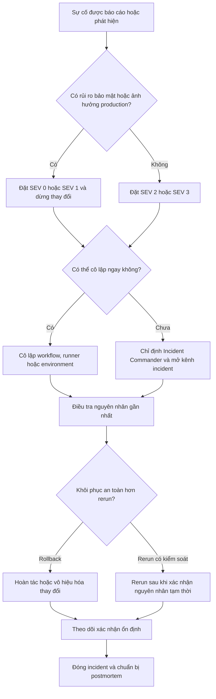

<Callout type="info" title="Dành cho vận hành production">
  Tài liệu này áp dụng cho sự cố liên quan đến workflow, runner, secret, permissions, artifact, deployment và quota của GitHub Actions trong môi trường production.
</Callout>

## Mục lục

- [Tổng quan](#tổng-quan)
- [Phạm vi áp dụng](#phạm-vi-áp-dụng)
- [Mức độ nghiêm trọng](#mức-độ-nghiêm-trọng)
  - [SEV 0](#sev-0)
  - [SEV 1](#sev-1)
  - [SEV 2](#sev-2)
  - [SEV 3](#sev-3)
- [Vai trò và trách nhiệm](#vai-trò-và-trách-nhiệm)
- [Luồng xử lý sự cố](#luồng-xử-lý-sự-cố)
  - [Luồng ra quyết định nhanh](#luồng-ra-quyết-định-nhanh)
  - [Phát hiện và triage](#phát-hiện-và-triage)
  - [Cô lập và giảm thiểu](#cô-lập-và-giảm-thiểu)
  - [Điều tra](#điều-tra)
  - [Khôi phục, hoàn tác và chạy lại](#khôi-phục-hoàn-tác-và-chạy-lại)
  - [Truyền thông](#truyền-thông)
  - [Thu thập và bảo toàn bằng chứng](#thu-thập-và-bảo-toàn-bằng-chứng)
- [Bảng triệu chứng và chẩn đoán](#bảng-triệu-chứng-và-chẩn-đoán)
- [Tình huống mẫu](#tình-huống-mẫu)
  - [Triển khai thất bại](#triển-khai-thất-bại)
  - [Secret bị lộ](#secret-bị-lộ)
  - [Runner bị gián đoạn](#runner-bị-gián-đoạn)
  - [Hết quota](#hết-quota)
- [Mẫu ghi nhận sự cố](#mẫu-ghi-nhận-sự-cố)
- [Mẫu postmortem](#mẫu-postmortem)
  - [Cấu trúc khuyến nghị](#cấu-trúc-khuyến-nghị)
  - [Mẫu postmortem để sao chép](#mẫu-postmortem-để-sao-chép)
- [Phòng ngừa và cải tiến](#phòng-ngừa-và-cải-tiến)
- [Tài liệu tham khảo](#tài-liệu-tham-khảo)

## Tổng quan

GitHub Actions thường là đường ống cuối cùng trước khi mã vào production. Khi workflow lỗi, runner mất kết nối, secret bị lộ, hoặc quota bị cạn, tác động có thể lan rất nhanh sang toàn bộ quá trình build, test, deploy và phát hành.

Mục tiêu của runbook này là giúp đội vận hành xử lý theo cùng một thứ tự ưu tiên:

1. Giảm blast radius trước.
2. Xác nhận mức độ ảnh hưởng.
3. Khôi phục dịch vụ an toàn nhất có thể.
4. Ghi lại bằng chứng để điều tra và phòng ngừa tái diễn.

<Callout type="idea" title="Nguyên tắc vàng">
  Nếu chưa chắc vấn đề chỉ là lỗi tạm thời, hãy coi đó là sự cố thật, chốt người chỉ huy incident, và dừng các thay đổi rủi ro cho đến khi có kết luận rõ ràng.
</Callout>

## Phạm vi áp dụng

Tài liệu này áp dụng cho các thành phần và tình huống sau:

- Workflow chạy trên `push`, `pull_request`, `workflow_dispatch`, `schedule`, `workflow_call` và deployment pipeline.
- Self-hosted runner, GitHub-hosted runner, runner group và labels của runner.
- Secrets ở cấp repository, environment, organization và các biến môi trường nhạy cảm.
- Environment protection rules, required reviewers, approvals và deployment gates.
- Artifact, cache, release, package và các bước phát hành liên quan.
- Quota minutes, storage, concurrency limit, job queue và tình trạng dịch vụ GitHub.

Không áp dụng trực tiếp cho:

- Lỗi business logic của ứng dụng nhưng workflow vẫn chạy đúng.
- Sự cố hạ tầng ngoài GitHub Actions nếu không chạm vào pipeline.
- Môi trường local, sandbox hoặc demo không có yêu cầu production.

## Mức độ nghiêm trọng

Khi nghi ngờ giữa hai mức, luôn chọn mức cao hơn. Với sự cố bảo mật hoặc khả năng lộ secret, mặc định nâng lên SEV 0 cho đến khi chứng minh ngược lại.

### SEV 0

Sự cố có rủi ro bảo mật nghiêm trọng, rủi ro supply chain, hoặc có dấu hiệu secret, token, artifact nhạy cảm, hoặc quyền truy cập bị lộ ra ngoài phạm vi dự kiến.

Ví dụ:

- Secret bị in ra log công khai.
- Workflow bị sửa để chạy mã không tin cậy trên nhánh production.
- Runner tự quản bị xâm nhập hoặc có dấu hiệu can thiệp.
- Token, credential hoặc artifact có thể đã bị trích xuất.

Mục tiêu lúc này không phải “chạy lại cho xong”, mà là khóa rủi ro càng sớm càng tốt, xoay vòng thông tin nhạy cảm, và giữ bằng chứng nguyên trạng.

### SEV 1

Sự cố làm dừng deploy production, làm hỏng một phần lớn pipeline quan trọng, hoặc chặn release cho nhiều repo/đội.

Ví dụ:

- Toàn bộ job deploy production fail sau một thay đổi workflow.
- GitHub-hosted runner hoặc self-hosted runner pool không còn đủ năng lực để xử lý khối lượng công việc bắt buộc.
- Một workflow dùng chung bị lỗi và làm nhiều repo không thể phát hành.

Mục tiêu là khôi phục dịch vụ trong thời gian ngắn nhất nhưng vẫn kiểm soát được thay đổi.

### SEV 2

Sự cố ảnh hưởng đáng kể nhưng còn có đường vòng hoặc workaround an toàn.

Ví dụ:

- Một workflow test thất bại do runner đơn lẻ hoặc lỗi mạng tạm thời.
- Chỉ một environment hoặc một nhánh bị ảnh hưởng.
- Pipeline vẫn chạy được nhưng chậm bất thường hoặc có tỷ lệ fail tăng cao.

Mục tiêu là xác định nguyên nhân gốc, giảm lặp lại, và khôi phục trong cùng ngày làm việc nếu có thể.

### SEV 3

Sự cố nhẹ, không chặn production, và có thể chấp nhận tạm thời.

Ví dụ:

- Một job phụ trợ fail nhưng không ảnh hưởng deploy.
- Cảnh báo quota hoặc cảnh báo runner chưa gây tác động thật.
- Có flakiness rõ ràng ở bước không quan trọng.

Mục tiêu là theo dõi, sửa dứt điểm, và đưa vào backlog cải tiến.

## Vai trò và trách nhiệm

| Vai trò | Trách nhiệm chính | Khi nào tham gia |
|---|---|---|
| Incident Commander | Chốt SEV, điều phối, ưu tiên hành động, quyết định rollback hay rerun | Ngay khi có SEV 1/0, hoặc khi sự cố chưa rõ hướng xử lý |
| Operations Lead | Thực hiện kiểm tra workflow, runner, quota, logs, artifact | Trong giai đoạn triage và khôi phục |
| Security Lead | Xử lý secret, token, permissions, audit log và rủi ro bảo mật | Bất kỳ khi nào có dấu hiệu lộ thông tin hoặc thay đổi quyền |
| Communications Lead | Soạn và gửi cập nhật cho stakeholder, giữ nhịp thông tin | Với SEV 1/0, hoặc khi cần thông báo liên đội |
| Scribe | Ghi timeline, quyết định, bằng chứng, owner của từng việc | Từ phút đầu tiên của incident |
| Subject Matter Expert | Giải thích workflow, release process, runner architecture | Khi cần chẩn đoán sâu hoặc sửa workflow |

Nếu đội nhỏ, một người có thể giữ nhiều vai trò. Tuy nhiên, Incident Commander và Scribe nên được tách riêng nếu có thể để tránh bỏ sót quyết định quan trọng.

## Luồng xử lý sự cố

### Luồng ra quyết định nhanh



<Steps>
<Step>

**Phát hiện tín hiệu**

Ghi nhận nguồn báo cáo, thời gian bắt đầu, repo, workflow, job, branch, environment, và mức độ ảnh hưởng ban đầu.

</Step>
<Step>

**Chốt SEV và owner**

Chỉ định Incident Commander, Scribe, và người xử lý kỹ thuật. Nếu có rủi ro bảo mật, kéo Security Lead vào ngay.

</Step>
<Step>

**Cô lập blast radius**

Dừng deploy, tạm khóa workflow nguy hiểm, hoặc chuyển traffic sang đường an toàn hơn nếu có.

</Step>
<Step>

**Điều tra và khôi phục**

Xác minh nguyên nhân gần nhất, chọn rollback hoặc rerun có kiểm soát, rồi theo dõi kết quả đến khi ổn định.

</Step>
<Step>

**Ghi chép và đóng incident**

Lưu timeline, bằng chứng, quyết định, và action items trước khi kết thúc.

</Step>
</Steps>

### Phát hiện và triage

Bước triage trả lời bốn câu hỏi đầu tiên: cái gì hỏng, ai bị ảnh hưởng, có mở rộng tiếp hay không, và có phải sự cố bảo mật không.

Các tín hiệu thường gặp:

- Job fail hàng loạt sau một commit hoặc thay đổi workflow.
- Job bị kẹt ở trạng thái queued hoặc waiting quá lâu.
- Deploy production không tạo được release hoặc environment approval không qua được.
- Runner offline, mất label, hoặc không thể nhận job.
- Secret, token, hoặc artifact nhạy cảm xuất hiện trong log.
- Quota minutes hoặc storage bị chạm ngưỡng.

Khi triage, luôn xác nhận các dữ kiện tối thiểu sau:

- Repo và workflow nào bị ảnh hưởng.
- Commit SHA, branch, environment, và run ID nào liên quan.
- Đây là lỗi lặp lại hay chỉ xảy ra một lần.
- Có thay đổi nào vừa được merge, phát hành, hoặc sửa secret không.
- Có dấu hiệu ảnh hưởng bảo mật, supply chain, hoặc quyền truy cập không.

### Cô lập và giảm thiểu

Mục tiêu của bước này là ngăn sự cố lan rộng trong khi vẫn giữ trạng thái đủ sạch để điều tra.

Hành động ưu tiên:

- Tạm dừng hoặc vô hiệu hóa workflow gây ảnh hưởng nếu nó đang tự động chạy theo push hoặc schedule.
- Khóa nhánh, environment, hoặc cổng approval nếu deployment đang đi sai hướng.
- Tạm ngừng self-hosted runner group nếu có khả năng runner bị nhiễm hoặc cấu hình sai.
- Tắt concurrency mới nếu một loạt job đang đè nhau hoặc gây áp lực lên quota.
- Chặn phát hành mới cho đến khi có xác nhận an toàn.

### Điều tra

Điều tra theo thứ tự từ gần nhất đến xa hơn:

1. Xem run gần nhất bị fail và đối chiếu với run thành công gần nhất.
2. Mở log của job fail đầu tiên, không chỉ nhìn job cuối cùng.
3. So sánh workflow file hiện tại với commit trước đó.
4. Kiểm tra secrets, permissions, environment rules, artifact, cache, và runner health.
5. Xác nhận xem lỗi có tái hiện trên nhánh hoặc runner khác hay không.

Nguồn dữ liệu nên đọc:

- Actions run logs.
- Workflow YAML trong `.github/workflows/`.
- Deployment logs và release notes.
- Audit log của tổ chức nếu nghi ngờ thay đổi quyền hoặc secret.
- Trạng thái runner, service manager, và network của self-hosted runner.

### Khôi phục, hoàn tác và chạy lại

Quyết định khôi phục phải dựa trên nguyên nhân, không dựa trên cảm giác.

| Tình trạng | Hành động ưu tiên | Không làm |
|---|---|---|
| Lỗi tạm thời, không đổi code, không rủi ro bảo mật | Rerun có kiểm soát sau khi xác nhận hệ thống ổn định | Không bấm rerun liên tục như một cách “thử may mắn” |
| Lỗi do commit hoặc thay đổi workflow | Rollback về commit hoặc workflow an toàn gần nhất | Không rerun bản lỗi mà chưa khóa nguyên nhân |
| Lỗi secret hoặc permission | Xoay vòng secret, sửa quyền, rồi chạy xác minh mới | Không chạy lại bằng credential cũ |
| Lỗi runner hoặc hạ tầng | Khôi phục runner, chuyển sang runner dự phòng, rồi thử lại | Không đẩy thêm job vào pool đang chết |

<Callout type="warn" title="Không rerun bừa bãi">
  Rerun chỉ có ý nghĩa khi nguyên nhân là tạm thời hoặc đã được sửa. Nếu chưa biết vì sao fail, rerun nhiều lần chỉ làm mất thời gian, làm mờ bằng chứng, và có thể lặp lại cùng một rủi ro.
</Callout>

Quy tắc thực hành an toàn:

- Với lỗi nghiêm trọng, luôn chụp lại log và metadata trước khi rerun.
- Nếu workflow có thể đã tạo side effect, kiểm tra khả năng chạy trùng trước khi rerun.
- Nếu rollback khả thi và ít rủi ro hơn rerun, ưu tiên rollback.
- Nếu commit mới là nguyên nhân, tạo run mới từ bản đã sửa thay vì cố kéo bản cũ sống lại.

<Steps>
<Step>

**Xác nhận điều kiện khôi phục**

Kiểm tra trạng thái runner, environment, secret rotation, quota, và thay đổi gần nhất.

</Step>
<Step>

**Chọn chiến lược**

Quyết định giữa rollback, rerun, hoặc vô hiệu hóa workflow.

</Step>
<Step>

**Thực hiện có kiểm soát**

Chỉ rerun một lần có chủ đích, hoặc deploy rollback theo đúng quy trình phê duyệt.

</Step>
<Step>

**Theo dõi sau khôi phục**

Xác nhận kết quả, so sánh log, và đảm bảo không còn job fail cùng mẫu lỗi.

</Step>
</Steps>

### Truyền thông

Giữ nhịp thông tin rõ ràng và ngắn gọn. Một update tốt phải trả lời được ba câu: đang ảnh hưởng gì, đội đang làm gì, và bước tiếp theo là gì.

Nhịp truyền thông khuyến nghị:

- SEV 0 hoặc SEV 1: cập nhật đầu tiên trong vòng 10 phút, sau đó mỗi 15 đến 30 phút.
- SEV 2: cập nhật theo mốc thay đổi trạng thái hoặc ít nhất mỗi vài giờ nếu chưa khôi phục.
- SEV 3: cập nhật trong kênh vận hành hoặc ticket nội bộ khi có thay đổi đáng kể.

Mẫu nội dung cập nhật:

- Tình trạng hiện tại.
- Repo, workflow, environment, hoặc runner bị ảnh hưởng.
- Biện pháp đã làm.
- Quyết định hiện tại: rollback, rerun, giữ nguyên, hay chờ.
- Thời điểm cập nhật tiếp theo.

### Thu thập và bảo toàn bằng chứng

Bằng chứng phải được lưu trước khi dọn dẹp hoặc rerun nếu sự cố có thể tái hiện hoặc có yếu tố bảo mật.

Nên lưu tối thiểu:

- Run ID, run attempt, job ID, repository, workflow file, branch, commit SHA, actor, và environment.
- Ảnh chụp hoặc export log của job thất bại đầu tiên.
- Diff của workflow file và commit liên quan.
- Danh sách secret, permission, environment rule, hoặc runner label liên quan ở mức metadata, không chép giá trị nhạy cảm.
- Mốc thời gian bắt đầu, thời gian phát hiện, thời gian cô lập, thời gian khôi phục.

<Callout type="info" title="Giữ bí mật trong bằng chứng">
  Khi sao chép log hoặc metadata, hãy che toàn bộ secret, token, URL ký sẵn, và payload nhạy cảm. Ghi lại sự tồn tại của dữ liệu, không sao chép nội dung bí mật vào ticket hoặc chat công khai.
</Callout>

## Bảng triệu chứng và chẩn đoán

| Triệu chứng | Nguyên nhân khả dĩ | Cách xác minh nhanh | Hành động ngay |
|---|---|---|---|
| Job queued rất lâu | Thiếu runner, label sai, concurrency bị kẹt, hoặc environment approval chờ | Xem hàng đợi Actions, trạng thái runner, và cấu hình label | Chuyển sang runner khác hoặc giải phóng runner đang bị kẹt |
| Job fail hàng loạt sau commit mới | Regression trong workflow, script, hoặc thay đổi quyền | So sánh với run thành công gần nhất và diff commit | Rollback hoặc sửa workflow rồi tạo run mới |
| Step báo `permission denied` | `GITHUB_TOKEN` thiếu quyền, secret scope sai, hoặc environment rule đổi | Kiểm tra `permissions`, environment, và secret scope | Sửa quyền, xác nhận lại scope, rồi rerun có kiểm soát |
| Deploy thành công nhưng runtime lỗi | Artifact sai version, cache cũ, hoặc cấu hình phát hành lệch | Đối chiếu SHA, artifact, và release tag | Thu hồi hoặc rollback release sai |
| Runner offline hoặc unhealthy | Service chết, disk đầy, network lỗi, hoặc label không còn khớp | Kiểm tra service manager, disk, network, và label | Đưa runner ra khỏi pool rồi khôi phục riêng |
| Log xuất hiện secret hoặc token | Echo nhầm biến môi trường, debug quá tay, hoặc payload lộ | Tìm dấu hiệu lộ trong log và audit log | Tắt workflow, xoay vòng secret, và bảo toàn bằng chứng |
| Nhiều repo đồng loạt fail | Sự cố dùng chung, thay đổi org-level, runner pool, hoặc GitHub incident | Kiểm tra cùng một workflow template, runner group, hoặc status page | Cô lập thành phần dùng chung và kích hoạt fallback |
| Chạy lại thì pass ngay | Lỗi tạm thời, network gián đoạn, hoặc runner chập chờn | So sánh lần fail và lần pass, xem có thay đổi nào khác không | Ghi nhận là transient, nhưng vẫn theo dõi mẫu lỗi |

## Tình huống mẫu

### Triển khai thất bại

Dấu hiệu thường thấy:

- Job deploy fail sau khi build và test đều pass.
- Environment approval không xuất hiện hoặc bị treo.
- Release tạo ra artifact sai, thiếu file, hoặc sai tag.

Cách xử lý:

1. Dừng mọi lần deploy tiếp theo.
2. Xác nhận commit, tag, artifact, và environment đang dùng.
3. So sánh với release thành công gần nhất.
4. Rollback về bản an toàn nếu rủi ro thấp hơn rerun.
5. Chỉ rerun sau khi đã sửa nguyên nhân và xác nhận side effect của deploy cũ.

Điểm cần lưu ý:

- Nếu deploy đã chạm production, kiểm tra khả năng rollback của ứng dụng trước khi rerun pipeline.
- Nếu workflow dùng `concurrency`, xác nhận job cũ đã dừng hoàn toàn trước khi chạy lại.

### Secret bị lộ

Dấu hiệu thường thấy:

- Secret in ra log, comment, artifact, hoặc request payload.
- Người không có quyền nhìn thấy giá trị nhạy cảm.
- Audit log cho thấy truy cập bất thường vào secret hoặc workflow.

Cách xử lý:

1. Nâng mức lên SEV 0.
2. Dừng workflow và mọi đường chạy có thể tái lộ secret.
3. Xoay vòng secret, token, hoặc key liên quan.
4. Rà soát log, artifact, và PR history để xác định phạm vi phơi nhiễm.
5. Khóa lại workflow để loại bỏ nguyên nhân gốc trước khi khởi động lại.

Điểm cần lưu ý:

- Không dùng lại secret cũ cho đến khi hoàn tất rotation.
- Không chia sẻ log chưa che mặt nạ qua kênh công khai.

### Runner bị gián đoạn

Dấu hiệu thường thấy:

- Job queued mãi, runner offline, hoặc job fail với lỗi network và timeout.
- Self-hosted runner báo disk full, service restart loop, hoặc mất registration.

Cách xử lý:

1. Loại runner bị lỗi khỏi pool.
2. Chuyển job quan trọng sang runner dự phòng hoặc GitHub-hosted runner nếu phù hợp.
3. Kiểm tra service, disk, network, DNS, thời gian hệ thống, và label của runner.
4. Nếu lỗi diện rộng, xác nhận có phải do nền tảng GitHub hay do hạ tầng nội bộ.
5. Khôi phục runner xong mới mở lại các job production.

Điểm cần lưu ý:

- Runner tự quản phải được xem như tài sản production. Nếu nghi ngờ bị can thiệp, coi đó là sự cố bảo mật cho đến khi chứng minh ngược lại.

### Hết quota

Dấu hiệu thường thấy:

- Job fail vì vượt minutes, storage, hoặc giới hạn đồng thời.
- Các workflow non-critical chen lấn làm workflow quan trọng không chạy được.

Cách xử lý:

1. Xác nhận loại quota đã chạm.
2. Tạm dừng workflow không quan trọng hoặc giảm tần suất schedule.
3. Giảm số job song song bằng `concurrency` hoặc tắt nhánh phụ trợ.
4. Chỉ giữ lại pipeline cần thiết để bảo vệ production.
5. Sau khi khôi phục, chỉnh lại retention, caching, hoặc thiết kế workflow để tránh tái diễn.

Điểm cần lưu ý:

- Quota hết không phải lúc nào cũng là lỗi hệ thống; đôi khi là dấu hiệu workflow đang bơm quá nhiều job hoặc artifact không cần thiết.

## Mẫu ghi nhận sự cố

Dùng mẫu sau cho ticket, post trong kênh incident, hoặc lưu vào hệ thống quản lý sự cố:

```md
# Incident Record
- Incident ID: INC-YYYYMMDD-001
- SEV: SEV 1
- Trạng thái: Đang điều tra / Đang giảm thiểu / Đã khôi phục / Đã đóng
- Thời gian bắt đầu: 2026-01-15 08:40 UTC
- Thời gian phát hiện: 2026-01-15 08:42 UTC
- Người phát hiện: ...
- Incident Commander: ...
- Scribe: ...
- Repo / workflow: ...
- Commit SHA / branch: ...
- Environment bị ảnh hưởng: ...
- Ảnh hưởng:
  - ...
- Hành động đã làm:
  - ...
- Bằng chứng đã lưu:
  - Run ID: ...
  - Job ID: ...
  - Log link: ...
  - Artifact link: ...
- Quyết định hiện tại:
  - Rollback / rerun / giữ nguyên / chờ điều tra
- Bước tiếp theo:
  - ...
- Người chịu trách nhiệm bước tiếp theo: ...
- Thời điểm cập nhật tiếp theo: ...
```

## Mẫu postmortem

Postmortem nên ngắn gọn, có bằng chứng, và ưu tiên hành động khắc phục thực tế hơn là giải thích dài dòng.

### Cấu trúc khuyến nghị

1. Tóm tắt một đoạn.
2. Tác động.
3. Phát hiện.
4. Timeline.
5. Nguyên nhân gốc và nguyên nhân góp phần.
6. Hành động đã làm.
7. Điều gì hiệu quả, điều gì không hiệu quả.
8. Danh sách action items có owner và deadline.

### Mẫu postmortem để sao chép

```md
# Postmortem

## Tóm tắt

Mô tả ngắn gọn sự cố, phạm vi ảnh hưởng, và cách đã khôi phục.

## Tác động

- Repo / workflow bị ảnh hưởng:
- Số lần deploy hoặc job fail:
- Tác động tới người dùng hoặc team:

## Phát hiện

- Phát hiện bằng cách nào:
- Ai phát hiện:
- Tín hiệu đầu tiên:

## Timeline

- 08:40 UTC: ...
- 08:42 UTC: ...
- 08:50 UTC: ...

## Nguyên nhân gốc

Mô tả nguyên nhân gốc với bằng chứng kèm theo.

## Nguyên nhân góp phần

- ...
- ...

## Hành động khắc phục

- ...
- ...

## Bài học rút ra

- Điều hiệu quả:
- Điều chưa hiệu quả:

## Action items

| Việc | Owner | Deadline | Trạng thái |
|---|---|---|---|
| ... | ... | ... | Open |
| ... | ... | ... | Open |
```

## Phòng ngừa và cải tiến

Một incident tốt không kết thúc ở việc khôi phục. Nó kết thúc khi đội đã biến sự cố thành kiểm soát tốt hơn.

Ưu tiên phòng ngừa theo các nhóm sau:

- **Thiết kế workflow an toàn hơn**
  - Tách deploy production khỏi test không quan trọng.
  - Dùng `concurrency` và `cancel-in-progress` cho các luồng dễ đè nhau.
  - Chỉ cho phép rerun trong tình huống đã định nghĩa trước.
  - Ưu tiên reusable workflow cho logic dùng chung để giảm drift.

- **Bảo vệ secret và quyền truy cập**
  - Áp dụng least privilege cho `permissions` của `GITHUB_TOKEN`.
  - Dùng environment protection và required reviewers cho bước chạm production.
  - Xoay vòng secret định kỳ và ngay khi có nghi ngờ.
  - Ghim action theo SHA hoặc policy đáng tin cậy, không phụ thuộc tag mơ hồ.

- **Gia cố runner và năng lực vận hành**
  - Theo dõi health của self-hosted runner, disk, network, và service restart.
  - Có runner dự phòng hoặc đường chạy thay thế cho workload quan trọng.
  - Thiết lập cảnh báo sớm khi quota, queue time, hoặc fail rate tăng.

- **Quan sát và diễn tập**
  - Gắn dashboard cho run success rate, queue time, flaky job, và deployment failure.
  - Diễn tập rollback, rerun, và secret rotation định kỳ.
  - Kiểm tra lại quy trình truyền thông sau mỗi incident lớn.

- **Dọn dẹp sau sự cố**
  - Đóng action items đúng hạn.
  - Xác nhận biện pháp đã giảm được blast radius thật sự.
  - Cập nhật runbook khi phát hiện lỗ hổng quy trình mới.

## Tài liệu tham khảo

- [GitHub Actions documentation](https://docs.github.com/en/actions)
- [Workflow syntax for GitHub Actions](https://docs.github.com/en/actions/reference/workflows-and-actions/workflow-syntax)
- [Re-running workflows and jobs](https://docs.github.com/en/actions/managing-workflow-runs/re-running-workflows-and-jobs)
- [Using secrets in GitHub Actions](https://docs.github.com/en/actions/security-guides/using-secrets-in-github-actions)
- [Managing self-hosted runners](https://docs.github.com/en/actions/how-tos/manage-runners/self-hosted-runners)
- [Troubleshooting workflows](https://docs.github.com/en/actions/monitoring-and-troubleshooting-workflows/troubleshooting-workflows)
- [Managing deployments in GitHub Actions](https://docs.github.com/en/actions/how-tos/deploy/configure-and-manage-deployments)
